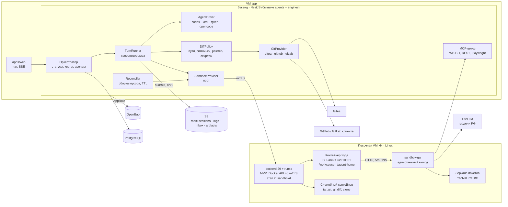

# Облачное исполнение CLI-агентов в Радити: исследование и архитектура

Данные на 26.09.2026. Версии взяты из GitHub Releases и `npm view` на эту дату. Файлы в репозитории не менял.

## 0. Выводы

1. Все облачные агенты (Codex cloud, Claude Code в облаке, Jules, Devin, Cursor, Copilot, OpenHands) устроены одинаково:
   - вычислительный узел одноразовый;
   - состояние хранится вне узла: ветка в git, журнал разговора и снимок окружения после setup-скрипта;
   - setup идёт с сетью и секретами, работа агента — с урезанной сетью и без секретов;
   - учётные данные git и API остаются снаружи, их подставляет прокси;
   - дифф и PR делает платформа, а не агент.

   Это и есть «как в облаке, а не на личном компьютере».
2. Главная поправка к spec §7: «одна задача — одна песочница» заменить на «одна задача — одна логическая сессия, контейнер — на один ход». Если агент ждёт ответа клиента (`awaiting_user`) или «Применить» (`awaiting_approval`), контейнер уже уничтожен, а сессия лежит в S3. Так же сделано в Claude Code: у простаивающей сессии ВМ забирают, а следующий ход поднимает новую ВМ и восстанавливает историю.
3. Для MVP подходит Docker Engine 29.8.1 + gVisor `runsc` (release-20260921.0) на обычной ВМ. У gVisor режим systrap не требует аппаратной и вложенной виртуализации. Это важно: в Yandex Compute Cloud вложенная виртуализация официально не поддерживается, поэтому Kata, Firecracker, E2B и CubeSandbox там возможны только на bare metal.
4. Управление в MVP — `DockerSandboxProvider` в бэкенде через dockerode 5.0.1. Локально он ходит в сокет Docker, в проде — в Docker API на песочной ВМ по mTLS. Позже его заменит небольшой демон `sandboxd` на песочных ВМ, порт `SandboxProvider` при этом не меняется. Kubernetes (agent-sandbox v1.0.4) и microVM на bare metal — вариант на потом.
5. Сессия хода = `sessions/<sessionId>/turns/<NNNN>/{workspace.tar.zst, home.tar.zst, manifest.json}`.
   - Архивы создаются и распаковываются внутри песочницы. Хост никогда не разбирает архив, который собрал агент.
   - Снимки хранятся по ходам, поэтому «Изменить» — это восстановление снимка хода n−1 и повторный запуск.
6. Git с учётными данными никогда не работает с `.git` из песочницы. Платформа забирает патч, накатывает его на чистый клон, проверяет политику диффа и секреты, затем коммитит и пушит от бота через `GitProvider` (Gitea, GitHub, GitLab).
7. Сеть песочницы в MVP — никакого интернета и DNS. Единственный выход — внутренний шлюз `sandbox-gw`: LiteLLM, MCP-шлюз и зеркала пакетов только на чтение. Presigned-ссылки S3 изнутри песочницы (spec §8, §14) — канал утечки: разрешив `storage.yandexcloud.net`, мы разрешаем писать в чужие бакеты. Файлы в песочницу и из неё переносит хост.
8. В spec §8 устарели несколько флагов и фактов, список в §8 этого отчёта. Главное:
   - у Kimi Code `-p` нельзя сочетать с `--yolo`;
   - Kimi и Qwen привязывают сессию к пути рабочего каталога;
   - Daytona OSS с июня 2026 не поддерживается.

---

## 1. Как устроены облачные агенты

| Продукт | Где исполняется | Окружение и кэш | Сеть | Секреты | Между ходами | Git и PR |
|---|---|---|---|---|---|---|
| **Codex cloud** | Контейнер на задачу, образ `universal` | Setup-скрипт, затем maintenance-скрипт на закэшированном контейнере; кэш «up to 12 hours», сбрасывается при смене скриптов, переменных или секретов | Setup — с интернетом; работа агента — по умолчанию без него; allowlist (None / Common dependencies / All), можно оставить только GET, HEAD, OPTIONS | Секреты «only available to setup scripts», удаляются перед работой агента | Кэш контейнера | Дифф и PR из UI |
| **Claude Code (облако)** | Изолированная ВМ на сессию: 4 vCPU, 16 ГБ, 30 ГБ | Setup-скрипт; если он укладывается примерно в 5 минут, делается снимок файловой системы, который живёт около 7 дней; «cache stores files only, not running processes» | None / Trusted / Full / Custom; весь трафик идёт через security proxy | Токен GitHub не попадает в ВМ: GitHub proxy подменяет учётные данные; agent proxy подставляет API-ключи «after each request leaves the session's VM» | Простаивающая ВМ отбирается; при следующем сообщении — «fresh VM with your conversation history restored», фоновые процессы не восстанавливаются | Ветка и PR через прокси |
| **Claude Code self-hosted** | Раннер у клиента забирает сессию из очереди с арендой | Образ раннера | Только исходящие соединения | Git-учётки даёт развёртывание | Heartbeat через опрос; примерно через 60 с без опроса сессия возвращается в очередь; `--release-idle-session-min` освобождает простаивающие сессии, и они продолжаются на новом раннере | — |
| **Jules** | «short-lived VM» с Ubuntu | Setup и «Run and Snapshot»; снимок переиспользуется | ВМ с сетью | — | Снимок окружения | PR в GitHub |
| **Devin** | ВМ из «machine snapshot»: репозитории, инструменты, файлы | Startup-команды на каждый запуск | — | — | Засыпает после простоя (~0,1 ACU); Outposts: песочница останавливается с сохранением файлов, при завершении удаляется | PR |
| **Cursor cloud agents** | Изолированные ВМ с Ubuntu | `.cursor/environment.json`: `install` при сборке Build, `start` и `terminals` (tmux) при запуске, `snapshot`, Dockerfile с кэшем слоёв | Ограничение доменов, Tailscale | Секреты — переменными окружения | «Running processes… don't continue» | Своя ветка, push |
| **Copilot cloud agent** | Одноразовая среда GitHub Actions | `copilot-setup-steps.yml`, таймаут не больше 59 минут; с апреля 2026 кастомные образы, старт на 20 % быстрее | Firewall со списком разрешённых по умолчанию; действует только на процессы агента из Bash, не на setup-шаги и не на MCP | Секреты окружения `copilot` | — | PR, заблокированные адреса пишутся в PR |
| **OpenHands** | Docker-контейнер на сессию, внутри REST-сервер исполнения | Слоистые теги образа (source, lock, versioned) | — | — | SDK: `DockerWorkspace`, `RemoteWorkspace`, pause и resume | — |

**Что берём себе**

- Две фазы. Сборка окружения идёт с сетью к зеркалам. Ход агента идёт без интернета и без долгоживущих секретов.
- Снимок окружения — это только файлы, с TTL и ключом из хеша (setup, lock-файлы, образ).
- Вычислительный узел одноразовый. Состояние — снимки хода в S3 плюс ветка у git-провайдера.
- Учётные данные снаружи. Ключи шлюзов, выданные на один ход, — сейчас; подстановка ключей прокси — позже.
- Разделение на управляющую часть и исполнителя: аренды, heartbeat, возврат в очередь, сборщик мусора.
- Коммит, PR и проверку диффа делает платформа. Заблокированные сетевые обращения показываем в отчёте хода.

---

## 2. Инфраструктура песочниц без внешних сервисов

| Технология | Лицензия, версия | Зрелость | KVM, bare metal | Холодный старт | Снимки | Сеть | Эксплуатация |
|---|---|---|---|---|---|---|---|
| **Docker + gVisor (`runsc`)** | Apache-2.0; release-20260921.0; Docker 29.8.1 | Production (GKE Sandbox и другие) | Не нужны: systrap «does not require hardware virtualization»; KVM-режим лучше на bare metal | Сотни мс, быстрее Kata и Firecracker ([arXiv 2110.11462](https://arxiv.org/pdf/2110.11462)); измерить в PoC | `runsc checkpoint/restore`; Docker восстанавливает только в тот же контейнер; нам хватает снимков файлов | netstack, Docker-сети, iptables | Низкая: apt-репозиторий, `runsc install`. С июля 2026 релиз состоит из нескольких файлов, автозагрузка отключается в конце сентября 2026 — ставить новым способом |
| **Kata Containers** | Apache-2.0; 4.2.0 (15.09.2026) | Production | «requires nested virtualization or bare metal» | Около 0,5–0,6 с (QEMU) | Шаблоны ВМ, ограниченно | CNI | Средняя и высокая, в основном через kata-deploy в K8s |
| **Firecracker** | Apache-2.0; v1.17.0 (10.09.2026) | Production (Lambda) | Нужен `/dev/kvm` | Около 125 мс | Полные снимки GA, diff — developer preview; сетевые соединения после восстановления не гарантированы | tap | Высокая: ядро, rootfs, jailer |
| **firecracker-containerd** | Apache-2.0, активен | Нишевый | KVM | Как у Firecracker | Нет | CNI | Высокая |
| **E2B runtime** (бывший `e2b-dev/infra`) | Apache-2.0; 2026.30 (10.09.2026); SDK `e2b` 2.51.0 | Production у E2B | Нужен Linux с KVM | Восстановление из снимка, без загрузки ядра | Pause и resume (память и диск в объектное хранилище), fork | Firewall и allowlist доменов на песочницу | Embed — один хост, но «evaluation package, not a production deployment pattern»; прод-развёртывание вне GCP и AWS не подтвердил |
| **CubeSandbox** (Tencent) | Apache-2.0 по README (GitHub показывает NOASSERTION — проверить LICENSE); v0.7.2 | Молодой, активный | x86_64 + KVM; вложенная виртуализация «not recommended» | Заявлено меньше 60 мс | Pause и resume между узлами через S3 | eBPF-фильтр исходящего трафика, L7-прокси с подстановкой учётных данных | Высокая; совместим с SDK E2B |
| **microsandbox** | Apache-2.0; v0.7.3 (npm 0.7.4) | «still beta software» | KVM (Linux) или Apple Silicon | Заявлено меньше 100 мс (на M1) | Fork и save/restore | Allowlist, «secrets never enter the VM» | Встраивается как библиотека (TS, Rust, Python, Go) |
| **Daytona OSS** | AGPL-3.0; последний релиз v0.190.0 | **Не поддерживается:** «As of June 2026… no further updates, fixes, or releases» | — | Заявлено меньше 90 мс | Снимки | Лимиты сети | Не брать |
| **kubernetes-sigs/agent-sandbox** | Apache-2.0; v1.0.4 (24.09.2026), API `v1beta1` | Ранний v1 | Нет своих требований; изоляцию даёт RuntimeClass (gVisor или Kata) | Зависит от runtime; есть пулы заранее запущенных песочниц | Pause и resume, постоянный том | NetworkPolicy кластера | Нужен K8s; CRD `Sandbox`, `SandboxTemplate`, `SandboxClaim`, `SandboxWarmPool`; SDK для Go и Python, для TS — через `@kubernetes/client-node` 2.0.0 |
| **OpenHands runtime** | MIT; v1.24.0, SDK v1.49.6 | Production у OpenHands | Нет (Docker) | Как у Docker | Pause и resume в SDK | Docker | Привязан к агенту OpenHands (Python); полезен как образец REST-сервера исполнения в контейнере |
| **Sysbox** | Apache-2.0; v0.7.1 (31.07.2026) | Стабилен | Нет (user namespace) | Как у runc | Нет | Docker | Общее ядро с хостом, изоляция слабее gVisor; пригодится только для Docker-in-Docker (стеки на Docker Compose, этап 3) |

**Вложенная виртуализация в российских облаках**

| Облако | ВМ с KVM внутри | Вывод |
|---|---|---|
| Yandex Cloud (Compute) | **Нет:** «Вложенная виртуализация не поддерживается из соображений безопасности» (FAQ) | На ВМ — только gVisor в режиме systrap. Для microVM — Yandex BareMetal |
| Cloud.ru | В Architecture Center описано включение: опция «Expose hardware-assisted CPU virtualization to guest OS» и заявка на MacLearning и Unknown Unicast Flooding. Судя по формулировкам, это облако на VMware (VDC); для Evolution Compute подтверждения не нашёл | Уточнить у поддержки |
| Selectel, Timeweb, VK Cloud | Публичного подтверждения для облачных ВМ не нашёл; выделенные серверы (bare metal) дают KVM | Уточнить; microVM — на выделенных серверах |

---

## 3. Headless-режим CLI-агентов и перенос сессий

| CLI (версия на 26.09) | Запуск без интерфейса | Где сессия и что упаковывать | Продолжение | Особенности для песочницы |
|---|---|---|---|---|
| **Codex CLI** `@openai/codex` 0.157.1 (+ `@openai/codex-sdk` 0.157.1) | `codex exec --json --output-schema f.json -o last.json`. `--json` пишет события JSONL: `thread.started` (с `thread_id`), `turn.started`, `item.*`, `turn.completed`, `turn.failed` | `$CODEX_HOME/sessions/YYYY/MM/DD/rollout-<ts>-<thread_id>.jsonl`. Имя файла самоописывающее, и ядро умеет продолжать сессию из любого пути к rollout-файлу — переносится между хостами | `codex exec resume <thread_id>`. SDK ставит флаги до `resume` | Внутри gVisor встроенную песочницу выключаем: `--dangerously-bypass-approvals-and-sandbox` (алиас `--yolo`), он «intended solely for… externally sandboxed» environments. **Не** использовать `--ephemeral`. `-p` у Codex — это `--profile`. В config: `check_for_update_on_startup=false`, `[analytics] enabled=false`, провайдер `wire_api="responses"` |
| **Kimi Code CLI** `@moonshot-ai/kimi-code` 2.1.1 (MIT, TypeScript, отдельный бинарник). Старый Python-пакет `kimi-cli` в архиве | `kimi -p "<задача>" --output-format stream-json`. Выход — сообщения Assistant и Tool в стиле OpenAI (`tool_calls`); размышления в JSONL не пишутся; служебное — в stderr | `$KIMI_CODE_HOME/sessions/<workDirKey>/<sessionId>/` и `session_index.jsonl`. `workDirKey = wd_<slug>_<sha256[:12]>` от пути рабочего каталога → путь должен быть всегда `/workspace/repo` | `--session <id>` или `-c` | **`-p` нельзя сочетать с `--yolo`, `--auto` и `--plan`**: в `-p` по умолчанию режим `auto`. Модель задаётся через `KIMI_MODEL_NAME`, `KIMI_MODEL_API_KEY`, `KIMI_MODEL_BASE_URL`, `KIMI_MODEL_PROVIDER_TYPE=openai` — без записи в config. Нужны `KIMI_DISABLE_TELEMETRY=1` (телеметрия включена по умолчанию) и отключённое автообновление. `rg` и `fd` положить в образ — иначе CLI их скачивает. Из архива сессии исключить `credentials/`, `logs/`, `bin/`, `updates/`. ID сессии в `-p` брать из `session_index.jsonl` |
| **Qwen Code** `@qwen-code/qwen-code` 0.24.6 | `qwen -p … --output-format stream-json`. Первое событие — `system/session_start` с `session_id`; в `result` — расход токенов | `~/.qwen/projects/<sanitized-cwd>/chats` — тоже зависит от пути | `--resume <id>` или `--continue` | `--approval-mode yolo`; лимиты `--max-wall-time`, `--max-tool-calls`, `--max-session-turns`; `QWEN_CODE_UNATTENDED_RETRY=1` |
| **OpenCode** `opencode-ai` 1.18.32 | `opencode run --format json` | Каталог данных XDG (`~/.local/share/opencode`); надёжнее `opencode export <id>` и `opencode import <file>` | `--session <id>` или `-c` | Права — через `OPENCODE_PERMISSION` (JSON) |

Во всех драйверах: пути фиксированные (`/workspace/repo`, `/agent-home/<driver>`), версия CLI закреплена дайджестом образа и записана в манифест снимка. Продолжать сессию можно только тем же образом; иначе — новая сессия с кратким содержанием прошлых ходов, как в spec §8.

---

## 4. Архитектура для Радити

### 4.1 Принципы

1. **Состояние — вне вычислений.** PostgreSQL (задачи, ходы, аренды), S3 (снимки ходов, логи, артефакты), git-провайдер (ветка и PR). Песочная ВМ может исчезнуть в любой момент.
2. **Контейнер на ход.** Задача — последовательность одноразовых контейнеров, связанных `sessionId`. `awaiting_user` и `awaiting_approval` не держат ресурсы.
3. **Недоверенные данные разбираются только внутри песочницы:** архивы, `.git`, вывод агента. Хост видит только поток байтов и патч.
4. **Доступы у агента — только на время хода.** Виртуальный ключ LiteLLM с бюджетом и TTL и MCP-токен задачи — в tmpfs. Учётных данных для git, S3 и Vault внутри нет.
5. **Агент-агностичность.** Ядро знает `AgentDriver`, `SandboxProvider`, `GitProvider`, `SiteAdapter`. Порты — в `packages/domain`, адаптеры — в `packages/agent-runtime`.

### 4.2 Компоненты



### 4.3 Где исполнять

| Вариант | Как | Плюсы | Минусы | Когда |
|---|---|---|---|---|
| **B. Docker Engine API по mTLS** (dockerode) | Бэкенд обращается к `dockerd` песочной ВМ на порт 2376 с `--tlsverify`; файрвол пускает только app-ВМ | Быстрее всего сделать; локально на Mac — тот же код через сокет | Ключ клиента = root на песочной ВМ («anyone with the keys… root access»); политику держит только код провайдера; архивы идут через бэкенд; в Docker API нет операции остановки exec — поэтому агент запускается главным процессом контейнера | **MVP**: PoC и пилот, одна песочная ВМ |
| **A. `sandboxd` — демон на песочной ВМ** | Небольшой сервис (gRPC или HTTP по mTLS, либо опрос задач по образцу раннеров Claude и Devin Outposts): создаёт только разрешённые спецификации, принудительно ставит `runsc`, держит git-зеркала и кэши, сам ходит в S3 по presigned-ссылкам, пишет вывод в файл с оффсетами | Узкий интерфейс вместо root-API; вывод можно перечитать после рестарта бэкенда; хосты добавляются без изменений в бэкенде | Свой код и его сопровождение | **Этап 2**: больше одной ВМ, параллельные задачи |
| **C. Kubernetes + agent-sandbox** | Управляемый K8s российского облака, RuntimeClass `gvisor`, `SandboxWarmPool`, pause и resume | Пулы, планировщик, масштабирование | Надо проверить, дают ли управляемые K8s в РФ поставить `runsc` на узлы; сложность; API пока `v1beta1` | **Этап 3** — при десятках одновременных задач |
| **D. microVM на bare metal** (E2B runtime или CubeSandbox по API E2B) | Выделенные серверы с KVM | Снимки памяти, fork, изоляция ядром ВМ, Docker внутри | Bare metal стоит дороже; прод-развёртывание E2B вне GCP и AWS не подтверждено; CubeSandbox молодой | Этап 3 — стеки с Docker Compose, строгая изоляция |

**Рекомендация.** Порт один. В MVP — адаптер B с жёстко зашитой политикой. На этапе 2 — адаптер A с тем же контрактом: `create`, `exec`, `attach(offset)`, `fs`, `snapshot`, `restore`, `destroy`. Если с первого дня нужно больше одной песочной ВМ — сразу делать A.

**Плотность** — оценка, не измерение: при лимите 4 ГБ на 64 ГБ помещается около 12 песочниц. CPU можно переподписывать, потому что агент большую часть хода ждёт модель.

### 4.4 Порт `SandboxProvider`

```ts
// packages/domain/src/agent-runtime/ports/sandbox-provider.ts
export type SandboxRuntime = 'runsc' | 'runc'            // из конфига SANDBOX_RUNTIME
export type SandboxId = string & { readonly __brand: 'SandboxId' }
export type ExecId = string & { readonly __brand: 'ExecId' }

export interface SandboxLabels {
  workspaceId: string; siteId: string; taskId: string; sessionId: string; turn: number
}

export interface SandboxProvider {
  readonly kind: 'docker' | 'sandboxd' | 'k8s-agent-sandbox' | 'e2b'
  create(spec: SandboxSpec, signal?: AbortSignal): Promise<Sandbox>
  /** Подхватить песочницу после рестарта или смены реплики оркестратора. */
  get(id: SandboxId): Promise<Sandbox | null>
  /** Для reconciler: найти сироты по меткам и TTL. */
  list(filter?: Partial<SandboxLabels>): Promise<SandboxInfo[]>
}

export interface SandboxSpec {
  image: string                                        // только с дайджестом: registry/raditi/sbx-wp@sha256:…
  labels: SandboxLabels
  runtime?: SandboxRuntime
  resources: { cpu: number; memoryMiB: number; pids: number; diskMiB: number } // 2 / 4096 / 512 / …
  user: { uid: number; gid: number }                   // не root
  readOnlyRootfs: true
  volumes: VolumeSpec[]
  env: Record<string, string>                          // без секретов
  secrets: SecretFile[]                                // tmpfs, только на ход, в снимок не попадают
  network: NetworkPolicy
  lifetime: { hardTimeoutMs: number; idleOutputTimeoutMs?: number }
}

export interface VolumeSpec {
  name: 'workspace' | 'home' | 'inbox' | 'out' | 'run'
  mountPath: string                                    // /workspace, /agent-home, /workspace/inbox, /workspace/out, /run/raditi
  readOnly?: boolean
  sizeMiB: number                                      // квота: XFS prjquota или tmpfs
}
export interface SecretFile { path: string; value: string; mode?: number }

export type NetworkPolicy =
  | { mode: 'none' }
  | { mode: 'gateway'; routes: Array<'llm' | 'mcp' | 'npm' | 'composer' | 'pypi'> } // MVP
  | { mode: 'allowlist'; rules: EgressRule[] }                                       // позже: SNI-прокси
export interface EgressRule { host: string; ports?: number[]; methods?: Array<'GET' | 'HEAD' | 'OPTIONS'> }

export interface Sandbox {
  readonly id: SandboxId
  readonly labels: SandboxLabels
  /** Главная команда хода (CLI-агент). Отмена = сигнал процессу. */
  run(spec: ExecSpec): Promise<ExecHandle>
  /** Короткие служебные команды: git diff, ls, cat. */
  exec(spec: ExecSpec): Promise<ExecHandle>
  /** Перечитать вывод с байтового оффсета после переподключения. */
  attach(execId: ExecId, fromOffset?: number): Promise<ExecHandle>
  readonly fs: SandboxFs
  snapshot(req: SnapshotRequest, signal?: AbortSignal): Promise<SnapshotManifest>
  restore(manifest: SnapshotManifest, sources: Record<string, BlobRef>, signal?: AbortSignal): Promise<void>
  pause?(): Promise<void>                              // тёплое окно, если адаптер умеет
  resume?(): Promise<void>
  destroy(reason: 'completed' | 'failed' | 'cancelled' | 'timeout' | 'gc'): Promise<void>
}

export interface ExecSpec {
  argv: string[]
  cwd?: string
  env?: Record<string, string>
  stdin?: Uint8Array | AsyncIterable<Uint8Array>
  timeoutMs: number
  killGraceMs?: number                                 // SIGTERM → пауза → SIGKILL
  signal?: AbortSignal
}
export interface ExecHandle {
  readonly id: ExecId
  output(): AsyncIterable<ExecChunk>                   // упорядоченно, с оффсетами
  kill(signal?: 'SIGTERM' | 'SIGKILL'): Promise<void>
  wait(): Promise<ExecExit>
}
export interface ExecChunk { stream: 'stdout' | 'stderr'; offset: number; data: Uint8Array; at: Date }
export interface ExecExit {
  code: number | null
  reason: 'exited' | 'timeout' | 'idle_timeout' | 'cancelled' | 'oom' | 'lost'
}

export interface SandboxFs {
  read(path: string, opts?: { maxBytes?: number }): Promise<Uint8Array>
  write(path: string, data: Uint8Array | AsyncIterable<Uint8Array>, opts?: { mode?: number; mkdirp?: boolean }): Promise<void>
  remove(path: string, opts?: { recursive?: boolean }): Promise<void>
  list(path: string, opts?: { recursive?: boolean; maxEntries?: number }): Promise<FileEntry[]>
  stat(path: string): Promise<FileEntry | null>
  upload(destDir: string, from: BlobRef): Promise<void>          // хост скачивает по presigned GET и кладёт внутрь
  download(path: string, to: BlobTarget): Promise<BlobInfo>      // хост забирает и отдаёт по presigned PUT
}
export interface FileEntry { path: string; type: 'file' | 'dir' | 'symlink'; size: number; mode: number; mtime: Date }
export interface BlobRef { url: string; sha256?: string; sizeBytes?: number }
export interface BlobTarget { url: string; maxBytes: number }
export interface BlobInfo { sha256: string; sizeBytes: number }

export interface SnapshotRequest {
  parts: Array<{
    name: 'workspace' | 'home'
    root: string                                       // /workspace или /agent-home
    include?: string[]; exclude?: string[]             // из SiteAdapter и AgentDriver
    target: BlobTarget
  }>
  compression: { algo: 'zstd'; level: number }
  encryption?: { keyId: string; dataKey: Uint8Array; wrappedKey: string } // Vault Transit datakey
  limits: { maxBytes: number; maxFiles: number }
}
export interface SnapshotManifest {
  sessionId: string; turn: number; createdAt: string
  image: string                                        // дайджест: продолжаем только тем же образом
  driver: { id: string; version: string; nativeSessionId?: string; workdir: '/workspace/repo' }
  git?: { provider: 'gitea' | 'github' | 'gitlab'; baseSha: string; branch: string }
  parts: Array<{
    name: string; key: string; sha256: string; sizeBytes: number; files: number
    format: 'tar.zst'; encryption?: { keyId: string; wrappedKey: string }
  }>
}
```

**Изменения в `AgentDriver` из spec §8**

```ts
interface AgentDriver {
  // …поля из spec §8
  prepare(ctx: RunContext): Promise<PreparedRun>        // files: config.toml, AGENTS.md, mcp-конфиг; env; secrets
  command(run: PreparedRun, turn: TurnInput): string[]  // codex exec … resume <id> | kimi -p … --session <id>
  parseEvent(line: string): AgentEvent[]                // одна строка может дать несколько событий
  sessionState(run: PreparedRun): { root: string; include: string[]; exclude: string[] } // что попадёт в home.tar.zst
  locateNativeSession?(fs: SandboxFs, run: PreparedRun): Promise<string | null> // Kimi: session_index.jsonl
}
```

### 4.5 Супервизор хода (`TurnRunner`)

```mermaid
sequenceDiagram
  participant O as Оркестратор
  participant T as TurnRunner
  participant P as SandboxProvider
  participant S as S3
  participant G as GitProvider
  O->>T: runTurn(task, ход n), аренда в PostgreSQL
  T->>P: create(образ стека, 2 vCPU/4 ГБ, сеть gateway)
  alt есть снимок хода n−1
    T->>S: presigned GET workspace и home
    T->>P: restore: распаковка внутри песочницы от uid 10001
  else первый ход
    T->>G: короткий токен только на чтение
    T->>P: клон base в /workspace/repo (служебный контейнер)
  end
  T->>P: fs.write: конфиг драйвера, AGENTS.md, файлы клиента; секреты хода в tmpfs
  T->>P: run(driver.command), таймаут 20 мин
  P-->>T: JSONL → AgentEvent → БД, S3-чанки, шина → SSE
  T->>P: exec git diff --binary base → патч (недоверенный)
  T->>P: snapshot → S3 turns/n
  T->>P: destroy (или pause на тёплое окно)
  T->>G: чистый клон base, git apply, DiffPolicy, gitleaks, коммит и push от бота, PR
  T-->>O: итог хода (zod), новый статус
```

**Что делает супервизор**

1. **Размещение.** Выбирает хост со свободным слотом (слоты с арендой в PostgreSQL) и пишет строку `sandbox_runs`: host, containerId, execId, оффсет вывода, heartbeat. Если реплика упала, другая перехватывает аренду и вызывает `attach(execId, offset)` — как у раннеров Claude: без heartbeat около 60 с работа возвращается в очередь.
2. **Клон.** Делает его служебный шаг с укреплённым git: `GIT_CONFIG_NOSYSTEM=1`, `-c core.hooksPath=/dev/null`, `-c protocol.file.allow=never`, `--no-recurse-submodules`. Токен git-провайдера живёт только в этом шаге. Этап 2: локальные зеркала `git clone --mirror` на песочной ВМ и `--reference`.
3. **Ход.** CLI запускается **главным процессом контейнера** (tini в роли PID 1): отмена = `docker stop -t 10`, код выхода — через `wait`. Вывод дублируется в файл на томе `/run/raditi/events.jsonl`, чтобы после переподключения читать с оффсета. Лимиты: жёсткий таймаут 20 минут; тишина в выводе дольше N минут — остановка.
4. **Дифф.** `git diff --binary --full-index <baseSha>` и `git status --porcelain=v2 -z` выполняются **внутри** песочницы; результат считается недоверенными данными.
5. **Публикация** — только на доверенной стороне: свежий клон по `baseSha` → `git apply --index --binary` → проверки `DiffPolicy`:
   - запрещённые пути: `.gitea/`, `.github/`, `.gitlab-ci.yml`, `.gitlab/`, `.forgejo/`, `.woodpecker*`, `.drone.yml`, `Jenkinsfile`, `bitbucket-pipelines.yml`, `.circleci/`, `.gitmodules`, плюс `SiteAdapter.protectedPaths()` — `wp-config.php`, `wp-admin/`, `wp-includes/`, у Bitrix `/bitrix/`;
   - новые симлинки, сабмодули и смена прав на исполнение запрещены;
   - лимиты на размер файла и число файлов; больше 20 объектов — через `request_approval`;
   - поиск секретов — gitleaks v8.30.1;
   - затем коммит от бота с трейлером `Raditi-Task:` и `GitProvider.pushBranch()` / `openPullRequest()`.

   С `.git` агента учётные данные не встречаются: хуки, `core.fsmonitor` и `core.sshCommand` из него не исполняются.
6. **Итог.** `extractResult` → zod-схема итога хода; `client_message` проверяется и уходит клиенту. Артефакты из `/workspace/out` уходят в `raditi-artifacts` с лимитами по типу и размеру.
7. **Сборщик мусора** (reconciler) раз в минуту: контейнеры и тома без живой аренды или старше TTL удаляются; снимки чистят правила жизненного цикла бакета.

**Как ложится на статусы задачи:**

- `preparing` — размещение, восстановление снимка или клон, запись конфигов;
- `running` — контейнер хода работает;
- `awaiting_user`, `awaiting_approval`, `deploying`, `verifying` — контейнера нет;
- «Изменить» — восстановление хода n−1;
- `cancelled` и `failed` — `destroy`, снимок хранится 7 дней для разбора.

### 4.6 Сессии и снимки

- Ключи: `raditi-sessions/sessions/<sessionId>/turns/<NNNN>/workspace.tar.zst`, `…/home.tar.zst`, `…/manifest.json`. Манифест пишется последним, указатель на последний ход — в БД.
- `workspace.tar.zst` — весь `/workspace/repo` вместе с `.git`, поэтому удалённые файлы восстанавливаются сами. Исключения — из `SiteAdapter.snapshotExcludes()`: `node_modules`, `vendor`, кэши. Этап 2: база как зеркало git по `baseSha` плюс дельта (`git bundle` + неотслеживаемые файлы).
- `home.tar.zst` — только `driver.sessionState()`, без учётных данных, глобальных логов и бинарников.
- Архивы создаёт `tar --zstd` внутри песочницы, поток идёт через хост в S3. Лимиты `maxBytes` и `maxFiles` защищают от архивных бомб.
- Шифрование на стороне платформы — ключом данных из Vault Transit (`transit/datakey/…/ws-<wsId>`), как в spec §14.
- Хранение: последние K ходов, первый ход и ход перед «Применить»; 30 дней после закрытия задачи.

### 4.7 Образы и кэши

- **MVP.** Один базовый образ на стек: `sbx-wordpress` = PHP CLI, Composer, Node LTS, git, `rg`, `fd`, `jq`, `tini` и все CLI агентов с закреплёнными версиями. Образ хранится по дайджесту в реестре Gitea и заранее скачан на песочные ВМ. Для WordPress-тем сборка зависимостей обычно не нужна.
- **Этап 2.** Образ окружения сайта `env/<siteId>:<sha256(базовый образ + setup + lock-файлы)>`. Собирается BuildKit или `docker commit` после setup в `runsc` с сетью только к зеркалам. TTL около 7 дней, как в Claude; пересборка при смене хеша. Кэш зависимостей — отдельный том на сайт, при сборке на запись, в ходе агента не подключается. Общих кэшей на запись между клиентами нет: они открывают путь к отравлению кэша.
- **Зеркала.** Собственные, только на чтение: Verdaccio с запретом `publish` для npm и прокси для Composer. Разрешить `registry.npmjs.org` напрямую = разрешить `npm publish` с токеном злоумышленника.

### 4.8 Сеть и безопасность

**Изоляция контейнера**

- `--runtime=runsc` (на облачных ВМ — systrap);
- `--read-only`, tmpfs для `/tmp` и `/run/raditi`;
- `--user 10001:10001`, `--cap-drop=ALL`, `--security-opt no-new-privileges`;
- `--pids-limit 512`, `--memory 4g --memory-swap 4g`, `--cpus 2`;
- без сокета Docker; тома только этой сессии.

Rootless dockerd вместе с `runsc` имеет ограничения (у `runsc --rootless` нет netstack и save/restore). Поэтому в MVP: dockerd с правами root, непривилегированный пользователь в контейнере, границу держит gVisor. Rootless dockerd — после PoC.

**Сеть**

- Отдельная `internal`-сеть на песочницу. После исправления CVE-2024-29018 (Moby 26.0.0+) internal-сети не пересылают DNS наружу.
- DNS внутри не нужен: `--add-host gw.sandbox:<ip>`, базовые URL LiteLLM, MCP и зеркал указывают на `sandbox-gw`. Это Caddy, Envoy или Nginx, маршрутизация по путям; обходить поддержку `HTTP_PROXY` в CLI не требуется.
- Если позже понадобится публичный интернет — Envoy с SNI-allowlist или smokescreen (MIT, ACL по роли через mTLS). Нужно помнить, что каждый общий хост (github.com, S3-эндпоинт) — канал утечки.

**Доступы**

- Виртуальный ключ LiteLLM на задачу: `max_budget`, TTL, отзыв после хода.
- MCP-токен ограничен сайтом и задачей.
- Позже: подстановка ключей на `sandbox-gw` — внутри песочницы только заглушка, как `proxy-injected` у Claude.

**MCP-шлюз**

- `browser_*` открывает только домен сайта клиента. Иначе агент выведет данные через Playwright, открыв URL злоумышленника.
- Список WP-CLI по-прежнему белый.

**Хост**

- На песочной ВМ нет секретов платформы.
- Входящие соединения — только с app-ВМ (2376 или порт `sandboxd`); исходящие — только к S3, Gitea и зеркалам.
- Обновления ядра, аудит в Loki.

**Цепочка поставок**

- CLI и образы закреплены по дайджесту.
- Автообновления и телеметрия выключены в config и env.
- Обновление CLI — через eval-набор из spec §21.

### 4.9 Разработка на macOS

- Тот же `DockerSandboxProvider` через локальный сокет (Docker Desktop, OrbStack или Colima), `SANDBOX_RUNTIME=runc`.
- Профиль compose `--profile sandbox`: `sandbox-gw`, Verdaccio, internal-сеть.
- Вместо bind-каталогов — именованные тома: на Mac у bind-каталогов проблемы с правами и скоростью.
- Изоляцию под `runsc` проверять в Linux-ВМ (Lima, OrbStack) или на dev-сервере. Интеграционные тесты провайдера — в GitHub Actions на Ubuntu с `runsc install` (systrap не требует KVM; работу на раннерах GitHub проверить).

---

## 5. MVP и что позже

| Область | MVP (PoC и пилот) | Этап 2 | Этап 3 |
|---|---|---|---|
| Runtime | Docker 29 + gVisor systrap | То же, несколько ВМ | K8s + agent-sandbox или microVM на bare metal |
| Управление | dockerode → Docker API по mTLS | `sandboxd`: опрос задач, оффсеты, S3 напрямую, git-зеркала | CRD `Sandbox`, `SandboxWarmPool` или SDK E2B к своему E2B или CubeSandbox |
| Жизненный цикл | Контейнер на ход, без тёплого окна | Тёплое окно 5–10 минут через `pause` (проверить с `runsc`) | Пулы заранее запущенных песочниц |
| Сессии | workspace.tar и home.tar по ходам | База + дельта (`git bundle`) | Снимки памяти (Firecracker, E2B) при необходимости |
| Сеть | `sandbox-gw` без интернета | Подстановка ключей на шлюзе | SNI-allowlist для документации |
| Образы | Базовый образ на стек | Образы окружений сайтов, TTL 7 дней | Docker-in-sandbox для стеков на Docker Compose |
| Git | `GitProvider`: Gitea + GitHub App + GitLab; патч → чистый клон | Зеркала | — |

---

## 6. Риски

| Риск | Вероятность | Что делаем |
|---|---|---|
| gVisor замедляет работу с множеством файлов (`npm install`, `git status` на больших репозиториях) | Средняя | Замер в PoC; directfs (включён по умолчанию); зависимости — в образе, а не в ходе |
| CLI ломается под gVisor или без сети: встроенная песочница Codex (Landlock, seccomp), автообновления, скачивание `rg` | Средняя | Выключить встроенные песочницы, автообновление и телеметрию; положить `rg` и `fd` в образ; прогнать PoC на каждом драйвере |
| Формат сессии меняется с версией CLI — продолжение ломается | Высокая со временем | Дайджест образа в манифесте; продолжать тем же образом; иначе краткое содержание ходов |
| Kimi и Qwen привязывают сессию к пути | Высокая, если забыть | Всегда `/workspace/repo`; тест продолжения в новой песочнице |
| Docker API = root на песочной ВМ | Средняя | mTLS, файрвол, отдельная сеть; переход на `sandboxd` |
| Утечка через разрешённые адреса (S3, публичные реестры, MCP-браузер) | Средняя | Никакого S3 изнутри; зеркала только на чтение; браузер — только домен сайта; проверка диффа и секретов |
| Разбор архивов или `.git` агента на хосте | Средняя | Архивы и git — внутри песочницы; публикация из чистого клона |
| Контейнеры-сироты и переполнение диска | Средняя | Метки, аренды, reconciler, квоты XFS |
| Нет вложенной виртуализации (Yandex) — microVM недоступны | Факт | gVisor на ВМ; microVM — только с бюджетом на bare metal |
| Проект-основа закроется, как Daytona OSS | Низкая и средняя | Опора на простые компоненты (Docker, runsc) и свой порт; платформы — только за адаптером |
| Две задачи правят один сайт одновременно — конфликт при merge | Средняя | Публикация на свежем base с rebase; при конфликте — новый ход или очередь задач по сайту |

---

## 7. Что проверить в PoC

- [ ] Codex, Kimi, Qwen и OpenCode под `runsc` (systrap) на ВМ Yandex Cloud: ход, `resume` в **новом** контейнере из `home.tar.zst` по фиксированному пути.
- [ ] Codex: порядок флагов `exec --json --output-schema … resume <id>` (как в `@openai/codex-sdk`); что ещё в `$CODEX_HOME` нужно для продолжения, кроме `sessions/`.
- [ ] Kimi: `-p --session <id> --output-format stream-json`; ID сессии из `session_index.jsonl`; поля расхода токенов в выводе.
- [ ] Время: создание контейнера под `runsc`, восстановление 20–100 МБ из S3, клон, `git diff`; `npm` и `composer` под gVisor.
- [ ] Видит ли хост через `docker cp` изменения в оверлее корневой ФС gVisor (`--overlay2=root:self`). Если нет — все данные только на томах.
- [ ] `docker pause` / `unpause` с `runsc` для тёплого окна.
- [ ] Internal-сеть: нет DNS, нет выхода наружу, `sandbox-gw` работает; журнал заблокированных обращений.
- [ ] Публикация патча: запрещённые пути, симлинки, сабмодули, gitleaks; push в Gitea, GitHub и GitLab.
- [ ] Российские облака: вложенная виртуализация в Cloud.ru Evolution, Selectel и Timeweb — запрос в поддержку.

## 8. Что поправить в spec (файлы не менял)

1. **§7, §8.** «Одна задача — одна песочница» → «одна задача — одна сессия, контейнер на ход». В снимок входит и `workspace.tar.zst`, не только `home`. Ключи — по ходам: `sessions/<sessionId>/turns/<NNNN>/…`.
2. **§8, Kimi.**
   - `--yolo` с `-p` не работает: в `-p` режим `auto` по умолчанию.
   - Пакет — `@moonshot-ai/kimi-code` 2.1.1; старый Python `kimi-cli` в архиве.
   - Нужны `KIMI_DISABLE_TELEMETRY=1` и модель через `KIMI_MODEL_*`.
3. **§8, Codex.** Вместо `--sandbox danger-full-access` — `--dangerously-bypass-approvals-and-sandbox`: оно выключает и подтверждения. Не использовать `--ephemeral`. Отключить проверку обновлений и аналитику.
4. **§8, §14.** Presigned-ссылки S3 внутри песочницы убрать: файлы кладёт и забирает хост.
5. **§8.** Пути `/workspace/repo` и `/agent-home` фиксированы: от них зависят сессии Kimi и Qwen.
6. **§8, §10.** Коммит и пуш — только из чистого клона на доверенной стороне через `GitProvider`. Список запрещённых путей расширить на `.github/`, `.gitlab-ci.yml` и другие CI.
7. **§5, §19.** Строка «Песочница» в таблице компонентов: Docker 29 + gVisor (systrap), управление по mTLS, позже `sandboxd`. Kata и Firecracker на ВМ Yandex Cloud невозможны: там нет вложенной виртуализации.

---

## Источники

**Облачные агенты**
- Codex cloud: [окружения](https://learn.chatgpt.com/docs/environments/cloud-environment), [доступ в интернет](https://learn.chatgpt.com/docs/cloud/internet-access), [неинтерактивный режим](https://learn.chatgpt.com/docs/non-interactive-mode); исходный код: [openai/codex](https://github.com/openai/codex) — rollout recorder, `sdk/typescript/src/exec.ts`, `shared_options.rs`, `exec-server/README.md`.
- Claude Code: [облачные сессии](https://code.claude.com/docs/en/claude-code-on-the-web), [облачные окружения](https://code.claude.com/docs/en/cloud-environments), [self-hosted](https://code.claude.com/docs/en/self-hosted-environments).
- Jules: [окружение](https://jules.google/docs/environment/), [снимки окружения](https://jules.google/docs/changelog/2025-08-05/).
- Devin: [настройка репозитория](https://docs.devin.ai/onboard-devin/repo-setup), [Outposts на Daytona](https://www.daytona.io/docs/en/guides/devin/devin-outposts/).
- Cursor: [cloud agents](https://cursor.com/docs/cloud-agent), [настройка окружения](https://cursor.com/docs/cloud-agent/setup).
- Copilot: [окружение агента](https://docs.github.com/en/copilot/how-tos/use-copilot-agents/coding-agent/customize-the-agent-environment), [firewall](https://docs.github.com/en/copilot/how-tos/use-copilot-agents/coding-agent/customize-the-agent-firewall), [кастомные образы, апрель 2026](https://github.blog/changelog/2026-04-27-copilot-cloud-agent-starts-20-faster-with-actions-custom-images/).
- OpenHands: [runtime](https://docs.openhands.dev/openhands/usage/architecture/runtime), [software-agent-sdk](https://github.com/OpenHands/software-agent-sdk).

**Песочницы**
- gVisor: [платформы](https://gvisor.dev/docs/architecture_guide/platforms/), [checkpoint/restore](https://gvisor.dev/docs/user_guide/checkpoint_restore/), [файловая система](https://gvisor.dev/docs/user_guide/filesystem/), [rootless](https://gvisor.dev/docs/user_guide/rootless/), [установка](https://gvisor.dev/docs/user_guide/install/), [релизы](https://github.com/google/gvisor/releases).
- Kata Containers: [релиз 4.2.0](https://github.com/kata-containers/kata-containers/releases/latest), [установка](https://github.com/kata-containers/kata-containers/blob/main/docs/install/README.md).
- Firecracker: [снимки](https://github.com/firecracker-microvm/firecracker/blob/main/docs/snapshotting/snapshot-support.md); [firecracker-containerd](https://github.com/firecracker-microvm/firecracker-containerd).
- [E2B runtime](https://github.com/e2b-dev/runtime) · [CubeSandbox](https://github.com/TencentCloud/CubeSandbox) · [microsandbox](https://github.com/superradcompany/microsandbox) · [Daytona (уведомление в README, AGPL-3.0)](https://github.com/daytonaio/daytona) · [agent-sandbox](https://github.com/kubernetes-sigs/agent-sandbox) · [Sysbox](https://github.com/nestybox/sysbox).
- Сравнение изоляции: [arXiv 2110.11462](https://arxiv.org/pdf/2110.11462).
- Docker: [релизы Engine](https://docs.docker.com/engine/release-notes/), [защита сокета](https://docs.docker.com/engine/security/protect-access/), [CVE-2024-29018](https://explore.alas.aws.amazon.com/CVE-2024-29018.html).
- [smokescreen](https://github.com/stripe/smokescreen) · [gitleaks v8.30.1](https://github.com/gitleaks/gitleaks/releases/latest).

**Российские облака**
- [FAQ Yandex Cloud о вложенной виртуализации](https://github.com/yandex-cloud/docs/blob/master/ru/_qa/compute/vm.md).
- [Cloud.ru: вложенная виртуализация](https://cloud.ru/docs/architecture-center/topics/templates__ent/templates__ent_other-tools_using-nested-virtualization.html).

**CLI агентов**
- Kimi Code: [команда `kimi`](https://moonshotai.github.io/kimi-code/en/reference/kimi-command.html), [расположение данных](https://github.com/MoonshotAI/kimi-code/blob/main/docs/en/configuration/data-locations.md), [переменные окружения](https://github.com/MoonshotAI/kimi-code/blob/main/docs/en/configuration/env-vars.md), [файлы конфигурации](https://github.com/MoonshotAI/kimi-code/blob/main/docs/en/configuration/config-files.md).
- [Qwen Code: headless](https://qwenlm.github.io/qwen-code-docs/en/users/features/headless/) · [OpenCode CLI](https://opencode.ai/docs/cli/).
- Версии пакетов — `npm view` от 26.09.2026: `@openai/codex` 0.157.1, `@moonshot-ai/kimi-code` 2.1.1, `@qwen-code/qwen-code` 0.24.6, `opencode-ai` 1.18.32, `dockerode` 5.0.1, `e2b` 2.51.0, `@kubernetes/client-node` 2.0.0.

Контекст проекта: `docs/spec.md` (§5, §7, §8, §13–15, §18–20), `CLAUDE.md`.