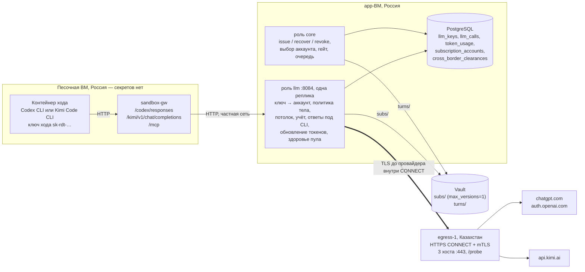

# P3. Шлюз подписок Codex и Kimi: проектное решение и план работ

> Проект утверждён владельцем 28.09.2026 и лежит здесь как основание этапа P3. Вопросы раздела 17 приняты с ответами по умолчанию и ждут подтверждения владельца. Правила и архитектура, обязательные для кода, — в `CLAUDE.md`, `docs/spec.md` и `docs/plan/roadmap.md`: если проект с ними разойдётся, верны они. Исследования и ревью, на которых он построен, — [README.md](README.md).

Редакция 2 от 28.09.2026, уточнения локального ревью от 29.09.2026 (единицы резерва, параллельные вызовы, окна пула, вывод аккаунта, платное продолжение и границы P3.0), ветка `codex/p3-llm-gateway`. Пути даны от корня репозитория, пути `codex-rs/…` — от тега Codex `rust-v0.158.0` (064c6b8), пути `packages/…` Kimi — от `@moonshot-ai/kimi-code@2.1.1` (f67e639). Все ссылки проверены 28.09.2026.

Редакция 2 заменяет редакцию 1 этого проекта. Она учитывает три ревью от 28.09.2026: безопасность токенов, право и данные, эксплуатация и деньги. Прежний проект P3 на LiteLLM ([p3-litellm-design.md](p3-litellm-design.md)) остаётся историей; что из него берётся — раздел 5.6.

Основание — решения владельца от 28.09.2026:
1. Две оболочки: Codex CLI на подписке ChatGPT и Kimi Code CLI на подписке Kimi Code.
2. Личные подписки в пуле аккаунтов. Риск блокировки за нарушение условий и риск лимитов владелец принимает.
3. Правило 1 меняется: код, тексты и сообщения клиента уходят в OpenAI (США) и Moonshot (КНР). Хранилища платформы остаются в России.
4. GigaChat убирается.
5. Весь диалог с клиентом идёт внутри сессий Codex и Kimi. Отдельных вызовов роутера и классификатора нет.
6. Потолки себестоимости попытки на тарифах с квотой — 135, 285 и 735 ₽ — остаются. P3 закрывается после проверки владельца на настоящих подписках.

## Что изменилось после ревью

| Замечание | Решение | Раздел |
| --- | --- | --- |
| Песочница выводит аккаунты и оболочку из пула через сигналы в теле ответа (401 Kimi за тариф, 403 WAF, три обрыва) | Классификация только по статусу и структурным кодам. Аккаунт понижается только после проверочного запроса шлюза без содержимого. Размыкатель — по аккаунту, в базе, считает только штатно завершённые ответы | 2.5, 3.8, 4.1 |
| Опасное содержимое разносится по пулу перепривязкой | Сигнал `policy_flagged`: задача `failed` и оператору, без перепривязки. После `suspended` 24 часа без автоматической перепривязки | 2.5, 7 (P12, M7) |
| Краевые случаи обновления токенов Codex | Сначала сверка с Vault, нижняя граница интервала, запись в Vault без ограничения повторов, полная классификация ответов `/oauth/token`, импорт под тем же замком и только тот же аккаунт | 2.4 |
| История токенов в Vault, нет отзыва | Отдельный mount `subs/` с `max_versions=1` и `cas_required` на mount. Политика `subscriptions-admin`, процедура вывода с `oauth/revoke` | 2.4 |
| Права PostgreSQL не работают с `FOR UPDATE`, web получает DML на новые таблицы | Выбор аккаунта — под advisory lock без `FOR UPDATE`. У роли `llm` — UPDATE только на служебные колонки. Отзыв у `raditi_app` в миграции и в `init-roles.sh` | 2.5, 10 |
| Взаимоблокировка при выборе аккаунта | `pg_advisory_xact_lock` по оболочке | 2.5 |
| Ключ хода не привязан к ВМ | `llm_keys.bound_source`, не больше 2 запросов на ключ, простой потока | 3.2 |
| Ошибки шлюза не совпадают с повторами CLI | Ответы под каждый CLI: кратковременное — 503 с `Retry-After` до 30 с, окончательное — код, который CLI не повторяет. Причину отказа `core` читает из базы | 3.3 |
| Проверка владельца без изоляции | Отдельный процесс роли `llm` с AppRole, одноразовый OpenBao с новым root-токеном, CLI только в контейнерах, после проверки — отзыв токенов | 9 |
| Резерв съедает потолок heavy, Astra не помещается в 735 ₽ | `R_out` по модели, ρ по попытке, картинки и `encrypted_content` не считаются байтами, ключ — только при бюджете не меньше резерва первого вызова. heavy — Sol с высоким уровнем рассуждения, Astra — только после P15 | 4.3, 17 |
| Учётная цена плавает с курсом и непроверяема для клиента | Учётная ставка — собственная опубликованная ставка платформы, утверждается раз в квартал | 4.2, 4.4 |
| Реальные деньги уходят через кредиты и Extra Usage | Чек-лист аккаунта, алерт на баланс кредитов, окно 100% считается охлаждением | 2.5, 6.3 |
| Юнит-экономика от мощности, а не от загрузки | Расчёт от загрузки, точка безубыточности, пример пилотного пула, две себестоимости | 4.5 |
| Ожидание пула без срока держит резерв | Не больше 24 часов, затем отмена с возвратом. Срок резерва продлевается | 2.6 |
| Закрытие учёта при сбое базы, сборщик только в `llm` | Повтор закрытия до 10 минут, резервный сборщик в `core` | 4.1 |
| `egress-1` — единая точка отказа, замедление после 16 КБ | Проба `/probe` больше 16 КБ, второй узел до первого клиента (M10) | 3.7, 8 |
| Схема A не проверена, а на ней 15 коммитов | Разведка P3.0 на настоящем Codex до кода | 0.1 |
| ПД третьих лиц с сайтов уходят в США и КНР | Правило «ПД третьих лиц агенту не передаются», меры в P6 и M2, приложение 3 оферты — до P6 | 6.1, 7 |
| Гейт 152-ФЗ не проверяется кодом, порядок уведомлений неполон | `cross_border_clearances` и `workspaces.data_class`, `issue` без записи отказывает. Ст. 22 — до регистрации в проде | 6.2 |
| Получатель в Kimi не установлен | Юрлицо — по фактической покупке и условиям. До заключения юриста `kimi-code` на реальных данных выключен | 6.2, 6.6 |
| Ложные утверждения остаются в юридических текстах и на лендинге | Добавлены `privacy-policy.md:267,273,342`, `consent.md:127,131`, `public-offer.md:386,421,427,429`, `landing.dc.html:924,970` | 6.6 |

Что отклонено и почему — раздел 18.

## 0. Решения коротко

1. **Оболочки.** В продукте две:
   - `openai-chatgpt` — Codex CLI на бэкенде ChatGPT Codex;
   - `kimi-code` — Kimi Code CLI на `/coding/v1`.

   Код Qwen Code и OpenCode из P1 остаётся, но выключен. Идентификаторы `gigacode` и `sourcecraft` удаляются.
2. **Шлюз подписок — четвёртая роль оркестратора `llm`.** Отдельный процесс на app-ВМ, порт 8084 на `APP_PRIVATE_IP`, **одна реплика**: обновление токенов — единственный писатель в процессе. Токены подписок читает и обновляет только эта роль.
   - `sandbox-gw` остаётся простым: пути и заголовки. Он работает на песочной ВМ, где секретов платформы нет (`docs/spec.md:1009`, `:848`).
   - Формулировка «ключ подставляет `sandbox-gw`» (`docs/spec.md:406`, `packages/db/prisma/schema.prisma:916`) исправляется.
3. **Ключ хода** — из прежнего проекта: `sk-rdt-…`, запись в Vault `turns/` один раз, строка в `llm_keys` с хешем. Проверяет наша таблица.
   - Ключ действует, пока не отозван и `clock_timestamp() < expires_at`.
   - Ключ закреплён за аккаунтом пула; `recover` восстанавливает эту привязку.
   - В режиме раннера ключ привязан к адресу ВМ, которая забрала ход (`bound_source`).
   - Не больше 2 одновременных запросов на ключ.
4. **Пул.**
   - `status` (оператор: `active`, `banned`, `retired`) и `health` (шлюз: `ok`, `needs_relogin`, `suspended`) — разные колонки с разными правами.
   - Выбор аккаунта — в `core` под `pg_advisory_xact_lock` по оболочке.
   - Задача закреплена за аккаунтом (`task_account_bindings`): у Codex зашифрованные рассуждения привязаны к аккаунту.
   - По умолчанию одновременно: Codex — 1 ход и 2 запроса на аккаунт, Kimi — 2 хода и 3 запроса. Уточняет PoC.
   - Перед ходом нужен запас окна не меньше ожидаемого расхода хода.
5. **Обновление токенов** — только для OAuth Codex.
   - Один писатель: advisory lock, отметка `refresh_started_at`, CAS в Vault.
   - Первым шагом — сверка версии в Vault с базой.
   - Не чаще раза в 6 часов, кроме 401.
   - Неясный исход не повторяется: повтор грозит `refresh_token_reused`, то есть отзывом всей цепочки. Аккаунт работает на текущем токене до срока, оператор получает алерт «войти заново».
   - У Kimi — API-ключ из консоли, обновлять нечего.
6. **Vault.** Токены — в отдельном mount `subs/` (KV v2, `max_versions=1`, `cas_required=true` на mount). Истории потраченных токенов нет. Вывод аккаунта — `oauth/revoke`, затем `destroy`.
7. **Выход наружу — зарубежная ВМ `egress-1`**, по умолчанию в Казахстане.
   - HTTPS CONNECT-прокси с mTLS и точным белым списком из трёх хостов на :443; проба `/probe` проверяет канал из России больше 16 КБ.
   - TLS идёт от шлюза прямо до провайдера. Тела и токены на ВМ не расшифровываются и не пишутся.
   - ⚠ **Эта ВМ нужна до разведки P3.0**, второй узел в другой стране — до первого клиента (M10).
8. **Сигналы провайдера** разбираются только по статусу и структурным кодам.
   - Понизить аккаунт или закрыть выход можно только после проверочного запроса шлюза без содержимого (`/wham/usage`, `/usages`).
   - Отказ по содержанию (`cyber_policy`, «high risk») — `policy_flagged`: ошибка задачи без перепривязки, задача уходит оператору.
9. **Ответы шлюза подобраны под повторы CLI.** Кратковременное — 503 с `Retry-After` до 30 с: оба CLI повторяют. Окончательное — код, который CLI не повторяет. Причина пишется в `llm_keys.last_refusal`.
10. **Учёт — только на шлюзе.**
    - Расход — из ответа провайдера: у Codex `response.completed.response.usage`, у Kimi `usage` в последнем чанке. `usage` из CLI не доверяем.
    - `llm_calls` (`open` → итог) и `token_usage` пишутся идемпотентно по id вызова, который выдаёт шлюз.
    - Нет usage — оценочная строка. Три штатно завершённых ответа без usage подряд у аккаунта — размыкатель этого аккаунта на 15 минут. Обрывы — только метрика.
11. **Деньги.**
    - Учётная ставка модели — собственная ставка платформы в ₽ за 1 млн токенов с НДС, `Decimal(14,6)`, с историей. Владелец выводит её из цены докупки у провайдера и утверждает раз в квартал; на сайте она опубликована.
    - Порог допуска новых запросов на попытку — 135, 285 и 735 ₽: бюджет ключа плюс оценочный резерв на каждый запрос. Фактический расход уже допущенных запросов может превысить резерв (раздел 4.3).
    - Формула «Оплаты за действие» не меняется. Оценки по вине платформы клиенту не выставляются.
12. **Классы моделей — это профили** (оболочка, модель, уровень рассуждения). При постановке в очередь — `standard`, «Попробовать ещё» — `heavy`, `light` — после eval. heavy по умолчанию — GPT-6 Sol с высоким уровнем рассуждения. Класс `service` удаляется миграцией сужения.
13. **Пул исчерпан** — задача в `queued` с отложенным повтором, не дольше 24 часов, затем отмена с возвратом резерва. Текст клиенту — правдивый и на «вы».
14. **LiteLLM удаляется полностью.** Yandex AI Studio и Cloud.ru выключаются, история цен остаётся. GigaChat уходит из документов, переменных и юридических текстов. Профиль compose `llm` поднимает фейки подписок и локальный прокси выхода.
15. **Право.**
    - Новое правило: ПД третьих лиц (посетители, авторы комментариев и заявок, клиенты сайта) агенту не передаются (6.1).
    - Гейт трансграничной передачи проверяет код: без записи в `cross_border_clearances` `issue` не выдаёт ключ рабочему пространству с реальными данными (6.2).
    - Уведомление по ст. 22 — до регистрации в проде. По ст. 12 — после него, с оценкой получателей; для США — 10 рабочих дней.
    - Юрлицо-получатель в Kimi не установлено. До заключения юриста `kimi-code` на реальных данных выключен.
    - P3, P3.0, P16 и первые задачи M4 — только синтетические данные.
16. **Roadmap.** P3 — «Шлюз подписок» с разведкой P3.0 до кода; P4 и P5 — на подписках. Опрос окон, слоты выхода, группы аккаунтов — в M6; стоимость аккаунтов — в M9; второй узел выхода — в M10. Меры по ПД третьих лиц — в P6 и M2.
17. **P3 закрывается** после проверки владельца на настоящих подписках в изолированном режиме: 1 аккаунт Codex и 1 аккаунт Kimi, синтетические промпты, выход через `egress-1`.

### 0.1 Порядок работ

1. **Документы A1–A7** (раздел 15).
2. **B1 — прокси выхода.** `infra/egress` с тестами и runbook, плюс записывающий проход `infra/dev/llm-verify/record-proxy.mjs` для разведки. Код прокси нужен раньше остального: без него нечем проверить канал из России.
3. **Владелец:** поднимает `egress-1` по runbook, покупает 1 аккаунт Codex (Plus) и, если продаётся, 1 аккаунт Kimi.
4. **P3.0 — разведка, 1–2 дня, только синтетика.**
   - Где: одноразовая ВМ `spike-1` у того же провайдера и в той же стране, что `egress-1`. Её удаляют после разведки. На `egress-1` токены не попадают.
   - Codex: `codex login --device-auth` во временном `CODEX_HOME` отдельного тестового аккаунта, `record-proxy` подставляет токен, Codex CLI 0.158.0 — с провайдером `raditi` из раздела 3.6. Это узкое исключение из правил 1–2 CLAUDE.md: временный `auth.json` и очищенная запись синтетических обменов допустимы только на `spike-1`; рабочие аккаунты, данные клиентов и production-секреты запрещены.
   - Для гейта запросы записывающего прохода обязательно идут через `egress-1` (`RECORD_EGRESS` и mTLS). Прямой выход с `spike-1` допускается только как явно отмеченное диагностическое сравнение и гейт не закрывает.
   - Что проверить:
     - принимает ли бэкенд схему A (`requires_openai_auth=false`, наш `Authorization` и `ChatGPT-Account-ID`);
     - работает ли без `client_metadata` и `x-codex-turn-metadata`, нужен ли `/codex/models`;
     - usage в потоке и форма `response.failed`;
     - форма 429 и 503, заголовки `x-codex-*`, в том числе `credits`;
     - срок жизни токена доступа (`exp` в JWT) и `chatgpt_plan_type` в `id_token`;
     - `/wham/usage` без расхода токенов.
   - Kimi, если куплен: `/usages` с API-ключом, usage в последнем чанке, входит ли reasoning в `completion_tokens`, `User-Agent` без изменений.
   - Канал: с машины владельца в России — `curl` через `egress-1` к `/probe?bytes=1048576` и CONNECT к `chatgpt.com` с загрузкой больше 16 КБ.
   - После разведки: `codex logout` (отзывает токены — `login/src/auth/manager.rs:213`), удаление каталога и ВМ `spike-1`.
   - Итог — `docs/research/2026-09-subscriptions/spike.md` (коммит A8).
5. **Гейт «схема A».**
   - Codex не принимает схему A — стоп. Схема B (встроенный провайдер, поддельный `auth.json`, прокси WebSocket и zstd) — отдельным проектом, решает владелец.
   - Канал режется после 16 КБ — другой провайдер или страна `egress-1` до продолжения.
6. **B2–B14** (раздел 15).
7. **Проверка владельца** (раздел 9), затем B15 и `[x]` у P3.
8. **Следующий релиз** (начало P4) — B16, миграция сужения (раздел 10): так требует `infra/app/README.md:75`.

## 1. Границы этапа

| Что | Где |
| --- | --- |
| Роль `llm`: вход, ключ хода с привязкой к адресу раннера, политика тела, подстановка токена, выход через прокси, учёт, потолок попытки, ответы под CLI, здоровье аккаунтов с проверочными запросами, размыкатель по аккаунту | **P3** |
| Обновление токенов Codex одним писателем; вход по device-flow, повторный вход, вывод аккаунта с отзывом (`subscriptions:login`, `subscriptions:retire`) | **P3** |
| `TurnCredentialSource` в `core`: `issue` (выбор аккаунта под advisory lock, привязка, гейт трансграничной передачи), `recover`, `revoke`; сборщик ключей и резервный сборщик вызовов | **P3** |
| Клиент KV v2 в `@repo/vault`, mounts `turns/` и `subs/`, политики `core-turns`, `llm-subscriptions`, `subscriptions-writer`, `subscriptions-admin` | **P3** |
| Миграции расширения; роль PostgreSQL `raditi_llm`, права `core`, отзыв у web | **P3** |
| Миграция сужения: `litellm_key_hash`, `subscription_accounts.limits`, класс `service` | Следующий релиз (B16) |
| `sandbox-gw`: пути `/codex`, `/kimi`, заголовки идентификации клиента | **P3** |
| Прокси выхода `infra/egress` с `/probe` и runbook `egress-1` | **P3**; ВМ поднимает владелец (⚠) |
| Разведка P3.0 | **P3**, до кода B2 |
| `verify:llm-gateway`: фейки, настоящие Codex CLI и Kimi CLI в контейнерах, настоящие роли PostgreSQL | **P3** |
| Проверка владельца на настоящих подписках | **P3**, закрывает этап |
| Боевой конфиг Codex (провайдер `raditi`, файл ключа, подагенты выключены), образ по digest, ходы и resume | P4 |
| Боевой конфиг Kimi (`KIMI_MODEL_*`, без `[secondary_model]`), образ, ходы и сессии | P5 |
| Токен MCP, проверка эпохи; закрытие комментариев, заявок форм и скриншотов `wp-admin`, маскирование почты и телефонов | P6 |
| Остальной Vault: Transit, SSH CA, AppRole в проде, вход оператора с MFA | P7 |
| Супервизор в Nest, `task_turns` до `issue`, бюджет по формуле §17, `awaiting_user` при потолке, очередь при исчерпанном пуле до 24 часов, `policy_flagged` → оператор, продление резерва | P12 |
| Списание после закрытия учёта попытки, правила для оценочных строк | M5 |
| Профили в базе, опрос окон по необходимости, слоты выхода, группы аккаунтов, перенос Kimi между запросами, детектор расхода «не наш», адаптеры плана Б | M6 |
| Заморозка рабочего пространства после флагов содержания, очередь эскалаций | M7 |
| `subscription_account_costs`, фактическая себестоимость, алерты пула | M9 |
| Роль `llm` в проде, второй узел выхода с переключением, сертификаты через vault-agent, DOCKER-USER | M10 |
| Юридические тексты, отдельное согласие, уведомления РКН, гейт | M8; ст. 22 — до регистрации в проде |
| Детектор ПД в чате, удаление EXIF | M2 |

## 2. Архитектура

### 2.1 Схема



Что видит каждая точка:
- **Песочница** — только ключ хода. Ключ бесполезен вне частной сети, в режиме раннера — с чужого адреса, и живёт не дольше `deadline_at`.
- **Роль `llm`** — все токены подписок. Это самая чувствительная точка, поэтому у неё:
  - свой AppRole и своя роль PostgreSQL вне `raditi_app`;
  - нет Redis;
  - нет пути в интернет, кроме `egress-1`;
  - доверие к провайдерам — только встроенный набор CA Node (раздел 3.7).
- **`egress-1`** — SNI, адреса, объёмы и время соединений. Адреса клиентов прокси в журнал не пишутся.

### 2.2 Роль `llm`

- **Роль, а не отдельное приложение.** Роль в образе `apps/orchestrator`, как `core`, `mcp` и `runner` (`apps/orchestrator/src/config/config.ts:29`). HTTP-вход — `node:http` без Nest-адаптера: SSE проходит насквозь, учёт читает тот же поток.
- **Одна реплика.** Кэш токенов и отложенная запись в Vault (раздел 2.4) живут в памяти процесса. Вторая реплика — только после выноса обновления в отдельный процесс (вопрос 33).
- **Почему не `core`.** `core` не должен держать токены подписок: они нужны только тому, кто их подставляет. Отдельный процесс сужает последствия взлома.
- **Почему не `sandbox-gw`.** Он работает на песочной ВМ, где нет секретов платформы.
- **Почему не LiteLLM `chatgpt/`, CLIProxyAPI или sub2api.**
  - LiteLLM держит один аккаунт на процесс, дописывает `instructions` и выбрасывает `text`, `prompt_cache_key` и `parallel_tool_calls`. Без `text` ломается `--output-schema`.
  - CLIProxyAPI хранит токены на своём диске — против правила 2.
  - sub2api сделан под совместный доступ вскладчину.
- **Периодические задачи** — таймеры в процессе и замки PostgreSQL, без BullMQ:
  - проверка, кому пора обновить токен, — раз в 5 минут;
  - закрытие зависших вызовов — раз в минуту;
  - проба канала `egress-1` (`/probe`, 64 КБ) — раз в 5 минут;
  - вывод аккаунтов по `retire_requested_at` — раз в минуту.
- **Регулярного опроса окон лимитов в P3 нет.** Окна приходят в заголовках ответов. Проверочный запрос делается только для подтверждения сигнала, при входе и при выводе. Опрос по необходимости — M6: круглосуточный опрос похож на автоматизацию.

### 2.3 Пул аккаунтов: данные и состояния

У каждого аккаунта есть:
- строка `subscription_accounts`, привязанная к провайдеру (`openai-chatgpt` или `kimi-code`) и драйверу (`codex` или `kimi`);
- `credential_refs` вида `subscription` с путём `subs/<backend>/<accountId>` (`schema.prisma:374-404`, CHECK в init-миграции).

Колонки — миграция 2 (раздел 10).

| Колонка | Значения | Кто пишет |
| --- | --- | --- |
| `enabled` | ручной выключатель | Оператор (через `core`) |
| `status` | `active`, `banned`, `retired` | Оператор (через `core`). У роли `llm` права нет |
| `health` | `ok`, `needs_relogin`, `suspended` | Шлюз и обновитель; сброс в `ok` — повторный вход или оператор |
| `health_reason` | `refresh_ambiguous`, `vault_write_pending`, `auth_confirmed`, `risk_confirmed`, `plan_changed`, `credits_balance`, `payment_pending`… | Шлюз, обновитель |
| `cooling_until` | конец исчерпанного окна | Шлюз |
| `breaker_open_until`, `usage_missing_streak` | размыкатель «ответы без usage» | Шлюз |
| `plan`, `external_account_id`, `paid_until` | план, `chatgpt_account_id`, дата продления | Импорт, оператор |

- **Годен для выбора**, если: `retire_requested_at IS NULL`, `enabled`, `status='active'`, `health='ok'`, `cooling_until` прошёл, размыкатель закрыт, `llm_providers.enabled`.
- `health_reason='refresh_ambiguous'` оставляет `health='ok'` до `credential_expires_at`, но аккаунт не берёт новые задачи.
- **Охлаждение — не состояние, а `cooling_until`.** Исчерпано окно (5 часов, неделя, месяц) — аккаунт `active` и `ok`, но выбрать его можно только после `cooling_until`.
- **`limit_windows`** — массив `{name: '5h'|'week'|'month', usedPct, resetsAt}`; **`headroom_pct`** — минимум по окнам от `100 − usedPct`.
- **Стоп-краны:** `enabled` у аккаунта и `llm_providers.enabled` у оболочки. Шлюз проверяет оба на каждом запросе — на случай запрета РКН (раздел 6.2).

### 2.4 Учётные данные: Vault, вход, обновление, вывод

**Mount `subs/`** (KV v2):
- настройки mount: `max_versions=1`, `cas_required=true`. OpenBao берёт большее из значений ключа и mount (`path_data.go`, `AddVersion`), поэтому настройки ключа не могут их ослабить. CAS проверяется по текущей версии (`validateCheckAndSetOption`);
- истории нет: потраченный refresh-токен не лежит в старой версии, и его нельзя случайно предъявить. Одно предъявление старого токена — `refresh_token_reused` и отзыв всего grant ([codex-plugin-cc#789](https://github.com/openai/codex-plugin-cc/issues/789), 27.09.2026);
- путь — `subs/data/<backend>/<accountId>`: раскладка по оболочкам позволяет потом дать каждой свой AppRole.

**Что лежит в Vault** (zod-схема — в адаптере):
- Codex: `{v:'1', kind:'chatgpt_oauth', accessToken, refreshToken, idToken, chatgptAccountId, accessExpiresAt, refreshedAt}`.
- Kimi: `{v:'1', kind:'kimi_api_key', apiKey}`. Запасной вариант — `kimi_oauth` с `accessToken`, `refreshToken`, `expiresAt` и `region`.
- В базе, не в Vault: `client_identity` (`installationId`, `deviceId`, `deviceName`), `external_account_id` (`chatgpt_account_id` из `id_token`), `plan`. Это не секреты.

**Политики** (`infra/vault/policies/`):
- `llm-subscriptions.hcl` (роль `llm`): `read` и `update` на `subs/data/*`. Версия для CAS приходит в ответе на чтение. Прав на `metadata`, `delete` и `destroy` нет.
- `subscriptions-writer.hcl` (импорт): `create` и `update` на `subs/data/*`, `read` на `subs/metadata/*` — только ради версии для CAS. Данные прочитать нельзя: форма пишет и не читает обратно (правило 2).
- `subscriptions-admin.hcl` (вывод аккаунта): `delete` на `subs/metadata/*`, `update` на `subs/destroy/*`. В проде — только вход оператора с MFA (P7).
- `core-turns.hcl` — `turns/`, из прежнего проекта (§4.2). Чтение `kv/llm/*` у `core` убирается (`docs/spec.md:847`).
- У `core`, `web`, `mcp` и `runner` пути к `subs/` нет.
- Пароли и TOTP держателей аккаунтов — не в `subs/`, а в отдельном mount `ops/` с политикой `ops-breakglass` только для аварийного доступа. Роль `llm` и импорт его не видят.

**Токен оператора с политикой writer или admin:**
- dev — `pnpm --filter orchestrator subscriptions:token -- --policy writer`: токен на 15 минут от dev-root; в dev только тестовые аккаунты;
- проверка владельца — одноразовый OpenBao стенда (раздел 9);
- прод — вход userpass с TOTP в Vault (P7, M10).

**Вход — `pnpm --filter orchestrator subscriptions:login -- --backend openai-chatgpt --label codex-a`** (`apps/orchestrator/scripts/subscription-login.mjs`, логика — в `@repo/llm-backends`).
- **Codex — собственный device-flow** через undici с mTLS-агентом прокси выхода, без контейнера, `auth.json` и `docker exec`. Шаги повторяют `login/src/device_code_auth.rs:165-237`:
  1. `POST https://auth.openai.com/api/accounts/deviceauth/usercode` с `client_id=app_EMoamEEZ73f0CkXaXp7hrann`;
  2. оператор открывает `https://auth.openai.com/codex/device` и вводит код; код живёт 15 минут (`device_code_auth.rs:68,108`). У личного аккаунта вход по коду сначала включают в настройках безопасности ChatGPT;
  3. опрос `POST …/api/accounts/deviceauth/token` с интервалом из ответа — приходят `authorization_code` и PKCE `code_verifier`;
  4. обмен на `POST https://auth.openai.com/oauth/token` (`grant_type=authorization_code`, `redirect_uri=https://auth.openai.com/deviceauth/callback`);
  5. из `id_token` берутся `chatgpt_account_id` и `chatgpt_plan_type`. `OPENAI_API_KEY` через token-exchange device-flow не выдаёт, и мы его не запрашиваем.
- **Kimi.** API-ключ читается со stdin без эха и проверяется `GET https://api.kimi.ai/coding/v1/usages` через прокси (работает ли с ключом — P3.0, запасной путь — `/models`).
- **Запись.** Для нового аккаунта — `kvWrite(cas=0)`, строки `credential_refs` и `subscription_accounts` с `enabled=false`. Включает аккаунт оператор после чек-листа (раздел 6.3). `client_identity` генерируется один раз.
- **Повторный вход** (`--relogin <accountId>`):
  - берёт тот же advisory lock, что обновитель;
  - разрешён только с тем же `chatgpt_account_id`. Другой аккаунт — отказ «это другой аккаунт, импортируйте его отдельно»: так делает и Codex (`manager.rs:1985-2010`, `:2860-2885`);
  - `kvWrite(cas=<версия из metadata>)`, сброс `health='ok'`, `health_reason`, `refresh_*`.
- **Журнал скрипта** — без токенов, кода подтверждения и тел ответов. Ошибки разбора JSON пишутся только именем класса: V8 вставляет в сообщение начало строки (`Unexpected token 'x', "xrt_…" is not valid JSON`).

**Обновление токенов Codex** — `apps/orchestrator/src/llm-gateway/refresher.ts`.
- **Когда:**
  - до `accessExpiresAt` осталось меньше `min(48 ч, половины срока жизни)`, где срок жизни — `accessExpiresAt − credential_refreshed_at`. Codex обновляет за 5 минут до срока (`manager.rs:204`); мы раньше, чтобы был запас на работу оператора. Срок жизни токена измеряет P3.0;
  - или `refreshedAt` старше 8 дней — как `TOKEN_REFRESH_INTERVAL` у Codex (`manager.rs:203`, `:3004-3026`);
  - или шлюз получил 401;
  - но не чаще раза в 6 часов на аккаунт (кроме 401), со случайным сдвигом ±30 минут, по одному аккаунту за раз и только при здоровой пробе `egress-1`. Так меньше неясных исходов из-за сети.
- **Шаги:**
  1. Отдельное соединение с базой, `pg_try_advisory_lock(hashtextextended('sub-refresh:'||id, 0))`. Не взят — пропустить. Процесс умер — замок снят вместе с соединением.
  2. `kvRead`: версия `V_vault` и данные.
  3. `V_vault > credential_version` — прошлая запись в Vault прошла, а база не обновилась. Починить базу из Vault (`credential_version`, `credential_expires_at`, `credential_refreshed_at`, `refresh_finished_at=clock_timestamp()`), снять `refresh_ambiguous`, выйти.
  4. `refresh_started_at > refresh_finished_at` (или `finished` пуст) и версии равны — прошлое обновление прервано, состояние неясное:
     - если поводом был 401 или `accessExpiresAt` прошёл — `health='needs_relogin'`;
     - иначе `health_reason='refresh_ambiguous'`, аккаунт работает на текущем токене до срока, алерт «войдите заново до <срок>»;
     - выход без повтора.
  5. Проверка нижней границы интервала (кроме 401).
  6. `UPDATE … SET refresh_started_at = clock_timestamp()`, фиксация.
  7. `POST https://auth.openai.com/oauth/token` через прокси, таймаут 20 с, тело `{grant_type:'refresh_token', client_id, refresh_token}` (`login/src/oauth/client.rs:76-88`). `originator` и `User-Agent` — как у закреплённой версии Codex.
  8. **200:**
     - объединить с прежними данными: поля ответа могут отсутствовать (`manager.rs:1598-1622`);
     - новые токены — сразу в кэш шлюза;
     - `kvWrite(cas=V)` с повторами, пока жив процесс (отступ до 1 минуты). Через 2 минуты неудач — `health_reason='vault_write_pending'` и алерт. Заново из старой версии в Vault не обновляем никогда;
     - после записи — `credential_version=V+1`, `credential_expires_at`, `credential_refreshed_at`, `refresh_finished_at`, `refresh_failures=0`;
     - `chatgpt_plan_type` из нового `id_token` не равен `plan` — `health='suspended'`, `health_reason='plan_changed'`, алерт: продление через посредника не прошло, и аккаунт тихо перешёл на Free ([help 11369540](https://help.openai.com/en/articles/11369540-using-codex-with-your-chatgpt-plan)).
  9. **Структурная ошибка OAuth** (JSON с полем `error`) — окончательный исход, `refresh_finished_at` заполняется:
     - `refresh_token_expired`, `refresh_token_reused`, `refresh_token_invalidated`, `400 invalid_grant` без кода, 401 — `needs_relogin` и алерт. Так их классифицирует Codex (`manager.rs:1640-1706`);
     - 403 `unsupported_country_region_territory` — запрос отклонён до OAuth, ротации не было. Выход закрывается до здоровой пробы, повтор — через 10 минут.
  10. **Всё остальное после отправки** — таймаут, обрыв, 5xx, 429, ответ без JSON — неясность, `refresh_finished_at` не заполняется; при следующем запуске сработает шаг 4.
- **Почему неясность не повторяем.** Повтор может стать `refresh_token_reused`, а это отзыв доступа у всех клиентов аккаунта. Повторный вход создаёт новую цепочку, прежняя больше не важна. Есть ли у `auth.openai.com` окно, в котором повтор безопасен, проверяет P14.
- **Кэш токенов в шлюзе.** `accountId → {version, credential}` в памяти. Запрос ключа (раздел 3.2) приносит `credential_version`; версия сменилась — `kvRead`.
- **401 во время запроса:**
  - просим обновление (тот же замок, тот же процесс), ждём до 15 с;
  - повторяем запрос один раз, если клиенту ещё не ушло ни байта (тело в буфере);
  - иначе — ответ «аккаунт» (раздел 3.3).
- **Ограничение для аккаунтов пула.** Их не используют больше нигде: ни этим `auth.json`, ни в вебе ChatGPT и Kimi. Лимиты Codex общие с ChatGPT Work, Excel и PowerPoint ([help 12642688](https://help.openai.com/en/articles/12642688-using-credits-for-flexible-usage-in-chatgpt-personal-plans)); месячный лимит Kimi общий со всеми сервисами Kimi (error reference). Выход «на всех устройствах» или смена пароля — `needs_relogin`.
- **Kimi через OAuth** (запасной вариант): тот же механизм, порог обновления — меньше 7,5 минуты, потому что токен живёт 900 с ([kimi-code#3410](https://github.com/MoonshotAI/kimi-code/issues/3410)). По умолчанию — API-ключ.

**Вывод аккаунта и компрометация** — `pnpm --filter orchestrator subscriptions:retire -- --account <id> [--compromised]`:
1. `core` под тем же транзакционным замком пула, что `issue`, ставит `retire_requested_at=now()`: новые ключи на аккаунт не выдаются, включая уже привязанные задачи. При обычном выводе `enabled` пока не меняется, действующие ключи и `recover` работают до конца ходов. При `--compromised` сразу `enabled=false` и отзыв действующих ключей.
2. При обычном выводе `core` дожидается отзыва/истечения всех ключей и закрытия открытых `llm_calls`, затем ставит `enabled=false`; сборщик `core` доводит этот шаг после рестарта. Таймер вывода роли `llm` работает только при заданном `retire_requested_at` и `enabled=false` (при компрометации ожидания нет). Роль `llm` (единственная, кто читает токен): `POST https://auth.openai.com/oauth/revoke` с refresh-токеном (`token_type_hint=refresh_token`, `login/src/auth/revoke.rs`), затем `credentials_revoked_at`. У Kimi ключ отзывает оператор в консоли.
3. Оператор с политикой admin: удаление всех версий `subs/metadata/<backend>/<id>`, `status='retired'`.
4. **Ключ Kimi** перевыпускается раз в 90 дней и при подозрении: новый ключ через `--relogin`, затем отзыв старого в консоли.

### 2.5 Выбор аккаунта, привязка, сигналы

**Выбор** делает `core` внутри `issue` — в одной транзакции с INSERT `llm_keys`, под fence аренды сайта:

```sql
SELECT pg_advisory_xact_lock(hashtextextended('pool:' || $backend, 0));  -- one issue per shell at a time: no row locks, no deadlock
SELECT a.id, a.max_concurrent_turns, a.headroom_pct, a.cooling_until, a.health, a.health_reason, a.status, a.enabled, a.retire_requested_at,
       (SELECT count(*) FROM llm_keys k
         WHERE k.subscription_account_id = a.id AND k.revoke_requested_at IS NULL
           AND k.revoked_at IS NULL AND k.expires_at > clock_timestamp()) AS active_turns
  FROM subscription_accounts a JOIN llm_providers p ON p.id = a.provider_id
 WHERE p.slug = $backend AND p.enabled
   AND (a.id = $bound OR (a.retire_requested_at IS NULL AND a.enabled AND a.status = 'active' AND a.health = 'ok'
        AND a.health_reason IS DISTINCT FROM 'refresh_ambiguous'
        AND (a.breaker_open_until IS NULL OR a.breaker_open_until <= clock_timestamp())))
```

- Строки не блокируются: `FOR UPDATE` потребовал бы у `core` права UPDATE на таблицу ([PostgreSQL 17, The Locking Clause](https://www.postgresql.org/docs/17/sql-select.html#SQL-FOR-UPDATE-SHARE)). Два `issue` с разными привязками брали бы строки в разном порядке и ловили 40P01.
- Замок транзакционный и берётся последним после fence аренды: цикла ожиданий нет. Ходы разных оболочек не ждут друг друга.
- Решение — чистая функция `pickAccount` (`packages/domain/src/llm/pool.ts`).

| Случай | Решение |
| --- | --- |
| Привязка есть, аккаунт годен, слот свободен, запас окна не меньше расхода хода | Этот аккаунт |
| Привязка есть, все слоты заняты | `SUBSCRIPTION_BUSY`, повтор через 60 с, привязка не меняется |
| Привязка есть, охлаждение или запас меньше расхода хода, сброс не позже чем через 45 минут | `SUBSCRIPTION_WAIT` до сброса |
| Привязка есть, охлаждение дольше, `needs_relogin`, вывод запрошен (`retire_requested_at`), выключен, `banned` или `retired` | Перепривязка, `rebinds += 1`. Вторая перепривязка задачи — оператору |
| Привязка есть, аккаунт `suspended` меньше 24 часов назад | Без перепривязки — задача ждёт решения оператора: не разносим возможную причину по пулу |
| Прошлый ход закончился `policy_flagged` | Выбор не делается: P12 переводит задачу в `failed` и отдаёт оператору |
| Первый ход | Из годных — с наибольшим запасом, при равенстве — давно не использованный. Для новых задач пропускаются аккаунты с запасом окна 5 часов меньше 10% |
| Годных нет | `SUBSCRIPTION_WAIT` до минимального `cooling_until`; неизвестно — через 15 минут |

- **Расход хода** — `LLM_POOL_MIN_TURN_HEADROOM_PCT` в `core`, по умолчанию 5% окна; P15 заменит его на p95 по профилю.
- **Перепривязка:**
  - **Codex.** Новая родная сессия и краткое содержание прошлых ходов из их `summary`, без вызова LLM (`docs/spec.md:440`). PoC проверяет альтернативу: продолжить тред, вырезав в шлюзе `reasoning` с `encrypted_content`. Сейчас при смене аккаунта бэкенд отвечает «encrypted content … could not be verified» ([openai/codex#3942](https://github.com/openai/codex/issues/3942)).
  - **Kimi.** История пересылается целиком, `reasoning_content` — открытым текстом, поэтому сессия, скорее всего, переносится как есть; теряется только кэш промпта. Переключение в шлюзе между запросами хода — M6, после проверки в P14.
- **Окна лимитов** приходят с каждым ответом:
  - **Codex:** `x-codex-primary-{used-percent,window-minutes,reset-at}` (300 минут), `x-codex-secondary-*` (10080 минут), `x-codex-credits-*` (`codex-api/src/rate_limits.rs:57-99,181-222`);
  - **Kimi:** в ответах окон нет. Они приходят из проверочного `GET /coding/v1/usages` после 403 «лимит»: `limit_5h`, `limit_7d`, `limit_month_*` (`packages/oauth/src/managed-usage.ts#L60-L125`). У новых планов Kimi недельного окна нет, есть месячное — общее со всеми сервисами Kimi (error reference). `limit_7d.used_ratio` известен ошибкой ([kimi-code#3951](https://github.com/MoonshotAI/kimi-code/issues/3951)), поэтому решение принимается по 403.
- **Реальные деньги.** Если у аккаунта Codex есть кредиты, после исчерпания плана бэкенд тратит их сам ([help 12642688](https://help.openai.com/en/articles/12642688-using-credits-for-flexible-usage-in-chatgpt-personal-plans)). Поэтому:
  - `x-codex-credits-*` с балансом больше 0 — `health_reason='credits_balance'` и алерт;
  - окно, дошедшее до 100% по заголовкам, шлюз считает охлаждением, даже если бэкенд продолжает отвечать.

  У Kimi Extra Usage снимает лимиты подписки ([membership](https://www.kimi.com/code/docs/en/kimi-code/membership.html)) — выключается по чек-листу.

**Сигналы бэкендов** — функция `LlmBackend.classify(status, headers, errorJson)`. Коды Codex — `codex-api/src/api_bridge.rs:99-115,176-230,273-300`, Kimi — [error reference](https://www.kimi.com/code/docs/en/kimi-code/error-reference.html). Тело разбирается только как JSON-объект ошибки: `error.type`, `error.code`, у Kimi — ещё и `error.message`, сверенный с точными текстами из error reference. Подстрок в произвольном теле (HTML, «Cloudflare», «blocked») шлюз не ищет.

| Сигнал | Codex | Kimi | Проверка | Действие |
| --- | --- | --- | --- | --- |
| Окно исчерпано | 429 `usage_limit_reached` с `resets_at` | 403 «You've reached your 5-hour / weekly / monthly usage limit» | Не нужна | `cooling_until = resets_at + 60 с`; у Kimi — `reset_time` из `/usages`, иначе +60 мин |
| Кратковременно | 503 `server_is_overloaded`, `slow_down`; 429 без `usage_limit_reached`; `response.failed` с `rate_limit_exceeded` | 429 «too many requests», «engine is currently overloaded»; 5xx | Не нужна | Пауза аккаунта в памяти: 30, 60, 120 с |
| Оплата не проверена | — | 402 «unable to verify your membership benefits» — по документации временная | Не нужна | Пауза 5, 15, 45 мин; третий 402 за сутки — `suspended`, `payment_pending` |
| Авторизация | 401 | 401 «API Key appears to be invalid», «Invalid Authentication» | Проверочный запрос | Codex — обновить и повторить (раздел 2.4); Kimi — подтвердилось → `needs_relogin` |
| Тариф не даёт модель | — | 401 «does not have access to k3 / highspeed», «supports only k3 up to 256K», «model id does not exist» | Не нужна, аккаунт не трогаем | Ошибка задачи и профиля: `last_refusal='profile'`, алерт оператору |
| Риск или оплата аккаунта | `usage_not_included`, `insufficient_quota` | 403 «concurrent request limit» — служба риска | Проверочный запрос | Подтвердилось — `suspended`, `risk_confirmed`, алерт со списком рабочих пространств за 24 часа |
| Содержание | `cyber_policy`, `bio_policy`, `invalid_prompt`, `misalignment_policy_violation` (и в `response.failed`) | 400 «considered high risk» | Не нужна | `policy_flagged`: ошибка задачи, без перепривязки, оператору (P12, M7) |
| Регион | 403 `unsupported_country_region_territory` | — | Проверочный запрос через тот же выход | Подтвердилось — выход закрыт, алерт. Нет — запрос считается отказом WAF по содержанию: ошибка задачи |
| 403 без структурной ошибки (HTML) | Любой | Любой | Проверочный запрос | Как «регион», если проверка тоже 403; иначе — ошибка задачи |

- **Проверочный запрос** — `LlmBackend.probe`: `GET https://chatgpt.com/backend-api/wham/usage` (токены не тратит, `backend-client/src/client/rate_limit_resets.rs:127`) или `GET https://api.kimi.ai/coding/v1/usages`. Не чаще раза в 5 минут на аккаунт. Он же обновляет окна, `plan_type` и баланс кредитов.
- **Одновременность:**
  - `max_concurrent_turns`: Codex — 1 (по [openai/codex#42685](https://github.com/openai/codex/issues/42685) 429 бывают уже при 2–3 потоках), Kimi — 2;
  - `max_concurrent_requests`: Codex — 2, Kimi — 3. Лишний запрос ждёт в шлюзе до 20 с, затем получает кратковременный отказ (раздел 3.3);
  - на ключ хода — не больше 2 запросов;
  - подагенты Codex выключаются в конфиге драйвера (P4).

### 2.6 Когда пул исчерпан

- **`issue` бросает `SUBSCRIPTION_WAIT` или `SUBSCRIPTION_BUSY`** (DomainError 503 с `retryAt`) до создания контейнера. P12 сначала дешёвым запросом проверяет, есть ли годный аккаунт, и только потом берёт аренду; проиграл гонку — аренда освобождается.
- **Статус остаётся `queued`** (§7), ставится отложенный job на `retryAt + 0–60 с`.
- **Резерв не трогаем:** на квоте — одна правка, на «Оплате за действие» — сумма резерва. P12 продлевает `credit_holds.expires_at` до конца ожидания плюс час: иначе cron снимет резерв по сроку (`schema.prisma:1070-1071`).
- **Не дольше 24 часов.** Потом задача отменяется с возвратом резерва, клиент получает сообщение, оператор — алерт (вопрос 17). Алерт оператору — уже после 2 часов.
- **Тексты клиенту** — `task_events` и Telegram, шаблоны в web по коду; `client_message` не участвует. Формулировки правдивы и для лимитов, и для блокировок:
  - время известно: «Ваша задача в очереди: сейчас все мощности ИИ-агента заняты. Начнём примерно в 15:40 по Москве и сразу напишем. Отменить задачу можно бесплатно.»
  - время неизвестно: «Ваша задача в очереди: сейчас все мощности ИИ-агента заняты. Напишем, как только возьмёмся. Отменить задачу можно бесплатно.»
  - дольше 2 часов: «Задержка больше обычной: раньше 18:00 по Москве начать не получится. Если задача срочная, нажмите «Передать специалисту».»
  - отмена через 24 часа: «Не смогли взяться за задачу за сутки и отменили её. Правка (или резерв) вернулась на ваш счёт. Отправьте задачу снова, когда будет удобно.»

### 2.7 Потеря оболочки

Блокировки аккаунтов связаны между собой: один оператор, один узел выхода, одна схема работы. Условия Kimi прямо запрещают обратный прокси, неинтерактивную автоматизацию и подмену идентичности клиента ([community guidelines](https://www.kimi.com/code/docs/en/kimi-code/community-guidelines.html)), а шлюз делает всё это. Реалистичный сценарий — потеря оболочки целиком, а не одного аккаунта.

- **Признак:** годных аккаунтов оболочки 0, и больше половины — `suspended` или `banned` за сутки.
- **Действия:**
  - оператор ставит `llm_providers.enabled=false`;
  - новые задачи идут на другую оболочку до первого хода (M6);
  - задачи, начатые на потерянной оболочке, — оператору: сессии Codex на Kimi не переносятся;
  - клиентам — текст из раздела 2.6.
- **План Б** — каналы, которые условия разрешают: OpenAI API (Codex с API-ключом на `api.openai.com/v1/responses`) и Kimi Open Platform. Это новые адаптеры `LlmBackend` с API-ключом и ценами по токенам. По умолчанию — подготовить к пилоту в M6 (вопрос 8).

## 3. Путь трафика

### 3.1 `sandbox-gw` (`infra/sandbox/gateway.mjs`)

Маршруты LLM (`:27-29`) заменяются. Группа маршрутов в `NetworkPolicy` остаётся `'llm' | 'mcp'` (`packages/domain/src/ports/sandbox-provider.ts:39`). Что ключ хода подходит только к своему бэкенду, проверяет шлюз.

| Путь `sandbox-gw` | Метод | Куда |
| --- | --- | --- |
| `/codex/responses` | POST | `${LLM_UPSTREAM}/codex/responses` |
| `/kimi/v1/chat/completions` | POST | `${LLM_UPSTREAM}/kimi/v1/chat/completions` |
| `/codex/models` | GET | Только если P3.0 покажет, что Codex без него не работает. Тогда шлюз отдаёт закреплённый каталог без вызова провайдера |
| `/mcp` | GET, POST, DELETE | Без изменений |

- **Заголовки запроса** — белый список (`:51-58`) расширяется: `user-agent`, `originator`, `session-id`, `thread-id`, `x-client-request-id`, `x-openai-subagent`, `x-codex-turn-state`; `x-msh-*` — не больше 8, каждое значение не длиннее 256 символов.
- **Заголовки ответа** (`:76`): плюс `x-codex-turn-state` и `retry-after`.
- **Время:** LLM-запрос — до 10 минут (сейчас 20, `:49`); MCP — 20 минут.

### 3.2 Шлюз: конвейер запроса

1. **Вход.**
   - Адрес источника — в `LLM_GATEWAY_CLIENTS`, `Host` — в `LLM_GATEWAY_HOSTS`.
   - Нет `CONNECT`, `upgrade` и редиректов.
   - Всего не больше 64 запросов одновременно, с одного адреса — не больше 16.
2. **Маршрут** — точный путь и метод из таблицы 3.4, иначе 403.
3. **Тело** — до 16 МиБ в буфер, JSON UTF-8. Глубина не больше 64, узлов не больше 200 000, ключи `__proto__`, `constructor` и `prototype` — 400.
4. **Ключ хода** — одна транзакция:

   ```sql
   SELECT k.*, m.provider_model_id, m.reserve_output_tokens, p.slug AS backend, p.enabled AS provider_enabled,
          a.status, a.health, a.enabled AS account_enabled, a.cooling_until, a.breaker_open_until,
          a.limit_windows, a.credential_version, a.client_identity,
          (SELECT coalesce(sum(u.cost_rub), 0) FROM token_usage u WHERE u.key_id = k.id) AS spent,
          (SELECT coalesce(sum(c.reserved_rub), 0) FROM llm_calls c
             WHERE c.key_id = k.id AND c.state = 'open') AS reserved,
          (SELECT count(*) FROM llm_calls c WHERE c.key_id = k.id AND c.state = 'open') AS open_calls
     FROM llm_keys k
     JOIN llm_models m ON m.id = k.model_id
     JOIN llm_providers p ON p.id = m.provider_id
     JOIN subscription_accounts a ON a.id = k.subscription_account_id
    WHERE k.key_hash = $sha256 AND k.revoke_requested_at IS NULL AND k.revoked_at IS NULL
      AND clock_timestamp() < k.expires_at
      FOR UPDATE OF k   -- raditi_llm holds UPDATE on last_call_at, last_refusal, last_refusal_at only
   ```

   - Нет строки — 401.
   - `bound_source` задан и не равен адресу источника — 401.
   - Бэкенд маршрута не равен бэкенду ключа — 403.
   - `open_calls ≥ LLM_MAX_REQUESTS_PER_KEY` (2) — кратковременный отказ.
   - `provider_enabled=false` — окончательный отказ: сработал стоп-кран.
5. **`User-Agent`** соответствует закреплённому CLI бэкенда ключа (`codex_exec/…`, `kimi-code-cli/2.1.x`), иначе 403. Это проверка согласованности, а не защита: песочница задаёт заголовок сама. Нужна, чтобы Kimi получал настоящий заголовок клиента — менять его правила Kimi запрещают.
6. **Политика тела** — `LlmBackend.normalizeBody` (раздел 3.5). Нарушение — 400 с путём поля до 64 символов, имена вне словаря — `unknown`.
7. **Резерв и бюджет** (раздел 4.3): `spent + reserved + R > budget_rub` — окончательный отказ `budget`.
8. **Годен ли аккаунт:** `status`, `health`, `enabled`, `cooling_until`, размыкатель, окно не на 100%, пауза в памяти, свободный слот (ждать до 20 с). Нет — отказ по разделу 3.3.
9. **INSERT `llm_calls`** (`state='open'`, `reserved_rub`, `request_bytes`), `UPDATE llm_keys SET last_call_at`, фиксация.
10. **Токен** из кэша или из Vault. Vault недоступен и кэша нет — кратковременный отказ, вызов закрывается как `failed`.
11. **Запрос к провайдеру** — `LlmBackend.upstream` через mTLS-агент прокси. Поток идёт клиенту и одновременно читается учётом (`usageMeter`). Клиент не читает поток 60 с — обрыв (`aborted`).
12. **Конец.** В одной транзакции: закрыть `llm_calls`, записать `token_usage`, обновить окна, сигнал и `last_used_at` аккаунта. База недоступна — повторять до 10 минут, usage держать в памяти (раздел 4.1).

- **Любой отказ шлюза** пишет `llm_keys.last_refusal` и `last_refusal_at`. По ним P12 определяет итог хода (`failed{reason:'budget'|'subscription_limit'|'account'|'policy_flagged'|'profile'}`), а не по тексту из CLI.
- **Журнал JSON:** путь, бэкенд, slug модели, статус, отклонённое поле, `aborted`, длительность, байты. Без тела, ключа, хеша, токена и текста ошибок провайдера.

### 3.3 Ответы шлюза под CLI

Проверено по исходникам:
- **Codex 0.158.0** 429 не повторяет (`retry_429: false`), а 5xx и обрывы повторяет до 4 раз (`model-provider-info/src/lib.rs:441-447`, `:63-65`). `Retry-After` соблюдает без потолка (`codex-client/src/retry.rs:84-110`, `http-client/src/retry_after.rs`). Тело ошибки в выводе теряется: остаются статус и id запроса.
- **Kimi 2.1.1** повторяет 408, 409, 429 и 5xx до 10 раз с `Retry-After` (`agent-core-v2/src/human/llm/requester/retry.ts:3-10,39-66`). Не повторяет 429 с `exceeded_current_quota_error` (`llm-kimi/errors.ts:7-65`).

| Исход | Codex | Kimi | Что видит `core` |
| --- | --- | --- | --- |
| Кратковременно: перегрузка провайдера, пауза аккаунта до 30 с, занят слот, лимит на ключ, Vault недоступен | 503, `Retry-After` не больше 30 с | 503, `Retry-After` не больше 30 с | Ничего, CLI повторит |
| Окончательно: потолок, окно исчерпано, аккаунт негоден, стоп-кран, выход закрыт | 429 — не повторяется | 429 с `error.type="exceeded_current_quota_error"` — не повторяется | `last_refusal`: `budget`, `subscription_limit`, `account`, `provider_off`, `egress` |
| Содержание | 400 с кодом провайдера из белого списка | 400 | `policy_flagged` |
| Тариф не даёт модель | 400 `raditi_profile` | 400 | `profile` |
| Политика тела | 400 `raditi_policy` | 400 | `policy` |
| Ключ хода | 401 | 401 | — |

- Тело любой ошибки собирает шлюз: `{"error":{"type","code","message"}}`, `code` — из белого списка, `message` — наш короткий английский текст. Тела провайдера не пересылаются: в них `plan_type`, `resets_at` и идентификаторы.
- Из-за этой таблицы кратковременное ограничение больше не превращается в потерянный ход, а «Попробовать ещё» не уводит задачу в `heavy` без нужды.

### 3.4 Пути к провайдерам

Все обращения — только через `egress-1`.

| Бэкенд | Кто | Путь шлюза | Адрес провайдера | Что ставит шлюз |
| --- | --- | --- | --- | --- |
| `openai-chatgpt` | Песочница | `POST /codex/responses` | `POST https://chatgpt.com/backend-api/codex/responses` (SSE) | `Authorization: Bearer <access_token>`, `ChatGPT-Account-ID`, `x-codex-installation-id` аккаунта, `accept: text/event-stream`, `accept-encoding: identity` |
| `openai-chatgpt` | Шлюз (проверка) | — | `GET https://chatgpt.com/backend-api/wham/usage` | То же |
| `openai-chatgpt` | Обновитель, вход, вывод | — | `POST https://auth.openai.com/oauth/token`, `…/oauth/revoke`, `…/api/accounts/deviceauth/*` | — |
| `kimi-code` | Песочница | `POST /kimi/v1/chat/completions` | `POST https://api.kimi.ai/coding/v1/chat/completions` (поток) | `Authorization: Bearer <api_key>`, `X-Msh-Device-Id` и `X-Msh-Device-Name` аккаунта |
| `kimi-code` | Шлюз (проверка) | — | `GET https://api.kimi.ai/coding/v1/usages` | То же |

- **Белый список прокси:** `chatgpt.com:443`, `auth.openai.com:443`, `api.kimi.ai:443`; `auth.kimi.ai:443` — только для OAuth Kimi.
- **Запрещено:** у Kimi — `/search`, `/fetch`, `/feedback`, `/me` (`packages/oauth/src/managed-kimi-code.ts#L633-L638`); у Codex — WebSocket, `/responses/compact` и любые другие пути. Если P3.0 увидит обращение к другому пути, путь добавляется явно, с тестом.
- **Заголовки к провайдеру:**
  - Codex: `user-agent`, `originator`, `session-id`, `thread-id`, `x-client-request-id`, `x-openai-subagent`, `x-codex-turn-state`;
  - Kimi: `user-agent` без изменений, `x-msh-platform`, `x-msh-version`.
- **Вырезается:** `x-codex-turn-metadata` (там могут быть пути и адреса зеркала), `x-codex-window-id`, `x-codex-routing-hint`. Если P3.0 покажет, что без них не работает, они возвращаются по одному.
- **Назад в песочницу** — только `content-type`, `x-codex-turn-state` и `retry-after`. Заголовки лимитов не уходят: состояние пула песочнице не показываем.

### 3.5 Политика тела

`normalizeBody` лежит в адаптерах `@repo/llm-backends`, общий рекурсивный валидатор белых списков — в `packages/domain/src/llm/json-policy.ts`. Функция идемпотентна. Правила Responses — из прежнего проекта (§2.5) с поправками.

**Codex, `/codex/responses`:**

| Поле | Правило |
| --- | --- |
| `model` | Равен `provider_model_id` ключа |
| `store` | Обязательно `false` |
| `stream` | Обязательно `true` |
| `include` | Только `reasoning.encrypted_content` |
| `reasoning` | `effort` не выше `llm_keys.reasoning_effort`; `summary` пропускается |
| `text` | `format` (`text`, `json_schema`, `json_object`), `verbosity` — нужно для `--output-schema` |
| `instructions`, `tool_choice`, `parallel_tool_calls` | Пропускаются |
| `prompt_cache_key` | Заменяется на `rdt_` + первые 32 hex от `sha256("raditi:" + taskId)`: кэш общий для ходов задачи и не общий для клиентов |
| `service_tier` | Вырезается: Fast mode в 2,5 раза дороже |
| `client_metadata` | Вырезается; принимает ли бэкенд запрос без него — P3.0 |
| `max_output_tokens`, `metadata` | 400: бэкенд подписки их отклоняет ([LiteLLM docs](https://docs.litellm.ai/docs/providers/chatgpt)), шлюз их **не подставляет** |
| `previous_response_id`, `conversation`, `background`, `prompt`, `user`, `truncation` | 400 |
| `tools[].type` | `function`, `custom`, `namespace` (внутри только `function`). Список уточняется записью настоящего Codex; `web_search*`, `file_search`, `code_interpreter`, `image_generation`, `computer_use*`, `mcp` запрещены |
| Элементы `input` | `message`, `reasoning`, `function_call`, `function_call_output`, `custom_tool_call`, `custom_tool_call_output` (+ `local_shell_call`, если его шлёт Codex) |
| Части содержимого | `input_text`, `output_text`, `refusal`, `summary_text`, `input_image` только с `data:image/(png\|jpeg\|webp\|gif);base64,` |

**Kimi, `/kimi/v1/chat/completions`** — поля из `packages/agent-core-v2/src/human/llm-kimi/trait.ts#L15-L89`:

| Поле | Правило |
| --- | --- |
| `model` | Равен модели ключа; `*-highspeed` и окно 1M — только если так задан профиль |
| `messages[].role` | `system`, `user`, `assistant`, `tool` |
| Ассистент | `reasoning_content`, `tool_calls[].{id,type:'function',function,extras}` |
| Части содержимого | `text`; `image_url` только с `data:` |
| `thinking` | `{type, effort ∈ low\|high\|max не выше ключа, keep}` |
| `tools[].type` | Только `function`; `builtin_function` (`$web_search` и другие) — 400 |
| `stream` | `true`; `stream_options.include_usage` шлюз всегда ставит в `true` |
| `max_completion_tokens`, `max_tokens` | Не больше 65 536, иначе 400; сам шлюз их не подставляет |
| `prompt_cache_key` | Заменяется, как у Codex |
| Всё остальное | 400 |

Kimi отклоняет сообщения больше 2 МБ в сумме (error reference) — это ошибка задачи, не аккаунта.

### 3.6 Настройка оболочек в песочнице (P4, P5)

Codex — `/agent-home/codex/config.toml`, его пишет `driver.prepare`:

```toml
model = "gpt-6-sol"                         # ctx.llm.model = llm_models.provider_model_id
model_provider = "raditi"
model_reasoning_effort = "medium"           # from the profile, never above llm_keys.reasoning_effort
check_for_update_on_startup = false
chatgpt_base_url = "http://sandbox-gw:8080/disabled/"   # any ChatGPT-side call fails fast with 403
cli_auth_credentials_store = "ephemeral"
[analytics]
enabled = false
[model_providers.raditi]
name = "Raditi"
base_url = "http://sandbox-gw:8080/codex"
wire_api = "responses"
env_key = "RADITI_LLM_TOKEN"                # the turn key: the wrapper exports it from the secrets file
requires_openai_auth = false                # true would read auth.json — the subscription token
supports_websockets = false                 # no WebSocket, no zstd, no codex-backend side calls
```

- `auth.json` в песочнице нет; `sessionState` берёт только `sessions` (`packages/agent-drivers/src/codex.ts:33-36`).
- Конфиг проекта не может переопределить провайдера и `chatgpt_base_url` (`config/src/loader/mod.rs:85-94`).
- `RADITI_LLM_TOKEN` не попадает в команды, которые запускает Codex: его отсекают шаблоны `*KEY*` и `*TOKEN*` (`protocol/src/shell_environment.rs:126-128`).
- Режим «codex backend» выключен (`core/src/client.rs:1124-1133`).
- Схема B (встроенный провайдер и поддельный `auth.json`) не берётся: пришлось бы проксировать WebSocket, распаковывать zstd и глушить собственное обновление токенов Codex.

Kimi — окружение exec агента. Ключ берётся из файла секретов, `PreparedRun.env` его не содержит (`packages/domain/src/ports/agent-driver.ts:66-75`). Kimi не записывает ключ из окружения в конфиг (`stripEnvModelConfig`, `packages/node-sdk/src/config/env-model.ts`).

```
KIMI_CODE_HOME=/agent-home/kimi
KIMI_MODEL_NAME=k3-256k
KIMI_MODEL_PROVIDER_TYPE=kimi            # not openai: Moonshot extensions (thinking, reasoning_content)
KIMI_MODEL_BASE_URL=http://sandbox-gw:8080/kimi/v1
KIMI_MODEL_API_KEY=<turn key, from the secrets file>
KIMI_DISABLE_TELEMETRY=1
KIMI_CODE_NO_AUTO_UPDATE=1
KIMI_CODE_BUILTIN_PRODUCT_SKILLS=0
```

В конфиге Kimi: `auto_session_title=false`, без `[secondary_model]`. Комментарий `packages/agent-drivers/src/kimi.ts:13-19` исправляется. В `RunContext.llm` (`agent-driver.ts:49`) и `turnPlanSchema` (`packages/domain/src/ports/turn-executor.ts:296`) добавляется необязательное поле `reasoningEffort`.

### 3.7 Выход за рубеж: `egress-1`

- **ВМ.** 1 vCPU, 1 ГБ, 10 ГБ, Ubuntu 24.04, постоянный IPv4.
  - Страна — в [списке стран ChatGPT](https://help.openai.com/en/articles/7947663-chatgpt-supported-countries) и в перечне РКН (приказ № 128). По умолчанию — Казахстан.
  - Россия, Беларусь, Китай и Гонконг не подходят. Hetzner, DigitalOcean и OVH тоже: соединения из России к ним обрываются после 16 КБ при любом протоколе ([Cloudflare, 26.06.2025](https://blog.cloudflare.com/russian-internet-users-are-unable-to-access-the-open-internet/)).
  - Второй узел в другой стране и у другого провайдера — до первого клиента (M10). Аккаунт при этом остаётся за одним узлом: смена адреса выглядит как сигнал риска.
- **Транспорт app-ВМ → `egress-1`.** HTTPS-прокси на 443 с mTLS. Внутри TLS к прокси — `CONNECT host:443`, внутри туннеля — TLS шлюза до провайдера. Трафик похож на обычный HTTPS. WireGuard не берём: его рукопожатия в России часто режут. Запасной вариант — AmneziaWG (вопрос 3).
- **Сертификаты:**
  - два промежуточных CA: серверный (EKU `serverAuth`) и клиентский (EKU `clientAuth`). Клиентский сертификат не подойдёт как серверный;
  - CN без личных данных: `app-1`, `op-1`;
  - сертификат владельца живёт 14 дней, после P3 его CN убирается из `EGRESS_CLIENT_CN_ALLOW`;
  - закрытый ключ корневого CA — у владельца офлайн, не на ВМ.
- **Прокси** — `infra/egress/llm-egress.mjs`, `node:tls` и `node:net` без зависимостей, около 180 строк:
  - принимает `CONNECT` только к парам `host:port` из `LLM_EGRESS_ALLOW`;
  - единственное исключение — `GET /probe?bytes=N` (N не больше 1 МиБ): отдаёт случайные байты клиенту с сертификатом и проверяет, что канал из России не режется после 16 КБ;
  - остальное — 403 или 405;
  - клиент предъявляет сертификат клиентского CA, его CN — в `EGRESS_CLIENT_CN_ALLOW`;
  - имя резолвит сам; частный, loopback, link-local (в том числе 169.254.169.254) или CGNAT адрес — отказ. Общий таймаут DNS и TCP-подключения — 10 секунд;
  - не больше 64 туннелей, простой — не больше 11 минут;
  - журнал JSON: CN, хост, результат, длительность, байты. Адреса клиента и содержимого нет.
- **nftables на `egress-1`:**
  - входящие — только 443/tcp с внешнего адреса app-ВМ и на время P3 — с адреса владельца; SSH — с адреса администратора;
  - исходящие — DNS до заданных резолверов провайдера, DHCP, NTP, IPv6 Neighbor Discovery и 80/443 TCP только на публичные адреса для провайдеров и обновлений системы. Это правила хоста; CONNECT-прокси по-прежнему допускает только три разрешённых хоста на 443;
  - journald хранит 14 дней.
- **Секретов на ВМ нет**, кроме ключа TLS-сервера. Взломанный `egress-1` видит адреса и объёмы и может остановить трафик или рвать соединения. Подменить провайдера без его сертификата он не может. Обрывы во время обновления токенов — угроза из раздела 16.
- **Доверие к провайдерам в роли `llm`:**
  - агент к провайдерам создаётся с явным `ca: tls.rootCertificates` — встроенный набор Mozilla из Node, без `NODE_EXTRA_CA_CERTS`. Поэтому CA Vault, который M10 даёт через `NODE_EXTRA_CA_CERTS` (`docs/plan/roadmap.md:62`), к провайдерам не применяется;
  - в проде конфиг роли `llm` отклоняет `NODE_TLS_REJECT_UNAUTHORIZED`, `NODE_USE_SYSTEM_CA`, `--use-system-ca`, `--use-openssl-ca` в `NODE_OPTIONS` и `LLM_UPSTREAM_CA_FILE`.
- **app-ВМ (M10).** Контейнер `llm` в сети `llm-out` (мост `rd-llmout`). DOCKER-USER пропускает новые соединения только на `EGRESS_PROXY_IP:443` и к Vault. DNS не нужен: прокси задан IP-адресом, имя для TLS — `egress-1.raditi.internal`, проверка — нашим серверным CA.

### 3.8 Что отказывает закрыто

| Условие | Поведение |
| --- | --- |
| Нет ключа хода, ключ отозван, истёк, чужой адрес раннера, бэкенд не тот | 401 или 403 |
| Оболочка выключена (`llm_providers.enabled=false`) | Окончательный отказ на всех запросах сразу — стоп-кран |
| Поле вне белого списка, `store` не `false`, `max_output_tokens`, встроенный инструмент, изображение по URL, слишком глубокий JSON | 400 |
| Потолок попытки | Окончательный отказ `budget`, провайдер запроса не получает |
| Аккаунт охлаждается, требует входа, приостановлен | Окончательный отказ; на другой аккаунт посреди хода не переключаемся |
| PostgreSQL недоступен | Кратковременный отказ: без учёта запрос не уходит |
| Vault недоступен и токена нет в памяти | Кратковременный отказ |
| Прокси выхода недоступен, ошибка TLS, проба не проходит | 502 или окончательный отказ `egress`; прямого маршрута в интернет у контейнера `llm` нет |
| Три штатно завершённых ответа без usage подряд у аккаунта | Размыкатель аккаунта на 15 минут, потом один пробный запрос. Состояние — в базе |
| Редирект от провайдера, путь вне таблицы, запрос дольше 10 минут | Обрыв или 403 |
| Регион подтверждён проверочным запросом | Выход закрыт, алерт. В обход не идём |

## 4. Учёт и деньги

### 4.1 Учёт на шлюзе

- **`llm_calls`** — одна строка на запрос к провайдеру:
  - `open` при отправке;
  - `completed` — usage разобран;
  - `failed` — провайдер ответил ошибкой;
  - `aborted` — обрыв клиента, лимит времени или ошибка потока;
  - `lost` — строка в `open` дольше 11 минут, шлюз упал. Закрывает сборщик роли `llm`, а если она лежит — резервный сборщик `core` после 30 минут.
- **`token_usage`** пишется в той же транзакции, что закрывает вызов:
  - `gateway_call_id = llm_calls.id` (uuid v7 выдаёт шлюз, песочница его задать не может), `ON CONFLICT DO NOTHING`;
  - закрытие — `UPDATE … WHERE state = 'open'`: сборщик и запоздалое закрытие не пишут дважды. Опоздавший настоящий usage (база вернулась позже 10 минут) даёт только метрику `raditi_llm_usage_late_total`;
  - цена — строка с наибольшим `effective_from ≤ started_at`, составной FK `(price_id, model_id)`;
  - себестоимость — `llmCallCostRub`, Decimal с HALF_UP до 10 знаков (`docs/spec.md:960-964`, векторы — прежний проект §5.4).
- **Откуда токены:**
  - Codex — `response.completed.response.usage`: `input_tokens` (весь вход), `input_tokens_details.cached_tokens`, `cache_write_tokens`, `output_tokens` (рассуждения внутри), `output_tokens_details.reasoning_tokens` (`codex-api/src/sse/responses.rs:130-167`). `response.failed` и `response.incomplete` приходят без usage (`:425-508`);
  - Kimi — `usage` в корне или в `choices[0].usage` последнего чанка, `cached_tokens` в корне или в `prompt_tokens_details` (`…/requester/bases/openai/format.ts#L125-L135`). Входит ли reasoning в `completion_tokens` — P3.0.
- **Согласованность:** `input ≥ cacheRead + cacheWrite` и `reasoning ≤ output`. Не сходится — оценочная строка, метрика `usage_invalid`.
- **Оценка** — `token_usage.estimated=true` и `estimate_reason`, когда usage нет:
  - вход — `est_in` из раздела 4.3;
  - выход — `⌈байты текста в delta-событиях / 3⌉` (у Codex — `output_text.delta` и аргументы вызовов, у Kimi — `content`, `reasoning_content`, `arguments`). Сырые байты SSE не считаем: текст в потоке повторяется в delta, done и completed. Невидимые зашифрованные рассуждения не оцениваются — это недооценка;
  - у `lost` — `R_out`.

  Провайдер всё равно списал токены с квоты, поэтому оценка нужна потолку.
- **Кому выставляется оценка:** `billable=false` у `lost` и у обрывов по вине шлюза или провайдера — `docs/spec.md:944`. Оценки идут в потолок и себестоимость, но не в цену. Правила для остальных — M5.
- **Размыкатель «нет usage»** считает только штатно завершённые ответы: `response.completed` у Codex, финальный чанк с `finish_reason` у Kimi. Обрывы, отмены и `response.failed` — только метрика.
- **Учёт ключа закрыт** (`llm_keys.usage_closed_at`), когда ключ отозван и открытых вызовов нет. Ставит сборщик раз в минуту. Списание M5 — только после этого. Состояния `pending`, `synced`, `drift` и `lost` из LiteLLM не нужны: журнал пишется синхронно.
- **Сверка** — не с детализацией провайдера (её нет), а грубая: наши токены аккаунта за окно против изменения `usedPct`. Она же ловит чужой расход — кражу токена или использование аккаунта вне пула. P3 копит данные, детектор с калибровкой — M6, алерт — M9.

### 4.2 Учётная ставка

У подписки нет цены за токен. **Учётная ставка — собственная ставка платформы** в ₽ за 1 млн токенов с НДС по каждой модели. Владелец выводит её из цены докупки мощности у того же провайдера, утверждает раз в квартал и публикует на странице тарифов. Сама по себе она не меняется ни с курсом, ни с прайсом провайдера.

- **Codex — вывод ставки:** `p = r × c`, где r — кредиты за 1 млн токенов из [rate card](https://help.openai.com/en/articles/20001106-codex-rate-card), c — ₽ за кредит с НДС 22%. c — цена наименьшего пакета кредитов в Usage & Billing по курсу ЦБ на дату утверждения. Для оценки: 1 000 кредитов за $40 ([OpenAIDevs, 30.10.2025](https://x.com/OpenAIDevs/status/1983956898786267619), действует ли цена сейчас — не подтверждено) при 90–100 ₽/$ дают c ≈ 4,4–4,9 ₽.

  | Модель | Вход | Кэш | Выход |
  | --- | --- | --- | --- |
  | GPT-6 Luna | 2,5 | 0,25 | 12,5 |
  | GPT-6 Sol | 50 | 5 | 250 |
  | GPT-6 Astra | 250 | 25 | 1 250 |
  | GPT-5.6 Luna | 5 | 0,5 | 30 |

  За запись в кэш Codex отдельно не берёт: `cache_write_per_1m = NULL`, это цена входа. Промоцены в rate card (например, GPT-5.6 Sol до 21.11.2026) в ставку не берутся.
- **Kimi — вывод ставки:** `p = цена Open Platform или Extra Usage [¥ за 1 млн] × курс ЦБ на дату утверждения × q × 1,22`. Множитель квоты q: HighSpeed — 3, K3 с окном 1M — 2 ([membership](https://www.kimi.com/code/docs/en/kimi-code/membership.html)).
- **Где хранится:** `llm_model_prices`, `Decimal(14,6)`, `vat_rate = 0.2200`. В `source_url` — страница тарифов платформы, rate card и дата курса. Новый квартал — новые строки для всех моделей оболочки с новым `effective_from`.
- **Цен в сидах нет.** Модели подписок сидируются с `enabled:false` и без цен. `issue` не выдаёт ключ модели без действующей цены (`LLM_PRICE_MISSING`). Ставки утверждает владелец (вопрос 9), `verify` вставляет синтетические строки и удаляет их после проверки.
- **Пример в кредитах** — GPT-6 Sol, токены задач из `docs/business.md:167-171`, 80% кэша:

  | Задача | Кредиты | ₽ при c = 4,4–4,9 |
  | --- | --- | --- |
  | Контент (250 тыс. / 5 тыс.) | 4,75 | 21–23 |
  | Код (1,2 млн / 20 тыс.) | 21,8 | 96–107 |
  | Сложная (2 млн / 40 тыс.) | 38 | 167–186 |
  | Сложная на Astra | 190 | 836–931 — **больше потолка heavy 735 ₽** |

### 4.3 Потолки 135, 285 и 735 ₽

- **Что считается.** Потолок относится к попытке (`tasks.attempt`) и считается по учётным ставкам. Он ограничивает допуск новых запросов по учётной стоимости; фактический расход уже допущенных запросов может быть выше оценки. Ставки меняются раз в квартал. Защита окон аккаунта отдельно опирается на запас окна и сигналы провайдера; рублёвый порог сам по себе не гарантирует, что окно не исчерпается.
- **Профили должны помещаться.** P15 проверяет: p90 учётной стоимости задачи на профиле — не больше 0,8 потолка класса. Поэтому heavy по умолчанию — GPT-6 Sol с высоким уровнем рассуждения; Astra — только если P15 покажет, что она помещается (вопрос 14).
- **Бюджет ключа** (P3 хранит, формулу использует P12). `attemptBudgetRub` в `packages/domain/src/llm/budget.ts`, округление вниз до копеек:
  - квота: `budget = min(750, потолок(класс) − spent(попытка))`;
  - «Оплата за действие»: `budget = min(750, (резерв − фикса) / наценка − spent(попытка))`;
  - `spent(попытка)` — сумма `token_usage.cost_rub` ключей попытки плюс резервы её открытых вызовов;
  - ключ выдаётся, только если бюджет не меньше резерва первого вызова: вход 40 тыс. токенов по цене входа плюс `R_out` (для Sol — около 10 кредитов, 44–49 ₽). Иначе P12 переводит задачу в `awaiting_user`.
- **Резерв на запрос** (шаг 7 раздела 3.2): `R = (est_in × (ρ·p_cache + (1−ρ)·p_in) + R_out × p_out) / 10^6`, где p — ставки в ₽ за 1 млн токенов, а R — рубли:
  - `est_in = ⌈байты тела / 3⌉` без строк `encrypted_content` и без `data:`-картинок. Каждая картинка — фиксированные 2 000 токенов;
  - ρ — доля кэша в последнем завершённом вызове **этой попытки** (не ключа: у нового хода кэш тот же). Для первого вызова попытки — 0, не больше 0,9;
  - `R_out` — `llm_models.reserve_output_tokens`, по умолчанию 32 000 у Codex и 32 768 у Kimi. После P15 — p95 выхода по модели.

  Для Sol при 100 тыс. токенов входа R ≈ 13 кредитов при ρ=0 и ≈ 9 при ρ=0,8 — 14–22% потолка standard.
- **Отказ.** `spent(ключ) + резерв открытых + R > budget_rub` — окончательный отказ `budget` (раздел 3.3).
- **Точность:**
  - возможный перерасход после последнего допуска ограничен суммой положительных разниц `max(0, факт − R)` всех уже допущенных незавершённых вызовов попытки, а не одного: на ключ разрешены 2 параллельных запроса. Причины — вывод больше `R_out`, меньшая доля кэша или ошибка оценки входа. Его берёт платформа;
  - на момент отказа оценочный свободный остаток меньше R отклонённого запроса; после закрытия открытых вызовов неиспользованный бюджет может быть больше R, если их фактический расход ниже резервов.

  Бэкенд Codex отклоняет `max_output_tokens`, поэтому обрезать сам вывод нельзя.
- **Когда потолок достигнут** (P12):
  - на квоте: «Задача оказалась больше обычной правки. Продолжить? Это будет ещё одна правка.» — кнопки «Продолжить» и «Остановиться». После закрытия учёта прежней попытки «Продолжить» атомарно резервирует ещё одну правку и увеличивает `tasks.attempt`, сохраняя профиль, аккаунт и сессию. Новый ключ получает бюджет новой попытки; прежний расход не входит в её `spent`. Все резервы задачи списываются при `done` либо возвращаются при `failed`/`cancelled`; повтор подтверждения идемпотентен (вопрос 12);
  - на «Оплате за действие»: «На задачу ушёл весь резерв — 600 ₽. Чтобы продолжить, нужно зарезервировать ещё 600 ₽ из баланса. Продолжить?» (`docs/spec.md:940`).
- **Уточнение и «Изменить»** тратят потолок той же попытки. Увеличение рублёвого резерва на «Оплате за действие» увеличивает бюджет той же попытки. «Попробовать ещё» после ошибки — новая попытка класса `heavy`; платное «Продолжить» на квоте — новая попытка с прежним профилем. Уточнение переходов P12 от 29.09.2026.

### 4.4 «Оплата за действие»

- **Формула без изменений:** `цена = clamp(фикса + Σ учётная стоимость × наценка, минимум, резерв)`. Сиды прежние (`packages/db/prisma/seed/data.ts:100-124`): наценка ×2,0, фикса 30 ₽, минимум 50 ₽, резерв 300, 600 и 1 500 ₽.
- **Учётная стоимость** — по опубликованным ставкам (раздел 4.2). Клиент может проверить её сам: ставки на сайте, токены — в истории задачи.
- **Оценки** с `billable=false` в цену не входят.
- **Фактическая себестоимость** — амортизация пула (раздел 4.5). Гейт 2 сравнивает с ценой её, а не учётную стоимость: формулировку `docs/spec.md:964` дополнить.
- **Оферта:**
  - `docs/business.md:265` и `public-offer.md:386` (приложение 1, п. 1.5): вместо «в связи с изменением цен провайдеров ИИ-моделей» — «Ставки публикуются на странице тарифов и меняются не чаще раза в квартал с уведомлением за 10 дней»;
  - «цена докупки» в оферте не упоминается: кредиты мы не покупаем (вопрос 26).

### 4.5 `docs/business.md`: юнит-экономика на пуле

Новый §5, «Модели: пул подписок».

- **Стоимость пула в месяц:** `C = Σ по аккаунтам (цена плана в $ × K) + узлы выхода и адреса + комиссия посредника + время оператора на повторные входы + ожидаемые потери от блокировок` (месяцы, списанные при блокировке). K — рублей за доллар с НДС, ответ бухгалтера.
  - Цены планов: Plus $20, Pro $100 и $200 (новые Pro $200 приостановлены с 10.09.2026, [help 9793128](https://help.openai.com/en/articles/9793128)).
  - Kimi: Plus ≈ $19, Pro ≈ $39, Max ≈ $99, Ultra ≈ $199 — вывод из старых цен, не подтверждён.
- **Мощность аккаунта:** `T = min(задач в окне 5 ч × окон в рабочем месяце, задач в неделю × 4,3, задач в месяц)`. Месячное окно Kimi — общее со всеми сервисами Kimi. Несуществующие окна плана не участвуют в минимуме; неизвестная мощность требует измерения P15.
- **Сколько аккаунтов:** отдельно для каждой оболочки и плана `N_base = max(⌈пиковые ходы / ходов на аккаунт⌉, max по применимым окнам w ⌈задачи в окне w / мощность аккаунта в окне w⌉)`, затем `N = max(N_base + 1, ⌈N_base × (1 + b)⌉)`.
  - Окна w — 5 часов и неделя у Codex; 5 часов и месяц у новых планов Kimi; у старых планов — фактически действующие окна. Несуществующее окно исключается, неизвестная мощность требует измерения P15.
  - b — запас на блокировки: 0,5 на пилоте; округление после запаса — вверх, минимум один запасной аккаунт на оболочку.
  - Блокировки связаны между собой, поэтому b не спасает от потери оболочки: на это — план Б и деградированный режим (раздел 2.7).
  - Даты покупки аккаунтов сдвигаются, чтобы недельные окна не сбрасывались одновременно.
- **Себестоимость моделей на задачу — от загрузки, а не от мощности:** `C / фактические задачи в месяц` вместо 127,8 ₽ (`:172`).
- **Пример пилота:** 3 Codex Pro по $100 и 2 Kimi Pro по $39 — $378, при K = 100–130 ₽/$ это 37,8–49,1 тыс. ₽ в месяц.
  - При 130 задачах в месяц — 291–378 ₽ на задачу. План — 145 ₽ (`docs/business.md:216`). Правка в «Старте» стоит 163 ₽ при полной квоте (4 900 ₽ / 30) и около 408 ₽ при 12 задачах (`:285`).
  - Чтобы выйти на 145 ₽, тот же пул должен выполнять 260–340 задач в месяц — если хватит его мощности.
  - Вывод: на пилоте модельная себестоимость, скорее всего, выше плана. Нужна точка безубыточности пула по числу клиентов.
- **Чувствительность при полной загрузке** (не прогноз): при K = 100 ₽/$ и плане $100 на задачу приходится 33 ₽ при T = 300, 10 ₽ при T = 1 000, 5 ₽ при T = 2 000.
- **Две себестоимости:** учётная (по ставкам, для потолков и цены) и фактическая (амортизация, для гейта 2 и маржи). Хранение `subscription_account_costs` — M9.
- **Главные риски:** блокировка — мгновенная потеря мощности, связанная по аккаунтам; окна лимитов; недельные и месячные лимиты без чисел.
- **Какие строки менять:**
  - `:15`, `:17`, `:19`, `:23`, `:27`, `:49`, `:65`, `:157` («российские модели… данные в России»);
  - §5 `:163-189` — таблицы цен моделей удалить;
  - `:174` — служебные вызовы gpt-oss удалить;
  - `:205-212` — столбец «Модели, ₽/мес»;
  - §6 `:216-238`, `:248`, `:252-296` (`:262` — «через LiteLLM», `:265`);
  - §7 `:370`, `:376` — чувствительность: цена и мощность аккаунта, риск блокировки;
  - источники `:388`;
  - лист «Допущения» в `docs/model/Raditi_unit_economics.xlsx` — пересчитывает владелец.

## 5. Что уходит и что переносится

### 5.1 LiteLLM

Удаляется всё:
- сервис `litellm` и сеть `llm` (`infra/dev/docker-compose.yml:5`, `:8-9`, `:25`, `:144-167`, `:232-233`, `:304`);
- `infra/dev/litellm.config.yaml`;
- роль и база `litellm` (`infra/dev/postgres-init.sql:6-19`);
- в мониторинге: цели (`infra/dev/monitoring/prometheus.yml:51-53`, `:63-64`), алерт (`rules/raditi.yml:16-17`), три панели в `grafana/dashboards/raditi-overview.json`, `monitoring/README.md:35`, `:43`;
- `LITELLM_*` (`.env.example:80-81`, `turbo.json:19-20`);
- `task_turns.litellm_key_hash` (`schema.prisma:551-553`) — колонка удаляется миграцией сужения в следующем релизе; код перестаёт её использовать в B2;
- `packages/db/prisma/seed/litellm-config.test.ts`;
- упоминания в `infra/app/docker-compose.yml:5`, `infra/app/traefik.test.mjs:27`, `apps/orchestrator/src/config/config.test.ts:536-555`, `apps/orchestrator/src/turns/turn-exec-recovery.ts:81`, `.claude/agents/spec-reviewer.md:13`, `README.md:67`.

### 5.2 Yandex AI Studio и Cloud.ru

- **Строки провайдеров и моделей** не удаляются: `apply.ts:9-12` считает цены неизменяемой историей. Миграция 1 ставит им `enabled=false`, из `data.ts:184-296` их сиды уходят.
- **Переменные** `YANDEX_*`, `CLOUDRU_*` удаляются (`.env.example:82-84`, `turbo.json:11`, `:76-77`).
- **Остаётся Yandex SmartCaptcha**: это не модель.
- **SpeechKit** в M2 — вопрос 20.

### 5.3 GigaChat

Удаляется:
- `GIGACHAT_AUTH_KEY` (`.env.example:85`, `turbo.json:13`);
- `gigacode` и `sourcecraft` в `agentDriverIds` (`packages/domain/src/ports/agent-driver.ts:15-22`). Затрагивает `snapshot-manifest.ts:31` и `runner/protocol.ts:228`, `:246`; снимков с такими id нет даже в dev;
- тесты `packages/agent-drivers/src/registry.test.ts:16`, `:39`, `:43`;
- комментарии `registry.ts:21`, `codex.ts:15`, `schema.prisma:920`;
- в спецификации: `:21`, `:97`, `:599`, `:603`, `:614`, `:1043`, `:1051`, `:1135`, `:1148`;
- roadmap `:24`, `:36`, `:44`;
- юридические тексты (раздел 6.6).

Не правится `docs/research/2026-09-bootstrap/sandbox-critique.md` — это история.

### 5.4 Роутер и класс `service`

- **Роутера нет.** Класс ставится при постановке в очередь по правилу, без LLM: `standard`, «Попробовать ещё» — `heavy`.
- **Класс `service`.** Миграция 1 выключает его единственную модель `gpt-oss-120b`. Сам класс уходит из enum миграцией сужения; модель становится `light`.
- **Краткое содержание прошлых ходов** собирается из `summary` итогов ходов. Сообщения клиенту — только из `client_message`.

Правятся: `docs/spec.md:618-645`, `schema.prisma:450`, `:526-533`, `:545`, roadmap M6 `:58`.

### 5.5 Профиль compose `llm`

- `llm-egress` — локальный экземпляр `infra/egress` с белым списком фейков;
- `fake-subscriptions` — фейки ChatGPT Codex, `auth.openai.com` и Kimi на TLS тестового CA.

Роль `llm` в dev работает в процессе `pnpm dev`. Проверка владельца идёт на отдельном стенде (раздел 9).

### 5.6 P2 и прежний проект P3

- **Восстановление учётных данных хода (P2).** Решения по умолчанию `docs/spec.md:1096` и `:1102` закрываются:
  - ключ хода и токен MCP лежат в Vault `turns/`, запись один раз;
  - `recover` сверяет sha256 ключа с `llm_keys.key_hash`, `sessionId`, отсутствие отзыва и срок;
  - запись в Vault содержит `accountId`, `recover` сверяет его с `llm_keys.subscription_account_id` — вместе с ключом восстанавливается привязка к аккаунту;
  - состояние аккаунта `recover` не проверяет: если аккаунт стал негоден, решит шлюз, а P12 перепривяжет задачу.
- **Что берём из прежнего проекта:**

  | Раздел прежнего проекта | Статус |
  | --- | --- |
  | §4.2 Vault `turns/`, порядок записи, `core-turns.hcl`, `SecretStore.kv*` | Без изменений |
  | §4.3 `issue` / `recover` / `revoke`, таблица «Где вызывается» (отзыв до освобождения аренды) | Да. Шаг 0 «сверка цен LiteLLM» и `/key/*` уходят; выбор аккаунта и гейт входят в транзакцию INSERT |
  | §4.4 окна сбоев и сборщик (a)–(c) | Да. (d) `/key/delete` не нужен — вместо него закрытие учёта ключа |
  | §2.5 рекурсивная политика тела | Да, по бэкендам. Подстановка `max_output_tokens` уходит |
  | §2.6 `llm-egress` | Да, переезжает на `egress-1` с mTLS |
  | §3 порт `LlmGateway` | Нет. Вместо него `LlmBackend` и таблицы |
  | §5 опрос `/spend/logs/v2`, `pending/synced/drift/lost` | Нет. Учёт синхронный, остаётся `usage_closed_at` |
  | §5.4 себестоимость в Decimal и векторы | Да, по учётным ставкам |
  | §11 `llm_keys`, `token_usage_rejects`, составной FK цены | `llm_keys` — с `subscription_account_id`, без `alias`. `token_usage_rejects` не нужен: несогласованный usage становится оценкой. Составной FK остаётся |
  | §2.2–2.4 и §6–8 — LiteLLM, мост, реестр, лимиты LiteLLM | Нет |
  | §10 `verify` | Да, с фейками подписок и двумя CLI |

  Прежний проект сохраняется как история: `docs/research/2026-09-subscriptions/p3-litellm-design.md`, в шапке — «заменён 28.09.2026; действуют §4.2–4.4».

## 6. Право

Это не юридическая консультация: тексты и решения — за юристом. Первоисточники — в разделе «Источники».

### 6.1 Правило: ПД третьих лиц агенту не передаются

По данным посетителей, авторов отзывов и заявок, клиентов и работников сайта оператор — сам клиент (ч. 3 ст. 6 152-ФЗ). Уведомлять РКН о трансграничной передаче должен был бы он, а малый бизнес этого не сделает. OpenAI и Moonshot на потребительских условиях поручением не связаны. Поэтому до первого клиента вводится правило: **агент не получает ПД третьих лиц**. Где держится:

| Мера | Где сейчас | Что сделать | Этап |
| --- | --- | --- | --- |
| Комментарии | `wordpress-mcp-policy.ts:96-107` запрещает только `comment delete` и `comment generate`; маршрута `/wp/v2/comments` в запретах `:110-134` нет; `edit-comments.php` в `:185-225` не закрыт | Запретить `wp comment` целиком, `/wp/v2/comments`, `edit-comments.php`, `comment.php` | P6 |
| Заявки форм | В `deniedPostTypes` (`:178-184`) нет `flamingo_inbound`, `flamingo_contact`, `feedback` (Jetpack) | Добавить их; закрыть `admin.php?page=flamingo*`, `admin.php?page=wpforms-entries`, `/wp/v2/feedback` | P6 |
| Скриншоты | `browser_screenshot` (`packages/site-adapters/src/wordpress.ts:143-146`) снимает любую открытую страницу | Скриншоты только публичной части сайта; `wp-admin` — отказ | P6 |
| Почта и телефоны в выдаче MCP | — | Заменяемые метки, таблица соответствия в России | P6 |
| Файлы из чата | — | Удаление EXIF, детектор телефонов, почты, паспортов и карт | M2 |
| Опубликованные на сайте имена (отзывы, команда) | Приложение 3 оферты, п. 3.3 (`public-offer.md:421`) прямо их называет | Решает юрист: достаточно ли того, что сведения опубликованы, или отзывы агенту не отдавать (вопрос 30) | До P6 |
| Рабочая копия | `wp-config`, `uploads`, дампы исключает `importRules` (`wordpress.ts:67-80,182-189`); `protectedPaths` только запрещает их в диффе | Без изменений; в документах ссылаться на `importRules` | — |
| Задание агенту | — | Без почты, имени и id учётной записи клиента | P12 |

Текст правила — в правиле 1 `CLAUDE.md` (раздел 6.4), п. 3.3–3.7 приложения 3 оферты юрист переписывает **до P6**.

### 6.2 Гейт трансграничной передачи

**В коде (P3):**
- `workspaces.data_class`: `synthetic` или `client`. Новые рабочие пространства вне прода — `synthetic`, в проде — `client`; тестовые в проде помечает оператор.
- `cross_border_clearances` — запись по оболочке: страны, номера и даты уведомлений по ст. 22 и ст. 12, дата оценки получателей, дата, с которой передача разрешена, опубликованные редакции документов, кто записал.
- `issue` для рабочего пространства `client` требует действующую запись для оболочки ключа с `transfer_allowed_from ≤ сегодня` (по Москве). Нет записи — `CROSS_BORDER_NOT_CLEARED`, задача — оператору.
- Отзыв записи (`revoked_at`) останавливает выдачу ключей сразу — это второй стоп-кран, по данным клиентов.

**Порядок для владельца:**
1. **Уведомление по ст. 22** — до любой обработки ПД в проде, то есть до открытия регистрации (M1 в проде, M10–M11), а не до первой задачи. Сведения о трансграничной передаче и месте базы — в нём. Штраф за неподачу — КоАП 13.11 ч. 10.
2. **Оценка получателей** по ч. 5 ст. 12 — до подачи уведомления: меры защиты и условия прекращения обработки у OpenAI и Moonshot по их публичным документам. Дата оценки идёт в уведомление (ч. 4 п. 7).
3. **Уведомление по ст. 12** через [портал РКН](https://pd.rkn.gov.ru/cross-border-transmission/form2/) — с номером и датой уведомления по ст. 22 (ч. 4 п. 1). Страны: США, КНР (или Сингапур — см. ниже) и страна `egress-1`.
4. **Ожидание для США** — 10 рабочих дней с даты поступления уведомления. Если РКН пришлёт запрос по ч. 6, рассмотрение приостанавливается (ч. 9): на ответ — 10 рабочих дней плюс 5. Казахстан, КНР и Сингапур — в перечне приказа № 128, ожидания для них нет.
5. **Документы и согласия** опубликованы (раздел 6.6), согласия собраны заново.
6. **Запись в `cross_border_clearances`.**
7. **Изменения:** новая страна узла выхода (второй узел в M10, запасная страна) или новый провайдер — новое уведомление по ст. 12 до начала передачи. Изменения сведений по ч. 7 ст. 22 — до 15-го числа следующего месяца.

**Получатель в Kimi не установлен.**
- Проект опирался на соглашение `kimi.com/user/agreement/modelUse?version=v2` и политику v2 (с 31.08.2026, п. 5.1 — хранение в КНР): Beijing Moonshot, КНР.
- Условия Kimi OpenPlatform (от 30.07.2026) заключаются с Moonshot AI PTE. LTD. (Сингапур) по праву Сингапура; исключение из обучения там — только отдельным письменным соглашением.
- По сторонним обзорам международные условия от 13.08.2026 называют стороной NOVASCENT PRIVATE LIMITED (Сингапур); первоисточник не проверен.
- **Решение:** юрлицо устанавливается по фактической покупке подписки и условиям, принятым в аккаунте. До заключения юриста `kimi-code` на реальных данных выключен: записи в `cross_border_clearances` для него нет. Нужны письменный отказ от обучения и заключение о коммерческом использовании результата (оферта 9.8, `public-offer.md:212`).

### 6.3 Чек-лист 152-ФЗ и аккаунтов

**Технические меры (в коде):**
- [ ] Сообщения и файлы клиента сначала записываются в `task_events` и `raditi-inbox` в России, потом идут в ход (`docs/spec.md:160`). Прямого пути «браузер → провайдер» нет. Фрагменты сайта, прочитанные через MCP, идут без предварительной записи: в журнал пишутся только изменяющие вызовы (`docs/spec.md:741`). Достаточно ли этого для ч. 5 ст. 18 — [ЮРИСТ].
- [ ] Снимки сессий — в `raditi-sessions` в России, зашифрованы (§14).
- [ ] Стоп-краны: `llm_providers.enabled` и `cross_border_clearances.revoked_at` (раздел 6.2). Процедура удаления у получателя по ч. 14 ст. 12: история в каждом аккаунте, запрос в поддержку Moonshot.
- [ ] Меры по ПД третьих лиц — раздел 6.1.
- [ ] На `egress-1` содержимое и адреса клиентов прокси в журнал не пишутся; CN обезличены.

**Владельцу:**
- [ ] P3, P3.0, P16 и первые задачи M4 — только синтетические данные на тестовых сайтах.
- [ ] Гейт — раздел 6.2.
- [ ] В каждом аккаунте:
  - OpenAI — выключить «Improve the model for everyone» и «Include environments»;
  - Kimi — запрос на отказ от обучения, подтверждение сохранить;
  - автодокупка кредитов выключена, баланс кредитов Codex — 0, Extra Usage Kimi выключен;
  - аккаунт не используется ни в вебе, ни в других приложениях.
- [ ] Аккаунты — на почте компании. Держатели — только работники по трудовому договору, с приказом о допуске к ПД и соглашением о конфиденциальности, а не посторонние физлица. Пароли и TOTP — в `ops/` Vault (раздел 2.4).
- [ ] Даты покупки аккаунтов сдвинуты, `paid_until` заполнен.
- [ ] Страна `egress-1` — из перечня РКН и из списка стран ChatGPT.
- [ ] Схема оплаты подписок — с бухгалтером: агентский НДС 22%, первичные документы, НДФЛ.
- [ ] Убрать утверждения «модели и данные в России» из лендинга, спецификации и юридических текстов.

**Юристу:**
- [ ] Хватает ли правила 6.1, или нужна отдельная схема для ПД третьих лиц. Опубликованные на сайте имена (вопрос 30). Редакция п. 3.3–3.7 приложения 3 — до P6.
- [ ] Основание для данных клиента: договор или договор и согласие. Отдельное согласие на трансграничную передачу: что при отказе и при отзыве (ч. 2 ст. 9; прекращение и уничтожение до 30 дней по ч. 5 ст. 21), как оно остаётся свободным, если без него ИИ-агент не работает, как хранить доказательство (`docs/spec.md:1089`).
- [ ] Юрлицо-получатель в Kimi (раздел 6.2). Условия Kimi: некоммерческое использование, права на результат. Условия OpenAI: передача аккаунта, неподдерживаемые страны. Последствия для оферты 9.8, 11.7 и 13.
- [ ] Личные подписки: держатели аккаунтов как ещё одни получатели; обеспечить уничтожение данных на потребительских условиях нельзя (журналы злоупотреблений до 30 дней, нулевое хранение — только для бизнес-клиентов). Решение по ChatGPT Business или API — до гейта (вопрос 8).
- [ ] Санкционная оценка (OFAC EO 14071, [FAQ 1184](https://ofac.treasury.gov/faqs/1184)). 243-ФЗ: теряется ли отсрочка до 01.09.2032 (ч. 3 ст. 13, условие — обработка и хранение в РФ; не проверено), и нужен ли вопрос о сфере деятельности клиента при подключении к 01.03.2027 (M4).
- [ ] Статус собственного узла выхода за рубежом (ст. 15.8 149-ФЗ).

### 6.4 Правило 1 в `CLAUDE.md` (`:86`), новый текст

> 1. **Хранилища — в России, модели — по подпискам Codex и Kimi.** База, S3, логи, снимки и журналы платформы — только у российских провайдеров. Задания, сообщения и файлы клиента, код и содержимое его сайта обрабатывают модели OpenAI (США) через подписки ChatGPT для Codex CLI и Moonshot AI через подписки Kimi Code (юрлицо и страна — по заключению юриста) — решение владельца от 28.09.2026. Других провайдеров моделей нет: GigaChat, Yandex AI Studio и Cloud.ru убраны. Сообщения и файлы клиента сначала записываются в PostgreSQL и S3 в России; прямого пути «браузер → провайдер модели» нет. В работе платформы к провайдерам ходит только шлюз подписок (роль `llm`) через узел выхода за рубежом; тела запросов нигде не пишутся. Исключение только для разведки P3.0 (§21): на одноразовой `spike-1` разрешены временный `CODEX_HOME/auth.json` отдельного тестового аккаунта и очищенная запись синтетических обменов `record-proxy`. Рабочие аккаунты, данные клиентов и production-секреты запрещены. После разведки — выход с отзывом токенов, удаление временных каталогов и ВМ; в репозиторий попадают только проверенные очищенные материалы. Персональные данные третьих лиц — посетителей, авторов комментариев и заявок, клиентов сайта — агенту не передаются (§11). Данные клиентов уходят провайдеру только после гейта 152-ФЗ (§18): `issue` не выдаёт ключ хода рабочему пространству с реальными данными без записи в `cross_border_clearances` для этой оболочки. Никаких других зарубежных API с данными клиентов.

### 6.5 Остальные правила `CLAUDE.md`

- **`:87`, правило 2** — добавить: «Токены подписок — только в Vault mount `subs/` (`max_versions=1`, `cas_required`). Читает и обновляет их только роль `llm`, импорт пишет и не читает обратно, удаляет — только политика admin. В песочницу, на песочную ВМ и `egress-1`, в `turn_assignments.plan`, логи и метрики они не попадают». Вместо «Локально ключи провайдеров можно держать в `.env`» — «Тестовые подписки живут в OpenBao (`subscriptions:login`), не в `.env`; исключение для временного входа P3.0 — §0.1».
- **`:90`, правило 5:** «…единственный выход — `sandbox-gw` с белым списком путей к шлюзу подписок (роль `llm`) и MCP-шлюзу».
- **`:92`, правило 7:** «…на „Оплате за действие“ — цена по `pricing_rules` из `token_usage` шлюза подписок по опубликованным учётным ставкам, не больше резерва; оценки по вине платформы не выставляются; на тарифе с квотой порог допуска новых запросов попытки по учётным ставкам — 135, 285 и 735 ₽ для light, standard и heavy с учётом оценочных резервов; перерасход допущенных запросов берёт платформа».
- **`:93`, правило 8:** добавить порт `LlmBackend` и пример «никаких `if (backend === 'openai-chatgpt')` вне адаптера».
- **`:94`, правило 9:** «цены провайдеров» → «учётные ставки моделей — ₽ за 1 млн токенов, `Decimal(14,6)`, с историей и ставкой НДС `Decimal(5,4)`, меняются раз в квартал; стоимость аккаунта подписки — ₽ в месяц, `Decimal(12,2)`, с историей».
- **Стек и роли** (`:28-31`, `:39`, `:48`, `:77`):
  - роли `core`, `mcp`, `llm` (одна реплика), `runner`;
  - «Кроме LLM-шлюза» → «Кроме шлюза подписок»;
  - LiteLLM удалить; добавить «узел выхода `egress-1` за рубежом»;
  - профиль `llm` — фейки подписок и прокси выхода;
  - пакет `llm-backends` (`openai-chatgpt`, `kimi-code`).
- **«Команды»:** `pnpm dev` — плюс роль `llm` на :8084; `verify:llm-gateway`; `subscriptions:login`, `subscriptions:retire`, `subscriptions:token`.
- **«Расхождения»** (`:133-137`): ставки и цена кредита — до M5; юрлицо Kimi — до гейта.

### 6.6 Правки юридических черновиков — пометить «[ЮРИСТ]»

Даты редакций в `packages/domain/src/legal/documents.ts:30-65` поднимаются одновременно с текстом (коммит A6). Все пользователи принимают документы заново.

**Политика `privacy-policy.md`:**
- `:202` (8.4): «Для работы ИИ-агента Оператор использует модели OpenAI (США) через сервис Codex и [ЮРИСТ: Moonshot AI — юрлицо и страна по условиям, принятым в аккаунте] через сервис Kimi Code. Им передаются задания, сообщения и файлы Пользователя, фрагменты кода и содержимого сайта Пользователя — в объеме, необходимом для выполнения задания. Сообщения и файлы Пользователя сначала записываются в базы данных в России. Комментарии, заявки форм, учетные записи и заказы сайта Пользователя ИИ-агенту не передаются.»
- `:204` (8.5): «Получатели обрабатывают данные по своим правилам. Оператор отключает использование данных для обучения моделей в настройках каждого аккаунта (OpenAI) и направляет отказ от обучения (Moonshot) [ЮРИСТ: формулировка при отсутствии договора обработки].»
- `:135`, `:142`, `:259` — получатели: OpenAI, L.L.C. [ЮРИСТ: сверить юрлицо], Moonshot [ЮРИСТ]; страна узла выхода.
- `:267` (11.3) — разделить «лица, которым Оператор поручает обработку» и «получатели, которым данные предоставляются и которые обрабатывают их по своим правилам».
- `:273` (12.1) — пересказ ч. 5 ст. 18 в старой редакции; заменить на «первичная запись в базы данных в России, затем передача».
- `:275` (12.2): «Хранение — в России; обработка ИИ-моделями — за рубежом (раздел 13).»
- `:281` (13.1) — заменить: «Оператор осуществляет трансграничную передачу персональных данных в США (OpenAI) и [ЮРИСТ: КНР или Сингапур] (Moonshot AI) через узел связи в [СТРАНА]. США не входят в перечень государств с адекватной защитой. Категории данных, цели, основание, сроки и порядок отзыва — [ЮРИСТ].»
- `:342` (15.2) — убрать «размещение… ИИ-моделей на территории Российской Федерации».

**Согласие `consent.md`:**
- `:117` — получатели;
- `:125` («Данные Пользователя не передаются иностранным ИИ-сервисам») — убрать;
- `:127` — разделить поручение и предоставление, как в политике 11.3;
- `:131` («ИИ-модели… работают на серверах в России») — убрать, раздел 8 `:129-140` переписать под трансграничную передачу;
- отдельный документ `cross-border-consent.md` с отдельной галочкой — если так решит юрист (вопрос 23, код в M8).

**Соглашение `user-agreement.md`:** `:178`, `:234` (10.5), `:337` (15.6), `:339` (15.7) — те же получатели и страны.

**Оферта `public-offer.md`:**
- `:148` (6.11), `:162` (7.4), `:200` (9.2), `:224` (10.5), `:240` (11.6);
- `:242` (11.7) — оговорка о передаче провайдерам моделей;
- `:386` (приложение 1, п. 1.5) — ставки по разделу 4.4;
- приложение 3, до P6: `:421` (3.3) — категории под правило 6.1; `:425` (3.5) — убрать «не передает иностранным ИИ-сервисам и обрабатывает их на территории России»; `:427` (3.6) — убрать «обрабатывать данные на серверах… российских облачных провайдеров» как единственное место обработки; `:429` (3.7) — получатели и конец пункта «обеспечивает соблюдение привлеченными лицами…»: для OpenAI и Moonshot это неверно; по образцу `:437` (3.11) — запрет присылать в чат данные посетителей и клиентов сайта;
- `:212` (9.8) и `user-agreement.md:220` — права на результат с учётом условий Kimi [ЮРИСТ].

**Служебная заметка `apps/web/content/legal/README.md`:** `:7` («данные только в России») и `:55` — убрать Сбер (GigaChat), Yandex AI Studio и Cloud.ru как провайдеров моделей, SmartCaptcha остаётся. Добавить пункт «OpenAI и Moonshot: трансграничная передача, условия сервисов, юрлицо Kimi».

**Лендинг `docs/landing/landing.dc.html`:**
- `:549` («Модели и данные — на серверах в России») и `:815` («Изоляция и данные в России») — хранение в России, обработка моделями за рубежом;
- `:924` (ответ FAQ «На серверах в России») — прямо сказать: «Данные хранятся в России. Задания обрабатывают ИИ-модели OpenAI и Moonshot за рубежом; комментарии, заявки и заказы вашего сайта им не передаются.» Иначе это недостоверная реклама (ч. 7 ст. 5 38-ФЗ);
- `:970` — одна галочка «оферта + согласие» противоречит ч. 1 ст. 9 (ред. 156-ФЗ) и `docs/spec.md:996`: отдельные галочки, плюс своя для трансграничной передачи, если её введёт юрист.

## 7. Roadmap: новые строки

- **P3 (`:24`):**

  > - [ ] **P3. Шлюз подписок.** Сначала — разведка P3.0 на настоящем Codex (и Kimi, если продаётся) через `egress-1`: схема A, usage в потоке, форма 429, заголовки, срок токена, канал больше 16 КБ; не прошла — пересмотр. Роль `llm` в apps/orchestrator (одна реплика): ключ хода (Vault `turns/`, `llm_keys`, `issue`/`recover`/`revoke` с привязкой к аккаунту и адресу раннера), пул `subscription_accounts` (`status` оператора и `health` шлюза, выбор под advisory lock, запас окна на ход), подстановка токена только на app-ВМ, токены в Vault `subs/` с `max_versions=1`, обновление токенов Codex одним писателем, вывод аккаунта с отзывом, сигналы по структурным кодам с проверочным запросом, ответы под повторы CLI, политика тела для Codex и Kimi, расход — из ответов провайдера в `llm_calls` и `token_usage`, потолок попытки fail-closed по учётным ставкам, гейт трансграничной передачи в `issue`, выход через `egress-1` (CONNECT, mTLS, три хоста, `/probe`), вход по device-flow. Проверка — `verify:llm-gateway` на фейках с настоящими CLI в контейнерах и настоящими ролями PostgreSQL; P3 закрывается после проверки владельца на настоящих подписках в изолированном стенде на синтетике. app-ВМ — профиль `llm`, включение в M10. §9, §17, §18.
- **P4 (`:25`):**

  > - [ ] **P4. Драйвер Codex CLI на подписке ChatGPT** через шлюз подписок: провайдер `raditi` (`base_url` — `sandbox-gw` `/codex`, `wire_api="responses"`, `requires_openai_auth=false`, `supports_websockets=false`, ключ хода из файла секретов), без `auth.json` в песочнице; `codex exec --json --output-schema`, `codex exec resume <thread_id>`; `--dangerously-bypass-approvals-and-sandbox`; обновления, аналитика и подагенты выключены; модель и уровень рассуждения — из профиля класса. Образ по digest из реестра Gitea. Первым коммитом — миграция сужения (`litellm_key_hash`, `subscription_accounts.limits`, класс `service`). §8, §9.
- **P5 (`:26`):**

  > - [ ] **P5. Драйвер Kimi Code CLI** (`@moonshot-ai/kimi-code` 2.1) на подписке Kimi Code через шлюз подписок: `KIMI_MODEL_PROVIDER_TYPE=kimi`, `KIMI_MODEL_BASE_URL` — `sandbox-gw` `/kimi/v1`, ключ хода из файла секретов; `kimi -p … --output-format stream-json` без `--yolo`, `--auto` и `--plan`; `auto_session_title=false`, без `[secondary_model]`, встроенные `$`-инструменты запрещены шлюзом; usage — только из шлюза. Qwen Code и OpenCode в продукт не входят (код P1 выключен). §8, §9.
- **P6 (`:27`) — добавить:** «ПД третьих лиц агенту не передаются: `wp comment` целиком, `/wp/v2/comments`, `edit-comments.php`; типы `flamingo_inbound`, `flamingo_contact`, `feedback`, страницы Flamingo и WPForms entries; скриншоты только публичной части; маскирование почты и телефонов в выдаче MCP. До начала — редакция приложения 3 оферты от юриста.»
- **P7 (`:28`):** «KV v2, mounts `turns/` и `subs/`, политики подписок сделаны в P3; остаются Transit по рабочим пространствам, SSH CA, AppRole в проде, вход оператора с MFA, wrapping, KV сайтов».
- **P12 (`:33`) — добавить:**
  - бюджет ключа по формуле §17, ключ — только при бюджете не меньше резерва первого вызова;
  - потолок → `awaiting_user`; на квоте платное «Продолжить» после закрытия учёта атомарно создаёт новый резерв правки и увеличивает `tasks.attempt` с прежним профилем и сессией (§4.3), повтор идемпотентен; на «Оплате за действие» увеличивается резерв той же попытки;
  - класс при постановке без классификатора (`standard`, «Попробовать ещё» — `heavy`);
  - итог хода — по `llm_keys.last_refusal`, а не по тексту CLI;
  - пул исчерпан → `queued` с отложенным повтором и текстом клиенту, продление `credit_holds.expires_at`, через 24 часа — отмена с возвратом;
  - `policy_flagged` → `failed` и оператору, без перепривязки;
  - перепривязка к другому аккаунту с кратким содержанием из `summary`, вторая — оператору.
- **P14 (`:35-45`)** — пункты `:36`, `:41`, `:44` заменить:
  - что не закрыла P3.0: окно повторного использования refresh-токена на `auth.openai.com`, срок refresh-токена;
  - окна и 429/403 на настоящих лимитах; сколько ходов одновременно выдерживает аккаунт;
  - смена аккаунта посреди сессии (Codex без `encrypted_content`, Kimi как есть);
  - доступ через `egress-1` из разных облаков России: Cloudflare, геоблок, адреса дата-центров, `/probe`.
- **P15 (`:46`):**

  > - [ ] **P15. Eval.** 30 типовых задач на профилях классов двух оболочек (Codex: GPT-6 Luna, Sol с уровнями medium и high, Astra; Kimi: k3-256k, k3): доля успеха, учётная себестоимость по §17, время, доля окна на ход (p95), задачи на аккаунт в окне 5 часов, в неделю и в месяц. Итог — профили классов (p90 стоимости не больше 0,8 потолка), `R_out` по моделям и мощность аккаунта для расчёта пула. §9.
- **P16 (`:47`):** «…на тестовых сайтах с синтетическим контентом у разных хостингов».
- **M1 (`:53`):** «рабочие пространства получают `data_class` (`synthetic` вне прода)».
- **M2 (`:54`) — добавить:** «детектор телефонов, почты, паспортов и карт в чате; удаление EXIF у файлов».
- **M4 (`:56`) — добавить:** «первые задачи `operator_review` — на синтетике до гейта 152-ФЗ; вопрос о сфере деятельности клиента (243-ФЗ, к 01.03.2027) — по решению юриста».
- **M5 (`:57`):** «`token_usage` из шлюза подписок × учётная ставка; оценки с `billable=false` не выставляются; списание после закрытия учёта попытки; сверка — расход аккаунта против его окон (детализации провайдера нет); ставки и НДС — до M5».
- **M6 (`:58`):**

  > - [ ] **M6. Пул подписок и профили.** Профили классов в базе (оболочка, модель, уровень рассуждения, `R_out`, доля окна на ход); опрос окон по необходимости; слоты выхода (IP на 2–3 аккаунта); группы аккаунтов для рабочих пространств; переход на другую оболочку при исчерпании пула до первого хода; перенос сессии с кратким содержанием; для Kimi — переключение аккаунта между запросами; детектор чужого расхода; адаптеры плана Б (`openai-api`, `moonshot-api`); админка: вход, включение, вывод аккаунта, повторный вход; вторая неудача — оператору. §9.
- **M7 (`:59`) — добавить:** «флаги содержания: рабочее пространство с 2 флагами за 30 дней ставит задачи только через оператора».
- **M8 (`:60`) — добавить:**
  - новые редакции документов с трансграничной передачей, отдельное согласие и его отзыв по решению юриста;
  - лендинг без «моделей в России», отдельные галочки;
  - **гейт 152-ФЗ** (раздел 6.2): ст. 22 — до регистрации в проде; оценка получателей; ст. 12; 10 рабочих дней для США; запись в `cross_border_clearances`.
- **M9 (`:61`):** «лимиты провайдеров» → «здоровье пула: аккаунты по состояниям, запас окон, ошибки выхода, ответы без usage, флаги содержания, баланс кредитов, чужой расход»; плюс `subscription_account_costs` и две себестоимости.
- **M10 (`:62`) — добавить:**
  - роль `llm` на app-ВМ (профиль `llm`), роль PostgreSQL `raditi_llm`;
  - клиентский сертификат `egress-1` через vault-agent;
  - DOCKER-USER для `rd-llmout` — только `EGRESS_PROXY_IP:443` и Vault;
  - второй узел выхода в другой стране и у другого провайдера, переключение по пробе; уведомление по ст. 12 на новую страну;
  - `egress-1` и `egress-2` через Ansible; CN владельца — из `EGRESS_CLIENT_CN_ALLOW`.
- **Spec §21** (`docs/spec.md:1125-1129`) — новый гейт «перед первой задачей с данными клиента: гейт 152-ФЗ (§18)».
- **Не трогать:** `:11`, `:13`, `:23` — выполненные B3, B4 и P2.

## 8. Инфраструктура

**⚠ Нужна новая ВМ — `egress-1` за рубежом, до разведки P3.0.** Без неё нельзя ни проверить схему, ни закрыть P3: OpenAI отвечает 403 российским адресам, а адреса Kimi за Cloudflare в России урезаны ([Cloudflare, 26.06.2025](https://blog.cloudflare.com/russian-internet-users-are-unable-to-access-the-open-internet/)).
- 1 vCPU, 1 ГБ, 10 ГБ, Ubuntu 24.04, постоянный IPv4, по умолчанию в Казахстане, провайдер — не Hetzner, DigitalOcean или OVH.
- Поднимает и оплачивает владелец. Runbook — `infra/egress/README.md`: nftables, systemd unit прокси, выпуск корневого и двух промежуточных CA, сертификаты `app-1` и `op-1`, проверка `curl --proxy` к трём хостам, отказ к четвёртому, `/probe` на 1 МиБ.

**⚠ Одноразовая ВМ `spike-1`** в той же стране — на 1–2 дня разведки P3.0, удаляется после неё. Она отдельная от `egress-1`: временные токены и записанные обмены на узел выхода не помещаются.

**⚠ Второй узел `egress-2`** — в другой стране и у другого провайдера, до первого клиента (M10).

**app-ВМ (M10):**
- сервис `llm`: образ orchestrator, `ORCHESTRATOR_ROLES=llm`, одна реплика, uid 10008;
- порт `${APP_PRIVATE_IP}:8084:8084`;
- сети: `llm-edge` (новых исходящих нет), `data` (PostgreSQL), `llm-out` (`rd-llmout`);
- секреты `/run/raditi/llm/{app.env,egress-client.pem,egress-client-key.pem,egress-ca.pem}`, пароль `/run/raditi/llm-password` для `init-roles.sh`;
- группа безопасности открывает 8084 только подсети песочных ВМ;
- LiteLLM, его PostgreSQL и `llm-ingress` из прежнего проекта не нужны.

**Песочная ВМ:** `SANDBOX_LLM_UPSTREAM=http://<APP_PRIVATE_IP>:8084` (`infra/sandbox/docker-compose.yml:57`), в остальном без изменений.

**dev:**
- роль `llm` в `pnpm dev` на :8084, песочницы ходят на `http://host.docker.internal:8084`;
- профиль `llm` — фейки и локальный прокси;
- настоящие подписки в dev не используются: проверка владельца — на отдельном стенде (раздел 9).

## 9. Проверка без клиентских данных

**Модульные тесты (Vitest):**

| Тест | Что проверяет |
| --- | --- |
| `packages/domain/src/llm/budget.test.ts` | Бюджет на квоте и на «Оплате за действие», округление вниз, перевод ставки за 1 млн токенов в рубли резерва, порог первого вызова, R с ρ по попытке, картинки и `encrypted_content` вне `est_in` |
| `packages/domain/src/llm/cost.test.ts` | Векторы прежнего проекта §5.4, NULL-цены, кэш, reasoning, HALF_UP до 10 знаков |
| `packages/domain/src/llm/pool.test.ts` | Все строки таблицы 2.5: занято, ожидание 45 минут, запас окна на ход, перепривязка, `suspended` 24 часа, `policy_flagged`, первый ход, пусто |
| `packages/domain/src/llm/json-policy.test.ts` | Рекурсия, `unknown`, длина пути, идемпотентность, глубина, число узлов, `__proto__` |
| `packages/domain/src/ports/llm-backend.test.ts` | zod-схемы usage, окон, сигналов и проб |
| `packages/llm-backends/src/openai-chatgpt/*.test.ts` | Политика тела; `max_output_tokens` — 400 и не подставляется; `service_tier` и `client_metadata` вырезаются; `prompt_cache_key`; usage из записанного SSE, `response.failed` без usage; оценка по delta-тексту; `x-codex-*` и кредиты; `classify` по таблице 2.5 без поиска подстрок; ответы по таблице 3.3; тело обновления и классификация ответов `/oauth/token`; device-flow; `plan_type` |
| `packages/llm-backends/src/kimi-code/*.test.ts` | `builtin_function` — 400; `include_usage`; usage в корне и в `choices[0]`; `cached_tokens` в двух местах; 401 за тариф — не аккаунт; 402 — пауза; 403 «лимит» и «concurrent»; 429; «high risk»; ответ `exceeded_current_quota_error` |
| `packages/vault/src/kv.test.ts` | Из прежнего проекта: `cas=0`, метаданные, 403, мягкое удаление, LIST. Плюс `kvWrite(cas)` в `subs/`, конфликт CAS, `max_versions=1` |
| `apps/orchestrator/src/llm-gateway/*.test.ts` | Вход (адрес, `Host`, лимиты); ключ отозван, истёк, чужой адрес раннера; третий запрос на ключ; стоп-кран; резерв и отказ по бюджету; `llm_calls` во всех конечных состояниях; `token_usage` идемпотентно; повтор закрытия при сбое базы; `billable`; размыкатель аккаунта (обрывы не считаются); 401 → обновление → один повтор; 401 после первого байта; `last_refusal`; свои тела ошибок; окно 100% = охлаждение; проверочный запрос перед понижением; тело, ключ и текст ошибки провайдера не попадают в журнал |
| `…/refresher.test.ts` | Замок одного писателя; починка базы из Vault раньше «неясности»; нижняя граница интервала; `vault_write_pending` с повторами; каждый класс ответа `/oauth/token`; неясность после 401 → `needs_relogin` сразу; `plan_changed` |
| `…/retire.test.ts` | Обычный вывод не прерывает следующие запросы действующего хода; новые `issue` запрещены под замком пула; `core` после рестарта завершает ожидание ключей и вызовов; при компрометации отзыв немедленный; `oauth/revoke` только после выключения, `credentials_revoked_at`, отказ без `retire_requested_at` |
| `apps/orchestrator/src/llm/turn-credentials.test.ts` | Окна сбоев прежнего проекта §4.4 через `crashable()`; advisory lock — два `issue` без 40P01; `SUBSCRIPTION_BUSY` и `SUBSCRIPTION_WAIT`; `CROSS_BORDER_NOT_CLEARED` для `client` и пропуск `synthetic`; `recover` отвечает `null` при чужом `accountId` или хеше; зомби-`core` получает `LEASE_LOST`; резервный сборщик |
| `turn-supervisor.test.ts`, `turn-attempt.test.ts`, `turn-exec-recovery.test.ts` | Отзыв раньше освобождения аренды, по таблице прежнего проекта §4.3 |
| `packages/db/prisma/constraints.test.ts` | CHECK и FK миграции 2; миграция сужения на базе с данными |
| `packages/db/prisma/seed/*.test.ts` | Провайдеры вида `subscription`, модели без цен, история `prices[]` |
| `apps/orchestrator/src/config/config.test.ts` | `LLM_*` — только у роли `llm`; в проде отклоняются подмены адресов бэкендов, `LLM_UPSTREAM_CA_FILE`, `NODE_TLS_REJECT_UNAUTHORIZED`, `NODE_USE_SYSTEM_CA`, `--use-system-ca`, `--use-openssl-ca`; раннер отклоняет `LLM_*` |

**Проверки инфраструктуры (`pnpm test:infra`, `package.json:26`):**
- `infra/sandbox/gateway.test.mjs` — новые пути, старые `/v1/*` дают 403, `x-msh-*` с лимитами, `user-agent`, 10 минут на LLM.
- `infra/egress/llm-egress.test.mjs`:
  - CONNECT к хосту из списка — туннель через подменённый резолвер;
  - чужой хост, порт, частный адрес, 169.254.169.254 — 403; без клиентского сертификата — обрыв TLS; клиентский сертификат как серверный — отказ;
  - `/probe` отдаёт ровно N байт и не больше 1 МиБ; другой GET — 403;
  - в журнале нет адреса клиента.
- `infra/app/compose.test.mjs` — сервис `llm` в профиле `llm`, одна реплика, uid, сети, публикация только 8084 на `APP_PRIVATE_IP`, нет прямого выхода; `init-roles.sh` создаёт `raditi_llm` вне `raditi_app` и отзывает у `raditi_app` права на таблицы шлюза.

**`pnpm --filter orchestrator verify:llm-gateway`** — `apps/orchestrator/scripts/verify-llm-gateway.mjs`, стек `infra/dev/llm-verify/compose.yml`, проект `raditi-p3verify`:
1. **Стек:** свой PostgreSQL 17, свой OpenBao со случайным root-токеном в памяти скрипта, `fake-subscriptions` (TLS тестового CA, имена `chatgpt.com`, `auth.openai.com`, `api.kimi.ai`), `llm-egress`, `sandbox-gw` (`gateway.mjs`), образ CLI из `infra/dev/llm-verify/cli.Dockerfile` (закреплённые `@openai/codex@0.158.0` и `@moonshot-ai/kimi-code@2.1.1`) во внутренней сети. Роль `llm` и роль `core` — отдельные дочерние процессы, каждая со своим AppRole и своей ролью PostgreSQL.
2. **Роли PostgreSQL:** миграции → `infra/app/postgres/init-roles.sh` → повторный запуск. Проверки: у `raditi_web` нет прав на таблицы шлюза; у `raditi_llm` — только колонки из раздела 10; запросы разделов 2.5 и 3.2 проходят под настоящими ролями.
3. **Vault:** mounts `turns/` и `subs/` (`max_versions=1`, `cas_required`); `llm-subscriptions` — чтение и CAS разрешены, `metadata`, удаление и `destroy` — 403; `subscriptions-writer` — чтение данных 403; `?version=1` после второй записи — пусто.
4. **База:** синтетические workspace (`data_class='synthetic'` и один `client`), site, task, аренда; синтетические цены.
5. **Импорт:** device-flow против фейка; повторный вход с другим `chatgpt_account_id` — отказ; ключ Kimi со stdin.
6. **`issue`:** выбор, привязка, `recover`, повтор с тем же ключом; `client` без записи в `cross_border_clearances` — `CROSS_BORDER_NOT_CLEARED`, с записью — ключ выдан; два параллельных `issue` с разными привязками — без 40P01.
7. **Codex CLI в контейнере:** провайдер `raditi` через `sandbox-gw`; сценарии `plan-then-text`, два круга инструмента, `--output-schema`, `resume`. Фейк записывает пути, заголовки и тела. Проверки: только `/codex/responses`, нет `max_output_tokens`, `store:false`, `ChatGPT-Account-ID`, заменённый `prompt_cache_key`, код выхода 0.
8. **Kimi CLI в контейнере:** `kimi -p` через `sandbox-gw`, два круга инструмента. Проверки: usage из последнего чанка, `User-Agent` без изменений, `X-Msh-Device-Id` аккаунта.
9. **Отказы тела:** `store:true`, `web_search`, изображение по `https://`, `builtin_function`, неизвестное поле, глубокий JSON — 400; чужой бэкенд ключа — 403; `/kimi/v1/search`, `/codex/wham/usage` — 403; ключ с чужого адреса — 401.
10. **Ответы под CLI:** 503 провайдера — Codex и Kimi повторяют и доходят до конца; окончательный отказ — Codex завершает ход сразу (без повторов), Kimi тоже (`exceeded_current_quota_error`); `last_refusal` записан.
11. **Пул не выводится содержимым:** 401 Kimi «supports only k3 up to 256K» — аккаунт `ok`; 403 HTML «Cloudflare blocked» при успешной пробе — выход открыт; три обрыва клиента подряд — размыкатель закрыт; `cyber_policy` — `policy_flagged`, аккаунт `ok`.
12. **Пул:** 429 `usage_limit_reached` — `cooling_until`; 503 — пауза без смены состояния; 403 «concurrent» с подтверждением пробой — `suspended`; 402 трижды — `suspended`, `payment_pending`; `x-codex-credits` с балансом — алерт; второй ход Codex на аккаунт при максимуме 1 — `SUBSCRIPTION_BUSY`; три штатных ответа без usage — размыкатель аккаунта, пробный запрос его закрывает.
13. **Обновление:** фейк с одноразовыми refresh-токенами — повтор старого отзывает всё. Два процесса — ровно один вызов. `kill -9` после `refresh_started_at` — неясность без повтора; `kill -9` между `kvWrite` и `UPDATE` — починка из Vault без `needs_relogin`. Vault недоступен после 200 — `vault_write_pending`, затем запись. 401 посреди хода — обновление и один повтор.
14. **Вывод аккаунта:** обычный `subscriptions:retire` запрещает новые ключи, но действующий CLI завершает следующий вызов; только после завершения ключей и вызовов фейк получает `oauth/revoke`, версии уничтожаются. При `--compromised` выключение и отзыв немедленны.
15. **Бюджет:** ключ на 30 ₽ — отказ до провайдера; ставка за 1 млн делится на `10^6`; два параллельных вызова оба превышают свои резервы — учтена сумма превышений, новые запросы отвергаются, цена клиента не превышает резерв. Окончательный отказ при открытом резерве, фактический расход которого оказался ниже оценки: учёт закрывается с оставшимся бюджетом, повтор автоматически не разрешается; ограничение недобора величиной R не предполагается.
16. **Учёт:** обрыв клиента — `aborted` и оценка; `kill -9` роли `llm` посреди потока — `lost` и `billable=false`; остановка роли `llm` — резервный сборщик `core` закрывает вызов; база недоступна 30 с в конце потока — настоящий usage после восстановления.
17. **Отзыв посреди потока** — следующий запрос 401; закрытие учёта ключа.
18. **Что не пишется:** маркера промпта нет в журналах роли `llm`, прокси и `sandbox-gw`, в аудите OpenBao и в базе. Ключа, токенов и текста ошибок провайдера в открытом виде нет.
19. **Уборка:** `compose down -v` — база, OpenBao и фейки исчезают вместе со стеком.

Флаг `--record` сохраняет очищенные потоки в `packages/llm-backends/src/*/fixtures/`.

**Проверка владельца — закрывает P3.** Команда: `P3_REAL=codex,kimi pnpm --filter orchestrator verify:llm-gateway --real`.
- **Изоляция:**
  - тот же стенд: свой OpenBao со случайным root-токеном, а не dev-OpenBao с `raditi-dev-root` (`infra/dev/docker-compose.yml:95-102`);
  - роль `llm` — отдельный процесс с AppRole `llm-subscriptions`, `core` — со своим;
  - CLI — только в контейнере во внутренней сети, `CODEX_HOME` и `KIMI_CODE_HOME` — временные;
  - на хосте не нужен и не читается `~/.codex/auth.json` владельца.
- **Предусловия:** `egress-1` поднята; сертификат `op-1` лежит вне репозитория; учётные ставки заданы (вопрос 9); данные только синтетические.
- **Шаги:**
  1. CONNECT к трём хостам проходит, к четвёртому — 403; `/probe` на 1 МиБ.
  2. Импорт Codex по device-flow и ключа Kimi — интерактивно, в OpenBao стенда. Чек-лист аккаунта из раздела 6.3 пройден.
  3. `codex exec` на синтетическом репозитории («создайте файл `ok.txt` со словом ок»), затем `resume`. Проверки: код 0, строки `token_usage` с ненулевыми токенами, окна из заголовков, поведение `/models`.
  4. Одно принудительное обновление токена: новая версия в Vault, вызовы идут дальше.
  5. `kimi -p` на том же репозитории: usage, `User-Agent`, проверочный `/usages`.
  6. Ключ на 1 ₽ — отказ; отзыв ключа — 401.
  7. Уборка: `subscriptions:retire` для Codex (отзыв токенов), перевыпуск ключа Kimi в консоли, `compose down -v`. Для пилота — новый вход, новая цепочка.
- **Вывод** — только форма ответов: есть ли usage, кэш и reasoning, окна, коды. Итог — `docs/plan/05-p3-verification.md`.

**Закрытие без Kimi.** Если подписку Kimi купить не удастся за 2 недели, P3 закрывается только с согласия владельца: настоящий Codex плюс фейковый Kimi, настоящий Kimi — в P5 (вопрос 29).

**Проверка P12:** подтверждение «Продолжить» на исчерпанной квоте создаёт одну новую попытку и один резерв, сохраняет профиль и сессию, позволяет выдать ключ с новым бюджетом; повтор подтверждения ничего не списывает и не резервирует повторно. При завершении задачи закрываются все её резервы. Увеличение рублёвого резерва оставляет номер попытки прежним.

**CI.** `.github/workflows/llm-gateway.yml`, не обязателен для merge. Запускается по путям `packages/llm-backends/**`, `apps/orchestrator/src/llm*/**`, `infra/egress/**`, `infra/dev/llm-verify/**`, `infra/app/postgres/**`. Прогоняет шаги 1–19 с CLI из npm.

## 10. Схема данных

Правило `infra/app/README.md:75`: миграции релиза только расширяют схему, сужение — в следующем релизе, потому что старые web и `core` работают на новой схеме. Поэтому миграций три.

**Миграция 1 — `packages/db/prisma/migrations/20260929120000_subscriptions_expand/migration.sql`:**

```sql
-- Russian API providers: history stays (prices are immutable), nothing selects them.
UPDATE "llm_providers" SET "enabled" = false WHERE "kind" = 'api';
UPDATE "llm_models" SET "enabled" = false
 WHERE "provider_id" IN (SELECT "id" FROM "llm_providers" WHERE "kind" = 'api');
-- gpt-oss-120b is the only service model; the enum loses 'service' in the contract migration.
UPDATE "llm_models" SET "enabled" = false WHERE "model_class" = 'service';
ALTER TABLE "llm_models" ADD COLUMN "reserve_output_tokens" INTEGER NOT NULL DEFAULT 32000
  CONSTRAINT "llm_models_reserve_output_tokens_check" CHECK ("reserve_output_tokens" BETWEEN 1024 AND 131072);
```

**Миграция 2 — `…/20260929130000_subscription_gateway/migration.sql`** (сокращённо, CHECK полностью):

```sql
CREATE TYPE "SubscriptionAccountStatus" AS ENUM ('active', 'banned', 'retired');
CREATE TYPE "SubscriptionAccountHealth" AS ENUM ('ok', 'needs_relogin', 'suspended');
CREATE TYPE "LlmCallState" AS ENUM ('open', 'completed', 'failed', 'aborted', 'lost');
CREATE TYPE "WorkspaceDataClass" AS ENUM ('synthetic', 'client');

-- Before P3 nothing wrote these tables; stop instead of guessing.
DO $$ BEGIN
  IF EXISTS (SELECT 1 FROM "subscription_accounts") THEN RAISE EXCEPTION 'subscription_accounts is not empty'; END IF;
  IF EXISTS (SELECT 1 FROM "token_usage") THEN RAISE EXCEPTION 'token_usage is not empty'; END IF;
END $$;

ALTER TABLE "workspaces" ADD COLUMN "data_class" "WorkspaceDataClass" NOT NULL DEFAULT 'client';

ALTER TABLE "subscription_accounts"
  ALTER COLUMN "driver_id" SET NOT NULL,             -- every account serves exactly one shell
  ADD COLUMN "plan" VARCHAR(32) NOT NULL,
  ADD COLUMN "external_account_id" VARCHAR(128),     -- chatgpt_account_id: not a secret, relogin must match
  ADD COLUMN "paid_until" DATE,
  ADD COLUMN "status" "SubscriptionAccountStatus" NOT NULL DEFAULT 'active',
  ADD COLUMN "status_reason" VARCHAR(64),
  ADD COLUMN "health" "SubscriptionAccountHealth" NOT NULL DEFAULT 'ok',
  ADD COLUMN "health_reason" VARCHAR(64),
  ADD COLUMN "health_changed_at" TIMESTAMPTZ(6),
  ADD COLUMN "cooling_until" TIMESTAMPTZ(6),
  ADD COLUMN "breaker_open_until" TIMESTAMPTZ(6),
  ADD COLUMN "usage_missing_streak" SMALLINT NOT NULL DEFAULT 0,
  ADD COLUMN "max_concurrent_turns" SMALLINT NOT NULL,
  ADD COLUMN "max_concurrent_requests" SMALLINT NOT NULL,
  ADD COLUMN "limit_windows" JSONB NOT NULL DEFAULT '[]',
  ADD COLUMN "headroom_pct" NUMERIC(5,2),
  ADD COLUMN "limits_seen_at" TIMESTAMPTZ(6),
  ADD COLUMN "credits_seen" JSONB,                   -- x-codex-credits-*: the balance must stay 0
  ADD COLUMN "credential_version" INTEGER NOT NULL DEFAULT 0,
  ADD COLUMN "credential_expires_at" TIMESTAMPTZ(6),
  ADD COLUMN "credential_refreshed_at" TIMESTAMPTZ(6),
  ADD COLUMN "refresh_started_at" TIMESTAMPTZ(6),
  ADD COLUMN "refresh_finished_at" TIMESTAMPTZ(6),
  ADD COLUMN "refresh_failures" INTEGER NOT NULL DEFAULT 0,
  ADD COLUMN "retire_requested_at" TIMESTAMPTZ(6),
  ADD COLUMN "credentials_revoked_at" TIMESTAMPTZ(6),
  ADD COLUMN "client_identity" JSONB NOT NULL DEFAULT '{}',   -- device/installation ids: not secrets
  ADD COLUMN "last_used_at" TIMESTAMPTZ(6),
  ADD CONSTRAINT "subscription_accounts_concurrency_check"
    CHECK ("max_concurrent_turns" BETWEEN 1 AND 8 AND "max_concurrent_requests" BETWEEN 1 AND 16),
  ADD CONSTRAINT "subscription_accounts_headroom_check" CHECK ("headroom_pct" IS NULL OR "headroom_pct" BETWEEN 0 AND 100),
  ADD CONSTRAINT "subscription_accounts_json_check"
    CHECK (jsonb_typeof("limit_windows") = 'array' AND jsonb_typeof("client_identity") = 'object'),
  ADD CONSTRAINT "subscription_accounts_numbers_check"
    CHECK ("credential_version" >= 0 AND "refresh_failures" >= 0 AND "usage_missing_streak" >= 0),
  ADD CONSTRAINT "subscription_accounts_retired_check" CHECK ("status" <> 'retired' OR NOT "enabled");
CREATE UNIQUE INDEX "subscription_accounts_label_key" ON "subscription_accounts"("label");
CREATE UNIQUE INDEX "subscription_accounts_external_key" ON "subscription_accounts"("provider_id", "external_account_id");
CREATE INDEX "subscription_accounts_pick_idx" ON "subscription_accounts"("provider_id", "status", "health") WHERE "enabled";

CREATE TABLE "task_account_bindings" (
  "task_id" UUID PRIMARY KEY REFERENCES "tasks"("id") ON DELETE RESTRICT,
  "driver_id" VARCHAR(32) NOT NULL REFERENCES "agent_drivers"("id") ON DELETE RESTRICT,
  "subscription_account_id" UUID NOT NULL REFERENCES "subscription_accounts"("id") ON DELETE RESTRICT,
  "bound_at" TIMESTAMPTZ(6) NOT NULL DEFAULT CURRENT_TIMESTAMP, "rebinds" INTEGER NOT NULL DEFAULT 0 CHECK ("rebinds" >= 0),
  "updated_at" TIMESTAMPTZ(6) NOT NULL DEFAULT CURRENT_TIMESTAMP);
CREATE INDEX "task_account_bindings_account_idx" ON "task_account_bindings"("subscription_account_id");

CREATE TABLE "llm_keys" (
  "id" UUID PRIMARY KEY, "key_hash" VARCHAR(64) NOT NULL UNIQUE CHECK ("key_hash" ~ '^[0-9a-f]{64}$'),
  "task_id" UUID NOT NULL REFERENCES "tasks"("id") ON DELETE RESTRICT, "task_attempt" INTEGER NOT NULL,
  "session_id" VARCHAR(64) NOT NULL, "turn_no" INTEGER NOT NULL, "first_epoch" INTEGER NOT NULL,
  "driver_id" VARCHAR(32) NOT NULL REFERENCES "agent_drivers"("id") ON DELETE RESTRICT,
  "model_id" UUID NOT NULL REFERENCES "llm_models"("id") ON DELETE RESTRICT,
  "subscription_account_id" UUID NOT NULL REFERENCES "subscription_accounts"("id") ON DELETE RESTRICT,
  "reasoning_effort" VARCHAR(16),
  "budget_rub" DECIMAL(18,10) NOT NULL CHECK ("budget_rub" >= 1 AND "budget_rub" <= 750),
  "bound_source" INET,                                   -- runner VM address; NULL for the local executor
  "issued_at" TIMESTAMPTZ(6) NOT NULL DEFAULT CURRENT_TIMESTAMP, "expires_at" TIMESTAMPTZ(6) NOT NULL,
  "valid_until" TIMESTAMPTZ(6) NOT NULL, "revoke_requested_at" TIMESTAMPTZ(6), "revoked_at" TIMESTAMPTZ(6),
  "usage_closed_at" TIMESTAMPTZ(6),
  "last_call_at" TIMESTAMPTZ(6), "last_refusal" VARCHAR(32), "last_refusal_at" TIMESTAMPTZ(6),
  UNIQUE ("task_id", "turn_no", "first_epoch"),
  CHECK ("task_attempt" > 0 AND "turn_no" > 0 AND "first_epoch" > 0),
  CHECK ("expires_at" > "issued_at" AND "valid_until" >= "expires_at"),
  CHECK ("revoked_at" IS NULL OR "revoke_requested_at" IS NOT NULL),
  CHECK ("usage_closed_at" IS NULL OR "revoked_at" IS NOT NULL),
  CHECK (("last_refusal" IS NULL) = ("last_refusal_at" IS NULL)));
CREATE INDEX "llm_keys_account_active_idx" ON "llm_keys"("subscription_account_id", "expires_at") WHERE "revoked_at" IS NULL;
CREATE INDEX "llm_keys_task_attempt_idx" ON "llm_keys"("task_id", "task_attempt");
CREATE INDEX "llm_keys_revoke_retry_idx" ON "llm_keys"("revoke_requested_at") WHERE "revoke_requested_at" IS NOT NULL AND "revoked_at" IS NULL;
CREATE INDEX "llm_keys_usage_open_idx" ON "llm_keys"("revoked_at") WHERE "usage_closed_at" IS NULL;

CREATE TABLE "llm_calls" (
  "id" UUID PRIMARY KEY,                                  -- gateway uuid v7 = token_usage.gateway_call_id
  "key_id" UUID NOT NULL REFERENCES "llm_keys"("id") ON DELETE RESTRICT,
  "subscription_account_id" UUID NOT NULL REFERENCES "subscription_accounts"("id") ON DELETE RESTRICT,
  "model_id" UUID NOT NULL REFERENCES "llm_models"("id") ON DELETE RESTRICT,
  "route" VARCHAR(64) NOT NULL, "state" "LlmCallState" NOT NULL DEFAULT 'open',
  "reserved_rub" DECIMAL(18,10) NOT NULL CHECK ("reserved_rub" >= 0),
  "request_bytes" INTEGER NOT NULL CHECK ("request_bytes" >= 0), "response_bytes" BIGINT NOT NULL DEFAULT 0 CHECK ("response_bytes" >= 0),
  "upstream_status" INTEGER, "upstream_response_id" VARCHAR(256), "signal" VARCHAR(32),
  "started_at" TIMESTAMPTZ(6) NOT NULL DEFAULT CURRENT_TIMESTAMP, "finished_at" TIMESTAMPTZ(6),
  CHECK (("state" = 'open') = ("finished_at" IS NULL)));
CREATE INDEX "llm_calls_open_idx" ON "llm_calls"("started_at") WHERE "state" = 'open';
CREATE INDEX "llm_calls_key_idx" ON "llm_calls"("key_id");
CREATE INDEX "llm_calls_account_started_idx" ON "llm_calls"("subscription_account_id", "started_at");
CREATE INDEX "llm_calls_signal_idx" ON "llm_calls"("signal", "started_at") WHERE "signal" IS NOT NULL;

CREATE TABLE "cross_border_clearances" (
  "id" UUID PRIMARY KEY, "provider_id" UUID NOT NULL REFERENCES "llm_providers"("id") ON DELETE RESTRICT,
  "countries" VARCHAR(64) NOT NULL CHECK ("countries" ~ '^[A-Z]{2}(,[A-Z]{2})*$'),
  "notice22_ref" VARCHAR(128) NOT NULL, "notice22_date" DATE NOT NULL,
  "recipients_assessed_on" DATE NOT NULL,
  "notice12_ref" VARCHAR(128) NOT NULL, "notice12_received_on" DATE NOT NULL,
  "transfer_allowed_from" DATE NOT NULL,                 -- after 10 working days for the US, set by the operator
  "documents" VARCHAR(1024) NOT NULL,                    -- published versions of the legal documents
  "recorded_by" VARCHAR(255) NOT NULL, "recorded_at" TIMESTAMPTZ(6) NOT NULL DEFAULT CURRENT_TIMESTAMP,
  "revoked_at" TIMESTAMPTZ(6),
  CHECK ("recipients_assessed_on" <= "notice12_received_on" AND "notice22_date" <= "notice12_received_on"
     AND "transfer_allowed_from" >= "notice12_received_on"));
CREATE INDEX "cross_border_clearances_active_idx" ON "cross_border_clearances"("provider_id") WHERE "revoked_at" IS NULL;

ALTER TABLE "token_usage"
  ALTER COLUMN "gateway_call_id" TYPE UUID USING "gateway_call_id"::uuid,
  ALTER COLUMN "turn_id" DROP NOT NULL,                  -- until P12 writes task_turns before issue
  ADD COLUMN "key_id" UUID NOT NULL, ADD COLUMN "subscription_account_id" UUID NOT NULL,
  ADD COLUMN "task_attempt" INTEGER NOT NULL,
  ADD COLUMN "estimated" BOOLEAN NOT NULL DEFAULT false, ADD COLUMN "estimate_reason" VARCHAR(16),
  ADD COLUMN "billable" BOOLEAN NOT NULL DEFAULT true,
  ADD CONSTRAINT "token_usage_gateway_call_id_fkey" FOREIGN KEY ("gateway_call_id") REFERENCES "llm_calls"("id") ON DELETE RESTRICT,
  ADD CONSTRAINT "token_usage_key_id_fkey" FOREIGN KEY ("key_id") REFERENCES "llm_keys"("id") ON DELETE RESTRICT,
  ADD CONSTRAINT "token_usage_account_fkey" FOREIGN KEY ("subscription_account_id") REFERENCES "subscription_accounts"("id") ON DELETE RESTRICT,
  ADD CONSTRAINT "token_usage_reasoning_check" CHECK ("reasoning_tokens" <= "output_tokens"),
  ADD CONSTRAINT "token_usage_attempt_check" CHECK ("task_attempt" > 0),
  ADD CONSTRAINT "token_usage_estimate_check" CHECK (
    "estimated" = ("estimate_reason" IS NOT NULL)
    AND ("estimate_reason" IS NULL OR "estimate_reason" IN ('aborted_client', 'aborted_platform', 'lost', 'no_usage', 'invalid_usage'))
    AND "billable" = ("estimate_reason" IS NULL OR "estimate_reason" NOT IN ('aborted_platform', 'lost')));  -- docs/spec.md:944
CREATE INDEX "token_usage_key_id_idx" ON "token_usage"("key_id");
CREATE INDEX "token_usage_task_attempt_idx" ON "token_usage"("task_id", "task_attempt");
CREATE UNIQUE INDEX "llm_model_prices_id_model_id_key" ON "llm_model_prices"("id", "model_id");
ALTER TABLE "token_usage" DROP CONSTRAINT "token_usage_price_id_fkey";
ALTER TABLE "token_usage" ADD CONSTRAINT "token_usage_price_id_model_id_fkey"
  FOREIGN KEY ("price_id", "model_id") REFERENCES "llm_model_prices"("id", "model_id") ON DELETE RESTRICT ON UPDATE RESTRICT;

-- Privileges. Default privileges give raditi_app (web and core) DML on every new table
-- (infra/app/postgres/init-roles.sh:30-35): take it back at once and grant core directly.
-- raditi_llm is created by init-roles.sh; its grants live there. In dev the roles do not exist.
DO $$ BEGIN
  IF EXISTS (SELECT FROM pg_roles WHERE rolname = 'raditi_app') THEN
    REVOKE ALL ON "llm_keys", "llm_calls", "task_account_bindings", "subscription_accounts",
                  "token_usage", "cross_border_clearances" FROM raditi_app;
  END IF;
  IF EXISTS (SELECT FROM pg_roles WHERE rolname = 'raditi_core') THEN
    GRANT SELECT, INSERT, UPDATE ON "llm_keys", "task_account_bindings" TO raditi_core;
    GRANT SELECT, INSERT ON "subscription_accounts", "token_usage" TO raditi_core;
    GRANT UPDATE ("enabled", "status", "status_reason", "health", "health_reason", "health_changed_at",
                  "plan", "external_account_id", "paid_until", "max_concurrent_turns", "max_concurrent_requests",
                  "retire_requested_at", "credential_version", "credential_expires_at", "credential_refreshed_at",
                  "refresh_started_at", "refresh_finished_at", "client_identity") ON "subscription_accounts" TO raditi_core;
    GRANT SELECT, UPDATE ("state", "finished_at") ON "llm_calls" TO raditi_core;   -- backup sweeper
    GRANT SELECT ON "cross_border_clearances" TO raditi_core;
  END IF;
END $$;
```

**Миграция 3 (следующий релиз, B16) — `…/2026MMDD_subscriptions_contract/migration.sql`:**

```sql
DO $$ BEGIN
  IF EXISTS (SELECT 1 FROM "tasks" WHERE "model_class" = 'service')
     OR EXISTS (SELECT 1 FROM "pricing_rules" WHERE "model_class" = 'service')
  THEN RAISE EXCEPTION 'model class service is in use'; END IF;
END $$;
UPDATE "llm_models" SET "model_class" = 'light' WHERE "model_class" = 'service';
ALTER TYPE "ModelClass" RENAME TO "ModelClass_old";
CREATE TYPE "ModelClass" AS ENUM ('light', 'standard', 'heavy');
ALTER TABLE "tasks" ALTER COLUMN "model_class" TYPE "ModelClass" USING "model_class"::text::"ModelClass";
ALTER TABLE "llm_models" ALTER COLUMN "model_class" TYPE "ModelClass" USING "model_class"::text::"ModelClass";
ALTER TABLE "pricing_rules" ALTER COLUMN "model_class" TYPE "ModelClass" USING "model_class"::text::"ModelClass";
DROP TYPE "ModelClass_old";
DROP INDEX "task_turns_litellm_key_hash_key";
ALTER TABLE "task_turns" DROP COLUMN "litellm_key_hash";
ALTER TABLE "subscription_accounts" DROP COLUMN "limits";
```

**Права в PostgreSQL на app-ВМ** — `infra/app/postgres/init-roles.sh`:
- после `:35` — те же `REVOKE … FROM raditi_app` и `GRANT … TO raditi_core`, что в миграции 2, с проверкой `to_regclass`, как для `_prisma_migrations` на `:37-38`. Иначе `GRANT … ON ALL TABLES` на `:34` при повторном запуске (после ротации паролей, `infra/app/README.md:46`) вернёт web права;
- новая роль `raditi_llm LOGIN`, **не** в `raditi_app`, пароль из `/run/raditi/llm-password`:
  - `CONNECT`, `USAGE` на схеме;
  - `SELECT` на `llm_keys`, `llm_models`, `llm_model_prices`, `llm_providers`, `subscription_accounts`, `token_usage`, `llm_calls`;
  - `UPDATE ("last_call_at", "last_refusal", "last_refusal_at")` на `llm_keys` — этого достаточно для `FOR UPDATE OF k`, а снять отзыв или поднять `budget_rub` нельзя;
  - `INSERT` и `UPDATE ("state", "finished_at", "response_bytes", "upstream_status", "upstream_response_id", "signal")` на `llm_calls`;
  - `INSERT` на `token_usage`;
  - `UPDATE` на колонки состояния `subscription_accounts`: `health`, `health_reason`, `health_changed_at`, `cooling_until`, `breaker_open_until`, `usage_missing_streak`, `limit_windows`, `headroom_pct`, `limits_seen_at`, `credits_seen`, `credential_version`, `credential_expires_at`, `credential_refreshed_at`, `refresh_started_at`, `refresh_finished_at`, `refresh_failures`, `credentials_revoked_at`, `last_used_at`. На `enabled`, `status`, `plan`, `max_concurrent_*` права нет;
- в runbook (`infra/app/README.md:72`) релиз меняет `init-roles.sh` — его запуск обязателен.

**Изменения `schema.prisma`:**
- модели `LlmKey`, `LlmCall`, `TaskAccountBinding`, `CrossBorderClearance` и новые enum;
- `Workspace.dataClass`, `LlmModel.reserveOutputTokens`;
- у `SubscriptionAccount` — новые поля; комментарии `:915-916`, `:920` исправляются; `limits` помечен «dropped by the contract migration»;
- у `TokenUsage` — `keyId`, `subscriptionAccountId`, `taskAttempt`, `estimated`, `estimateReason`, `billable`, `turnId?`, `gatewayCallId @db.Uuid`, связь с ценой через `[priceId, modelId]`;
- `TaskTurn.litellmKeyHash` остаётся до миграции 3 с комментарием;
- комментарии `:450`, `:526-527`, `:545`, `:809`, `:812`, `:835`, `:855`, `:879-881`, `:1059`.

## 11. Код: порты, пакеты, роли

**`packages/domain`** — `src/ports/llm-backend.ts`:

```ts
export const llmBackendIds = ['openai-chatgpt', 'kimi-code'] as const // = llm_providers.slug
export type LlmBackendId = (typeof llmBackendIds)[number]
export interface LlmRoute { method: 'POST' | 'GET'; path: `/${string}` }
export interface LimitWindow { name: '5h' | 'week' | 'month'; usedPct: number; resetsAt: Date | null }
export type CallSignal =
  | { kind: 'ok' }
  | { kind: 'transient'; retryAfterMs: number }             // overload, short throttling, 402 pause
  | { kind: 'window_exhausted'; until: Date | null }
  | { kind: 'auth' }                                        // account-level: confirm with probe()
  | { kind: 'account_risk'; reason: string }                // account-level: confirm with probe()
  | { kind: 'region' }                                      // egress-level: confirm with probe()
  | { kind: 'unconfirmed_block' }                           // 403 without a structured error: probe decides
  | { kind: 'policy_flagged'; code: string }                // content: task-level, never rebind
  | { kind: 'profile'; code: string }                       // plan lacks the model: task-level
export interface ProbeResult {
  status: 'ok' | 'auth' | 'region' | 'suspended' | 'unknown'
  windows: LimitWindow[] | null; plan: string | null; creditsBalance: string | null
}
export interface CallUsage { input: number; cacheRead: number; cacheWrite: number; output: number; reasoning: number }
export interface MeterResult { usage: CallUsage | null; completedNormally: boolean; deltaTextBytes: number }
export interface NormalizedBody { body: Uint8Array; estInputTokens: number }
export type GatewayRefusal =
  | 'transient' | 'budget' | 'subscription_limit' | 'account' | 'provider_off' | 'egress'
  | 'policy' | 'policy_flagged' | 'profile'
export interface LlmBackend {
  id: LlmBackendId
  routes: readonly LlmRoute[]
  credentialSchema: z.ZodType<SubscriptionCredential>
  normalizeBody(route: LlmRoute, body: Uint8Array, ctx: { model: string; reasoningEffort: string | null; cacheKey: string }): NormalizedBody
  upstream(route: LlmRoute, body: NormalizedBody, clientHeaders: Headers, credential: SubscriptionCredential,
           identity: ClientIdentity): { url: string; method: string; headers: Headers }
  usageMeter(): { push(chunk: Uint8Array): void; end(): MeterResult }
  classify(status: number, headers: Headers, errorJson: unknown | null): CallSignal
  windowsFromHeaders(headers: Headers): { windows: LimitWindow[]; creditsBalance: string | null } | null
  refusal(kind: GatewayRefusal, retryAfterMs?: number): { status: number; headers: Headers; body: Uint8Array } // CLI-shaped, section 3.3
  probe(credential: SubscriptionCredential, identity: ClientIdentity, http: EgressHttp): Promise<ProbeResult>
  refresh?(credential: SubscriptionCredential, http: EgressHttp): Promise<RefreshOutcome>  // ok | final | ambiguous
  login?: DeviceLogin                                       // device flow steps, pure request builders and parsers
  revoke?(credential: SubscriptionCredential, http: EgressHttp): Promise<void>
}
```

Остальное в domain:
- `src/llm/{model-class,budget,cost,pool,json-policy}.ts`: `modelClasses` плюс тест «enum Prisma совпадает» (после миграции 3), `quotaAttemptCeilingsRub = {light:'135.00', standard:'285.00', heavy:'735.00'}`.
- `TurnCredentialGrant` для `issue(turn, grant)`: `{driverId, backend, modelSlug, modelClass, reasoningEffort, ttlMs, deadlineAt, budgetRub, boundSource}`.
- Комментарии `ports/turn-executor.ts:220` и `agent-driver.ts:48`: `apiKey` — непрозрачный ключ хода, никогда не токен подписки.
- `ports/secret-store.ts`: `kvCreateOnce`, `kvRead`, `kvWrite(cas)`, `kvDelete`, `kvDestroyAll`, `kvList`, `kvMetadata`.
- `errors.ts`: `SUBSCRIPTION_WAIT`, `SUBSCRIPTION_BUSY`, `LLM_PRICE_MISSING`, `LLM_GATEWAY_UNAVAILABLE`, `CROSS_BORDER_NOT_CLEARED`.

**`@repo/llm-backends`** — новый пакет-адаптер, зависит только от domain и zod:
- `src/openai-chatgpt/{backend,policy,usage,limits,refresh,login,revoke,refusal}.ts`;
- `src/kimi-code/{backend,policy,usage,limits,refusal}.ts`;
- `src/*/fixtures/`.

`.dependency-cruiser.cjs`: пакет — в `ADAPTERS` (`:9-10`), `runner-no-platform-access` (`:155-172`), `web-no-sandbox` (`:174-179`).

**`apps/orchestrator`:**
- `src/config/config.ts`: роль `llm` в `orchestratorRoles` (`:29`) и в ролях dev по умолчанию (`:37`); `LLM_*` — только при роли `llm`; в проде отклоняются подмены адресов бэкендов, `LLM_UPSTREAM_CA_FILE` и переменные доверия TLS (раздел 3.7).
- `src/llm-gateway/` (роль `llm`): `llm-gateway.module.ts`, `server.ts`, `inbound.ts`, `json-limits.ts`, `key-lookup.ts`, `forward.ts`, `refusals.ts`, `metering.ts`, `close-retry.ts`, `egress-agent.ts` (undici с mTLS, `ca: tls.rootCertificates` к провайдерам), `egress-probe.ts`, `credentials-cache.ts`, `refresher.ts`, `account-health.ts` (сигналы, проверочные запросы, размыкатель), `retirer.ts`, `call-sweeper.ts`, `llm-gateway-metrics.ts`.
- `src/llm/` (роль `core`): `llm.module.ts`, `turn-credentials.ts` (`GatewayTurnCredentials`), `llm-key-store.ts` (INSERT под fence и advisory lock, выбор аккаунта, гейт), `credential-sweeper.ts`, `backup-call-sweeper.ts`, `llm-metrics.ts`.
- `src/turns/{turn-supervisor,turn-attempt,turn-exec-recovery}.ts` — `issue` и отзыв по таблице прежнего проекта §4.3; `bound_source` при захвате хода раннером (адрес из `RUNNER_TOKENS`, `config.ts:103`).
- `scripts/{verify-llm-gateway,subscription-login,subscription-retire,subscription-token}.mjs`.

**`@repo/vault`:** `src/{kv,session}.ts`; вход по AppRole выносится из `transit.ts:74-105`.

## 12. Файлы

**Новые:**
- `packages/domain/src/ports/llm-backend.ts` и тест; `packages/domain/src/llm/{model-class,budget,cost,pool,json-policy}.ts` и тесты
- `packages/llm-backends/{package.json,tsconfig.json,eslint.config.js,vitest.config.ts,src/**}`
- `packages/vault/src/{kv,session}.ts` и `kv.test.ts`
- `packages/db/prisma/migrations/20260929120000_subscriptions_expand/migration.sql`, `…/20260929130000_subscription_gateway/migration.sql`; в B16 — `…/subscriptions_contract/migration.sql`
- `apps/orchestrator/src/llm-gateway/**`, `apps/orchestrator/src/llm/**` с тестами; `apps/orchestrator/scripts/{verify-llm-gateway,subscription-login,subscription-retire,subscription-token}.mjs`
- `infra/egress/{llm-egress.mjs,llm-egress.test.mjs,Dockerfile,docker-compose.yml,nftables.conf,env.example,make-ca.sh,README.md}`
- `infra/dev/llm-verify/{compose.yml,fake-subscriptions.mjs,make-test-ca.mjs,cli.Dockerfile,record-proxy.mjs}`
- `infra/vault/policies/{core-turns,llm-subscriptions,subscriptions-writer,subscriptions-admin,ops-breakglass}.hcl`
- `infra/app/secrets.example/llm/{app.env,egress-client.pem,egress-client-key.pem,egress-ca.pem}`, `infra/app/secrets.example/llm-password`
- `.github/workflows/llm-gateway.yml`
- `docs/research/2026-09-subscriptions/{README,codex,kimi,legal-152fz,repository,p3-litellm-design,p3-design,reviews}.md`; после разведки — `spike.md`
- `docs/plan/05-p3-verification.md` — в конце этапа
- `apps/web/content/legal/cross-border-consent.md` — в M8, если так решит юрист

**Изменяются:**
- `CLAUDE.md`, `README.md:67`, `.claude/agents/spec-reviewer.md:13`
- `docs/spec.md` → v0.4:
  - `:1-5`, `:20-21`, `:39`, `:50`, `:57-58`, `:96-97`;
  - §5 `:117`, `:135`, `:145`, `:156`, `:160`, `:165`, `:169-172`;
  - §6 `:200`, `:202`, `:208`, `:220`, таблица слоёв `:230`;
  - §8 `:296`, `:302`, `:322`, `:328-331`, `:356`, `:406`, `:413`, `:435`, `:440`, `:450`, `:503`;
  - §9 `:591-647` — целиком «Агенты и подписки»;
  - §11 — правило «ПД третьих лиц агенту не передаются»;
  - §14 `:821`; §15 `:831`, `:841`, `:847`; §16 `:880`, `:888-893`, `:908`;
  - §17 `:931-944`, `:962-964` (учётные ставки, `billable`, две себестоимости);
  - §18 `:978`, `:985-988`, `:994-996` + гейт 152-ФЗ и угрозы из раздела 16;
  - §19 `:1008-1009`, `:1014`, `:1018`, `:1025`, `:1034`, `:1037-1038`;
  - §20 `:1043`, `:1049-1052`, `:1056`, `:1064-1065`, `:1071`, `:1096`, `:1102` + новые риски;
  - §21 `:1114`, `:1118`, `:1125-1137`, `:1145-1148`, источники `:1158-1161`
- `docs/plan/roadmap.md` (раздел 7), `docs/business.md` (раздел 4.5), `docs/research/2026-09-bootstrap/README.md:11-12` (пометка), `docs/landing/landing.dc.html:549`, `:815`, `:924`, `:970`
- `apps/web/content/legal/{privacy-policy,consent,user-agreement,public-offer,README}.md`, `packages/domain/src/legal/documents.ts:30-65`
- `packages/domain`: `src/ports/{agent-driver,turn-executor,secret-store,sandbox-provider}.ts`, `src/errors.ts`, `src/index.ts`, `src/snapshot-manifest.ts:31`, `src/runner/protocol.ts:228`, `:246`, `package.json`
- `packages/agent-drivers/src/{codex,kimi,registry}.ts`, `registry.test.ts`
- `packages/db`: `prisma/schema.prisma`, `prisma/seed/{data,apply}.ts`, `data.test.ts:171-218`, `apply.test.ts:80-82`, `prisma/constraints.test.ts`
- `packages/vault/src/{transit,vault-secret-store,index}.ts`
- `packages/sandbox-providers/src/gateway/config.test.ts:8`, `:18`, `:35`
- `apps/orchestrator`: `src/config/{config,config.test}.ts`, `src/roles.ts`, `src/main.ts`, `src/infra/tokens.ts`, `src/health/health-checks.ts`, `src/metrics/metrics.module.ts`, `src/turns/*`, `src/testing/turn-credentials.ts`, `package.json`
- `apps/web`: создание рабочего пространства с `data_class` (`synthetic` вне прода)
- `infra/sandbox/{gateway.mjs,gateway.test.mjs,docker-compose.yml:57}`
- `infra/dev/{docker-compose.yml,postgres-init.sql}`, `infra/dev/monitoring/{prometheus.yml,rules/raditi.yml,README.md,grafana/dashboards/raditi-overview.json}`
- `infra/app/{docker-compose.yml,env.example,compose.test.mjs,traefik.test.mjs,preflight.sh,README.md}`, `infra/app/postgres/init-roles.sh`
- `.dependency-cruiser.cjs`, `.env.example`, `turbo.json`, `pnpm-workspace.yaml` (новый пакет)

**Удаляются:** `infra/dev/litellm.config.yaml`, `packages/db/prisma/seed/litellm-config.test.ts`.

## 13. Переменные окружения

| Переменная | Где | `.env.example` | `turbo.json` |
| --- | --- | --- | --- |
| `LITELLM_URL`, `LITELLM_MASTER_KEY`, `YANDEX_API_KEY`, `YANDEX_FOLDER_ID`, `CLOUDRU_API_KEY`, `GIGACHAT_AUTH_KEY` | — | **удалить** `:79-85` | **удалить** `:11`, `:13`, `:19-20`, `:76-77` |
| `LLM_GATEWAY_PORT` | роль `llm` | `8084` | добавить |
| `LLM_GATEWAY_LISTEN_HOST` | роль `llm` | `127.0.0.1` в dev; `0.0.0.0` в контейнере | добавить |
| `LLM_GATEWAY_CLIENTS` | роль `llm` | `127.0.0.1/32,172.16.0.0/12` | добавить |
| `LLM_GATEWAY_HOSTS` | роль `llm` | `127.0.0.1:8084,host.docker.internal:8084` | добавить |
| `LLM_MAX_REQUESTS_PER_KEY` | роль `llm` | `2` | добавить |
| `LLM_EGRESS_PROXY_URL` | роль `llm` | пусто (dev с профилем `llm` — локальный прокси) | добавить |
| `LLM_EGRESS_CA_FILE`, `LLM_EGRESS_CLIENT_CERT_FILE`, `LLM_EGRESS_CLIENT_KEY_FILE` | роль `llm` | пусто; в проде — `/run/raditi/llm/…` | добавить |
| `LLM_UPSTREAM_CA_FILE` | роль `llm`, только не прод | пусто | добавить |
| `LLM_BACKEND_URL_OPENAI_CHATGPT`, `LLM_AUTH_URL_OPENAI`, `LLM_BACKEND_URL_KIMI_CODE` | роль `llm`, только не прод | пусто | добавить |
| `LLM_POOL_MIN_TURN_HEADROOM_PCT` | роль `core` | `5` | добавить |
| `P3_REAL` | `verify:llm-gateway` | пусто | добавить |
| `SANDBOX_LLM_UPSTREAM` | раннер | `http://host.docker.internal:8084` в комментарии | есть (`:58`) |
| `LLM_EGRESS_ALLOW`, `EGRESS_CLIENT_CN_ALLOW`, `EGRESS_PROBE_MAX_BYTES` | `infra/egress/env.example` | — | — |
| `LLM_GATEWAY_PUBLISH=8084`, `EGRESS_PROXY_IP` | `infra/app/env.example` | — | — |

## 14. Метрики и алерты

В метках нет `task_id`, id аккаунтов, хешей и ярлыков. Подробности по аккаунтам — в базе и админке (M6).

| Метрика | Тип | Метки |
| --- | --- | --- |
| `raditi_llm_requests_total` | counter | `backend`, `outcome`: ok, policy, budget, limit, account, auth, transient, upstream_error, aborted, egress_error |
| `raditi_llm_request_seconds` | histogram | `backend` |
| `raditi_llm_tokens_total` | counter | `backend`, `kind`: input_uncached, cache_read, output — для эксплуатации, не для счёта |
| `raditi_llm_usage_missing_total` | counter | `backend`, `cause`: completed, aborted, failed |
| `raditi_llm_usage_late_total` | counter | `backend` |
| `raditi_llm_policy_flags_total` | counter | `backend` |
| `raditi_subscription_accounts` | gauge | `backend`, `status`, `health`, `cooling`, `breaker` |
| `raditi_subscription_headroom_pct` | gauge | `backend`, `stat` = min или max |
| `raditi_subscription_refresh_total` | counter | `result`: ok, relogin, ambiguous, region, vault_pending, error |
| `raditi_subscription_probes_total` | counter | `backend`, `result` |
| `raditi_llm_keys_issued_total`, `raditi_llm_keys_revoked_total` | counter | `result` |
| `raditi_llm_pool_waits_total` | counter | `backend`, `reason`: busy, cooling, empty, not_cleared |
| `raditi_llm_egress_errors_total` | counter | `kind`: tls, connect, region, probe |
| `raditi_llm_egress_probe_seconds` | histogram | — |

Алерты (M9):
- аккаунт в `needs_relogin` или `suspended`; `refresh_ambiguous`, `vault_write_pending`, `plan_changed`, `credits_balance`; доля неясных обновлений за сутки больше 10%;
- минимальный запас пула меньше 20%; больше половины аккаунтов оболочки `suspended` за сутки (раздел 2.7);
- ответы без usage, размыкатель открыт;
- флаги содержания;
- ошибки выхода, проба `/probe` не проходит;
- задача ждёт аккаунт дольше 2 часов;
- `paid_until` через 3 дня.

## 15. Коммиты

Conventional Commits на английском.

**Часть A — документы, сейчас:**
1. `docs(research): add the 28.09.2026 research and reviews on Codex and Kimi subscriptions and 152-FZ` — `docs/research/2026-09-subscriptions/*`, этот проект, три ревью и прежний P3 как история; пометка в README bootstrap.
2. `docs: switch model access to Codex and Kimi subscriptions (owner decision of 28.09.2026)` — `CLAUDE.md`: правила 1, 2, 5, 7, 8, 9, стек, роли, команды, «Расхождения»; `.claude/agents/spec-reviewer.md:13`; `README.md:67`.
3. `docs(spec): v0.4 with the subscription gateway, account pool, foreign egress, third-party data rule and the 152-FZ gate`.
4. `docs(plan): restructure the roadmap around the subscription gateway`.
5. `docs(business): unit economics on a subscription pool by utilisation`. Лист xlsx пересчитывает владелец.
6. `docs(legal): draft cross-border transfer to OpenAI and Moonshot for the lawyer` — черновики с пометками [ЮРИСТ], README, даты в `documents.ts`.
7. `docs(landing): state where data is stored and where models run; separate consent checkboxes`.
8. После разведки: `docs(research): add the P3.0 subscription spike report`.

Перед коммитами 2–8 — `/spec-check`.

**Часть B — код.** В каждом коммите тесты. Перед коммитом — `pnpm typecheck && pnpm lint && pnpm test` по затронутым пакетам, `pnpm check-architecture`, `pnpm check-env`, `pnpm test:infra`. После B3, B6 и B11 — тесты `@repo/db` и orchestrator с `DATABASE_URL`.
1. `feat(infra): foreign egress proxy with mTLS, an exact host allowlist and a probe; a recording pass-through for the spike` — затем владелец: `egress-1`, P3.0, A8, гейт «схема A».
2. `refactor!: remove LiteLLM, GigaChat and the Russian model providers from dev, config and drivers`
3. `feat(db): switch off API providers and the service model; output reserve per model`
4. `feat(domain): model classes, attempt budget, call cost, account picking, call signals and the LlmBackend port`
5. `feat(vault): KV v2 client with CAS, the turns and subs mounts and their policies`
6. `feat(db): turn keys, LLM calls, pool state, task bindings and cross-border clearances with role grants`
7. `feat(llm-backends): Codex on ChatGPT and Kimi Code backends with usage meters, signals, probes, CLI-shaped refusals and device login`
8. `feat(sandbox): route Codex and Kimi paths through sandbox-gw and keep client identity headers`
9. `feat(orchestrator): the llm role, a subscription gateway with turn keys, body policy, ceilings and metering`
10. `feat(orchestrator): single-writer token refresh, account health with confirmation probes, breakers and retirement`
11. `feat(orchestrator): issue, recover and revoke turn keys with account binding, runner address and the cross-border gate`
12. `feat(orchestrator): subscription login, relogin and retire commands through the egress`
13. `test(orchestrator): verify the subscription gateway against fake backends with Codex and Kimi CLIs in containers` — плюс CI
14. `feat(infra): run the llm role on the app VM behind the llm profile` — compose, `init-roles.sh` с `raditi_llm`, preflight, секреты, README
15. `docs: add the P3 verification report` — после проверки владельца; `[x]` у P3
16. Следующий релиз, начало P4: `feat(db)!: drop the LiteLLM key hash, subscription account limits and the service class`

В M8, после ответа юриста: `feat(legal): add the cross-border transfer consent` — документ, `consentDocumentTypes` (`packages/domain/src/legal/documents.ts:5-11`), enum `ConsentDocumentType` новой миграцией, отзыв согласия останавливает выдачу ключей рабочему пространству.

## 16. Риски, угрозы и что проверить

- **Блокировка аккаунтов.** Условия OpenAI запрещают передавать аккаунт и «power third-party services». Условия Kimi запрещают неинтерактивную автоматизацию, обратный прокси, подмену клиента и перепродажу. Риск принят владельцем. Блокировки связаны, поэтому реалистичный сценарий — потеря оболочки (раздел 2.7). Меры:
  - запас аккаунтов со сдвинутыми датами покупки;
  - ровный темп, один узел на аккаунт;
  - `User-Agent` без изменений;
  - без перепривязки после риска и флагов содержания;
  - план Б.
- **Схема A Codex** — проверяет P3.0 до кода. Не примет — схема B отдельным проектом.
- **Лимиты неизвестны в числах**: неделя, месяц, одновременность, Kimi. Пул считается по замерам P15.
- **Обновление токенов:** сроки refresh-токенов неизвестны; `refresh_token_reused` отзывает всё. Защита — один писатель, сверка с Vault, отказ от повтора при неясности, обновление только при здоровой пробе.
- **Сеть:** TLS в TLS до `egress-1` могут замедлять; соединения к зарубежным хостингам обрываются после 16 КБ; Cloudflare может блокировать адреса дата-центров. Меры — `/probe`, выбор провайдера, второй узел, AmneziaWG.
- **Покупка Kimi** приостанавливалась 21.07.2026, открыта ли сейчас — неизвестно ([Korea Times](https://www.koreatimes.co.kr/world/20260721/kimi-k3-developer-suspends-new-subscriptions-amid-compute-constraints)). Российские карты не проходят, оплата через посредников по договору Kimi (п. 61) — повод для блокировки.
- **Учёт:** reasoning у Kimi в `completion_tokens`; usage при обрыве; квота Kimi тратится не пропорционально токенам (HighSpeed ×3). Сверка — изменение `used_ratio`.
- **Экономика:** на пилоте модельная себестоимость задачи, скорее всего, выше плана 145 ₽ (раздел 4.5).
- **Правовые:** запрет РКН на передачу в США — стоп-кран и процедура удаления; 243-ФЗ для отдельных сфер клиентов; юрлицо Kimi.

**Новые угрозы для §18 спецификации:**

| Угроза | Мера |
| --- | --- |
| Кража токена подписки из роли `llm` | Отдельный процесс, AppRole, роль PostgreSQL, нет Redis и интернета кроме прокси; `subs/` без истории; вывод с `oauth/revoke`; детектор чужого расхода (M6) |
| Массовый «войдите заново»: ТСПУ или взломанный `egress-1` рвёт соединения во время обновления | Обновление только при здоровой пробе, по одному аккаунту, не чаще раза в 6 часов; алерт на долю неясных исходов; второй узел |
| Блокировка аккаунтов как отказ в обслуживании (в том числе инъекция из контента сайта) | `policy_flagged` без перепривязки, 24 часа без перепривязки после `suspended`, флаги по рабочему пространству, план Б |
| Песочница выводит пул сигналами | Структурные коды, проверочный запрос, размыкатель по аккаунту |
| Взломанный раннер использует ключи с другой ВМ | `bound_source`, лимит на ключ, бюджет, TTL |
| Подмена `User-Agent` | Не защита: песочница задаёт его сама; проверка только на согласованность |
| Риски у получателя: обучение на данных, доступ властей США и КНР, срок хранения | Отказ от обучения в каждом аккаунте, правило 6.1, гейт, оценка получателей, согласия |

## 17. Вопросы владельцу

Ответ по умолчанию — **жирным**.

1. **Где подставлять токен подписки.** Роль `llm` на app-ВМ, а не `sandbox-gw`; `docs/spec.md:406` и `schema.prisma:916` исправляются. **По умолчанию — роль `llm`, одна реплика.**
2. **Страна и провайдер `egress-1`, ВМ для разведки.** **По умолчанию — Казахстан, VPS с оплатой из России и постоянным IPv4, не Hetzner, DigitalOcean и OVH; для P3.0 — одноразовая `spike-1` рядом.**
3. **Транспорт до `egress-1`.** **По умолчанию — HTTPS CONNECT с mTLS на 443**; AmneziaWG — если TLS будут резать.
4. **Адреса выхода на аккаунты.** **По умолчанию — один IP на старте**, слоты (IP на 2–3 аккаунта) — M6.
5. **Аккаунты.** **По умолчанию:** P3.0 — 1 Codex Plus; проверка P3 — 1 Codex и 1 Kimi Pro; пилот — 3 Codex (2 и запасной) и 2 Kimi, планы — по P15; даты покупки сдвинуты; аккаунты нигде больше не используются.
6. **Учётные данные Kimi.** **По умолчанию — API-ключ из консоли**, перевыпуск раз в 90 дней; OAuth — только если ключ не подойдёт.
7. **Регион Kimi.** **По умолчанию — global, `api.kimi.ai`.**
8. **ChatGPT Business или API вместо личных подписок.** Business даёт токены для автоматизации и выключенное по умолчанию обучение, API — разрешённый условиями канал. **По умолчанию — личные подписки для P3 и синтетики (решение от 28.09); решение для реальных данных — до гейта 152-ФЗ вместе с юристом; адаптеры плана Б — к пилоту (M6).**
9. **Учётные ставки.** **По умолчанию — владелец утверждает раз в квартал: Codex — c × r, где c — наименьший пакет кредитов по курсу ЦБ на дату плюс 22%; Kimi — цена Open Platform × q × курс × 1,22.** Нужны до проверки владельца: без ставки ключ не выдаётся.
10. **НДС в ставке.** **По умолчанию — включён, 22%**; окончательно — бухгалтер.
11. **Основа цены «Оплаты за действие».** **По умолчанию — опубликованные учётные ставки**, формула и сиды прежние; альтернатива — фиксированная цена за класс.
12. **Потолок на квоте достигнут.** **По умолчанию — `awaiting_user`: «Продолжить» стоит ещё одну правку.**
13. **Класс без классификатора.** **По умолчанию — `standard`; «Попробовать ещё» — `heavy`; `light` — после P15.**
14. **Профили-гипотезы.** **По умолчанию:** light — GPT-6 Luna, standard — GPT-6 Sol (medium), heavy — GPT-6 Sol (high); Astra — только если P15 покажет p90 не больше 0,8 от 735 ₽. Kimi `k3-256k` — standard и запасная оболочка. HighSpeed и окно 1M не используем.
15. **Одновременность на аккаунт.** **По умолчанию — Codex 1 ход и 2 запроса, Kimi 2 и 3, на ключ — 2 запроса**; уточняет PoC.
16. **Ждать или перепривязывать.** **По умолчанию — ждать, если сброс не позже чем через 45 минут, и требовать запас окна 5% на ход.**
17. **Пул исчерпан.** **По умолчанию — `queued` не дольше 24 часов, затем отмена с возвратом; оператору — через 2 часа.**
18. **Неясное обновление токена.** **По умолчанию — не повторять; работать на текущем токене до срока, если поводом не был 401; алерт «войдите заново».**
19. **Когда обновлять токен.** **По умолчанию — меньше `min(48 ч, половины срока)` до срока или раз в 8 дней, не чаще раза в 6 часов.**
20. **SpeechKit и SaluteSpeech в M2.** Это не LLM. **По умолчанию — оставить до решения в M2.**
21. **Qwen Code и OpenCode.** **По умолчанию — код оставить выключенным; `gigacode` и `sourcecraft` удалить.**
22. **Исторические документы** (`docs/research/2026-09-bootstrap/*`, `docs/plan/00-…03-…`). **По умолчанию — не править, только пометка в README.**
23. **Согласие на трансграничную передачу.** **По умолчанию — отдельный документ с отдельной галочкой; при отказе ИИ-задачи недоступны (честно так и сказано); отзыв останавливает выдачу ключей рабочему пространству, данные уничтожаются в срок до 30 дней, неиспользованное возвращается по оферте.** Решает юрист.
24. **Где гейт 152-ФЗ.** **По умолчанию — в коде с P3 (`cross_border_clearances`), ст. 22 — до регистрации в проде, документы — M8.**
25. **Стоимость аккаунтов в учёте.** **По умолчанию — `monthly_cost_rub` с комиссией посредника и НДС, таблица в M9**, данные — от бухгалтера.
26. **Кредиты и Extra Usage.** **По умолчанию — выключены, баланс 0, окно 100% — охлаждение даже при кредитах.**
27. **Codex на подписке Kimi** как запасной путь с одним драйвером. **По умолчанию — нет,** только пункт P14.
28. **Роль `llm` как четвёртая роль оркестратора.** **По умолчанию — роль.**
29. **Закрытие P3 без настоящего Kimi.** **По умолчанию — ждать покупки до 2 недель; дальше — только с вашего согласия закрыть на настоящем Codex и фейковом Kimi, настоящий Kimi — в P5.**
30. **Опубликованные на сайте имена (отзывы, команда).** **По умолчанию — комментарии, заявки и скриншоты `wp-admin` закрыты в P6; отзывы с публичных страниц агент видит до решения юриста.**
31. **Получатель в Kimi.** **По умолчанию — юрлицо по фактической покупке и условиям в аккаунте; `kimi-code` на реальных данных выключен до заключения юриста.**
32. **Флаги содержания.** **По умолчанию — 2 флага за 30 дней: задачи рабочего пространства только через оператора.**
33. **Отдельный процесс обновления токенов** (refresh-токены видит только он, запросы — только access-токены). **По умолчанию — нет в MVP; вернуться в M10.**

## 18. Отклонённые и отложенные замечания

| Замечание | Решение | Почему |
| --- | --- | --- |
| Разделить роль `llm` на `llm-front` без Vault и минимальный `llm-inject` (безопасность, п. 7) | Отложено (вопрос 33) | Разбор JSON в JS не даёт порчи памяти. Главный риск — ошибка политики — токенов не раскрывает. Разделение добавляет внутренний переход, второй AppRole и порт и ломает учёт на одном потоке. Взято остальное: лимиты JSON, запрет `__proto__`, одна реплика, раскладка `subs/<backend>/*` под будущий AppRole на оболочку, данные для детектора чужого расхода |
| Отклонять `NODE_EXTRA_CA_CERTS` в проде (безопасность, п. 10) | Частично | M10 передаёт CA Vault именно так (`docs/plan/roadmap.md:62`). Вместо запрета агент к провайдерам закреплён на `ca: tls.rootCertificates` — лишние CA на него не действуют. Остальные подмены доверия отклоняются |
| Распределять клиентов по группам аккаунтов (безопасность, п. 2) | Отложено в M6 | Нужно больше двух аккаунтов на оболочку. В P3 — без перепривязки после риска и флагов, вторая перепривязка — оператору |
| Держать потолок в кредитах или доле окна вместо рублей (эксплуатация, п. 4) | Отклонено | Решение владельца 6 фиксирует потолки в рублях. Стабильность в токенах даёт квартальная учётная ставка без привязки к ежедневному курсу. Мощность защищает отдельная проверка запаса окна на ход |
| Разрешать «последний вызов» при `spent + open < budget` (эксплуатация, п. 3) | Отклонено | Без резерва допуск новых запросов не учитывает даже ожидаемую стоимость целого вызова. Вместо этого используется оценочный R: `R_out` по модели, ρ по попытке, без картинок и `encrypted_content`, ключ — только при бюджете не меньше резерва первого вызова |
| Классифицировать сигналы по тексту тела (эксплуатация, п. 8) | Отклонено в пользу п. 1 безопасности | Подстрока в теле, на которое влияет песочница, даёт вывести пул. Берём структурные коды; у Kimi — только точные тексты из error reference внутри JSON-ошибки; понижение аккаунта — только после проверочного запроса. Суть п. 8 (402 временный, 401 за тариф — не аккаунт, «high risk», `plan_type`, `paid_until`) принята |
| Не считать задачи, ждущие пул, в дневной лимит (эксплуатация, п. 14) | Отклонено | Дневной лимит считает принятые задачи клиента, а ожидание ограничено 24 часами. Если будет мешать — пересмотр в P12 |
| Закрывать P3 на настоящем Codex и фейковом Kimi (эксплуатация, п. 17) | Не по умолчанию | Решение владельца 6 — проверка на настоящих подписках. Остаётся запасным путём только с согласия владельца (вопрос 29) |
| Два узла выхода уже в P3 (эксплуатация, п. 10) | Отложено в M10 | P3 работает на синтетике, проверке хватает одного узла. Проба `/probe` больше 16 КБ — в P3 |
| Проектный срок 243-ФЗ: отсрочка до 01.09.2032 теряется (право, п. 10) | Вопрос юристу, не факт | Норму (ч. 3 ст. 13) сам не сверял |
| NOVASCENT PRIVATE LIMITED как сторона условий Kimi (право, п. 4) | Записано как неопределённость | Источник — сторонний обзор, первоисточник не проверен |
| Сразу переписать правила ПД под публичные отзывы (право, п. 1) | Решает юрист (вопрос 30) | Закрыть можно комментарии, заявки и админку. Имена в опубликованных отзывах надёжно не маскируются, а запрет отзывов ломает типовые задачи |

Остальные замечания приняты — таблица «Что изменилось после ревью».

## Источники

Все ссылки проверены 28.09.2026.

- **Codex**, тег [`rust-v0.158.0`](https://github.com/openai/codex/releases/tag/rust-v0.158.0), коммит 064c6b8. Пути `codex-rs/…`:
  - `login/src/{server.rs,device_code_auth.rs}`, `login/src/auth/{manager.rs,revoke.rs}`, `login/src/oauth/client.rs`, `login/src/token_data.rs`;
  - `model-provider-info/src/lib.rs` (`:63-65`, `:441-447`), `codex-client/src/retry.rs`, `http-client/src/retry_after.rs`;
  - `core/src/client.rs`, `codex-api/src/{rate_limits.rs,api_bridge.rs,sse/responses.rs}`;
  - `config/src/loader/mod.rs`, `backend-client/src/client/rate_limit_resets.rs`, `protocol/src/shell_environment.rs`.
- **Codex, документация:** [auth](https://learn.chatgpt.com/docs/auth), [ci-cd-auth](https://learn.chatgpt.com/docs/auth/ci-cd-auth), [access tokens](https://learn.chatgpt.com/docs/enterprise/access-tokens), [pricing](https://learn.chatgpt.com/docs/pricing), [rate card](https://help.openai.com/en/articles/20001106-codex-rate-card), [кредиты для личных планов](https://help.openai.com/en/articles/12642688-using-credits-for-flexible-usage-in-chatgpt-personal-plans), [Pro](https://help.openai.com/en/articles/9793128), [Codex на плане ChatGPT](https://help.openai.com/en/articles/11369540-using-codex-with-your-chatgpt-plan), [data controls](https://help.openai.com/en/articles/7730893-data-controls-in-chatgpt), [OpenAIDevs о цене кредитов, 30.10.2025](https://x.com/OpenAIDevs/status/1983956898786267619).
- **Codex, условия и доступность:** [страны ChatGPT](https://help.openai.com/en/articles/7947663-chatgpt-supported-countries), [неподдерживаемые страны](https://help.openai.com/en/articles/9131992-chatgpt-and-api-services-in-unsupported-countries-and-territories), [Terms of Use](https://openai.com/policies/row-terms-of-use/), [platform data controls](https://developers.openai.com/api/docs/guides/your-data).
- **Codex, issues:** [#3942](https://github.com/openai/codex/issues/3942), [#42685](https://github.com/openai/codex/issues/42685), [#14215](https://github.com/openai/codex/issues/14215), [codex-plugin-cc#789](https://github.com/openai/codex-plugin-cc/issues/789) (27.09.2026).
- **LiteLLM `chatgpt/`:** [документация](https://docs.litellm.ai/docs/providers/chatgpt).
- **Kimi Code CLI**, тег `@moonshot-ai/kimi-code@2.1.1`, коммит [`f67e639`](https://github.com/MoonshotAI/kimi-code/tree/f67e6398fb3210ad8ace970e2dfd5bcc984ed61f): `packages/oauth/src/{oauth,region,storage,identity,oauth-manager,managed-kimi-code,managed-usage}.ts`, `packages/agent-core-v2/src/human/llm-kimi/{trait,errors}.ts`, `packages/agent-core-v2/src/human/llm/requester/retry.ts`, `packages/node-sdk/src/config/env-model.ts`, `docs/en/configuration/env-vars.md`.
- **Kimi, документация:** [membership](https://www.kimi.com/code/docs/en/kimi-code/membership.html), [models](https://www.kimi.com/code/docs/en/kimi-code/models.html), [error reference](https://www.kimi.com/code/docs/en/kimi-code/error-reference.html), [community guidelines](https://www.kimi.com/code/docs/en/kimi-code/community-guidelines.html), [Codex guide](https://www.kimi.com/code/docs/en/third-party-tools/codex.html).
- **Kimi, соглашения:** [пользовательское соглашение v2](https://www.kimi.com/user/agreement/modelUse?version=v2), [политика конфиденциальности v2](https://www.kimi.com/user/agreement/userPrivacy?version=v2) (с 31.08.2026), [OpenPlatform ToS](https://platform.kimi.ai/docs/agreement/modeluse) (от 30.07.2026), [сторонний разбор политики](https://gist.github.com/gadgetb0y/11931119946c2e9dcae0a438fdefe0d5).
- **Kimi, issues:** [#3186](https://github.com/MoonshotAI/kimi-code/issues/3186), [#3410](https://github.com/MoonshotAI/kimi-code/issues/3410), [#3951](https://github.com/MoonshotAI/kimi-code/issues/3951).
- **Kimi, продажи:** [Korea Times, 21.07.2026](https://www.koreatimes.co.kr/world/20260721/kimi-k3-developer-suspends-new-subscriptions-amid-compute-constraints).
- **OpenBao KV v2:** `builtin/logical/kv/path_data.go` — `validateCheckAndSetOption`, `AddVersion`.
- **PostgreSQL 17:** [SELECT, The Locking Clause](https://www.postgresql.org/docs/17/sql-select.html#SQL-FOR-UPDATE-SHARE).
- **Сеть:** [Cloudflare о блокировках в России, 26.06.2025](https://blog.cloudflare.com/russian-internet-users-are-unable-to-access-the-open-internet/).
- **152-ФЗ, ред. 26.07.2026:** [ст. 12](https://www.consultant.ru/document/cons_doc_LAW_61801/e4ebbe1780de623c7cf32a59ca82a7bb523a25dd/), [ст. 18](https://www.consultant.ru/document/cons_doc_LAW_61801/cbf4e15b7c330f9372e876cdf2bc928bad7950ef/), [ст. 9](https://www.consultant.ru/document/cons_doc_LAW_61801/6c94959bc017ac80140621762d2ac59f6006b08c/), [ст. 6](https://www.consultant.ru/document/cons_doc_LAW_61801/315f051396c88f1e4f827ba3f2ae313d999a1873/), [ст. 22](https://www.consultant.ru/document/cons_doc_LAW_61801/d996966e22e1320c9de1ab82d9f6be12c3d9d765/), [весь закон](https://www.consultant.ru/document/cons_doc_LAW_61801/).
- **Другие нормы:** 265-ФЗ, [ст. 1](https://www.consultant.ru/document/cons_doc_LAW_540340/3d0cac60971a511280cbba229d9b6329c07731f7/); [приказ РКН № 128](https://www.consultant.ru/document/cons_doc_LAW_426970/); [портал РКН](https://pd.rkn.gov.ru/cross-border-transmission/); [ПП № 24](https://www.consultant.ru/document/cons_doc_LAW_488228/); [КоАП ст. 13.11](https://www.consultant.ru/document/cons_doc_LAW_34661/1f421640c6775ff67079ebde06a7d2f6d17b96db/); [243-ФЗ](https://www.consultant.ru/document/cons_doc_LAW_540336/); [OFAC FAQ 1184](https://ofac.treasury.gov/faqs/1184); [Comply.ru о письмах РКН и Минцифры, 25.07.2025](https://comply.ru/tpost/c43ezsout1-lokalizatsiya-i-transgranichnaya-peredac).
- **Репозиторий** (проверено 28.09.2026): `infra/app/postgres/init-roles.sh:14-38`, `infra/app/README.md:46,62,72,75`, `packages/site-adapters/src/wordpress-mcp-policy.ts:96-225`, `packages/site-adapters/src/wordpress.ts:67-80,143-146,182-189`, `packages/db/prisma/schema.prisma:528-533,807-936,1062-1071`, `apps/web/content/legal/privacy-policy.md:135-342`, `consent.md:117-131`, `public-offer.md:386-437`, `docs/landing/landing.dc.html:549,815,924,970`, `docs/spec.md:940-964,994-996,1125-1129`, `docs/business.md:9,216,233,285`, `docs/plan/roadmap.md:24-62`.
- **Прежний проект P3:** [p3-litellm-design.md](p3-litellm-design.md).
- **Исследования и ревью** — [README.md](README.md). Клоны исходников, сохранённая error reference Kimi и выписки по праву лежали во временном каталоге сессии и в репозиторий не вошли; версии и коммиты указаны выше.
