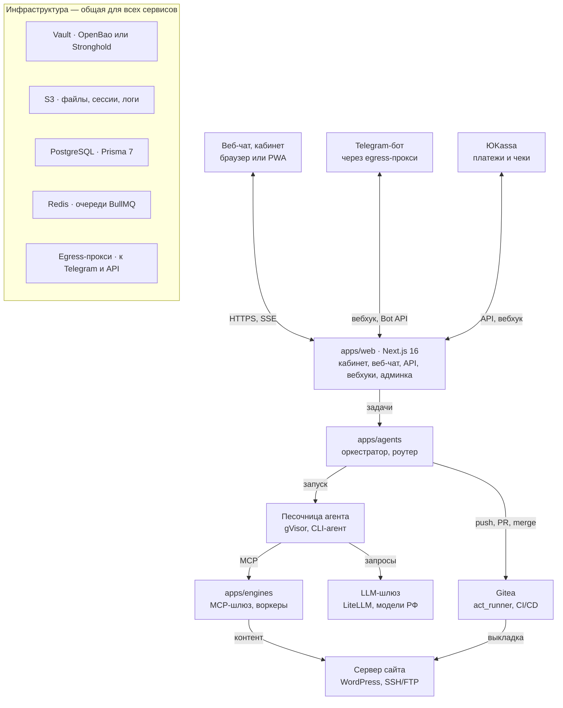
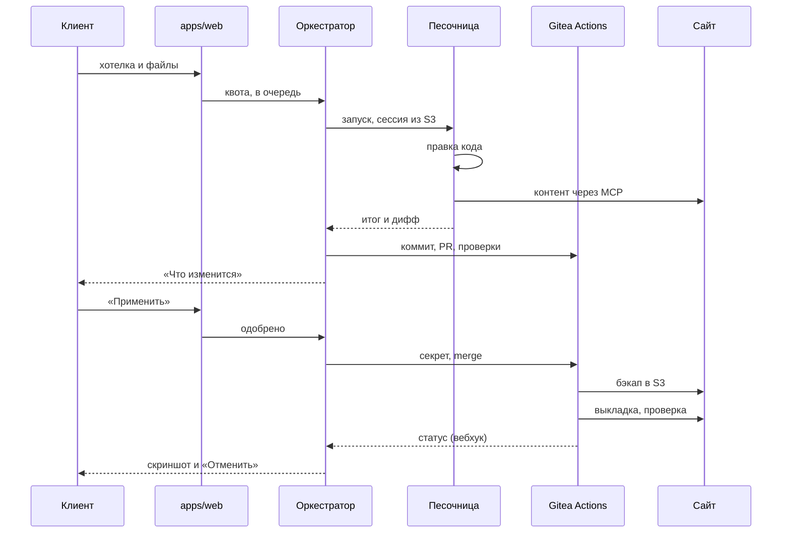

# Радити: AI-поддержка сайтов для малого бизнеса — спецификация v0.2

Версия v0.2 · 26.09.2026

> Снимок документа из Claude Docs на 26.09.2026. Если решение меняется — обновите и этот файл, и документ.

## 1. Коротко

Радити (raditi.ru) ведёт сайты малого бизнеса в России: владелец пишет пожелание в чат, агент меняет сайт. Код меняется через Gitea и Gitea Actions, контент — прямо на сайте. Окружение одно — прод, поэтому каждую выкладку страхуют бэкап, проверка и автоматический откат.

Первый стек — WordPress; Bitrix, Laravel, Node.js и Python подключаются адаптерами без переделки ядра.

**Ключевые решения**

| Область | Решение |
| --- | --- |
| Клиент | Малый бизнес без своего разработчика (раздел 2) |
| Каналы | Веб-чат (PWA) — основной, Telegram-бот — второй, MAX — позже |
| Структура кода | Монорепозиторий по образцу anynote: pnpm, Turborepo, Next.js 16, NestJS, Prisma 7 (раздел 6) |
| Агент | Любой CLI-агент через драйвер: Codex CLI, Kimi Code CLI, Qwen Code, OpenCode (раздел 8) |
| Модели | Российские провайдеры: Yandex AI Studio, Cloud.ru, GigaChat (раздел 9) |
| Изоляция | Одноразовая песочница под gVisor на каждую задачу |
| Код сайтов | Gitea 1.27 и act\_runner, обязательный workflow организации (раздел 10) |
| Окружения | Только прод: подтверждение, бэкап, проверка, откат |
| Файлы, сессии, логи | S3 в российском облаке (раздел 14) |
| Секреты | OpenBao или Deckhouse Stronghold (раздел 15) |
| Данные и очереди | PostgreSQL и Prisma 7, Redis и BullMQ |
| Оплата | ЮKassa: карта, СБП, SberPay, автоплатёж, чеки 54-ФЗ (раздел 17) |

**Что изменилось в v0.2**

1. GitLab заменён на Gitea с act\_runner (раздел 10).
2. Файлы клиентов, сессии агентов и логи хранятся в S3 (раздел 14).
3. Секреты хранятся в Vault-совместимом хранилище (раздел 15).
4. Структура репозитория взята из anynote (раздел 6).
5. Агент не привязан к Codex: драйверы для нескольких CLI и модели, доступные в России (разделы 8–9).
6. Рынок — только Россия, оплата через ЮKassa (раздел 17).
7. Добавлен портрет пользователя (раздел 2).
8. Staging убран: только прод со страховкой (разделы 7 и 10).

**Что поправлено в исходной идее**

- Подписка ChatGPT за $200 не подходит: ChatGPT официально недоступен в России, а условия OpenAI запрещают отдавать свой аккаунт другим. Codex CLI остаётся — как открытый рантайм на российских моделях.
- Kimi берём как модель Kimi-K2.6 в Cloud.ru: подписку Kimi Code российской картой напрямую не оплатить.
- Telegram в России с февраля 2026 года замедлен, поэтому основной канал — веб-чат.
- Без staging прод защищают подтверждение перед выкладкой, бэкап, проверка и откат.

## 2. Для кого

Клиент — владелец малого бизнеса, у которого есть купленный сайт, но нет своего разработчика и знаний, чтобы менять его самому. Он пишет пожелания обычными словами, как подрядчику, и ждёт результат, а не технические детали.

| Черта | Как выглядит | Что это значит для продукта |
| --- | --- | --- |
| Бизнес | Кафе, салон, клиника, магазин, услуги; сайт — витрина и источник заявок | Типовые задачи: цены, акции, фото, баннеры, формы, новые страницы |
| Сайт | Куплен у студии или фрилансера; обычно WordPress или Bitrix, часто на виртуальном хостинге | Доступ часто только FTP и панель хостинга; онбординг помогает их найти |
| Знания | Не знает, что такое Git, SSH, плагин или кэш | Никаких терминов в чате; агент сам решает, код это или контент |
| Время | Пишет урывками с телефона, часто голосом | Голос и фото в чате, короткие ответы, кнопки вместо вопросов |
| Страх | Боится «сломать сайт» и потерять заявки | Скриншот после правки, кнопка «Отменить», понятный статус |
| Деньги | Платит картой или со счёта организации, ждёт чек | ЮKassa, чеки 54-ФЗ; счета юрлицам — после MVP |

**Как агент говорит с клиентом**

- Обращается на «вы», без жаргона и английских терминов.
- Перед правкой кода показывает «Что изменится» — 1–3 пункта простыми словами — и кнопки «Применить», «Изменить», «Отмена».
- Если просьба неясна, задаёт один уточняющий вопрос с вариантами-кнопками.
- После выкладки присылает скриншот и держит кнопку «Отменить» 7 дней.
- Если задача ему не по силам, передаёт её специалисту и честно называет срок.

## 3. Границы MVP

MVP — WordPress-сайты малого бизнеса в России, одно окружение (прод) и два канала: веб-чат и Telegram. Всё, что за этими рамками, заложено в интерфейсы, но включается позже.

| Область | В MVP | Позже |
| --- | --- | --- |
| Стеки | WordPress | Bitrix, Laravel, статика, Node.js, Python |
| Каналы | Веб-чат (PWA), Telegram-бот | MAX, e-mail |
| Окружения | Только прод | Staging по запросу клиента |
| Доступ к серверу | SSH, FTP/FTPS | Панели хостинга через API |
| Выкладка | Gitea Actions: rsync по SSH, git-ftp | Docker Compose |
| Контент | WP-CLI, REST API, Playwright | Конструкторы сайтов через браузер |
| Агенты | Codex CLI, Kimi Code CLI | Qwen Code, OpenCode, GigaCode, SourceCraft |
| Модели | Yandex AI Studio, Cloud.ru | GigaChat, свои модели на GPU |
| Оплата | ЮKassa: карта, СБП, SberPay, автоплатёж, чеки | Счета и закрывающие документы для юрлиц |
| Секреты и файлы | OpenBao на одном узле, S3 в российском облаке | Stronghold или кластер высокой доступности |

## 4. Пользовательские сценарии

Клиент работает в веб-чате или в Telegram; кабинет с тарифом, оплатой и историей — только на сайте платформы. Сценарии MVP:

1. **Подключение сайта.** Мастер в кабинете просит адрес сайта и доступы: SSH, FTP, вход в админку. Он подсказывает, где их взять у популярных хостингов, и сам их проверяет (раздел 12).
2. **Правка кода.** «Добавьте на главную блок с отзывами». Агент готовит правку, клиент видит «Что изменится» и жмёт «Применить», «Изменить» или «Отмена». После выкладки приходит скриншот.
3. **Правка контента.** «Поменяйте цену на стрижку на 1500». Агент делает снимок страницы, меняет текст и сразу применяет; «Отменить» возвращает снимок.
4. **Голос и файлы.** Голосовое распознаётся (Yandex SpeechKit или SaluteSpeech), фото и документы уходят в S3 и попадают агенту во входящие.
5. **Уточнение.** Если просьба неясна, агент задаёт один вопрос с вариантами-кнопками; задача ждёт ответа.
6. **Сессии.** Каждая задача — отдельный диалог в веб-чате и отдельная тема в Telegram. Клиент видит список сессий и может вернуться к любой.
7. **Отмена.** «Верните как было» или кнопка «Отменить» в течение 7 дней: код откатывается revert-коммитом, контент — из снимка.
8. **Тариф и оплата.** Остаток задач виден в чате; купить или сменить тариф можно только в кабинете. Бот ничего не продаёт.
9. **Специалист.** Если агент не справился за две попытки или задача вне тарифа, её получает оператор, а клиент — понятный срок.

## 5. Архитектура

Платформа устроена как anynote: Next.js-приложение для людей, NestJS-сервисы для агентов и фоновых задач, Gitea для кода сайтов. Агент работает только в одноразовой песочнице и выходит наружу через LLM-шлюз и MCP-шлюз.



Главный путь: сообщение → apps/web → очередь → оркестратор → песочница с агентом → push в Gitea → выкладка на сервер сайта. Правки контента идут из песочницы через MCP-шлюз в apps/engines прямо на сайт.

| Компонент | Что делает | Технологии |
| --- | --- | --- |
| apps/web | Кабинет, веб-чат (SSE), API, вебхуки Telegram, ЮKassa и Gitea, админка оператора | Next.js 16, tRPC, better-auth, MUI |
| apps/agents | Оркестратор: очередь, квоты, выбор драйвера и модели, запуск песочниц, коммиты и PR | NestJS 11, BullMQ |
| Песочница | Одноразовый контейнер задачи: CLI-агент, клон сайта, файлы клиента | Docker + gVisor (runsc) |
| LLM-шлюз | Единая точка к моделям: ключи на задачу, лимиты, учёт токенов, Responses API для Codex | LiteLLM |
| apps/engines | MCP-шлюз к сайтам (WP-CLI, REST, браузер) и воркеры: продление подписок, уведомления, Telegram, очистка | NestJS 11, @rekog/mcp-nest, Playwright |
| Gitea | Репозитории сайтов, проверки и выкладка через act\_runner, реестр образов | Gitea 1.27, act\_runner |
| Vault | Доступы к сайтам, ключи моделей, токены выкладки, SSH-сертификаты | OpenBao или Stronghold |
| S3 | Файлы клиентов, сессии агентов, логи, бэкапы, скриншоты | Объектное хранилище в российском облаке |
| PostgreSQL, Redis | Данные платформы; очереди и блокировки | Prisma 7, BullMQ |
| Egress-прокси | Выход к Telegram и внешним API с отдельного адреса | Как WARP-прокси для Telegram в anynote |

## 6. Монорепозиторий

Платформа повторяет структуру [anynote](https://github.com/anynoteinc/anynote): pnpm 9 и Turborepo 2, `apps/*` и `packages/*`, а слои пакетов проверяет dependency-cruiser (`pnpm check-architecture`). Отличие одно: `apps/agents` пишем на TypeScript (NestJS), а не на Python — агент теперь внешний CLI, и граф LangGraph не нужен.

| Путь | Назначение | Из anynote |
| --- | --- | --- |
| apps/web | Next.js 16: лендинг `(about)`, вход `(auth)`, кабинет и веб-чат `(protected)`, вебхуки, SSE-поток задачи | Да: route groups, SSE, вебхук ЮKassa |
| apps/agents | Оркестратор: очередь, квоты, драйверы агентов, песочницы, роутер моделей | Роль та же, стек TypeScript вместо Python |
| apps/engines | MCP-шлюз к сайтам; cron-воркеры: продление подписок, уведомления, Telegram, очистка | Да |
| apps/e2e | Playwright-тесты платформы | Да |
| packages/db | Prisma 7 + PrismaPg: схема, миграции, сиды | Да |
| packages/domain | Бизнес-логика: задачи, квоты, биллинг; ошибки `DomainError` | Да |
| packages/auth | better-auth плюс вход через Telegram | Расширить |
| packages/trpc, packages/ui | tRPC с `createCaller` для RSC; MUI v6 | Да |
| packages/storage | S3-клиент: добавить presigned URL, multipart, несколько бакетов | Расширить |
| packages/yookassa | Платежи, автоплатёж, возвраты, вебхуки; добавить чеки | Расширить |
| packages/telegram, mail, notifications | Bot API через прокси, письма через SendSay, уведомления | Да |
| packages/vault | Клиент Vault API: KV, Transit, SSH, AppRole, wrapping | Новый, слой адаптеров |
| packages/gitea | Клиент Gitea API: репозитории, секреты и переменные Actions, PR, вебхуки | Новый, слой адаптеров |
| packages/agent-runtime | Интерфейс драйвера, разбор событий, упаковка сессий в S3 | Новый, слой сервисов |
| packages/site-adapters | Адаптеры стеков: WordPress, дальше Bitrix и другие | Новый, слой сервисов |
| agent-kit/ | Образы песочниц и драйверы: Codex, Kimi, Qwen, OpenCode | Новый |
| ci/ | Обязательные workflow и actions; синхронизируются в `platform/ci` в Gitea | Новый |
| ansible/ | Плейбуки подготовки серверов сайтов | Новый |
| deploy/, docs/ | Compose и Traefik платформы; architecture.md, спецификации, юридические тексты | Да |

Слои те же, что в anynote: приложения → UI → домен → инфраструктурные сервисы → чистые адаптеры, зависимости только вниз. Новые переменные окружения попадают и в `.env.example`, и в `globalEnv` в `turbo.json`. Платформа собирается своими же Gitea Actions: образы — в реестр Gitea, релизы — semantic-release, выкладка — `deploy-stack.sh` по SSH, как в `deploy/` anynote.

## 7. Жизненный цикл задачи

Одна задача — одна песочница и одна ветка в Gitea. Правка кода попадает в прод только после «Применить», правка контента — сразу, но со снимком для отката.



Прод один, поэтому клиент видит «Что изменится» до merge, а Gitea Actions делает бэкап, выкладку, проверку и при сбое — откат. Секрет выкладки одноразовый: оркестратор кладёт его в репозиторий перед merge и удаляет после (раздел 15).

| Статус | Что происходит | Что видит клиент |
| --- | --- | --- |
| queued | Задача в очереди, единица квоты зарезервирована | «Приняли, начинаем» |
| preparing | Поднимается песочница, из S3 восстанавливается сессия | «Готовим» |
| running | Агент работает, события пишутся в S3 | Прогресс шагами |
| awaiting\_user | Агент задал вопрос | Вопрос с кнопками |
| awaiting\_approval | Правка кода готова, проверки прошли | «Что изменится» и кнопки |
| deploying | Merge в main, Gitea Actions делает бэкап и выкладку | «Выкладываем» |
| verifying | Проверки после выкладки | «Проверяем» |
| done | Готово, резерв квоты списан | Скриншот и «Отменить» |
| failed | Ошибка до выкладки, на сайте ничего не изменилось | Объяснение и «Попробовать ещё» |
| rolled\_back | Проверка не прошла, прод вернули из бэкапа | «Вернули как было» |
| cancelled | Клиент отменил до выкладки | «Отменено» |

## 8. Агентный рантайм

Платформа не привязана к одному агенту: любой CLI-агент подключается драйвером, который запускает его без интерфейса, читает поток событий и сохраняет сессию. В MVP два драйвера — Codex CLI и Kimi Code CLI; Qwen Code и OpenCode — запасные.

### Драйвер

```ts
interface AgentDriver {
  id: 'codex' | 'kimi' | 'qwen' | 'opencode' | 'gigacode' | 'sourcecraft'
  image: string                                        // образ песочницы с CLI
  capabilities: {
    resume: boolean                                    // продолжение сессии
    jsonEvents: boolean                                // поток событий JSONL
    outputSchema: boolean                              // итог по JSON-схеме
    mcp: boolean
    images: boolean                                    // картинки на вход
  }
  prepare(ctx: RunContext): Promise<PreparedRun>       // конфиг, ключ шлюза, AGENTS.md
  command(run: PreparedRun, turn: TurnInput): string[] // argv запуска
  parseEvent(line: string): AgentEvent | null          // строка stdout → общее событие
  sessionDirs(run: PreparedRun): string[]              // что упаковать в S3
  extractResult(events: AgentEvent[]): AgentResult
}
```

Оркестратор, чат и биллинг видят только общие события: `started`, `message`, `command`, `file_change`, `tool_call`, `question`, `usage`, `completed`, `failed`.

| Драйвер | Запуск без интерфейса | Сессии | Модели |
| --- | --- | --- | --- |
| Codex CLI | `codex exec --json --output-schema <файл>` | `codex exec resume <id>`; каталог `CODEX_HOME` | Провайдер с Responses API |
| Kimi Code CLI | `kimi -p <задача> --output-format stream-json` | `--session <id>`, `--continue`; каталог `KIMI_CODE_HOME` | Kimi-K2.6 и другие через `kimi provider` |
| Qwen Code | `qwen -p <задача> --output-format stream-json` | `--resume <id>`; чаты в `~/.qwen/projects` | OpenAI-совместимые через `modelProviders` |
| OpenCode | `opencode run --format json` | `--session <id>`, `opencode export` и `import` | Любые провайдеры из конфига |

Флаги взяты из документации [Codex](https://learn.chatgpt.com/docs/non-interactive-mode), [Kimi Code](https://moonshotai.github.io/kimi-code/en/reference/kimi-command.html), [Qwen Code](https://qwenlm.github.io/qwen-code-docs/en/users/features/headless/) и [OpenCode](https://opencode.ai/docs/cli/); работу каждого драйвера подтверждаем в PoC.

### Изоляция

- Каждая задача — новый контейнер под [gVisor](https://gvisor.dev/docs/) (`runsc`): rootless, корневая файловая система только для чтения, `HOME` в tmpfs.
- Лимиты: 2 vCPU, 4 ГБ памяти, 512 процессов, 20 минут на ход агента.
- Папки: `/workspace/repo` — клон сайта, `/workspace/inbox` — файлы клиента, `/workspace/out` — артефакты, `/agent-home` — сессия агента.
- Сеть — только по списку: LLM-шлюз, MCP-шлюз, зеркала пакетных реестров. Ни Gitea, ни сервер сайта из песочницы недоступны.
- Долгоживущих секретов внутри нет: только ключ LLM-шлюза и токен MCP на эту задачу. Если драйвер работает по подписке, её токен кладётся из Vault в tmpfs на время хода.
- Встроенные песочницы агентов выключены (`--sandbox danger-full-access` у Codex, `--yolo` у Kimi, `--approval-mode yolo` у Qwen): изоляцию даёт контейнер.
- Супервизор снаружи готовит клон, читает stdout, останавливает по таймауту, проверяет дифф, коммитит и пушит от имени бота.

### Сессии, логи и файлы в S3

- Сессия — каталоги из `sessionDirs()`: после каждого хода они упаковываются в `sessions/<sessionId>/home.tar.zst`, следующий ход восстанавливает их в новой песочнице.
- Лог — поток событий частями: `tasks/<taskId>/events/<n>.jsonl.zst` каждые 10 секунд или 256 КБ, плюс сырые stdout и stderr.
- Файлы клиента лежат в `inbox/`, песочница получает их по presigned-ссылкам только на чтение.
- Артефакты (скриншоты, отчёты, диффы) агент кладёт в `/workspace/out`, супервизор выгружает их в S3.
- При смене драйвера сессия не переносится: новый агент получает краткое содержание прошлых ходов.

Бакеты, сроки хранения и шифрование — в разделе 14.

### Инструкции агенту

1. Платформенный `AGENTS.md`: роль, язык ответа клиенту, запрет трогать `.gitea/`, секреты и ядро CMS, формат итога.
2. `AGENTS.md` сайта: стек, тема, где что лежит, особые правила; пишется при онбординге.
3. Навыки по типовым задачам: цены, баннеры, формы, новые страницы.

Драйверам, которые не читают `AGENTS.md`, тот же текст уходит системным промптом.

### Инструменты MCP

| Инструмент | Что делает |
| --- | --- |
| `site_info` | Стек, версии, плагины, ключевые страницы |
| `wp_cli` | Команды WP-CLI из белого списка |
| `wp_rest` | Запросы к REST API WordPress |
| `snapshot`, `restore` | Снимок объекта перед правкой и возврат |
| `media_upload` | Загрузка файла из входящих в медиатеку |
| `browser_*` | Playwright: открыть, кликнуть, заполнить, скриншот |
| `request_approval` | Показать клиенту «Что изменится» и ждать решения |

Браузер работает в apps/engines, а не в песочнице, и входит в админку с доступами из Vault ([Playwright MCP](https://github.com/microsoft/playwright-mcp)). Для WordPress подходит и [MCP Adapter](https://github.com/WordPress/mcp-adapter), если плагин можно поставить.

### Итог хода

```json
{
  "summary": "Добавил блок отзывов на главную",
  "change_type": "code",
  "client_message": "На главной появится блок «Отзывы» с тремя карточками.",
  "files_changed": ["wp-content/themes/shop/front-page.php"],
  "questions": [],
  "needs_approval": true,
  "risk": "low"
}
```

Итог проверяется zod-схемой; при ошибке агент получает одну попытку исправить. `change_type` — `code`, `content`, `mixed` или `none`; `client_message` уходит клиенту как есть, поэтому пишется простыми словами.

## 9. Агенты и модели в России

ChatGPT, Claude и Gemini в России официально недоступны: [OpenAI](https://help.openai.com/en/articles/7947663-chatgpt-supported-countries), [Anthropic](https://www.anthropic.com/supported-countries) и [Google](https://ai.google.dev/gemini-api/docs/available-regions) не включают страну в список поддерживаемых. Поэтому агенты — открытые или российские CLI, а модели — у провайдеров с серверами в России.

### CLI-агенты

| Агент | Доступ из России | Модели | Роль |
| --- | --- | --- | --- |
| [Codex CLI](https://learn.chatgpt.com/docs/non-interactive-mode) | Открытый код; сторонний провайдер — только через Responses API ([обсуждение](https://github.com/openai/codex/discussions/7782)) | Yandex AI Studio напрямую, GigaChat через [gpt2giga](https://github.com/ai-forever/gpt2giga/blob/main/integrations/codex/README.md), Cloud.ru через LiteLLM | Основной драйвер |
| [Kimi Code CLI](https://moonshotai.github.io/kimi-code/en/reference/kimi-command.html) | CLI работает; [подписку](https://www.kimi.com/code/docs/en/kimi-code/membership.html) из России оплатить можно только через посредников ([vc.ru](https://vc.ru/services/3056116-kak-kupit-kimi-api-i-podpisku-kimi-code-iz-rossii)) | Kimi-K2.6 в Cloud.ru; работу со сторонним провайдером проверяем в PoC | Второй драйвер |
| [Qwen Code](https://qwenlm.github.io/qwen-code-docs/en/users/configuration/model-providers/) | Apache-2.0; бесплатный вход Qwen OAuth закрыт с 15 апреля 2026 | Любые OpenAI-совместимые | Запасной |
| [OpenCode](https://opencode.ai/docs/cli/) | Открытый код, есть режим сервера | Любые провайдеры из конфига | Запасной |
| [GigaCode CLI](https://neuraldeep.ru/gigacode-cli) | Сбер; облако и on-prem, для компаний — по договору | GigaChat | После PoC |
| [SourceCraft CLI](https://vc.ru/ai/2880355-yandex-b2b-tech-sourcecraft-cli-ii-agent) | Яндекс, с апреля 2026 | YandexGPT, Qwen3, DeepSeek и другие | После PoC |

Claude Code и Gemini CLI не берём: их модели в России недоступны.

### Провайдеры моделей

| Провайдер | API | Модели для кода | Оплата |
| --- | --- | --- | --- |
| [Yandex AI Studio](https://aistudio.yandex.ru/docs/en/ai-studio/concepts/generation/models.html) | OpenAI-совместимый, включая Responses ([API](https://aistudio.yandex.ru/docs/en/ai-studio/api/)) | Qwen3 235B, gpt-oss-120b, DeepSeek V4 Flash, YandexGPT Pro 5.1 | Рубли |
| [Cloud.ru Evolution Foundation Models](https://cloud.ru/docs/foundation-models/ug/topics/overview__available__models) | OpenAI-совместимый, вызов функций, 20 запросов в секунду на ключ | Kimi-K2.6, GLM-5.1, DeepSeek-V4-Pro, Qwen3-Coder-Next, MiniMax-M3 | Рубли |
| GigaChat API | Свой API; для Codex — прокси gpt2giga | GigaChat-3-Ultra, GigaChat-2-Max | Рубли |

У Cloud.ru есть и [«внешние» модели](https://cloud.ru/products/evolution-foundation-models) сторонних поставщиков — для данных клиентов берём только модели на серверах Cloud.ru.

### Роутер

Роутер — это [LiteLLM](https://docs.litellm.ai/docs/response_api) перед всеми провайдерами и правила в оркестраторе. LiteLLM даёт ключ на задачу, лимиты, учёт токенов и мост `/responses` для провайдеров, где есть только Chat Completions.

| Класс | Когда | Кандидаты (гипотеза) |
| --- | --- | --- |
| Лёгкий | Разбор просьбы, тексты, простые правки контента | YandexGPT Pro 5.1, Qwen3.6 35B |
| Стандарт | Обычные правки кода и контента | Qwen3-Coder-Next, Kimi-K2.6 |
| Тяжёлый | Новые страницы, сложная вёрстка, повтор после неудачи | GLM-5.1, DeepSeek-V4-Pro |

До пилота прогоняем 30 типовых задач на каждой паре «агент + модель» и оставляем лучшие по качеству и цене.

**Алгоритм выбора**

1. Лёгкая модель определяет тип и сложность задачи.
2. Тип сайта и тариф сужают список пар «драйвер + модель».
3. Отбрасываются пары с исчерпанным лимитом провайдера или ошибками за последние 15 минут.
4. Из оставшихся берётся лучшая по итогам eval для этого класса.
5. Сессия задачи остаётся на выбранной паре до конца.
6. При сбое — следующая пара того же класса и краткое содержание прошлых ходов.
7. Вторая неудача — задача уходит оператору.

**Подписки.** Тип провайдера «подписка» в модели данных остаётся, но включается только там, где договор разрешает работу на клиентов, — например, корпоративный GigaCode. Подписки ChatGPT, Claude и Kimi для этого не используем: первые две недоступны в России, Kimi не оплатить напрямую.

## 10. Gitea: код и выкладка

Код каждого сайта живёт в Gitea 1.27, в организации `sites`; выкладку делает act\_runner по обязательному workflow организации, который агент изменить не может.

- [Gitea 1.27](https://blog.gitea.com/release-of-1.27.0/) умеет обязательные workflow уровня организации ([scoped workflows](https://docs.gitea.com/usage/actions/scoped-workflows/)): они лежат в отдельном репозитории `platform/ci` и выполняются в контексте репозитория сайта; обязательный workflow нельзя отключить.
- В репозиториях сайтов нет `.gitea/workflows`; супервизор отклоняет дифф, который трогает `.gitea/`.
- Раннеры двух видов ([act\_runner](https://docs.gitea.com/usage/actions/act-runner)): `check` — проверки в Docker, `deploy` — выкладка с постоянного IP, который клиент при необходимости добавляет в белый список хостинга.
- Выкладки одного сайта идут строго по очереди: `concurrency` есть с [Gitea 1.26](https://blog.gitea.com/release-of-1.26.0/).
- `GITEA_TOKEN` работает в ограниченном режиме, доступ к чужим репозиториям по умолчанию закрыт ([права токена](https://docs.gitea.com/usage/actions/token-permissions/)).
- О ходе выкладки платформа узнаёт из вебхуков `workflow_run` и `workflow_job` с подписью `X-Gitea-Signature` ([вебхуки](https://docs.gitea.com/usage/webhooks)).
- Docker-образы сайтов (после MVP) хранятся во встроенном [реестре Gitea](https://docs.gitea.com/usage/packages/container/).

### Git-флоу

1. Супервизор клонирует `main` в песочницу и создаёт ветку `agent/<taskId>`.
2. После хода агента супервизор проверяет дифф, коммитит от имени бота и пушит ветку.
3. Оркестратор открывает PR; workflow `check` прогоняет проверки.
4. Клиент нажимает «Применить» — оркестратор кладёт одноразовый секрет выкладки и делает merge.
5. Push в `main` запускает `deploy`; итог приходит вебхуком, секрет удаляется.

### Пайплайн

| Шаг | Что делает | При ошибке |
| --- | --- | --- |
| check | Линтер PHP, сборка ассетов, запрет на `.gitea/` и секреты в диффе | PR не мержится, агент получает лог |
| drift | Сравнивает файлы на сервере с последней выкладкой | По политике сайта: `sync` или остановка |
| backup | Архив изменяемых файлов и дамп БД в S3 (`raditi-backups`) | Остановка |
| deploy | rsync по SSH, git-ftp или Docker — по `vars.DEPLOY_METHOD` | Откат |
| verify | HTTP-коды ключевых страниц, ошибки PHP в логе, скриншоты | Откат |
| rollback | Возврат файлов из бэкапа, revert-коммит в `main` | Оператору |

```yaml
# platform/ci/.gitea/scoped_workflows/deploy.yml
name: deploy
on:
  push:
    branches: [main]
concurrency:
  group: deploy-${{ gitea.repository }}
  cancel-in-progress: false
jobs:
  deploy:
    runs-on: deploy
    steps:
      - uses: actions/checkout@v4
      - uses: platform/actions/vault-login@v1     # разворачивает одноразовый токен
      - uses: platform/actions/drift-check@v1
      - uses: platform/actions/backup@v1
      - uses: platform/actions/deploy@v1          # rsync, git-ftp или docker по vars.DEPLOY_METHOD
      - uses: platform/actions/verify@v1
      - if: failure()
        uses: platform/actions/rollback@v1
```

Actions берутся из своей Gitea (`DEFAULT_ACTIONS_URL = self`), а `actions/checkout` зеркалируется туда же. Параметры выкладки — хост, путь, метод — хранятся в переменных Actions репозитория; их задаёт оркестратор при онбординге.

**Дрейф.** Владелец или плагин могут менять файлы на сервере в обход Gitea. Политика задаётся на сайт: `sync` — расхождения перед выкладкой коммитятся в `main` отдельным коммитом; `freeze` — в WordPress включается `DISALLOW_FILE_MODS`, и обновления идут только через платформу.

**Откат.** «Отменить» в течение 7 дней делает revert-коммит и обычную выкладку. Базу данных восстанавливаем из дампа только после подтверждения клиента: новые заказы и заявки при этом пропадут.

## 11. Изменения контента

Контент — тексты, цены, фото, записи, меню — меняется прямо на проде без Git: перед правкой делается снимок в S3, после — скриншот и кнопка «Отменить».

| Способ | Когда | Пример |
| --- | --- | --- |
| WP-CLI через MCP | Есть SSH | `wp post update`, `wp option update`, `wp media import` |
| REST API WordPress | Нет SSH, есть пароль приложения | Страницы, записи, медиа, меню |
| MCP Adapter | Плагин можно поставить | Возможности WordPress (Abilities API) как инструменты MCP |
| Playwright | Конструкторы страниц и настройки без API | Elementor, настройки плагинов, формы |

**Правила**

- Перед правкой — снимок объекта (запись, опция, файл медиа) в `raditi-artifacts`; «Отменить» восстанавливает его 7 дней.
- Сразу применяются только обратимые правки: текст, цена, фото, запись. Удаление страниц, смена темы, плагины и настройки оплаты — только через «Применить».
- Массовые правки (больше 20 объектов) — через «Применить» со списком.
- Агент не трогает пользователей, заказы и настройки платежей.
- Входы в админку и пароли приложений лежат в Vault; браузер получает их на время сессии.

Бот в Telegram может скачать файл не больше 20 МБ ([Bot API](https://core.telegram.org/bots/api#getfile)). Большие файлы клиент загружает в веб-чате — напрямую в S3 по presigned-ссылке.

## 12. Подключение сайта

Онбординг превращает «сайт где-то на хостинге» в репозиторий Gitea, доступы в Vault и описание сайта для агента. Мастер ведёт клиента, сложные случаи доделывает оператор.

| Доступ | Где взять | Что даёт |
| --- | --- | --- |
| SSH | Панель хостинга; на VPS — ключ или SSH-сертификат из Vault | Выкладка через rsync, WP-CLI, дамп БД |
| FTP/FTPS | Панель хостинга | Выкладка через git-ftp; контент через REST |
| Вход в админку WordPress | Владелец или прежний подрядчик | Пароль приложения для REST, браузер |
| Доступ к БД | Панель хостинга | Бэкап и откат, если нет SSH |

1. **Доступы.** Клиент вводит их в форме; они сразу уходят в Vault, в базе остаётся только ссылка. Форма работает только на запись — прочитать доступ обратно из кабинета нельзя.
2. **Разведка.** Воркер проверяет доступы и определяет стек, версии, плагины, размер сайта.
3. **Подготовка сервера.** На VPS Ansible ставит SSH CA, WP-CLI и rsync; на виртуальном хостинге ничего не ставится, только проверка.
4. **Импорт.** Код сайта без `uploads` и кэша становится репозиторием в организации `sites`; `.gitignore` задаёт адаптер.
5. **Выкладка.** Оркестратор задаёт переменные Actions и политику Vault `site-<id>-deploy`.
6. **AGENTS.md.** Агент описывает сайт — тема, шаблоны, ключевые страницы, — оператор проверяет.
7. **Эталон.** Скриншоты ключевых страниц и полный бэкап уходят в S3.
8. **Готово.** Первые задачи проходят проверку оператора (`operator_review`).

Ansible запускается через ansible-runner; доступы он получает из Vault на время запуска и нигде не сохраняет.

## 13. Адаптеры стеков

Всё, что зависит от CMS или фреймворка, спрятано за адаптером; ядро платформы о WordPress не знает.

```ts
interface SiteAdapter {
  id: 'wordpress' | 'bitrix' | 'laravel' | 'static' | 'node' | 'python'
  detect(probe: ServerProbe): Promise<SiteFacts | null>  // стек, версии, пути
  importRules(site: SiteFacts): ImportRules               // .gitignore, что не импортировать
  deployVars(site: SiteFacts): DeployVars                 // переменные Actions: метод, пути, команды
  backup(site: SiteFacts): BackupPlan                     // файлы и БД
  verify(site: SiteFacts): VerifyPlan                     // страницы, логи, скриншоты
  mcpTools(site: SiteFacts): McpToolSet                   // инструменты контента
  agentGuide(site: SiteFacts): string                     // заготовка AGENTS.md
}
```

| Стек | Выкладка | Контент | Этап |
| --- | --- | --- | --- |
| WordPress | rsync или git-ftp | WP-CLI, REST, MCP Adapter, браузер | MVP |
| Статика | rsync или FTP | Правки в коде | 2 |
| 1С-Битрикс | rsync или git-ftp; только `/local/`, ядро `/bitrix/` не трогаем | REST модулей, браузер | 3 |
| Laravel | rsync, `composer install`, миграции | Админка через браузер | 3 |
| Node.js, Python | Docker Compose, образ из реестра Gitea | Через API проекта | 3 |

Адаптер не пишет свой CI: он отдаёт только переменные для общего workflow `deploy`, поэтому пайплайн один на все стеки и агент не может его изменить.

## 14. S3: файлы, сессии и логи

Всё, что не помещается в PostgreSQL, лежит в S3 российского облака — Yandex Object Storage, Selectel, Cloud.ru или VK Cloud; платформа работает с ним через `@repo/storage` из anynote.

| Бакет | Что лежит | Ключи | Срок | Доступ |
| --- | --- | --- | --- | --- |
| raditi-inbox | Файлы клиента из чата | `inbox/<wsId>/<taskId>/<fileId>` | 90 дней | web пишет, песочница читает по presigned |
| raditi-sessions | Сессии агентов, с версиями | `sessions/<sessionId>/home.tar.zst` | 30 дней после закрытия | Только оркестратор |
| raditi-logs | События и stdout агентов | `tasks/<taskId>/events/<n>.jsonl.zst` | 180 дней | Оркестратор пишет, админка читает |
| raditi-artifacts | Скриншоты, снимки контента, диффы | `tasks/<taskId>/…`, `snapshots/<siteId>/…` | 1 год | web и engines |
| raditi-backups | Бэкапы сайтов перед выкладкой | `sites/<siteId>/<deployId>/…` | 14 последних или 30 дней | Только раннер `deploy` |
| raditi-platform | Бэкапы самой платформы | `pg/`, `gitea/`, `vault/` | 30 дней | Только администраторы |

- Сессии, логи и бэкапы шифруются на стороне платформы ключами данных из Vault Transit (ключ на рабочее пространство), поверх шифрования хранилища.
- У каждого сервиса свой ключ доступа только к своим бакетам; песочница ключей S3 не получает, только presigned-ссылки на 15 минут.
- Сроки хранения задаются правилами жизненного цикла бакета; удаление аккаунта стирает его префиксы.
- `@repo/storage` расширяем: presigned URL, multipart для больших файлов, несколько бакетов.
- Данные граждан РФ хранятся только в России — требование 152-ФЗ с 1 июля 2025 года (раздел 18).
- Для разработки — SeaweedFS или Garage вместо MinIO из compose anynote: MinIO Community больше не развивается как открытый проект ([It's FOSS](https://itsfoss.com/news/minio-moves-away-from-open-source/)).

## 15. Vault: секреты

Секреты хранятся в Vault-совместимом хранилище: [OpenBao](https://openbao.org/community/release-notes/2-6-0/) — открытый форк Vault под лицензией MPL 2.0 — или российский [Deckhouse Stronghold](https://deckhouse.ru/blog/ne-prosto-fork-sravnenie-deckhouse-stronghold-s-hashicorp-vault-ce/). HashiCorp Vault не берём: HashiCorp прекратила работу с российскими организациями ([BearPass](https://bearpass.ru/blog/hashicorp-vault-alternativy-rossiya-2026-devops-sekrety)).

| Механизм | Путь | Что хранит |
| --- | --- | --- |
| KV v2 | `kv/sites/<siteId>/{ssh,ftp,wp,browser}` | Доступы к сайтам |
| KV v2 | `kv/llm/<provider>`, `kv/subscriptions/<accountId>` | Ключи провайдеров моделей и подписок |
| Transit | `transit/keys/ws-<wsId>` | Ключи шифрования сессий, логов и бэкапов |
| SSH CA | `ssh/sign/deploy` | Короткие SSH-сертификаты для VPS клиентов |
| AppRole | `auth/approle/role/<service>` | Вход сервисов платформы |
| Response wrapping | `sys/wrapping/*` | Одноразовые обёртки для токенов выкладки |
| Audit | Файл и syslog | Журнал всех обращений |

**Политики**

- web — только запись в `kv/sites/*`, чтение запрещено.
- engines — чтение `kv/sites/*` для MCP-шлюза и онбординга.
- agents — выдача токенов выкладки, Transit, чтение `kv/llm/*`.
- `site-<id>-deploy` — чтение доступов одного сайта и подпись SSH-сертификата; токен живёт 15 минут.
- Раннер `check` и песочницы агентов доступа к Vault не имеют.

**Секрет выкладки без OIDC.** В Gitea Actions пока нет OIDC-токенов для внешних систем ([issue #33681](https://github.com/go-gitea/gitea/issues/33681)), поэтому выкладка получает доступ так:

1. Перед merge оркестратор создаёт токен с политикой `site-<id>-deploy` на 15 минут.
2. Оборачивает его ([response wrapping](https://openbao.org/docs/concepts/response-wrapping/)): обёртка одноразовая и живёт 10 минут.
3. Кладёт обёртку в секрет Actions репозитория через API Gitea и делает merge.
4. Шаг `vault-login` разворачивает токен; второй раз ту же обёртку не развернуть.
5. После выкладки оркестратор отзывает токен и удаляет секрет.

Хранилище распечатывается ключами Шамира по схеме 3 из 5. На старте — один узел со снапшотами Raft в `raditi-platform`, кластер — позже.

## 16. Модель данных

Схема лежит в `packages/db` (Prisma 7), как в anynote; центр модели — задача (`tasks`), вокруг неё сессии, события, выкладки и списания.

| Таблица | Ключевые поля | Зачем |
| --- | --- | --- |
| users, user\_consents | better-auth; согласия — неизменяемые записи | Вход, 152-ФЗ, оферта |
| workspaces, members | Владелец, роли | Клиент — компания, а не один человек |
| channel\_identities | `channel` (web, telegram, max), внешний id | Кто пишет и из какого канала |
| sites | Стек, домен, `drift_policy`, `operator_review` | Сайт клиента |
| environments | Только `prod`; хост, метод выкладки | Задел под staging |
| credential\_refs | Путь в Vault, тип, `key_version` | Ссылки на секреты, не сами секреты |
| chat\_sessions | Канал, тема Telegram, `agent_driver`, S3-ключ сессии | Сессия агента |
| tasks | Статус, тип правки, класс модели, PR, `deployment_id` | Задача |
| task\_events | Номер части, S3-ключ, счётчики | Индекс логов в S3 |
| attachments | S3-ключ, тип, размер, источник | Файлы клиента |
| snapshots | Объект, S3-ключ, срок | Откат контента |
| deployments | Коммит, запуск workflow, статус, бэкап | Выкладки и откаты |
| agent\_drivers | id, образ, возможности, включён | Реестр драйверов |
| llm\_providers, llm\_models | Провайдер, цена за 1 млн токенов в копейках, класс | Роутер и себестоимость |
| subscription\_accounts | Тип, ссылка на Vault, лимиты | Подписки там, где их разрешает договор |
| plans, subscriptions | Цена в копейках, квоты; `paymentMethodId` | Тарифы, как в anynote |
| orders | Платёж ЮKassa, `receipt_status` | Оплаты и чеки |
| credit\_ledger | Резерв, списание, возврат | Учёт квот |
| outbox\_events | Тип, payload, статус | Надёжная отправка событий |
| audit\_log | Кто, что, когда | Аудит действий людей и агента |

Квоты считаются по `credit_ledger`: резерв при постановке в очередь, списание при `done`, возврат при `failed` и `cancelled`.

## 17. Тарифы и оплата

Клиент платит помесячно за подписку с квотой задач; деньги принимает ЮKassa, чек по 54-ФЗ уходит автоматически.

| Тариф | Задач в день | Сайтов | Что включено |
| --- | --- | --- | --- |
| Старт | 10 | 1 | Контент и небольшие правки кода |
| Бизнес | 30 | 5 | Всё из «Старта» плюс тяжёлый класс моделей |
| Агентство | 100 | 25 | Всё из «Бизнеса» плюс приоритет и оператор |

Цены назначим после PoC, когда будет известна себестоимость задачи в рублях.

**Правила списания**

- Задача резервирует единицу квоты при постановке в очередь.
- Резерв списывается при `done`; `failed` и `cancelled` возвращают его.
- Уточняющий вопрос и «Изменить» новой задачей не считаются.
- «Отменить» бесплатно.
- Остаток квоты виден в чате; докупить пакет задач можно в кабинете.

**Оплата через ЮKassa**

- Берём `packages/yookassa` из anynote: `createPayment`, `chargeWithSavedMethod`, возвраты и вебхук `/api/webhooks/yookassa` с проверкой IP.
- Первый платёж — с `save_payment_method`, дальше продление по cron в apps/engines.
- В боевом магазине автоплатежи включает менеджер ЮKassa по запросу; клиент явно соглашается на списания и получает уведомления ([автоплатежи](https://yookassa.ru/developers/payment-acceptance/scenario-extensions/recurring-payments/basics)).
- Чеки — через «Чеки от ЮKassa» или онлайн-кассу (АТОЛ, Orange Data): в платёж добавляется `receipt` с e-mail или телефоном, позициями, `vat_code`, `payment_subject` и `payment_mode` ([чеки](https://yookassa.ru/developers/payment-acceptance/receipts/basics)).
- В Telegram-боте ничего не продаём: цифровые товары внутри Telegram оплачиваются только в Stars ([Telegram](https://core.telegram.org/bots/payments-stars)). Оплата — только в кабинете на сайте.
- Счета юрлицам — после MVP.

**Себестоимость задачи**

```latex
\text{cost} = \frac{(t_{in} - t_{cached})\,p_{in} + t_{cached}\,p_{cached} + t_{out}\,p_{out}}{10^{6}} + c_{\text{sandbox}}
```

Токены берём из событий `usage` и учёта LiteLLM; цены p — рубли за 1 млн токенов из `llm_models`; c\_sandbox — минуты песочницы и хранение в S3. Гейт 2 требует, чтобы средняя себестоимость была ниже цены задачи в тарифе.

## 18. Безопасность

Агент не может навредить больше, чем позволяет песочница: у него нет долгоживущих секретов, доступа к серверу сайта и права менять пайплайн.

| Угроза | Защита |
| --- | --- |
| Промпт-инъекция из контента сайта или файла | Песочница без секретов, сеть по списку, правки кода только через «Применить» |
| Агент меняет пайплайн, чтобы выкатить что угодно | Обязательный workflow из `platform/ci`, запрет диффов в `.gitea/` |
| Кража секрета выкладки | Одноразовая обёртка на 10 минут, токен на 15 минут, отзыв после выкладки |
| Утечка доступов клиента | Vault, форма только на запись, политики, аудит |
| Побег из контейнера | gVisor, rootless, лимиты, одноразовые контейнеры |
| Поломка прода без staging | «Что изменится» до merge, бэкап, проверка, автооткат, «Отменить» 7 дней, оператор на первых задачах |
| Удаление данных на сайте | Опасные операции только через «Применить»; заказы и пользователи агенту недоступны |
| Чужой пишет в чат от имени клиента | Telegram привязывается через вход в кабинет, роли в рабочем пространстве |
| Перерасход токенов | Лимиты на ключ задачи в LiteLLM, таймауты, квоты тарифа |
| Утечка данных за рубеж | Модели и хранилища только в России (ниже) |

**152-ФЗ.** С 1 июля 2025 года запись и хранение персональных данных граждан РФ в иностранных базах запрещены ([Лидингс](https://www.lidings.com/ru/media/legalupdates/localization_pd_update/)). Поэтому база, S3, логи и модели — только у российских провайдеров, а внешние модели Cloud.ru для данных клиентов выключены. Нужны уведомление Роскомнадзора об обработке ПДн, согласия (в anynote уже есть `user_consents`) и поручение обработки провайдерам.

Telegram — иностранный сервис: переписка в нём проходит через его серверы, а наша копия хранится в России. Это не юридическая консультация: схему обработки данных стоит проверить с юристом.

## 19. Инфраструктура

Для MVP хватает пяти виртуальных машин в российском облаке и управляемого S3; всё поднимается Compose и Ansible, как `deploy/` в anynote.

| Машина | Что работает | Ориентир |
| --- | --- | --- |
| app | apps/web, apps/agents, apps/engines, LiteLLM, PostgreSQL, Redis, Traefik | 8 vCPU, 16 ГБ |
| sandbox | Песочницы агентов под gVisor, браузеры MCP-шлюза | 16 vCPU, 64 ГБ, масштабируется |
| gitea | Gitea и её PostgreSQL | 4 vCPU, 8 ГБ |
| ci | act\_runner: `check` и `deploy` с постоянным IP | 4 vCPU, 8 ГБ |
| vault | OpenBao или Stronghold | 2 vCPU, 4 ГБ |

S3 — управляемый сервис того же облака. Выход к Telegram — через egress-прокси, как WARP-прокси в anynote ([спецификация](https://github.com/anynoteinc/anynote/blob/main/docs/superpowers/specs/2026-08-01-telegram-warp-proxy-design.md)).

**Наблюдаемость**

- Логи и метрики сервисов, трассировка задачи от сообщения до выкладки.
- Расход токенов и денег по провайдерам и клиентам — из LiteLLM.
- Алерты: задача в очереди дольше 10 минут, ошибки выкладки, откаты, исчерпание лимитов провайдера.
- Ежедневные бэкапы PostgreSQL и Gitea и снапшоты Vault — в `raditi-platform`.

## 20. Риски и открытые вопросы

Главные риски v0.2 — качество российских моделей на задачах агента и доступность Telegram; оба проверяются в PoC до пилота.

Telegram в России с февраля 2026 года официально замедлен, файлы и голосовые работают с перебоями ([Битрикс24](https://www.bitrix24.ru/journal/blokirovka-telegram/)). Поэтому основной канал — веб-чат, Telegram — второй, а бот в [MAX](https://dev.max.ru/docs/chatbots/bots-coding/prepare) — следующий шаг: MAX требует российское юрлицо, ИП или самозанятого и модерацию бота.

| Риск | Вероятность | Что делаем |
| --- | --- | --- |
| Российские модели хуже справляются с кодом | Высокая | Eval на 30 задачах, тяжёлый класс для повторов, оператор |
| Codex CLI сломает совместимость со сторонними провайдерами | Средняя | Несколько драйверов, версии CLI закреплены в образах |
| Kimi Code CLI не заработает с Kimi-K2.6 из Cloud.ru | Средняя | Kimi-K2.6 через Codex, Qwen Code или OpenCode |
| Замедление или блокировка Telegram | Высокая | Веб-чат основной, MAX, уведомления по e-mail и push |
| Поломка прода без staging | Средняя | Бэкап, проверка, откат, оператор на первых задачах |
| Дрейф файлов на сервере | Высокая | drift-check, политики `sync` и `freeze` |
| Хостинг блокирует IP раннера или не даёт SSH | Средняя | Постоянный IP, git-ftp, инструкции для популярных хостингов |
| Себестоимость выше цены | Средняя | Роутер по классам, учёт в LiteLLM, лимиты |
| Требования 152-ФЗ и 54-ФЗ | Средняя | Всё в России, согласия, чеки ЮKassa, юрист |
| Поставщик Vault или S3 уйдёт с рынка | Низкая | OpenBao и S3 API переносимы |

**Открытые вопросы**

- [ ] Основной канал на старте: только веб-чат или сразу веб-чат и Telegram?
- [ ] Провайдер моделей по умолчанию: Yandex AI Studio или Cloud.ru?
- [ ] OpenBao или Deckhouse Stronghold: нужен ли российский вендор с поддержкой?
- [ ] Какие правки контента применять сразу, без «Применить»?
- [ ] Можно ли присылать из Telegram-бота ссылку на оплату в кабинете?
- [ ] Нужны ли счета юрлицам с первого дня?
- [ ] Какой срок ответа оператора обещать в тарифах?

## 21. План работ

План — четыре этапа с гейтами: сначала PoC доказывает, что агенты на российских моделях доводят задачу до прода, потом пилот на платящих клиентах.

| Этап | Что делаем | Гейт на выходе |
| --- | --- | --- |
| 0 · PoC | Песочница gVisor; агенты на моделях РФ; Gitea, S3, Vault | Гейт 1: 10 задач сквозь без ручных правок |
| 1 · MVP-пилот | Веб-чат и Telegram; ЮKassa, онбординг; только прод, откат | Гейт 2: пилот платит, себестоимость в ₽ |
| 2 · Масштаб | Ещё драйверы агентов; параллельный запуск; MAX, конструкторы | Гейт 3: стабильность и маржа в плюсе |
| 3 · Другие стеки | Bitrix, Laravel; Node.js, Python; Docker-проекты | — |

Гейт — условие перехода: пока оно не выполнено, следующий этап не начинается.

**Критерии гейтов**

1. **Гейт 1, после PoC.** 10 типовых задач на тестовых WordPress-сайтах прошли от сообщения до прода без ручных правок, откат сработал.
2. **Гейт 2, после пилота.** Пилотные клиенты платят через ЮKassa, себестоимость задачи посчитана в рублях и ниже цены.
3. **Гейт 3, перед масштабом.** Месяц без инцидентов на проде по вине платформы и маржа в плюсе.

**Что проверить в PoC**

- [ ] Codex CLI на Yandex AI Studio через Responses API
- [ ] Kimi Code CLI на Kimi-K2.6 из Cloud.ru; если не выйдет — Qwen Code или OpenCode
- [ ] Codex CLI на GigaChat через gpt2giga
- [ ] Агенты под gVisor без встроенной песочницы
- [ ] Восстановление сессии из S3 в новой песочнице
- [ ] Обязательный scoped workflow в Gitea 1.27 и запрет на `.gitea/`
- [ ] Секрет выкладки через обёрнутый токен Vault
- [ ] Eval: 30 задач на трёх парах «агент + модель»
- [ ] Telegram через egress-прокси: сообщения, файлы, голос
- [ ] GigaCode CLI и SourceCraft CLI в режиме без интерфейса

## Источники

- anynote: [репозиторий](https://github.com/anynoteinc/anynote), [спецификация WARP-прокси для Telegram](https://github.com/anynoteinc/anynote/blob/main/docs/superpowers/specs/2026-08-01-telegram-warp-proxy-design.md)
- Gitea: [релиз 1.27](https://blog.gitea.com/release-of-1.27.0/), [релиз 1.26](https://blog.gitea.com/release-of-1.26.0/), [scoped workflows](https://docs.gitea.com/usage/actions/scoped-workflows/), [права токена Actions](https://docs.gitea.com/usage/actions/token-permissions/), [вебхуки](https://docs.gitea.com/usage/webhooks), [act\_runner](https://docs.gitea.com/usage/actions/act-runner), [реестр контейнеров](https://docs.gitea.com/usage/packages/container/), [issue #33681: OIDC в Actions](https://github.com/go-gitea/gitea/issues/33681)
- Секреты: [OpenBao 2.6](https://openbao.org/community/release-notes/2-6-0/), [OpenBao: response wrapping](https://openbao.org/docs/concepts/response-wrapping/), [Deckhouse Stronghold и Vault CE](https://deckhouse.ru/blog/ne-prosto-fork-sravnenie-deckhouse-stronghold-s-hashicorp-vault-ce/), [BearPass: альтернативы Vault в России](https://bearpass.ru/blog/hashicorp-vault-alternativy-rossiya-2026-devops-sekrety)
- S3: [It's FOSS: MinIO уходит от open source](https://itsfoss.com/news/minio-moves-away-from-open-source/)
- Доступность и условия: [ChatGPT: поддерживаемые страны](https://help.openai.com/en/articles/7947663-chatgpt-supported-countries), [Anthropic: поддерживаемые страны](https://www.anthropic.com/supported-countries), [Gemini API: регионы](https://ai.google.dev/gemini-api/docs/available-regions), [OpenAI Terms of Use](https://openai.com/policies/row-terms-of-use/)
- Агенты: [Codex: non-interactive mode](https://learn.chatgpt.com/docs/non-interactive-mode), [Codex: переход на Responses API](https://github.com/openai/codex/discussions/7782), [Kimi Code CLI: команда kimi](https://moonshotai.github.io/kimi-code/en/reference/kimi-command.html), [Kimi Code: подписка](https://www.kimi.com/code/docs/en/kimi-code/membership.html), [vc.ru: Kimi из России](https://vc.ru/services/3056116-kak-kupit-kimi-api-i-podpisku-kimi-code-iz-rossii), [Qwen Code: headless](https://qwenlm.github.io/qwen-code-docs/en/users/features/headless/), [Qwen Code: провайдеры моделей](https://qwenlm.github.io/qwen-code-docs/en/users/configuration/model-providers/), [OpenCode CLI](https://opencode.ai/docs/cli/), [GigaCode CLI](https://neuraldeep.ru/gigacode-cli), [vc.ru: SourceCraft CLI](https://vc.ru/ai/2880355-yandex-b2b-tech-sourcecraft-cli-ii-agent), [gpt2giga для Codex](https://github.com/ai-forever/gpt2giga/blob/main/integrations/codex/README.md)
- Модели: [Yandex AI Studio: модели](https://aistudio.yandex.ru/docs/en/ai-studio/concepts/generation/models.html), [Yandex AI Studio: API](https://aistudio.yandex.ru/docs/en/ai-studio/api/), [Yandex Cloud: модели в IDE](https://yandex.cloud/en/docs/tutorials/ml-ai/ai-model-ide-integration), [Cloud.ru: доступные модели](https://cloud.ru/docs/foundation-models/ug/topics/overview__available__models), [Cloud.ru Evolution Foundation Models](https://cloud.ru/products/evolution-foundation-models), [LiteLLM: Responses API](https://docs.litellm.ai/docs/response_api)
- Песочница и инструменты: [gVisor](https://gvisor.dev/docs/), [Playwright MCP](https://github.com/microsoft/playwright-mcp), [WordPress MCP Adapter](https://github.com/WordPress/mcp-adapter)
- Оплата и право: [ЮKassa: автоплатежи](https://yookassa.ru/developers/payment-acceptance/scenario-extensions/recurring-payments/basics), [ЮKassa: чеки](https://yookassa.ru/developers/payment-acceptance/receipts/basics), [Лидингс: локализация ПДн](https://www.lidings.com/ru/media/legalupdates/localization_pd_update/)
- Каналы: [Битрикс24: Telegram в России](https://www.bitrix24.ru/journal/blokirovka-telegram/), [MAX: подготовка бота](https://dev.max.ru/docs/chatbots/bots-coding/prepare), [Telegram Bot API](https://core.telegram.org/bots/api), [Telegram: платежи в Stars](https://core.telegram.org/bots/payments-stars)
