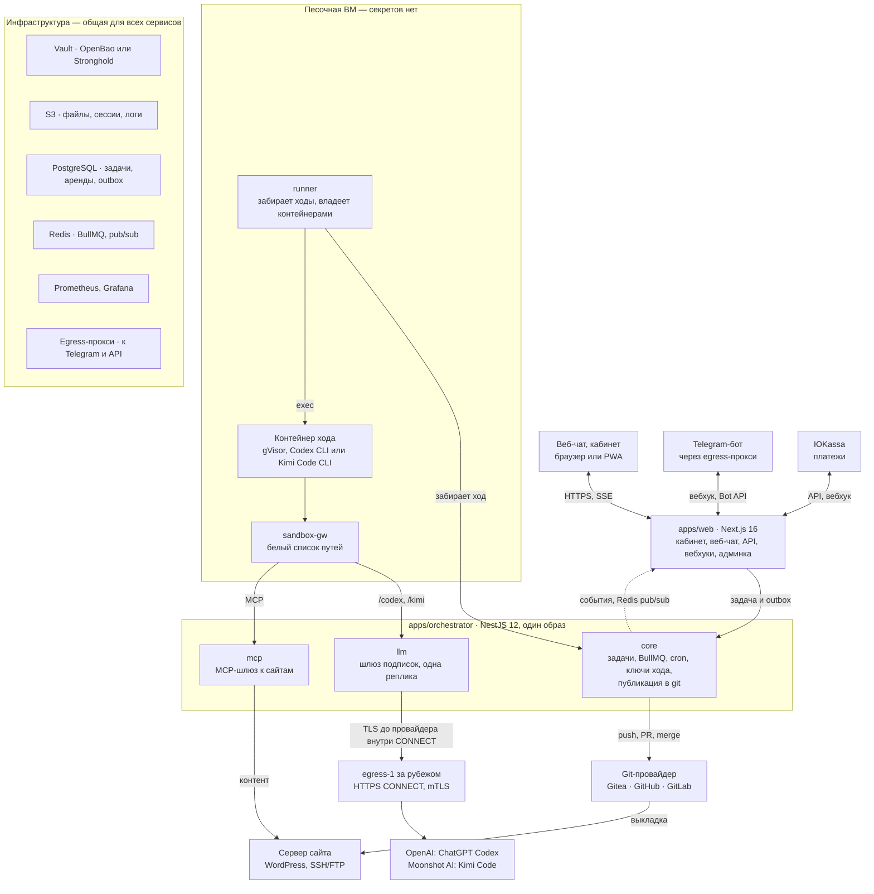

# Радити: AI-поддержка сайтов для малого бизнеса — спецификация v0.4

Версия v0.4 · 28.09.2026 · уточнение локальной проверки P3.0 от 29.09.2026 · сверка с кодом после ревью 02–04.10.2026 — 04.10.2026 · решения владельца об оплате от 04.10.2026 (продавец — самозанятая, два счёта правок; разделы 17 и 20)

> Снимок v0.2 из Claude Docs, обновлённый до v0.3 по решениям владельца от 26.09.2026 (итог bootstrap) и до v0.4 по решениям от 28.09.2026 (модели по подпискам Codex и Kimi, шлюз подписок). Исследования — в [docs/research/2026-09-bootstrap/](research/2026-09-bootstrap/) и [docs/research/2026-09-subscriptions/](research/2026-09-subscriptions/); подробный проект P3 — [p3-design.md](research/2026-09-subscriptions/p3-design.md). Если решение меняется — обновите и этот файл, и документ.

## 1. Коротко

Радити (raditi.ru) ведёт сайты малого бизнеса в России: владелец пишет пожелание в чат, агент меняет сайт. Код меняется через git-провайдера — нашу Gitea с обязательным пайплайном выкладки, позже и GitHub или GitLab клиента, — контент прямо на сайте. Окружение одно — прод, поэтому каждую выкладку страхуют бэкап, проверка и автоматический откат.

Первый стек — WordPress, следующий — 1С-Битрикс; Laravel, Node.js и Python подключаются адаптерами без переделки ядра.

**Ключевые решения**

| Область | Решение |
| --- | --- |
| Клиент | Малый бизнес без своего разработчика (раздел 2) |
| Каналы | Веб-чат (PWA) — основной, Telegram-бот — второй, MAX — позже |
| Структура кода | Монорепозиторий по образцу anynote, порты и адаптеры: pnpm 12, Turborepo 2.11, Next.js 16, NestJS 12, Prisma 7 (раздел 6) |
| Агент | CLI-агент через драйвер: Codex CLI и Kimi Code CLI; код Qwen Code и OpenCode выключен (раздел 8) |
| Модели | Подписки ChatGPT (Codex) и Kimi Code в пуле личных аккаунтов: шлюз подписок на app-ВМ, выход к провайдерам через узел за рубежом; хранилища — в России (разделы 9, 18) |
| Изоляция | Одноразовый контейнер под gVisor на каждый ход агента (раздел 8) |
| Код сайтов | Gitea 1.27 и gitea/runner, обязательный workflow организации; GitHub и GitLab клиента — через `GitProvider` (раздел 10) |
| Окружения | Только прод: подтверждение, бэкап, проверка, откат |
| Файлы, сессии, логи | S3 в российском облаке (раздел 14) |
| Секреты | OpenBao или Deckhouse Stronghold (раздел 15) |
| Данные и очереди | PostgreSQL и Prisma 7 — истина о задаче; Redis и BullMQ — очередь, таймеры, cron, раздача событий (раздел 7) |
| Оплата | ЮKassa: личная карта, СБП, SberPay, автоплатёж; подписка с квотой или оплата за действие из кошелька. Продавец — самозанятая (НПД): чеков 54-ФЗ, счетов и закрывающих документов для организаций нет, чек из «Мой налог» по каждому платежу оформляет владелец (раздел 17) |
| Код платформы | GitHub: CI и релизы в GitHub Actions (раздел 6) |
| Наблюдаемость | Prometheus и Grafana (раздел 19) |

**Что изменилось в v0.4** (решения владельца от 28.09.2026)

1. Модели — по личным подпискам в пуле аккаунтов: Codex CLI на подписке ChatGPT и Kimi Code CLI на подписке Kimi Code. Риск блокировки аккаунтов и риск лимитов владелец принимает. LiteLLM, Yandex AI Studio, Cloud.ru, GigaChat, роутер с классификатором и класс `service` убраны (разделы 3, 9).
2. Код, тексты и сообщения клиента обрабатывают модели OpenAI (США) и Moonshot AI (юрлицо и страна — по заключению юриста); хранилища платформы остаются в России. ПД третьих лиц агенту не передаются, трансграничную передачу пропускает гейт 152-ФЗ в коде (разделы 11, 18).
3. Шлюз подписок — четвёртая роль оркестратора `llm` на app-ВМ: ключ хода с привязкой к аккаунту пула, подстановка токена подписки, политика тела, потолок попытки, учёт из ответов провайдера (разделы 5, 9).
4. К провайдерам шлюз ходит только через узел выхода `egress-1` за рубежом: HTTPS CONNECT с mTLS и точным белым списком хостов (разделы 9, 19).
5. Токены подписок — в Vault mount `subs/` без истории версий, ключи хода — в `turns/` (раздел 15).
6. Цены провайдеров заменены учётными ставками платформы; на тарифах с квотой порог допуска запросов попытки — 135, 285 и 735 ₽ с учётом оценочных резервов; перерасход уже допущенных запросов берёт платформа (раздел 17).
7. Весь диалог с клиентом идёт внутри сессий Codex и Kimi; краткое содержание прошлых ходов собирается из итогов ходов без вызова модели (разделы 8, 9).
8. PoC начинается с разведки P3.0 на настоящем Codex; P3 закрывается после проверки владельца на настоящих подписках (раздел 21).

**Что изменилось в v0.3**

1. `apps/agents` и `apps/engines` объединены в `apps/orchestrator`: один образ, роли `core`, `mcp` и `runner` (разделы 5, 6).
2. Пакеты устроены как порты и адаптеры: порты — в `packages/domain`, новые пакеты `agent-drivers`, `sandbox-providers`, `git-providers` (разделы 6, 8).
3. Контейнер песочницы живёт один ход, а не всю задачу; снимки сессии — по ходам; патч публикуется из чистого клона (разделы 7, 8).
4. Один ход, выкладка или откат на сайт — аренда сайта в PostgreSQL; Redis остаётся для BullMQ, постановка в очередь — через `outbox_events` (раздел 7).
5. Код сайта может жить в нашей Gitea или в GitHub и GitLab клиента; список запрещённых путей расширен (раздел 10).
6. Деньги — Decimal, а не целые копейки; новый тариф «Оплата за действие» с кошельком; счёт — по журналу вызовов моделей, а не по событиям CLI (разделы 9, 16, 17).
7. Второй стек после WordPress — 1С-Битрикс (разделы 3, 13).
8. Исправлены флаги драйверов и описана изоляция: dockerd от root, uid 10001 в контейнере, граница — gVisor (разделы 8, 18).
9. Капча — Yandex SmartCaptcha; мониторинг — Prometheus и Grafana; CI и релизы платформы — GitHub Actions (разделы 6, 18, 19).

**Что изменилось в v0.2**

1. GitLab заменён на Gitea с act\_runner (раздел 10).
2. Файлы клиентов, сессии агентов и логи хранятся в S3 (раздел 14).
3. Секреты хранятся в Vault-совместимом хранилище (раздел 15).
4. Структура репозитория взята из anynote (раздел 6).
5. Агент не привязан к Codex: драйверы для нескольких CLI (разделы 8–9).
6. Рынок — только Россия, оплата через ЮKassa (раздел 17).
7. Добавлен портрет пользователя (раздел 2).
8. Staging убран: только прод со страховкой (разделы 7 и 10).

**Что поправлено в исходной идее**

- Подписки ChatGPT и Kimi Code. v0.3 от них отказалась: ChatGPT официально недоступен в России, условия OpenAI запрещают отдавать аккаунт другим, условия Kimi — автоматизацию и обратный прокси. Решение владельца от 28.09.2026 — модели по личным подпискам в пуле: доступ к провайдерам — через узел выхода за рубежом, риск блокировки аккаунтов и риск лимитов приняты (разделы 9, 18, 20).
- Подписку Kimi Code российской картой не оплатить — только через посредника, а её продажа приостанавливалась 21.07.2026 (раздел 20).
- Telegram в России с февраля 2026 года замедлен, поэтому основной канал — веб-чат.
- Без staging прод защищают подтверждение перед выкладкой, бэкап, проверка и откат.

## 2. Для кого

Клиент — владелец малого бизнеса, у которого есть купленный сайт, но нет своего разработчика и знаний, чтобы менять его самому. Он пишет пожелания обычными словами, как подрядчику, и ждёт результат, а не технические детали.

| Черта | Как выглядит | Что это значит для продукта |
| --- | --- | --- |
| Бизнес | Кафе, салон, клиника, магазин, услуги; сайт — витрина и источник заявок | Типовые задачи: цены, акции, фото, баннеры, формы, новые страницы |
| Сайт | Куплен у студии или фрилансера; обычно WordPress или Bitrix, часто на виртуальном хостинге | Доступ часто только FTP и панель хостинга; онбординг помогает их найти |
| Знания | Не знает, что такое Git, SSH, плагин или кэш | Никаких терминов в чате; агент сам решает, код это или контент |
| Время | Пишет урывками с телефона, часто голосом | Голос и фото в чате, короткие ответы, кнопки вместо вопросов |
| Страх | Боится «сломать сайт» и потерять заявки | Скриншот после правки, кнопка «Отменить», понятный статус |
| Деньги | Привык платить картой или со счёта организации, ждёт чек | ЮKassa, оплата только личной картой: продавец — самозанятая (НПД), платить ей могут только физлица. Чеков 54-ФЗ, счетов и закрывающих документов для организаций нет; чек из «Мой налог» по каждому платежу оформляет владелец. До оплаты говорим клиенту, что платить можно только личной картой и что счетов и закрывающих документов для организаций нет; о чеке продукт клиенту не говорит — ни на страницах, ни в письмах (решение владельца от 10.10.2026); оферта называет чек обязанностью исполнителя словами AnyNote (разделы 17 и 20) |

**Как агент говорит с клиентом**

- Обращается на «вы», без жаргона и английских терминов.
- Перед правкой кода показывает «Что изменится» — 1–3 пункта простыми словами — и кнопки «Применить», «Изменить», «Отмена».
- Если просьба неясна, задаёт уточняющие вопросы; варианты-кнопки — позже (раздел 7).
- После выкладки присылает скриншот и держит кнопку «Отменить» 7 дней.
- Если задача ему не по силам, передаёт её специалисту и честно называет срок.

## 3. Границы MVP

MVP — WordPress-сайты малого бизнеса в России, одно окружение (прод) и два канала: веб-чат и Telegram. Всё, что за этими рамками, заложено в интерфейсы, но включается позже.

| Область | В MVP | Позже |
| --- | --- | --- |
| Стеки | WordPress | 1С-Битрикс — следующим; Laravel, статика, Node.js, Python |
| Каналы | Веб-чат (PWA), Telegram-бот | MAX, e-mail |
| Окружения | Только прод | Staging по запросу клиента |
| Доступ к серверу | SSH, FTP/FTPS | Панели хостинга через API |
| Git-провайдер сайта | Наша Gitea | GitHub и GitLab клиента через `GitProvider` (раздел 10) |
| Выкладка | Gitea Actions: rsync по SSH, git-ftp | Docker Compose; для GitHub и GitLab клиента — открытый вопрос (раздел 20) |
| Контент | WP-CLI, REST API, Playwright | Конструкторы сайтов через браузер |
| Агенты | Codex CLI, Kimi Code CLI | Другие CLI — по решению владельца; код Qwen Code и OpenCode из P1 выключен |
| Модели | Подписки ChatGPT (Codex) и Kimi Code, пул личных аккаунтов | План Б — OpenAI API и Kimi Open Platform по токенам (раздел 9) |
| Оплата | ЮKassa: личная карта, СБП, SberPay, автоплатёж; чеков 54-ФЗ нет, чек из «Мой налог» по каждому платежу оформляет владелец; подписка с квотой и оплата за действие из кошелька | Оплата от ИП и организаций, счета и закрывающие документы для них — только если владелец сменит налоговый режим (раздел 17) |
| Секреты и файлы | OpenBao на одном узле, S3 в российском облаке | Stronghold или кластер высокой доступности |

## 4. Пользовательские сценарии

Клиент работает в веб-чате или в Telegram; кабинет с тарифом, оплатой и историей — только на сайте платформы. Сценарии MVP:

1. **Подключение сайта.** Мастер в кабинете просит адрес сайта и доступы: SSH, FTP, вход в админку. Он подсказывает, где их взять у популярных хостингов, и сам их проверяет (раздел 12).
2. **Правка кода.** «Добавьте на главную блок с отзывами». Агент готовит правку, клиент видит «Что изменится» и жмёт «Применить», «Изменить» или «Отмена». После выкладки приходит скриншот.
3. **Правка контента.** «Поменяйте цену на стрижку на 1500». Агент делает снимок страницы, меняет текст и сразу применяет; «Отменить» возвращает снимок.
4. **Голос и файлы.** Голосовое распознаётся (Yandex SpeechKit или SaluteSpeech), фото и документы уходят в S3 и попадают агенту во входящие.
5. **Уточнение.** Если просьба неясна, агент задаёт уточняющие вопросы; варианты-кнопки — позже (раздел 7); задача ждёт ответа.
6. **Сессии.** Каждая задача — отдельный диалог в веб-чате и отдельная тема в Telegram. Клиент видит список сессий и может вернуться к любой.
7. **Отмена.** «Верните как было» или кнопка «Отменить» в течение 7 дней: код откатывается revert-коммитом, контент — из снимка.
8. **Тариф и оплата.** Остаток правок или баланс кошелька виден в чате; купить или сменить тариф и пополнить кошелёк можно только в кабинете. Бот ничего не продаёт.
9. **Специалист.** Если агент не справился за две попытки или задача вне тарифа, её получает оператор, а клиент — понятный срок.

## 5. Архитектура

Платформа устроена как anynote: Next.js-приложение для людей, NestJS-оркестратор для задач, агентов и фоновых работ, Gitea для кода сайтов. Агент работает только в одноразовом контейнере на песочной ВМ и выходит наружу только через `sandbox-gw` — к шлюзу подписок и MCP-шлюзу. К провайдерам моделей ходит только шлюз подписок, через узел выхода за рубежом.



Главный путь: сообщение → apps/web (задача и `outbox_events` одной транзакцией) → relay в `core` → BullMQ → ход в контейнере песочницы → патч → публикация в git-провайдер → «Применить» → выкладка на сервер сайта. Правки контента идут из песочницы через `sandbox-gw` в MCP-шлюз (роль `mcp`) прямо на сайт. Сообщения и файлы клиента сначала записываются в PostgreSQL и S3 в России; прямого пути «браузер → провайдер модели» нет, к провайдеру данные уходят только в запросах агента через шлюз подписок (роль `llm`).

| Компонент | Что делает | Технологии |
| --- | --- | --- |
| apps/web | Кабинет, веб-чат (SSE), API, вебхуки Telegram, ЮKassa и git-провайдеров, админка оператора; пишет задачу и `outbox_events` одной транзакцией | Next.js 16.3, tRPC 11, better-auth 1.7, MUI 9 |
| apps/orchestrator · core | Жизненный цикл задач, квоты и кошелёк, relay outbox → BullMQ, воркеры и cron, выбор драйвера и профиля класса, выбор аккаунта пула и выдача ключа хода, управление песочницами, публикация в git | NestJS 12, BullMQ 6 |
| apps/orchestrator · mcp | MCP-шлюз к сайтам: WP-CLI, REST, браузер; отдельный процесс и порт, своя AppRole в Vault, подключение к PostgreSQL под общим пользователем `raditi` | NestJS 12, @rekog/mcp-nest 2, Playwright |
| apps/orchestrator · llm | Шлюз подписок (с P3): проверяет ключ хода, подставляет токен подписки аккаунта, держит политику тела и бюджет ключа хода (расход попытки по всем её ключам считает P12), пишет расход из ответов провайдера в `llm_calls` и `token_usage`, а отметку отказа по содержанию — в `task_events`, обновляет токены, следит за здоровьем аккаунтов. Одна реплика на app-ВМ, порт 8084 на частном адресе; своя AppRole, общий пользователь PostgreSQL `raditi`, без Redis (раздел 9) | `node:http`, undici с mTLS |
| apps/orchestrator · runner | Pull-раннер на песочной ВМ: сам забирает ходы, владеет контейнерами, без входящих портов, аренда хода с эпохой (roadmap P2). В PoC вместо него `core` управляет Docker через локальный сокет | NestJS 12, dockerode |
| Песочница | Одноразовый контейнер на ход: CLI-агент, рабочая копия сайта, файлы клиента | Docker 29 + gVisor (`runsc`, systrap) |
| sandbox-gw | Единственный выход песочницы: белый список путей к шлюзу подписок (`/codex`, `/kimi`) и MCP-шлюзу | HTTP-шлюз на Node (`infra/sandbox/gateway.mjs`) |
| Узел выхода `egress-1` | Единственный выход шлюза подписок к провайдерам: CONNECT только к `chatgpt.com`, `auth.openai.com`, `api.kimi.ai` на :443; TLS идёт от шлюза до провайдера, тела и токены на узле не расшифровываются (разделы 9, 19) | ВМ за рубежом, по умолчанию Казахстан; `node:tls` без зависимостей, mTLS |
| Провайдеры моделей | OpenAI (США): Codex на бэкенде ChatGPT; Moonshot AI: Kimi Code (юрлицо и страна — по заключению юриста) | Личные подписки в пуле аккаунтов |
| Git-провайдер | Репозитории сайтов, проверки и выкладка: Gitea — наша, GitHub и GitLab — клиента | Gitea 1.27, gitea/runner 4 |
| Vault | Доступы к сайтам, токены подписок (`subs/`), ключи хода (`turns/`), токены выкладки, SSH-сертификаты, ключи шифрования | OpenBao или Stronghold |
| S3 | Файлы клиентов, снимки ходов, логи, бэкапы, скриншоты | Объектное хранилище в российском облаке |
| PostgreSQL | Данные платформы; истина о задаче (`tasks.status`), аренды сайтов, outbox, история событий | PostgreSQL 17, Prisma 7.10 |
| Redis | Очереди и таймеры BullMQ, job schedulers для cron, pub/sub событий задачи для реплик web | Redis 8.10: `appendonly`, `maxmemory-policy noeviction` |
| Мониторинг | Метрики сервисов и инфраструктуры, алерты | Prometheus, Grafana |
| Egress-прокси | Выход к Telegram и внешним API с отдельного адреса | Как WARP-прокси для Telegram в anynote |

## 6. Монорепозиторий

Платформа повторяет структуру [anynote](https://github.com/anynoteinc/anynote): pnpm и Turborepo, `apps/*` и `packages/*`, а слои пакетов проверяет dependency-cruiser (`pnpm check-architecture`). Отличий два: оркестратор пишем на TypeScript (NestJS), а не на Python — агент теперь внешний CLI, и граф LangGraph не нужен; пакеты устроены по схеме «порты и адаптеры».

**Версии** (на 26.09.2026)

| Что | Версия | Оговорка |
| --- | --- | --- |
| Node.js | 26.10 | В прод — после перехода 26 в LTS 28.10.2026 |
| pnpm, Turborepo | 12.6, 2.11 | — |
| TypeScript | `tsc` 7.0 для проверки типов; пакет `typescript` 6.0 через псевдоним | typescript-eslint, dependency-cruiser и Nest CLI с TS 7 не работают |
| Next.js, React, MUI | 16.3, 19.3, 9.4 | MUI 9, а не v6 |
| NestJS | 12.1 | Только ESM |
| Prisma | 7.10, строго | Генератор `prisma-client`; тег `latest` у CLI указывает на 8.0 RC |
| better-auth, tRPC, zod | 1.7, 11.19, 4.6 | tRPC — через `@trpc/tanstack-react-query` |
| Vitest, ESLint, Playwright | 5, 10, 1.63 | Для Nest — unplugin-swc |
| BullMQ, @nestjs/bullmq, Redis | 6.3, 12, 8.10 | — |

| Путь | Назначение | Из anynote |
| --- | --- | --- |
| apps/web | Next.js 16: лендинг `(about)`, вход `(auth)`, кабинет и веб-чат `(protected)`, юридические документы в MDX, вебхуки, SSE-поток задачи | Да: route groups, SSE, вебхук ЮKassa, юридические документы |
| apps/orchestrator | NestJS 12, один код и один образ, четыре роли запуска: `core` — жизненный цикл задач, воркеры BullMQ, cron, управление песочницами, ключи хода, публикация в git; `mcp` — MCP-шлюз к сайтам; `llm` — шлюз подписок (с P3, одна реплика); `runner` — pull-раннер на песочной ВМ. В проде роли — отдельные процессы; локально `core`, `mcp` и `llm` можно запустить в одном процессе на разных портах (`ORCHESTRATOR_ROLES`) | Роль та же, что у бывших agents и engines; стек TypeScript вместо Python |
| apps/e2e | Playwright-тесты платформы | Да |
| packages/domain | Ядро: ошибки `DomainError` и порты — `AgentDriver` с общими событиями и zod-схемой итога хода, `SandboxProvider`, `TurnExecutor`, `TurnCredentialSource`, `TurnAssignmentStore`, `SiteLeaseStore`, `LlmBackend`, `GitProvider`, `SiteAdapter`, `SecretStore`, `ObjectStorage`, `JobQueue`; zod-схемы протокола раннера (`runner/protocol.ts`). Чистая логика шлюза подписок (с P3): классы моделей и потолки, бюджет попытки, себестоимость вызова, выбор аккаунта, политика JSON. Остальной бизнес-логики пока нет, со временем вся она будет здесь | Да, роль шире |
| packages/db | Prisma 7 + PrismaPg: схема, миграции, сиды | Да |
| packages/storage | S3 за портом `ObjectStorage`: добавить presigned URL, multipart, несколько бакетов | Расширить |
| packages/vault | Клиент Vault API за портом `SecretStore`: KV v2 с CAS, Transit, SSH, AppRole, wrapping | Новый |
| packages/git-providers | `GitProvider`: адаптеры gitea, github, gitlab — репозитории, ветки, PR, секреты и переменные CI, вебхуки | Новый, вместо packages/gitea |
| packages/sandbox-providers | `SandboxProvider`: адаптер docker | Новый |
| packages/agent-drivers | `AgentDriver`: codex и kimi — запуск, разбор событий, состояние сессии; qwen и opencode — код P1, выключен и в продукт не входит | Новый, вместо packages/agent-runtime |
| packages/llm-backends | `LlmBackend` (с P3): openai-chatgpt и kimi-code — политика тела, учёт usage, сигналы провайдера, проверочные запросы, ответы под повторы CLI, обновление токенов, вход по device-flow, отзыв | Новый |
| packages/site-adapters | `SiteAdapter`: wordpress, дальше bitrix | Новый |
| packages/yookassa | Платежи, автоплатёж, возвраты, вебхуки. Чеки не добавляем: продавец — самозанятая, объект `receipt` в платёж не передаётся (раздел 17) | Расширить |
| packages/mail, telegram | Письма через SendSay, Bot API через прокси | Да |
| packages/auth | better-auth, вход через Telegram, капча SmartCaptcha | Расширить |
| packages/notifications | Уведомления | Да |
| packages/trpc, packages/ui | tRPC с `createCaller` для RSC; MUI 9 | Да |
| packages/observability | Серверные помощники приложений: health-проверки, метрики, сравнение bearer-токена, текст ошибки и лог с ограничением частоты. Зависит только от domain и `@prometheus-io/client`, импортируют его только приложения | Новый |
| agent-kit/ | Образы песочниц: базовый образ на стек с закреплёнными версиями CLI агентов | Новый |
| ci/ | Обязательные workflow и actions выкладки сайтов; синхронизируются в `platform/ci` в Gitea | Новый |
| .github/ | CI и релизы платформы в GitHub Actions | Да |
| ansible/ | Плейбуки подготовки серверов сайтов | Новый |
| infra/ | `infra/dev` — локальная инфраструктура (`docker-compose.yml` с профилями `site`, `llm` — фейки подписок и локальный прокси выхода, `ci`, `monitoring`, `monitoring-host`); `infra/sandbox` — песочная ВМ (watchdog, шлюз, раннер); `infra/app` — app-ВМ: Compose с Traefik и Let's Encrypt, web, core, `llm` (профиль `llm`), PostgreSQL, Redis, runbook выкладки; `infra/egress` — узел выхода `egress-1` за рубежом: прокси, nftables, runbook (с P3); `infra/vault` — политики Vault с P3, ВМ Vault — M10; `infra/{gitea,ci}` — M10 | Новый |
| docs/ | architecture.md, спецификации, исследования, юридические тексты | Да |

**Слои — порты и адаптеры.** Зависимости идут только вниз; адаптер реализует порт из `packages/domain` и зависит только от него, а какой адаптер подставить, решает приложение. `mail`, `telegram` и `yookassa` пока — клиенты внешних сервисов без своих портов: порты `Mailer` и `Messenger` появятся в domain вместе с логикой, которой они нужны (M3). Порт `PaymentGateway` не вводится: сервисный пакет `@repo/billing` (появляется в M5) использует адаптер `@repo/yookassa` напрямую, как `notifications` использует `mail`. Это допущение «п» [плана биллинга](plan/37-billing-plan.md) от 04.10.2026, ждёт владельца (раздел 20). `observability` стоит сбоку от слоёв: это только серверный код приложений (health, метрики, bearer-токен, лог ошибок с ограничением частоты), он зависит только от domain и `@prometheus-io/client`, и ни один пакет его не импортирует. Чистые помощники без ввода-вывода, которые нужны и доверенному коду, живут в domain: `withTimeout` и разбор переменных окружения (`parseEnv`, `envVar`, `envProblems`, тип `Env`).

| Слой | Пакеты |
| --- | --- |
| Приложения | apps/web, apps/orchestrator, apps/e2e |
| UI и транспорт | ui, trpc |
| Сервисы | auth (better-auth), notifications; с M5 — billing |
| Адаптеры | db, storage, vault, git-providers, sandbox-providers, agent-drivers, llm-backends, site-adapters, yookassa, mail, telegram |
| Ядро | domain: порты, ошибки домена, чистые помощники (`withTimeout`; `parseEnv`, `envVar`, `envProblems`, `Env`) и чистая логика шлюза подписок (с P3) |
| Сбоку, только для приложений | observability: health, метрики, bearer-токен, лог ошибок |

Новые переменные окружения попадают и в `.env.example`, и в `globalEnv` в `turbo.json`. Код платформы живёт на GitHub: CI (typecheck, lint, test, check-architecture, build) и релизы через semantic-release с `@semantic-release/github` идут в GitHub Actions: тег на влитом коммите и GitHub Release с заметками, без коммита CHANGELOG в `main`; выкладка платформы на ВМ через GitHub Actions — позже (M10). Gitea — только для репозиториев сайтов клиентов и реестра образов.

## 7. Жизненный цикл задачи

Одна задача — одна логическая сессия агента и одна ветка задачи; контейнер песочницы живёт один ход. Пока задача ждёт клиента, контейнера нет, а сессия лежит в S3. Правка кода попадает в прод только после «Применить», правка контента — сразу, но со снимком для отката.


Прод один, поэтому клиент видит «Что изменится» до merge, а пайплайн делает бэкап, выкладку, проверку и при сбое — откат. Секрет выкладки одноразовый: оркестратор кладёт его в репозиторий перед merge и удаляет после (раздел 15).

**Очередь и сериализация**

- Истина о задаче — `tasks.status` в PostgreSQL. Переход статуса — условный `UPDATE … WHERE status IN (…)` в одной транзакции с записью в `credit_ledger`, поэтому списание и возврат случаются ровно один раз.
- Постановка в очередь атомарна с записью в базу: web пишет задачу и `outbox_events` одной транзакцией, relay в `core` переносит их в BullMQ. После публикации relay очищает payload строки, а опубликованные и неудачные строки удаляет через 7 дней: в payload бывают одноразовые ссылки. Задания уведомлений удаляются из Redis сразу после выполнения.
- Ходы, выкладки, таймеры и cron — задачи BullMQ через `@nestjs/bullmq`; cron — job schedulers BullMQ. Redis работает с `appendonly` и `maxmemory-policy noeviction`.
- Долгие ожидания (`awaiting_user`, `awaiting_approval`) — это статус плюс отложенная задача-таймер BullMQ, а не висящий job. Таймер ничего не делает, если статус уже сменился. Таймера ожидания ответа клиента пока нет (раздел 20, «Лента для клиента»: вопрос 19 проекта ленты); `no_answer` у `feed.cancelled` зарезервирован.
- Ответ клиента и «Изменить» ставят следующий ход той же задачи в очередь (`queued`).
- На сайте одновременно идёт не больше одной операции — хода, выкладки или отката. Это аренда сайта (site lease) в PostgreSQL; группы BullMQ есть только в платной Pro, поэтому их не берём. Если исход выкладки неизвестен, аренда не снимается до решения оператора.
- Лента диалога — строки `task_events` с типом `feed.*` и `client_visible = true`; остальные строки таблицы — служебные и клиенту не отдаются никогда (решение владельца от 11.10.2026, [проект ленты](research/2026-10-client-feed/feed-design.md)). Строка ленты пишется один раз, при записи: слова клиента — web, в транзакции создания задачи или её возврата в очередь; этапы работы — журнал хода, тем же запросом, что и служебную запись; вопрос, итог, сбой и отмену — тот, кто делает переход статуса, в его транзакции. Смена статуса строкой ленты не является: истина — `tasks.status`.
- Клиент читает ленту процедурой `task.feed`: один снимок базы (`REPEATABLE READ`) — голова задачи (статус, попытка, номер хода, причина ожидания в очереди, удержан ли сайт) и строки после курсора. Курсор — `task_events.id`. Сейчас это опрос; SSE (M12.11) отдаёт тот же ответ, `Last-Event-ID` — тот же курсор, а через Redis pub/sub между репликами web идёт только подсказка «задача изменилась». Идентификатор выдаётся при вставке, а не при фиксации, поэтому клиент складывает строки по идентификатору и при смене статуса один раз перечитывает ленту с начала.
- Слова клиента — строки `feed.request`; запрос хода агенту собирается из них. Текст в `outbox_events` не дублируется. Сообщение, похожее на пароль или ключ, отклоняется до записи (раздел 11).
- Переход в `running` делает журнал хода — тем же запросом, что пишет первую запись хода под арендой. Переход в `done`, `failed`, `awaiting_user`, `awaiting_approval` и `cancelled` делается, только когда назначение хода закрыто либо не открывалось; ход с открытым назначением оставляет задачу в `running` до конца восстановления.
- `preparing → queued`: сайт занят другой операцией (`SITE_BUSY`). Резерв и номер попытки не меняются, строка ленты не пишется, задача ставится снова отложенным заданием очереди; сбоем это не считается. Почему задача ждёт в очереди — свободного аккаунта пула или сайта, — хранит `tasks.waiting` (раздел 16).
- Запасной путь без Redis — бэкенд BullMQ 6 на PostgreSQL (`createPostgresBackend`, с июля 2026).

| Статус | Что происходит | Контейнер хода | Что видит клиент |
| --- | --- | --- | --- |
| queued | Задача в очереди, резерв сделан: кредиты, отложенные под попытку (раздел 17, «Правила списания»). Если свободного аккаунта пула подписок нет, задача ждёт здесь не дольше 24 часов (раздел 9) | Нет | «Приняли, начинаем»; если пул занят — шаблон раздела 9 без времени (оценки начала в голове задачи нет); если занят сайт — «На сайте сейчас идёт другая работа. Начнём, когда она закончится» |
| preparing | Аренда сайта, запуск контейнера, восстановление контрольной точки (снимок хода n−1, при замене хода — более раннего; раздел 8) или клон ветки | Создаётся | «Готовим» |
| running | Агент работает, события пишутся в `task_events` и S3 | Есть | «Агент работает»: этапы — «Работа над задачей», «Сохранение работы»; позже, по доверенным фактам, — «Работа с содержимым сайта» и «Правки в файлах сайта» — и время от начала хода. Слова агента до итога, команды, имена файлов и расход не показываются |
| awaiting\_user | Агент задал вопрос или попытка упёрлась в потолок (раздел 17); таймера ожидания пока нет (раздел 20) | Нет | «Нужен ваш ответ»: вопросы из итога хода, ответ одним сообщением; кнопки-варианты — после добавления вариантов в итог хода. Вопрос платформы о шаге и кредитах — тем же местом, с P12 |
| awaiting\_approval | Правка кода опубликована в ветку, проверки прошли; таймера ожидания пока нет (раздел 20) | Нет | «Что изменится» и кнопки |
| deploying | Merge в main, пайплайн делает бэкап и выкладку; сайт под арендой | Нет | «Выкладываем» |
| verifying | Проверки после выкладки | Нет | «Проверяем» |
| done | Готово, резерв списан | Нет | «Готово»: сообщение агента и строка о сайте по тому, что известно платформе; снимок страницы и «Отменить» — когда появятся |
| failed | Ошибка до выкладки; что с сайтом — по доверенному факту (абзац под таблицей); резерв возвращён (исключение — допущение «л», раздел 17). «Попробовать ещё» — та же задача с новым резервом и классом `heavy` (`failed` → `queued`) | Нет | «Не получилось»: причина из закрытого списка, что с сайтом, что с кредитами; «Попробовать ещё» — если причина это допускает и правки содержимого не остались на сайте; счёт попыток повтор после сбоя не ограничивает (абзац под таблицей; открытый вопрос раздела 20) |
| rolled\_back | Проверка не прошла, прод вернули из бэкапа | Нет | «Вернули как было» |
| cancelled | Клиент отменил до выкладки либо платформа отменила без его участия: правку кода пока нельзя применить из кабинета (до M12.9) или задача сутки ждала аккаунт пула (раздел 9); резерв возвращён (исключение — допущение «л», раздел 17) | Удаляется | «Отменено» |

Подписи статусов в шапке диалога и в списке: `queued` — «Приняли, начинаем», `preparing` — «Готовим», `running` — «Агент работает», `awaiting_user` — «Нужен ваш ответ», `awaiting_approval` — «Ждёт вашего решения», `deploying` — «Выкладываем», `verifying` — «Проверяем», `done` — «Готово», `failed` — «Не получилось», `rolled_back` — «Вернули как было», `cancelled` — «Отменено». Завершённый диалог закрыт: после `done`, `cancelled` и `failed` без повтора клиент начинает новый.

Обещание «на сайте ничего не изменилось» при `failed` и `cancelled` клиенту даётся только тогда, когда доверенная сторона это знает: записей содержимого у задачи не было либо все они возвращены. Перед переходом в `failed` и `cancelled` доверенная сторона возвращает правки содержимого задачи (`undoTask`); если возврат невозможен, клиент читает: «Часть правок могла остаться на сайте. Откройте сайт и проверьте», а «Попробовать ещё» для такой задачи нет. Пока канал возврата не подключён (N9), так заканчивается каждая сбойная задача с успешными записями содержимого.

До «Применить» и «Не применять» в кабинете (M12.9) задача, итог которой требует правки кода, не остаётся в `awaiting_approval`: она отменяется с возвратом резерва и правок содержимого и текстом «Эта задача требует изменений в файлах сайта, а применять их из кабинета пока нельзя». Ветка `agent/<taskId>` остаётся в репозитории, выкладки нет. Так же, без участия клиента, отменяется задача, сутки прождавшая свободный аккаунт пула (раздел 9).

Попытка, в которой агент упал, не засчитывается ни в три попытки задачи, ни в дневной лимит запусков: клиент платит только кредитами, которые считаются от расхода модели (решение владельца от 11.10.2026, раздел 20, «Решения владельца от 11.10.2026 — страница сайта, раздел «Чат»», пункт 4). Прежде, по решению о ленте, незасчитанной была только попытка, упавшая до выдачи ключа хода. Сейчас документы читают это так: не засчитывается каждая попытка, которая закончилась сбоем (строка `feed.failure`), с любым кодом причины; три попытки тогда ограничивают только попытки, начатые иначе, — «Продолжить» после вопроса платформы (P12). Какие сбои владелец называет «агент упал» и чем ограничены повторы подряд, его слова не решают — открытый вопрос того же блока. Раздел 17 и сервис биллинга пока считают попытки по `tasks.attempt`, а запуски дневного лимита — по одному, чем бы запуск ни кончился; согласование — за линией биллинга (M5.27a, P12).

## 8. Агентный рантайм

Платформа не привязана к одному агенту: любой CLI-агент подключается драйвером (`AgentDriver`), а песочница — провайдером (`SandboxProvider`). Оба порта объявлены в `packages/domain`, адаптеры лежат в `packages/agent-drivers` и `packages/sandbox-providers`. В MVP два драйвера — Codex CLI и Kimi Code CLI, оба на подписках через шлюз подписок (раздел 9). Код Qwen Code и OpenCode из P1 остаётся, но выключен и в продукт не входит.

### Драйвер

```ts
interface AgentDriver {
  id: 'codex' | 'kimi' | 'qwen' | 'opencode'
  image: string                                        // образ песочницы с CLI, по дайджесту
  capabilities: {
    resume: boolean                                    // продолжение сессии
    jsonEvents: boolean                                // поток событий JSONL
    outputSchema: boolean                              // итог по JSON-схеме
    mcp: boolean
    images: boolean                                    // картинки на вход
  }
  prepare(ctx: RunContext): Promise<PreparedRun>       // конфиг, AGENTS.md, MCP; env; секреты хода
  command(run: PreparedRun, turn: TurnInput): string[] // argv хода: новая сессия или продолжение
  parseEvent(line: string): AgentEvent[]               // строка stdout → ноль или несколько общих событий
  sessionState(run: PreparedRun): {                    // что упаковать в home.tar.zst
    root: string; include: string[]; exclude: string[]
  }
  extractResult(events: AgentEvent[]): AgentResult
}
```

Оркестратор и чат видят только общие события: `started`, `message`, `command`, `file_change`, `tool_call`, `question`, `usage`, `completed`, `failed`. События `usage` печатает процесс под управлением агента, поэтому денег по ним не считают: деньги считаются по учёту шлюза подписок, а расход он берёт из ответов провайдера (раздел 9). `failed.reason` — сырой текст CLI или провайдера, часто на английском: он нужен только для логов и оператора. Клиент его не видит: чат показывает русский текст по коду причины из закрытого списка.

**Лента для клиента.** Общие события агента клиенту напрямую не показываются, и проекция от них не зависит: набор событий у оболочек разный. Строки `feed.*` в `task_events` (zod-схемы — `packages/domain/src/tasks/`, `client-feed*.ts`) строятся так:

- `feed.step` — этап: `work` (журнал записал фазу `running` или `resumed`), `save` (фазу `quiesced`). Этапы, утверждающие что-то о сайте, строятся на доверенных фактах: `site` — первая допущенная запись содержимого хода в журнале MCP, `files` — публикация кандидата с непустым диффом; их писатели подключаются позже (N8/N9 и M12.9). Каждый этап — не больше раза за заход.
- События `message`, `command`, `tool_call`, `file_change`, `usage`, `question`, `completed`, `failed` в ленту не идут. `failed.reason` и текст ошибки в строку ленты не попадают: в ней только код из закрытого списка причин (их двенадцать), русский текст выбирается при показе. Что с сайтом и что с кредитами, в строке сбоя и отмены пишет доверенная сторона, а не агент.
- Свободный текст в ленте — только слова клиента, `client_message` и тексты вопросов из итога хода. Текст агента перед записью нормализуется: управляющие, невидимые и меняющие направление символы и одиночные половины суррогатных пар удаляются, служебные метки маскирования (раздел 11) заменяются словами «(телефон скрыт)» и «(почта скрыта)», а любая другая строка вида `[[raditi:…]]`, в том числе оборванная или испорченная, — словом «(скрыто)»: метка скрывается целиком, вместе с метками внутри неё; на экране он выводится простым текстом без разметки и ссылок. Слова клиента хранятся как написаны, поэтому то, что сохранить нельзя, отклоняется, а не удаляется: управляющие символы, одиночная половина суррогатной пары и текст без единого видимого символа. Видимый символ нужен и тексту агента: строка из одних пробелов и переводов строки в ленту не записывается, а сохранённая строка, в которой после нормализации нечего читать, показывается нейтральной фразой нечитаемой строки, а не пустой карточкой. Схему итога хода (`turnResultSchema`) такой `client_message` пока проходит: что делает с ним обработчик хода, решает его срез (M12.5).
- В каждой строке — версия `v`; строки не переписываются. Запись проверяется строгой схемой, чтение терпимо: незнакомый тип и нечитаемая строка показываются нейтральной фразой, а не пропускаются. Тексты платформы — подписи этапов, статусов и причин — в строках не хранятся: в строке код, текст берётся из каталога при показе.

Этап пишет журнал хода в том же запросе, что и служебную запись: ограждение аренды у них общее, и владелец, потерявший аренду, клиенту ничего не напишет.

В P1 реализованы stateless-парсеры JSONL, проверка итога через `turnResultSchema` и списки файлов сессии для четырёх CLI. Форматы сверены с закреплёнными upstream-релизами; [источники и ограничения](../packages/agent-drivers/src/fixtures/README.md). Строка JSONL ограничена 256 КиБ, глубина JSON — 32; неизвестные и повреждённые строки пропускаются. Обрезанный текст помечается и не принимается как итоговый JSON. В выводе хода строка длиннее 256 КиБ ход не завершает: супервизор пропускает её целиком и оставляет на её месте служебное сообщение, которое итогом не считается. Весь вывод хода ограничен 32 МиБ. `capabilities` описывает возможности CLI; `prepare`, `command`, запуск с моделью и resume в контейнере проверяются в P4/P5. Kimi не печатает terminal event и usage: успешный выход процесса проверяет супервизор. `output` общего события usage включает reasoning.

| Драйвер | Запуск без интерфейса | Сессии | Модели | Настройка для песочницы |
| --- | --- | --- | --- | --- |
| Codex CLI | `codex exec --json --output-schema <файл>` | `codex exec resume <thread_id>`; rollout-файлы в `CODEX_HOME/sessions`; `--ephemeral` не использовать | Подписка ChatGPT через шлюз подписок: свой провайдер `raditi` с `base_url` на `sandbox-gw` `/codex`, `wire_api="responses"`, `requires_openai_auth=false`, `supports_websockets=false`; ключ хода — из файла секретов; `auth.json` в песочнице нет | Встроенную песочницу и подтверждения выключает `--dangerously-bypass-approvals-and-sandbox`; `check_for_update_on_startup=false`, аналитика и подагенты выключены |
| Kimi Code CLI (`@moonshot-ai/kimi-code` 2.1.1) | `kimi -p <задача> --output-format stream-json`; `-p` нельзя сочетать с `--yolo`, `--auto` и `--plan` | `--session <id>`; каталог `KIMI_CODE_HOME/sessions/<workDirKey>/…`, ключ зависит от пути рабочего каталога | Подписка Kimi Code через шлюз подписок: `KIMI_MODEL_PROVIDER_TYPE=kimi`, `KIMI_MODEL_BASE_URL` на `sandbox-gw` `/kimi/v1`, ключ хода — из файла секретов; в `stream-json` нет usage | `KIMI_DISABLE_TELEMETRY=1`, `KIMI_CODE_NO_AUTO_UPDATE=1`; `auto_session_title=false`, без `[secondary_model]`; `rg` и `fd` — в образе |
| Qwen Code 0.24 — выключен | `qwen -p <задача> --output-format stream-json` | `--resume <id>`; чаты в `~/.qwen/projects/<cwd>` | Не в продукте: код P1 | `--approval-mode yolo`; лимиты `--max-wall-time`, `--max-session-turns` |
| OpenCode 1.18 — выключен | `opencode run --format json` | `--session <id>`, `opencode export` и `import` | Не в продукте: код P1 | Права через `OPENCODE_PERMISSION` |

Боевые конфиги оболочек — P4 (Codex) и P5 (Kimi), подробности — раздел 9, «Оболочки в песочнице». Флаги взяты из документации [Codex](https://learn.chatgpt.com/docs/non-interactive-mode), [Kimi Code](https://moonshotai.github.io/kimi-code/en/reference/kimi-command.html) ([переменные окружения](https://github.com/MoonshotAI/kimi-code/blob/main/docs/en/configuration/env-vars.md)), [Qwen Code](https://qwenlm.github.io/qwen-code-docs/en/users/features/headless/) и [OpenCode](https://opencode.ai/docs/cli/); работу каждого драйвера подтверждаем в PoC. Для закреплённого Codex 0.158.0 локально подтверждены флаги после `exec resume`, включая `--output-schema`, и восстановление только из `sessions/` в новом контейнере; [отчёт P4](plan/22-p4-codex-driver.md). Дополнительно `pnpm verify:codex-supervisor` проверяет два хода настоящего CLI под gVisor через супервизор и pull-раннер: захват и восстановление зашифрованных снимков, тот же native UUID в новом контейнере, новые ключи и публикацию в локальный Git после удаления песочницы. PostgreSQL, S3 и OpenBao одноразовые; ответы LLM и MCP синтетические, выдача ключей подставная. Рабочий `.env` не читается. Этот проход не заменяет приёмку шлюза подписок P3 или продуктовый WordPress e2e.

`command(run, input)` может дополнить `run.files` входными файлами хода; супервизор проверяет и записывает подготовленные файлы после него. Codex сохраняет текст запроса в `/agent-home/codex/prompt.txt`, аргументы CLI — в `cli-args.json`. Обёртка `run.mjs` читает эти файлы, подаёт запрос через stdin и запускает Codex в той же группе процессов рантайма для штатной отмены. Это сохраняет запрос из одного `-` буквально и не упирается в лимит exec для длинного текста и списка вложений. Картинки из `/workspace/inbox` идут повторяемыми `--image`, другие файлы перечислены в запросе. Картинка с запятой в имени в `--image` не передаётся — CLI делит значение по запятым — и перечисляется в запросе вместе с остальными файлами. Список вложений драйверы Codex и Kimi проверяют правилом самого плана хода (`turnInputSchema`): не больше 100 путей, каждый — под `/workspace/inbox`, без управляющих символов, без пустых сегментов, `.` и `..`, не длиннее 1024 символов. Своей копии правила у драйверов нет; отказ у обоих один — `Invalid attachment path`. Общая для двух драйверов обвязка хода (схема контекста, два файла секретов, подготовка входных файлов, проверка вложений) — в `packages/agent-drivers/src/cli-run.ts`. Ни обёртка, ни эти входные файлы не входят в allowlist снимка.

### Песочница

Порт `SandboxProvider` прячет, как запускается контейнер: адаптер `docker` работает через dockerode и локальный сокет Docker. Где идёт работа с контейнером хода, прячет второй порт — `TurnExecutor` (ниже). В PoC и тестах `core` вызывает провайдер в своём процессе, в пилоте тот же адаптер работает внутри роли `runner` на песочной ВМ: раннер сам забирает ходы, владеет контейнерами и файлом вывода, входящих портов у него нет, а аренда хода с эпохой отсекает устаревшего владельца. Удалённая граница — `TurnExecutor`, а не провайдер: удалённый провайдер означал бы RPC на каждый exec и каждую операцию с файлами, а stdin и stdout шли бы через core. Поэтому `SandboxProvider.kind` — только `docker`. Docker API по TCP наружу не выставляем: ключ к нему — это root на ВМ.

```ts
interface SandboxProvider {
  kind: 'docker'                                       // локальный сокет Docker: в core (PoC) или в роли runner (пилот)
  create(spec: SandboxSpec, signal?: AbortSignal): Promise<Sandbox>
  get(id: SandboxId): Promise<Sandbox | null>          // подхватить для работы: свой, неизменный, шлюз цел
  getForRemoval(id: SandboxId): Promise<RemovableSandbox | null> // только удалить: и тот, что get не отдаёт
  list(filter?: Partial<SandboxLabels>): Promise<SandboxInfo[]> // свои контейнеры ходов по меткам — и для работы, и для удаления
}

interface SandboxSpec {
  image: string                                        // только по дайджесту из своего реестра
  labels: SandboxLabels                                // workspaceId, siteId, taskId, sessionId, turn, leaseEpoch
  runtime: 'runsc' | 'runc'                            // из SANDBOX_RUNTIME; на macOS — runc
  resources: { cpu: number; memoryMiB: number; pids: number } // 2 / 4096 / 512
  user: { uid: number; gid: number }                   // только 10001:10001
  env: Record<string, string>                          // без секретов: видно в docker inspect
  secrets: SecretFile[]                                // tmpfs вне /workspace и /agent-home, только на ход
  network: { mode: 'none' } | { mode: 'gateway'; routes: Array<'llm' | 'mcp'> } // зеркала пакетов — позже
  hardTimeoutMs: number                                // не больше 20 минут
}                                                      // корневая ФС всегда только для чтения — переключателя нет

interface Sandbox {
  id: SandboxId
  exec(spec: ExecSpec): Promise<ExecHandle>            // всё через exec: агент, git diff, tar
  attach(execId: ExecId, cursor?: { stdout: number; stderr: number }): Promise<ExecHandle> // байтовые оффсеты потоков
  quiesce(): Promise<void>                             // остановить процессы агента перед снимком
  fs: SandboxFs                                        // чтение и запись; байты — через stdin и stdout exec
  destroy(reason: 'completed' | 'failed' | 'cancelled' | 'timeout' | 'gc'): Promise<void>
}
```

Принять контейнер после рестарта для работы и для удаления — разные операции. `get` отдаёт только контейнер, в котором можно продолжать ход: свой по меткам, с прежними настройками изоляции и целым шлюзом. `getForRemoval` находит и тот, что для работы уже не годится (например, упал его шлюз), и умеет только удалить его вместе с ресурсами шлюза; `null` значит, что контейнера нет, а чужой контейнер — `CONFLICT`. `list` сообщает все свои контейнеры ходов, поэтому recovery и сборщик мусора видят и такие. Пропавший exec при `attach` — `NOT_FOUND`: recovery отказывается от хода (`exec_lost`), а не повторяет попытку.

Правило 5 из CLAUDE.md проверяется кодом, а не только ревью: каждая спецификация проходит `sandboxSpecSchema` (`assertSandboxSpec` в `packages/domain`) до запуска — образ по дайджесту, uid 10001, потолки ресурсов и времени, сеть только `sandbox-gw`, нет похожих на секреты переменных окружения. Вывод агента недоверенный: у общих событий и итога хода есть лимиты длины (`agentOutputLimits`). Пути, которые дифф трогать не может, проверяет `isForbiddenPath` там же, в ядре.

Супервизор хода в `core` держит аренду, журнал, драйвер и публикацию, а контейнером хода владеет исполнитель — порт `TurnExecutor` в `packages/domain`. `LocalTurnExecutor` вызывает `SandboxProvider` в процессе `core` (PoC, тесты), удалённый исполнитель передаёт те же шаги раннеру по протоколу из раздела «Раннер на песочной ВМ»; код супервизора для обоих один.

```ts
interface TurnExecutor {
  prepare(input, signal): Promise<TurnExecution>        // контейнер, git bundle, restore контрольной точки, файлы и секреты драйвера
  adopt(input, signal): Promise<TurnExecution | null>   // после рестарта: принять контейнер для работы или только для удаления
  list(filter): Promise<SandboxInfo[]>                  // контейнеры ходов по меткам — что recovery должен принять или удалить
  takeover(assignment): TurnTakeover | null             // можно ли забрать назначение сейчас: сессия раннера и держит ли она ключи хода
}

interface TurnExecution {
  launch(timeoutMs): Promise<TurnAgentExec>             // запуск агента — только после проверки fence
  attach(from): Promise<TurnAgentExec | null>           // переподключение с execId, курсора и числа событий из журнала
  quiesce(): Promise<void>
  capture({ home, baseSha }): Promise<CapturedTurn>     // patch и untracked — недоверенные данные; home остаётся у исполнителя
  seal({ base, dataKey, put }): Promise<SealedTurnPart> // шифрует home.tar.zst и кладёт его presigned PUT
  destroy(reason): Promise<void>
}
```

Сразу после создания контейнера `prepare` передаёт супервизору его `TurnExecution` (`input.created`): с этого момента удаление контейнера — забота супервизора, даже если импорт bundle, restore или запись файлов потом не удались, а контейнер, о котором исполнитель сообщил уже после отказа от хода, удаляется сразу. Вывод агента исполнитель отдаёт партиями `{from, to, events}`: курсор сдвигают только целые строки stdout, а следующая партия читается после того, как журнал записал предыдущую. Секретов платформы у исполнителя нет: объекты S3 он получает presigned-запросами, ключ данных и git bundle — через функции `core`. Файлы и секреты драйвера приходят к нему уже проверенными (`preparedRunSchema`, `preparedRunExposesSecret`), и он проверяет их снова (`preparedFilesSchema`).

### Изоляция

- Один контейнер на ход: PID 1 — `tini` и `sleep`, всё остальное — через exec. Агент запускается обёрткой в своей группе процессов и пишет события в файл с оффсетами, поэтому после переподключения вывод дочитывается с места обрыва. Отмена — сигнал группе процессов, запасной путь — остановка контейнера.
- `docker cp` и archive API не используем: изменения в оверлее корневой ФС gVisor хосту не видны, а сам `docker cp` исторически уязвим.
- Docker 29.1 и новее + [gVisor](https://gvisor.dev/docs/) `runsc` в режиме systrap: вложенная виртуализация не нужна. Версия движка — требование кода: шлюз попытки даёт прокси фиксированный адрес в сети, подсеть которой выбрал Docker, а движки до 29.1 такой запрос отклоняют (проверено на 29.5.2 и 29.6.2; на Docker 28.0.4 раннера GitHub создание песочницы падало). На app-ВМ с профилем `llm` нужен Docker 29 и новее: Docker 28 без userland-proxy закрывает опубликованный порт для контейнера другой сети, и `core` не достаёт `llm`. В Yandex Cloud её нет, поэтому Kata и Firecracker там невозможны.
- dockerd работает от root, в контейнере — uid 10001; границу изоляции держит gVisor. Режим `runsc --rootless` не берём: в нём нет netstack и снимков.
- Корневая файловая система только для чтения, `--cap-drop=ALL`, `no-new-privileges`, `HOME` и служебные файлы хода — в tmpfs.
- В локальном P2 до данных задачи доверенный bootstrap один раз запускается как uid 0 без дополнительных capabilities: сохраняет PID/starttime служебного процесса в root-owned control tmpfs. Агент и обычные exec остаются uid 10001; контрольную запись они изменить не могут. Quiesce использует эту запись, а не подделываемый argv процесса.
- Лимиты: 2 vCPU, 4 ГБ памяти, 512 процессов, 20 минут на весь ход вместе с сохранением снимка и публикацией: самому агенту остаётся на 3 минуты меньше (п. 3 «Супервизор хода и публикация»). Таймаут тишины в выводе — щедрый: Codex в `--json` пишет событие только по завершении элемента.
- Папки: `/workspace/repo` — рабочая копия сайта, `/workspace/inbox` — файлы клиента, `/workspace/out` — артефакты, `/agent-home` — сессия агента. Пути `/workspace/repo` и `/agent-home` фиксированы: от них зависят сессии Kimi и Qwen.
- Долгоживущих секретов внутри нет: только ключ хода шлюза подписок (бюджет, срок не позже `deadline_at`, привязка к аккаунту пула и к адресу раннера) и токен MCP, ограниченный сайтом и задачей. Учётных данных git, S3 и Vault в песочнице нет. Ключ хода и токен MCP приходят двумя файлами в tmpfs с правами 0400; обёртка драйвера читает оба один раз и сразу удаляет, поэтому команды агента на диске их не находят. Codex 0.158.0 держит оба значения в окружении своих процессов CLI до конца хода: запускаемым командам они не передаются, но команда того же uid может прочитать `/proc/<pid>/environ` CLI; другого способа CLI не даёт (замеры — раздел 9, «Оболочки в песочнице»). Kimi держит их только в памяти процесса CLI: ни в одном `/proc/*/environ` их нет. Наружу значения не выпускают фильтры вывода, снимка и Git (ниже), а запись `wp_rest`, в тексте которой есть ключ хода или токен MCP, MCP-шлюз отклоняет до журнала и до сайта (`CONTENT_CREDENTIAL_REFUSED`). Токены подписок не попадают ни в песочницу, ни на песочную ВМ, ни в `sandbox-gw`: их подставляет шлюз подписок (роль `llm`) на app-ВМ (раздел 9).
- Встроенные песочницы и подтверждения агентов выключены (флаги — в таблице драйверов): изоляцию даёт контейнер.
- Образ — один базовый на стек, например `sbx-wordpress`: PHP CLI, Composer, Node, git, `rg`, `fd`, `jq`, `tini` и CLI агентов с закреплёнными версиями. Драйверы получают общий `SANDBOX_IMAGE=…@sha256:<digest>`; прежний `SANDBOX_IMAGE_PREFIX` удалён. В runtime стоят Codex 0.158.0 и Kimi Code 2.1.1. CLI ставятся из `packages/agent-drivers/cli/package-lock.json` командой `npm ci --ignore-scripts`: sha512 каждого пакета сверяется с lock-файлом, сценарии установки не выполняются, версии проверяет `npm ls`. В production `SANDBOX_IMAGE` с нулевым дайджестом — заглушкой из `env.example` — отклоняется. Образ хранится по дайджесту в реестре Gitea не меньше срока хранения сессий. Автообновления и телеметрия CLI выключены.

### Сеть

- У песочницы — своя internal-сеть без DNS и выхода в интернет.
- Единственный выход — `sandbox-gw` с белым списком путей: шлюз подписок `POST /codex/responses` и `POST /kimi/v1/chat/completions`, MCP-шлюз `/mcp`. Заголовок Host нормализуется; заголовки запроса и ответа — по белому списку (раздел 9, «Шлюз подписок»).
- Git-провайдер, S3, Vault и сервер сайта из песочницы недоступны. Зеркала пакетов (npm, Composer) — позже: темам WordPress сборка зависимостей обычно не нужна.
- Presigned-ссылок S3 внутри песочницы нет: разрешённый S3-эндпоинт — это канал утечки. Файлы клиента в песочницу кладёт и артефакты забирает хост.

Сеть попытки (P2). На каждую попытку — своя internal-сеть без адреса хоста: мост `rdx<12 hex>` (имя выводится из id попытки), `gateway_mode_ipv4/ipv6=isolated`, IPv6 выключен. Провайдер проверяет не опции, а результат: в `IPAM.Config` нет `Gateway`, иначе попытка удаляется и ход не запускается. Трафик внутри моста не фильтруется, поэтому к сети подключены ровно двое — шлюз (`.2`) и сторона песочницы (`.3`); третий участник делает песочницу непризнанной. HTTP-шлюз на Node разрешает точные методы и пути, не следует redirect и не поддерживает CONNECT/upgrade; исходящие адреса задаёт только хост. Агент — uid 10001 без capabilities.

- `runc` (локально на macOS): агент разделяет сетевое пространство доверенного контейнера-фильтра с `NET_ADMIN` и отдельным PID-пространством; фильтр пропускает только TCP к шлюзу на порт 8080.
- `runsc` (прод): [netstack gVisor](https://gvisor.dev/docs/architecture_guide/networking/) отправляет кадры в обход netfilter своего пространства имён, поэтому фильтр в пространстве имён не используется. Песочница подключается к сети попытки напрямую, а доверенный помощник `host-firewall.mjs` (runc, сеть хоста, только `NET_ADMIN`, без сокета Docker) до запуска кода ставит на хосте `INPUT -i <мост> -j DROP` для IPv4 и IPv6 и проверяет его. При каждом повторном принятии песочницы (`get`, recovery) провайдер заново ставит правило тем же помощником (установка идемпотентна) и проверяет его: правило, пропавшее после `firewalld --reload` или `iptables-restore`, возвращается. Если помощник не отработал, вызов завершается ошибкой инфраструктуры, а не ответом «песочницы нет», чтобы контейнер не потерялся для уборки. Правило снимается после удаления моста: при каждой установке и освобождении помощник убирает правила, чьего моста уже нет; гонка двух таких уборок и неудачная уборка чужих правил ход не ломают — правило без моста ничего не пропускает. `runsc` регистрируется в демоне путём к бинарю `runsc`, без `runtimeType` и `options` (shim `containerd-shim-runsc-v1` берёт флаги из toml-файла, которого `docker info` не показывает), а в `runtimeArgs` нельзя включать `net-raw`, `allow-flag-override` и `network`, кроме `sandbox`. Провайдер проверяет это перед созданием; неверная настройка демона — сбой инфраструктуры (502), а не ошибка ввода.
- Помощник файловых операций внутри песочницы принимает каталог, только если имя само является этим каталогом (тот же inode, не симлинк): gVisor, в отличие от Linux, открывает симлинк на каталог даже с `O_DIRECTORY | O_NOFOLLOW`.

Проверено 27.09.2026 в Linux-ВМ (Colima, Ubuntu 24.04, Docker 29.5.2, gVisor release-20260921.0, systrap, aarch64) отдельной атакой из песочницы: доступен только `sandbox-gw:8080`; адрес моста, хост ВМ, `docker0`, metadata, интернет, DNS `127.0.0.11`, соседние попытки, IPv6, broadcast, raw-сокеты и обходы HTTP-шлюза закрыты. Каждый из двух рубежей — мост без адреса хоста и правило INPUT — закрывает хост сам по себе; правила переживают перезапуск dockerd. Перед продом — повторить на x86_64 (Yandex Cloud, systrap), зафиксировать backend iptables (сейчас nft) и настроить пулы адресов Docker под сеть на попытку (`default-address-pools` мелкими подсетями).

### Сессии и снимки по ходам

- Задача — логическая сессия (`sessionId`), ход — один контейнер. Рабочая копия — ветка задачи во внутреннем зеркале Gitea: первый ход клонирует её, следующие продолжают с коммита прошлого хода. Для сайтов в GitHub и GitLab клиента промежуточные ходы в их репозитории не видны.
- Снимок хода лежит в `raditi-sessions`: `sessions/<sessionId>/turns/<NNNN>/{home.tar.zst, untracked.tar.zst, patch.diff, manifest.json}`.
  - `home.tar.zst` — только `driver.sessionState()`, без учётных данных, логов и бинарников CLI;
  - `untracked.tar.zst` — неотслеживаемые файлы сырого снимка; в завершённом снимке P2 новые файлы уже входят в коммит, поэтому сохраняется корректный пустой архив;
  - `patch.diff` — патч хода, чтобы публикацию можно было повторить, когда контейнера уже нет;
  - `manifest.json` пишется последним: `schemaVersion: 1`, workspace/session/turn, время, образ по дайджесту, версия драйвера, id сессии CLI (если доступен), git provider/branch/baseSha/headSha, список home-файлов и три части с параметрами шифрования.
  - id сессии CLI (`nativeSessionId`) попадает в буквальные пути снимка, поэтому проверяется целиком и не обрезается: `^[A-Za-z0-9][A-Za-z0-9_-]{0,199}$`, без `.` и `:`. Решение от 27.09.2026: драйверы P1 таких id не выдавали, а снимки с ними есть только в dev, поэтому `schemaVersion` остаётся 1; миграция старых снимков не нужна.
- Архивы собирает GNU `tar --zstd --format=ustar` внутри песочницы после остановки процессов агента, через exec и NUL-списки буквальных путей. Хост проверяет байты обоих архивов до сохранения или восстановления; `.git`, абсолютные пути, traversal, ссылки, специальные файлы, дубликаты, расширения PAX/GNU и некорректные заголовки запрещены. Файлы на хост не извлекаются.
- CLI может сам записать учётные данные хода в `/agent-home` или в рабочую копию. Поэтому при capture хост ищет точные значения `turnCredentials` — ключ хода, токен MCP, значение каждого файла секретов — в именах и содержимом файлов обоих архивов (в том числе на стыке частей распаковки) и в тексте `patch.diff`. Найденное значение — отказ `SNAPSHOT_NOT_WRITTEN` до кандидата, gitleaks, сохранения и push: ничего не записано, аренда освобождается, в журнале причина `snapshot_credential`; само значение не попадает ни в ошибку, ни в журнал, ни в лог. Двоичные изменения отслеживаемых файлов лежат в `patch.diff` сжатыми, и поиск в тексте патча их не видит. Поэтому кандидат публикации (шаг 5 в «Супервизор хода и публикация») повторяет тот же поиск в содержимом каждого изменённого файла целиком, двоичные тоже, до gitleaks; находка — тот же отказ `SNAPSHOT_NOT_WRITTEN` с причиной `snapshot_credential`, аренда освобождается. Повтор публикации из завершённого снимка учётных данных хода уже не знает и этот поиск пропускает: снимок сохраняется только после него.
- P1 буферизует сжатые части в ограниченной памяти: до 16 МиБ на архив, 8 МиБ на patch; распаковка — потоком до 128 МиБ на архив, один файл до 32 МиБ, до 10 000 записей. Глубина пути — до 32, длина — до 1024 байт, дополнительно действуют ограничения представления USTAR (100 байт имени и 155 байт префикса). Превышение — ошибка 413 без частичного принятия: `SNAPSHOT_TOO_LARGE` для home и манифеста (состояние сессии агента), `PUBLICATION_TOO_LARGE` для untracked и патча (изменения агента); сохранение при этом ничего не пишет. Манифест — до 64 КиБ.
- Один 256-битный ключ данных на снимок выдаёт Vault Transit `ws-<workspaceId>`. Хост шифрует каждую часть AES-256-GCM с отдельным случайным IV (12 байт) и tag (16 байт); SHA-256 и размер в манифесте относятся к шифротексту. AAD связывает часть со всеми метаданными снимка, включая git SHA и home. Открытый ключ живёт только в памяти и обнуляется после операции; в S3 — wrapped key (один на все части, манифест с разными отклоняется), IV, tag и шифротекст; при чтении ключ разворачивается одним запросом к Vault после проверки SHA-256 всех частей, в песочницу ключ не попадает.
- Сначала хост без побочных эффектов проверяет метаданные и архивы, получает ключ данных, шифрует все части и собирает манифест. Сбой на этих шагах, в том числе отказ проверки, ничего не записывает (`SNAPSHOT_NOT_WRITTEN`): аренда освобождается как после обычной ошибки хода, ход можно повторить. Метаданные, известные до хода (образ, версия драйвера, ветка, SHA, время публикации), супервизор проверяет той же схемой (`snapshotPlanSchema`) ещё до аренды, чтобы 20-минутный ход не закончился снимком, который нельзя сохранить. Если супервизор перестал ждать сохранение (таймаут, отмена, потеря аренды), оно получает сигнал отмены: до резервирования ничего не пишет, после — не пишет следующие части и манифест. Затем супервизор ждёт ответа прерванного сохранения — до `TURN_PUBLICATION_GRACE_MS` (90 секунд), но не дольше срока аренды: `SNAPSHOT_NOT_WRITTEN` (или 413) — аренда освобождается, в журнале остаётся причина прерывания (`timeout`, `cancelled`, `lease_lost`) без префикса снимка; записанный снимок, другая ошибка или отсутствие ответа — аренда удерживается для разбора. Только затем хост атомарно занимает `reservation.json` через S3 `If-None-Match: *`. Ключи завершённого хода неизменяемы. При сбое или неоднозначном ответе S3 начиная с запроса резервирования резервирование и частичные объекты остаются: удалять их автоматически опасно из-за запоздалой записи. Снимок существует только после `manifest.json`; разбор незавершённых попыток под арендой сайта — P2.
- Restore сверяет ожидаемые workspace/session/turn, образ, версию драйвера и home, затем хеши, GCM и оба архива, и только после этого пишет в новый контейнер до запуска агента. P2 заранее клонирует `headSha` в `/workspace/repo`, удаляет процессы старого хода и выдаёт секреты нового хода после restore. `patch.diff` возвращается как данные для доверенной публикации; при restore автоматически не применяется. Существующие файлы не перезаписываются, симлинки в назначении запрещены.
- Продолжать сессию можно только тем же образом. При смене образа или драйвера сессия не переносится: новый агент получает краткое содержание прошлых ходов, собранное из `summary` их итогов без вызова модели. Так же — при перепривязке задачи Codex к другому аккаунту подписки: зашифрованные рассуждения Codex привязаны к аккаунту (раздел 9, «Пул аккаунтов»).
- «Изменить» — возврат к ходу n−1: ветка сбрасывается на его коммит, `home` берётся из его снимка. Перед этим откатываются правки контента хода n (раздел 11).
- Лог — поток событий частями: `tasks/<taskId>/events/<n>.jsonl.zst` каждые 10 секунд или 256 КБ, плюс сырые stdout и stderr.
- Артефакты (скриншоты, отчёты) агент кладёт в `/workspace/out`, хост выгружает их в `raditi-artifacts` с лимитами по типу и размеру.

Бакеты, сроки хранения и шифрование — в разделе 14.

### Супервизор хода и публикация

1. **Размещение.** Аренда сайта и слот на песочной ВМ; имя контейнера детерминированное (`raditi-turn-<taskId>-<turnNo>`), поэтому второй такой же ход не запустится.
2. **Подготовка.** Рабочую копию готовит хост: клон ветки задачи с укреплённым git (без хуков и сабмодулей, короткий токен только на чтение, не остаётся в `.git/config`) и восстановление контрольной точки, которую называет `core`. Для продолжения это снимок хода n−1; для замены хода (`replacesTurn`, только последний ход) — точка, с которой начинал заменяемый ход, то есть более ранний ход той же сессии. В песочницу копия передаётся git bundle (объекты и один ref, без конфигурации и credentials) через stdin exec — git-провайдер из песочницы недоступен. Конфиг драйвера и платформенный AGENTS.md — через `fs` в agent home (`/agent-home`), а не в рабочую копию: иначе capture опубликовал бы их в репозиторий клиента. Итог `prepare` проверяет `preparedRunSchema` из `packages/domain`: файлы — только нормализованные пути под `/agent-home`, секреты — только в tmpfs `/run/raditi/secrets` и вместе не больше его размера (`SANDBOX_SECRETS_TMPFS_BYTES`, 2 МиБ, с учётом целых страниц tmpfs; та же константа задаёт размер tmpfs в провайдере): не больше 32 файлов и 65 536 символов в каждом; ключ хода и токен MCP — не длиннее. Те же пределы у учётных данных в командах раннера (`runnerLimits`), поэтому оба исполнителя принимают и отклоняют одно и то же. Учётные данные хода — ключ хода, токен MCP и значение любого файла из `secrets` — попадают в песочницу только файлами секретов: файл драйвера, переменная окружения или аргумент команды драйвера (`command()`) с ними отклоняются до записи (`preparedRunExposesSecret`, `DRIVER_PREPARE_INVALID`), потому что `/agent-home` упаковывается в `home.tar.zst` в S3, а env и argv видны в `docker inspect` и в списке процессов. Env контейнера (`SandboxSpec.env`) с ключом хода или токеном MCP отклоняется ещё до аренды. Файлы секретов создаются с правами 0400, и обёртка драйвера удаляет их сразу после чтения; что после этого остаётся в окружении процесса CLI — в «Изоляции» выше. Файлы клиента — через `fs` в `/workspace/inbox`, секреты хода — в tmpfs.
   - Роль `runner` не имеет своих доступов к Vault и S3: на каждый ход `core` выдаёт ей presigned-ссылки на части снимков этого хода и ключ данных Vault Transit (открытый ключ живёт только в памяти runner на время операции). Ссылки для логов (P12) и артефактов (M7) добавятся в протокол на этих этапах; подробности — в разделе «Раннер на песочной ВМ».
3. **Ход.** Команда драйвера через exec; события агента → служебный журнал хода в `task_events` (клиенту не отдаются), части лога в S3. Клиенту идут только строки ленты `feed.*`, которые пишет журнал хода (раздел «Драйвер», «Лента для клиента»); через Redis pub/sub уходит только подсказка «задача изменилась» (раздел 7). 20 минут — лимит всего хода, включая шаги 4–5: quiesce, capture, кандидат с gitleaks, сохранение снимка и push. Поэтому exec агента получает остаток лимита минус резерв `TURN_FINALIZE_RESERVE_MS` (3 минуты, `packages/domain`); если к запуску агента осталось меньше резерва, агент не запускается и ход завершается как `timeout`. Контейнер живёт до конца всего лимита, чтобы capture успел после остановки агента. Сбой вывода агента — `TURN_OUTPUT_REJECTED` (502), слишком большой вывод — `TURN_OUTPUT_TOO_LARGE` (413), недопустимый итог `prepare` или `command` — `DRIVER_PREPARE_INVALID` (502), сбой служебной команды в песочнице — `SANDBOX_COMMAND_FAILED` (502); ошибкой ввода клиента (400) они не считаются. Так же, `TURN_OUTPUT_REJECTED`, отвечают недопустимые данные в работе агента: ссылка, FIFO или другой особый файл, бит setuid или setgid в рабочей копии или в `/agent-home` (отказ формата архива при capture), путь с `-` в начале или с компонентом `.git`, испорченный двоичный патч, неверные заголовки и статистика патча. У отказов политики публикации свои коды: изменение путей CI, `.gitmodules` или `protectedPaths`, ссылка, сабмодуль или смена прав — `PUBLICATION_FORBIDDEN` (502), находка gitleaks — `PUBLICATION_SECRET` (502). Ссылка, сабмодуль или недопустимый путь в самом репозитории сайта — не вина агента: `REPOSITORY_UNSUPPORTED` (422), уже при подготовке рабочей копии.
4. **Дифф.** После `quiesce` хост забирает `git diff --binary --no-renames <trustedBaseSha>` и неотслеживаемые файлы как недоверенные данные. Сравнение всегда с исходным SHA хода, поэтому собственные коммиты агента не скрывают изменения.
5. **Кандидат и публикация** — только на доверенной стороне, в роли `core`:
   - чистый клон без checkout;
   - предпроверка `git apply --numstat --summary`: отказ на симлинки, сабмодули и смену прав;
   - `git apply --cached`, `transfer.fsckObjects=true`, свежая версия git. Патч, который git отвергает (испорченный или не накладывается), и новый файл, который git молча не внёс в индекс (при `core.protectNTFS` — имена вроде `git~1` и `.git.`), — `TURN_OUTPUT_REJECTED`: после `update-index` хост сверяет каждый новый файл с индексом кандидата;
   - `DiffPolicy`: запрещённые пути (раздел 10), лимиты на размер и число файлов, поиск секретов gitleaks. `SiteAdapter.protectedPaths()` — обязательное поле источника публикации: если защищённых путей нет, передаётся пустой список, пропуск поля отклоняется. Полный патч кандидата ограничен тем же лимитом, что и `patch.diff` снимка (8 МиБ); превышение — `PUBLICATION_TOO_LARGE` (413, «слишком большой объём»), а не ошибка инфраструктуры. Так же — 413 — отвечают все лимиты размера и числа: число файлов, размер файла и дерева, двоичный патч, архивы и части снимка. Изменения агента — `PUBLICATION_TOO_LARGE`, состояние его сессии — `SNAPSHOT_TOO_LARGE`, сам репозиторий сайта (bundle, базовое дерево) — `REPOSITORY_TOO_LARGE`; русские тексты для клиента — в `packages/trpc/src/errors.ts`. Число файлов ограничено двумя разными лимитами (`publicationLimits` в `packages/domain`): изменения агента за ход — до 10 000 файлов (`files`: изменённые патчем и новые вместе), базовое дерево сайта — до 100 000 (`repositoryFiles`; индекс кандидата — до их суммы). Списки файлов git (`ls-tree`, `ls-files`) читаются с пределом по байтам, выведенным из этих лимитов и длины пути (1024 байта), поэтому большой сайт получает 413, а не сбой команды. Лимит репозитория — оценка, его проверяем на настоящих сайтах WordPress в P5. Число процессов кандидата не зависит от числа файлов: новые файлы пишутся в объекты одним `hash-object --stdin-paths`, изменённое содержимое читается несколькими `cat-file --batch` (до 32 МиБ за чтение) и проверяется одним запуском `gitleaks dir` на кандидат по закрытому каталогу с копиями, которые хост нумерует сам: пути агента, в том числе его `.gitleaksignore`, на проверку не влияют. Gitleaks пропускает файл, чьи байты в начале (в том числе на смещениях 128, 257 и 32769) похожи на архив, PDF или программу, поэтому каждую копию хост предваряет заголовком картинки GIF и переводом строки: картинки gitleaks проверяет, а их сигнатуры сверяет раньше прочих. Заголовок получают и двоичные копии: иначе один неверный байт UTF-8 прятал бы текст за сигнатурой. Находка — только код выхода 99 (`--exit-code=99`): кодом 1 gitleaks отвечает и на собственные ошибки (неполная проверка, испорченная конфигурация), это `GIT_OPERATION_FAILED`. Замер 27.09.2026 (Apple M1 Max, git 2.55, gitleaks 8.30.1): кандидат на 10 000 изменённых или новых файлов — 9–11 секунд, push — около 1,5 секунды, три двоичных файла по 32 МиБ — 3 секунды; прежняя проверка по файлу (около 0,4 секунды на файл) занимала 400–470 секунд уже на 1 000 файлов. Поэтому лимит в 10 000 файлов с запасом укладывается в резерв `TURN_FINALIZE_RESERVE_MS` вместе с capture и сохранением снимка;
   - детерминированный коммит от бота с трейлером `Raditi-Task:`: task/turn/время берутся из доверенного запроса; полный патч кандидата включает новые файлы;
   - завершённый снимок с `baseSha`, `headSha` кандидата и `git.publication.taskId/committedAt` сохраняется в S3 до push; `untracked` в нём пуст, `home` сохраняется; затем контейнер удаляется;
   - непосредственно перед push — проверка аренды; обновление ветки — с проверкой исходного SHA и короткими credentials через `GitProvider`.

   Неоднозначный ответ S3 или push удерживает аренду для разбора. Повтор публикации из завершённого снимка явно забирает удержанную эпоху, получает новую эпоху, заново строит кандидат и сравнивает точный `headSha`; уже опубликованный кандидат считается успехом. Метаданные публикации включены в AAD снимка. Незавершённый `reservation.json` автоматически не освобождается.

   С `.git` агента учётные данные не встречаются: его хуки и настройки не исполняются.
6. **Итог.** `extractResult` → zod-схема итога хода; `client_message` проверяется и уходит клиенту.
7. **Сборщик мусора** удаляет конкретные ID контейнеров, чья эпоха больше не владеет арендой, и повторно сверяет аренду перед удалением. Ошибка чтения PostgreSQL не считается истечением аренды. Независимый `infra/sandbox/watchdog.mjs` контролирует абсолютный TTL контейнеров и служебных ресурсов шлюза через локальный сокет Docker, даже если core завершился. Сервис запускается отдельно до приёма ходов; Docker и watchdog должны быть доступны, часы хоста — синхронизированы. Аренда живёт минимум на 90 секунд дольше лимита операции (60 секунд на уже начатый push и 30 секунд запаса); у хода лимит — 20 минут вместе с публикацией (п. 3). Ход её не продлевает: лимит отсчитывается от запроса аренды, а супервизор раз в 30 секунд сверяет fence. Ход прерывается только при явной потере аренды; ошибка чтения PostgreSQL даёт предупреждение в лог (не чаще раза в минуту) и повтор на следующей сверке, а локальный таймер всё равно остановит ход к истечению аренды. Так же мягко аренда сверяется перед каждой записью вывода агента в журнал: сама вставка в `task_events` проверяет fence в том же SQL-запросе. Если вставка не нашла свою аренду — ход завершается как `lease_lost` (`LEASE_LOST`), если база недоступна — как `run_failed`, а не как потеря аренды. Проверка перед записью в S3 и push строгая: ошибка чтения там считается потерей аренды. При отказе в аренде супервизор смотрит её состояние (`inspect`): сайт занят другой операцией — `SITE_BUSY` («попробуйте, когда она закончится»), сайт удержан восстановлением (`held_for_operator`) — `SITE_HELD`; если посмотреть не удалось — `SITE_BUSY`. `SITE_HELD` отвечают и удержание для оператора после неоднозначной записи (`#park`), и удержания, которые снимаются сами: ожидание раннера (`recovery{awaiting_runner}`, до `deadline_at` плюс 90 секунд), повтор удаления контейнера (`destroy_failed`) и повтор чтения снимка на следующем проходе. Поэтому текст клиенту ничего не обещает: «произошёл сбой, заканчиваем, попробуйте позже»; уведомления о конце удержания пока нет (P12). Сбой или отказ самого удержания (`holdForRecovery`) не заменяет исходную ошибку хода, но пишется в лог как ошибка: только эпоха и фаза, без идентификаторов, текста ошибки и секретов. Если последнюю запись журнала хода сделать не удалось, сайт удерживается для оператора, только если уже началось сохранение снимка или push (или не удалось удалить контейнер); иначе супервизор освобождает аренду, а если не удалось и это — она истекает по сроку. `renew` остаётся в порте для долгих выкладок и откатов (P12, до 45 минут).

Состояние реализации P2 описано в [отчёте проверки](plan/03-p2-verification.md). Готовы локальный супервизор, SQL-аренда, журнал хода, pull-runner с выдачей scoped presigned-ссылок и восстановление незавершённого хода после падения `core` или раннера: гейты 2 и 3 P2 закрыты проверкой в ВМ с gVisor. Подключение супервизора и восстановления к очереди задач относится к P12, реальные CLI и их resume — к P4/P5, проверка на целевой облачной ВМ — к M10.

### Раннер на песочной ВМ

Роль `runner` — процесс без HTTP-сервера на отдельной Linux-ВМ. Docker он вызывает через локальный сокет, ходы забирает у `core` сам. Своих доступов к PostgreSQL, Redis, Vault, S3 и Git у него нет ни в окружении, ни в памяти. В проде раннер запускается только со своими переменными — `APP_ENV`, `NODE_ENV`, `ORCHESTRATOR_ROLES`, `RUNNER_*`, `SANDBOX_*` — и системными (`PATH`, `HOME`, `HOSTNAME`, `TZ`, язык, то, что задаёт образ Node). С любой другой непустой переменной — `DATABASE_URL`, `GITEA_TOKEN`, `LLM_*` шлюза подписок, секретом web — он не стартует и называет её, но не значение. Раннер проводит ход целиком — restore и снимок по presigned-ссылкам, публикация остаётся в `core` — и переживает `kill -9` как `core`, так и самого себя во время вывода агента. В P2 — один раннер, один ход на раннер (`RUNNER_MAX_TURNS=1`) и одна реплика `core`; несколько раннеров и реплик — этап 2.

**Транспорт.** Раннер держит long-poll `POST /runner/v1/poll`: `core` отвечает сразу, когда есть команды, а иначе через 25 секунд. Отчёты раннер шлёт на `POST /runner/v1/reports`. Оба адреса — на отдельном порту `core` `RUNNER_API_PORT` (8083) в частной сети, не на :8081. Внутри контура — HTTP (решение владельца от 27.09.2026): порт публикуется только на частном адресе app-ВМ (`APP_PRIVATE_IP`) и открыт группой безопасности только подсети песочных ВМ; через Traefik он не проходит. В проде `RUNNER_CORE_URL` — `http://` только на частный IP-адрес (RFC 1918 или IPv6 ULA; имя не принимается — его адрес не проверяется), иначе `https://` (тогда можно свой CA, `RUNNER_CORE_CA_FILE`). Хеш токена ВМ в `RUNNER_TOKENS` привязан к частному адресу этой ВМ (`id:sha256@ip`): `core` принимает токен только с этого адреса, поэтому на app-ВМ `userland-proxy: false`. Presigned-ссылки раннер принимает только с точным путём объекта хода под `RUNNER_S3_ORIGIN`: это origin S3, а при path-style адресации — origin и бакет сессий, потому что хост делят чужие бакеты. Токен ВМ, ключ данных хода, git bundle и патч идут по частной сети открытым текстом — принятый риск (раздел 18). Отклонены: Redis/BullMQ или PostgreSQL на ВМ — это секреты платформы и доступ ко всем задачам; входящий порт или Docker по TCP — запрещено выше; WebSocket и gRPC — лишняя зависимость. Как ВМ доказывает, кто она, — в разделе 15.

**Сообщения.** Схемы zod, все `.strict()`, лежат в `packages/domain/src/runner/protocol.ts`. Опрос сообщает `runnerSession` (новый uuid на каждый запуск процесса), число свободных мест, контейнеры ходов по меткам и активные назначения с их фазой. Каждая команда несёт `commandId`, `assignmentId`, fence и срок годности `ttlMs`: просроченные команды и устаревшие эпохи раннер отбрасывает.

| Команда | Что делает раннер | Отчёт |
| --- | --- | --- |
| `prepare` | Создаёт контейнер по `SandboxSpec` без секретов и сообщает о нём, дожидаясь ответа `core`: с этого момента удаление контейнера — забота супервизора. Затем скачивает у `core` git bundle (SHA-256, до 64 МиБ, с базовым SHA и веткой задачи) и импортирует его через stdin exec; восстанавливает контрольную точку, названную `core`, по presigned GET трёх частей (SHA-256, GCM, проверка архивов); пишет файлы и секреты драйвера | `created{containerId}`, затем `prepared{containerId}` |
| `launch` | Запускает агента — `core` перед этим строго сверил аренду; разбирает вывод `parseEvent` и фильтрует учётные данные хода | `running{execId}`; `output{from,to,events}` — до 1 МиБ, только целые строки; `exited{exit}` |
| `adopt`, `resume` | После рестарта принимает контейнер — для работы или только для удаления — и переподключается к exec с курсора журнала. Контейнера нет — ответ `destroyed`, чужой контейнер — `failed{CONFLICT}` | `adopted`, `running` |
| `quiesce`, `capture` | Останавливает агента; снимает patch и untracked и загружает их в `core` (`PUT …/candidate/{patch,untracked}`, до 8 и 16 МиБ, недоверенные данные); home остаётся у раннера | `quiesced`, `captured` |
| `seal` | Шифрует `home.tar.zst` ключом данных хода с AAD снимка, куда входят headSha кандидата и `createdAt`, и кладёт его presigned PUT | `sealed{sha256,sizeBytes,iv,tag}` |
| `abort` | Убивает exec агента; контейнер остаётся для capture или удаления | Отдельного ответа нет: вывод завершается отчётом `exited` |
| `destroy` | Удаляет контейнер | `destroyed` |

Сбой команды — `failed{code}` с кодом из закрытого списка. Ошибку с текстом строит `core`, а текст раннера не попадает ни в журнал, ни к клиенту. Прочие отказы API — `{error}` с кодом и без подробностей (`runnerApiErrors`): `COMMAND_CLOSED` (410) — `core` больше не ждёт эту команду или этот exec, раннер бросает эту работу и ждёт следующую команду; `UNAVAILABLE` (503) — повторить с backoff до срока хода; а также 400, 401, 404, 413 и 500.

**Назначение хода.** Супервизор открывает `turn_assignments` сразу после аренды — для обоих исполнителей: запись фенсится арендой в том же SQL-запросе, а у хода бывает только одно незавершённое назначение. Удалённый исполнитель ждёт раннер со свободным местом. Сначала опрос резервирует ход за сессией раннера — только в памяти `core`: это нужно до выдачи ключа, который привязан к адресу ВМ этого раннера. Долговременно назначение переходит к раннеру (`claim`, `FOR UPDATE SKIP LOCKED`) лишь в `prepare`, непосредственно перед выдачей команды: до этого контейнера хода быть не может. Ход, от которого `core` отказался до этого момента, закрывается `failed`, и сайт свободен сразу; назначение, которое `core` оставил без раннера, упав, восстановление закрывает как `lost` и тоже сразу освобождает сайт (доказательство (1) ниже). Не зарезервированное за 30 секунд назначение закрывается как `failed` — после этого его не заберёт ни один раннер, — а ход завершается `RUNNER_UNAVAILABLE`. Завершённый ход закрывает назначение (`completed` или `failed`) после подтверждённого удаления контейнера; удержанный для оператора ход остаётся назначенным — его подхватывает восстановление. Где идут ходы, задаёт `TURN_EXECUTOR`: `local` — Docker на машине `core`, только не в проде; `runner` — песочные ВМ через API раннеров (`RUNNER_API_PORT`, `RUNNER_TOKENS`, раздел 15).

**Ключ данных и ссылки.** `GET …/keys/{restore|seal}` отдаёт 32 байта как `application/octet-stream` с `Cache-Control: no-store` и только текущему `runnerSession`, на текущей эпохе и для открытой команды. Раннер обнуляет буфер сразу после использования. Presigned-ссылки выдаются только на `sessions/<sid>/turns/<NNNN>/…` этого хода: GET трёх частей контрольной точки для restore (ход n−1, при замене хода — более ранний ход той же сессии) и один PUT `home.tar.zst` хода n для снимка. Срок ссылки — не больше min(5 минут, остаток аренды), адрес S3 — такой, каким его видит ВМ (`S3_RUNNER_ENDPOINT`, раздел 14). Ссылка — доступ по предъявлению, поэтому в проде адрес, под который `core` её подписывает (`S3_RUNNER_ENDPOINT`, иначе `S3_ENDPOINT`), — только `https://`, иначе `core` не стартует; раннер принимает ссылки только на `https://`-origin `RUNNER_S3_ORIGIN`. Ключи и query-строки presigned-ссылок в логи не пишутся.

**Fence и идемпотентность.** Каждый запрос несёт `assignmentId`, эпоху и `runnerSession`; `core` проверяет цепочку токен → `runnerId` → назначение этого раннера и этой сессии → эпоха. Перед presign, выдачей ключа и `launch` аренда сверяется строго (`leases.assert`), а для вывода — внутри INSERT журнала, как в локальном супервизоре. На устаревшую эпоху `core` отвечает `409 FENCE_SUPERSEDED{fence}`, если назначение и контейнер по-прежнему за этим раннером (после recovery), — раннер переходит на новый fence. Иначе ответ — `409 LEASE_LOST`: аренды этого хода больше нет, раннер убивает exec и удаляет контейнер. Сессии, которая раннеру больше не принадлежит, — снятой (опрашивает более новая сессия этого раннера) или брошенной `core` по молчанию, а также сессии, которой не принадлежит назначение, хотя оно за этим раннером, — `core` отвечает `409 SESSION_RETIRED`: раннер останавливается, не трогая ни одного контейнера (их может держать новая сессия или recovery), и сервис перезапускается новой сессией. Вывод принимается, только если `from` совпадает с курсором журнала, и подтверждается после записи в журнал; лимит событий хода и учётные данные хода `core` проверяет в партии ещё раз, что бы ни отфильтровал раннер, — и после своего рестарта тоже: ключи для проверки recovery берёт у `TurnCredentialSource.recover`. Партию, чей `to` не дальше курсора, `core` подтверждает без записи — это повтор. На разрыв `core` отвечает `409 CURSOR_MISMATCH{expected}`, и раннер переподключается с `expected`. Остальные отчёты идемпотентны по `commandId`; назначение забирается через `FOR UPDATE SKIP LOCKED`.

**Время и сбои.** Опрос служит heartbeat (свежесть сессии раннера `core` держит в памяти, в базе её нет): раннер, молчащий 90 секунд, считается потерянным. Если за 30 секунд ни один раннер не зарезервировал ход, он завершается `RUNNER_UNAVAILABLE` (503, `run_failed`). Тем же кодом кончается ход, чей раннер посреди хода замолчал, перезапустился или не ответил на команду вовремя, поэтому текст клиенту — «не получается связаться с агентом». Опрос, чьё соединение закрылось, пока шёл захват, команд не забирает: `prepare` ждёт следующего опроса и выданным не считается (доказательство (1) ниже). Ответ опроса `core` считает доставленным, как только сокет его принял, но сеть может потерять его и после этого. Поэтому выданный `prepare`, которого раннер не держит (его нет в `active` опроса), на который он не ответил и чей контейнер `core` не знает, после двух таких опросов подряд уходит снова с тем же `commandId`; копию того, что уже взял, раннер отбрасывает. Первый такой опрос ничего не доказывает: он мог уйти раньше, чем пришёл ответ с командой. Если `prepare` так пропадает две минуты, ход завершается `RUNNER_UNAVAILABLE`. Доказательства, что контейнера нет, при этом нет, поэтому ход уходит в `vacating`, но место раннера освобождается для следующего хода, а не ждёт срока хода. Место раннера считается занятым ходом с момента, когда опрос забрал его `prepare`, и до одного из событий: ответ `failed` без известного контейнера, отчёт `destroyed`, освобождение назначения в `core`, переход хода к другой сессии раннера или две минуты, пока опросы его не видят. Ждёт ли `core` ещё этот `prepare`, неважно. Опрос, отправленный раньше, чем раннер получил `prepare` (следующий опрос раннер шлёт сразу, как освободилось место), такой ход в `active` не называет, и хаб вычитает его место сам. `prepare`, от которого `core` отказался, повторно не уходит, но его место освобождается по тем же правилам: если ответ с ним потерялся, место занято до двух минут. Ответ `failed` после отчёта о контейнере место не освобождает: раннер держит ход до `destroyed`. Освобождение места будит удерживаемый опрос. Отчёты раннер повторяет с backoff до срока хода плюс `TURN_PUBLICATION_GRACE_MS` — пока живёт аренда: иначе отчёт `destroyed` о контейнере, удалённом по сроку, не ушёл бы ни разу. `deadline_at` — абсолютное время PostgreSQL, раннер получает остаток в миллисекундах. Таймауты протокола — константы домена (`runnerTimings`), а не переменные окружения.

**Срок контейнера и аренда.** Аренда хода живёт не меньше срока хода плюс `TURN_PUBLICATION_GRACE_MS` (90 секунд). Срок контейнера — метка `deadline`, по которой watchdog удаляет его по часам ВМ, — не позже срока хода: `core` пересчитывает остаток в `prepare` в момент, когда опрос забирает команду, раннер отсчитывает его от отправки этого опроса, провайдер — от начала `create` и не создаёт контейнер, если срок уже вышел. Поэтому к моменту, когда аренда истекает сама, контейнера уже нет: запас покрывает такт watchdog, повторы удаления и дрейф часов. На песочных ВМ и на app-ВМ (часы PostgreSQL) NTP подстраивает часы плавно (`makestep` только при загрузке), расхождение больше секунды — тревога. Иначе агент мог бы менять сайт через MCP, пока аренду держит другой ход.

Раньше срока аренду освобождают только с доказательством, что контейнера хода нет и не будет: (1) `prepare` не ушёл из `core` — назначение закрыто `abandon`, пока его не забрал раннер, команда снята из очереди раньше, чем её забрал опрос, или локально провайдер не начинал создание; (2) удаление подтверждено — успешный `destroy` или ответ «контейнера нет» на принятие по точному ID известного контейнера; (3) раннер ответил на `prepare` `failed{absent}` — создание не начиналось, демон Docker отказал в нём и контейнера с именем хода нет, или провайдер удалил созданный контейнер. Не доказательство: отсутствие контейнера в инвентаре раннера (инвентарь отстаёт от создания, которое ещё идёт), `destroyed` для контейнера, которого `core` не знал, и ответ Docker 409. Если владелец отказался от хода без доказательства (отмена, таймаут, сбой до `created`), в журнале — `vacating{reason}`: аренда не освобождается и не удерживается для оператора, а истекает сама; назначение остаётся открытым, новый ход на сайте получает `SITE_BUSY`. Поздний `created` (контейнер сразу удаляется) или `failed{absent}` завершают ожидание раньше: `failed`, освобождение аренды, назначение `failed` (решение от 27.09.2026). Назначение закрывается только после освобождения аренды: пока сайт удержан на эпохе хода, его закрывает восстановление.

**Серверный барьер (P3/P6).** Срок ключа хода и токена MCP — не позже `deadline_at` по часам сервера: шлюз подписок на каждом запросе сверяет `clock_timestamp() < expires_at` в PostgreSQL. MCP-шлюз на каждом изменяющем вызове сверяет `(taskId, epoch)` хода с арендой (`assert`), как API раннеров. Учётные данные хода отзываются, как только они не нужны агенту, и всегда до освобождения аренды, при `vacating` тоже; отзыв не ответил за 5 секунд — аренда освобождается, отзыв повторяет сборщик раз в минуту (раздел 9, «Ключ хода»).

**Устройство раннера.** Роль `runner` — Nest application context без HTTP-сервера: `SandboxRunner` опрашивает `core` и выполняет команды параллельно через `LocalTurnExecutor` над Docker ВМ — тот же код, что у `core` в PoC. Отчёты и остальные запросы к `core` — ключ данных, base bundle (целиком, импорт всё равно сверяет размер и SHA-256), части кандидата — повторяются с backoff до срока хода плюс `TURN_PUBLICATION_GRACE_MS`. Presigned-ссылку раннер принимает, только если её путь называет объект своего хода: для restore — части одного более раннего хода своей сессии (продолжение — n−1, замена — тот, с которого начинался заменяемый ход), для seal — `home.tar.zst` хода n, — и только если это точный путь объекта под `RUNNER_S3_ORIGIN` (origin, при path-style — с бакетом сессий); иначе команда отклоняется до первого байта и до выдачи ключа. Ход, переживший срок и grace, раннер удаляет сам и сообщает `destroyed` без команды. Освободившееся место раннер сообщает сразу — иначе следующий ход ждал бы до 25 секунд: новый опрос уходит, не прерывая прежний. `core` отвечает прежнему сразу — пусто или тем, что уже забрал для него из очереди, — и раннер выполняет и это: прерванный запрос потерял бы ответ, который `core` уже считает доставленным. `core`, который останавливается, отвечает раннерам `UNAVAILABLE` (повторить), а не `SESSION_RETIRED`: сессии он снимает только в своей памяти. Свои ходы он при этом не бросает: ожидания ответов раннеров и вывода агента кончаются кодом `CORE_STOPPING`, а не `RUNNER_UNAVAILABLE`, и попытка хода, чей контейнер раннер уже сообщил (`created`), до начала снимка не удаляет контейнер, не удерживает сайт и ничего не пишет в журнал. Журнал остаётся на последнем шаге, аренда — на своей эпохе, и recovery следующего `core` возобновляет агента, как после `kill -9`. Ход без сообщённого контейнера завершается, как при любом сбое: `prepare` ещё не выдан опросом — `failed`, и аренда освобождается сразу; выдан — `vacating`, и следующий `core` закрывает ход итогом `failed`. Ход, у которого снимок уже начат, удерживается для публикации, как при любом сбое. При старте и раз в 5 минут — сверка `POST /runner/v1/reconcile`: удаляются только контейнеры из отчёта этой сессии, не занятые её ходами и с прежними метками. Контейнеры ходов раннер помечает своим id из токена ВМ (`io.raditi.runner`, вне проверяемой идентичности песочницы) и в инвентарь и сверку берёт только свои, поэтому два раннера на одном демоне Docker (например, две проверки на одной ВМ) не удаляют контейнеры друг друга. В проде на песочной ВМ один раннер. Ответ `SESSION_RETIRED` — на опрос или на отчёт — значит, что сессию сменила более новая или `core` снял её по молчанию: раннер забывает ходы, не трогая контейнеры (их может держать новая сессия), и завершает процесс — сервис перезапускается новой сессией, а контейнеры принимает recovery. Токен ВМ читается из файла при старте; в проде файл должен быть доступен только владельцу. Docker `core` ведёт только при `TURN_EXECUTOR=local`, поэтому `SANDBOX_*` нужны `core` только тогда; до этапа 2 `RUNNER_MAX_TURNS` — только 1. Число свободных мест `core` берёт из опроса раннера (не больше 64) и своего лимита на раннер не держит: это допустимо, пока `RUNNER_MAX_TURNS=1` и раннер один. Для нескольких ходов на раннер (этап 2) `core` должен ограничивать места сам — из числа незавершённых назначений раннера в базе. Сервис `runner` описан в `infra/sandbox/docker-compose.yml` (профиль `runner`, рядом с watchdog): без портов, root только ради сокета Docker, все capabilities сброшены, токен (и CA, если адрес `core` — `https://`) — из `/etc/raditi` только для чтения; `RUNNER_S3_ORIGIN` — origin presigned-ссылок. Порядок выкладки и отката `core` и раннеров — раздел 19, «Выкладка». Слои проверяет dependency-cruiser: `src/runner/**` и `LocalTurnExecutor` даже транзитивно не достают до `@repo/db`, `@repo/vault`, `@repo/storage`, Redis и API раннеров `core`.

| Шаг | Где |
| --- | --- |
| Аренда, журнал, `driver.prepare`, argv, `extractResult`, `sessionState` | `core` |
| Клон и git bundle без учётных данных | `core`; импорт через stdin exec — раннер |
| Создание контейнера, restore (GET, SHA-256, GCM, проверка архивов), запись файлов, exec, `parseEvent` и фильтр учётных данных, quiesce, capture | раннер |
| Кандидат, `DiffPolicy`, gitleaks по недоверенному патчу | `core` |
| Ключ данных Transit | выдаёт `core` |
| Шифрование `home.tar.zst` и PUT | раннер |
| Шифрование patch и untracked, резервирование, проверка home (GET → хеш → GCM → архив), манифест | `core` |
| Push через `GitProvider` (п. 5 выше) | только `core` |

AAD снимка включает headSha и `createdAt`, поэтому home шифруется только после кандидата. Перед командой `seal` `core` шифрует patch и untracked и занимает резервирование. Отказ capture на раннере — превышение лимита или недопустимый архив — ничего не пишет (413 или `SNAPSHOT_NOT_WRITTEN`), и аренда освобождается. Любая ошибка после резервирования — `snapshot_ambiguous`, как в локальном супервизоре.

### Восстановление незавершённого хода

`TurnExecRecovery` в `core` запускается при старте и каждые 30 секунд. Он берёт незавершённые `turn_assignments` и читает журнал по диапазону эпох назначения `first_epoch…lease_epoch` в порядке `task_events.id`. Затем удерживает эпоху E (`holdForRecovery`) и забирает её вместе с назначением (`takeOver`) на `deadline_at − now + TURN_PUBLICATION_GRACE_MS`: срок хода не продлевается. Остаток охраняет новый `LeaseGuard`. Восстановление публикации забирает эпоху на `max(RECOVERY_TIMEOUT_MS, deadline_at − now) + TURN_PUBLICATION_GRACE_MS`: работа по-прежнему ограничена шестью минутами, но контейнер, который ещё предстоит удалить, может жить до срока хода, и аренда не истекает раньше него.

| Последняя фаза | Что делаем |
| --- | --- |
| `leased` (последняя запись — `leased`, `vacating` или `recovery`) | Только удаление, попытки не считаются, драйвер не нужен. Назначение не забрано раннером — `abandon` и освобождение аренды. Контейнер известен по ID из журнала или виден по меткам, а раннер на связи — забрать ход, удалить по ID и после подтверждения освободить аренду. Иначе ждать, не удерживая аренду. После `deadline_at + grace` — `failed`, удержание снимается, назначение `failed` (если был `vacating`) или `lost` |
| `created`, `restored` | Агент мог успеть стартовать: удалить контейнер, `run_failed`; аренда освобождается только после подтверждённого удаления |
| `running`, `output` | Раннер получает `resume`, локально — `get` и `attach`. Курсор и события берутся из журнала, `readTurnOutput` продолжает с ними; в журнале — `resumed{recoveredFromEpoch}` |
| `quiesced` | Принять контейнер, повторить quiesce и capture — оба идемпотентны |
| `checkpointing` (манифест есть), `checkpointed` | Публикация только после подтверждённого удаления контейнера: `TurnPublicationRecovery` принимает для удаления контейнер из журнала по ID, затем найденные по меткам; попытка засчитывается после удаления. Раннер не на связи (нет сессии или она молчит дольше 40 секунд) — сайт удерживается (`holdForRecovery` на эпохе E), в журнал один раз `recovery{awaiting_runner}`, попытка не считается; ждём раннер или `deadline_at + TURN_PUBLICATION_GRACE_MS` — после этого контейнер удалил watchdog, пишем `destroyed{reason: timeout}` и публикуем (решение от 27.09.2026). Манифеста нет или идентичность контейнера неоднозначна — удержание для оператора; сбой чтения снимка (S3, Vault, таймаут) — не доказательство: аренда удерживается, следующий проход пробует снова |
| `destroyed`, `publishing` | Удаление подтверждено журналом — сразу `TurnPublicationRecovery`. Его первая запись под новой эпохой — снова `destroyed`, поэтому проход, сорвавшийся до `publishing`, не прячет подтверждённое удаление, и следующий тоже публикует сразу |
| `failed` | Удаление доказано или срок с grace прошёл: снять удержание аренды, если оно есть, и закрыть назначение. Пока на аренде незавершённая запись MCP, ни то, ни другое не проходит: ход остаётся оператору, а проходы спрашивают только аренду (ниже) |

Исходный `RunContext` берётся из `turn_assignments.plan`: там хранится запрос хода без учётных данных — `turnPlanSchema` отклоняет ключ хода и токен MCP — и драйвер хода. `sessionState` и `extractResult` от них не зависят: им нужна только сессия драйвера. Её дают событие `started` в журнале или запись `restored`, куда супервизор пишет сессию, которую ход продолжает.

Учётные данные хода нужны тому, кто фильтрует вывод, а работающий CLI держит свои ключи, поэтому при attach их не сменить. Вывод и кандидата `core` проверяет ими и сам, поэтому после рестарта `core` recovery всегда берёт их у порта `TurnCredentialSource.recover` (`issue(ref, grant)`, `recover`, `revoke`; выдача и lifecycle подключены в P3 B11, в P2 была только тестовая реализация). Раннеру, пережившему `core`, они не отправляются — он держит их сам; раннеру после рестарта (и локальному исполнителю) — отправляются. Ответ `null` означает отказ от хода.

От хода отказываемся — kill, удаление контейнера, `failed{reason}`, `revoke`, — когда exec или контейнер пропали или чужие (`exec_lost`), срок хода прошёл (`timeout`), учётные данные не восстановить или раннер не вернулся до срока хода плюс grace. `revoke` восстановление отправляет не чаще одного раза на назначение за жизнь процесса; неудавшийся (ошибка или таймаут 5 секунд) повторяет следующий проход, которому он нужен, в том числе для хода, оставленного оператору за незавершённой записью на сайте. Больше двух попыток восстановления или расхождение журнала — удержание для оператора. Аренда освобождается по правилу из «Время и сбои» выше. Итог `lost` или `failed` передаётся P12: снять `credit_holds`, `TaskTurn.status=lost`. Зомби-`core` отсекает эпоха, зомби-раннер — `runnerSession`. Сборщик мусора (`TurnReconciler.stale`, только при `TURN_EXECUTOR=local`; к Nest подключается в P12 вместе с супервизором) считает свежим контейнер, принятый назначением на текущей эпохе; у раннера нет базы, поэтому его сверка идёт через `POST /runner/v1/reconcile`. Контейнер хода, найденный по меткам, но не принятый провайдером (например, упал шлюз), recovery не пропускает: принятие для работы и для удаления различаются, и сайт удерживается, пока такой контейнер не удалён.

Как это устроено (`turns/turn-exec-recovery.ts`):

- Ход, который ведёт супервизор этого же процесса, recovery не трогает: супервизор отмечает свою эпоху в `LiveTurns` ещё до того, как откроет назначение, и снимает отметку, только когда запись `vacating` уже в журнале — иначе проход этого процесса закрыл бы ход как `lost`, а не `failed`. Запись, которую отклонила база, супервизор повторяет с паузой, пока жива аренда; отказ по аренде (у сайта новый владелец) окончателен. В P2 реплика `core` одна; для нескольких реплик нужен владелец назначения в базе (этап 2). Назначения восстанавливаются независимо друг от друга: возобновлённый агент может работать до конца хода, и проход раз в 30 секунд его не ждёт.
- Забрать ход: удержать эпоху E, затем одним запросом забрать её под E+1 на остаток хода плюс grace и перевести назначение на E+1 (`takeOver`: аренда и назначение переходят вместе или не переходят вовсе; с новой сессией раннера, если он перезапустился; счётчик попыток растёт, кроме хода, который только удаляется, и восстановления публикации — там попытка засчитывается после удаления контейнеров). Если `takeOver` не ответил, назначение читается заново: перешло на E+1 (ответ потерян после коммита) — удерживается E+1; закрыто владельцем — эпоха E освобождается; иначе аренда остаётся удержанной на E, и следующий проход пробует снова. Эпоху recovery освобождает одним запросом (`SiteLeaseStore.free`, удержана она или истекла), без промежуточного удержания. Назначение закрывается только после освобождения своей эпохи или когда она не удержана, поэтому удержание на эпохе закрытого назначения, у задачи которого на сайте нет незакрытых назначений, оставил проход, который прервался между закрытием и освобождением или проиграл гонку владельцу. К такому ходу проходы не возвращаются, и каждый проход начинает с того, что снимает такие удержания одним запросом (`freeOrphanedHolds`). Эпоху, на которую не указывает назначение, recovery не удерживает. Все записи нового владельца несут `recoveredFromEpoch`. `TurnPublicationRecovery` тоже забирает ход через `takeOver`, прежде чем принимать контейнеры, и закрывает назначение как `completed`.
- Дальше ход идёт тем же кодом, что у супервизора (`TurnAttempt`): вывод, quiesce, capture, кандидат, снимок, удаление, публикация. Ключи хода recovery берёт у `TurnCredentialSource.recover` и проверяет ими вывод и кандидата в `core`. Исполнителю, который их ещё держит (`TurnTakeover.holdsCredentials`: раннер, переживший `core`), они повторно не отправляются (`TurnAdoptInput.holdsCredentials`). Нет ключей — отказ от хода (`exec_lost`).
- Отказ от хода — итог `lost` (`failed`, если первым от хода отказался его владелец — `vacating`): удалить контейнер из журнала и все найденные по меткам контейнеры этого назначения, записать `failed{reason, outcome}`, освободить аренду, `revoke`. Не удалось удалить — `recovery{destroy_failed}`, аренда удерживается.
- Сбой до возврата агента, который не значит потерю (исполнитель или хранилище не ответили), не трогает контейнер: аренда новой эпохи удерживается, следующий проход пробует снова — пока попыток не больше двух.
- Раннер не на связи — ждём до `deadline_at + grace`: к этому времени контейнер удалил watchdog. Затем отзываем учётные данные хода, пишем `failed{timeout}`, снимаем удержание аренды, если оно было (`destroy_failed`, отложенная попытка), и закрываем назначение как `lost` — и тогда, когда аренду уже занял другой владелец. Публикацию из снимка при раннере вне связи не начинаем (таблица выше).
- Ход с последним шагом `completed`, у которого потерялось только освобождение аренды или обновление назначения, закрывается как `completed`, аренда освобождается. Ход, чей журнал кончается `failed`, закрывается с итогом из этой записи (`outcome`: `lost`, если от хода отказалось восстановление, иначе `failed`; у записей без него — `failed`), удержание аренды снимается. Так итог не меняется с `lost` на `failed`, если обновление назначения не прошло. Если аренда остаётся на эпохе хода, а `free` и `finish` отказаны — на аренде незавершённая запись MCP (`inflight_mcp_call_id`), — ход остаётся оператору с одной записью в лог (`unresolved site write`). Дальше каждый проход спрашивает только аренду (`free`, при отказе — `inspect`): журнал не читается, прошедший `revoke` не повторяется. Когда запись разрешена (маркер снят; удержание снимает `free`) или сайт перешёл другому владельцу, назначение закрывается с итогом из журнала: `lost` остаётся `lost`. Назначение, перешедшее на другую эпоху, восстанавливается по журналу заново.
- Для оператора оставляем ход с расхождением журнала (другой контейнер или exec, курсор назад, контейнер назначения не совпадает с журналом), без закоммиченного манифеста этого хода (его нет — `NOT_FOUND`: манифест пишется последним — или он другого хода; сбой чтения S3 или Vault доказательством не считается), с закоммиченным снимком, который не проходит собственные проверки (схема манифеста, размер или SHA-256 части, GCM, архив — повторное чтение ответит так же), с недоступным драйвером или после двух попыток. Процесс больше его не трогает — кроме хода, который держит только незавершённая запись на сайте: о нём каждый проход спрашивает аренду (см. выше). В лог — только эпоха, фаза и число попыток.

### Инструкции агенту

1. Платформенный `AGENTS.md`: роль, язык ответа клиенту, запрет трогать файлы CI, защищённые пути CMS и секреты, формат итога.
2. `AGENTS.md` сайта: стек, тема, где что лежит, особые правила; пишется при онбординге.
3. Навыки по типовым задачам: цены, баннеры, формы, новые страницы.

Драйверам, которые не читают `AGENTS.md`, тот же текст уходит системным промптом.

### Инструменты MCP

| Инструмент | Что делает |
| --- | --- |
| `site_info` | Стек, версии, плагины, ключевые страницы |
| `wp_cli` | Команды WP-CLI из белого списка |
| `wp_rest` | Запросы к REST API WordPress |
| `snapshot`, `restore` | Снимок объекта перед правкой и возврат |
| `media_upload` | Загрузка файла из входящих в медиатеку |
| `browser_*` | Playwright: открыть, кликнуть, заполнить, скриншот |
| `request_approval` | Показать клиенту «Что изменится» и ждать решения |

MCP-шлюз — отдельный процесс (роль `mcp`) со своим портом, своей AppRole в Vault и подключением к PostgreSQL под общим пользователем `raditi`. Каждый вызов, который меняет сайт, пишется в журнал MCP-вызовов хода с ключом идемпотентности (раздел 11). Браузер работает в MCP-шлюзе, а не в песочнице, открывает только домен сайта клиента и входит в админку с доступами из Vault ([Playwright MCP](https://github.com/microsoft/playwright-mcp)). Для WordPress подходит и [MCP Adapter](https://github.com/WordPress/mcp-adapter), если плагин можно поставить.

Токен MCP проверяется по `llm_keys.mcp_token_hash` на каждом HTTP-запросе, включая initialize и уведомления; сайт и задача определяются сервером. Допуск требует текущего незавершённого назначения, действующей аренды с его эпохой, активного сайта и неотозванного ключа с будущим сроком. Хеш MCP создаётся атомарно с ключом модели, сроки и отзыв общие. Старые ключи без хеша MCP не допускаются. Роль `mcp` не читает Vault `turns/`. `MCP_ALLOWED_HOSTS` — точные Host её upstream, в production обязателен; Origin там не допускается. Локальный блок от 01.10.2026 объявляет только `site_info` с публичным адресом и стеком; полный набор выше остаётся целью P6. [Реализация и проверка](plan/24-p6-mcp-access.md).

**Допуск доверенной стороны (локально, 04.10.2026).** Правки контента доверенная сторона возвращает без ключа хода — по ограждению аренды сайта: держатель, эпоха и операция `turn` или `revert`. Сайт не удержан оператором, срок аренды не истёк, сайт `active`, контекст контента целевой задачи не очищен; цель — задача-держатель либо задача, на которую держатель ссылается `reverts_task_id`, на том же сайте и в том же рабочем пространстве. Ограждение проверяется под блокировкой аренды на каждом шаге журнала: шаги до записи (списки, источник, резервирование, подтверждение снимка, допуск записи) требуют всего допуска, шаги, которые фиксируют исход уже допущенной записи, — только держателя, эпохи и операции, как у агента. Сайт, рабочее пространство и адрес читаются из базы, не из запроса. Такой вызов пишется в `mcp_calls` без назначения и ключа, с держателем аренды и её операцией, и может быть только возвратом (`restore`). Область хоста доступна только доверенному коду роли `mcp`: инструмента MCP и маршрута на порту `/mcp` для неё нет; сетевой канал от `core` — отдельный слушатель со своим секретом (N8). Допуск агента не изменился. Откат перед заменой хода (`TurnContentRollback.rollback({ fence, turn })`) токен MCP нового хода не получает. [Отчёт](plan/35-content-host-undo.md).

Локальная основа снимков и журнала от 01.10.2026 сохраняет зашифрованное состояние объекта до 32 КиБ в `raditi-artifacts`. Предел считается в байтах UTF-8 JSON-состояния без `\u`-экранирования — одинаково на сайте и на платформе; ответ сайта адаптер принимает до 128 КиБ, потому что WordPress отдаёт кириллицу как `\uXXXX`. Снимок хранится до очистки — семь дней после завершения задачи; срок, записанный при снятии, задаёт только самую раннюю очистку. Основа проверяет квитанцию до допуска записи и привязывает повтор к назначению, ключу хода и хешу входа. Перед внешней записью в одной транзакции выставляются отметка вызова и `site_leases.inflight_mcp_call_id`: неизвестный результат не позволяет освободить аренду или сменить владельца даже после истечения TTL. Доказанный результат закрывает блокировку; таймаут требует проверки оператором. [Основа и проверки](plan/25-p6-content-journal.md).

Следующий локальный блок подключает `wp_rest` и `restore` контентным профилем роли (`MCP_CONTENT_PROFILE=local`, раздел 12), который запрещён в production. Доступны только `title`, `content`, `excerpt` опубликованных записей и страниц без пароля; прочие маршруты и поля отклоняются. `wp_rest` объявлен одной объектной схемой (`method` GET или POST, `route`; `body` и `idempotencyKey` — только для POST), точные сочетания проверяет уточнение схемы. Повтор с тем же ключом идемпотентности возвращает первый результат, поэтому после ошибки агент повторяет вызов с новым ключом. Запись, в тексте которой есть ключ хода или токен MCP, отклоняется до журнала и до сайта. Снимок подтверждается до записи; узкий плагин WordPress сравнивает текущий хеш и сохраняет результат с квитанцией в одной транзакции, а после `UPDATE` перечитывает строку: расхождение — отказ `storage` без квитанции. Правка агента всегда сохраняется после фильтра WordPress; если фильтр изменил бы смысл нового или заменяемого значения, плагин отвечает `invalid/markup` и ничего не пишет (раздел 11). Своих часов сайт с `deadlineAt` не сравнивает: остаток времени `ttlMs` приходит через порт `PublishedContentGateway` с часов PostgreSQL журнала, а плагин отсчитывает только время своего запроса. Плагин держит одну эпоху на установку (`raditi_content_epoch`): привязка установки к новому сайту платформы должна её сбросить, потому что аренда нового сайта начинается с эпохи 1 (мастер подключения, M4/P11).

Почта и телефоны в выдаче заменяются метками; карта «метка — контакт» лежит в Vault по задаче (`kv/content-masks/<siteId>/<taskId>`, раздел 15), исходные контакты восстанавливает сервер. Детектор находит контакт по форме, а контакт, уже известный задаче, маскируется при каждом повторе: точные символы — в любом месте, для телефонов — ещё и те же цифры с другими разделителями и с `+7`, `8` или без префикса, если они стоят отдельным числом. Запись, после которой возвращённый на место контакт не скрылся бы при следующем чтении, отклоняется кодом `CONTENT_PRIVACY_CONTEXT` до журнала. Страница, повторы которой не сходятся за шесть проходов, и задача, чья карта переполнена (одно значение Vault, 32 768 символов — около 350 контактов), получают `CONTENT_PRIVACY_LIMIT`. Ограничение: карта живёт в пределах задачи, следующая задача маскирует только по форме (раздел 20). `restore` принимает только снимки правок своего хода, не затирает внешнюю правку; более ранние ходы возвращает только доверенный откат хода: он идёт в обратном порядке и допускается ограждением аренды сайта, а не токеном MCP (абзац о допуске доверенной стороны выше). Неизвестный результат остаётся удержанным до доказательства. Штатная роль объявляет `wp_rest` и `restore` только с контентным профилем (`MCP_CONTENT_PROFILE=local`, вне production; раздел 12), без него — только `site_info`; дальнейшие инструменты и production-инфраструктура остаются в P6. Следующий [локальный блок](plan/28-p6-content-recovery-retention.md) закрывает брошенные подготовки, восстанавливает отсутствие записи по отрицательной квитанции WordPress после deadline и очищает истёкшие внешние данные с сохранением журнала. [Реализация на настоящем WordPress](plan/26-p6-wordpress-content.md).

Что инструментам нельзя, задаёт адаптер сайта: у WordPress это `wordpressMcpPolicy` — запрещённые группы команд WP-CLI (пользователи, плагины, темы, WooCommerce, ядро, база, произвольный код), маршруты REST (пользователи, плагины, темы, настройки, комментарии и заявки форм, заказы и платёжные шлюзы, пакетные запросы) и параметры REST `_method` и `_embed`, запрещённые типы записей (заказы, заявки форм), защищённые опции и страницы админки, которые браузер не открывает. Шлюз применяет эту политику до вызова и считает изменённые объекты за ход: больше 20 — только через `request_approval` (правило 4).

### Итог хода

```json
{
  "summary": "Добавил блок отзывов на главную",
  "change_type": "code",
  "client_message": "На главной появится блок «Отзывы» с тремя карточками.",
  "files_changed": ["wp-content/themes/shop/front-page.php"],
  "questions": [],
  "needs_approval": true,
  "risk": "low"
}
```

Итог проверяется zod-схемой (`turnResultSchema`). `core` читает его из последнего сообщения агента; если объект обёрнут в текст или в один блок кода, берётся единственный JSON-кандидат этого сообщения. Невалидный итог завершает ход `TURN_OUTPUT_REJECTED`. Одна попытка исправить итог — второй exec в том же контейнере — появится в P12: протокол запуска, журнал и восстановление должны знать второй `execId`. Весь JSON итога должен поместиться в одно событие `message` — 20 000 символов; модели это сказано в схеме и в инструкции. `files_changed` — справочное поле: когда файлов много, в нём только самые важные пути. `change_type` — `code`, `content`, `mixed` или `none`; `client_message` уходит клиенту как есть, поэтому пишется простыми словами, а размер его ограничен и перед SSE он экранируется.

Сразу после чтения итога, до контрольной точки, супервизор проверяет `client_message`, `summary` и `questions` на учётные данные хода и отклоняет итог (`TURN_OUTPUT_REJECTED`), если они там есть. Чем кончился ход, решает одно правило: непустые `questions` — `awaiting_user` и строка `feed.question`; иначе, если опубликованный кандидат содержит правку кода (доверенный признак публикации; заявление `change_type` учитывается, только когда признака нет), — `awaiting_approval`; иначе — `done`. `needs_approval` и `risk` на этот выбор не влияют: они сохраняются в строке `feed.result` для согласия на опасное действие. В строке `feed.result` — `message` (`client_message` после нормализации, раздел «Драйвер», «Лента для клиента»), доверенное `site` (что известно о сайте по журналу MCP), `next`, `filesChanged` (доверенное число файлов опубликованного кандидата, а не длина `files_changed`) и справочные `changeType`, `needsApproval`, `risk`; пути и `summary` в ленту не попадают. Вопрос агента клиенту — это `questions` итога; событие драйвера `question` остаётся в журнале и клиенту не показывается. Вариантов ответа у вопросов пока нет: клиент отвечает одним сообщением на все. Если `core` остановился между записью итога в журнал и переходом статуса либо ход закончило восстановление, сверка находит задачи в `preparing` и `running` с закрытым назначением хода и выполняет тот же переход по журналу; в записи `failed` журнала для этого лежит код ошибки из закрытого перечисления. Пока в кабинете нет «Применить» (M12.9), ветка кода заканчивается отменой, а не `awaiting_approval` (раздел 7).

## 9. Агенты и подписки

Решение владельца от 28.09.2026: модели — по личным подпискам в пуле аккаунтов. Оболочек две — Codex CLI на подписке ChatGPT и Kimi Code CLI на подписке Kimi Code, других провайдеров моделей нет (правило 1 CLAUDE.md). Весь диалог с клиентом идёт внутри сессий оболочек: отдельных вызовов роутера и классификатора нет.

ChatGPT Россию не обслуживает, и OpenAI отвечает 403 российским адресам ([страны ChatGPT](https://help.openai.com/en/articles/7947663-chatgpt-supported-countries)); соединения из России к зарубежным хостингам обрываются после 16 КБ ([Cloudflare, 26.06.2025](https://blog.cloudflare.com/russian-internet-users-are-unable-to-access-the-open-internet/)). Поэтому к провайдерам ходит только шлюз подписок через узел выхода за рубежом. Условия OpenAI запрещают передавать аккаунт и строить на нём сторонние сервисы ([Terms of Use](https://openai.com/policies/row-terms-of-use/)), условия Kimi — неинтерактивную автоматизацию, обратный прокси и подмену клиента ([community guidelines](https://www.kimi.com/code/docs/en/kimi-code/community-guidelines.html)). Риск блокировки аккаунтов и риск лимитов владелец принял (раздел 20). Подробный проект — [p3-design.md](research/2026-09-subscriptions/p3-design.md), исследования — [codex.md](research/2026-09-subscriptions/codex.md) и [kimi.md](research/2026-09-subscriptions/kimi.md) (ссылки проверены 28.09.2026).

### Оболочки

| Оболочка (`llm_providers.slug`) | CLI и драйвер | Бэкенд | Учётные данные аккаунта | Роль |
| --- | --- | --- | --- | --- |
| `openai-chatgpt` | Codex CLI, драйвер `codex` | `POST https://chatgpt.com/backend-api/codex/responses`, SSE | OAuth ChatGPT: вход по device-flow, токены обновляет только шлюз (раздел 15) | Основная |
| `kimi-code` | Kimi Code CLI 2.1, драйвер `kimi` | `POST https://api.kimi.ai/coding/v1/chat/completions`, поток; регион global (раздел 20, вопрос 7) | API-ключ из консоли Kimi Code, перевыпуск раз в 90 дней; OAuth — только если ключ не подойдёт (вопрос 6) | Вторая и запасная. На реальных данных выключена, пока юрист не установит получателя (раздел 18) |

- Qwen Code и OpenCode в продукт не входят: код P1 остаётся, но выключен (раздел 20, вопрос 21). Claude Code и Gemini CLI не берём: других провайдеров моделей нет.
- Подписку Kimi Code российской картой не оплатить — только через посредника ([vc.ru](https://vc.ru/services/3056116-kak-kupit-kimi-api-i-podpisku-kimi-code-iz-rossii)); новые подписки Kimi приостанавливались 21.07.2026 ([Korea Times](https://www.koreatimes.co.kr/world/20260721/kimi-k3-developer-suspends-new-subscriptions-amid-compute-constraints)).
- **План Б** на случай потери оболочки — каналы, которые условия разрешают: OpenAI API (Codex с API-ключом на `api.openai.com/v1/responses`) и Kimi Open Platform. Это новые адаптеры `LlmBackend` с ценами по токенам, к пилоту (M6, раздел 20, вопрос 8).

### Классы моделей — профили

Класс модели — это профиль: оболочка, модель и уровень рассуждения. Роутера и классификатора нет: класс ставится при постановке задачи в очередь по правилу — `standard`, «Попробовать ещё» — `heavy`, `light` — после eval P15 (раздел 20, вопрос 13). Профили ниже — гипотезы до eval (вопрос 14). P15 оставляет профиль, если p90 учётной стоимости задачи на нём не больше 0,8 потолка класса (раздел 17).

| Класс | Когда | Codex (гипотеза) | Kimi (гипотеза) | Потолок попытки на квоте |
| --- | --- | --- | --- | --- |
| `light` | Простые правки — только после eval | GPT-6 Luna | — | 135 ₽ |
| `standard` | Каждая новая задача | GPT-6 Sol, рассуждение medium | `k3-256k`, запасная оболочка | 285 ₽ |
| `heavy` | «Попробовать ещё» | GPT-6 Sol, рассуждение high; GPT-6 Astra — только если P15 покажет, что она помещается в потолок | — | 735 ₽ |

- HighSpeed и окно 1M у Kimi не используем: они тратят квоту втрое и вдвое быстрее ([membership](https://www.kimi.com/code/docs/en/kimi-code/membership.html)).
- Класса `service` больше нет. Сообщения клиенту агент пишет в `client_message` итога хода, краткое содержание прошлых ходов собирается из их `summary` без вызова модели. Модель `gpt-oss-120b` выключена, класс уходит из перечисления миграцией сужения в начале P4.
- Модель профиля — строка `llm_models` (`provider_model_id`, класс, резерв выхода `reserve_output_tokens`), уровень рассуждения — в запросе хода и в ключе (`reasoning_effort`). Профили в базе с долей окна на ход — M6.

### Шлюз подписок

**B7 реализован локально:** адаптеры Codex/Kimi с политикой тела, потоковым учётом, сигналами, окнами, probe и Codex device login/refresh/revoke; [отчёт](plan/13-p3-backends.md). Служебный транспорт инъецируется, автоматических повторов refresh нет. Парсер device-flow получает время явно. `reasoning_effort=NULL` сохраняет дефолт провайдера без клиентского выбора effort; заданный уровень — потолок и значение по умолчанию запроса. Подключение адаптеров к шлюзу — B9–B12, реальные гейты P3.0 открыты.

Роль `llm` образа `apps/orchestrator` (раздел 6) — отдельный процесс на app-ВМ, порт 8084 на `APP_PRIVATE_IP`, одна реплика. Токены подписок читает и обновляет только она.

**Локально выполнен B4:** в `packages/domain` готовы чистые функции бюджета, стоимости, выбора аккаунта и политики JSON, порт `LlmBackend`, схемы данных и контракт выдачи ключа хода — [отчёт](plan/08-p3-domain.md). Vault и схема БД подключены в B5/B6, адаптеры провайдеров реализованы в B7. Основной шлюз и роль `llm` подключены в B9 — [отчёт](plan/16-p3-main-gateway.md). Обновление токенов, подтверждение здоровья, паузы и размыкатель usage, проверка канала и отзыв при выводе реализованы в B10 — [отчёт](plan/17-p3-pool-health.md). B11 подключает выдачу, восстановление и ранний отзыв ключей, сборщик и завершение вывода — [отчёт](plan/18-p3-turn-keys.md); общий проход на одноразовой PostgreSQL завершён успешно. B12 реализует операторский вход/повторный вход, безопасный ввод, токены writer/admin и вывод аккаунта — [порядок и отчёт B12](plan/19-p3-subscription-commands.md); PostgreSQL/OpenBao и локальный mTLS проверены. B13 проверяет шлюз с настоящими Codex/Kimi CLI в контейнере и синтетическими провайдерами: 53 проверки прошли на одноразовых PostgreSQL/OpenBao через mTLS (прогон 04.10.2026); [отчёт B13](plan/20-p3-synthetic-gateway.md). Стенд собирает образ CLI на production-стадии runtime, запускает `prepare` и `command` драйверов (exec и resume обеих CLI) с синтетическим MCP и проверяет сбои провайдера внутри потока. В тестовом профиле Kimi явно заданы предел выхода 65 536 и effort `low`; запуск — `pnpm verify:llm-gateway`. B14 выполнен локально: app-профиль llm, preflight и ранний firewall; [отчёт B14](plan/21-p3-app-llm.md). P3.0 и P3 остаются открытыми.

- **Почему отдельная роль.** `sandbox-gw` работает на песочной ВМ, где секретов платформы нет. `core` токены подписок не нужны: они нужны только тому, кто их подставляет, и отдельный процесс сужает последствия взлома (раздел 20, вопросы 1 и 28). LiteLLM `chatgpt/` держит один аккаунт на процесс и выбрасывает поля Responses — без `text` ломается `--output-schema`; CLIProxyAPI хранит токены на своём диске (против правила 2 CLAUDE.md); sub2api сделан под совместный доступ вскладчину.
- **Одна реплика.** Кэш токенов и отложенная запись в Vault живут в памяти процесса. Вторая реплика — только после выноса обновления токенов в отдельный процесс (вопрос 33).
- **Изоляция.** Своя AppRole (`llm-subscriptions`), общий пользователь PostgreSQL `raditi` (раздел 16); Redis нет; пути в интернет, кроме `egress-1`, нет. К провайдерам — только встроенный в Node набор корневых CA (`ca: tls.rootCertificates`). В проде конфиг роли отклоняет подмену адресов бэкендов, `LLM_UPSTREAM_CA_FILE`, `NODE_TLS_REJECT_UNAUTHORIZED`, `NODE_USE_SYSTEM_CA`, `--use-system-ca` и `--use-openssl-ca`.
- **Порт `LlmBackend`.** Всё, что зависит от оболочки, — за портом в `packages/domain`, адаптеры `openai-chatgpt` и `kimi-code` — в `@repo/llm-backends`: маршруты, политика тела, адрес и заголовки провайдера, учёт usage, разбор сигналов и окон, ответы под CLI, проверочный запрос, обновление токенов, вход и отзыв. Ядро по оболочке не ветвится (правило 8 CLAUDE.md). Адаптер сам объявляет свои заголовки клиента и ответа (`clientHeaders`, `responseHeaders`) и все свои запросы к провайдеру (`egress`: origin и точные «METHOD URL»): шлюз знает только нейтральные заголовки (`authorization`, `content-type`, `accept`; в ответе — `content-type`, `retry-after`), а список разрешённых запросов выхода строится из этих объявлений. Правила значений заголовков — в `validateClientHeaders` адаптера. Одно отображение сигнала провайдера в отказ шлюза — `refusalForSignal`. Реестр адаптеров — `llmBackends`. `credentialMetadata(credential)` возвращает общие сведения `CredentialMetadata`: `externalAccountId`, `plan`, `accessExpiresAt`, `accessIssuedAt`; неизвестные значения — `null`. Если обе даты известны, срок доступа должен быть позже выдачи. Так вход и обновитель читают сведения о восстановленных из Vault доступах, не разбирая поля токенов конкретного провайдера; сами доступы проверяет схема адаптера, они не входят в планы хода.

С B12 операторские команды `subscriptions:login`/`--relogin`, `subscriptions:retire` и `subscriptions:token` используют отдельные writer/admin-права Vault и закрытые файлы токенов. Kimi строит конверт через необязательный `LlmBackend.importCredential(secret)` и подтверждает ключ проверочным запросом; Codex использует device-flow. Новый аккаунт создаётся выключенным. Повторный вход держит session lock обновителя, сохраняет внешнюю идентичность и ручные флаги; частичный вход остаётся в `needs_relogin`, после рестарта оператор выполняет свежий `--relogin`. Штатный вывод ждёт ключи и вызовы, аварийный сразу выключает аккаунт и сохраняет маркеры отзыва; окончательное уничтожение `subs/` требует подтверждённого отзыва провайдера. Запрос вывода и `--finalize` подтверждаются меткой аккаунта (`--account <UUID> --label <метка>`); запрос можно отменить (`--cancel`), пока токены не отозваны, флаг `enabled` при этом не меняется. Выведенная строка остаётся в истории и не мешает ввести тот же аккаунт или ту же метку заново — новой строкой; повторный вход (`--relogin`) в выведенную строку отклоняется. Вход проверяет токен writer и метку до device-flow и отзывает у провайдера доступы, которые не удалось сохранить. Порядок, пределы и команды — [runbook B12](plan/19-p3-subscription-commands.md).

Незавершённый первый импорт Codex допускает ручное подтверждение отзыва только при обеих SQL-версиях 0 (`credential_version`, `credential_refs.key_version`), `health='needs_relogin'` и причине `import_pending` либо `relogin_pending`. Даже при отсутствии записи Vault OAuth-токены могли уже быть выданы. Оператор сначала отзывает созданные входы у провайдера, затем выполняет `subscriptions:retire --finalize --console-revoked`: отметка сохраняется до уничтожения Vault, под общим замком проверяются выключение аккаунта и завершение ключей/вызовов. Без подтверждения удаления нет. Для успешно импортированного Codex сохраняется автоматический отзыв ролью `llm`.
- **Вход** — `node:http` без Nest-адаптера: SSE проходит насквозь, учёт читает тот же поток.
- **Периодические задачи** — таймеры в процессе и замки PostgreSQL, без BullMQ: кому пора обновить токен — раз в 5 минут; закрытие зависших вызовов — раз в 30 секунд; проба канала `egress-1` — раз в 5 минут, пока канал здоров, а после неудачи — через 5, 15 и 30 секунд (здоровый канал закрывается только после двух неудач подряд); вывод аккаунтов — раз в минуту. Такт обновителя идёт после проверки канала. Блок региона — отдельное состояние в памяти: байтовая проба его не снимает. Снимает его только проверочный запрос аккаунта, подтвердившего блок, через тот же выход — раз в 10 минут, при любом ответе провайдера, кроме отказа по региону; рестарт роли `llm` блок сбрасывает. Регулярного опроса окон лимитов нет: окна приходят в заголовках ответов, а круглосуточный опрос похож на автоматизацию. Опрос по необходимости — M6.

**Маршруты.** Группа маршрутов `llm` в `NetworkPolicy` песочницы остаётся одна; что ключ хода подходит только к своей оболочке, проверяет шлюз.

| Путь `sandbox-gw` и шлюза | Метод | Куда | Что ставит шлюз |
| --- | --- | --- | --- |
| `/codex/responses` | POST | `https://chatgpt.com/backend-api/codex/responses` | `Authorization: Bearer <токен доступа>`, `ChatGPT-Account-ID`, `x-codex-installation-id` аккаунта, `accept: text/event-stream`, `accept-encoding: identity` |
| `/kimi/v1/chat/completions` | POST | `https://api.kimi.ai/coding/v1/chat/completions` | `Authorization: Bearer <API-ключ>`, `X-Msh-Device-Id` и `X-Msh-Device-Name` аккаунта |
| `/mcp` (только `sandbox-gw`) | GET, POST, DELETE | MCP-шлюз | — |

- Проверочные запросы шлюза токенов не тратят: `GET https://chatgpt.com/backend-api/wham/usage` и `GET https://api.kimi.ai/coding/v1/usages`. Обновление токенов, вход и вывод аккаунта — `https://auth.openai.com` (`/oauth/token`, `/oauth/revoke`, `/api/accounts/deviceauth/*`).
- `/codex/models` появится, только если разведка P3.0 покажет, что Codex без него не работает; тогда шлюз отдаёт закреплённый каталог без вызова провайдера.
- Запрещены WebSocket и `/responses/compact` у Codex, `/search`, `/fetch`, `/feedback` и `/me` у Kimi, любые другие пути. Путь, который увидит P3.0, добавляется явно, с тестом.
- Заголовки к провайдеру — по белому списку: у Codex `user-agent`, `originator`, `session-id`, `thread-id`, `x-client-request-id`, `x-openai-subagent`, `x-codex-turn-state`, `x-openai-internal-codex-responses-lite` (только `true`); у Kimi `user-agent` без изменений, `x-msh-platform`, `x-msh-version` (в `sandbox-gw` — не больше 8 заголовков `x-msh-*` по 256 символов). Вырезаются `x-codex-turn-metadata` (там могут быть пути и адреса), `x-codex-window-id` и `x-codex-routing-hint`.
- Назад в песочницу для LLM — только `content-type`, `x-codex-turn-state` и `retry-after`: заголовки лимитов не уходят, состояние пула песочнице не показываем. MCP сохраняет `content-type`, `mcp-session-id` и `mcp-protocol-version`; его поля не передаются в LLM. Потолок LLM-запроса — 10 минут — держит сама роль `llm`; у `sandbox-gw` для LLM страховочный предел 11 минут, чтобы обрыв на пределе платформы шлюз подписок записал сам как `aborted_platform` (`billable=false`). MCP через `sandbox-gw` — до 20 минут. Тело запроса больше 16 МиБ получает от `sandbox-gw` окончательный 413 `raditi_body`, а не 502: объявленный `Content-Length` проверяется до соединения с upstream, превышение в потоке — по ходу передачи.
- `X-Msh-Device-Name` аккаунта Kimi — 12 случайных шестнадцатеричных цифр, своё у каждого аккаунта; название продукта в нём не используется.
- `sandbox-gw` проверяет дубли передаваемых одиночных полей по исходным HTTP-заголовкам; неоднозначный запрос отклоняется до upstream, неоднозначный ответ — общим 502. Для `x-msh-*` считаются исходные поля, повторы и превышение 8 × 256 отклоняются. Поля, перечисленные в `Connection`, вырезаются в обоих направлениях. Исходящий framing задаётся доверенным шлюзом заново для всех методов, включая MCP GET/DELETE с телом; входные Content-Length/Transfer-Encoding не копируются. Завершение ответа останавливает незаконченный upload. Реализация B8 — [отчёт](plan/15-p3-sandbox-gateway.md).

**Конвейер запроса.**

1. **Вход.** Адрес источника — из `LLM_GATEWAY_CLIENTS`, `Host` — из `LLM_GATEWAY_HOSTS`; без `CONNECT`, `upgrade` и редиректов; не больше 64 запросов одновременно и 16 с одного адреса. Маршрут — точный путь и метод, иначе 403.
2. **Тело** — до 16 МиБ в буфере, JSON UTF-8, глубина до 64, узлов до 200 000; ключи `__proto__`, `constructor` и `prototype` — 400. Размер проверяется до декодирования; лексический проход проверяет глубину и число значений до `JSON.parse`, чтобы недопустимый запрос не успел выделить память под огромное дерево. После разбора дерево проверяется повторно. Строковые ключи объекта не считаются узлами, строковые значения считаются; экранирование и скобки внутри строк не меняют глубину.
3. **Ключ хода** — одна транзакция: строка `llm_keys` по sha256 ключа, не отозвана и `clock_timestamp() < expires_at`, вместе с моделью, оболочкой, аккаунтом, потраченным и зарезервированным. Нет строки или чужой адрес раннера — 401; оболочка маршрута не оболочка ключа — 403; уже 2 открытых вызова на ключ — кратковременный отказ; оболочка выключена — окончательный отказ: сработал стоп-кран.
4. **`User-Agent`** соответствует закреплённому CLI оболочки ключа, иначе 403. Это проверка согласованности, а не защита: песочница задаёт заголовок сама. Kimi получает настоящий заголовок клиента — менять его условия Kimi запрещают.
5. **Политика тела** (ниже). Нарушение — 400 с путём поля.
6. **Резерв и бюджет:** потрачено ключом, плюс резервы открытых вызовов, плюс резерв R этого запроса больше `budget_rub` — окончательный отказ `budget`, провайдер запроса не получает (раздел 17).
7. **Годен ли аккаунт:** `status`, `health`, `enabled`, охлаждение, размыкатель, окно не на 100%, пауза в памяти, свободный слот (ожидание до 20 секунд). Нет — отказ по таблице ниже. Для идущего хода окна читаются так: окно на 100% отказывает (`subscription_limit`) до своего сброса плюс 60 секунд, позже оно считается сменившимся и запрос проходит. Неизвестные окна окончательно не отказывают: шлюз в пределах тех же 20 секунд сам запускает одну общую проверку usage аккаунта, а если она ничего не дала — отвечает кратковременно (503, `Retry-After` 30 секунд). Как размыкатель и охлаждение читает выбор аккаунта для нового хода — таблица в «Пуле аккаунтов».
8. **Запрос.** Запись `llm_calls` (`open`, резерв, байты запроса, оценка входа `estimated_input_tokens`); токен — из кэша или из Vault; запрос к провайдеру — через mTLS-агент прокси выхода. Поток идёт клиенту и одновременно читается учётом. Клиент не читает поток 60 секунд — обрыв. Провайдер молчит 5 минут — до ответа или между событиями — обрыв по вине платформы (`aborted_platform`).
9. **Конец.** Одна транзакция: закрыть вызов, записать `token_usage`, обновить окна, сигнал и `last_used_at` аккаунта. База недоступна — повтор до 10 минут, usage держится в памяти, новые запросы в это время не допускаются. После этих 10 минут процесс сам допуск закрытым не держит: вызов остаётся открытым со своим резервом, пока сборщик не закроет его как `lost`. Итог, который хранилище не примет никогда, не повторяется и допуск не закрывает.

Любой отказ шлюза пишет `llm_keys.last_refusal` — только последнюю причину. По ней P12 определяет итог хода — `budget`, `subscription_limit`, `account`, `policy_flagged`, `profile`, `request_rejected`, — а не по тексту из CLI. `request_rejected` значит «провайдер отклонил этот запрос»: у Codex — `context_length_exceeded` и нераспознанный 4xx, у Kimi — нераспознанный отказ запроса. Для хода он окончателен, но аккаунт, окна и выход не трогает; `profile` остаётся только за несоответствием профиля и случаем «тариф не даёт модель». Отказ по содержанию, кроме `last_refusal`, оставляет долговременную отметку — событие задачи `llm.policy_flagged` для оператора (`client_visible=false`, один раз на задачу, не снимается). Пишет его роль `llm`; выдача ключа читает это событие, а не `last_refusal`, и шлюз не допускает больше ни одного запроса отмеченной задачи. Журнал шлюза — JSON: путь, оболочка, модель, статус, отклонённое поле, обрыв, длительность и байты; тела, ключа, хеша, токена и текста ошибок провайдера в нём нет.

**Ответы под повторы CLI.** Codex 0.158 не повторяет 429, а 5xx и обрывы повторяет до 4 раз и соблюдает `Retry-After`. Kimi 2.1 повторяет 408, 409, 429 и 5xx до 10 раз и не повторяет 429 с `exceeded_current_quota_error`. Поэтому шлюз отвечает так:

| Исход | Codex | Kimi | Что видит `core` |
| --- | --- | --- | --- |
| Кратковременно: перегрузка провайдера, пауза аккаунта до 30 с, занят слот, лимит на ключ, Vault недоступен; обрыв туннеля или потока, ошибка TLS, редирект провайдера; закрытый допуск (сборщик, журнал usage, проба канала); неизвестные окна идущего хода | 503, `Retry-After` не больше 30 с | 503, `Retry-After` не больше 30 с | `transient`: CLI повторит |
| Окончательно: потолок, окно исчерпано, аккаунт негоден, стоп-кран, регион подтверждён сигналом провайдера | 429 | 429 с `error.type="exceeded_current_quota_error"` | `last_refusal`: `budget`, `subscription_limit`, `account`, `provider_off`, `egress` |
| Отказ по содержанию | 400 `raditi_policy_flagged` | 400 | `policy_flagged` и событие задачи `llm.policy_flagged` |
| Тариф аккаунта не даёт модель | 400 `raditi_profile` | 400 | `profile` |
| Провайдер отклонил этот запрос: не помещается в окно модели, нераспознанный 4xx | 400 `raditi_request_rejected`; в потоке — `context_length_exceeded` либо `invalid_prompt` | 400 | `request_rejected` |
| Политика тела | 400 `raditi_policy` | 400 | `policy` |
| Ключ хода | 401 | 401 | — |

Тело любой ошибки собирает шлюз: `{"error":{"type","code","message"}}`, код — из белого списка, текст — короткий английский. Тела провайдера не пересылаются: в них план, сроки окон и идентификаторы. Так кратковременное ограничение не превращается в потерянный ход, а «Попробовать ещё» не уводит задачу в `heavy` без нужды. Закрытый допуск проверяется после поиска ключа: запрос без ключа получает 401, а с ключом — 503 с записью `transient`.

**Сбой внутри потока.** После HTTP 200 шлюз заменяет сбой провайдера своим завершающим событием. Codex 0.158.0 читает в `response.failed` только `error.code` и на незнакомый код переподключается до 5 раз — каждый раз это новый запрос к провайдеру. Поэтому окончательный отказ несёт код, на котором закреплённый CLI завершает ход: `insufficient_quota` — для `budget`, `subscription_limit`, `account`, `provider_off` и `egress`; `invalid_prompt` — для `policy`, `policy_flagged`, `profile` и `request_rejected`; `context_length_exceeded` — когда запрос не помещается в окно модели. Кратковременный несёт `raditi_transient`, и CLI переподключается. Kimi 2.1.1 повторяет любой объект ошибки в потоке до 10 раз, поэтому окончательный отказ для него — чанк с `finish_reason="content_filter"` без объекта ошибки, а кратковременный сохраняет очищенную ошибку. Оба поведения замерены на закреплённых CLI и проверяются в `pnpm verify:llm-gateway`.

**Политика тела** — `LlmBackend.normalizeBody` в `@repo/llm-backends`, общий рекурсивный валидатор белых списков — в `packages/domain`. Функция идемпотентна.

- **Codex, `/codex/responses`:**
  - `model` равен модели ключа; `store: false` и `stream: true` обязательны; `include` — только `reasoning.encrypted_content`; `reasoning.effort` — не выше уровня ключа;
  - `text` (`format`, `verbosity`), `instructions`, `tool_choice` и `parallel_tool_calls` пропускаются: `text` нужен для `--output-schema`; `reasoning.context` допускает только `auto`, `current_turn`, `all_turns`;
  - `prompt_cache_key` заменяется ключом, производным от `taskId`: кэш общий для ходов задачи и не общий для клиентов;
  - `service_tier` (быстрый режим в 2,5 раза дороже) и `client_metadata` вырезаются;
  - `max_output_tokens`, `metadata`, `previous_response_id`, `conversation`, `background`, `prompt`, `user` и `truncation` — 400; `max_output_tokens` бэкенд подписки отклоняет, и шлюз его не подставляет;
  - инструменты — только `function`, `custom` и `namespace` (внутри — `function`/`custom`, без вложенных пространств имён); встроенные (`web_search*`, `file_search`, `code_interpreter`, `image_generation`, `computer_use*`, `mcp`) — 400;
  - Responses Lite: инструменты допускаются также в `input` типа `additional_tools` с ролью `developer`, с той же строгой проверкой. Заголовок `x-openai-internal-codex-responses-lite` проходит только со значением `true`. `internal_chat_message_metadata_passthrough` вырезается из элементов истории;
  - картинки — только `data:image/(png|jpeg|webp|gif);base64,`, по URL — 400.
- **Kimi, `/kimi/v1/chat/completions`:**
  - `model` равен модели ключа; `*-highspeed` и окно 1M — только если так задан профиль;
  - роли `system`, `user`, `assistant`, `tool`; `thinking.effort` — не выше уровня ключа;
  - инструменты — только `function`; встроенные `builtin_function` (`$web_search` и другие) — 400;
  - `stream: true`; `stream_options.include_usage` шлюз всегда ставит в `true`;
  - `max_completion_tokens` и `max_tokens` — не больше 65 536, сам шлюз их не подставляет; `prompt_cache_key` — как у Codex;
  - картинки — только `data:`; остальные поля — 400.

**Что отказывает закрыто.**

- Нет ключа хода, ключ отозван или истёк, чужой адрес раннера, чужая оболочка — 401 или 403.
- PostgreSQL недоступен — кратковременный отказ: без учёта запрос не уходит. Vault недоступен и токена нет в памяти — тоже.
- Прокси выхода недоступен, ошибка TLS, проба не проходит — кратковременный отказ: 503, `Retry-After` 30 секунд, `last_refusal='transient'`; при закрытом канале допуск закрыт и запрос к провайдеру не уходит. Прямого маршрута в интернет у контейнера `llm` нет. Окончательный `egress` — только когда регион подтверждён сигналом провайдера: выход закрыт, алерт, в обход не идём.
- Аккаунт охлаждается, требует входа или приостановлен — окончательный отказ; посреди хода на другой аккаунт шлюз не переключается.
- Путь вне таблицы — 403; запрос дольше 10 минут — обрыв. Ответ 3xx на генерации — обычный ответ провайдера, по нему шлюз не переходит: вызов закрывается с нулевым usage (не оценкой), CLI получает 503. Управляющие вызовы — проба, обновление, отзыв, вход — 3xx по-прежнему отвергают как отправленный запрос.

### Ключ хода

Ключ хода — `sk-rdt-` и 32 случайных байта в base64url. Его выдаёт `core` на каждый ход через порт `TurnCredentialSource` (`issue`, `recover`, `revoke`), шлюз проверяет его по таблице `llm_keys` (sha256), а сам ключ вместе с токеном MCP хода лежит в Vault `turns/` — запись один раз (раздел 15). В песочницу ключ попадает только файлом секретов (раздел 8).

- **`issue(ref, grant)`** — две короткие SQL-транзакции с записью Vault между ними. Первая проверяет fence аренды сайта, профиль, учётную ставку, гейт передачи и бюджет ключа, предварительно выбирает аккаунт под замком пула. Гейт читает `data_class` у рабочего пространства сайта задачи. Задача, чей `workspace_id` не совпадает с рабочим пространством её сайта, ключ не получает: `LEASE_LOST`, записей в Vault и `llm_keys` нет — и тогда, когда строка задачи изменилась уже во время выдачи. Это то же условие, что в допуске MCP; `revoke` им не ограничен. Бюджет проверяет `turnKeyBudgetVerdict` из `packages/domain`: не выше остатка попытки и не ниже резерва первого вызова (раздел 17). В production-композиции ключ выдаётся только при открытом назначении хода; задаче с отметкой `llm.policy_flagged` ключ не выдаётся. Write-once Vault сохраняет ключ, MCP-токен, `sessionId`, `accountId` и сериализованную исходную политику со сроками. Вторая снова проверяет fence и тот же аккаунт, затем атомарно создаёт `llm_keys` и привязку задачи. Сетевые операции не удерживают SQL-блокировки. Повтор сохраняет исходные бюджет, профиль, адрес и сроки. Модели без действующей учётной ставки ключ не выдаётся (`LLM_PRICE_MISSING`); при бюджете меньше резерва первого вызова P12 ключ не просит и переводит задачу в `awaiting_user`, а сам `issue` такой запрос отклоняет — это вторая линия защиты. Годного аккаунта нет — `SUBSCRIPTION_WAIT` или `SUBSCRIPTION_BUSY` до создания контейнера («Когда пул исчерпан»).
- **Контракт B11.** `TurnCredentialGrant` содержит `{driverId, backend, modelSlug, modelClass, reasoningEffort, ttlMs, deadlineAt, budgetRub, boundSource}` без секретов. Чистая политика подготовлена в B4, `issue(ref, grant)` и lifecycle подключены в B11. `expiresAt = min(now + ttlMs, deadlineAt − TURN_FINALIZE_RESERVE_MS)` закрывает admission; времени агенту не осталось — отказ. `validUntil = min(deadlineAt + TURN_PUBLICATION_GRACE_MS, firstIssueClock + 25 минут)` сохраняет значения для финализации. Супервизор принимает `UnkeyedTurnRequest`, открывает assignment, берёт его сохранённый deadline и в режиме раннера до выдачи ключа резервирует в памяти `core` место сессии раннера: адрес этой ВМ из `RUNNER_TOKENS` становится `boundSource` ключа. Долговременно назначение переходит к раннеру только в `prepare`, непосредственно перед выдачей команды, поэтому ход, брошенный или оставленный упавшим `core` до этого, закрывается сразу (раздел 8, доказательство (1)); резерв места снимается, если выдача не удалась. Ключи подставляются до подготовки драйвера, в сохранённом плане их нет. `sessionId` ключа — метка сессии песочницы (`^[A-Za-z0-9][A-Za-z0-9_-]*$`).
- **Привязка.** Ключ закреплён за аккаунтом пула, а в режиме раннера — ещё и за адресом ВМ, которая забрала ход (`bound_source`, адрес из `RUNNER_TOKENS`). Не больше 2 одновременных запросов на ключ.
- **`recover`** после рестарта `core` сверяет запись Vault со строкой `llm_keys`: sha256 ключа, сессию, отсутствие отзыва, `validUntil` и аккаунт — вместе с ключом восстанавливается привязка к аккаунту. Истечение `expiresAt` запрещает новые запросы модели, но до `validUntil` значения можно восстановить для фильтрации вывода и финализации. Не сходится — `null`, и от хода отказываются; недоступность Vault/SQL — исключение и отложенное восстановление. Состояние аккаунта `recover` не проверяет: если аккаунт стал негоден, решит шлюз, а P12 перепривяжет задачу.
- **`revoke`** — как только ключ не нужен агенту и всегда до освобождения аренды (раздел 8, «Серверный барьер»). Под замком строки аренды сначала сохраняются `task_events.type='llm.revoke_requested'` с `(sessionId, turn, firstEpoch)` и `revoke_requested_at` существующего ключа. Marker закрывает выдачу даже без `llm_keys`, когда поздний CAS прерванного `issue` ещё не завершился; бизнес-статус задачи он не меняет. Затем идут soft-delete Vault, `revoked_at`, закрытие учёта при отсутствии открытых вызовов и уничтожение версий. Супервизор ждёт не больше 5 секунд; шаги повторяет сборщик `core` раз в минуту. Он же отзывает живые ключи уже закрытых назначений. Каждый пятый запуск читает до 100 имён `turns/` и удаляет записи после `validUntil`, при отсутствии metadata срока — `createdTime + 25 минут`. Резервный сборщик закрывает потерянные вызовы старше 30 минут.
- **Учёт ключа закрыт** (`usage_closed_at`), когда ключ отозван и открытых вызовов нет. Списание M5 — только после этого.
- Порядок записи в Vault, окна сбоев и таблица «где вызывается отзыв» — прежний проект P3, [p3-litellm-design.md](research/2026-09-subscriptions/p3-litellm-design.md) §4.2–4.4: они действуют без LiteLLM ([p3-design.md](research/2026-09-subscriptions/p3-design.md) §5.6).
- **Проверка неизвестных окон** из `core` проходит после освобождения SQL-блокировок через частный `POST /internal/subscriptions/probe`: Bearer `METRICS_TOKEN`, обычные Host/CIDR шлюза, строгий JSON `accountIds` с 1–10 уникальными UUID, максимум 2 КиБ, ответ 204 без содержимого. Промптов и генерации нет. Правило «не чаще одной пробы на аккаунт за 5 минут» остаётся для подтверждения сигналов запроса; для неизвестных окон действует своё (ниже, «Неизвестные окна»): нижняя граница между пробами — 20 секунд, решение ждёт владельца (раздел 20). На app-ВМ источники порта 8084 ограничивает ещё и firewall хоста — мост `core` и подсети песочных ВМ (раздел 19): после SNAT Docker проверка Host и CIDR самого шлюза не отличает `core` от других контейнеров. `LLM_CONTROL_URL` — origin на частном IP или loopback; его Host должен входить в `LLM_GATEWAY_HOSTS`, адрес `core` — в `LLM_GATEWAY_CLIENTS`. В production адрес задаётся явно, без него неизвестные окна остаются в ожидании. Роль `core` не читает `subs/`, песочнице endpoint недоступен.

### Пул аккаунтов

У каждого аккаунта — строка `subscription_accounts` с оболочкой и драйвером и ссылка `credential_refs` на `subs/<backend>/<accountId>` в Vault (разделы 15, 16). Аккаунты пула больше нигде не используются — ни в вебе ChatGPT и Kimi, ни в других приложениях: лимиты Codex общие с другими функциями ChatGPT ([help 12642688](https://help.openai.com/en/articles/12642688-using-credits-for-flexible-usage-in-chatgpt-personal-plans)), месячный лимит Kimi — со всеми сервисами Kimi.

- **Состояние.** `status` ведёт оператор через `core`: `active`, `banned`, `retired`. `health` ведут шлюз и обновитель токенов: `ok`, `needs_relogin`, `suspended`, причина — в `health_reason`. У роли `llm` прав на `status` и `enabled` нет. Охлаждение — не состояние, а `cooling_until`: исчерпано окно (5 часов, неделя, месяц) — аккаунт `active` и `ok`, но выбрать его можно только после сброса. Окна — `limit_windows`, запас — `headroom_pct`, минимум по окнам.
- **Годен для выбора**, если `retire_requested_at IS NULL`, включён, `status='active'`, `health='ok'`, нет неясного обновления токена, охлаждение прошло, размыкатель закрыт и оболочка включена. Охлаждение и открытый размыкатель — паузы с известным концом, а не негодность: привязанная задача их ждёт (строка «Привязана, охлаждение…» таблицы ниже). Стоп-краны — `enabled` у аккаунта и `llm_providers.enabled` у оболочки: шлюз проверяет оба на каждом запросе.
- **Выбор** делает `core` внутри `issue` под `pg_advisory_xact_lock` по оболочке, без блокировки строк: один `issue` на оболочку за раз, взаимоблокировок нет, ходы разных оболочек друг друга не ждут. Решение — чистая функция `pickAccount` в `packages/domain`:

| Случай | Решение |
| --- | --- |
| Задача привязана, аккаунт годен, слот свободен, запас окна не меньше расхода хода | Этот аккаунт |
| Привязана, все слоты заняты | `SUBSCRIPTION_BUSY`, повтор через 60 секунд, привязка не меняется |
| Привязана, охлаждение, открытый размыкатель (пауза на 15 минут) или запас меньше расхода хода; пауза кончается не позже чем через 45 минут | `SUBSCRIPTION_WAIT` до её конца, без перепривязки (раздел 20, вопрос 16) |
| Привязана, у аккаунта истёк токен доступа | Пауза на один цикл обновителя — 5 минут: `SUBSCRIPTION_WAIT`, без перепривязки |
| Привязана, пауза дольше 45 минут, `needs_relogin`, вывод запрошен (`retire_requested_at`), аккаунт выключен, `banned` или `retired` | Перепривязка; вторая перепривязка задачи — оператору |
| Привязана, аккаунт стал `suspended` меньше 24 часов назад | Без перепривязки: задача ждёт оператора, чтобы не разнести возможную причину по пулу |
| У задачи есть отметка отказа по содержанию (событие `llm.policy_flagged`) | Выбора нет: задача `failed` и уходит оператору (P12, M7) |
| Первый ход | Годный с наибольшим запасом, при равенстве — давно не использованный; для новых задач пропускаются аккаунты с запасом окна 5 часов меньше 10% |
| Первый ход или перепривязка: выбрать некого, но годному аккаунту не хватает только свободного слота (окна в норме или неизвестны) | `SUBSCRIPTION_BUSY`, повтор через 60 секунд, перепривязка не тратится. Если при этом у свободного аккаунта неизвестны окна — `SUBSCRIPTION_WAIT` с проверкой usage и повтором не позже чем через 60 секунд |
| Годных нет | `SUBSCRIPTION_WAIT` до ближайшего сброса окна, конца охлаждения или размыкателя; неизвестно когда — через 15 минут |

- **Неизвестные окна.** В результате `wait` поле `probeAccountIds` перечисляет аккаунты, для которых выбору мешают отсутствующие окна, уже прошедший `resetsAt` или недостаточный запас без известного сброса. После освобождения SQL-блокировок вызывающая сторона просит шлюз разово проверить usage, затем читает новый снимок и повторяет выбор. Частота таких проверок — своя, не пятиминутная: проба, после которой состояние аккаунта изменилось (`limits_seen_at` новее), ответом не считается, и новая идёт сразу; проба, оставившая окна неизвестными или не давшая ответа, повторяется не раньше чем через 20 секунд. При исчерпании без времени сброса ответ пробы, отправленной до этого исчерпания, не используется: общей остаётся только проба, которая ещё в полёте, иначе сразу идёт новая, и граница 20 секунд здесь не действует. То же правило — для допуска идущего хода в шлюзе. Это изменение правила проекта: пока окна неизвестны, а ходы или задачи в очереди продолжают спрашивать, выходит до 180 проб usage в час на аккаунт — ждёт подтверждения владельца (раздел 20). `retryAt` остаётся временем повтора, если проверка не установила доступность. Это проверка по потребности текущего выбора, а не фоновый опрос. `resetsAt=null` при известном достаточном запасе разрешён: сам по себе неизвестный срок сброса аккаунт не блокирует.
- **Привязка задачи** — `task_account_bindings`: у Codex зашифрованные рассуждения привязаны к аккаунту, и при смене аккаунта бэкенд их отвергает ([openai/codex#3942](https://github.com/openai/codex/issues/3942)). Перепривязка Codex — новая сессия и краткое содержание из `summary` прошлых ходов. Kimi пересылает историю целиком, рассуждения — открытым текстом, поэтому его сессия, скорее всего, переносится как есть: проверяет P14, переключение аккаунта между запросами хода — M6.
- **Расход хода** — запас окна, нужный до начала хода: `LLM_POOL_MIN_TURN_HEADROOM_PCT`, по умолчанию 5% окна. P15 заменит его на p95 по профилю.
- **Одновременность** (уточняет PoC, вопрос 15): Codex — 1 ход и 2 запроса на аккаунт (429 бывают уже при 2–3 потоках, [openai/codex#42685](https://github.com/openai/codex/issues/42685)), Kimi — 2 хода и 3 запроса, ключ хода — 2 запроса. Лишний запрос ждёт слот в шлюзе до 20 секунд, затем получает кратковременный отказ. Подагенты Codex выключены в конфиге драйвера.
- **Окна лимитов.** Codex присылает их в каждом ответе: `x-codex-primary-*` (5 часов), `x-codex-secondary-*` (неделя), `x-codex-credits-*`. У Kimi окон в ответах нет: их даёт проверочный `GET /coding/v1/usages` после 403 «лимит» — 5 часов, неделя или месяц; у новых планов вместо недельного окна месячное, общее со всеми сервисами Kimi. Разбор заголовков (`windowsFromHeaders`) различает три случая: `null` — ответ ничего не сообщил; `windows: null` — окна не названы, пришёл только баланс `x-codex-credits-*`, известные окна и `limits_seen_at` остаются; пустой список — отчёт не читается, окна сбрасываются до пробы. Проба, которую обогнал ответ: окна, неизвестные ещё до её отправки, она восстанавливает; окна, сброшенные после отправки, остаются неизвестными до следующей пробы. Время сброса дальше границы окна от текущего момента — 6 часов для окна 5 часов, 8 суток для недели, 32 суток для месяца, 8 суток для `usage_limit_reached` без имени окна — считается повреждённым отчётом: у сигнала нет времени сброса, окна неизвестны, проба отвечает `unknown`, и такой `cooling_until` хранилище не пишет. Пауза аккаунта ограничена границей того окна, которому принадлежит сброс; сброс дальше границы — пауза на час, как при неизвестном сбросе. Занятость больше 100% зажимается до 100 — и в заголовках, и в ответе проверочного запроса.
- **Реальные деньги.** Если у аккаунта есть кредиты Codex, после исчерпания плана бэкенд тратит их сам ([help 12642688](https://help.openai.com/en/articles/12642688-using-credits-for-flexible-usage-in-chatgpt-personal-plans)); Extra Usage Kimi снимает лимиты подписки ([membership](https://www.kimi.com/code/docs/en/kimi-code/membership.html)). Поэтому автодокупка кредитов Codex и Extra Usage выключены, баланс кредитов Codex — 0 (вопрос 26). Баланс больше нуля в заголовках — `health_reason='credits_balance'` и алерт; окно, дошедшее до 100%, шлюз считает охлаждением, даже если бэкенд продолжает отвечать.

**Сигналы провайдера.** Шлюз разбирает только статус и структурные коды ошибки: `error.type`, `error.code`, у Kimi — ещё `error.message`, сверенный с точными текстами [error reference](https://www.kimi.com/code/docs/en/kimi-code/error-reference.html). Подстрок в произвольном теле (HTML, «Cloudflare», «blocked») шлюз не ищет: на тело влияет песочница, и так она могла бы вывести аккаунты из пула. Понизить аккаунт или закрыть выход можно только после проверочного запроса шлюза без содержимого — для подтверждения сигналов запроса не чаще раза в 5 минут на аккаунт; он же обновляет окна, план и баланс кредитов Codex. Проверочный запрос без ответа об аккаунте — сбой транспорта, таймаут, 3xx, 5xx, 429 — ничего не меняет и поднимает алерт `probe_failed`. Ответ `unknown` — только на 200 с нечитаемой квотой и на исчерпание без названного окна. 403 со структурной ошибкой провайдера (кроме `unsupported_country_region_territory`) говорит об аккаунте — `suspended`; 403 без объекта ошибки — о регионе. 401 на проверочном запросе Kimi, кроме сообщения о тарифе, — `auth`.

| Сигнал | Codex | Kimi | Проверка | Действие |
| --- | --- | --- | --- | --- |
| Окно исчерпано | 429 `usage_limit_reached` | 403 «You've reached your … usage limit»; 429 с `error.type` или `error.code` `exceeded_current_quota_error` | Не нужна | `cooling_until` — сброс окна плюс 60 секунд; сброс неизвестен или неправдоподобен — проверочный запрос, без его ответа — пауза на час |
| Кратковременно | 503 `server_is_overloaded`, `slow_down`; 429 без `usage_limit_reached` | 429, «engine is currently overloaded», 5xx | Не нужна | Пауза аккаунта в памяти: 30, 60, 120 секунд |
| Оплата не проверена | — | 402 «unable to verify your membership benefits» | Не нужна | Пауза 5, 15, 45 минут; третий 402 за сутки — `suspended`. Одновременные 402 в пределах паузы — одна проверка; пауза снимается успешным вызовом, начатым после 402 |
| Авторизация | 401 | 401 «Invalid Authentication» | Проверочный запрос | Codex — обновить токен и повторить запрос один раз, если клиенту не ушло ни байта; 401 запроса и пробы для него — только повод обновить токен, `needs_relogin` ставит итог обновителя (раздел 15). Kimi (обновления токена нет) — подтверждённый 401 даёт `needs_relogin` |
| Тариф не даёт модель | — | 401 «does not have access to …» | Не нужна | Аккаунт не трогаем: ошибка задачи и профиля, алерт оператору |
| Риск или оплата аккаунта | `usage_not_included`, `insufficient_quota` | 403 «concurrent request limit» | Проверочный запрос | Подтвердилось — `suspended`, алерт со списком рабочих пространств за 24 часа |
| Содержание | `cyber_policy`, `bio_policy`, `invalid_prompt`, `misalignment_policy_violation` | 400 «considered high risk» | Не нужна | `policy_flagged`: ошибка задачи без перепривязки, оператору; событие задачи `llm.policy_flagged` закрывает следующие запросы и выдачу ключей |
| Провайдер отклонил этот запрос | 400 или `response.failed` с `context_length_exceeded`; нераспознанный 4xx | Нераспознанный 4xx | Не нужна | `request_rejected`: ошибка хода; аккаунт, окна и выход не трогаем |
| Регион или 403 без структурной ошибки | 403 `unsupported_country_region_territory`, 403 HTML | 403 HTML | Проверочный запрос через тот же выход | Подтвердилось — выход закрыт, алерт; блок снимает перепроверка этого аккаунта раз в 10 минут. Нет — ошибка задачи |

**Размыкатель по аккаунту.** Три штатно завершённых ответа без usage подряд (`response.completed` у Codex, финальный чанк с `finish_reason` у Kimi) — аккаунт выключается на 15 минут, потом идёт один пробный запрос. Состояние — в базе. Обрывы, отмены и `response.failed` попадают только в метрики. Для выбора аккаунта открытый размыкатель — пауза с известным концом, как охлаждение: привязанная задача ждёт, а не перепривязывается; неизвестные окна за размыкателем проверяются так же, как за охлаждением.

**Когда пул исчерпан** (раздел 20, вопрос 17).

- `issue` отвечает `SUBSCRIPTION_WAIT` или `SUBSCRIPTION_BUSY` со временем повтора ещё до создания контейнера: P12 сначала дешёвым запросом проверяет, есть ли годный аккаунт, и только потом берёт аренду. Задача остаётся в `queued` (раздел 7) с отложенным повтором. Для P12: время повтора у `SUBSCRIPTION_BUSY` — интервал опроса в 60 секунд, а не оценка начала, поэтому клиенту идёт шаблон «Начнём, как только возьмёмся», без времени. Причину ожидания обработчик хода пишет в `tasks.waiting` (`agents`): текст в диалоге выбирается по ней, а не по времени в очереди.
- Резерв не трогаем; P12 продлевает срок `credit_holds` до конца ожидания плюс час, иначе cron снимет резерв по сроку.
- Ожидание — не дольше 24 часов, затем отмена с возвратом резерва. Оператор получает алерт через 2 часа ожидания.
- Тексты клиенту — шаблоны в web по коду, `client_message` не участвует. Они правдивы и для лимитов, и для блокировок:
  - «Ваша задача в очереди: сейчас все мощности ИИ-агента заняты. Начнём примерно в 15:40 по Москве — результат появится в диалоге.» Если время неизвестно — «Начнём, как только возьмёмся, — результат появится в этом диалоге». Фраза «Отменить задачу можно бесплатно» добавляется, когда в кабинете есть «Отмена» (M12.6); «и сразу напишем» — когда появятся уведомления о задачах (решение о ленте от 11.10.2026, раздел 20);
  - дольше 2 часов — «Задержка больше обычной: раньше 18:00 по Москве начать не получится. Если задача срочная, нажмите «Передать специалисту».» — когда в кабинете есть эта кнопка;
  - через 24 часа — «Не смогли взяться за задачу за сутки и отменили её. Кредиты за эту задачу не списаны. Отправьте задачу снова, когда будет удобно.»;
  - исключение для текста «через 24 часа» — допущение «л» [плана биллинга](plan/37-billing-plan.md) от 04.10.2026, ждёт владельца (раздел 20). Кредиты тарифа, отложенные в прошлом периоде и возвращённые после его конца, в новый период не переносятся: они сгорают (раздел 17). Для такой задачи вторая фраза другая: «Отложенные кредиты были из прошлого периода тарифа и в новый не переносятся.» Кредитов подарка и пакета исключение не касается.

**Потеря оболочки.** Блокировки аккаунтов связаны: один оператор, один узел выхода, одна схема работы. Поэтому реалистичный сценарий — потеря оболочки целиком. Признак — годных аккаунтов оболочки нет, и больше половины из них за сутки стали `suspended` или `banned`. Оператор выключает оболочку (`llm_providers.enabled=false`); новые задачи до первого хода уходят на другую оболочку (M6); начатые на потерянной — оператору: сессии Codex на Kimi не переносятся; клиентам — тексты выше. Дальше — план Б.

### Учёт

- **`llm_calls`** — строка на запрос к провайдеру: `open` при отправке; `completed` — usage разобран; `failed` — провайдер ответил ошибкой; `aborted` — обрыв клиента, лимит времени или ошибка потока; `lost` — шлюз упал. Соединение, закрытое после того, как поток провайдера закончился, итог не меняет: CLI уходит, как только прочитал последнее событие, и вызов остаётся `completed` или `failed`. Вызов в `open` дольше 11 минут закрывает сборщик роли `llm`, а если она лежит — резервный сборщик `core` через 30 минут.
- **`token_usage`** пишется в той же транзакции, что закрывает вызов, идемпотентно по id вызова: его выдаёт шлюз (uuid v7), песочница задать его не может. Закрытие — только из `open`, поэтому сборщик и запоздалое закрытие не пишут дважды.
- **Откуда токены** — только из ответа провайдера: у Codex `response.completed.response.usage` (весь вход, кэш, запись в кэш, выход с рассуждениями), у Kimi — `usage` последнего чанка. Событиям `usage` из CLI не доверяем. Несогласованный usage — кэш больше входа, рассуждения больше выхода — становится оценкой.
- **Оценка** (`estimated=true`, `estimate_reason`) — когда usage нет, а провайдер мог обработать запрос. Вход — `est_in`, оценка при допуске (раздел 17), сохранённая в `llm_calls.estimated_input_tokens`; у старых строк без неё — байты запроса, делённые на 3. Вход делится на кэш той же долей ρ, что и резерв вызова: `cacheRead = ⌈ρ·est_in⌉`, а если ставка кэша выше ставки входа — `⌊ρ·est_in⌋`, так что вход оценки не дороже входа резерва. Выход — байты текста в delta-событиях, делённые на 3, у потерянного вызова — резерв выхода модели. Стоимость `lost` пересчитывается по вызовам попытки, завершённым до его `started_at`, и не превышает `reserved_rub`. Провайдер всё равно списал квоту, поэтому оценка идёт в потолок и в себестоимость. Оценки по вине шлюза или провайдера — потерянный вызов, обрыв со стороны платформы — получают `billable=false` и в цену клиенту не входят (раздел 17).
- **Ноль вместо оценки.** HTTP-ошибка провайдера, ответ 3xx и сбой выхода, который доказывает, что запрос не доставлен, пишут нулевой usage с `estimated=false`: квота не потрачена.
- **Чей обрыв.** Обрыв клиентом считается `aborted_client` (выставляется), только если провайдер присылал данные в последние 60 секунд; иначе клиент ушёл от зависшей платформы — `aborted_platform`. Обрыв по 20-минутному лимиту хода или при перезапуске `sandbox-gw` шлюз видит как обрыв клиентом — открытый вопрос владельцу (раздел 20).
- **Цена вызова** — учётная ставка с наибольшим `effective_from` не позже начала вызова; себестоимость — Decimal с HALF_UP до 10 знаков (раздел 17).
- **Сверка.** Детализации расхода у подписок нет. Вместо неё — грубая сверка: токены аккаунта за окно против изменения процента окна. Она же ловит чужой расход — кражу токена или работу аккаунта вне пула. P3 копит данные, детектор — M6, алерт — M9.

### Выход за рубеж

- Все обращения шлюза к провайдерам идут только через `egress-1`: HTTPS-прокси на 443 с mTLS, внутри — `CONNECT host:443`, внутри туннеля — TLS шлюза до провайдера. Трафик похож на обычный HTTPS. Узел видит имена хостов, адреса, объёмы и время соединений, но не тела и не токены. WireGuard не берём: его рукопожатия в России часто режут; запасной вариант — AmneziaWG (раздел 20, вопрос 3).
- Белый список прокси — `chatgpt.com:443`, `auth.openai.com:443`, `api.kimi.ai:443`; `auth.kimi.ai:443` — только если понадобится OAuth Kimi. Проба `GET /probe` на узле отдаёт до 1 МиБ случайных байт: так шлюз проверяет, что канал из России не режется после 16 КБ.
- Аккаунт закреплён за одним узлом: смена адреса выглядит для провайдера как сигнал риска. Один IP на старте, слоты — IP на 2–3 аккаунта — в M6 (вопрос 4). Второй узел в другой стране у другого провайдера — до первого клиента (M10).
- ВМ, сертификаты и сеть — раздел 19.

### Оболочки в песочнице

Codex (P4): `/agent-home/codex/config.toml` пишет `driver.prepare`.

```toml
model = "gpt-6-sol"                         # llm_models.provider_model_id of the class profile
model_provider = "raditi"
model_reasoning_effort = "medium"           # from the profile, never above the turn key
check_for_update_on_startup = false
chatgpt_base_url = "http://sandbox-gw:8080/disabled/"   # any ChatGPT-side call fails fast with 403
cli_auth_credentials_store = "ephemeral"
[analytics]
enabled = false
[model_providers.raditi]
name = "Raditi"
base_url = "http://sandbox-gw:8080/codex"
wire_api = "responses"
env_key = "RADITI_LLM_TOKEN"                # the turn key: the wrapper exports it from the secrets file
requires_openai_auth = false                # true would read auth.json, that is the subscription token
supports_websockets = false                 # no WebSocket, no zstd, no ChatGPT-side calls
```

- `auth.json` в песочнице нет, в снимок сессии Codex идёт только `sessions/`. Конфиг проекта не может переопределить провайдера и `chatgpt_base_url`. Ключ хода не попадает в команды, которые запускает Codex: переменные с `KEY` и `TOKEN` в имени он им не передаёт. Проверено по исходникам Codex 0.158.0. Это верно только для наследуемого окружения. Обёртка читает оба ключа один раз и удаляет файлы секретов до запуска CLI, но сам Codex 0.158.0 читает их из своего окружения (`env_key`, `bearer_token_env_var`) на каждом запросе, поэтому до конца хода они остаются в окружении процессов CLI, и команда того же uid может прочитать `/proc/<pid>/environ`. Замеренные альтернативы это не сужают: команда авторизации провайдера запускается перед каждым запросом, и её секрет пришлось бы держать на диске; помощник заголовков MCP запускается один раз, но оставляет ключ модели в окружении; нечитаемый бинарник gVisor не запускает.
- В локальной реализации P4 настройки платформы повторены runtime-флагами `--config`, которые выше конфигурации проекта: модель и effort, адреса LLM/MCP, `multi_agent`, `multi_agent_v2` и `agents.enabled=false`, `features.mcp_2026_07_28=false` (с протоколом MCP 2026 обязательный сервер `raditi` не стартует), `project_doc_max_bytes` — 32 КиБ, обновления, аналитика, запрет web search и фильтрация окружения. `project_doc_max_bytes` закреплён на значении CLI по умолчанию: платформенный `AGENTS.md` в `CODEX_HOME` читается целиком, а `AGENTS.md` репозитория обрезается на этом размере. В `--output-schema` уходит схема строгого подмножества Structured Outputs, выведенная из `turnResultSchema`: пределы длины и числа записаны описаниями, полную проверку zod делает после хода. Ход проваливает только `turn.failed`: строками `error` верхнего уровня CLI сообщает и о переподключении («Reconnecting… n/5»). Одних feature-флагов недостаточно: настройки модели Codex 0.158.0 могут включить подагентов без общего запрета `agents.enabled`. MCP `raditi` обязателен, получает `RADITI_MCP_TOKEN` через `bearer_token_env_var`; обёртка читает оба ключа из `/run/raditi/secrets`, а `PreparedRun.env` и argv их не содержат.
- Необязательный `RunContext.llm.reasoningEffort` сохраняется в плане хода. До аренды супервизор проверяет его совпадение с политикой выдачи ключа; отсутствующее поле дополняет значением политики. Запуск Codex требует явного уровня: иначе CLI отправляет свой default, который ключ с `reasoning_effort=NULL` не допускает. Подготовка старого плана без уровня для восстановления уже запущенного exec остаётся допустимой.
- Это схема A: свой провайдер, токен подписки подставляет шлюз. На настоящем бэкенде её проверяет разведка P3.0 до кода шлюза. Не примет — стоп: схема B (встроенный провайдер, поддельный `auth.json`, прокси WebSocket и zstd, глушение собственного обновления токенов Codex) — отдельный проект по решению владельца.

Kimi (P5): переменные окружения exec агента; ключ хода обёртка берёт из файла секретов, поэтому в `PreparedRun.env` и `docker inspect` его нет, а в свой конфиг Kimi его не записывает. `KIMI_MODEL_MAX_OUTPUT_SIZE=65536` — потолок шлюза для тел Kimi, а не резерв допуска: резерв выхода (`reserve_output_tokens`) — оценка, более длинный ответ — перерасход платформы (раздел 17).

```
KIMI_CODE_HOME=/agent-home/kimi
KIMI_MODEL_NAME=k3-256k
KIMI_MODEL_PROVIDER_TYPE=kimi            # not openai: Moonshot extensions (thinking, reasoning_content)
KIMI_MODEL_BASE_URL=http://sandbox-gw:8080/kimi/v1
KIMI_MODEL_API_KEY=<turn key from the secrets file>
KIMI_DISABLE_TELEMETRY=1
KIMI_CODE_NO_AUTO_UPDATE=1
KIMI_CODE_BUILTIN_PRODUCT_SKILLS=0
```

В конфиге Kimi — `auto_session_title=false` и нет `[secondary_model]`: вызовов модели мимо хода нет. Уровень рассуждения профиля передаётся в запросе хода (`RunContext.llm.reasoningEffort`).

Драйвер P5 закреплён на `@moonshot-ai/kimi-code@2.1.1`. CLI не читает запрос из stdin: обёртка Node читает подготовленный файл, заполняет JS `process.argv` и импортирует настоящий `dist/main.mjs` в том же процессе. Это позволяет передать до 100 000 символов, включая кириллицу, без ограничения Linux на длину одного аргумента. Все запросы имеют префикс `Client request:`, чтобы пользовательский `/goal …` не включал специальный CLI workflow; `-` остаётся текстом. Пути вложений перечисляются как файлы, картинки отдельно не обрабатываются.

На первом ходе явный `--agent-file /agent-home/kimi/raditi-agent.md` закрепляет инструкции и формат результата выше проектных `.kimi-code/agents`; проектные MCP без доверия не загружаются. В home нет trust store, плагинов или пользовательских настроек: восстанавливаются только index, state и agents выбранной сессии. `--model __kimi_env_model__` и безопасный env из профиля повторяются на каждом ходе; допустимые effort Kimi — `low`, `high`, `max`, передаются как `thinking.effort`. Неявный профиль разрешён только для подготовки recovery уже запущенного процесса; новый запуск требует явный effort. Общий allowlist инструментов исключает подагентов и серверные `$`-инструменты.

Kimi сохраняет первый system prompt в native binding. При resume актуальные инструкции платформы и JSON-схема повторяются в сообщении текущего хода, только если восстановленный журнал сессии не называет ровно текущую их версию (метка `raditi-instructions-<sha256>`): каждая повторённая копия остаётся в истории и уходит с каждым следующим запросом задачи. Это не замена сохранённого system prompt. Встроенного enforcement JSON Schema у Kimi нет: итог проверяет `turnResultSchema`. Ключи читаются из tmpfs один раз, файлы секретов обёртка сразу удаляет. Значения становятся неперечисляемыми свойствами отдельного объекта env: SDK/MCP читают их напрямую, дочерние команды не наследуют, и ни в одном `/proc/*/environ` их нет — они живут только в памяти процесса CLI. Этот механизм проверяется на закреплённом CLI. Native id `session_<UUID>` приходит в `session.resume_hint` после ответа; отдельное чтение index для обнаружения id не нужно. Usage и стоимость учитывает шлюз; успешный выход процесса завершает ход. Подробности и локальный сквозной проход — [отчёт P5](plan/23-p5-kimi-driver.md).

## 10. Git-провайдеры и Gitea: код и выкладка

Код сайта живёт у git-провайдера: в MVP — в нашей Gitea 1.27, в организации `sites`; позже — и в GitHub или GitLab клиента. Ядро работает с ними только через порт `GitProvider` (`packages/git-providers`). В Gitea выкладку делает gitea/runner по обязательному workflow из `platform/ci`, который агент изменить не может. Gitea — только для репозиториев сайтов клиентов; код платформы живёт на GitHub (раздел 6).

```ts
interface GitProvider {
  kind: 'gitea' | 'github' | 'gitlab'
  getRepository(ref: RepoRef): Promise<RepositoryInfo | null>
  issueCredentials(ref: RepoRef, access: 'read' | 'write', ttlSeconds: number): Promise<GitCredentials> // клон и push делает git на доверенной стороне; после expiresAt учётные данные не работают
  openPullRequest(ref: RepoRef, input: PullRequestInput): Promise<PullRequest>
  getPullRequest(ref: RepoRef, number: number): Promise<PullRequest | null>
  mergePullRequest(ref: RepoRef, number: number, expectedHeadSha: string): Promise<{ mergeSha: string }> // только если голова PR не менялась
  closePullRequest(ref: RepoRef, number: number): Promise<void>
  setActionsSecret(ref: RepoRef, name: string, value: string): Promise<void>  // одноразовый секрет выкладки
  deleteActionsSecret(ref: RepoRef, name: string): Promise<void>
  setActionsVariable(ref: RepoRef, name: string, value: string): Promise<void> // параметры выкладки (SiteAdapter.deployVars)
  listWorkflowRuns(ref: RepoRef, filter: { headSha?: string; branch?: string }): Promise<WorkflowRun[]> // запасной путь, если вебхук не пришёл
  parseWebhook(headers: Headers, rawBody: string, secret: string): GitWebhookEvent | null // сначала подпись (timing-safe), потом zod-схема события
}
```

- [Gitea 1.27](https://blog.gitea.com/release-of-1.27.0/) выполняет [scoped workflows](https://docs.gitea.com/usage/actions/scoped-workflows/): файлы из `.gitea/scoped_workflows/` репозитория-источника запускаются в других репозиториях, в их собственном контексте — коммит, секреты, переменные. Наш источник — `platform/ci`. Организация может зарегистрировать источником только собственный репозиторий. По умолчанию, до ответа владельца (раздел 20), `platform/ci` регистрируется на весь экземпляр Gitea; такой источник запускается в каждом репозитории экземпляра, поэтому каждое задание начинается с `if: gitea.repository_owner == 'sites'`. Регистрацию и отметку «обязательный» делает администратор Gitea через веб-форму: REST API для этого нет (шаг runbook M10). Обязательный workflow нельзя отключить в настройках репозитория; отметка требует шаблон статуса, у `deploy.yml` это статус `check`. Владелец организации может выключить Actions в репозитории целиком — тогда не запускается ничего. Проверено на Gitea 1.27.3: `pnpm verify:pipeline`, [отчёт](plan/34-gitea-pipeline-spike.md).
- В репозиториях сайтов нет файлов CI. `DiffPolicy` отклоняет дифф, который трогает запрещённые пути: `.gitea/`, `.github/`, `.gitlab-ci.yml`, `.gitlab/`, `.forgejo/`, `.woodpecker*`, `.drone.yml`, `Jenkinsfile`, `bitbucket-pipelines.yml`, `.circleci/`, `.gitmodules`, а также `SiteAdapter.protectedPaths()` — у WordPress `wp-config.php`, `wp-admin/`, `wp-includes/`, у Битрикса `/bitrix/`. Файл workflow в репозитории сайта опасен и при обязательном пайплайне. На Gitea 1.27.3 он с любой ветки отменяет идущую выкладку (та же группа `concurrency` и `cancel-in-progress: true`), запускается на раннере `deploy` рядом с обязательным workflow и видит секрет выкладки. Поэтому запрет действует и для импорта сайта (P11). С настройкой Gitea `[actions] WORKFLOW_DIRS`, указывающей на путь внутри `.git`, запуски по файлам из репозиториев не создаются на всём экземпляре, а scoped workflows остаются; включать ли её — вопрос владельцу (раздел 20).
- Раннеры двух видов ([gitea/runner](https://gitea.com/gitea/runner/releases), бывший act\_runner): `check` — проверки в Docker, `deploy` — выкладка с постоянного IP, который клиент при необходимости добавляет в белый список хостинга.
- Выкладки одного сайта идут строго по очереди: порядок держит аренда сайта в PostgreSQL, одна на ход, выкладку и откат для любого провайдера (раздел 7). `concurrency` в Gitea ([с 1.26](https://blog.gitea.com/release-of-1.26.0/)) — страховка: две выкладки сайта одновременно не идут, но ждать может только одна — следующий push её отменяет.
- Автоматический токен задания Actions (`GITEA_TOKEN` внутри workflow) чужих репозиториев не видит (404), но в свой репозиторий по умолчанию пишет: режим Gitea — `permissive`. Workflow в `platform/ci` объявляют `permissions: contents: read` ([права токена](https://docs.gitea.com/usage/actions/token-permissions/)). Это не переменная окружения `GITEA_TOKEN` роли `core`: та хранит токен бота (ниже).
- О ходе выкладки платформа узнаёт из вебхуков `workflow_run` с подписью `X-Gitea-Signature` ([вебхуки](https://docs.gitea.com/usage/webhooks)); подпись проверяется по байтам тела, как их прислала Gitea. Если вебхук не пришёл, оркестратор опрашивает API запусков. Какой шаг упал, говорит только `workflow_job`; события задания в порту пока нет. REST API не отличает обязательный workflow от файла в репозитории сайта (`path` у обоих `deploy.yml@refs/heads/main`); отличает поле `workflow.path` вебхука — в `WorkflowRun` порта его добавляет P8. По наблюдению на той же Gitea (вручную, стендом не закреплено) запуск берёт голову ветки на момент обработки push, а не коммит самого push.
- Docker-образы песочниц, а после MVP и сайтов, хранятся во встроенном [реестре Gitea](https://docs.gitea.com/usage/packages/container/).
- **Сайты в GitHub или GitLab клиента.** Ветки и PR — через `GitProvider`, промежуточные ходы — во внутреннем зеркале Gitea. Выкладку там делает пайплайн клиента; как сохранить бэкап, проверку и автооткат — открытый вопрос (раздел 20).

### Доступ бота и короткие учётные данные

`core` работает с Gitea от имени бота — пользователя с правом записи в организации `sites`. Секреты и переменные Actions репозитория через API ставит только владелец организации: участнику с правом записи Gitea 1.27.3 отвечает 403 (для секрета — «user should be the owner of the repo»). Кто их ставит — бот в команде Owners или отдельная учётная запись — вопрос владельцу (раздел 20). Настройки — `GITEA_URL`, `GITEA_TOKEN` и `GIT_CA_FILE`.

- **Только HTTPS.** С адресом `http:` вне production git не настроен: `core` стартует, ходы не идут. В production `http:` — ошибка конфигурации. `GIT_CA_FILE` — CA сервера Gitea для git (`GIT_SSL_CAINFO`); в образе orchestrator он добавляется к системному набору CA, а не заменяет его. REST-клиент берёт CA из `NODE_EXTRA_CA_CERTS`. Проверка сертификата не отключается.
- **Токен бота** — с областями `write:user` и `write:repository`. Меньше нельзя: запросы управления токенами требуют `write:user`, а область нового токена не может быть шире области токена, которым он создан.
- **Гарантия порта.** После `expiresAt` учётные данные, выданные `issueCredentials`, не работают. Срок обеспечивает провайдер либо адаптер. Отзыва до срока у порта нет.
- **Gitea 1.27.3.** Срока у токена нет, поэтому срок обеспечивает адаптер. Он создаёт от имени бота токен с одной областью (`read:repository` для клона и чтения головы ветки, `write:repository` для push) и именем `raditi-git-<r|w>-<срок в секундах Unix>-<16 hex>`. В момент `expiresAt` адаптер удаляет токен; если Gitea не подтвердила удаление — повторяет каждые 30 секунд, до 20 раз. Удаление действует сразу.
- **Подметание.** При старте процесса (`sweepCredentials`) и перед выдачей, но не чаще раза в 5 минут, адаптер удаляет токены бота с таким именем и истёкшим сроком, а живым токенам, которых сам не выдавал, ставит таймер на их срок. Пока просроченные удалить не удалось или список токенов длиннее 40 страниц, новые доступы не выдаются. При остановке процесс сразу удаляет выданные им токены (`revokeCredentials`). Старт и остановку вызывает `GitWorkspaceModule` (`onApplicationBootstrap`, `onApplicationShutdown`); в `core` это заработает, когда модуль подключат к `CoreModule` вместе с обработчиком хода (P12).
- **Границы гарантии.** Она держится, пока жив выдавший процесс и Gitea подтверждает удаление. Токен процесса, убитого `kill -9`, остаётся в Gitea до старта следующего процесса; его значения уже ни у кого нет.
- **Границы доступа.** Токен Gitea открывает все репозитории, доступные боту, а не один (вопрос в разделе 20). Создать или прочитать токены выданным доступом нельзя. Значение токена есть только в памяти `core` и в окружении процесса git; в песочницу, на раннер, в URL и в конфигурацию клона оно не попадает. `GitWorkspaceService` запрашивает доступ на 120 секунд, принимает срок от 5 до 125 и после срока доступом не пользуется. Доступ на запись выдаётся внутри публикации, до проверки ограждения аренды; после проверки идёт только push.
- **Адрес клона** — `<GITEA_URL>/<owner>/<repo>.git`: адаптер строит его из настроенного адреса, а не из `clone_url` ответа (Gitea выводит его из заголовка Host). Перенаправления API не выполняются: переименованный репозиторий — ошибка, а не другой репозиторий.
- **Голова ветки.** `GitWorkspaceService.readBranchHead` читает её одним `ls-remote` с доступом на чтение; отсутствующая ветка — `null`. Отсюда планировщик хода (P12) будет брать базу.
- **Ход без изменений файлов** публикует в `agent/<taskId>` пустой коммит бота с деревом базы.

Сделаны два метода порта — `getRepository` и `issueCredentials`; остальные восемь остаются P8. Проверено на одноразовой Gitea 1.27.3: `pnpm verify:gitea`, [отчёт](plan/32-gitea-turn-git.md).

### Git-флоу

1. База хода — голова `main`, для следующего хода — голова `agent/<taskId>`. Хост клонирует репозиторий коротким токеном только на чтение и передаёт базу в песочницу git bundle через exec. Ветка `agent/<taskId>` появляется при первой публикации.
2. После хода патч публикуется на доверенной стороне: чистый клон, предпроверка, `git apply --cached`, `DiffPolicy` и gitleaks, коммит от бота, push через `GitProvider` (раздел 8).
3. Оркестратор открывает PR; workflow `check` прогоняет проверки.
4. Клиент нажимает «Применить» — оркестратор берёт аренду сайта, кладёт одноразовый секрет выкладки и делает merge.
5. Push в `main` запускает `deploy`; итог приходит вебхуком, секрет удаляется, аренда снимается.

### Пайплайн

| Шаг | Что делает | При ошибке |
| --- | --- | --- |
| check | Линтер PHP, сборка ассетов, запрет на запрещённые пути и секреты в диффе | PR не мержится, агент получает лог |
| drift | Сравнивает файлы на сервере с последней выкладкой | По политике сайта: `sync` или остановка |
| backup | Архив изменяемых файлов и дамп БД в S3 (`raditi-backups`) | Остановка |
| deploy | rsync по SSH, git-ftp или Docker — по `vars.DEPLOY_METHOD` | Откат |
| verify | HTTP-коды ключевых страниц, ошибки PHP в логе, скриншоты | Откат |
| rollback | Возврат файлов из бэкапа, revert-коммит в `main` | Оператору |

```yaml
# platform/ci/.gitea/scoped_workflows/deploy.yml
name: deploy
on:
  push:
    branches: [main]
concurrency:
  group: deploy-${{ gitea.repository }}
  cancel-in-progress: false
permissions:
  contents: read
jobs:
  deploy:
    if: gitea.repository_owner == 'sites'
    runs-on: deploy
    steps:
      - uses: actions/checkout@v4
      - uses: platform/actions/vault-login@v1     # разворачивает одноразовый токен
      - uses: platform/actions/drift-check@v1
      - id: backup
        uses: platform/actions/backup@v1
      - uses: platform/actions/deploy@v1          # rsync, git-ftp или docker по vars.DEPLOY_METHOD
      - uses: platform/actions/verify@v1
      - if: (failure() || cancelled()) && steps.backup.outcome == 'success'
        uses: platform/actions/rollback@v1
```

Откат срабатывает и при отмене запуска: шаг с одним `if: failure()` отменённый запуск пропускает. Возвращается только бэкап этой же попытки. В `ci/` пока шаги `run:` с подменами; actions из своей Gitea и `actions/checkout` спайком N18 не проверялись.

Actions берутся из своей Gitea (`DEFAULT_ACTIONS_URL = self`), а `actions/checkout` зеркалируется туда же. Параметры выкладки — хост, путь, метод — хранятся в переменных Actions репозитория; их задаёт оркестратор при онбординге. Адрес Vault к ним не относится: его задаёт конфигурация раннера `deploy` (`runner.envs`, переменная `RADITI_VAULT_ADDR`), а не переменная или секрет репозитория сайта — то, что лежит в репозитории, не решает, куда уйдёт обёртка токена. Из прочитанного в Vault пайплайн не пишет ничего ни в лог задания, ни в лог на сайте. Токен Vault шаг отдаёт клиенту файлом или через stdin, не аргументом процесса. Файлы `ci/` с пометкой `SPIKE` (подменные шаги спайка N18) в `platform/ci` настоящей Gitea не синхронизируются.

**Дрейф.** Владелец или плагин могут менять файлы на сервере в обход Gitea. Политика задаётся на сайт: `sync` — расхождения перед выкладкой коммитятся в `main` отдельным коммитом; `freeze` — в WordPress включается `DISALLOW_FILE_MODS`, и обновления идут только через платформу.

**Откат.** «Отменить» в течение 7 дней делает revert-коммит и обычную выкладку. Базу данных восстанавливаем из дампа только после подтверждения клиента: новые заказы и заявки при этом пропадут.

## 11. Изменения контента

Контент — тексты, цены, фото, записи, меню — меняется прямо на проде без Git: перед правкой делается снимок в S3, после — скриншот и кнопка «Отменить».

| Способ | Когда | Пример |
| --- | --- | --- |
| WP-CLI через MCP | Есть SSH | `wp post update`, `wp option update`, `wp media import` |
| REST API WordPress | Нет SSH, есть пароль приложения | Страницы, записи, медиа, меню |
| MCP Adapter | Плагин можно поставить | Возможности WordPress (Abilities API) как инструменты MCP |
| Playwright | Конструкторы страниц и настройки без API | Elementor, настройки плагинов, формы |

**Правила**

- Перед правкой — снимок объекта (запись, опция, файл медиа) в `raditi-artifacts`; «Отменить» восстанавливает его 7 дней после завершения задачи, а не после самой правки: снимок доступен, пока не начата его очистка.
- Каждый вызов MCP, который меняет сайт, пишется в журнал MCP-вызовов хода с ключом идемпотентности: повтор вызова не применяет правку дважды. Повтор с тем же ключом возвращает первый результат, в том числе ошибку, поэтому после ошибки агент повторяет вызов с новым ключом. Коды отказов для агента фиксированы и содержимого не несут: `CONTENT_CONFLICT`, `CONTENT_MARKUP_UNSUPPORTED`, `CONTENT_TOO_LARGE`, `CONTENT_STORAGE_MISMATCH`, `CONTENT_SITE_UNAVAILABLE`, `CONTENT_WRITE_REJECTED`, `CONTENT_OBJECT_UNAVAILABLE`, `CONTENT_PREPARATION_FAILED`, а также `CONTENT_PRIVACY_LIMIT`, `CONTENT_PRIVACY_UNAVAILABLE`, `CONTENT_PRIVACY_CONTEXT`, `MCP_APPROVAL_REQUIRED` и `MCP_CALL_IN_FLIGHT`; любой другой отказ агент видит как `CONTENT_CALL_REJECTED`. Запись, в тексте которой есть ключ хода или токен MCP, шлюз отклоняет до журнала и до сайта.
- «Изменить» и повтор хода сначала откатывают правки контента этого хода по снимкам из журнала. В локальной реализации доверенный план содержит `replacesTurn`: замена сохраняется под новым номером, берёт входной checkpoint заменяемого хода и завершает контентный откат до подготовки контейнера. Повтор после частичного отката проходит сохранённую цепочку замен и пропускает возвращённые снимки; конфликт или неподтверждённая запись останавливают запуск. Доверенный откат допускается ограждением аренды сайта, а не токеном MCP нового хода (раздел 8): заменяемый ход журнал берёт из сохранённого плана незавершённого назначения; откат может возвращать снимки более ранних ходов и не расходует лимит 20 объектов нового хода. Конфликт содержимого останавливает его кодом `CONFLICT`, любой другой сбой — `CONTENT_RESTORE_FAILED` (503), его повторяет следующая попытка хода. Инструмент `restore` самого агента принимает только снимки правок своего хода. Назначение и `TaskTurn` сохраняются и закрываются атомарно, метаданные проецируются из fenced-журнала. [Отчёт локального блока](plan/27-p6-task-turn-undo.md). Кнопки и очередь — P12, межролевой транспорт и production-композиция MCP остаются открытыми.
- Тем же допуском доверенная сторона возвращает правки без ключа хода (порт `TrustedContentUndo`, локально 04.10.2026): `undoTurn({ fence, turn })` — правки хода под арендой `turn` его задачи, когда ключ хода уже отозван; `undoTask({ fence, targetTaskId })` — все невозвращённые правки задачи, новыми вперёд, под арендой самой задачи или задачи отмены (`reverts_task_id`, аренда `revert`). Ответ — счётчик возвращённых правок. Остановка — фиксированный код: `CONFLICT` — содержимое изменено после правки — вручную либо более поздней невозвращённой правкой того же объекта (другого хода или другой задачи), очистка снимка начата или контекст задачи очищен; повтор не поможет, возвращённое остаётся возвращённым; `CONTENT_RESTORE_FAILED` — сайт, хранилище или журнал не ответили, есть неразрешённая запись либо агент с живым ключом ещё готовит правку; повтор продолжает с места остановки, после неразрешённой записи — когда её сверит обслуживание; `LEASE_LOST` — ограждение больше не держит сайт: аренда перешла, истекла или удержана оператором. Подготовку агента, чей ключ уже отозван, возврат закрывает сам. Роль, упавшая посреди подготовки возврата, оставляет открытый вызов: под тем же ограждением повтор отвечает `CONTENT_RESTORE_FAILED`, пока подготовке не исполнится 60 секунд, под новой арендой — закрывает её сразу. Повтор после закрытого отказа — новый вызов журнала для того же снимка, а не сохранённая ошибка. Ключ хода для возврата не выдаётся: он работает при пустом пуле аккаунтов. Неизвестный результат возврата удерживает сайт и под арендой `revert`; запись сверяет обслуживание, а удержание аренды `revert` до N13 снимает оператор. Пока запись с неизвестным результатом не сверена, сайт держит сам указатель незавершённой записи: аренду нельзя ни освободить, ни взять заново, в том числе после истечения срока. После сверки удержание аренды `turn` остаётся, только пока назначение хода открыто: закрытый ход recovery освобождает, поэтому N9 не закрывает назначение до конца возврата. Журнал не ограничивает срок возврата: его закрывают только очистка контекста задачи и начатая очистка снимка; семь дней «Отменить» — правило продукта (N13). Вызов при незавершённом ходе — N9, сеть — N8, «Отменить» в продукте — N13. [Отчёт](plan/35-content-host-undo.md).
- Контент одного сайта одновременно меняет только один ход — аренда сайта (раздел 7).
- Сразу применяются только обратимые правки: текст, цена, фото, запись. Удаление страниц, смена темы, плагины и настройки оплаты — только через «Применить».
- Массовые правки (больше 20 объектов) — через «Применить» со списком. В лимит идут только правки: возвраты (`restore`) и доверенный откат хода не считаются.
- Агент не трогает пользователей, заказы и настройки платежей.
- Входы в админку и пароли приложений лежат в Vault; браузер получает их на время сессии.
- Локальный MU-плагин P6 сохраняет права WordPress. Правка агента всегда сохраняется после фильтра WordPress (`sanitize_text_field` / `wp_kses_post`): нефильтрованный текст агента не пишется даже от администратора. Если фильтр изменил бы смысл нового значения или заменяемого сохранённого — `iframe`, `script`, форма, обработчики событий, протоколы вне списка WordPress, табуляция внутри значения `style`, — плагин отвечает `invalid/markup` и ничего не пишет; агенту это `CONTENT_MARKUP_UNSUPPORTED`. Поля, которые не меняются, не переписываются, поэтому остальные поля такой страницы править и возвращать можно. Без права `unfiltered_html` заменяемое значение должно побайтно совпадать с результатом фильтра — так правку всегда можно вернуть тем же подключением. Следствие: подключение автора или администратора сайта в мультисайте не может править поля с блоками изображений Gutenberg (самозакрывающийся `` фильтр переписывает). Требование к учётной записи подключения — открытый вопрос владельцу (раздел 20). Восстановление, отклонённое из-за разметки, отвечает `invalid` с причиной `markup` без изменения снимка или записи. После `UPDATE` плагин перечитывает строку; расхождение — `invalid/storage` без квитанции (`CONTENT_STORAGE_MISMATCH`). Повышать общую эпоху сайта может только пользователь с `manage_options`; пароль приложения автора и идентификатор сайта такого права не дают.

- В локальном восстановлении отсутствие квитанции до deadline означает `unknown`. После deadline WordPress под общим замком записи сохраняет `not_committed`, запрещающий задержанный запрос; повторная отправка записи не используется. Сайт не сравнивает `deadlineAt` со своими часами: адаптер передаёт остаток времени `ttlMs`, взятый с часов PostgreSQL журнала, а плагин отсчитывает только время своего запроса; `deadlineAt` остаётся идентичностью операции. Пока `ttlMs` больше нуля, сверка отвечает `unknown`. `forget` требует `ttlMs ≤ 0` (отправляется 0) и сдвигает эпоху сайта (`raditi_content_epoch`) за эпоху операции, чтобы опоздавший исходный запрос не записал после снятия квитанции. Подготовки без допуска закрываются под замком аренды: это делает следующее резервирование на сайте. Незапущенная подготовка старше 60 секунд по часам PostgreSQL (`CONTENT_PREPARATION_LIMIT_MS`; время приёма вызова пишется из `clock_timestamp()`) закрывается и при живом владельце: повтор с тем же ключом получает `CONTENT_PREPARATION_INTERRUPTED`, опоздавший первый запрос не может ни приложить снимок, ни открыть запись. Более молодая подготовка и любая допущенная запись сохраняются. Допущенные записи, пережившие deadline, сверяет обслуживание (`McpContentMaintenance.recoverWrites`, расписание — P12). Обслуживание работает под областью хоста: запись сверяется по ограждению аренды, записанному с вызовом (держатель, операция, эпоха), а к сайту оно ходит по области сайта; ключ хода и область агента для этого не используются. Снимки и квитанции возвратов доверенной стороны очищает `sweepSnapshots` вместе с остальными. Доказательство снимает указатель writer, удержание оператора снимается только явно.
- Снимки и квитанции очищаются по устойчивым отметкам: очистка снимка ждёт завершения задачи плюс семь дней, очищенный снимок для отката недоступен; незавершённые вызовы и удержания блокируют допуск очистки. Журнал и метаданные остаются. Карта контактов удаляется вместе со всеми версиями Vault спустя семь дней после завершения задачи и очистки её снимков; квитанции на сайте снимаются отдельно и карту не задерживают — персональных данных в них нет. Порядок обслуживания для P12: `recoverCaptures` и `recoverWrites` → `freeOrphanedHolds` и `takeOver` → `sweepSnapshots` и `sweepMasks`; алерт — при `failed > 0`. Контентный контекст помечается закрытым до удаления; MCP и продуктовый супервизор не возобновляют его. Задачи только с кодом не затрагиваются. Свежий контекст позднего пользовательского повтора и планировщик обслуживания подключаются в P12. [Локальная реализация](plan/28-p6-content-recovery-retention.md).

**ПД третьих лиц агенту не передаются.** Модели работают за рубежом (раздел 9). По данным посетителей, авторов комментариев, отзывов и заявок, клиентов и работников сайта оператор — сам клиент (ч. 3 ст. 6 152-ФЗ): уведомлять Роскомнадзор о трансграничной передаче пришлось бы ему, а OpenAI и Moonshot на потребительских условиях поручением не связаны. Поэтому до первого клиента действует правило: агент эти данные не получает. Где оно держится:

| Мера | Что делаем | Этап |
| --- | --- | --- |
| Комментарии | Запрещены `wp comment` целиком, маршрут `/wp/v2/comments`, страницы `edit-comments.php` и `comment.php`; параметр REST `_embed` — он вложил бы в ответ `/wp/v2/comments` и `/wp/v2/users`. Запреты записаны в `wordpressMcpPolicy` | P6; политика есть |
| Заявки форм | Типы записей `flamingo_inbound`, `flamingo_contact`, `feedback` (Jetpack) запрещены; закрыты `admin.php?page=flamingo*`, `admin.php?page=wpforms-entries`, `/wp/v2/feedback`. Запреты записаны в `wordpressMcpPolicy`. Пробел: заявки других плагинов форм — Gravity Forms, Ninja Forms, Formidable, отправки Elementor — в списке не названы | P6; политика есть |
| Скриншоты | Только публичной части сайта; `wp-admin` — отказ | P6 |
| Почта и телефоны в выдаче MCP | Заменяются метками, таблица соответствия — в России: карта задачи в Vault (`kv/content-masks/<siteId>/<taskId>`). Контакт находится по форме, а уже известный задаче — при каждом повторе: точные символы в любом месте, у телефона — те же цифры с другими разделителями и с `+7`, `8` или без префикса, если они стоят отдельным числом. Запись, после которой контакт не скрылся бы при следующем чтении, отклоняется до журнала (`CONTENT_PRIVACY_CONTEXT`); переполненная карта (около 350 контактов на задачу) и страница, повторы которой не сходятся за шесть проходов, — `CONTENT_PRIVACY_LIMIT`. Ограничение: карта живёт в пределах задачи, следующая задача маскирует только по форме (раздел 20) | P6; локально есть |
| Файлы из чата | Удаление EXIF, детектор телефонов, почты, паспортов и карт | M2 |
| Опубликованные на сайте имена (отзывы, команда) | Решает юрист; до его решения агент видит отзывы с публичных страниц (раздел 20, вопрос 30) | До P6 |
| Рабочая копия | `wp-config.php`, `uploads` и дампы в неё не импортируются (`SiteAdapter.importRules`) | Есть |
| Задание агенту | Без почты, имени и id учётной записи клиента | P12 |
| Пароли и ключи в словах клиента | Сообщение, похожее на пароль или ключ, web отклоняет до записи в базу: «Похоже, в сообщении есть пароль или ключ. Не отправляйте их в чат — доступы задаются в разделе «Настройки»». Что считается паролем, задал владелец 11.10.2026 (раздел 20): слово только из цифр, латинских букв и спецсимволов, не короче 8 знаков, в котором есть и заглавная, и строчная латинская буква; цифры не обязательны. Текст делится на слова по пробельным символам, знаки препинания остаются при слове; слова вокруг значения — «пароль», «ключ», `password=` — не учитываются. Ещё отклоняются ключи известных форматов (`sk-`, `ghp_` и соседние, `github_pat_`, `glpat-`, `xoxb-` и соседние, `AKIA…`, трёхчастный токен `eyJ…`) и заголовок блока закрытого ключа; список форматов открытый и неполный — у клиента могут быть свои инсталляции со своими префиксами, угадывать их проверка не пытается. Адреса не отклоняются, что бы в них ни было, — ключ в параметрах (`?key=…`), имя и пароль перед хостом: ответственность за адрес несёт клиент. Адресом считается слово, которое начинается со схемы и `://` или с `www.`; перед ними может стоять открывающая пунктуация любой письменности — скобка, кавычка, «ёлочка», „лапка“, тире; голый домен, адрес почты и ссылка `mailto:` проверяются как обычные слова. Проверка по форме, не гарантия: пароль в одном регистре («qwerty123»), короче 8 знаков или с нелатинской буквой («пароль: солнышко») она пропускает; пропускает и пароль, к которому без пробела приклеен знак вне этого набора, — в ёлочках («Qwerty123») или после русской подписи (`пароль=Qwerty123`). Пропущенный адрес с ключом или паролем — исключение из правила 2 по решению владельца от 11.10.2026 (раздел 20): он записывается в `task_events` и уходит провайдеру модели. Правило применяется буквально и отклоняет обычные слова, которые под него подходят: `WordPress`, `JavaScript`, `Price2026.pdf`, `Example.ru`, «Welcome!»; исходы закреплены тестами. Функция — `looksLikeSecret` (`packages/domain/src/tasks/client-feed-text.ts`); ту же проверку повторяет схема записи `feed.request`. Сообщение длиннее предела (4000 символов после обрезки пробелов) на пароль и ключ не проверяется: схема останавливается на длине, и клиент получает один отказ — «слишком длинное»; сама функция такой текст не читает и отвечает отказом (ответ выбрал исполнитель: так прямой вызов не пропустит секрет; владелец его не подтверждал). Отклонять такое сообщение или только предупреждать клиента — открытый вопрос (раздел 20) | M12.5 |
| Почта и телефоны в словах клиента | Передаются агенту как написаны, в том числе контакты третьих лиц, — отступление от правила 1 до заключения юриста: это поручение клиента; ограничение — гейт 152-ФЗ в `issue` (раздел 18). Значение по умолчанию до заключения юриста (раздел 20, «Лента для клиента») | M12.5 |
| Метки в тексте агента для клиента | Метку маскирования, которую агент повторил в `client_message` или вопросе, лента заменяет словами «(телефон скрыт)», «(почта скрыта)»; настоящее значение в ленту не возвращается. Шаблон метки — один на роль `mcp`, которая метки пишет, и на ленту, которая их скрывает: он лежит в `packages/domain` (`contactMarkerPattern`), роль `mcp` берёт его оттуда | M12.5 |

Пользователи, заказы и настройки платежей закрыты и без этого правила (выше). Приложение 3 оферты юрист переписывает под него до P6.

Бот в Telegram может скачать файл не больше 20 МБ ([Bot API](https://core.telegram.org/bots/api#getfile)). Большие файлы клиент загружает в веб-чате — напрямую в S3 по presigned-ссылке.

## 12. Подключение сайта

Онбординг превращает «сайт где-то на хостинге» в репозиторий Gitea, доступы в Vault и описание сайта для агента. Мастер ведёт клиента, сложные случаи доделывает оператор.

| Доступ | Где взять | Что даёт |
| --- | --- | --- |
| SSH | Панель хостинга; на VPS — ключ или SSH-сертификат из Vault | Выкладка через rsync, WP-CLI, дамп БД |
| FTP/FTPS | Панель хостинга | Выкладка через git-ftp; контент через REST |
| Вход в админку WordPress | Владелец или прежний подрядчик | Пароль приложения для REST, браузер |
| Доступ к БД | Панель хостинга | Бэкап и откат, если нет SSH |

1. **Доступы.** Клиент вводит их в форме; они сразу уходят в Vault, в базе остаётся только ссылка. Форма работает только на запись — прочитать доступ обратно из кабинета нельзя.
2. **Разведка.** Воркер проверяет доступы и определяет стек, версии, плагины, размер сайта.
3. **Подготовка сервера.** На VPS Ansible ставит SSH CA, WP-CLI и rsync; на виртуальном хостинге ничего не ставится, только проверка.
4. **Импорт.** Код сайта без `uploads` и кэша становится репозиторием в организации `sites`; `.gitignore` задаёт адаптер.
5. **Выкладка.** Оркестратор задаёт переменные Actions и политику Vault `site-<id>-deploy`.
6. **AGENTS.md.** Агент описывает сайт — тема, шаблоны, ключевые страницы, — оператор проверяет.
7. **Эталон.** Скриншоты ключевых страниц и полный бэкап уходят в S3.
8. **Готово.** Первые задачи проходят проверку оператора (`operator_review`). До гейта 152-ФЗ — только на тестовых сайтах с синтетическим контентом (раздел 18).

Ansible запускается через ansible-runner; доступы он получает из Vault на время запуска и нигде не сохраняет.

**Доступ контента и resolver роли `mcp` — локально 04.10.2026.** Подключение сайта оставляет для контента секрет `kv/sites/<siteId>/<вид>` в Vault и строку `credential_refs` (`kind` — вид доступа, `workspace_id`, `site_id`, `vault_path`, `key_version`). Вид называет адаптер стека. У WordPress это `wp` — пароль приложения; поля секрета — строки `v` (`"1"`), `origin`, `username`, `applicationPassword`; лишние поля отклоняются. `origin` — origin адреса, для которого выдан пароль, в том виде, как его даёт `new URL(адрес).origin`: кириллическое имя записано в punycode, порта по умолчанию нет; другой вид роль отклоняет. Секрет пишет доверенный шаг подключения под политикой `sites-writer` (CAS, без чтения), ключ рабочего пространства создаёт `workspace-provisioner` (раздел 15). До мастера (M4) это делают стенды и доверенная команда локального подключения (абзац ниже).

Роль `mcp` находит доступ сама. Сайт берётся из допуска вызова. Строка `credential_refs` нужного вида должна быть одна и в рабочем пространстве задачи. Её путь должен быть равен `kv/sites/<siteId>/<вид>` — иначе роль в Vault не идёт. Версия секрета должна совпасть с `key_version`, `origin` секрета — с origin адреса сайта. Затем адаптер стека из реестра `getSiteContentAdapter` строит шлюз контента. Любой отказ — `CONTENT_SITE_ACCESS_UNAVAILABLE` (503), причина одним словом пишется в лог роли; агент видит `CONTENT_PREPARATION_FAILED` у записи и `CONTENT_CALL_REJECTED` у чтения. Замена доступа: сначала новая версия в Vault, затем `key_version` в строке; пока они расходятся, роль не берёт из Vault ни прежний, ни новый доступ. Ссылка читается на каждом вызове, секрет — один раз на ссылку и версию. Прочитанная копия используется до 60 секунд: доступ, заменённый или удалённый только в Vault, действует ещё до 60 секунд, а смена `key_version` в строке отключает копию сразу; срок владельцем не утверждён (раздел 20). Адрес, в который разрешилось имя сайта, пока не проверяется; HTTP на loopback разрешён только профилю `local`. [Отчёт](plan/33-mcp-role-content-resolver.md).

**Локальное подключение сайта — 04.10.2026.** Сайт из кабинета остаётся `onboarding`, пока его не подключили. Перевод в `active` — одна функция `activateSite` (`packages/db`): `onboarding → active`, только если у сайта есть репозиторий и для каждого вида доступа, названного адаптером стека, — единственная строка `credential_refs` в рабочем пространстве сайта с путём `kv/sites/<siteId>/<вид>` и записанной версией; из `paused`, `disconnected` и `archived` сайт так не выходит. В продукте функцию пока никто не вызывает (P11, M4). До мастера (M4) локальный WordPress подключает доверенная команда стенда `infra/dev/site-verify/connect-local.mjs` — не продукт: только вне production, только PostgreSQL, OpenBao, Gitea и WordPress на loopback, рабочее пространство `synthetic`, окружение задаётся явно. Порядок: установка WordPress; при смене привязки установки плагина — удаление `raditi_content_epoch` и квитанций `raditi_content_call_*` (аренда нового сайта начинается с эпохи 1, а установка помнит прежнюю и отклоняла бы каждую запись как `fenced`); пароль приложения в Vault с CAS (сначала Vault, затем строка `credential_refs`); привязка плагина — последним шагом на стороне WordPress, когда доступ этой установки сохранён; ключ рабочего пространства; приватный репозиторий `sites/site-<siteId>` с первым коммитом и строка `git_repositories`; `activateSite`. Повторный запуск ничего не меняет, прерванный доводится следующим. Установку, привязанную к другому сайту той же базы, команда не отнимает и отказывает; при неизменной привязке ограждение не сбрасывается. Gitea команда принимает только по `https:`; с dev-Gitea (HTTP) она не работает (раздел 20). Профиль `site` dev compose задаёт тип окружения WordPress `local` и монтирует плагин в `mu-plugins` только на чтение. Проверено стендом `pnpm verify:site-connect` — [отчёт](plan/36-local-site-connect.md).

**Страница сайта — решение владельца от 04–10.10.2026.** У сайта в кабинете своя страница `/projects/{id}` с шестью разделами: `chat` («Чат»), `overview` («Обзор»), `changes` («Изменения»), `runs` («Запуски»), `database` («База и бэкап»), `settings` («Настройки»). Доступ — по членству в рабочем пространстве сайта; чужой и несуществующий сайт отвечают одинаково — «не найдено». Проверяет это каждая страница и каждая процедура, а не только общий layout. По адресу сайта открывается «Чат» — сразу экран нового диалога `chat/new`, а не надпись (решение владельца от 10.10.2026); туда же ведёт ссылка «Чат» в рейке и нижней панели. У сайта в `onboarding` по адресу сайта открывается «Обзор» с причиной, почему сайт не подключён; остальные разделы у него открываются. У приостановленного сайта (`paused`) открыт только «Обзор» — решение владельца от 11.10.2026: «если сайт приостановлен, веди на обзор, все остальные разделы для него недоступны»; так же ведут себя отключённый (`disconnected`) и архивный (`archived`) сайт (раздел 20). Адрес такого сайта ведёт на «Обзор»; страницы остальных разделов и `chat/new` перенаправляют туда же на сервере — после проверки «не найдено», так что чужой сайт по-прежнему отвечает «не найдено». В рейке, нижней панели и листе «Ещё» остальные разделы стоят на своих местах, но не ссылками: с замком и без перехода; «Обзор» называет причину второй фразой карточки «Подключение» — «Пока работа приостановлена, остальные разделы сайта недоступны.», «Пока связи с сайтом нет, остальные разделы сайта недоступны.» или «Пока сайт в архиве, остальные разделы сайта недоступны.» Незнакомый статус считается рабочим сайтом. Оболочка получает статус из layout, а он при переходах между разделами не перерисовывается: если статус сменился, пока страница открыта, рейка покажет прежнее до перезагрузки, а страницы перенаправят по свежему статусу. «Настройки» показывают сведения о сайте и список доступов из `credential_refs` — вид, версию и дату; путь в Vault и значения наружу не отдаются. Разделы, которым ещё нечем наполниться, показывают пустое состояние без образцов данных. В «Чате» рядом с содержимым стоит список диалогов, новый диалог начинается по адресу `chat/new`; корень `chat` от 900 px показывает рядом со списком тот же экран нового диалога. На экране уже 900 px область одна: в корне раздела — список, на элементе — содержимое со ссылкой назад к списку. На телефоне экран нового диалога сохраняет нижнюю панель: с него раздел начинается; панель уступает место только элементу, открытому из списка, а таких элементов пока нет. Задания из кабинета пока не принимаются: отправка на экране нового диалога выключена, и экран об этом говорит. Срезы — [38-site-page-plan.md](plan/38-site-page-plan.md).

**Что уже есть в кабинете («Новый проект», `project.create`).**

- Форма предлагает только платформы, для которых есть адаптер сайта, — сегодня это WordPress; остальные показаны как «скоро».
- Адрес сайта хранится как origin в ASCII-виде (`URL.origin`): домены вроде `.рф` — в punycode, а показываются и ищутся в Unicode.
- Какие адреса принимаются. В production — только публичные: loopback, адреса RFC 1918 и `fc00::/7`, имена из одной метки и зоны `localhost`, `local`, `internal`, `test`, `lan`, `home` отклоняются кодом `SITE_ADDRESS_NOT_PUBLIC`. Вне production они принимаются — это WordPress на машине разработчика. Нигде не принимаются `0.0.0.0/8`, `169.254.0.0/16`, `100.64.0.0/10`, multicast, `.invalid` и `.onion`. Это проверка ввода, DNS она не разрешает: мастер подключения (M4) обязан применить то же правило к адресам, в которые имя разрешилось.
- Новый сайт попадает в личное рабочее пространство пользователя; в чужие и общие пространства сайт неявно не добавляется. Вне production пространство получает класс `synthetic`, в production — `client` (раздел 18).
- **Потолок сайтов — решение владельца от 02.10.2026.** До лимитов тарифа действует технический потолок: 50 сайтов на пользователя (`MAX_SITES_PER_USER`), сверх него — отказ `PROJECT_LIMIT_REACHED` (403). Считаются сайты в рабочих пространствах, которые создал пользователь. Лимит тарифа `plans.max_sites` подключается в M5 (раздел 17).
- **Лимит сайтов по тарифу — допущение «м» [плана биллинга](plan/37-billing-plan.md) от 04.10.2026, ждёт владельца (раздел 20).** Без действующего тарифа сайты добавляются в пределах технического потолка 50. С действующим тарифом — не больше `plans.max_sites` сайтов в рабочем пространстве подписки. Тариф, в который не помещаются уже добавленные сайты, выбрать нельзя — ни при оплате, ни при смене тарифа. После окончания тарифа сайты остаются. В коде: оплата (M5.7, `startCheckout`) отказывает `BILLING_PLAN_SITE_LIMIT`, если сайтов больше, чем входит в тариф; `project.create` (M5.14) отказывает `PROJECT_PLAN_LIMIT_REACHED` (403, текст называет лимит), когда в личном рабочем пространстве уже `max_sites` сайтов действующего тарифа — подписка `past_due` считается действующей — либо тарифа, оплата которого начата и не завершена (заказ тарифа в `pending`). Зачисление платежа сайты не пересчитывает, поэтому лимит действует с момента оформления; когда есть и действующий тариф, и незавершённый заказ, берётся меньший лимит. Отменённый или неудавшийся заказ ничего не ограничивает. Заказ тарифа или пакета, оформление которого оборвалось до создания платежа, через час закрывается как `cancelled` (M5.10, проход зависших заказов в `core`) и перестаёт ограничивать сайты. С M5.12 так же ограничивает тариф, выбранный на следующий период (`subscriptions.next_plan_id`): продление и оплата в просрочке, которые его применяют, сайты не пересчитывают, поэтому `project.create` берёт меньший из трёх лимитов — действующего тарифа, тарифа незавершённого заказа и тарифа следующего периода; когда ограничивает только последний, текст отказа называет его («В тариф, который вы выбрали на следующий период, входит…») и предлагает отменить переход.

## 13. Адаптеры стеков

Всё, что зависит от CMS или фреймворка, спрятано за адаптером (`packages/site-adapters`); ядро платформы о WordPress и Битриксе не знает.

```ts
interface SiteAdapter {
  id: 'wordpress' | 'bitrix' | 'laravel' | 'static' | 'node' | 'python'
  detect(probe: ServerProbe): Promise<SiteFacts | null>  // стек, версии, пути
  importRules(site: SiteFacts): ImportRules               // .gitignore, что не импортировать
  deployVars(site: SiteFacts): DeployVars                 // переменные Actions: метод, пути, команды
  backup(site: SiteFacts): BackupPlan                     // файлы и БД
  verify(site: SiteFacts): VerifyPlan                     // страницы, логи, скриншоты
  mcpTools(site: SiteFacts): McpToolSet                   // инструменты контента
  protectedPaths(site: SiteFacts): string[]               // дифф агента сюда не пускаем: ядро CMS, конфиг с секретами
  snapshotExcludes(site: SiteFacts): string[]             // что не класть в снимок хода: зависимости, кэши
  agentGuide(site: SiteFacts): string                     // заготовка AGENTS.md
}
```

**Контент — отдельная часть порта (04.10.2026).** `SiteContentAdapter` в `packages/domain`: стек, вид доступа (`accessKind`), zod-схема секрета (`accessSchema`) и фабрика `createGateway({ siteId, origin, access, transport, allowLoopbackHttp })`, которая возвращает `PublishedContentGateway`. Транспорт `SiteHttpTransport` (один запрос, без перенаправлений; пределы времени и размера называет адаптер) даёт точка сборки. Реестр — `getSiteContentAdapter(stack)` в `packages/site-adapters`; сейчас в нём только WordPress. Приложение стек с CMS не сравнивает.

| Стек | Выкладка | Контент | Защищённые пути | Этап |
| --- | --- | --- | --- | --- |
| WordPress | rsync или git-ftp | WP-CLI, REST, MCP Adapter, браузер | `wp-config.php`, `wp-admin/`, `wp-includes/` | MVP |
| 1С-Битрикс | rsync или git-ftp; только `/local/`, ядро `/bitrix/` не трогаем | REST модулей, браузер | `/bitrix/` | 3, первым из других стеков |
| Статика | rsync или FTP | Правки в коде | — | 2 |
| Laravel | rsync, `composer install`, миграции | Админка через браузер | — | 3 |
| Node.js, Python | Docker Compose, образ из реестра Gitea | Через API проекта | — | 3 |

Адаптер не пишет свой CI: он отдаёт только переменные для общего workflow `deploy`, поэтому пайплайн один на все стеки и агент не может его изменить.

## 14. S3: файлы, сессии и логи

Всё, что не помещается в PostgreSQL, лежит в S3 российского облака — Yandex Object Storage, Selectel, Cloud.ru или VK Cloud; платформа работает с ним через `@repo/storage` из anynote.

| Бакет | Что лежит | Ключи | Срок | Доступ |
| --- | --- | --- | --- | --- |
| raditi-inbox | Файлы клиента из чата | `inbox/<wsId>/<taskId>/<fileId>` | 90 дней | web пишет; в песочницу файлы кладёт хост хода |
| raditi-sessions | Снимки ходов, с версиями | `sessions/<sessionId>/turns/<NNNN>/{home.tar.zst, untracked.tar.zst, patch.diff, manifest.json}` | 30 дней после закрытия задачи | Только оркестратор: core; runner — по presigned-ссылкам хода от core |
| raditi-logs | События и stdout агентов | `tasks/<taskId>/events/<n>.jsonl.zst` | 180 дней | Оркестратор пишет (runner — по presigned-ссылкам хода, с P12), админка читает |
| raditi-artifacts | Скриншоты, снимки контента, диффы, аватары профилей | `tasks/<taskId>/…`, `snapshots/<siteId>/…`, `avatars/<userId>/<uuid>.webp` | Артефакты — 1 год; аватары — до замены или удаления | web, core и mcp; runner — по presigned-ссылкам хода, с M7; аватары — через авторизованную выдачу web |
| raditi-backups | Бэкапы сайтов перед выкладкой | `sites/<siteId>/<deployId>/…` | 14 последних или 30 дней | Только раннер `deploy` |
| raditi-platform | Бэкапы самой платформы | `pg/`, `gitea/`, `vault/` | 30 дней | Только администраторы |

- Аватары загружает авторизованный пользователь через `POST /api/profile/avatar`: JPEG, PNG или WebP не больше 5 МиБ. web проверяет фактическое содержимое и приводит изображение к WebP без исходных метаданных, вписывая его в 512 × 512 без увеличения. В `users.image` сохраняется относительный адрес `/api/profile/avatar/<userId>/<uuid>.webp`; выдача требует сессию владельца и совпадение адреса с его текущим аватаром, публичного доступа к S3 нет. При замене или удалении ссылка обновляется условно по предыдущему значению, чтобы одновременные запросы не удаляли новый файл друг друга; прежний или непринятый файл удаляется из S3. Сбой удаления объекта журналируется и не отменяет сохранённый профиль.
  - Загрузка требует актуальных обязательных согласий: без них — 428 (`CONSENT_REQUIRED`). Удаление своего аватара (`DELETE /api/profile/avatar`) согласий не требует — только сессию и `Origin`: удаление персональных данных не может зависеть от принятия новых документов (раздел 18).
  - Пределы загрузки: 10 фото на пользователя за 10 минут — счётчик в `rate_limits`, ключ `avatar-upload:<userId>`, сверх него 429 (в `last_request` лежит конец окна: better-auth удаляет строки старше своего самого длинного окна в 60 секунд); одна загрузка пользователя одновременно на процесс web (429); одно декодирование на процесс и до четырёх в очереди, дальше 503 (`sharp.concurrency(1)`, `failOn: 'error'`). Тело запроса — до 5 МиБ плюс 64 КиБ, читается после проверки сессии; больше — 413.
  - Выдача — `Cache-Control: private, max-age=86400, immutable` и `ETag` из UUID файла (ответ 304 без чтения S3) вместо `no-store`; проверки владельца и `users.image` сохраняются. Причина сбоя пишется в лог не чаще раза в минуту на операцию.
  - `name`, `last_name` и `image` пользователя меняются только через `user.updateProfile` и `/api/profile/avatar`; встроенный `/api/auth/update-user` better-auth закрыт (раздел 16).
- Сессии, логи и бэкапы шифруются на стороне платформы ключами данных из Vault Transit (ключ на рабочее пространство), поверх шифрования хранилища. Снимки ходов шифрует хост: ключ в песочницу не попадает.
- У каждого сервиса свой ключ доступа только к своим бакетам. Песочница не получает ни ключей S3, ни presigned-ссылок: файлы в неё и из неё переносит хост хода.
- Роль `mcp` работает с S3 только при контентном профиле (`MCP_CONTENT_PROFILE=local`, вне production). Из настроек S3 она читает подключение и `S3_BUCKET_ARTIFACTS`; остальные бакеты и `S3_RUNNER_ENDPOINT` не читает. Её клиент знает один бакет: снимки контента `snapshots/<siteId>/<id>.json` в `raditi-artifacts` — создание без перезаписи, чтение, удаление; presigned-ссылок нет. Health роли с профилем проверяет этот бакет. Без профиля роль к S3 не подключается. Ключ роли в облаке, ограниченный одним бакетом, — M10.
- Сроки хранения задаются правилами жизненного цикла бакета; удаление аккаунта стирает его префиксы.
- `@repo/storage` расширяем: presigned URL, multipart для больших файлов, несколько бакетов.
- В P1 добавлен атомарный `putIfAbsent` для резервирования хода; совместимость S3 проверяется интеграционным тестом с конкурирующими записями.
- В P2 добавлен `ObjectStorage.presign` — только для `raditi-sessions`: раннеру нужны GET частей контрольной точки (ход n−1, при замене хода — более ранний) и PUT `home.tar.zst` хода n (раздел 8, «Раннер на песочной ВМ»). Ссылка живёт от 1 секунды до 5 минут, вызывающий ограничивает её ещё и остатком аренды. PUT только создаёт объект: в подпись входят `If-None-Match: *` и точный `Content-Length`, поэтому ссылка не перезапишет объект и не примет другой размер. Подпись привязана к адресу S3, каким его видит ВМ раннера (`S3_RUNNER_ENDPOINT`, по умолчанию `S3_ENDPOINT`). Интеграционный тест на локальном SeaweedFS проверяет повторный PUT (412), PUT без условия или другого размера (403) и просроченные ссылки (403). Presigned URL для браузера — M2.
- Данные граждан РФ хранятся только в России — требование 152-ФЗ с 1 июля 2025 года (раздел 18). Обработка моделями идёт за рубежом (раздел 9): провайдер получает только то, что агент отправляет в запросах хода через шлюз подписок, а бакеты платформы ни шлюзу, ни провайдеру недоступны.
- Для разработки — SeaweedFS в `infra/dev` вместо MinIO из compose anynote: MinIO Community больше не развивается как открытый проект ([It's FOSS](https://itsfoss.com/news/minio-moves-away-from-open-source/)).

## 15. Vault: секреты

Секреты хранятся в Vault-совместимом хранилище: [OpenBao](https://openbao.org/community/release-notes/2-6-0/) — открытый форк Vault под лицензией MPL 2.0 — или российский [Deckhouse Stronghold](https://deckhouse.ru/blog/ne-prosto-fork-sravnenie-deckhouse-stronghold-s-hashicorp-vault-ce/). HashiCorp Vault не берём: HashiCorp прекратила работу с российскими организациями ([BearPass](https://bearpass.ru/blog/hashicorp-vault-alternativy-rossiya-2026-devops-sekrety)).

| Механизм | Путь | Что хранит |
| --- | --- | --- |
| KV v2 | `kv/sites/<siteId>/{ssh,ftp,wp,browser}` | Доступы к сайтам — и только они |
| KV v2 | `kv/content-masks/<siteId>/<taskId>` | Карты контактов третьих лиц по задачам (маскирование контента MCP, раздел 11); удаляются со всеми версиями через семь дней после завершения задачи |
| KV v2, mount `subs/`: `max_versions=1`, `cas_required=true` | `subs/data/<backend>/<accountId>` | Токены подписок: OAuth ChatGPT для Codex (токены доступа, обновления и `id_token`, `chatgpt_account_id`, сроки) и API-ключ Kimi Code. Истории версий нет: потраченный токен обновления не лежит в старой версии, и его нельзя случайно предъявить. Раскладка по оболочкам позволяет потом дать каждой свою AppRole |
| KV v2, mount `turns/`: `max_versions=1`, `cas_required=true`, `delete_version_after=25m` | `turns/data/t_<taskId>_<turn>_<firstEpoch>` | Ключ хода и токен MCP хода с `sessionId` и `accountId`; запись один раз (`cas=0`), `undelete` и `destroy` запрещены политикой |
| KV v2, mount `ops/` | `ops/…` | Пароли и TOTP держателей аккаунтов подписок — только для аварийного доступа (`ops-breakglass`); роль `llm` и импорт его не видят |
| Transit | `transit/keys/ws-<wsId>` | Ключи шифрования сессий, логов и бэкапов; сейчас в коде тем же ключом рабочего пространства оборачивается ключ данных снимка контента MCP (раздел 11). Имя ключа платформа строит одной функцией `workspaceTransitKey` (`packages/domain`); вид имени `ws-…` проверяют ещё адаптер Vault и пути политик |
| SSH CA | `ssh/sign/deploy` | Короткие SSH-сертификаты для VPS клиентов |
| AppRole | `auth/approle/role/<service>` | Вход сервисов платформы: web, core, mcp, llm — у каждого своя роль |
| Response wrapping | `sys/wrapping/*` | Одноразовые обёртки для токенов выкладки |
| Audit | Файл и syslog | Журнал всех обращений |
| KV v2 | `kv/platform/app/<service>` | Настройки с секретами сервисов app-ВМ (`DATABASE_URL`, `REDIS_URL`, ключи S3, `METRICS_TOKEN`, ключи внешних API) и общий пароль PostgreSQL `raditi`, общий пароль Redis: vault-agent ВМ (M10) рендерит их в `/run/raditi/<service>/` на tmpfs хоста до старта Docker; каталог монтируется только в свой контейнер, приложение читает его `node --env-file`. Туда же для web, `core` и `llm` рендерится `vault-ca.pem` — CA сервера Vault. `METRICS_TOKEN` web — отдельное значение, не то, что делят `core` и `llm` (у них он же авторизует управляющий канал `core` → `llm`). SecretID сервисов здесь не хранится: vault-agent выпускает его сам (`auth/approle/role/<service>/secret-id` с `cidr_list` и `token_bound_cidrs` = `APP_PRIVATE_IP/32`). Docker маскирует выход мостов `rd-web` и `rd-core` под адрес ВМ, поэтому Vault видит частный адрес app-ВМ, а не подсеть моста. web и `core` различаются ролями и политиками AppRole и своими каталогами секретов (uid, монтирование только в свой контейнер), а не адресом |

Исключение: ключи TLS-сертификата и ACME-аккаунта Traefik лежат в `acme.json` на томе `acme` app-ВМ (0600, только Traefik), не в Vault и не в бэкапах; при утрате Traefik регистрирует новый аккаунт и перевыпускает сертификат. CAA `0 issue "letsencrypt.org"` ограничивает центр сертификации без привязки к аккаунту или способу проверки (runbook — `infra/app/README.md`). Токен реестра образов на ВМ — только на чтение, его рендерит vault-agent в tmpfs (`DOCKER_CONFIG`).

Для P1 в `packages/vault` работают выдача и расшифровка ключа данных Transit и вход по AppRole с ограниченным TTL кэша токена. Runtime не создаёт mount, ключи рабочих пространств, роли и политики. В P3 добавляются клиент KV v2 с CAS (`kvCreateOnce`, `kvRead`, `kvWrite(cas)`, `kvDelete`, `kvDestroyAll`, `kvList`, `kvMetadata` в порте `SecretStore`), mounts `turns/` и `subs/` и политики подписок в `infra/vault/policies/`. Mounts `kv/` и `transit/` и политики контента добавлены локально 04.10.2026 (абзац ниже); создание ключей рабочих пространств и запись доступов сайтов в продукте, SSH CA, AppRole в проде, вход оператора с MFA и response wrapping остаются P7. Локальная проверка P1 при необходимости включает Transit mount и создаёт/удаляет собственный тестовый ключ; mount остаётся включённым.

**B5 выполнен локально 30.09.2026:** KV v2 и общий AppRole-кэш для KV/Transit, bootstrap только для явного локального адреса, четыре политики и проверка реальных прав на отдельном OpenBao — [отчёт](plan/09-p3-vault-and-local-site.md). `kvRead` возвращает `{data, version}`, поэтому обновитель не требует metadata permission. `kvCreateOnce` пишет данные с CAS=0 до метаданных; повтор ремонта метаданных не воскрешает мягко удалённый ключ. `kvDestroyAll` удаляет metadata и все версии. Будущий `deletion_time` не означает, что версия уже удалена. LIST — один снимок с сортировкой и курсором на клиенте. Путь порта включает mount без `data`/`metadata`, входные поля — строки; операции не повторяются автоматически после неоднозначного сетевого сбоя. Настройки mounts меняет только явный bootstrap, runtime сохраняет минимальные права. У `core-turns` обновление metadata ограничено `custom_metadata`, чтобы core не мог менять хранение ключа.

**Mounts и политики контента — локально 04.10.2026.** Явный bootstrap (`infra/vault/bootstrap.mjs`) включает ещё два mount, только если их нет: `kv/` (KV v2) и `transit/`. У существующих он проверяет тип и ничего не меняет; чужой тип останавливает настройку до первого изменения. Настроек `kv/` bootstrap не задаёт — сейчас это настройки сервера по умолчанию: CAS не обязателен, прежние версии хранятся. Это касается и карт контактов (до удаления metadata), и доступов сайта: прежний пароль после замены читается ролью `mcp`, убрать его может только оператор. Значения настроек и отдельный mount для карт контактов — решение P7. Ключи `ws-<wsId>` не создают ни bootstrap, ни runtime: это доверенный шаг подключения сайта под политикой `workspace-provisioner`; обращение за ключом данных без ключа рабочего пространства отвечает ошибкой. Добавлены политики `mcp-content`, `core-transit`, `sites-writer` и `workspace-provisioner` (ниже), всего их восемь. Права ролей `mcp` и `core` под AppRole проверены на отдельном OpenBao 2.7.0 командой `pnpm verify:vault` — [отчёт](plan/31-vault-content-policies.md). С 04.10.2026 политиками пользуются стенды контента: роль `mcp` входит по AppRole с `mcp-content`, доступ сайта пишет токен `sites-writer`, ключ рабочего пространства создаёт токен `workspace-provisioner` ([отчёт](plan/33-mcp-role-content-resolver.md)). Root-токен одноразового OpenBao остаётся только у запускающего скрипта стенда. AppRole `core` в стендах шлюза по-прежнему без `core-transit`.

**Лимиты HTTP-клиента Vault.** Тело записи — до 64 КиБ; ответы AppRole, Transit и записи — до 64 КиБ. Чтение KV и metadata — до 1 МиБ: ответ объединяет данные с метаданными и может увеличиваться при JSON-экранировании сервером. LIST — до 16 МиБ на полный снимок префикса, до сортировки и фильтрации `after`/`limit`; размер страницы не ограничивает сетевой ответ. При превышении лимита поток отменяется и операция завершается ошибкой без частичного результата. Для каталога больше 16 МиБ потребуется разбиение по префиксам; серверная пагинация KV v2 не предполагается. Каждое строковое значение KV v2 — не длиннее 32 768 символов: более длинное адаптер отклоняет до сетевого вызова. От этого предела зависит карта контактов задачи (`CONTENT_PRIVACY_LIMIT`, раздел 11). Пределы `custom_metadata` клиент проверяет до записи данных: не больше 64 ключей, ключ — до 128 байт, значение — от 1 до 512 байт, только печатные символы. Ожидаемый 403 от записи «один раз» токен AppRole не сбрасывает. Health ролей `core`, `mcp` и `llm` проверяет каждый KV mount, с которым процесс уже работал (`sys/internal/ui/mounts/<mount>`): пропавший mount или потерянное право дают `degraded`. Так же health проверяет `transit/` — с первого обращения процесса за ключом данных. Отсутствие самого ключа `ws-<wsId>` health не видит: прав на `transit/keys/*` у ролей нет, ошибку даёт сам вызов.

**Политики**

- web — только запись в `kv/sites/*`, чтение данных запрещено; доступа к `kv/content-masks/*` нет. Политика записи готова — `sites-writer`: `create` и `update` на `kv/data/sites/*`, `read` на `kv/metadata/sites/*` только ради версии для CAS. До мастера подключения (M4) она предназначена доверенному шагу локального подключения сайта — команде `infra/dev/site-verify/connect-local.mjs` (раздел 12).
- mcp (`mcp-content`) — чтение доступов сайта для MCP-шлюза: сейчас только `read` на `kv/data/sites/+/wp` (доступ WordPress контентного профиля); виды `browser` и `ssh` добавляются вместе с `browser_*` и `wp_cli`. Для карт контактов — `read`, `create`, `update` на `kv/data/content-masks/*` и `delete` на `kv/metadata/content-masks/*`. **Сейчас в коде** роль также берёт и разворачивает ключ данных Transit для снимков контента: `update` на `transit/datakey/plaintext/ws-*` и `transit/decrypt/ws-*` — на том же ключе `ws-<wsId>`, которым `core` шифрует снимки ходов, поэтому каждая из двух ролей разворачивает ключ данных, обёрнутый другой. Путей к `transit/keys/*`, экспорту, `encrypt` и `rewrap` у роли нет. Оставить ли роли `mcp` Transit на общих ключах — вопрос владельцу (раздел 20); подтверждение нужно до production. Отдельная AppRole, отдельный процесс; PostgreSQL — общий пользователь `raditi` (раздел 16). Отдельный mount для карт (`max_versions=1`, `cas_required`) — решение P7.
- core — выдача токенов выкладки, Transit (`core-transit`: `update` на `transit/datakey/plaintext/ws-*` и `transit/decrypt/ws-*`, без управления ключами, экспорта и `encrypt`) и `turns/` (`core-turns`: `create`, `read` и `delete` на данных — без `update`, запись один раз; `undelete` и `destroy` запрещены); доступы к сайтам и токены подписок не читает. С B11 путь `turns/t_<taskId>_<turn>_<firstEpoch>` содержит `{v:"1", llmApiKey, mcpToken, sessionId, accountId, grant}`; `grant` — строка JSON исходной политики с `expiresAt` и `validUntil`, без токенов подписки. Данные с CAS=0 идут до `custom_metadata={sessionId, deadlineAt, validUntil}`; `kvDestroyAll` удаляет metadata со всеми версиями через DELETE metadata, не через запрещённый POST destroy.
- llm (`llm-subscriptions`) — `read` и `update` на `subs/data/*`: версия для CAS приходит в ответе на чтение. Прав на `metadata`, `delete` и `destroy` нет.
- Импорт аккаунта (`subscriptions-writer`) — `create` и `update` на `subs/data/*`, `read` на `subs/metadata/*` — только ради версии для CAS. Прочитать токен нельзя: форма пишет и не читает обратно.
- Вывод аккаунта (`subscriptions-admin`) — `delete` на `subs/metadata/*`, `update` на `subs/destroy/*`. В проде — только вход оператора с MFA (P7).
- `ops-breakglass` — `ops/`, только аварийный доступ.
- `workspace-provisioner` — создание ключа рабочего пространства: `update` на `transit/keys/ws-*` с единственным разрешённым параметром `type=aes256-gcm96`. Чтения, удаления, экспорта, импорта и изменения настроек ключа нет. Достижимы только `rotate` и `soft-delete-restore` — остаток формы пути; второй отменяет мягкое удаление ключа оператором. Путь `transit/keys/+` закрыл бы оба, но разрешил бы любые имена ключей — выбор за владельцем (раздел 20, [отчёт](plan/31-vault-content-policies.md)). Доверенный шаг подключения сайта или оператор, не runtime сервисов.
- runner — доступа к Vault нет: на песочной ВМ нет секретов платформы; ключ данных и presigned-ссылки хода выдаёт core (раздел 8).
- `site-<id>-deploy` — чтение доступов одного сайта и подпись SSH-сертификата; токен живёт 15 минут. К `kv/content-masks/*` доступа нет.
- Раннер `check` и песочницы агентов доступа к Vault не имеют. У web, mcp и runner путей к `subs/` и `turns/` нет.

**Токен оператора с политикой импорта или вывода.** В dev — `pnpm --filter orchestrator subscriptions:token -- --policy writer`: токен на 15 минут от dev-root, в dev только тестовые аккаунты. На проверке владельца P3 — одноразовый OpenBao стенда. В проде — вход userpass с TOTP (P7, M10).

**Токены подписок** (с P3; временный вход разведки P3.0 — исключение в §19). Читает и обновляет их только роль `llm`; в песочницу, на песочную ВМ и `egress-1`, в `turn_assignments.plan`, логи и метрики они не попадают. Все обращения к `auth.openai.com` идут через `egress-1`.

- **Вход** — `subscriptions:login` (`--backend openai-chatgpt` или `kimi-code`), логика — в `@repo/llm-backends`. Codex — собственный device-flow без контейнера и `auth.json`: код подтверждения на `auth.openai.com/codex/device`, обмен кода на токены, из `id_token` берутся `chatgpt_account_id` и план. У личного аккаунта вход по коду сначала включают в настройках безопасности ChatGPT. Kimi — API-ключ со stdin без эха, проверка проверочным запросом. Новый аккаунт записывается с `cas=0` и выключенным: включает его оператор после чек-листа аккаунта (раздел 18). Журнал входа — без токенов, кода подтверждения и тел ответов.
- **Повторный вход** (`--relogin`) — только с тем же `chatgpt_account_id`, под тем же замком, что обновление; другой аккаунт импортируется отдельно. Сбрасывает `health` в `ok`.
- **Обновление токенов Codex** — один писатель: `pg_try_advisory_lock` по аккаунту на отдельном соединении, отметка `refresh_started_at`, запись в Vault по CAS.
  - Когда: до срока токена доступа осталось меньше `min(48 ч, половины срока жизни)`, или токен обновлялся больше 8 дней назад, или шлюз получил 401. Не чаще раза в 6 часов на аккаунт (кроме 401), со случайным сдвигом, по одному аккаунту за раз и только при здоровой пробе `egress-1` (раздел 20, вопрос 19).
  - Первый шаг — сверка версии в Vault с базой: прошлая запись в Vault прошла, а база не обновилась — база чинится из Vault, без обновления.
  - Ответ 200 — новые токены сразу в кэш шлюза, запись в Vault повторяется, пока жив процесс; через 2 минуты неудач — `vault_write_pending` и алерт. Заново из старой версии не обновляем никогда. План в новом `id_token` не совпал — `suspended` (`plan_changed`): продление через посредника не прошло.
  - Структурная ошибка OAuth (`refresh_token_expired`, `refresh_token_reused`, `refresh_token_invalidated`, `invalid_grant`, 401) — `needs_relogin` и алерт.
  - Запрос, который не дошёл до провайдера, — отказ канала, сбой CONNECT или TLS до записи HTTP-запроса в TLS провайдера, локальный отказ — неясным не считается (`refresh_not_sent`): ставится `refresh_finished_at`, следующий такт пробует снова. Граница проходит так: запрос, переданный транспорту, считается отправленным, пока транспорт не доказал обратное (`EgressNotSentError`). Вердикт читается после того, как транспорт завершил запрос, а не по гонке с таймаутом адаптера; ждать его можно не дольше секунды, и запрос, не завершённый транспортом за это время, считается отправленным. Обрыв по 20-секундному таймауту после начала ответа — `refresh_ambiguous`, токен обновления повторно не отправляется.
  - Остановка процесса и потеря замка отправленный запрос OAuth не прерывают: он доходит до конца (до 20 секунд), его ответ применяется и хотя бы один раз пишется в Vault с CAS; при остановке событие — `refresh_unpersisted`. Сдвинувшаяся версия доступов или удалённая строка заканчивают запись как `refresh_conflict`.
  - Неясный исход — таймаут, обрыв, 5xx, 429, ответ без JSON — не повторяется: повтор грозит `refresh_token_reused`, то есть отзывом всей цепочки токенов у всех клиентов аккаунта ([codex-plugin-cc#789](https://github.com/openai/codex-plugin-cc/issues/789)). Аккаунт работает на текущем токене до срока и новых задач не берёт, оператор получает алерт «войдите заново»; если поводом был 401 или срок прошёл — сразу `needs_relogin` (вопрос 18).
- **У Kimi** API-ключ обновлять нечего; он перевыпускается раз в 90 дней и при подозрении: новый ключ через `--relogin`, затем отзыв старого в консоли.
- **Вывод и компрометация** — `subscriptions:retire`: `core` под тем же транзакционным замком пула, что `issue`, ставит `retire_requested_at` и запрещает новые ключи, включая ключи привязанных задач. Обычный вывод сохраняет `enabled=true`, пока действующие ходы завершаются; `recover` доступен. После отзыва/истечения всех ключей и закрытия открытых `llm_calls` `core` ставит `enabled=false`; его сборщик доводит ожидание после рестарта. При `--compromised` выключение и отзыв действующих ключей немедленны. Роль `llm` начинает отзыв токена только при заданном `retire_requested_at` и `enabled=false` (`POST auth.openai.com/oauth/revoke`); оператор с политикой вывода уничтожает все версии в `subs/` и ставит `status='retired'`. Ключ Kimi отзывает оператор в консоли. Запрос вывода и `--finalize` подтверждаются меткой аккаунта (`--label`); запрос можно отменить (`--cancel`), пока `credentials_revoked_at` пуст. Отзыв не ждёт в очереди за обновлениями токенов; неудавшийся повторяется через 1 и 5 минут, дальше — раз в 15 минут. Выведенная строка не занимает метку и внешний идентификатор: аккаунт возвращается в пул новым импортом, повторный вход в выведенную строку отклоняется (раздел 16).

**Токен песочной ВМ.** Раннер входит в `core` токеном `rnr_<runnerId>.<256 бит>`. Токен лежит в файле `RUNNER_TOKEN_FILE` (владелец root, права 0400, монтируется только для чтения), а не в env: окружение контейнера видно в `docker inspect`. `core` хранит только SHA-256 токенов в `RUNNER_TOKENS=id:hash@ip,…` — до двух хешей на id, для ротации — и сравнивает их за постоянное время. При `TURN_EXECUTOR=runner` у каждого раннера все записи должны называть один и тот же адрес: к нему привязывается ключ хода, и без него `core` не стартует. В проде это частный адрес ВМ, локально — `@127.0.0.1`. Токен — машинная идентичность, а не секрет платформы (решение по умолчанию, раздел 20). Раннеры забирают ходы сами, поэтому токен даёт забрать любой ожидающий ход любого клиента (вместе с bundle кода сайта, ключом restore и учётными данными хода), а к ходам, которые уже забрал другой раннер, не пускает. Ограничивает его только привязка хеша к частному адресу ВМ: перехваченный токен работает только с адреса своей ВМ. Число свободных мест `core` берёт из опроса самого раннера (раздел 8), поэтому скомпрометированная ВМ или тот, кто перехватывает трафик между ВМ, забирает все ожидающие ходы, а не только столько, сколько у раннера мест. Ротация: `scripts/runner-token.mjs issue <id> <файл> --ip <частный IP ВМ>` выпускает токен на самой ВМ и печатает запись `id:sha256@ip` → запись добавляется в `RUNNER_TOKENS` `core` → файл занимает место старого → раннер перезапускается → старая запись удаляется (runbook — `infra/app/README.md`, «Токены раннеров»). Транспорт — HTTP в частной сети (раздел 19); хеш токена привязан к частному адресу ВМ (`RUNNER_TOKENS=id:sha256@ip`). Шифрование, если потребуется, — WireGuard между ВМ без правок кода.

**Секрет выкладки без OIDC.** В Gitea Actions пока нет OIDC-токенов для внешних систем ([issue #33681](https://github.com/go-gitea/gitea/issues/33681)), поэтому выкладка получает доступ так:

1. Перед merge оркестратор создаёт токен с политикой `site-<id>-deploy` на 15 минут.
2. Оборачивает его ([response wrapping](https://openbao.org/docs/concepts/response-wrapping/)): обёртка одноразовая и живёт 10 минут.
3. Кладёт обёртку в секрет Actions репозитория через `GitProvider` и делает merge.
4. Шаг `vault-login` разворачивает токен; второй раз ту же обёртку не развернуть. Адрес Vault шаг берёт из конфигурации раннера `deploy`; соединение — только `https:` с CA Vault (в подмене спайка N18 этого ещё нет: OpenBao стенда отвечает по HTTP).
5. После выкладки оркестратор отзывает токен и удаляет секрет.

Проверено на OpenBao 2.7.0 и Gitea 1.27.3 (`pnpm verify:pipeline`): вторая распаковка той же обёртки — 400; повторный запуск выкладки останавливается на `vault-login` и сайт не трогает. Шаг `vault-logout` в `ci/` (последний, при любом исходе) сам отзывает токен; отзыв оркестратором по accessor остаётся. Секрет Actions с обёрткой виден любому workflow репозитория, в том числе файлу workflow в самом репозитории сайта (раздел 10).

Хранилище распечатывается ключами Шамира по схеме 3 из 5. На старте — один узел со снапшотами Raft в `raditi-platform`, кластер — позже.

## 16. Модель данных

Схема лежит в `packages/db` (Prisma 7), как в anynote; центр модели — задача (`tasks`), вокруг неё ходы, события, выкладки и списания. Значения перечислений — строчные, как в коде (`quota`, `credit_tariff`, `grant`). CHECK-ограничения, которых Prisma не описывает, — в SQL миграций: баланс и резерв не меньше нуля, резерв не больше баланса, кредиты и остатки квот только целые, цены и токены не отрицательные. Применённые миграции не меняем: новые ограничения добавляем следующей миграцией с сохранением существующих данных.

| Таблица | Ключевые поля | Зачем |
| --- | --- | --- |
| users, user\_consents | better-auth; `name` — имя (VARCHAR 255), `last_name` — необязательная фамилия (VARCHAR 255), `image` — относительный адрес текущего аватара `/api/profile/avatar/<userId>/<uuid>.webp`; согласия — неизменяемые записи с видом и редакцией документа. `name`, `last_name` и `image` меняются только через `user.updateProfile` (`consentedProcedure`) и `/api/profile/avatar`: встроенный `/api/auth/update-user` better-auth закрыт (`disabledPaths`). Регистрация проверяет имя той же схемой (1–255 символов после обрезки пробелов, без управляющих символов) и не принимает `image` (коды `INVALID_NAME`, `IMAGE_NOT_ALLOWED`). `sessions.user_agent` при создании сессии обрезается до 1024 символов | Вход, профиль, 152-ФЗ, оферта |
| workspaces, members | Владелец, роли; с P3 — `data_class` (`synthetic` или `client`: вне прода — `synthetic`, тестовые в проде помечает оператор) | Клиент — компания, а не один человек; гейт 152-ФЗ (раздел 18) |
| channel\_identities | `channel` (web, telegram, max), внешний id | Кто пишет и из какого канала |
| sites | Стек, домен, `drift_policy`, `operator_review` | Сайт клиента |
| site\_leases | Сайт, операция (ход, выкладка, откат), владелец, эпоха, срок, удержание оператора, указатель незавершённой записи контента (только под арендой `turn` или `revert`) | Строго одна операция на сайт |
| git\_repositories | Сайт, провайдер (gitea, github, gitlab), адрес, ветка по умолчанию, ссылка на доступ | Где живёт код сайта |
| environments | Только `prod`; хост, метод выкладки | Задел под staging |
| credential\_refs | Путь в Vault (уникальный), тип, `key_version`; доступы к сайту — с сайтом, токены подписок (`subs/…`, вид `subscription`) — без рабочего пространства | Ссылки на секреты, не сами секреты |
| chat\_sessions | Канал, тема Telegram, `agent_driver`, указатель на последний ход | Сессия агента |
| tasks | Статус, тип правки, класс модели, PR, `deployment_id`, `pricing_rule_id`, себестоимость и цена, `billable`; с миграцией M12.5 — `title` (название диалога, первые слова клиента), `mode` (режим диалога: `work`, `chat`), `waiting` (почему задача ждёт в очереди: `agents`, `site`) и индекс списка по сайту | Задача |
| task\_turns | Номер хода, статус, образ, id сессии CLI, снимок в S3, коммит; колонка `litellm_key_hash` с P3 не используется и удаляется миграцией сужения в начале P4 | Ходы задачи |
| turn\_assignments | Ход, исполнитель (`local` или `runner`; у раннера — `runner_id`, `runner_session`), эпохи аренды `first_epoch…lease_epoch`, `deadline_at` (время PostgreSQL), контейнер, число попыток восстановления, итог (`completed`, `failed`, `lost`), `plan` — запрос хода без учётных данных и с драйвером хода (`turnPlanSchema`); фаза, exec и сессия драйвера — в журнале хода (`task_events`); частичный уникальный индекс — одно незавершённое назначение на ход | Кто исполняет ход; восстановление незавершённого хода (раздел 8) |
| task\_events | Порядковый id, ход, тип, данные, видно ли клиенту; крупное — ссылкой на S3. Три семейства типов: `turn.*` — журнал хода; `llm.*` — отметки шлюза подписок; `feed.*` — лента диалога: `feed.request`, `feed.step`, `feed.question`, `feed.result`, `feed.failure`, `feed.cancelled` (разделы 7 и 8). Видимы клиенту строки `feed.*` и только они: с миграцией M12.5 это держит CHECK `client_visible = (type LIKE 'feed.%')`, а ленту читает частичный индекс `task_events_feed_idx (task_id, id) WHERE client_visible`. В каждом payload ленты есть версия `v`; строки не переписываются и живут вместе с задачей. Служебные события шлюза подписок: `llm.revoke_requested` (пишет `core`) и `llm.policy_flagged` (пишет роль `llm`, `client_visible=false`). Частичный индекс `task_events_llm_policy_flagged_idx (task_id) WHERE type = 'llm.policy_flagged'`: отметка отказа по содержанию проверяется при каждом поиске ключа, допуске и выдаче ключа | Лента диалога для чата и SSE; журнал хода; отметки шлюза подписок |
| mcp\_calls | Ход, инструмент, ключ идемпотентности, снимок объекта, результат; владелец вызова — назначение и ключ хода (агент) либо `host_task_id` и `host_operation` (возврат доверенной стороны под арендой `turn` или `revert`: без назначения и ключа, только `restore`, пишется под ходом исходной правки) | Журнал правок сайта: повтор без дублей, откат при «Изменить», доверенный возврат и «Отменить» |
| attachments | S3-ключ, тип, размер, источник | Файлы клиента |
| snapshots | Объект, S3-ключ, срок | Откат контента |
| deployments | Коммит, запуск workflow, статус, бэкап | Выкладки и откаты |
| agent\_drivers | id, возможности, включён; колонку `image` никто не читает — все драйверы работают на общем `SANDBOX_IMAGE` (раздел 8), её удаляет миграция сужения B16 | Реестр драйверов |
| llm\_providers, llm\_models | Провайдер — оболочка вида `subscription` (`openai-chatgpt`, `kimi-code`), `enabled` — стоп-кран оболочки; прежние провайдеры вида `api` выключены и остаются историей цен. Модель — `provider_model_id`, класс (`light`, `standard`, `heavy`; `service` уходит миграцией сужения), с P3 — резерв выхода `reserve_output_tokens` | Оболочки и модели профилей классов (раздел 9) |
| llm\_model\_prices | Учётные ставки за 1 млн токенов с НДС: вход, кэш, запись в кэш, выход; ставка НДС; `effective_from`; `source_url` — страница тарифов, rate card и дата курса. Строки неизменяемы: новый квартал — новые строки. В продукте их пишет только команда оператора `billing:rates` — вместе со строкой курса кредита и с тем же `effective_from` (раздел 17, «Учётные ставки») | История ставок, себестоимость (раздел 17) |
| credit\_rates | Курс кредита K: `effective_from` (уникальный), `rub_per_credit`, `basis` — как получена строка: корзина, модель, ставки, дата, кто утвердил. Строки только добавляются, сидами таблица не заполняется; пишет её только команда `billing:rates` (ниже, «Курс кредита») | Сколько рублей учётной стоимости в одном кредите; каждый вызов модели пересчитывается по курсу на момент своего начала (раздел 17) |
| subscription\_accounts | Оболочка и драйвер, ярлык, ссылка на Vault, `enabled`; с P3 — план, `external_account_id`, `paid_until`; `enabled` и `status` (`active`, `banned`, `retired`) ведёт оператор; `health` (`ok`, `needs_relogin`, `suspended`) с причиной, `cooling_until`, размыкатель, окна лимитов, запас окна, баланс кредитов Codex ведёт шлюз; одновременность ходов и запросов; версия и сроки токена в Vault, состояние обновления, `retire_requested_at`, `credentials_revoked_at`; `client_identity` — id установки и устройства, не секреты. Ярлык и пара (оболочка, `external_account_id`) уникальны только среди аккаунтов, которые не выведены (частичные индексы `WHERE status <> 'retired'`, миграция `20261002100000`): выведенная строка остаётся для истории и освобождает свою идентичность для нового импорта. Колонка `limits` удаляется миграцией сужения | Пул личных аккаунтов подписок (раздел 9) |
| task\_account\_bindings | С P3: задача, драйвер, аккаунт, `rebinds` | Задача закреплена за аккаунтом пула |
| llm\_keys | С P3: хеш ключа хода (sha256, уникальный), задача, попытка, сессия, ход, эпоха, драйвер, модель, аккаунт, `reasoning_effort`, `budget_rub`, `bound_source` (адрес раннера), `expires_at`, `valid_until`, отзыв, `usage_closed_at`, `last_refusal` — только последняя причина отказа (долговременная отметка отказа по содержанию — событие `llm.policy_flagged` в `task_events`); парный хеш токена MCP `mcp_token_hash` | Ключи хода шлюза подписок (раздел 9) |
| llm\_calls | С P3: id вызова (uuid v7 шлюза), ключ, аккаунт, модель, маршрут, состояние (`open`, `completed`, `failed`, `aborted`, `lost`), резерв, байты, оценка входа при допуске `estimated_input_tokens` (может быть пустой, CHECK `>= 0`, миграция `20261003100000`), статус провайдера, сигнал | Каждый запрос к провайдеру; открытые вызовы держат резерв |
| token\_usage | Id вызова шлюза (`gateway_call_id` = `llm_calls.id`, уникальный), задача и ход (ход — после P12), токены по категориям, `price_id`, себестоимость; с P3 — ключ хода, аккаунт, попытка, составной FK цены с моделью, `estimated`, `estimate_reason`, `billable` | Расход токенов, идемпотентно |
| cross\_border\_clearances | С P3: оболочка, страны, номера и даты уведомлений по ст. 22 и ст. 12, дата оценки получателей, `transfer_allowed_from`, опубликованные редакции документов, кто записал, `revoked_at` | Гейт трансграничной передачи (раздел 18) |
| subscription\_account\_costs | Аккаунт, стоимость в месяц с комиссией посредника и НДС, `effective_from` | Фактическая себестоимость пула (M9) |
| plans | `kind` (quota, payg, pack), цена, квоты — `credits_per_month` (кредитов в месяц), `tasks_per_day` (дневной лимит), `pack_credits` (кредитов в пакете), — число сайтов | Тарифы |
| pricing\_rules | Тариф, класс моделей (`light`, `standard`, `heavy`), наценка, фикса, минимум, резерв, `effective_from` | Цена действия на «Оплате за действие» |
| subscriptions | Тариф, период (`current_period_start`, `current_period_end`), `payment_method_id`. С M5.3 (миграция `20261004120000_billing_subscriptions`): CHECK «конец периода позже начала»; `period_anchor` — момент оплаты, от которого считаются месячные периоды; `next_plan_id` — запланированная смена тарифа; `past_due_since` — с какого момента подписка в просрочке; `renewal_notice_period_end` — за какой период письмо перед списанием уже поставлено; вид сохранённого способа оплаты, платёжная система и последние четыре цифры карты (`payment_method_type`, `payment_method_card_type`, `payment_method_last4`); `pending_payment_method_id` — незавершённая замена способа оплаты. Частичный уникальный индекс: одна живая подписка (`trial`, `active`, `past_due`) на рабочее пространство | Подписки, как в anynote; период, автопродление и смена тарифа (раздел 17) |
| billing\_accounts | Рабочее пространство, `unit` (`credit_tariff` — кредиты тарифа, `credit_gift` — подарочные кредиты, `credit_pack` — докупленные кредиты, `rub` — рубли), баланс, резерв. `credit_pack` добавлено отдельной миграцией `20261004110000_billing_edit_pack_unit` под прежним именем `edit_pack`, `credit_gift` — миграцией `20261010210000_billing_credit_gift_unit` (ниже, «Счёт подарка») | Три счёта кредитов и рублёвый кошелёк |
| credit\_holds | Счёт и копия его `unit`, задача, попытка (`attempt`: «Продолжить» и «Попробовать ещё» — следующие попытки со своими строками), сумма, статус, срок `expires_at` — один на все активные строки задачи, `created_at` — отметка периода тарифа, `placed_at` — момент постановки. Уникальный ключ — `(task_id, attempt, account_id)`: резерв попытки в кредитах стоит на нескольких счетах, по строке на счёт (ниже, «Резервы в кредитах») | Резервы под задачи; единица совпадает со счётом, кредиты (`credit_tariff`, `credit_gift` и `credit_pack`) только целые |
| gift\_site\_claims | `host_key` (первичный ключ) — сайт, чей подарок уже тратится: хост в нормализованном виде без одного ведущего `www.`, с портом, если он есть в адресе; `workspace_id`, `created_at` | Один сайт тратит подарочные кредиты только в одном рабочем пространстве (раздел 17, «Правила списания») |
| credit\_ledger | Счёт и копия его `unit`, вид (grant, topup, charge, refund, expire, adjust), сумма со знаком, остаток после, ключ идемпотентности | Единый журнал кредитов и рублей |
| orders | Платёж ЮKassa, вид (подписка, пакет, пополнение), сумма. С M5.3: оплаченный период `period_start` и `period_end` (заданы оба либо ни одного), `failure_reason` — код причины отказа, возврат — `yookassa_refund_id` (уникальный) и `refunded_amount` (не больше суммы заказа). Частичный уникальный индекс: один незавершённый заказ тарифа на рабочее пространство. `receipt_status` больше не используется: чеков 54-ФЗ нет, код колонку не читает и не пишет; её и тип `ReceiptStatus` удаляет миграция сужения M5.18 следующим релизом | Оплаты и возвраты |
| outbox\_events | Тип, payload, статус | Постановка в очередь атомарно с записью в базу |
| audit\_log | Кто, что, когда. `workspace_id` пуст у действия оператора над тем, что принадлежит платформе, а не рабочему пространству: утверждение курса кредита (`billing.credit_rate.approve`, объект `credit_rate`). Списание выполненной задачи — `billing.task.charge`, объект `task` | Аудит действий людей и агента |

**Деньги — Decimal** с явной точностью, не float и не целые копейки:

| Что | Тип |
| --- | --- |
| Суммы клиента: цены тарифов, заказы, правила цены | `Decimal(12,2)` |
| Баланс, резерв, записи журнала | `Decimal(14,2)` |
| Учётная ставка модели в рублях за 1 млн токенов с НДС | `Decimal(14,6)` |
| Курс кредита: рубли учётной стоимости за один кредит | `Decimal(14,6)` |
| Стоимость аккаунта подписки в месяц | `Decimal(12,2)` |
| Ставка НДС | `Decimal(5,4)` |
| Себестоимость вызова, хода, задачи; бюджет ключа хода и резерв вызова | `Decimal(18,10)` |
| Наценка | `Decimal(8,4)` |

Округление — HALF\_UP до копеек один раз на действие, от суммы в полной точности. В DTO и API деньги передаются строками. Точность задаём всегда: Prisma `Decimal` без `@db` даёт `decimal(65,30)`. Квоты и кошелёк считаются по `credit_ledger` и `credit_holds` (раздел 17).

**Единый пользователь PostgreSQL.** Решением владельца от 30.09.2026 web, `core`, `mcp`, `llm`, миграции, сиды и экспортёр подключаются под `raditi`, владельцем базы и схемы. У него права на все данные и DDL; разделения между сервисами по таблицам, колонкам и истории миграций нет. Это заменяет первоначальный ACL B6. Служебный `postgres` используется для bootstrap и обслуживания через локальный сокет; bootstrap снимает его пароль. Отдельные AppRole Vault и uid контейнеров сохраняются; Redis также использует одного пользователя `default`.

Бюджет попытки, отзыв ключа, управление аккаунтом и правила учёта остаются обязанностями кода сервисов и проверяются тестами; CHECK, внешние ключи и уникальность в PostgreSQL сохраняются. Выбор аккаунта по-прежнему идёт под advisory lock, который сериализует выбор по всему пулу провайдера.

`infra/app/postgres/init-roles.sh` настраивает `raditi` и транзакционно удаляет прежние роли и их права. Перед переходом останавливают сервисы со старыми логинами и меняют все `DATABASE_URL` на `raditi` с общим паролем из `postgres/password`; после bootstrap сервисы запускают снова. Применённые миграции сохраняются: условные ACL прежней миграции B6 не выполняются после удаления старых ролей. Проверка чистой установки, перехода и повторного bootstrap на одноразовой локальной PostgreSQL — `pnpm verify:db`; [отчёт о переходе](plan/11-postgres-single-user.md).

Миграции P3 только расширяют схему. Сужение — `litellm_key_hash`, `subscription_accounts.limits`, класс `service` — следующим релизом, в начале P4, как требует порядок выкладки (раздел 19).

**Единица биллинга в базе — кредит** (срез M5.21, миграция `20261010130000_billing_credit_units`). Миграция меняет только имена:

| Что | Было | Стало |
| --- | --- | --- |
| Метки `BillingUnit` | `edit`, `edit_pack` | `credit_tariff`, `credit_pack`; `rub` и порядок меток прежние |
| Колонки `plans` | `edits_per_month`, `edits_per_day`, `pack_edits` | `credits_per_month`, `tasks_per_day`, `pack_credits` |
| CHECK «целые числа» | `billing_accounts_edit_whole_check`, `credit_holds_edit_whole_check`, `credit_ledger_edit_whole_check` | `billing_accounts_credit_whole_check`, `credit_holds_credit_whole_check`, `credit_ledger_credit_whole_check` |

Ни одна строка, ни одно число и ни одно правило при этом не меняются. Выражения CHECK — трёх «целых чисел» и двух у `plans` (`plans_limits_check` и `plans_kind_fields_check`, их имена прежние) — PostgreSQL хранит по самой метке и колонке, а не по их тексту, поэтому они следуют за переименованием без пересоздания. Это закрепляет набор `packages/db/prisma/billing-subscriptions.test.ts`: он пишет строки биллинга под прежними именами, проводит базу через миграцию и сверяет метки, сохранённые выражения, строки и отказ на прежние имена; на этой миграции набор и заканчивается. Таблицы `credit_holds` и `credit_ledger` имена сохраняют. Каталог `20261004110000_billing_edit_pack_unit` остаётся с прежним словом: применённые миграции не переименовываются. Журнал `audit_log` только пополняется: строки, записанные до переименования, не переписываются, новые пишут ключи `meta` `credits`, `expiredCredits`, `packCreditsLeft`, `takeCredits` и `takenCredits`.

Переименование — это расширение и сужение схемы в одном релизе, против порядка выкладки (раздел 19). Значение по умолчанию [проекта модели кредитов](research/2026-10-credits/credits-design.md) (§6.3; владелец его не подтверждал, оно действует по его указанию от 09.10.2026): так можно только потому, что production не развёрнут и базы, с которой выложенный код должен оставаться совместимым, нет. Когда такая база появится, переименование делается в два релиза. Одна общая база всё же есть: рабочая dev-база по умолчанию (`DATABASE_URL` из `.env.example`) одна на все рабочие деревья репозитория. Пока миграция к ней не применена, с ней не работает код этого среза; после `pnpm db:deploy` — код без среза M5.21: колонки `plans.edits_per_month` и меток `edit`, `edit_pack` больше нет. Поэтому миграцию применяют к ней вместе с переносом остальных рабочих деревьев на этот срез либо дают дереву свою базу.

**Счёт подарка** (срезы M5.26a и M5.26b). У рабочего пространства три счёта кредитов: тарифа (`credit_tariff`), подарка (`credit_gift`) и пакета (`credit_pack`). Две миграции:

| Миграция | Что делает |
| --- | --- |
| `20261010210000_billing_credit_gift_unit` | `ALTER TYPE "BillingUnit" ADD VALUE 'credit_gift'`. Отдельной миграцией: PostgreSQL не даёт использовать новую метку в транзакции, которая её добавила. Порядок меток типа — `credit_tariff`, `rub`, `credit_pack`, `credit_gift`: это порядок их добавления, а не порядок расхода |
| `20261010210100_billing_credit_gift_checks` | Три CHECK «целые числа» (`…_credit_whole_check` у `billing_accounts`, `credit_holds` и `credit_ledger`) пересозданы под прежними именами для трёх единиц; рубли по-прежнему с копейками. Замена — одной транзакцией. Ни одна строка не меняется |

- **Порядок счетов** — тариф → подарок → пакет. Тариф раньше пакета — решение владельца от 10.10.2026; место подарка между ними — значение по умолчанию (раздел 20, вопрос 10 модели кредитов): первым тратится то, что сгорает раньше, а подаренное — раньше купленного. Порядок записан один раз — массив `creditAccountKinds` в `packages/domain` — и он же порядок блокировок: транзакция, которой нужно несколько счетов, блокирует их в этом порядке, строку подписки — раньше любого счёта, строку пользователя — раньше всего остального.
- **Создание.** `ensureAccounts` создаёт три счёта вместе, пустыми: у рабочего пространства их три либо ни одного. Существующие счета вызов не меняет; пространству, у которого счета появились до этого среза, он добавляет недостающий счёт подарка.
- **Начисление подарка** — `grantSignupGift(tx, { userId, workspaceId })` в `@repo/billing`: одна запись журнала вида `grant` на счёте подарка, без заказа (`order_id` пуст), на `signupGiftCredits` кредитов — 35, константа в `packages/domain/src/billing/credit-numbers.ts`, значение по умолчанию (раздел 20, вопрос 2 модели кредитов). Вместе с ней — запись `audit_log` `billing.gift.grant`: исполнитель — система, объект — счёт, в `meta` — пользователь и число кредитов.
- **Ключ начисления** — `user:<userId>:signup-gift`: подарок один на пользователя, а счёт — у рабочего пространства. Поэтому функция блокирует строку пользователя (`lockUserRow`, та же блокировка, под которой создаётся личное рабочее пространство), проверяет, что пользователь — владелец этого пространства, и ищет ключ сама, по всем счетам. Если ключ уже есть — на этом счёте или на счёте другого пространства того же пользователя, — она возвращает прежнюю запись и ничего не меняет: «уже начислено», не конфликт. Два одновременных вызова начисляют один раз. Подарок, начисленный при другом значении константы, остаётся со своей суммой.
- **Что подарок не трогает.** Конец периода и продление сжигают и начисляют только кредиты тарифа; окончание тарифа — без продления, после срока просрочки, возвратом оператора с `--end-subscription` — подарок оставляет; возврат пакета с `--take-credits` снимает кредиты только со счёта пакета, даже когда на нём доступно меньше, чем дал пакет.
- **Чтение.** `billing.overview` отдаёт `credits.gift` — баланс, резерв, доступное и `granted` (в журнале счёта есть начисление подарка), `billing.usage` — `gift` (`left`, `held`, `granted`); `totalAvailable` и `totalLeft` считают все три счёта. `granted` — признак счёта, а не пользователя: у другого рабочего пространства того же пользователя он `false`, хотя подарок пользователю уже начислен. Ждёт ли пользователя подарок, решает его ключ в журнале (`user:<userId>:signup-gift`), а не это поле.
- **Когда начисляется** (срез M5.26b). Подарок начисляет `ensurePersonalWorkspaceWithGift(tx, { userId, appEnv })` в `@repo/billing` — `ensurePersonalWorkspace`, а за ним `grantSignupGift` для найденного или созданного пространства. Её вызывают обе транзакции, которые могут создать личное рабочее пространство: первый сайт (`project.create`) и первое оформление оплаты (`startCheckout`). Вызов делается всегда, а не только для нового пространства: повтор ничего не меняет, а пространство, созданное до этого среза, получает подарок при следующем сайте или оформлении. Подарок пишет транзакция вызывающего: отказ ниже по коду (тариф уже есть, сайтов больше, чем входит в тариф) откатывает его вместе со всем остальным, и начисляет его следующий вызов, который дошёл до конца. Два одновременных создания пространства дают одно пространство и один подарок.
- **До рабочего пространства** счёта нет, и записать подарок некуда. Пользователю без личного рабочего пространства `billing.overview` и `billing.usage` показывают подарок обещанным: `credits.gift` — `{ balance: 35, held: 0, available: 35, granted: false }`, `usage.gift` — `{ left: 35, held: 0, granted: false }`, оба итога — 35 (`promisedCredits`, `promisedUsage`). Обещание читается по ключу пользователя (`isSignupGiftGranted`): если ключ в журнале уже есть — подарок стоит на пространстве, которое перестало быть личным, — обещания нет, все числа нулевые. Пространство и ключ — два чтения, а не один снимок: первый сайт или первое оформление оплаты могут закоммититься между ними, и тогда пространства «ещё нет», а ключ «уже есть». Поэтому, найдя ключ, процедура ищет личное пространство ещё раз и отвечает по нему — остатками его счетов, его тарифом и тем, чего он ждёт; нули она отдаёт, только если пространства нет и при втором чтении. Обещание выполняет транзакция, создающая пространство: подарок оказывается на счёте раньше, чем его можно потратить. Пользователю, у которого пространство уже есть, а подарка на нём нет, страницы показывают то, что лежит на счёте, — ноль и `granted: false`.

Резерв задачи берёт подарочные кредиты с M5.27a — после кредитов тарифа и раньше кредитов пакета, а без оплаченного тарифа только их (ниже, «Резервы в кредитах»). Что подарок значит для клиента — раздел 17, «Подарок при регистрации».

**Курс кредита** (срез M5.25, миграция `20261011100000_credit_rates`). Таблица `credit_rates` хранит историю курса K — сколько рублей учётной стоимости стоит один кредит:

| Колонка | Тип | Что это |
| --- | --- | --- |
| `id` | uuid | — |
| `effective_from` | timestamptz, уникальный, CHECK «целые миллисекунды» | Момент, с которого курс действует, — тот же, что у строк `llm_model_prices`, записанных вместе с ним |
| `rub_per_credit` | `Decimal(14,6)`, CHECK `> 0` | K |
| `basis` | varchar(1024) | Как получена строка: корзина, модель, ставки, дата, кто утвердил |
| `created_at` | timestamptz | — |

- **Строки только добавляются:** новый курс — новая строка. На задаче и на резерве курс не фиксируется: вызов модели пересчитывается в кредиты по строке с наибольшим `effective_from` не позже его начала (`token_usage.occurred_at`) — по тому же моменту, по которому шлюз выбрал ему ставку.
- **Сидами таблица не заполняется**, как и `llm_model_prices`: первую строку утверждает владелец командой `billing:rates` (раздел 17). Без строки резерв не ставится.
- **Целые миллисекунды.** Моменты курса, ставок и вызовов сравнивает и SQL, и код на датах JavaScript, а дата JavaScript хранит миллисекунды. Для строки курса CHECK гарантирует, что оба читают один и тот же момент: строка курса, вставленная вручную с `now()`, несёт микросекунды и отклоняется. Команда пишет момент, обрезанный до миллисекунд, и строки ставок — с тем же целым моментом, что и курс: в SQL они равны. У самой `llm_model_prices` такого CHECK нет: ставка, вставленная вручную с микросекундами, в SQL может оказаться новее курса той же миллисекунды, а код, который читает её момент как дату JavaScript (`creditRateStatus`, `taskRawCredits`), этого не увидит. Расхождение — в пределах одной миллисекунды; ставки пишет только команда, вручную их не вставляют.
- **Чтение** — `@repo/billing`, файл `credit-rate.ts`; все функции работают в транзакции вызывающего: `creditRateAt(tx, момент)` — действующая строка либо `null`; `creditRateStatus(tx, now)` и `requireUsableCreditRate(tx, now)` — пригоден ли курс для резерва (раздел 17); `taskRawCredits(tx, { taskId, attempts })` — вызовы задачи в кредитах до округления; `workspaceWorkCredits(tx, { workspaceId, since })` — работа рабочего пространства в кредитах и списанное за то же время, вход границы неоплаченной работы. `creditRateStatus` и `workspaceWorkCredits` с M5.27a вызывает резерв (`placeCreditHold`); `taskRawCredits` с M5.27b — списание выполненной задачи (`chargeTask`) и числа бюджета ключа хода (`attemptCreditBudget`).
- **Запись** — `approveCreditRate` в `@repo/billing` (`credit-rate-approval.ts`), её вызывает только команда `billing:rates`. Запись `audit_log` — `billing.credit_rate.approve`: исполнитель — оператор, рабочего пространства нет, объект — строка курса, в `meta` — причина, новый и прежний курс, момент начала, число записанных строк ставок и данные подтверждения.
- **Фикстура вызова модели.** Тестам списания нужен `token_usage`, а он по внешним ключам доходит до `llm_calls`, `llm_keys`, `subscription_accounts`, `llm_models`, `llm_model_prices` и `agent_drivers`. Строки пишет напрямую, без шлюза, фикстура из `packages/billing/src/testing.ts`: функции `writeModelPool`, `writeModelPrice`, `writeModelCall` и `writeCreditRate` принимают любой клиент, в том числе транзакцию, а методы `billingFixtures` — `modelPool`, `modelPrice`, `modelCall`, `creditRate` — фиксируют строки и убирают записанное в `cleanup`. Ход принадлежит одной попытке, а его ключ либо открыт, либо закрыт: вызову другой попытки нужен свой `turnNo`, иначе фикстура отказывает и ничего не пишет. Модуль доступен другим пакетам как `@repo/billing/testing`; правило dependency-cruiser `billing-testing-only-in-tests` разрешает импортировать его только тестовым файлам и коду `apps/e2e`, который тестовый целиком: браузерному прогону биллинга нужна задача со списанием, а её резерв и списание до очереди задач делает фикстура функциями продукта (`apps/e2e/fixtures/credits.ts`). Строка `credit_rates` — курс всей базы, поэтому тесты чтения работают в транзакциях, которые откатываются, а тесты, которые строку фиксируют или читают весь каталог, идут только на одноразовой базе (`RADITI_GATEWAY_DB_TESTS=1`): локально — `pnpm verify:db`, в CI — job `gateway-db`, отдельным шагом после набора orchestrator. Тестам резервов нужен зафиксированный резерв, а резерв ставится только при пригодном курсе: `underPrivateCreditRate(tx, work)` пишет строку курса, выполняет работу и удаляет строку в той же транзакции — резерв остаётся, а курса не видит ни одна другая транзакция; `placeReserve(db, placement)` и метод `billingFixtures.reserve` ставят так резерв штатной `placeCreditHold`. Поэтому тесты резервов идут и на общей базе. Проводящую половину списания, `settleTaskCharge`, тесты других пакетов берут из этого же модуля: из `@repo/billing` она не экспортируется.

**Резервы в кредитах** (срез M5.27a, миграция `20261011120000_credit_hold_accounts`). Резерв задачи считается в кредитах и может стоять на нескольких счетах; правила — раздел 17, «Правила списания». Миграция — одной транзакцией:

| Что | Было | Стало |
| --- | --- | --- |
| Уникальный ключ `credit_holds` | `credit_holds_task_id_attempt_key (task_id, attempt)` — одна строка на попытку | `credit_holds_task_id_attempt_account_id_key (task_id, attempt, account_id)` — по строке на каждый счёт, которого коснулся резерв попытки, до трёх |
| `credit_holds.placed_at` | — | `timestamptz NOT NULL DEFAULT now()` — момент постановки резерва, один на все строки постановки; индекс `credit_holds_account_id_placed_at_idx (account_id, placed_at)`. Существующие строки получают `created_at` |
| `gift_site_claims` | — | `host_key varchar(512)` — первичный ключ, `workspace_id` (внешний ключ на `workspaces`, RESTRICT) с индексом, `created_at` |

- **Строка резерва.** `amount` — часть резерва на этом счёте, целое число больше нуля; после записи не меняется: продление задачи — новая попытка со своими строками, поэтому строка, отмеченная одним периодом тарифа, не получает кредитов другого. `expires_at` — один на все активные строки задачи. Статусы: `captured` — задача списана, пока строка была активной (сколько заплатил каждый счёт, говорит журнал); `released` и `expired` — задача закончилась без списания.
- **Две отметки времени.** `created_at` говорит, какого периода тарифа кредиты: у строки тарифа это отметка внутри периода (`tariffHoldCreatedAt`) — резерв, поставленный после конца периода до проведения продления, отмечен последней миллисекундой закончившегося периода; у строк подарка и пакета — момент постановки. `placed_at` — сам момент постановки, не раньше начала оплаченного периода; по нему дневной лимит считает запуски. По `created_at` новый день не увидел бы резерв, отмеченный закончившимся периодом.
- **Ключи журнала.** Списание задачи — `task:<taskId>:charge:<accountId>`: одна запись на задачу и счёт, какие бы попытки ни резервировали на нём (прежний ключ `task:<taskId>:<attempt>:charge` не записан ни в одной базе: функции очереди никто не вызывал). Списание со строки тарифа закончившегося периода — `hold:<holdId>:charge`, её сгоревший остаток — `hold:<holdId>:expire` (ключ прежний). `post` в `ledger.ts` принимает отметку записи `created_at`: записи списания и возврата отмечаются моментом вызывающего, списание со счёта тарифа — отметкой внутри периода, чьи кредиты оно берёт.
- **Заявка сайта на подарок.** `host_key` строит `siteHostKey` из `packages/domain` по сохранённому адресу сайта (`sites.url`): `normalizeSiteHost` (нижний регистр, punycode, без точки в конце), без одного ведущего `www.`, с `:порт`, когда он есть в адресе, — иначе все локальные сайты были бы одним ключом. Схема в ключ не входит: `http://`, `https://` и `www.` одного хоста — один сайт; это значение по умолчанию открытого вопроса «один сайт на хост» (раздел 20). Строку пишет первый резерв, который берёт подарочные кредиты без оплаченного тарифа (`INSERT … ON CONFLICT DO NOTHING`, затем чтение): заявка другого пространства — отказ.
- **Функции** — `@repo/billing`, файл `holds.ts`; все работают в транзакции вызывающего: `placeCreditHold`, `extendTaskHolds`, `releaseTask`, `expireTaskHolds`, `countLaunchesToday`, а с M5.27b — списание выполненной задачи `chargeTask` и числа бюджета ключа хода `attemptCreditBudget` (раздел 17, «Правила списания»). Проводящая половина списания `settleTaskCharge` из `index.ts` не экспортируется: очередь вызывает `chargeTask`, которая сама читает расход задачи, а тесты других пакетов берут половину из `@repo/billing/testing`. До P12 эти функции вызывают только тесты. Прежние `placeEditHold`, `captureHold`, `releaseHold`, `expireHold`, `countEditsToday` и `chooseHoldAccount` удалены.
- **Запись аудита списания** — `billing.task.charge` в `audit_log`, одна на списанную задачу, в транзакции списания: исполнитель — система (`billing`), объект — задача (`task`: кредиты списания могут прийти с нескольких счетов), рабочее пространство — задачи. `meta` плоский: `attempts` — сколько попыток в цепочке, `firstAttempt` и `lastAttempt` — их номера, `reserved`, `charged`, `fromTariff`, `fromGift`, `fromPack`, `expired` — целые числа кредитов; `costRub` — учётная стоимость посчитанных вызовов, `rawCredits` — она же в кредитах до округления, `absorbedRub` — часть этой стоимости сверх резерва, оставшаяся за платформой (`costRub × (rawCredits − reserved) ÷ rawCredits`, когда работа превысила резерв, иначе ноль), — строки; `minimumApplied` — сработал ли минимум. Повторный вызов записи не добавляет.
- **Чтение «Использования»** стоит на том же хранении (`usage.ts`): «сегодня» — число запусков дня; отложенное по тарифу — сумма `amount` активных строк, а не их число; списанное по сайтам — записи `charge` журнала по `credit_ledger.task_id` (запись `hold:<holdId>:charge` относится к периоду своей строки резерва, остальные — к периоду своей отметки); история — одна строка на задачу: идентификатор строки — задача, момент — первая постановка резерва, период — по самой ранней отметке её строк. Шкала тарифа читается из журнала по отметкам периода, строки истории несут суммы и счета, с которых списано, история есть и без тарифа — раздел 17, ««Использование» и сообщения о лимитах» (M5.28).

## 17. Тарифы и оплата

Клиент выбирает подписку с месячной квотой правок или «Оплату за действие» из предоплаченного кошелька; деньги принимает ЮKassa, клиент платит личной картой. Цены клиенту — в рублях, без НДС ([docs/business.md](business.md) §6).

**Решения владельца от 04.10.2026.** Продавец — самозанятая (налог на профессиональный доход): чеков 54-ФЗ нет, НДС в цене нет; чек из «Мой налог» по каждому платежу оформляет владелец. Подписки идут через ЮKassa. Докупленные правки не сгорают; правки тарифа обновляются каждый период — остаток не переносится, начисляется новая квота. Следствие правил ЮKassa для самозанятых: платить могут только физлица, счетов и закрывающих документов для организаций нет; ждёт подтверждения владельца (раздел 20). Срезы реализации, модель данных и допущения по умолчанию — [план биллинга](plan/37-billing-plan.md); допущения ждут владельца (раздел 20, «Вопросы плана биллинга 04.10.2026»), буквы допущений в этой спецификации — из таблицы плана. НДС 22% в учётных ставках моделей и пороги 135, 285 и 735 ₽ ниже — о расходах платформы, эти решения их не меняют.

**Слова.** «Кредит» — единица учёта клиента (решение владельца от 10.10.2026, раздел 20); в базе и коде она так называется с M5.21: счета `credit_tariff` и `credit_pack` (с M5.26a — ещё `credit_gift`), колонки `plans.credits_per_month`, `tasks_per_day` и `pack_credits` (раздел 16). В коде биллинга — `packages/domain/src/billing`, `@repo/billing`, роутер `billing`, компоненты и письма — `credit` только существительное и только эта единица: платёж не «credited», а «applied» (`applyFirstPayment`, `applyPackPayment`), кредиты начисляются (granted), откладываются (held), списываются (charged), возвращаются (returned) и сгорают (expire). Кредит провайдера модели всегда называется с провайдером — «кредит Codex», в новых идентификаторах `providerCredits…`: так он назван в этой спецификации (разделы 9 и 16–21) и в [docs/business.md](business.md) §5–§6, а «кредит» без провайдера — всегда единица клиента. Прежние идентификаторы о кредитах Codex — `creditsBalance` порта `LlmBackend`, `subscription_accounts.credits_seen`, причина `credits_balance` — остаются до перехода на OpenCode, который эти файлы убирает или переписывает. «Задача» — одна просьба клиента вместе с уточнениями. «Правка» — само изменение на сайте. Тексты клиенту называют единицу «кредит» с M5.23a, таблица тарифов ниже и числа на страницах — в кредитах с M5.23b. «Правила списания» ниже описывают резервы в кредитах (с M5.27a) и списание выполненной задачи от расхода токенов — `chargeTask` (с M5.27b). «Оплата за действие» и «Потолки попытки и бюджет ключа» по-прежнему описывают прежнюю механику и называют единицу «правка»: их меняет срез, который меняет поведение (M5.31). До P12 функции резервов и списания никто не вызывает.

| Тариф | Цена | Квота | В среднем | Сайтов |
| --- | --- | --- | --- | --- |
| Старт | 4 900 ₽ в месяц | 300 кредитов в месяц, до 5 задач в день | около 27 задач | 1 |
| Бизнес | 12 900 ₽ в месяц | 800 кредитов в месяц, до 10 задач в день | около 73 задач | 3 |
| Агентство | 39 900 ₽ в месяц | 2 500 кредитов в месяц, до 30 задач в день | около 230 задач | 15 |
| Пакет из 100 кредитов | 1 990 ₽ разово | Плюс 100 кредитов из пакета; не сгорают | около 9 задач | — |

Числа кредитов — значения по умолчанию модели кредитов: прежние числа правок, умноженные на десять (M5.23b; раздел 20, блок «Модель кредитов 10.10.2026», вопрос 2). Цены, дневной лимит и число сайтов не менялись. Числа тарифов и пакета — условия тарифа, строки `plans`: новая база получает их из сидов, а базу, засеянную прежними числами, переводит миграция данных `20261010180000_billing_credit_amounts` — она же даёт пакету slug `pack` и название «Пакет из 100 кредитов». Умножаются только условия тарифов: если в `billing_accounts`, `credit_holds` или `credit_ledger` уже есть строки счетов `credit_tariff` или `credit_pack`, миграция останавливается с сообщением и ничего не меняет — такую базу разработчика пересоздают. Проверка стоит первым оператором файла, перед его `BEGIN … COMMIT`: файл с блоком `DO $$ … $$` `prisma migrate deploy` отправляет одним запросом (файл без долларовых кавычек — по одной команде, каждую в своей транзакции), и исключение внутри собственной транзакции файла оставило бы сессию в прерванной транзакции — вместо причины оператор увидел бы «current transaction is aborted».

Что клиенту говорится о стоимости задачи, страницы берут из констант `packages/domain/src/billing/credit-numbers.ts` (их же экспортирует `credits.ts`), каждое число записано один раз:

| Константа | Значение | Где звучит |
| --- | --- | --- |
| `minTaskChargeCredits` | 5 | «Задача стоит столько кредитов, сколько работы она потребовала, но не меньше 5» |
| `typicalTaskCredits` | 5; 15–25; 25–40 | Ориентиры: небольшая правка текста, цены или фото — «обычно 5 кредитов», добавить блок или страницу — «15–25», большая задача — «25–40». Первые два — и на главной: в подсказке под ползунком и в ответе «Что такое кредит?» (M5.29) |
| `averageTaskCredits` | 11 | Колонка «В среднем»: кредиты ÷ 11, до целого, от ста задач — до десятка (`averageTaskCount`); калькулятор лендинга считает задачи × 11 и говорит об этом под ползунком: «В расчёте берём 11 кредитов на задачу — это среднее» (M5.29) |
| `attemptStepCredits` | 20, 45 и 120 для `light`, `standard` и `heavy` | Шаг попытки — сколько откладывается под задачу; в резервах — с M5.27a, на страницах — с M5.28 |
| `signupGiftCredits` | 35 | Подарок при регистрации: «У вас 35 подарочных кредитов», письмо о регистрации, на главной у кнопки регистрации — «При регистрации — 35 кредитов в подарок» (M5.29) |
| `minStartCredits` | 5 — столько же, сколько `minTaskChargeCredits` | Сколько свободных кредитов нужно новой задаче: «на новую задачу нужно не меньше 5»; с этого числа подарок может начать задачу |
| `tasksPerDayWithoutTariff` | 3 | «Без тарифа можно поставить до 3 задач в день»; на главной — «Без тарифа — до 3 задач в день» (M5.29) |

Это оценки и значения по умолчанию (вопросы 1, 2, 3, 6, 8 и 10 того же блока): до сверки с эталонной корзиной на модели, которая будет работать, за ними стоят слова «обычно» и «в среднем». Со ставками моделей эти числа не двигаются. Счёт четырёх знаков клиенту показывается с разделителем тысяч, как сумма: «2 500 кредитов».

Квота месячная, дневной лимит только сглаживает пики. Число сайтов по тарифу (`plans.max_sites`) проверяется с M5; до него действует технический потолок — 50 сайтов на пользователя, отказ `PROJECT_LIMIT_REACHED` (решение владельца от 02.10.2026, раздел 12). Как лимит тарифа сочетается с потолком — там же, допущение «м».

**Подарок при регистрации** (срезы M5.26a и M5.26b; решение владельца от 10.10.2026, раздел 20). Каждый новый пользователь один раз получает подарочные кредиты, чтобы попробовать сервис без тарифа; когда они закончатся, нужен тариф. Ежемесячных бесплатных кредитов нет.

- **Сколько.** 35 кредитов (`signupGiftCredits`) — «кредитов на 3 изменения»: три задачи по среднему списанию, семь небольших правок или две-три задачи побольше. Число — значение по умолчанию (раздел 20, вопросы 2 и 10 модели кредитов). Это не тариф и не заказ: денег за подарок никто не платит.
- **Когда.** Один раз на пользователя, вместе с личным рабочим пространством: его создаёт первый сайт либо первое оформление оплаты, и та же транзакция начисляет подарок (раздел 16, «Счёт подарка»). До этого страницы показывают подарок обещанным — те же 35 кредитов, ещё не начисленные. Что подарок разовый, решил владелец; начислять его вместе с личным рабочим пространством, а до этого показывать обещанным — значение по умолчанию (раздел 20, вопрос 10 модели кредитов).
- **Где лежит.** На своём счёте рабочего пространства, `credit_gift`: на счёте тарифа он сгорел бы в конце первого периода, на счёте пакета назывался бы «из пакета», ждал бы тарифа и попадал бы под возврат пакета. Подарочные кредиты не сгорают: их не трогают ни конец периода, ни продление, ни окончание тарифа, ни возврат оператора. Свой счёт и «не сгорают» — значения по умолчанию (раздел 20, вопрос 10 модели кредитов).
- **Порядок.** Тариф → подарок → пакет: первым тратится то, что сгорает раньше, подаренное — раньше купленного. Тариф раньше пакета — решение владельца, место подарка между ними — значение по умолчанию (вопрос 10).
- **Без тарифа.** Подарочные кредиты тратятся и без оплаченного тарифа — когда тарифа нет, он закончился или не оплачен. Три границы этого режима — 3 запуска в день (`tasksPerDayWithoutTariff`), 70 кредитов неоплаченной работы (`trialUnpaidWorkCredits`) и «один сайт — одно рабочее пространство» — и сам резерв на счёте подарка проверяет и ставит `placeCreditHold` (M5.27a; ниже, «Правила списания»); до P12 задачи никто не ставит. Что подарок тратится без тарифа, решил владелец; все три границы — значения по умолчанию (раздел 20, вопросы 6, 10 и 20 модели кредитов).
- **Что видит клиент** (тексты — `apps/web/src/components/billing/plan-format.ts` и `usage-format.ts`):
  - «Тарифы», строка «Кредиты»: «Осталось 59: 45 по тарифу, 4 подарочных и 10 из пакета»; счёт, на котором ничего нет, не называется.
  - «Использование»: у клиента с тарифом — «Подарочные — 35» между кредитами тарифа и пакета с фразой «Не сгорают. Тратятся после кредитов по тарифу и раньше кредитов из пакета.»; использованный подарок колонкой не показывается. О пакете сказано, что он тратится последним — после кредитов по тарифу и подарочных.
  - Без тарифа, пока новую задачу приняли бы (ответ сервера `newTask`: подарка хватает на старт, день и неоплаченная работа в границах): на «Тарифах» — «У вас 35 подарочных кредитов — их хватит на семь небольших правок или на две-три задачи побольше. Без тарифа можно поставить до 3 задач в день. Когда кредиты закончатся, понадобится тариф.», на «Использовании» — «У вас 35 подарочных кредитов. Без тарифа можно поставить до 3 задач в день. Здесь видно, сколько кредитов осталось и на что они ушли.» Числа «семь» и «две-три» считаются от остатка (`giftTaskCounts`).
  - Подарка осталось меньше, чем нужно задаче: «Осталось 3 подарочных кредита, а на новую задачу нужно не меньше 5. Выберите тариф — подарочные кредиты сохранятся и прибавятся к кредитам тарифа.» Подарок израсходован: «Подарочные кредиты закончились. Чтобы ставить новые задачи, выберите тариф.» Рабочему пространству, которому подарок не начислялся и не обещан, о подарке не говорится.
  - Пока подарок может начать задачу, страницы не говорят, что без тарифа новые задачи не принимаются: о тарифе без автопродления, в диалогах отключения автопродления и отвязки карты, о неоплаченном и о закончившемся тарифе сказано «новые задачи принимаются, только пока есть подарочные кредиты». О настоящем это решает ответ сервера: о закончившемся тарифе — `newTask.allowed`; о неоплаченном — несёт ли подарок задачи до оплаты (`giftCarriesTasks`): задачу приняли бы сейчас либо отказ сиюминутный — запуски дня без тарифа исчерпаны (`trial_daily_limit`) или подарок отложен под задачу в работе (`held`), — тогда фраза остаётся, а сообщение рядом называет, когда можно поставить следующую задачу. О том, что будет после конца тарифа, — остаток подарка (не меньше `minStartCredits`): день и неоплаченная работа того дня заранее неизвестны.
  - Письма «Оплата не прошла» и «Тариф закончился» говорят о новых задачах то же, что страница, на которую ведут. В данных обоих писем — `giftCreditsLeft`: подарочные кредиты, свободные в момент, когда письмо ставится в очередь (доступное, а не баланс: отложенное под задачу не считается). Пока их не меньше `minStartCredits`, письма говорят «Пока оплата не пройдёт, новые задачи принимаются, только пока есть подарочные кредиты.» и «Новые задачи принимаются, только пока есть подарочные кредиты.», а «Тариф закончился» вместо «Чтобы снова ставить задачи, выберите тариф на странице «Тарифы».» заканчивается так: «Когда подарочные кредиты закончатся, понадобится тариф: выбрать его можно на странице «Тарифы».» Иначе фразы прежние: «Пока оплата не пройдёт, новые задачи не принимаются.» и «Новые задачи сейчас не принимаются.» О том, что остаётся после тарифа, «Тариф закончился» говорит по счетам: «Кредиты из пакета и подарочные, сайты и история правок сохраняются. Кредитов из пакета осталось: 40.»; счёт, на котором ничего нет, не называется («Подарочные кредиты, сайты и история правок сохраняются.», «Сайты и история правок сохраняются.»).
  - Письмо о регистрации: «Мы дарим вам 35 кредитов, чтобы попробовать: их хватит на семь небольших правок или на две-три задачи побольше.»
  - Главная, под тарифами у кнопки регистрации (M5.29; `mainActionNote` в `apps/web/src/components/landing/main-action.ts`): гостю — «При регистрации — 35 кредитов в подарок: хватит на несколько небольших правок. Без тарифа — до 3 задач в день. Тариф выберете позже.» Посетителю с аккаунтом и посетителю, чью сессию проверить не удалось, главная подарок не обещает — что от него осталось, она не знает — и говорит только «Тариф выберете позже.»
- Сообщения «лимиты закончились» по причине отказа (`newTask`), история списаний без тарифа и запуски дня без тарифа — ниже, ««Использование» и сообщения о лимитах» (M5.28); подарок в чате — P12.

**Оплата за действие**

- Действие — это задача. Уточнение и «Изменить» — та же задача.
- Цена = clamp(фикса + Σ учётная стоимость токенов × наценка, минимум, резерв) по правилу цены (`pricing_rules`) для класса моделей; правило закрепляется на задаче при постановке в очередь. Учётная стоимость считается по опубликованным учётным ставкам (ниже), поэтому клиент может проверить её сам: ставки — на странице тарифов, токены — в истории задачи (раздел 20, вопрос 11).
- Гипотеза для сидов: наценка ×2,0, фикса 30 ₽, минимум 50 ₽, резерв 300, 600 и 1 500 ₽ для лёгкого, стандартного и тяжёлого класса.
- Клиенту показываем только рубли — оценку до старта и итог.
- Кошелёк — предоплаченный рублёвый баланс: пополнение через ЮKassa, по желанию автопополнение с сохранённой карты. Автоплатёж на каждое действие не делаем.

**Правила списания**

С M5.27a резервы под задачи считаются в кредитах, с M5.27b выполненная задача списывается от расхода токенов: `@repo/billing`, `holds.ts`; чистые правила — `packages/domain/src/billing/credits.ts`; хранение — раздел 16, «Резервы в кредитах». Очередь задач подключит их в P12, до тех пор их вызывают только тесты. Числа и правила, кроме порядка «тариф раньше пакета», — значения по умолчанию модели кредитов (раздел 20, блок «Модель кредитов 10.10.2026», вопросы 3–6, 8, 10, 11, 14, 16, 19 и 20).

- **Слова.** Попытка (`tasks.attempt`) — отрезок работы со своим резервом: новая задача — первая, «Продолжить» и «Попробовать ещё» начинают следующую; попыток у задачи не больше трёх (`maxTaskAttempts`). Резерв — кредиты, отложенные под попытку: по строке `credit_holds` на каждый счёт, которого он коснулся. Цепочка — попытки задачи, чьи строки резерва активны; её резервы — один пул: они списываются, возвращаются и сгорают вместе.
- **Счета.** `credit_tariff` — кредиты тарифа: начисляются заново каждый период, остаток не переносится; `credit_gift` — подарочные, не сгорают; `credit_pack` — из пакета (в сидах — «Пакет из 100 кредитов»), начисляются по оплаченному заказу и не сгорают. Порядок расхода — тариф → подарок → пакет (допущение «а»). Свободные кредиты счёта — `balance − held`; задача может взять подарочные всегда, а кредиты тарифа и пакета — только пока тариф оплачен (`active`): кредиты пакета после окончания тарифа сохраняются и ждут тарифа, пакет продаётся только при действующем тарифе (допущения «ж» и «з»).
- **Резерв при постановке** — `placeCreditHold(tx, { workspaceId, taskId, attempt, now, expiresAt })`: под попытку откладывается `min(шаг класса, свободные кредиты)`; шаг — 20, 45 и 120 кредитов для `light`, `standard` и `heavy` (`attemptStepCredits`), класс — `tasks.model_class`. Резерв раскладывается по счетам в порядке расхода (`splitReserve`) — по строке и по одному `held += часть` на счёт. Баланс резерв не двигает и в журнал не пишет. Резерв берётся целиком при постановке, а не к началу хода: принятая задача обеспечена, что бы ни поставили после неё. Повторный вызов для той же попытки возвращает её строки и ничего не меняет.
- **Вид постановки** определяется по строкам самой задачи: новая (`attempt = 1`), продолжение (у более ранней попытки задачи есть активные строки) или повтор (`attempt > 1`, активных строк нет — неудача вернула их). Продолжение оставляет прежние резервы активными и даёт всем активным строкам задачи свой срок.
- **Отказы** считает одна чистая функция `newTaskVerdict`; отказ — ошибка с кодом причины и деталями `{ reason, spendable, held, needed }` (`taskRefusal`); детали читает только сервер. Проверки идут в одном порядке, причина — первая несработавшая:
  1. пригодный курс кредита (ниже, «Учётные ставки») — `BILLING_CREDIT_RATE_MISSING`;
  2. кредиты — лимит, который снимает оплата: новой задаче и повтору нужно 5 свободных кредитов (`minStartCredits`), продолжению — 1 (`minContinueCredits`). Если их нет, но столько отложено под другие задачи в работе, — `BILLING_CREDITS_HELD` («Все кредиты отложены под задачи в работе. Дождитесь, пока они закончатся, или купите пакет кредитов»); собственный резерв задачи «задачами в работе» не считается. При оплаченном тарифе — `BILLING_NOT_ENOUGH_CREDITS`, без него — `BILLING_TASK_NEEDS_SUBSCRIPTION`;
  3. день — для новой задачи и повтора: `BILLING_DAILY_LIMIT_REACHED`;
  4. неоплаченная работа — для новой задачи и повтора: `BILLING_UNPAID_WORK_LIMIT` («Новые задачи временно не принимаются: слишком много задач остановилось без результата. Напишите нам — разберёмся, в чём дело»), без оплаченного тарифа — `BILLING_TASK_NEEDS_SUBSCRIPTION`;
  5. без оплаченного тарифа — заявка сайта на подарок: `BILLING_TASK_NEEDS_SUBSCRIPTION`.

  Раньше этих проверок — конфликт: задача не оплачиваемая (`tasks.billable = false`: «Отменить», повтор оператора — резерва не берут) или без класса модели; четвёртая попытка; у задачи уже есть списание; попытка с номером меньше той, что держит резерв. Задача чужого рабочего пространства не находится. Отказ не пишет ни резерва, ни заявки сайта и не двигает остатков.
- **Дневной лимит считает запуски** (`countLaunchesToday`, допущение «г»): попытки, чей резерв поставлен в календарный день по Москве (`credit_holds.placed_at`) и по которым началась работа, — резерв ещё держится, либо задача списана, либо у попытки есть хотя бы одна строка `token_usage`. Новая задача, «Продолжить» и «Попробовать ещё» — по одному запуску, чем бы они ни кончились: неудачная попытка считается. Попытка, вернувшая резерв до первого вызова модели, — отменённая в очереди, не дождавшаяся свободного аккаунта пула — ничего не стоила и не считается. Продолжение считается, но не отклоняется никогда; новая задача и повтор у лимита получают отказ. Лимит — `plans.tasks_per_day`, без оплаченного тарифа — 3 (`tasksPerDayWithoutTariff`); пакет его не поднимает. День определяется моментом постановки, а не отметкой периода (раздел 16, «Резервы в кредитах»); момент постановки не раньше начала оплаченного периода: период начинается по часам ЮKassa, а они могут опережать часы очереди.
- **Граница неоплаченной работы.** Неудачи клиенту ничего не стоят, поэтому ограничивает их не остаток клиента: `неоплачено = max(0, работа − списано)`, где работа — все вызовы модели оплачиваемых задач пространства в кредитах, оплачиваемые и нет (`workspaceWorkCredits`), а списано — записи `charge` трёх счетов по задачам, списанным с того же момента. Когда задача списана, говорит её резерв (`credit_holds.settled_at` строк со статусом `captured`), а не одна отметка записи журнала: списание со счёта тарифа получает отметку внутри периода, чьи кредиты оно берёт, и у задачи, выполненной после конца периода, но до его продления, это последняя миллисекунда закончившегося периода, хотя вызовы модели начались позже, — по одной отметке такая работа считалась бы неоплаченной весь следующий период. Запись `charge`, чья собственная отметка не раньше этого момента, считается и без резерва. С оплаченным тарифом счёт идёт с начала текущего периода, граница — месячные кредиты тарифа (`plans.credits_per_month`); без него — с конца последнего тарифа (конца оплаченного периода просроченного или закончившегося тарифа) либо с создания пространства, граница — 70 кредитов (`trialUnpaidWorkCredits`), и остаток подарка при этом сохраняется. У границы (`неоплачено ≥ граница`) новая задача и повтор получают отказ, продолжение — нет: работа идёт и будет списана, если задача выполнится. Работа незавершённой задачи считается неоплаченной, пока не списана.
- **Один сайт — одно рабочее пространство для подарка.** Без оплаченного тарифа резерв стоит только на подарочных кредитах, и первый такой резерв записывает сайт задачи в `gift_site_claims`; резерв другого пространства для того же сайта получает отказ с причиной `gift_site_used`. При оплаченном тарифе заявка не пишется и не проверяется.
- **Срок резерва — один на задачу.** Пока задача ждёт дольше, чем живёт резерв, — свободный аккаунт пула (раздел 9, «Когда пул исчерпан»), ответ клиента — `extendTaskHolds(tx, { taskId, expiresAt })` двигает `expires_at` всех её активных строк; через 24 часа ожидания свободного аккаунта задача отменяется с возвратом резерва. `expireTaskHolds(tx, { taskId, now })` — для cron: резерв застрявшей задачи сгорает, только когда **все** её активные строки просрочены, и все вместе; пока хоть одна не просрочена — конфликт. Иначе строки первой попытки цепочки сгорели бы, пока работает вторая, и задача списалась бы только за вторую.
- **Списывается только выполненная задача** (`done`), и сумма считается от расхода токенов — `chargeTask(tx, { taskId, now })` (M5.27b). Функция сама читает записанные вызовы модели: вызывающий сумму не передаёт и передать неверную не может.
  - **Формула.** `израсходовано = Σ cost_rub ÷ K(occurred_at)` по оплачиваемым строкам `token_usage` попыток цепочки — тех, у которых есть активная строка резерва, — кроме вызовов хода, закончившегося `lost` (`taskRawCredits`; ниже, «Пересчёт вызовов в кредиты»). `кредиты = min(резерв, max(5, округление(израсходовано)))`, где резерв — сумма активных строк задачи (`taskCharge`). Округление одно на задачу, HALF_UP до целого кредита; по вызовам и по попыткам ничего не округляется: 37,5 и 12,5 кредита двух попыток — это 50, а не 38 и 13. Каждый вызов пересчитывается по курсу на момент своего начала, поэтому попытка, которая пришлась на смену курса, особого случая не требует.
  - **Минимум и потолок.** Выполненная задача стоит не меньше 5 кредитов (`minTaskChargeCredits`) — и та, чьи вызовы все были по вине платформы, и та, что обошлась без вызовов. Потолок — резерв: резервы цепочки — один пул, и попытка, вышедшая за свои 45 кредитов, оплачивается из того, что не израсходовала другая. Стоимость работы сверх резерва остаётся за платформой.
  - **Когда списание окончательно.** Задача `done`, у каждого ключа хода попыток цепочки закрыт учёт (`llm_keys.usage_closed_at`; раздел 9, «Ключ хода») и каждый посчитанный вызов пересчитывается в кредиты. P12 переводит задачу в `done` и вызывает `chargeTask` в одной транзакции, после перевода: статус функция проверяет сама. Пока учёт открыт, она отказывает конфликтом, транзакция откатывается вместе с переводом, и P12 повторяет позже; клиент в это время видит «Считаем расход…». Обычно учёт закрывается с отзывом ключа в конце хода, после потерянного вызова — до 11 минут, при остановленной роли `llm` — до 30; такой вызов не оплачивается, так что ожидание списание не увеличивает. Ключ неудачной попытки, которой уже нет в цепочке, списанию не мешает.
  - **Отказы** — конфликт с причиной в `details.charge`; детали читает только сервер. `not_done` — задача не `done`. `no_reserve` — у задачи нет ни активного резерва, ни списания: резерва не было, он возвращён либо задача не оплачиваемая, — это конфликт, а не молчаливый ноль. `usage_open` — учёт ключа хода ещё не закрыт; проходит сам, очередь повторяет вызов. `not_convertible` — вызов модели начался без действующего курса либо курс старше ставки, по которой вызов посчитан. Штатно такого не бывает: ставки и курс пишет одна команда `billing:rates` одним моментом. Сам этот отказ не проходит, и запуск команды его не снимает: момент в прошлом она не принимает, а вызов пересчитывается только по курсу, действовавшему на момент его начала. Очередь при таком отказе списание не повторяет, а сообщает оператору (P12); такую запись оператор разбирает вручную. Отказ ничего не пишет.
  - **Проводка и запись аудита.** Списание проводит `settleTaskCharge(tx, { taskId, credits, now })` (ниже, «Какие кредиты платят, решает момент списания»); списание больше резерва задачи она отклоняет. Вместе с проводкой пишется запись `audit_log` `billing.task.charge` (раздел 16, «Резервы в кредитах»): учётная стоимость посчитанных вызовов, кредиты до округления, резерв, списанное по счетам и `absorbedRub` — часть стоимости сверх резерва. Повторный вызов находит списание задачи в журнале и возвращает сделанное первым: ничего не пересчитывает и не пишет, расход, записанный после списания, его не меняет. `tasks.cost_rub` функция не пишет: колонка — очереди задач (P12).
- **Что стоит каждый исход** — одна чистая функция, `chargeForOutcome`:

  | Исход | Клиент платит | Почему |
  | --- | --- | --- |
  | `done` | Кредиты по формуле: не меньше 5 и не больше резервов | Результат на сайте |
  | `failed` — агент или платформа не справились, проверки платформы отклонили результат, изменения задели запрещённые пути | 0; все резервы возвращаются | На сайте ничего не изменилось |
  | `rolled_back` — проверка после выкладки не прошла, сайт восстановлен | 0 | Значение по умолчанию: списывается только `done` (раздел 20, вопрос 4 модели кредитов; ждёт владельца) |
  | `cancelled` клиентом до применения результата — в том числе «Остановиться» на вопросе и отказ на «Что изменится» | 0 | Правило 7 и оферта (раздел 20, вопрос 5 модели кредитов) |
  | `cancelled` платформой — 24 часа без свободного аккаунта пула, истекло ожидание ответа | 0 | Раздел 9, «Когда пул исчерпан» |
  | Вызовы по вине платформы внутри выполненной задачи | Не считаются | `billable = false`; вызовы хода `lost` клиенту не выставляются |
  | Перерасход уже допущенных вызовов | Не больше резерва | Ниже, «Потолки попытки и бюджет ключа» |
  | «Отменить» выполненной задачи в течение 7 дней | 0 за отмену; кредиты самой задачи не возвращаются | Отмена — неоплачиваемая задача |

  Резерв тарифа, возвращённый после конца своего периода, сгорает, а не возвращается. Ноль за `failed` и `cancelled` после записи контента честен только вместе с доверенным возвратом правок контента (`undoTask`, N7) перед возвратом резерва — его подключает P12. Оценка вызова, оборванного 20-минутным лимитом хода или перезапуском `sandbox-gw`, записана как обрыв клиентом и остаётся оплачиваемой; значение она имеет только внутри задачи, которая всё же выполнена (раздел 20, вопрос 13 модели кредитов).
- **Какие кредиты платят, решает момент списания, а не резерв** (`distributeCharge`): резерв только гарантирует, что задаче есть чем заплатить.
  1. Строки тарифа закончившегося периода — отмеченные раньше начала текущего периода, а когда тариф больше не принимает задачи, все строки тарифа — платят первыми, старшие раньше, каждая до своей суммы: задача начата на этих кредитах. Что такая строка не оплатила, сгорает и в новый период не переходит (допущение «л»).
  2. Затем счета в порядке тариф → подарок → пакет: каждый платит, сколько у него есть для задачи, — остальные строки задачи на этом счёте плюс его свободный остаток (у тарифа и пакета — только пока тариф оплачен).

  Задача, чей резерв целиком стоял на пакете, оплатится кредитами тарифа, если к её списанию они освободились. Неиспользованная часть резерва возвращается на свой счёт — просто перестаёт быть отложенной. Все активные строки задачи становятся `captured`.
- **Чего правило не чинит** (раздел 20, вопрос 19). Порядок соблюдается среди кредитов, свободных в момент списания: отложенное под другую задачу отдать нельзя — оно может ей понадобиться. Если первой заканчивается задача, чей резерв стоит на пакете, а кредиты тарифа в этот момент целиком отложены под другую, списание идёт из подарка или пакета; другая задача потом вернёт кредиты тарифа, которые ей не понадобились. Потеря ограничена одним списанием и возможна только при двух задачах в работе на почти пустом тарифе.
- **Возврат резерва** — `releaseTask(tx, { taskId, now })` при `failed`, `cancelled` и `rolled_back`: все активные строки задачи становятся `released` и уходят из `held`. Кредиты подарка и пакета возвращаются всегда. Кредиты тарифа возвращаются только в период, в котором зарезервированы: строка закончившегося периода и строка тарифа, который больше не принимает задачи, сгорают записью `expire` (допущение «л»). Доверенный возврат правок контента задачи перед возвратом резерва запускает P12. Задача, которой возвращать нечего, получает ответ «ничего не изменилось»; вернуть резерв списанной задачи и списать возвращённый — конфликт.
- **Конец периода при резерве.** В конце периода сгорает только доступное (`balance − held`): кредиты под активными резервами остаются, иначе нарушился бы CHECK `held <= balance`. Когда задача закончится, резерв закончившегося периода сначала оплатит израсходованное, а остаток сгорит: новый период — ровно его квота. Резерв, поставленный между концом периода и проведением продления, считается резервом закончившегося периода.
- **Числа бюджета ключа хода** — `attemptCreditBudget(tx, { taskId, attempt, now })` (M5.27b): только чтение, без блокировок и записей. P12 спрашивает их перед каждым ходом и после окончательного отказа шлюза `budget` и по ним решает, идёт ли задача дальше, нужен ли вопрос «Продолжить?» или кредиты закончились. Выдача ключа до M5.31 по-прежнему проверяет бюджет по потолку класса (ниже, «Потолки попытки и бюджет ключа»).

  | Число | Что это |
  | --- | --- |
  | `reserved` | Сумма активных строк резерва задачи — вся цепочка; 0, когда резерва нет |
  | `used` | Оплачиваемая работа цепочки в кредитах, без округления (`taskRawCredits`); открытые вызовы в неё не входят |
  | `customerLeftRub` | `max(0, reserved − used) × K(now)` — что резервы ещё держат для клиента, ₽ учётной стоимости, округление вниз |
  | `step` | Шаг класса задачи в кредитах |
  | `ceilingLeftRub` | `step × K(now)` минус `cost_rub` всех строк `token_usage` этой попытки, оплачиваемых и нет: потерянный вызов тоже потратил пул. Не меньше нуля |
  | `finishRub` | Резерв первого вызова (`firstCallReserveRub`): столько ключ держит сверх остатка клиента, чтобы последняя задача остатка могла закончиться. Считается по включённым моделям класса задачи и их действующим ставкам; если моделей несколько — наибольший |
  | `openReservedRub` | Резервы ещё открытых вызовов этой попытки (`llm_calls.state = 'open'`) на всех её ключах |
  | `budgetRub` | Сколько может держать следующий ключ попытки, вниз до копеек: 0, когда `customerLeftRub = 0`, иначе `max(0, min(750, min(customerLeftRub + finishRub, ceilingLeftRub) − openReservedRub))` |
  | `spendable` | Сколько кредитов рабочее пространство могло бы отложить под ещё одну попытку: подарочные — всегда, тарифа и пакета — пока тариф оплачен |
  | `attempt` | Попытка, о которой спрошено |

  Три предела выстраиваются в ряд: свободные кредиты клиента ограничивают резерв, резервы цепочки — ключ, шаг — попытку. Клиент с 12 кредитами получает ключ на 72 ₽ плюс резерв первого вызова, а не на 270 ₽; платформа при этом может взять на себя не больше одного резерва первого вызова на такую попытку — списание не превышает резерв. Резервы цепочки — один пул: что не израсходовала первая попытка, доступно второй. `K(now)` — пригодный курс на момент вопроса, без него — `BILLING_CREDIT_RATE_MISSING`; без включённой модели класса с действующей ставкой — `LLM_PRICE_MISSING`. Попытка должна держать активный резерв задачи: у задачи без резерва `reserved = 0` и бюджет нулевой, а попытка вне цепочки задачи, у которой резерв есть, получает конфликт — как и задача без класса модели и задача, чей вызов нельзя пересчитать в кредиты. Что делать, когда ключ закончился, — следующий ключ без вопроса, «Продолжить?», «кредиты закончились» или третья попытка — решает P12 по таблице случаев [проекта модели кредитов](research/2026-10-credits/credits-design.md) (§3.3).
- **Журнал.** Каждое движение — запись `credit_ledger` с ключом идемпотентности (раздел 16, «Резервы в кредитах»), резервы — строки `credit_holds`; `balance` и `held` меняются в SQL в той же транзакции. Повторный вызов `chargeTask` и `settleTaskCharge` находит списание задачи и возвращает сделанное первым; задача без активного резерва и без списания — конфликт, а не молчаливый ноль.
- **Блокировки** берутся в одном порядке: живая подписка, счёт тарифа, счёт подарка, счёт пакета; строка резерва меняется только под блокировкой своего счёта. У пространства без живой подписки первой блокировки нет, поэтому запуски дня и неоплаченная работа читаются после блокировки счетов, которую берёт каждая постановка: две одновременные постановки не увидят обе последний свободный запуск дня.
- Уточняющий вопрос и «Изменить» новой задачей не считаются: они идут в той же попытке под тем же резервом, а расход их ходов входит в стоимость задачи.
- «Отменить» бесплатно: задача отмены не оплачиваемая и резерва не берёт; кредиты, списанные за саму задачу, не возвращаются.
- Потерянные попытки хода по вине платформы клиенту не выставляются. Оценки расхода по вине шлюза или провайдера — потерянный вызов, обрыв со стороны платформы — получают `billable=false` и в цену не входят (раздел 9, «Учёт»); правила для остальных оценок — M5.
- «Оплата за действие» отложена, её правила прежние: задача резервирует при постановке сумму резерва для класса моделей на счёте `rub`, и каждый ход получает ключ хода с бюджетом из остатка резерва (ниже, «Потолки попытки и бюджет ключа»). Если бюджет кончился, задача переходит в `awaiting_user`: платформа спрашивает, добрать ли резерв; согласие увеличивает резерв и ставит следующий ход. При `done` списывается цена, но не больше резерва: перерасход уже допущенных вызовов платформа берёт на себя. Себестоимость неоплаченных задач остаётся в `token_usage`. `failed` и `cancelled` возвращают рублёвый резерв на свой счёт. Функции резервов в кредитах рублёвый резерв не трогают: задача с резервом в рублях получает от них конфликт.
- Остаток кредитов виден в чате (P12); докупить пакет можно в кабинете.

**«Использование» и сообщения о лимитах** (срез M5.28)

Страницы читают из журнала и резервов и ничего не пишут: `@repo/billing`, `usage.ts`, `read-models.ts`, `credit-conversion.ts`; тексты — `apps/web/src/components/billing/task-notice.ts`, `usage-format.ts`, `credits-examples.ts`. Числа и правила — значения по умолчанию модели кредитов (раздел 20, вопросы 3, 6, 10, 12, 14 и 20).

- **Примут ли новую задачу** страница не решает сама. `billing.overview` (`credits`) и `billing.usage` несут ответ, который дала бы сама очередь первой попытке задачи: `newTask = { allowed, reason }` и числа рядом — `spendable` (что задача может взять сейчас: подарочные кредиты всегда, кредиты тарифа и пакета — только при оплаченном тарифе), `setAside` (сколько отложено под задачи в работе на тех же счетах), `minToStart` (5) и `today { used, limit }` — запуски дня и лимит, который действует сейчас: лимит плана при оплаченном тарифе (`null` — у плана его нет), 3 без него. Ответ считает `newTaskCheck` (`holds.ts`) — без блокировок и без записи — по тем же фактам (`placementFacts`) и тому же правилу (`newTaskVerdict`), что и `placeCreditHold`, поэтому страница и сервер не расходятся; пользователю без рабочего пространства отвечает `firstTaskCheck` по обещанному подарку. Причина `gift_site_used` на страницах аккаунта не встречается: сайт известен только при постановке резерва, её сообщение — в чате сайта (P12, M12). В проект добавлены `setAside` и `today`: без первого сообщение «кредиты заняты» не назвало бы число, без второго на «Тарифах» нечем заполнить «в работу взято 5 из 5».
- **Пока курс не утверждён** (`rate_missing`), ни одна задача не принимается, и причина эта называется раньше любой другой: страницы говорят «Задачи сейчас не принимаются: мы обновляем расчёт кредитов. Попробуйте ещё раз немного позже.», остатки показывают как есть, а клиенту без тарифа перед этой фразой называют его подарок. В базе разработчика курса нет, пока его не утвердит `billing:rates`.
- **Сообщения до старта задачи** — «Использование» показывает их над шкалой, «Тарифы» — в блоке тарифа, а клиенту без тарифа — в строке под заголовком; выбираются по `newTask.reason`, числа и названия подставляются из той же модели чтения:

  | Причина | Когда | Текст |
  | --- | --- | --- |
  | `gift_spent` | тарифа нет, подарок израсходован | «Подарочные кредиты закончились. Чтобы ставить новые задачи, выберите тариф.» |
  | `gift_below_start` | тарифа нет, подарка 1–4 | «Осталось 3 подарочных кредита, а на новую задачу нужно не меньше 5. Выберите тариф — подарочные кредиты сохранятся и прибавятся к кредитам тарифа.» |
  | `trial_unpaid_limit` | тариф не оплачен или его нет, граница неоплаченной работы | «Пробные задачи закончились: несколько задач остановились без результата, и без тарифа мы больше не можем их принимать. Выберите тариф, чтобы продолжить; оставшиеся 15 подарочных кредитов сохранятся.» |
  | `trial_daily_limit` | тариф не оплачен или его нет, три запуска за день | «На сегодня пробные задачи закончились: без тарифа — до 3 задач в день. Следующую можно поставить завтра, а с тарифом — сразу.» |
  | `empty` | тариф оплачен и продлится, не осталось ничего | «Лимиты закончились: кредиты по тарифу и из пакета израсходованы. 18 октября начислим 300 кредитов по тарифу «Старт». Чтобы продолжить сейчас, купите пакет — 100 кредитов за 1 990 ₽. Кредиты из пакета не сгорают.» |
  | `below_start` | то же, осталось 1–4 | «Лимиты закончились: осталось 3 кредита, а на новую задачу нужно не меньше 5. 18 октября начислим 300 кредитов по тарифу «Старт». Чтобы продолжить сейчас, купите пакет — 100 кредитов за 1 990 ₽.» |
  | `empty`, `below_start` | тариф оплачен, автопродление выключено | «Лимиты закончились, а тариф «Старт» действует до 18 октября и не продлится. Купите пакет — 100 кредитов за 1 990 ₽, они не сгорают, — или включите автопродление: тогда 18 октября начислим 300 кредитов.» |
  | `held` | тариф оплачен, кредиты отложены под задачи в работе | «Кредиты заняты задачами в работе: под них отложено 90. Когда задачи закончатся, спишем только то, что ушло на работу, остальное вернётся — и можно будет поставить новую. Чтобы не ждать, купите пакет — 100 кредитов за 1 990 ₽.» |
  | `held` | тариф не оплачен или его нет | «Подарочные кредиты заняты задачей в работе: под неё отложено 35. Когда она закончится, спишем только то, что ушло на работу, остальное вернётся — и можно будет поставить следующую.» |
  | `daily_limit` | дневной лимит тарифа | «Лимит на сегодня исчерпан: в работу взято 5 из 5. Новую задачу можно будет поставить завтра. Задачи, которые уже в работе, можно продолжать.» |
  | `past_due` | тариф не оплачен, подарок задачу не потянет | «Тариф «Старт» не оплачен, поэтому новые задачи не принимаются. Оплатите тариф — кредиты нового периода начислим сразу.» |
  | `ended` | тариф закончился, остались кредиты пакета | «Тариф закончился. У вас 40 кредитов из пакета: они не сгорают и снова будут доступны, когда вы выберете тариф.» |
  | `unpaid_limit` | тариф оплачен, граница неоплаченной работы периода | «В этом периоде слишком много задач остановилось без результата, поэтому новые задачи временно не принимаются. Кредиты за них не списаны. Напишите нам — разберёмся, в чём дело.» |

  Без пакета в продаже фразы о пакете выпадают; где автопродление включить нельзя, выпадает фраза о нём; пока оплата выключена, выпадает всё, что требует платежа. Рядом с «Сменить тариф» сказано: «Новый тариф начнёт действовать со следующего периода.» У неоплаченного тарифа задачи идут на подарке, как без тарифа, поэтому причины `trial_*` и `held` приходят и ему: вместо «Выберите тариф» там «Оплатите тариф», вместо «а с тарифом — сразу» — «а после оплаты тарифа — сразу». На «Тарифах» неоплаченный тариф называет блок несостоявшегося списания, закончившийся — блок закончившегося тарифа, а пакет и другие тарифы стоят на той же странице ниже, поэтому сообщение там вторых кнопок не добавляет. Рабочему пространству, которому подарок не начислялся и не обещан, сервер отвечает той же причиной `gift_spent`; страница отличает его по `gift.granted` и о подарке не говорит. Сообщение A1 проекта («У вас 35 подарочных кредитов. Небольшая правка обычно стоит 5 кредитов.») на страницах аккаунта не показывается: состояние «тарифа нет, подарка хватает на задачу» там называют фразы «Тарифов» и «Использования» из блока «Подарок при регистрации» выше (проект, §7.1 и §7.2); сама фраза A1 — для чата (P12).

  Что стоит рядом с сообщением, с ним согласовано. Блок несостоявшегося списания на «Тарифах» («…пока оплата не пройдёт, новые задачи…») и плитка «Сегодня» на «Использовании» говорят неоплаченному тарифу «не принимаются», только когда задачи вернёт одна оплата (`past_due`, `trial_unpaid_limit`) и при паузе `rate_missing`; рядом с `trial_daily_limit` и `held` — «принимаются, только пока есть подарочные кредиты» (`giftCarriesTasks` в `task-notice.ts`): сообщение само называет следующую задачу. Строка «Кредиты» блока тарифа: «Осталось 59: 45 по тарифу, 4 подарочных и 10 из пакета»; «Закончились» — только когда доступно меньше `minToStart` и ничего не отложено; когда свободных кредитов нет ни на одном счёте, а под задачи в работе что-то отложено, — «Отложено под задачи в работе: 45» (число — `setAside`). Последней фразы в проекте не было: без неё строка говорила «Закончились» под сообщением «Кредиты заняты задачами в работе…» (ревью M5.28, 11.10.2026). У неоплаченного тарифа строка своя (`creditsWhileOverdue`): остаток периода и пакет доступными не называются, свободные подарочные кредиты названы первыми — «Осталось 35 подарочных. После оплаты — новые кредиты по тарифу и 100 из пакета» (без пакета вторая фраза — «Кредиты по тарифу начислим после оплаты»); когда свободных подарочных нет, а под задачу в работе они отложены, — «Отложено под задачу в работе: 35 подарочных. После оплаты — новые кредиты по тарифу и 100 из пакета», с той же второй фразой (число — `held` подарочного счёта; у неоплаченного тарифа оно равно `setAside`); «Недоступны, пока тариф не оплачен» — только когда подарочных кредитов нет ни свободных, ни отложенных. Этой фразы в проекте тоже не было: без неё строка говорила «Недоступны, пока тариф не оплачен» под сообщением «Подарочные кредиты заняты задачей в работе… остальное вернётся» (повторное ревью M5.28, 11.10.2026).
- **Отказ, когда страница устарела.** Детали отказа (`reason`, `spendable`, `held`, `needed`) до браузера не доходят — уходит только код. Фразу с числами строит сервер (`MESSAGE_FROM_DETAILS` в `packages/trpc/src/errors.ts`): `BILLING_NOT_ENOUGH_CREDITS` при 1–4 доступных — «Лимиты закончились: осталось 3 кредита, а на новую задачу нужно не меньше 5. Купите пакет кредитов или дождитесь начисления по тарифу»; `BILLING_CREDITS_HELD` — «Кредиты заняты задачами в работе: под них отложено 90. Дождитесь, пока задачи закончатся, или купите пакет кредитов»; `BILLING_TASK_NEEDS_SUBSCRIPTION` — первая фраза сообщения по причине (`gift_spent`, `gift_below_start`, `trial_unpaid_limit`, `gift_site_used`) и «Выберите тариф в разделе «Тарифы»». Без деталей или с чужими деталями — общая фраза кода.
- **Шкала тарифа читается из журнала по отметкам, а не по датам** (`tariffMeter`, один запрос — части одного момента). Для текущего периода, начавшегося в `S`:

  | Часть | Что суммируется |
  | --- | --- |
  | `granted` | запись `grant` заказа, у которого `period_start = S`, и то, что оператор добавил на счёт с начала периода (`adjust` больше нуля) |
  | `charged` | записи `charge` со своей отметкой не раньше `S` (`task:…`) и записи `hold:<id>:charge`, чья строка резерва отмечена не раньше `S` (тариф перестал принимать задачи внутри периода) |
  | `held` | активные строки резерва с отметкой не раньше `S` |
  | `expired` | записи `hold:<id>:expire`, чья строка резерва отмечена не раньше `S`, и то, что оператор снял со счёта (`adjust` меньше нуля) |
  | `left` | `balance − held` счёта |
  | `heldEarlier` — рядом со шкалой, не в ней | активные строки резерва с отметкой раньше `S`: кредиты закончившегося периода, ещё отложенные под задачу в работе |

  `granted = charged + held + expired + left` — всегда; схема ответа это проверяет. Остаток прошлого периода пишется в транзакции продления, то есть по часам уже в новом периоде, но его ключ `sub:<subscriptionId>:<periodEndMs>:expire` относит его к закончившемуся — в «сгорело» нового периода он не попадает. Заказы первой оплаты, продления и оплаты в просрочке несут `period_start` своего периода — на это опирается `granted` (проверено тестами на настоящих функциях оплаты): период подписки и период заказа каждая оплата пишет одной транзакцией. Подписка, у которой начало периода изменено без заказа, стоит в периоде, которому ничего не начислено: шкала не сходится, и «Использование» отказывает (500), а не показывает неверные числа, — поэтому тот, кто двигает даты в базе вручную, двигает и период заказа; так делает стенд `pnpm verify:billing` (`periodEndsAt`). Пример: 45 кредитов отложено 17-го, 18-го период продлён — `300 = 0 + 0 + 0 + 300` и `heldEarlier = 45`; 19-го задача выполнена за 17 — старая строка платит 17, её 28 сгорают, шкала та же, `heldEarlier = 0`.
- **Что видит клиент на «Использовании».** Подзаголовок — «Сколько кредитов осталось и на какие задачи они ушли.» Название шкалы — «Из 300 кредитов по тарифу: 89 списано, 45 отложено под задачи в работе, 166 осталось», и «, 24 сгорело», когда в периоде что-то сгорело или снято оператором; в легенде — «Списано», «Отложено», «Осталось» и, только тогда же, «Сгорело». Пока что-то отложено, под шкалой: «Отложенное спишем по факту: сколько уйдёт на работу, но не меньше 5 кредитов за выполненную задачу. Остальное вернётся.» При `heldEarlier > 0`: «Ещё 45 кредитов прошлого периода отложено под задачу в работе. Что не уйдёт на неё, в новый период не перейдёт.» День считается в задачах: «Сегодня в работу взято 3 из 5», «Сегодня можно поставить ещё 2 задачи.» — это `limit − used`, без оглядки на остаток: когда кредитов не хватает, об этом говорит сообщение над шкалой. По сайтам — «Кредиты, списанные за текущий период.»: каждая запись журнала считается в своём периоде.
- **История списаний** — одна строка на задачу, с суммой. Подзаголовок: «Сколько кредитов ушло на каждую задачу. Списываем только за выполненные задачи; уточнения и «Изменить» считаются вместе с задачей. «Отменить» — бесплатно.» Исход строки (`outcome`): `charged` — «5 кредитов», а если платили несколько счетов, ниже «5 по тарифу и 12 из пакета» (`credits` и `from { tariff, gift, pack }`); `held` — «В работе», ниже «Отложено до 45 кредитов — спишем по факту»; `unpaid` — «Не списано», под задачей «Не получилось», «Задача отменена» или «Вернули сайт как было»; `free` — «Бесплатно», под задачей «Отмена правки». Вернувшийся или сгоревший резерв строкой истории не является: это не потеря клиента. Два правила запроса: строка задачи принадлежит периоду её первого резерва и показывает всё списание целиком, в каких бы периодах ни стояли его записи; без живой подписки периода нет, и у истории нет нижней границы — её показывают и клиенту без тарифа. Дата строки — день по Москве: в истории периода без года («5 октября» — период назван над шкалой вместе с годом), в истории без тарифа, которая уходит назад до первой задачи клиента, — с годом («5 октября 2026»), и в строках, которые добавляет «Показать ещё», тоже. Пусто: «Списаний пока нет. Здесь появятся задачи и сколько кредитов ушло на каждую.»
- **Без тарифа** `billing.usage` несёт `trial { today, perDay }` — запуски дня и 3 — и историю; шкалы, лимитов и разбивки по сайтам нет.
- **«Как считаются кредиты»** — свёрнутый блок на «Тарифах» под строкой правила (`credits-explainer.tsx`): определение («Кредит — это единица, в которой мы считаем работу Радити над вашей задачей: чем больше нужно прочитать и изменить на сайте, тем больше кредитов; небольшая правка обычно стоит 5 кредитов, а в среднем задача — около 11.»), ориентиры «Что вы просите» — «Сколько это стоит» (обычно 5, 15–25 и 25–40 кредитов), три обещания («Кредиты списываются только за выполненную задачу — не меньше 5 за задачу.», «Больше 45 кредитов без вашего согласия задача не потратит: если она окажется больше, мы спросим, продолжать ли.», «Каждое списание видно в «Использовании»: задача, сайт, дата и сколько кредитов.»), правило дня («Продолжение большой задачи и повторная попытка считаются в дневном лимите как ещё одна задача.») и правило пересмотра («Расчёт кредитов и примеры мы можем уточнять не чаще раза в квартал и предупредим об этом за 10 дней. Число кредитов в тарифе и на вашем счёте при этом не меняется — меняется то, сколько кредитов стоит задача.»). Числа — константы `credit-numbers.ts`.
- **«Точный расчёт»** — уровнем глубже, таблица пересчёта, на которую ссылается оферта: «Объём работы считается в токенах — так называют единицы текста, которыми оперирует модель: один токен — примерно слог или короткое слово. За 1 млн токенов нового текста — 38,75 кредита, повторно прочитанного — 3,88, написанного — 193,75. Итог по задаче округляется до целого кредита; за выполненную задачу списывается не меньше 5. Таблица округлена до сотых, поэтому при пересчёте вручную итог может отличаться на один кредит; точный расчёт — в «Использовании».» Числа отдаёт `billing.plans` (`creditConversion`, `getCreditConversion`): действующие цены включённых моделей, делённые на курс, до сотых — те же, что печатает `billing:rates` перед утверждением (`creditRatePreview`). Одна фраза — когда у всех включённых моделей с ценой одни и те же числа; иначе строка на модель, по её отображаемому имени. Пока курс не пригоден или ни у одной включённой модели нет действующей цены, сервер таблицу не отдаёт и блок «Точный расчёт» не рисуется вовсе. У модели со своей ценой записи в кэш добавляется четвёртое число — «сохранённого для повторного чтения»; такого текста в проекте нет, он добавлен, чтобы таблица не умалчивала ставку, по которой идёт списание. Слово «токен» живёт только в этом блоке, в одной константе (`WORK_UNIT`): это исключение из правила 10, которого владелец не подтверждал (раздел 20, вопрос 12).
- Сообщения посреди задачи и остальные тексты чата, сообщение A1 о подарке, которого хватает на задачу, сообщение о подарке, уже потраченном на этом сайте (A6), остаток под списком диалогов и «Как посчитано» — P12 и M12.

**Учётные ставки**

У подписки нет цены за токен. Учётная ставка — собственная ставка платформы в рублях за 1 млн токенов с НДС по каждой модели: вход, кэш, запись в кэш, выход. Владелец выводит её из цены докупки мощности у того же провайдера, утверждает раз в квартал и публикует на странице тарифов. С курсом и прайсом провайдера сама она не меняется (раздел 20, вопросы 9 и 10).

- **Codex:** `p = r × c`. r — кредиты Codex за 1 млн токенов из [rate card](https://help.openai.com/en/articles/20001106-codex-rate-card), c — рубли за кредит Codex с НДС 22%: цена наименьшего пакета кредитов Codex по курсу ЦБ на дату утверждения. Для оценки: 1 000 кредитов Codex за $40 ([OpenAIDevs, 30.10.2025](https://x.com/OpenAIDevs/status/1983956898786267619); действует ли цена сейчас, не подтверждено) при 90–100 ₽ за доллар дают c ≈ 4,4–4,9 ₽. За запись в кэш Codex отдельно не берёт — у неё цена входа; промоцены rate card в ставку не берутся.

  | Модель, кредитов Codex за 1 млн токенов (rate card на 28.09.2026) | Вход | Кэш | Выход |
  | --- | --- | --- | --- |
  | GPT-6 Luna | 2,5 | 0,25 | 12,5 |
  | GPT-6 Sol | 50 | 5 | 250 |
  | GPT-6 Astra | 250 | 25 | 1 250 |

- **Kimi:** `p = цена Open Platform или Extra Usage в юанях за 1 млн × курс ЦБ на дату утверждения × q × 1,22`, где q — множитель квоты: HighSpeed — 3, K3 с окном 1M — 2 ([membership](https://www.kimi.com/code/docs/en/kimi-code/membership.html)).
- **Хранение.** `llm_model_prices`: `Decimal(14,6)`, `vat_rate = 0.2200`, в `source_url` — страница тарифов платформы, rate card и дата курса. Новый квартал — новые строки для всех моделей оболочки с новым `effective_from`; вызов считается по ставке с наибольшим `effective_from` не позже его начала. Строки пишет команда `billing:rates` (ниже) — вместе с курсом кредита.
- **В сидах нет ни цен, ни курса кредита.** B6 создаёт два выключенных провайдера подписок и четыре выключенных профиля: три класса Codex и `standard` Kimi. Резерв Kimi — 32 768 токенов, Codex — 32 000. Неподтверждённые ID моделей Codex остаются `null`; включение требует проверки доступной модели и назначения цены. Повторные сиды сохраняют настройки оператора и всю историю цен; коллизия slug с API-провайдером останавливает seed без изменений. Без действующей ставки ключ хода не выдаётся (`LLM_PRICE_MISSING`). Ставки нужны до проверки владельца в P3, НДС и окончательные значения — с бухгалтером до M5.
- **Курс кредита K** (срез M5.25) — сколько рублей учётной стоимости в одном кредите: таблица `credit_rates`, с историей (раздел 16, «Курс кредита»). `K = C_done ÷ 10`, где `C_done` — учётная стоимость эталонной корзины выполненной работы (60% задач контента, 32% кода, 8% сложных; без 25% на повторы из business.md) по ставкам модели, которая работает; предварительное значение — 6,00 ₽ — значение по умолчанию [проекта модели кредитов](research/2026-10-credits/credits-design.md) (§1.3; раздел 20, вопрос 1 модели кредитов), в базе его нет: первую строку утверждает владелец. Каждый вызов модели пересчитывается по курсу на момент своего начала; на задаче и на резерве курс не закрепляется, поэтому попытка, которая пришлась на смену курса, особого случая не требует. Клиент курса и рублей учётной стоимости не видит.
- **Пригодный курс.** Резерв кредитов ставится только при пригодном курсе, иначе — `BILLING_CREDIT_RATE_MISSING` (503, двойник `LLM_PRICE_MISSING`; клиенту: «Задачи сейчас не принимаются: мы обновляем расчёт кредитов. Попробуйте ещё раз немного позже»). Пригодный — значит: строка курса действует, **и** её `effective_from` не раньше наибольшего `effective_from` среди действующих ставок включённых моделей (`llm_models.enabled`; выключатель оболочки не учитывается). Курс, который старше ставки включённой модели, называется устаревшим: вызовы такой модели нельзя пересчитать. Правило — `creditRateVerdict` в `packages/domain`, чтение — `creditRateStatus` и `requireUsableCreditRate` в `@repo/billing`. С M5.27a пригодность курса проверяет резерв (`placeCreditHold`) — на момент постановки и раньше остальных отказов.
- **Команда `billing:rates`** — единственное, что пишет `llm_model_prices` и `credit_rates`:

  ```
  pnpm --filter orchestrator billing:rates -- --file <rates.json> --reason "…"
       [--effective-from <момент ISO со смещением>] [--confirm-exposure] [--confirm-mixed-models]
       [--operator <имя>]
  ```

  - Файл — JSON: `rubPerCredit`, `basis` и `prices` — список, возможно пустой, из `{ provider, model, inputPer1m, cacheReadPer1m, cacheWritePer1m, outputPer1m, vatRate, sourceUrl }` по slug из `llm_providers` и `llm_models`; суммы — строками, `cacheReadPer1m` и `cacheWritePer1m` могут быть `null` (тогда берётся ставка входа). Пустой `prices` — изменение одного курса.
  - Перечисленные строки ставок и одна строка курса пишутся с **одним `effective_from` в одной транзакции**, вместе с записью `audit_log`. Поэтому курс не бывает старше ставки, по которой посчитан вызов. Момент по умолчанию — часы базы данных в момент утверждения, в целых миллисекундах; `--effective-from` задаёт более поздний — со смещением и только существующий в календаре: 30 февраля, 31 ноября или 24:00 команда отклоняет как неверный параметр, потому что JavaScript молча перенёс бы такой момент на следующий день, а строку из таблицы уже не убрать. Первая строка пишется так же. Вызов, который начался не раньше этого момента, а закрылся до того, как транзакция команды зафиксирована (доли секунды), посчитан по прежней ставке, а в кредиты пересчитывается уже по новому курсу; на работающей системе момент поэтому задают вперёд.
  - **Отказы — без единой записи.** Сначала проверяются файл и каталог, и о них команда сообщает отдельно, до остальных проверок: файл, в котором есть ставки и нет курса, отклоняется до обращения к базе — ставки без курса не пишутся; модели из файла, которых нет в каталоге, называются все, а числа (доли, остатки, шаги, таблица моделей) при этом не считаются и не печатаются. Остальные причины печатаются все сразу: момент раньше часов базы; момент не позже самой новой существующей строки курса или ставок любой модели — история обеих таблиц остаётся одной линией; у включённой модели есть ставка, которая начинается позже момента, — курс оказался бы устаревшим; не дано нужное подтверждение (`--confirm-exposure`, `--confirm-mixed-models`).
  - **Перед записью команда печатает:** учётную стоимость каждого тарифа и пакета, выбранного целиком (`кредиты × K`), и её долю в цене — по тарифам и пакетам в продаже и по тарифам, снятым с продажи, пока у кого-то есть живая подписка на них; не потраченные кредиты пакетов и подарков всех рабочих пространств в кредитах и в рублях учётной стоимости; шаги попытки × K против предела 750 ₽ на один ключ хода; «кредитов за 1 млн токенов» по каждой включённой модели — по ставкам, которые будут действовать после записи. Печать идёт внутри транзакции, до первой записи.
  - `--confirm-exposure` нужен, когда учётная стоимость тарифа выше 50% его цены **или** курс отличается от действующего больше чем на 10%: это предел для крупных сдвигов, а не флаг на каждое изменение. При K = 6,00 доли — 36,7, 37,2 и 37,6% (пакет — 30,2%); половина цены достигается при K = 7,98–8,17.
  - `--confirm-mixed-models` нужен, когда у включённых моделей одного класса оказались бы разные действующие ставки: одна и та же задача стоила бы разное число кредитов смотря по тому, какой аккаунт выбрал пул.
  - Окружение — `APP_ENV` и `DATABASE_URL`, заданные явно; `.env` команда не читает и сама не запускается. Повтор не безопасен: каждый запуск без отказа добавляет строку.
- **Пересчёт вызовов в кредиты** (`taskRawCredits`): `Σ cost_rub ÷ K(occurred_at)` по строкам `token_usage` названных попыток задачи с `billable = true`, кроме строк ключа, чей ход (`task_turns` по задаче и `llm_keys.turn_no`) закончился `lost`. Ничего не округляется: округление — один раз на списанную задачу (`taskCharge` в `packages/domain`). Вызов пересчитывается, только если на момент его начала действовал курс и этот курс не старше строки ставки, по которой вызов посчитан; иначе функция отвечает «не пересчитывается» с числом таких вызовов, а не молча пропускает их, и задача не списывается, пока это так. Работа рабочего пространства для границы неоплаченной работы (`workspaceWorkCredits`) — тот же пересчёт по всем вызовам его оплачиваемых задач с начала периода, оплачиваемым и нет: потерянный вызов тоже потратил пул. Границу с M5.27a проверяет резерв (`placeCreditHold`); списание от расхода токенов (`chargeTask`) и числа бюджета ключа (`attemptCreditBudget`) читают пересчёт с M5.27b.
- **Оферта.** С редакции от 11.10.2026 оферта учётных ставок не называет: количество кредитов за задачу она определяет по правилам приложения 1 и таблице пересчёта на странице тарифов (п. 2.13), а правила расчёта и таблицу разрешает менять не чаще раза в квартал с уведомлением за 10 дней (приложение 1, п. 1.5). Таблица — блок «Точный расчёт» на «Тарифах» (M5.28; выше, ««Использование» и сообщения о лимитах»): она появляется, когда утверждён курс и у включённой модели есть действующая цена. Пока курс не утверждён, таблицы на странице нет, и раньше неё оферта не публикуется. Кредиты Codex платформа не покупает, поэтому «цена докупки» в оферте не упоминается.

**Потолки попытки и бюджет ключа**

- **Потолок.** На тарифе с квотой порог допуска новых запросов попытки (`tasks.attempt`) — 135, 285 и 735 ₽ для `light`, `standard` и `heavy` по учётным ставкам (решение владельца от 28.09.2026). Допуск учитывает оценочный резерв, поэтому фактический расход уже допущенных запросов может быть выше порога. Ставки меняются раз в квартал. Защита окон аккаунта отдельно опирается на запас окна и сигналы провайдера; рублёвый порог сам по себе не гарантирует, что окно не исчерпается.
- **Бюджет ключа хода** — `attemptBudgetRub` в `packages/domain`, округление вниз до копеек. Считает его P12; P3 хранит и при выдаче ключа проверяет (`turnKeyBudgetVerdict`): бюджет не выше остатка попытки и не ниже резерва первого вызова. Расход прежних ключей попытки `issue` пока принимает за ноль — `spent(попытка)` по всем ключам считает P12:
  - квота: `min(750, потолок(класс) − spent(попытка))`;
  - «Оплата за действие»: `min(750, (резерв − фикса) / наценка − spent(попытка))`;
  - `spent(попытка)` — `token_usage.cost_rub` всех ключей попытки плюс резервы её открытых вызовов;
  - ограничение БД — `0 < budget_rub ≤ 750`: остаток меньше рубля допустим, нижняя граница 1 ₽ из чернового SQL снята для согласованности с B4; условие резерва первого вызова проверяется отдельно;
  - ключ выдаётся, только если бюджет не меньше резерва первого вызова: 40 тыс. токенов входа по цене входа плюс резерв выхода (для Sol — около 10 кредитов Codex, 44–49 ₽). Иначе задача переходит в `awaiting_user`;
  - небилингуемая задача (`tasks.billable=false`: «Отменить», повтор оператором) резерва не имеет и идёт по формуле квоты — потолку класса, даже если на ней закреплено правило цены. Отказ `no_reserve` получает только билингуемая задача «Оплаты за действие» без активного резерва.
- **Резерв на запрос** — его ставит шлюз перед каждым запросом к провайдеру (раздел 9): `R = (est_in × (ρ·p_cache + (1 − ρ)·p_in) + R_out × p_out) / 10^6`, где p — ставки в ₽ за 1 млн токенов, а R — рубли. `est_in` сохраняется в `llm_calls.estimated_input_tokens` и служит входом оценки, когда usage нет; вход оценки делится на кэш той же долей ρ (`cacheRead = ⌈ρ·est_in⌉`, а при ставке кэша выше ставки входа — `⌊ρ·est_in⌋`), поэтому он не дороже входа резерва. Стоимость потерянного вызова пересчитывается по вызовам попытки, завершённым до его `started_at`, и не превышает `reserved_rub` (раздел 9, «Учёт»):
  - `est_in = ⌈байты нормализованного JSON в UTF-8 / 3⌉` без содержимого строк `encrypted_content` и картинок `data:image/...`; каждая картинка — 2 000 токенов. Исключаются только точные пути, подтверждённые адаптером после проверки политики тела; JSON-обрамление остаётся. Обычный текст с таким именем поля или префиксом `data:image/` считается полностью;
  - ρ — доля кэша в последнем завершённом вызове этой попытки (не ключа: у нового хода кэш тот же); у первого вызова попытки — 0, не больше 0,9;
  - `R_out` — `llm_models.reserve_output_tokens`: по умолчанию 32 000 у Codex и 32 768 у Kimi, после P15 — p95 выхода по модели.

  Для Sol при 100 тыс. токенов входа R ≈ 13 кредитов Codex при ρ = 0 и ≈ 9 при ρ = 0,8 — 14–22% потолка `standard`.
- **Отказ.** Потрачено ключом, плюс резервы открытых вызовов, плюс R больше бюджета — окончательный отказ `budget`, провайдер запроса не получает. Возможный перерасход после последнего допуска ограничен суммой положительных разниц `max(0, факт − R)` всех уже допущенных незавершённых вызовов попытки, а не одного: на ключ разрешены 2 параллельных запроса. Вывод может быть длиннее `R_out`, доля кэша — ниже ожидаемой, оценка входа — неточной; перерасход берёт платформа. На момент отказа оценочный свободный остаток меньше R отклонённого запроса; после закрытия открытых вызовов их фактический расход может оказаться ниже резервов, поэтому неиспользованный бюджет может быть больше R. Обрезать сам вывод нельзя: бэкенд Codex отклоняет `max_output_tokens`.
- **Профили должны помещаться.** P15 проверяет, что p90 учётной стоимости задачи на профиле — не больше 0,8 потолка класса. Поэтому `heavy` по умолчанию — GPT-6 Sol с высоким уровнем рассуждения: сложная задача (2 млн токенов входа, 40 тыс. выхода, 80% кэша) на Astra стоит около 190 кредитов Codex, 836–931 ₽, — больше потолка (раздел 20, вопрос 14).
- **Потолок достигнут** (P12):
  - на квоте: «Задача оказалась больше обычной правки. Продолжить? Это будет ещё одна правка.» — кнопки «Продолжить» и «Остановиться»; после закрытия учёта прежней попытки «Продолжить» атомарно резервирует ещё одну правку и увеличивает `tasks.attempt`, сохраняя профиль, аккаунт и сессию. Новый ключ получает бюджет новой попытки; прежний расход не переносится в её `spent`. Все резервы задачи списываются при `done` либо возвращаются при `failed`/`cancelled`; повтор подтверждения не создаёт второй резерв (раздел 20, вопрос 12);
  - на «Оплате за действие»: «На задачу ушёл весь резерв — 600 ₽. Чтобы продолжить, нужно зарезервировать ещё 600 ₽ из баланса. Продолжить?»
- Уточнение и «Изменить» тратят потолок той же попытки. Увеличение резерва на «Оплате за действие» увеличивает бюджет той же попытки. «Попробовать ещё» после ошибки — новая попытка с новым резервом и классом `heavy`; платное «Продолжить» на квоте — новая попытка с прежним профилем, как описано выше. Это уточнение переходов P12 от 29.09.2026.

**Оплата через ЮKassa**

- Берём `packages/yookassa` из anynote: `createPayment`, `chargeWithSavedMethod`, возвраты и вебхук `/api/webhooks/yookassa` с проверкой IP.
- **Автопродление — только по явному согласию клиента.** Согласие — галочка при оплате, по умолчанию выключена (допущение «д»). С согласием первый платёж идёт с `save_payment_method: true`, без него — с явным `save_payment_method: false`, чтобы страница ЮKassa сама не предложила клиенту сохранить карту. Второе — допущение: что магазин принимает явное `false` и что оно убирает это предложение, на настоящем магазине не проверено. Так поле уходит, пока магазину разрешены автоплатежи (`YOOKASSA_AUTOPAYMENTS=on`, ниже); при `off` его нет в запросе вовсе. Способ оплаты записывается, только если согласие было и ЮKassa вернула `payment_method.saved = true`. Дальше продление по cron (job scheduler BullMQ в роли `core`). Отключить автопродление и отвязать способ оплаты клиент может в кабинете.
- **Замена и отвязка способа оплаты — раздел «Оплата» (M5.10).** «Заменить» и «Привязать карту» привязывают карту без платежа (`POST /payment_methods`, возврат на `/settings/billing/return?method=1`); подписка запоминает, какую привязку ждёт (`pending_payment_method_id`), и новая привязка вытесняет прежнюю. Способ оплаты записывается, только когда ЮKassa на `GET /payment_methods/{id}` ответила `active` и `saved`, — по уведомлению `payment_method.active`, опросом со страницы возврата или при открытии раздела «Оплата», пока привязка ждёт (`billing.overview` сообщает это признаком `bindingPending`, без идентификатора; страница один раз вызывает `billing.syncPaymentMethod`), — один раз под блокировкой строки подписки; `inactive` и способ, которого магазин не знает, завершают привязку без изменений. Привязка — не согласие на списания: автопродление она не включает и не выключает (значение по умолчанию, ждёт владельца, раздел 20); после замены отметка письма перед списанием сбрасывается, и письмо с новым способом оплаты уходит заново — кроме случая, когда списание за период уже в банке (у заказа продления есть платёж): больше за этот период ничего не спишется, и отметка остаётся. «Отвязать» стирает способ оплаты и незавершённую привязку и выключает автопродление; у ЮKassa нет запроса на удаление сохранённого способа, мы перестаём им пользоваться. Списание автопродления, начатое до отвязки или замены, не останавливается и само не возвращается (значение по умолчанию, раздел 20). Заказ продления создаётся под блокировкой строки подписки, поэтому отвязка и запись привязанной карты под той же блокировкой читают заказ текущего периода по его ключу и сообщают клиенту одно из трёх: списания нет; оно уже в банке (у заказа есть платёж: если он пройдёт, тариф продлится на месяц); ответа на него ещё нет (у заказа нет платежа: запрос после отвязки не повторяется; если платёж всё же создан, его уведомление находит заказ по `metadata.order_id` и проводит его — см. ниже «Платёж, которого не держит ни один заказ»; без уведомления через двенадцать часов заказ закрывается как `unknown_result` и попадает оператору в список «Списания без ответа», а до этого тариф не завершается). Это же значение записано в аудите (`renewalCharge`), приходит в ответе «Отвязать», в `billing.syncPaymentMethod` для страницы возврата и в `billing.overview`; пока списание идёт, раздел «Оплата» не обещает «спишем этим способом» и не говорит «списаний не будет». Письмо «оплата не прошла» называет способ оплаты отклонённого платежа, а не тот, что сохранён к этому моменту. Отвязать можно без принятия новой редакции документов и при выключенной оплате (допущение «н»).
- **Возврат и команды оператора (M5.16).** Деньги возвращает оператор командой `billing:refund <заказ> --reason "…"` роли orchestrator; в продукте возврата нет. Возвращается весь платёж оплаченного заказа. Перед запросом платёж перечитывается (`GET /payments/{id}`): если часть платежа уже вернули, а заказ о возврате не знает, команда отказывает — такой возврат сделан в кабинете ЮKassa. Запрос идёт с ключом `refund.<orderId>`, идентификатор возврата хранится в заказе, поэтому повтор команды второй возврат не создаёт. Свой возврат платформа помечает описанием `Возврат по заказу <orderId>` — полем `description` запроса, которое ЮKassa возвращает вместе с возвратом: по нему узнаётся возврат, идентификатор которого заказ ещё не записал. `metadata` в запросе возврата не передаётся и не читается: в классах запроса официальных SDK у возврата такого поля нет. Причина оператора остаётся в `audit_log` и в ЮKassa не уходит. Ни пометка в описании, ни `metadata` на настоящем магазине не проверялись: сайт ЮKassa с рабочей машины недоступен. Заказ становится `refunded` (с `refunded_at` и `refunded_amount`), только когда ЮKassa на `POST /refunds` или `GET /refunds/{id}` ответила `succeeded`, — в самой команде, при её повторе или по уведомлению `refund.succeeded`, один раз под блокировкой строки заказа. `pending` оставляет заказ оплаченным до уведомления или повтора команды; `canceled` — тоже, команда сообщает причину и завершается с ошибкой. Отменённый возврат окончателен, а ЮKassa сутки отвечает на его ключ им же, поэтому следующий запрос идёт с новым ключом `refund.<orderId>.<n>`, где n — число возвратов заказа, отменённых ЮKassa, по записям оператора в `audit_log`; от второго возврата по-прежнему защищает чтение платежа перед запросом. Если платёж возвращён целиком, а идентификатора возврата у заказа нет (ответ на запрос потерян, уведомление не дошло), команда один раз повторяет запрос со своим ключом: вернуть больше нечего, поэтому второй возврат возникнуть не может; успешный возврат с пометкой этого заказа записывается, любой другой ответ — отказ, как для возврата из кабинета. Уведомление о возврате, которое пришло раньше, чем команда записала его идентификатор, узнаётся по той же пометке и не считается возвратом из кабинета. Права клиента возврат сам не меняет: без параметров возвращаются только деньги. `--end-subscription` завершает тариф сразу — статус `cancelled`, автопродление выключено, `current_period_end` обрезается до момента завершения, доступный остаток правок тарифа сгорает, запись `billing.subscription.end` с причиной `refund` — и до запроса денег принимается только для заказа, оплатившего текущий период тарифа; если деньги по заказу уже возвращены или возвращаются, а тариф перешёл в следующий период, команда не отказывает, а сообщает, что тариф не завершён. `--take-credits` снимает доступные правки возвращаемого пакета записью `adjust` (ключ `order:<orderId>:refund:adjust`, причина — в `credit_ledger.note`); занятые задачами и потраченные правки не трогаются. Параметры действуют, только когда деньги уже вернулись, и только в команде, где они названы: уведомление меняет один заказ. Параметр, названный при возврате в статусе `pending` и потому не применённый, не теряется: после уведомления заказ виден в `billing:refunds-needed` с готовой командой, пока оператор не повторит её с параметром или без него. Возврат из кабинета ЮKassa записывается в `audit_log` (`billing.order.refund_outside`, один раз на возврат, с суммами) и сам больше ничего не меняет. Если в кабинете вернули весь платёж, оператор отмечает заказ командой с `--refunded-in-cabinet`: запрос на возврат не отправляется, платёж перечитывается, и, только если ЮKassa показывает его возвращённым целиком, а собственного возврата у заказа нет, заказ становится `refunded` без идентификатора возврата; затем действуют `--end-subscription` и `--take-credits`. `billing:refunds-needed` показывает три списка. Первый — заказы с открытой записью `billing.order.refund_needed`; запись закрывает возврат заказа либо возвраты из кабинета на всю её сумму. Уже возвращённым считается большее из двух чисел — возвращённого к моменту записи и суммы возвратов из кабинета, — а не их сумма: возврат, сделанный в кабинете до зачисления, попадает в оба; если уведомление о таком возврате потеряно, список показывает к возврату больше, чем осталось, и никогда меньше. Второй — «Списания без ответа»: заказы продления, закрытые как `unknown_result` без платежа (запись `billing.renewal.unknown_result`), с суммой, ключом запроса и тем, как найти платёж в кабинете. Такую запись закрывает только факт: платёж привязан к заказу (уведомлением или командой `billing:settle-payment <платёж>`) либо оператор записал, что платежа в магазине нет (`billing:settle-payment --order <заказ> --not-found --reason "…"`, запись `billing.renewal.unknown_result_checked`). Третий — возвращённые заказы с неприменённым параметром. `billing:stop-renewal <email>` отключает автопродление по письму клиента (оферта это допускает): то же, что «Отключить автопродление», с записью оператора; способ оплаты остаётся. Адрес сравнивается на равенство без учёта регистра (`lower(email)`), а не по шаблону: `_` и `%` — обычные символы; команда печатает найденный адрес. Списание автопродления, начатое до отключения, команда не останавливает и сообщает оператору его состояние теми же тремя значениями, что и клиенту (`renewalCharge` — в ответе и в аудите): «в банке» — если платёж пройдёт, тариф продлится на месяц; «ответа нет» — запрос не повторяется; «тариф действует до…» печатается, только пока эта дата впереди. Команды берут окружение явно (`APP_ENV`, `DATABASE_URL`; для возврата и для `billing:settle-payment` с платежом — `YOOKASSA_*`, для последней ещё `APP_URL`), `.env` не читают и при отказе завершаются с ненулевым кодом. Писем о возврате нет: клиенту отвечает оператор (значения по умолчанию, раздел 20).
- **Платёж, которого не держит ни один заказ (M5.16).** Ответ на запрос, создавший платёж, может потеряться раньше, чем заказ запишет идентификатор: списание автопродления без ответа, оформление, оборвавшееся после запроса. Уведомление о таком платеже не отбрасывается: `settleOrderByPaymentId` перечитывает платёж (`GET /payments/{id}`; 404 — платёж не наш, любая другая ошибка — ответ 500 и повтор уведомления) и привязывает его к заказу, если `metadata.order_id` называет заказ без платежа, сумма в рублях равна сумме заказа, а `metadata.workspace_id`, когда оно есть, совпадает с пространством заказа. Привязка — условное обновление (`yookassa_payment_id IS NULL`, статус `pending`, `failed` или `cancelled`) с записью `billing.order.payment_attached`; прочитанному раньше статусу оно не доверяет, поэтому платёж остаётся привязанным, даже если заказ в этот момент закрыли. Дальше заказ проводится обычным путём. Незавершённый зачисляется или закрывается, как если бы идентификатор был записан вовремя: продление продлевает тариф на оплаченный месяц, в том числе после отключения автопродления; оплата вручную просроченного тарифа возвращает его в `active`; отмена платежа с истёкшей страницей закрывает заказ первого платежа, пакета или оплаты вручную. Уже закрытый заказ (`unknown_result`, брошенное оформление, отменённый через час заказ оплаты вручную) при пришедших деньгах получает запись `billing.order.refund_needed`, и тариф по нему не меняется. Подделать привязку уведомлением нельзя: из уведомления берётся только идентификатор, платёж читается ключом магазина, `metadata` задаёт только тот, кто создал платёж этим ключом, а заказ, у которого платёж уже есть, второго не получает. Цена — один запрос к ЮKassa на уведомление о платеже, которого нет ни у одного заказа.
- **Управление тарифом — раздел «Тарифы» (M5.12).** Клиент отключает и включает автопродление, выбирает другой тариф на следующий период и отменяет этот выбор, оплачивает тариф после отклонённого списания; каждое изменение идёт под блокировкой строки подписки и оставляет запись в `audit_log` в той же транзакции (`billing.auto_renewal.cancel`, `billing.auto_renewal.resume`, `billing.plan_change.schedule`, `billing.plan_change.cancel`, `billing.subscription.reactivate`). «Отключить автопродление» ставит `cancel_at_period_end` и `cancelled_at`, способ оплаты остаётся; процедура открыта без принятой редакции документов и при выключенной оплате (допущение «н»), а пользователю, которого кабинет отправил на страницу согласий, предстоящее списание и кнопка «Отключить автопродление» показаны прямо на ней (`billing.autoRenewal` отдаёт только название тарифа, сумму, день, состояние списания и `oneTimeOnly` — магазин принимает только разовые платежи, и включить автопродление снова будет нельзя). «Включить автопродление» работает только у оплаченного тарифа: с сохранённым способом оплаты — сразу, без него — через привязку карты (как в разделе «Оплата»), и автопродление включается в той же транзакции, в которой эта привязка записана как сохранённая; согласие хранится в записи `bind_start` этой привязки, другая привязка, начатая вместо неё, автопродление не включает. Другой тариф на следующий период — `subscriptions.next_plan_id`: сегодня ничего не меняется и не пересчитывается, отказ — если сайтов больше `max_sites` нового тарифа; при выключенном автопродлении страница говорит, что тариф сменится, только если его продлить. Всё, что меняет предстоящее списание, — другой тариф, отмена выбора, включение автопродления — сбрасывает `renewal_notice_period_end`: письмо с новой суммой уходит раньше списания. Списание, начатое до изменения, не останавливается: «Отключить автопродление» отвечает тем же `renewalCharge`, что «Отвязать», а выбор и отмена другого тарифа отклоняются с `BILLING_PAYMENT_IN_PROGRESS`, пока заказ продления периода не получил исход, — сумма объявлена и отправлена за один тариф и не зачисляется как другой (продление применяет тариф своего заказа, а не `next_plan_id` на момент зачисления). «Оплатить сейчас» при `past_due` создаёт заказ тарифа этой подписки с ключом UUID: тариф — запланированный, если он есть, цена — сегодняшняя, `save_payment_method` — включено ли автопродление; на рабочее пространство по-прежнему один незавершённый заказ тарифа — тот же выбор получает ту же страницу оплаты, изменившийся (тариф, цена, согласие) закрывает заказ и создаёт новый, заказ без платежа закрывается через час. Оплаченный заказ переводит подписку в `active`: период — месяц от момента оплаты, он же новый `period_anchor`, `past_due_since` очищается, применяется тариф заказа, доступный остаток закончившегося периода сгорает, квота начисляется один раз (ключ `order:<orderId>:grant`), способ оплаты заменяется только по правилу согласия и только если автопродление не отключили после создания заказа, уходит письмо «оплата прошла». Платёж за тариф, который к этому моменту уже не в просрочке, не зачисляется: заказ остаётся `paid` с записью оператору на возврат (`subscription_not_past_due`). Пока платёж такого заказа не получил исход, срок просрочки тариф не завершает. `billing.overview` дополнительно отдаёт `pastDueEndsAt` — когда просроченный тариф закончится (web читает `BILLING_PAST_DUE_DAYS`, значение должно совпадать с `core`; при выключенной оплате — `null`) — и `ended`: последний закончившийся тариф, когда действующего нет (название, дата, причина: не продлён, не оплачен, возврат оператора). Дата — конец оплаченного периода либо момент, когда тариф завершил оператор; у тарифа, который закончился неоплаченным, — момент, когда его завершил проход окончания периодов (время записи `billing.subscription.end`; без записи — конец оплаченного периода): это тот день, который страница просроченного тарифа называла заранее («… тариф закончится, если оплата не пройдёт раньше»), и его же называет письмо «тариф закончился». Страница не показывает остаток правок просроченного тарифа как доступный и, пока списание идёт, не называет день следующего списания (значения по умолчанию, раздел 20).
- **Письмо перед каждым списанием.** Клиент получает письмо с суммой и датой за 3 дня до списания; пока письмо за этот период не поставлено в очередь, списания нет (допущение «и»).
- **Автоплатежи магазину одобряет ЮKassa; одобрены ли они, продукту говорит `YOOKASSA_AUTOPAYMENTS` (M5.19a).** Сохранение способа оплаты и списания без участия клиента ЮKassa включает магазину по запросу ([автоплатежи](https://yookassa.ru/developers/payment-acceptance/scenario-extensions/recurring-payments/basics)). Пока их не одобрили, магазин отвечает 403 `forbidden` на платёж с `save_payment_method: true`: так 13.05.2026 ответил настоящий магазин AnyNote при верных ключах, а платёж без этого поля тот же магазин принял. Одобряют ли автоплатежи магазину самозанятой, неизвестно — это первый вопрос к ЮKassa ([памятка владельцу](plan/40-yookassa-shop-setup.md)). Переключатель принимает `on` и `off`. Вне production он по умолчанию `on`: поддельная ЮKassa способы оплаты сохраняет. В production у настроенного магазина значение обязательно: без него настройки магазина не разбираются, и web, `core` и команды оператора, которые обращаются к магазину (`billing:refund`, `billing:settle-payment` с идентификатором платежа), не стартуют. Остальные команды оператора — `billing:stop-renewal`, `billing:refunds-needed` и `billing:settle-payment --order … --not-found` — настроек магазина не читают и работают без этой переменной. При `off` магазин принимает только разовые платежи:
  - первый платёж тарифа, пакет и «Оплатить сейчас» уходят без поля `save_payment_method` — в той форме, которую принял магазин AnyNote, — и заказ записывает, что способ оплаты не сохраняется; способ, который покупатель сам сохранил на странице ЮKassa, в подписку не попадает;
  - оформление с согласием на автопродление, «Привязать карту», «Заменить» и «Включить автопродление» — и с уже сохранённой картой — отклоняются с `BILLING_AUTO_RENEWAL_UNAVAILABLE` (409) до обращения к базе и к магазину; тот же тариф оформляется без согласия;
  - `billing.overview` и `billing.plans` отдают `autoRenewalAvailable: false` (при выключенной оплате — тоже), и страницы автопродление не предлагают: в диалоге оформления вместо галочки стоит «Автопродление пока недоступно: тариф будет действовать месяц, потом его можно оформить снова.», на «Тарифах» нет «Включить автопродление» и обещаний будущих списаний, на «Оплате» — «Привязать карту» и «Заменить», диалог «Оплатить сейчас» не обещает сохранить способ оплаты, у тарифа без сохранённого способа оплаты в строке «Способ оплаты» нет ссылки «Изменить» — на «Оплате» ему предложить нечего. Тарифу без автопродления не предлагается и переход на другой тариф со следующего периода: следующего периода у него нет. При выключенной оплате (магазина нет) страницы о магазине, который принимает только разовые платежи, не говорят;
  - проходы продления переключатель не читают. Тариф, купленный при `off`, способа оплаты не имеет и заканчивается вместе с периодом. Тариф, у которого способ оплаты сохранён раньше, продлевается как прежде: письмо уходит, списание отправляется; «Отключить автопродление», «Отвязать» и `billing:stop-renewal` работают как всегда, оплата вручную в просрочке нового способа не сохраняет и прежний не трогает. Вернуть эти два шага на страницах при `off` нельзя, и оба подтверждения говорят об этом заранее: «Включить автопродление снова пока будет нельзя.» и «Привязать карту снова пока будет нельзя: автопродление недоступно.» Третий путь — страница согласий: там «Отключить автопродление» срабатывает с одного нажатия, без подтверждения, поэтому то же «Включить автопродление снова пока будет нельзя.» стоит последним предложением блока, над кнопкой; блок узнаёт об этом из `oneTimeOnly` в ответе `billing.autoRenewal` (`true` только при включённой оплате и `off`). `billing:stop-renewal` настроек магазина не читает, поэтому условие называет, а не проверяет: «Способ оплаты сохранён: клиент может включить автопродление снова, если магазину разрешены автоплатежи (YOOKASSA_AUTOPAYMENTS=on).» Письмо «Оплата не прошла» замену способа оплаты не предлагает — только оплатить тариф на странице «Тарифы»: так оно верно при любом значении переключателя.
- **403 на списании автопродления — скорее всего, «у магазина нет права на автоплатежи», а не «магазин недоступен».** Ход событий от этого не меняется: заказ продления остаётся `pending`, тот же ключ повторяется 12 часов — право могут вернуть, — затем `unknown_result`, подписка `past_due`, запись оператору. `billing:refunds-needed` над списком «Списания без ответа» говорит оператору: если в журнале `core` у списания стоит `forbidden`, платежа не было, искать его в кабинете незачем — нужно обращаться в ЮKassa, а запись закрывать с `--not-found`. Для списания это толкование — допущение: автосписаний на магазине без права никто не проводил.
- **Чеков 54-ФЗ нет** (решение владельца от 04.10.2026). Объект `receipt` в платёж не передаётся, НДС не выделяется. Чек из «Мой налог» по каждому платежу, включая ночное автопродление, владелец оформляет вручную, вне продукта. Продукт чек не формирует и не упоминает ни на страницах, ни в письмах (решение владельца от 10.10.2026, раздел 20). Оферта в редакции от 11.10.2026 называет чек обязанностью исполнителя словами AnyNote (п. 5.7, 7.2 и 8.3); верно ли так, решает юрист (`apps/web/content/legal/README.md`, записка юристу, вопрос 2).
- **Платят только физлица.** Клиент платит личной картой. Оплату от ИП и организаций, счета и закрывающие документы для них не обещаем и говорим об этом клиенту до оплаты.
- Пополнение кошелька — предоплата «Оплаты за действие»; чеков 54-ФЗ на аванс и на его зачёт нет. Кошелёк и пополнение отложены без срока вместе с «Оплатой за действие» (решение владельца от 10.10.2026, раздел 20): срез M5.17, которому они были отданы, заменён подарком при регистрации (M5.26a и M5.26b).
- Юридические тексты под самозанятую написаны 11.10.2026 (M5.19b; раздел 18). `YOOKASSA_*` в production не задаются, пока эти редакции не прочитал юрист, владелец не подтвердил реквизиты и тексты не опубликованы ([roadmap](plan/roadmap.md), M5).
- В Telegram-боте ничего не продаём: цифровые товары внутри Telegram оплачиваются только в Stars ([Telegram](https://core.telegram.org/bots/payments-stars)). Оплата — только в кабинете на сайте.

**Ограничения ЮKassa для самозанятых.** Прочитано по снимку страницы [«Платежи для самозанятых»](https://yookassa.ru/platezhi-dlya-samozanyatyh/) от 01.09.2026 и журналу изменений API от 01.09.2026 (web.archive.org; сам сайт с рабочей машины не открывается). Перед подключением магазина сверить с менеджером ЮKassa.

| Факт | Что это значит |
| --- | --- |
| «Есть автоплатежи… подойдёт тем, кто продаёт что-то по подписке» | Автопродление строим, как задумано. Включает его менеджер ЮKassa по запросу |
| «Платить вам могут только физлица» | Клиент платит личной картой. Оплату от ИП и организаций и документы для них не обещаем; клиенту говорим об этом до оплаты |
| «С банковских карт можно принимать до 500 000 ₽ в месяц» | Потолок приёма: около 38 клиентов «Бизнеса» или 12 клиентов «Агентства» в месяц |
| Годовой доход самозанятого — не больше 2,4 млн ₽ | Пять клиентов «Агентства» за год почти выбирают лимит (2 394 000 ₽). Решение о режиме — за владельцем |
| «Должен ли самозанятый отправлять чеки покупателю? Да, должен» | Чеки 54-ФЗ не нужны, но чек «Мой налог» по каждому платежу обязателен |
| С 29.12.2025 ЮKassa не формирует чеки самозанятых сама | Чек по каждому платежу, включая ночное автопродление, владелец делает в «Мой налог» вручную |
| Способы оплаты: карты, SberPay, СБП, T-Pay, ЮMoney; комиссия 3,5% с карт | Объект `receipt` в платёж не передаём, НДС не выделяем |

**Себестоимость задачи**

```latex
\text{cost} = \sum_{i} \frac{(t_{in,i} - t_{cached,i} - t_{cwrite,i})\,p_{in} + t_{cached,i}\,p_{cached} + t_{cwrite,i}\,p_{cwrite} + t_{out,i}\,p_{out}}{10^{6}} + c_{\text{sandbox}}
```

Сумма идёт по вызовам модели в задаче: токены берём из учёта шлюза подписок (`token_usage`, вместе с оценками), а не из событий `usage` CLI. t\_in — весь вход вызова, включая кэш и запись в кэш; reasoning входит в выход и отдельно не прибавляется. Цены p — учётные ставки в рублях за 1 млн токенов с НДС из `llm_model_prices`, действующие на начало вызова; если отдельной ставки кэша или записи в кэш у модели нет, берётся ставка входа. c\_sandbox — минуты песочницы и хранение в S3. Себестоимость хранится в `Decimal(18,10)`, округляется только цена для клиента.

Себестоимостей две. **Учётная** — по формуле выше: по ней считаются потолки и цена «Оплаты за действие». **Фактическая** — амортизация пула: стоимость аккаунтов подписок в месяц с комиссией посредника и НДС, узлы выхода, время оператора на повторные входы и потери от блокировок, делённые на фактическое число задач за месяц ([docs/business.md](business.md) §5; хранение стоимости аккаунтов — `subscription_account_costs`, M9). Гейт 2 требует, чтобы средняя фактическая себестоимость задачи была ниже её цены в тарифе.

## 18. Безопасность

Агент не может навредить больше, чем позволяет песочница: у него нет долгоживущих секретов, доступа к серверу сайта и права менять пайплайн. Самые ценные секреты платформы — токены подписок — есть только у шлюза подписок на app-ВМ (раздел 9).

| Угроза | Защита |
| --- | --- |
| Промпт-инъекция из контента сайта или файла | Песочница без секретов, сеть только через `sandbox-gw`, правки кода только через «Применить» |
| Агент меняет пайплайн, чтобы выкатить что угодно | Обязательный workflow из `platform/ci`; дифф в файлах CI (`.gitea/`, `.github/`, `.gitlab-ci.yml` и других) и в защищённых путях CMS отклоняется. Запрет путей CI здесь не дополнительная, а основная защита: на Gitea 1.27.3 файл workflow в репозитории сайта отменяет обязательную выкладку и видит её секрет (раздел 10) |
| Вредный патч: симлинки, сабмодули, запись за пределы рабочего дерева | Публикация из чистого клона: предпроверка `git apply --numstat --summary`, `git apply --cached`, `fsckObjects`, gitleaks; хуки и настройки `.git` агента не исполняются |
| Кража секрета выкладки | Одноразовая обёртка на 10 минут, токен на 15 минут, отзыв после выкладки |
| Утечка доступов клиента | Vault, форма только на запись, политики, аудит |
| Побег из контейнера | gVisor (`runsc`, systrap); dockerd от root, но в контейнере uid 10001, `cap-drop ALL`, `no-new-privileges`, read-only rootfs, лимиты, контейнер на один ход |
| Атака из песочницы на шлюз подписок или MCP-шлюз | `sandbox-gw` с белым списком путей и заголовков и нормализацией Host; шлюз подписок — отдельный процесс роли `llm` со своей AppRole, без Redis; лимиты JSON (размер, глубина, число узлов, `__proto__`), белые списки полей тела, встроенные инструменты провайдера и картинки по URL запрещены; MCP-шлюз — отдельный процесс со своей AppRole; браузер открывает только домен сайта |
| Утечка через разрешённые адреса | Нет интернета и DNS, нет S3 и presigned-ссылок в песочнице; Docker API по TCP наружу не выставлен |
| Поломка прода без staging | «Что изменится» до merge, бэкап, проверка, автооткат, «Отменить» 7 дней, оператор на первых задачах |
| Удаление данных на сайте | Опасные операции только через «Применить»; заказы и пользователи агенту недоступны |
| Повтор хода дублирует правки на сайте | Журнал MCP-вызовов с ключами идемпотентности, откат контента хода перед повтором, аренда сайта |
| Чужой пишет в чат от имени клиента | Telegram привязывается через вход в кабинет, роли в рабочем пространстве |
| Боты на регистрации и входе | Yandex SmartCaptcha, лимит частоты запросов (ниже) |
| Перерасход токенов | Ключ хода с бюджетом и сроком, потолок попытки по учётным ставкам с резервом на каждый запрос (fail-closed), не больше 2 запросов на ключ, таймауты, квоты и резервы тарифа (раздел 17) |
| Подделка расхода токенов агентом | Счёт только по учёту шлюза подписок: расход — из ответа провайдера, id вызова выдаёт шлюз; `usage` из CLI — только для интерфейса |
| Данные клиента у провайдеров моделей за рубежом | Хранилища — только в России; к провайдерам ходит только шлюз подписок, тела запросов нигде не пишутся; ПД третьих лиц агенту не передаются (раздел 11); гейт 152-ФЗ в `issue` и два стоп-крана; отказ от обучения в каждом аккаунте (ниже) |
| Кража токена подписки | Токены — только в Vault `subs/` без истории версий и в памяти роли `llm`: отдельный процесс, своя AppRole, нет Redis и интернета, кроме прокси выхода; в песочницу, на песочную ВМ и `egress-1` токены не попадают; вывод аккаунта с отзывом токена (`oauth/revoke`); детектор чужого расхода (M6) |
| Массовый «войдите заново»: ТСПУ или взломанный `egress-1` рвёт соединения во время обновления токенов | Обновление только при здоровой пробе канала, по одному аккаунту и не чаще раза в 6 часов; неясный исход не повторяется; алерт на долю неясных обновлений; второй узел выхода (M10) |
| Блокировка аккаунтов как отказ в обслуживании, в том числе инъекцией из контента сайта | Отказ по содержанию (`policy_flagged`) — ошибка задачи без перепривязки; после `suspended` 24 часа без автоматической перепривязки; 2 флага за 30 дней — задачи рабочего пространства только через оператора (M7); запас аккаунтов и план Б (раздел 9) |
| Песочница выводит аккаунты или выход из пула сигналами в теле ответа | Только статус и структурные коды ошибки; понижение аккаунта и закрытие выхода — после проверочного запроса шлюза без содержимого; размыкатель по аккаунту считает только штатно завершённые ответы (раздел 9) |
| Взломанный раннер использует ключи хода с другой ВМ | Ключ привязан к адресу ВМ, которая забрала ход (`bound_source`); лимит запросов на ключ, бюджет, срок |
| Подмена `User-Agent` | Не защита: песочница задаёт заголовок сама; шлюз проверяет только согласованность с закреплённым CLI |
| Взлом узла выхода `egress-1` | Секретов на узле нет, кроме ключа TLS-сервера; TLS идёт от шлюза до провайдера, подменить провайдера без его сертификата нельзя, а шлюз доверяет только встроенному набору CA Node; узел видит имена хостов, адреса и объёмы и может рвать соединения; mTLS, точный белый список хостов, отказ к частным адресам, журнал без адресов клиентов и содержимого (раздел 19) |
| Риски у получателя: обучение на данных, доступ властей США и КНР, срок хранения | Отказ от обучения в каждом аккаунте, правило о ПД третьих лиц, гейт 152-ФЗ, оценка получателей, согласия (ниже) |
| Перехват в частной сети (раннер ↔ `core`, с P3/P6 — `sandbox-gw` ↔ шлюз подписок и MCP) | Трафик открытым текстом — принятый риск (решение от 27.09.2026). Частная подсеть и группы безопасности; порты только на частном адресе app-ВМ. Перехваченный токен ВМ даёт все ожидающие ходы любых клиентов, поэтому хеш токена привязан к адресу ВМ и работает только с него; presigned-ссылки раннер принимает только на своём origin S3, срок ссылок — не больше 5 минут; ключ данных — на один снимок. При необходимости — WireGuard между ВМ |
| Подделка адреса клиента (`X-Forwarded-For`) | Traefik отбрасывает клиентские `X-Forwarded-*` и ставит один адрес соединения; до web доходит только Traefik (отдельные сети, web не делит сеть с `core`); `userland-proxy: false`, без AAAA, пока мосты без IPv6; перед Traefik нет L7-балансировщика |
| Выход из контейнера сервиса app-ВМ | У каждого сервиса свой uid и свой каталог секретов; PostgreSQL — общий пользователь `raditi`, владелец базы и схемы без SUPERUSER; Redis — один пользователь `default` с паролем и запретом административных команд, `FLUSHALL`, `FLUSHDB`, `KEYS`, `SWAPDB`; мосты выхода без доступа к сервису метаданных облака и к частной сети, кроме Vault, Gitea и DNS резолвера облака |

**Капча.** Yandex SmartCaptcha — данные остаются в России. В better-auth 1.7 её нет среди встроенных провайдеров, поэтому пишем свой плагин на `hooks.before`: он срабатывает и на HTTP, и на вызовах `auth.api.*`. Плагин защищает регистрацию, вход, сброс пароля и отправку письма подтверждения; токен приходит в заголовке `x-captcha-response`. Пропускаем без проверки только при сетевой ошибке, 5xx и 429; на 4xx и ответ `failed` — отказ и запись в лог. Ключи — `SMARTCAPTCHA_SERVER_KEY` и `SMARTCAPTCHA_CLIENT_KEY`: пустые в dev выключают капчу, в проде обязательны. Google — ни вход, ни reCAPTCHA — не используем. Sentry — позже и только на своём сервере в России (M9).

**152-ФЗ: хранение.** С 1 июля 2025 года запись и хранение персональных данных граждан РФ в иностранных базах запрещены (ч. 5 ст. 18, [Лидингс](https://www.lidings.com/ru/media/legalupdates/localization_pd_update/)). Поэтому база, S3, логи, снимки и журналы платформы — только у российских провайдеров. Сообщения и файлы клиента сначала записываются в PostgreSQL и S3 в России и только потом идут в ход. Фрагменты сайта, прочитанные через MCP, идут в ход без предварительной записи: в журнал пишутся только изменяющие вызовы (раздел 11); достаточно ли этого для ч. 5 ст. 18, решает юрист. Нужны уведомление Роскомнадзора об обработке ПДн, согласия (в anynote уже есть `user_consents`) и поручение обработки российским провайдерам, включая Яндекс для SmartCaptcha.

**152-ФЗ: трансграничная передача.** Задания, сообщения и файлы клиента, код и содержимое его сайта обрабатывают модели OpenAI (США) и Moonshot AI (КНР или Сингапур — по заключению юриста); трафик идёт через узел выхода в стране `egress-1`. США не входят в перечень государств с адекватной защитой. OpenAI и Moonshot обрабатывают данные по своим правилам: на потребительских условиях поручением они не связаны, журналы злоупотреблений хранят до 30 дней, нулевое хранение — только для бизнес-клиентов; держатели личных аккаунтов — ещё одни получатели. Выбор между личными подписками, ChatGPT Business и API для реальных данных — до гейта, вместе с юристом (раздел 20, вопрос 8). Разбор норм и источники — [legal-152fz.md](research/2026-09-subscriptions/legal-152fz.md); это не юридическая консультация.

**Гейт 152-ФЗ** — условие первой передачи данных клиента провайдеру (раздел 21). Его проверяет код с P3 (раздел 20, вопрос 24):

- у рабочего пространства — `workspaces.data_class`: `synthetic` или `client`. Вне прода новые рабочие пространства — `synthetic`, в проде — `client`; тестовые в проде помечает оператор. Вне production `project.create` принимает и локальные адреса сайтов, в production — только публичные (правило адресов — раздел 12). Стенду вне production настоящий сайт клиента давать нельзя: его рабочее пространство будет `synthetic`, и гейт его не остановит (правило 1 CLAUDE.md; решение владельца от 11.10.2026 — оставить так, вне production только тестовые данные, раздел 20);
- `issue` читает `data_class` у рабочего пространства сайта задачи. Задача, у которой `workspace_id` не совпадает с рабочим пространством её сайта, ключ не получает: `LEASE_LOST`, записей в Vault и `llm_keys` нет, в том числе если строка задачи изменилась уже во время выдачи. Это то же условие, что в допуске MCP; `revoke` им не ограничен;
- `cross_border_clearances` — запись по оболочке: страны, номера и даты уведомлений по ст. 22 и ст. 12, дата оценки получателей, дата, с которой передача разрешена, опубликованные редакции документов, кто записал;
- `issue` для рабочего пространства `client` требует действующую запись для оболочки ключа с `transfer_allowed_from` не позже сегодняшнего дня по Москве. Нет записи — `CROSS_BORDER_NOT_CLEARED`, задача — оператору;
- отзыв записи (`revoked_at`) сразу останавливает выдачу ключей — это второй стоп-кран, по данным клиентов; первый — `llm_providers.enabled` у оболочки. На случай запрета Роскомнадзора на передачу в США — оба стоп-крана и процедура удаления у получателя по ч. 14 ст. 12: история в каждом аккаунте, запрос в поддержку Moonshot.

Порядок для владельца:

1. Уведомление по [ст. 22](https://www.consultant.ru/document/cons_doc_LAW_61801/d996966e22e1320c9de1ab82d9f6be12c3d9d765/) — до любой обработки ПД в проде, то есть до открытия регистрации, а не до первой задачи; в нём — сведения о трансграничной передаче и месте базы. За неподачу — штраф по ч. 10 [ст. 13.11 КоАП](https://www.consultant.ru/document/cons_doc_LAW_34661/1f421640c6775ff67079ebde06a7d2f6d17b96db/).
2. Оценка получателей по ч. 5 [ст. 12](https://www.consultant.ru/document/cons_doc_LAW_61801/e4ebbe1780de623c7cf32a59ca82a7bb523a25dd/) — до уведомления по ст. 12: меры защиты и условия прекращения обработки у OpenAI и Moonshot по их публичным документам.
3. Уведомление по ст. 12 через [портал Роскомнадзора](https://pd.rkn.gov.ru/cross-border-transmission/) — с номером и датой уведомления по ст. 22. Страны — США, КНР или Сингапур и страна `egress-1`.
4. Для США — 10 рабочих дней с даты поступления уведомления; запрос Роскомнадзора по ч. 6 ст. 12 приостанавливает срок. Казахстан, КНР и Сингапур входят в перечень [приказа № 128](https://www.consultant.ru/document/cons_doc_LAW_426970/): для них ожидания нет.
5. Документы опубликованы, согласия собраны заново (ниже).
6. Запись в `cross_border_clearances`.
7. Новая страна узла выхода (второй узел в M10) или новый провайдер — новое уведомление по ст. 12 до начала передачи. Изменения сведений по ч. 7 ст. 22 — до 15-го числа следующего месяца.

До гейта — только синтетические данные на тестовых сайтах: P3, разведка P3.0, P16 и первые задачи M4.

**Получатель в Kimi не установлен.** Пользовательское соглашение Kimi и политика v2 (с 31.08.2026, хранение в КНР) называют Beijing Moonshot, КНР; условия Kimi Open Platform от 30.07.2026 заключаются с Moonshot AI PTE. LTD. (Сингапур); по сторонним обзорам международные условия называют NOVASCENT PRIVATE LIMITED (Сингапур), первоисточник не проверен. Юрлицо устанавливается по фактической покупке подписки и условиям, принятым в аккаунте. До заключения юриста записи в `cross_border_clearances` для `kimi-code` нет, и на реальных данных оболочка выключена (раздел 20, вопрос 31). Нужны письменный отказ от обучения и заключение о коммерческом использовании результата.

**Чек-лист аккаунта подписки** — до включения каждого аккаунта (раздел 15, «Токены подписок»):

- OpenAI — выключены «Improve the model for everyone» и «Include environments» ([data controls](https://help.openai.com/en/articles/7730893-data-controls-in-chatgpt)); Kimi — отправлен запрос на отказ от обучения, подтверждение сохранено;
- автодокупка кредитов Codex выключена, баланс кредитов Codex — 0, Extra Usage Kimi выключен;
- аккаунт не используется ни в вебе, ни в других приложениях;
- аккаунт — на почте компании; держатель — работник по трудовому договору с приказом о допуске к ПД и соглашением о конфиденциальности, а не постороннее физлицо; пароль и TOTP — в Vault `ops/`;
- даты покупки аккаунтов сдвинуты, `paid_until` заполнен; страна `egress-1` — из перечня Роскомнадзора и из списка стран ChatGPT;
- схема оплаты подписок согласована с бухгалтером: агентский НДС 22%, первичные документы, НДФЛ.

**Юридические документы и согласия.** Пользовательское соглашение, оферту, политику конфиденциальности, согласие на обработку ПДн, согласие на рассылки и сведения об операторе переносим из anynote в MDX и адаптируем под Радити. Редакции всех шести документов от 11.10.2026 (`version` `2026-10-11` в `packages/domain/src/legal/documents.ts`) написаны под самозанятую — по решениям владельца от 04.10.2026 (исполнитель на налоге на профессиональный доход, без НДС и чеков 54-ФЗ, платят только физлица) и от 10.10.2026 (тексты под самозанятую берутся из AnyNote, «Оплата за действие» клиенту не упоминается, единица учёта — кредиты). Пункты о продавце и деньгах возвращены к словам AnyNote, оферта адресована только физическим лицам, ЮKassa и автопродление описаны по разделу 17, приложение 1 оферты — в кредитах (срезы M5.19b и M5.32 [плана биллинга](plan/37-billing-plan.md)). Имя, статус, ИНН и адрес исполнителя перенесены из AnyNote, владелец их не подтверждал; почта поддержки, телефон, облачный провайдер и страна узла связи остаются заглушками: [ПОЧТА ПОДДЕРЖКИ], [ТЕЛЕФОН], [НАЗВАНИЕ ОБЛАЧНОГО ПРОВАЙДЕРА], [СТРАНА УЗЛА СВЯЗИ]. Юрист эти редакции не читал: что ему читать первым, открытые вопросы и список для владельца — `apps/web/content/legal/README.md`, разделы «Владельцу: подтвердить до публикации» и «Исполнитель — самозанятая: записка юристу». Пока юрист не прочитал редакции, владелец не подтвердил реквизиты и тексты не опубликованы, `YOOKASSA_*` в production не задаются. Места текстов о провайдерах моделей эти редакции не меняли: их меняет переход на OpenCode. Согласие на обработку ПДн — отдельная обязательная галочка, отдельно от принятия соглашения и оферты (152-ФЗ с 1 сентября 2025 года); сервер сам проверяет обе, новая редакция документа требует согласия заново, реестр документов один. Рабочие процедуры tRPC строятся на `consentedProcedure`: без принятых текущих редакций они отвечают `CONSENT_REQUIRED`, и кабинет ведёт клиента принять документы. Исключений из проверки актуальных согласий три: `consent.*` и `user.me` — только они остаются прямо на `protectedProcedure`, это для каждой процедуры роутера проверяет `packages/trpc/src/router.test.ts`, — и удаление своего аватара (`DELETE /api/profile/avatar`: сессия и `Origin`). Загрузка аватара без согласий отвечает 428. Где пользователь без актуальных согласий удаляет остальные свои данные — открытый вопрос (раздел 20). Решение от 28.09.2026 меняет тексты: документы и лендинг должны прямо говорить, что данные хранятся в России, задания обрабатывают модели OpenAI и Moonshot за рубежом, а комментарии, заявки и заказы сайта им не передаются. Утверждения «модели и данные в России» убираются — иначе это недостоверная реклама (ч. 7 ст. 5 38-ФЗ). Новые редакции проверяет юрист, все пользователи принимают их заново. Согласие на трансграничную передачу — отдельный документ с отдельной галочкой, если так решит юрист (M8, раздел 20, вопрос 23).

**Тексты ошибок.** Клиент видит только русские тексты на «вы» по коду ошибки; сообщения исключений и детали валидации уходят только в журнал и в режиме разработки.

**Пределы web.** Один запрос tRPC несёт не больше 10 вызовов: `maxBatchSize` обработчика и `maxItems` клиента берут одну константу `MAX_BATCH_SIZE`. Тело запроса web читает с пределом: `/api/auth/*` — 64 КиБ, `/api/trpc/*` — 256 КиБ, вебхук ЮKassa — 64 КиБ, аватар — 5 МиБ плюс 64 КиБ после проверки сессии. На тело сверх предела web отвечает 413 `{message: "Запрос слишком большой."}`, на оборванное — 400 `{message: "Не удалось прочитать запрос. Попробуйте ещё раз."}`. Тело запроса к странице Next буферизует не больше 1 МБ (`experimental.proxyClientMaxBodySize`). Те же запросы раньше ограничивает край app-ВМ (раздел 19).

**Заголовки безопасности web.** CSP сейчас задаёт `frame-ancestors`, `object-src`, `base-uri`, `form-action` и `img-src 'self' data: blob: https://smartcaptcha.cloud.yandex.ru`: аватар показывается только по собственным адресам `/api/profile/avatar/<userId>/<uuid>.webp` или как предпросмотр `blob:`, поэтому сохранённый внешний адрес не заставит браузер обратиться к чужому хосту. Полный CSP со `script-src` и `frame-src` — M8.

Telegram — иностранный сервис: переписка в нём проходит через его серверы, а наша копия хранится в России. Это не юридическая консультация: схему обработки данных и юридические тексты стоит проверить с юристом.

## 19. Инфраструктура

Для MVP хватает пяти виртуальных машин в российском облаке и управляемого S3 плюс узла выхода `egress-1` за рубежом (до первого клиента — второго, `egress-2`); ВМ платформы поднимает Compose (`infra/app`, `infra/sandbox`), узел выхода — systemd без Docker (`infra/egress`), все — Ansible (M10).

| Машина | Что работает | Ориентир |
| --- | --- | --- |
| app | Traefik — единственный публичный вход (80/443, Let's Encrypt); apps/web; apps/orchestrator в роли `core`, роль `llm` — шлюз подписок, одна реплика, профиль `llm` (с P3, в проде — M10), роль `mcp` — с P6; PostgreSQL, Redis; Prometheus и Grafana (M9) | 8 vCPU, 16 ГБ |
| sandbox | Роль `runner` без входящих портов, Docker 29 + gVisor (systrap), контейнеры ходов, `sandbox-gw`, watchdog; секретов платформы нет. Исходящие соединения — HTTP к API раннеров `core` (:8083) на частном адресе app-ВМ, с P3/P6 — из `sandbox-gw` к шлюзу подписок (:8084, `SANDBOX_LLM_UPSTREAM`) и MCP (:8082) там же; HTTPS к S3 по presigned-ссылкам и к реестру образов; NTP; PostgreSQL, Redis, Vault и Git с ВМ недоступны. Браузеры MCP-шлюза сюда не ставим: они входят в админки сайтов и работают в изолированных контейнерах рядом с ролью `mcp` | 16 vCPU, 64 ГБ, масштабируется |
| gitea | Gitea и её PostgreSQL, реестр образов; свой Traefik с Let's Encrypt (M10) | 4 vCPU, 8 ГБ |
| ci | gitea/runner: `check` и `deploy` с постоянным IP | 4 vCPU, 8 ГБ |
| vault | OpenBao или Stronghold | 2 vCPU, 4 ГБ |
| egress-1, за рубежом | HTTPS CONNECT-прокси шлюза подписок с mTLS (`infra/egress`): туннели только к `chatgpt.com:443`, `auth.openai.com:443`, `api.kimi.ai:443` и проба `/probe`; секретов нет, кроме ключа TLS-сервера. Страна — из [списка стран ChatGPT](https://help.openai.com/en/articles/7947663-chatgpt-supported-countries) и из перечня приказа Роскомнадзора № 128, по умолчанию Казахстан; Россия, Беларусь, Китай и Гонконг не подходят; провайдер — не Hetzner, DigitalOcean или OVH: соединения из России к ним обрываются после 16 КБ. Поднимает и оплачивает владелец до разведки P3.0 | 1 vCPU, 1 ГБ, 10 ГБ, постоянный IPv4, Ubuntu 24.04 |
| egress-2, за рубежом (M10) | Второй узел выхода — в другой стране и у другого провайдера, переключение по пробе; до первого клиента. Аккаунт при этом остаётся за одним узлом | Как `egress-1` |

S3 — управляемый сервис того же облака. Выход к Telegram — через egress-прокси, как WARP-прокси в anynote ([спецификация](https://github.com/anynoteinc/anynote/blob/main/docs/superpowers/specs/2026-08-01-telegram-warp-proxy-design.md)). К провайдерам моделей ходит только шлюз подписок и только через `egress-1` (ниже, «Выход к провайдерам моделей»).

- Docker Hub отвечает 403 на российские IP, поэтому образы — из своего реестра (реестр Gitea), для apt-репозиториев Docker и gVisor — зеркала. gVisor ставим из apt или полным архивом релиза.
- Код платформы — на GitHub: CI и релизы в GitHub Actions; выкладка платформы на ВМ через GitHub Actions — позже (M10).
- Образы инфраструктуры закреплены версиями; все образы app-ВМ (`infra/app`) — ещё и по digest, зеркала сохраняют upstream-digest. В dev порты публикуются только на `127.0.0.1`.
- API раннеров (`RUNNER_API_PORT`, 8083) — отдельный порт `core`, открытый только песочным ВМ в частной сети; публичный вход и :8081 им не нужны. Часы песочной ВМ синхронизируются по NTP: по ним watchdog удаляет контейнеры с истёкшим сроком. Логи раннера идут в journald хоста песочной ВМ с тем же `journald.conf`, что на app-ВМ: они переживают пересоздание контейнера при смене `RUNNER_IMAGE`.

**Публичный вход.** Единственная публичная точка app-ВМ — Traefik 3.7 на 80 и 443 (`infra/app/docker-compose.yml`): 80 — только редирект на HTTPS и проверка HTTP-01, 443 — `raditi.ru` → `web:3000` и `www` (редирект на apex). Сертификаты apex и `www` выпускаются отдельно и продлеваются самим Traefik (ACME HTTP-01, ключ EC256, `acme.json` на томе, который переживает выкладки); порт 80 открыт всему миру — Let's Encrypt проверяет домен из нескольких стран. Маршруты — file provider, сокета Docker у Traefik нет, панели нет; `ping` и метрики — на внутреннем порту 9000, он не публикуется. TLS не ниже 1.2, `sniStrict`. Заголовки безопасности ставит web. Журнал запросов — без заголовков и query-строк, путь сброса пароля не пишется. Логи контейнеров идут в journald хоста и переживают пересоздание контейнера при выкладке: до M9 журнал запросов — единственный след инцидента (152-ФЗ). В нём адреса клиентов, поэтому срок хранения ограничен: 90 дней и не больше 10 ГБ (`infra/app/README.md`, «Хост»). Эти 10 ГБ общие для всех контейнеров app-ВМ: поток запросов может вытеснить из журнала следы инцидента раньше срока. Traefik принимает не больше 32 КиБ заголовков на запрос (по умолчанию 1 МиБ), чтобы одна строка журнала не была огромной; лимит частоты на краю журнал не защищает — отказы 429 тоже пишутся. Остаточный риск до M9 — решение по умолчанию в разделе 20. `/api/metrics` через край закрыт. Срок сертификата до M9 проверяет ежедневный workflow `edge-cert.yml`.

**Пределы тела на краю.** Маршрут `web-api-body` — `/api/`, все методы, кроме GET и HEAD, и кроме `/api/profile/avatar`, — идёт через middleware `api-body-limit` (тип `buffering`): тело до 512 КиБ и ответ до 8 МиБ целиком держатся в памяти Traefik. Тело больше предела получает 413 от Traefik, и web запроса не видит: с объявленной длиной — сразу, без неё — после 512 КиБ (для этого у Traefik есть tmpfs на `/tmp`; без него ответ был бы 500). Ответ API больше 8 МиБ на запрос с телом даёт 500 на краю. Страницы и GET — в том числе SSE-поток задачи — через этот middleware не идут: он задерживает и ответ целиком. Загрузка аватара остаётся на обычном маршруте `web`: свои 5 МиБ web читает только после проверки сессии, а на краю они лежали бы в памяти для любого отправителя. Тот же middleware стоит на `web-reset-password`. Строка журнала Traefik `vulcand/oxy/buffer: request body over limit` уровня error — отклонённый запрос, а не сбой. Предел 512 КиБ — вдвое больше самого большого тела, которое web принимает на этих маршрутах (tRPC, 256 КиБ; раздел 18). Ограничения числа одновременных запросов на краю пока нет — открытый вопрос (раздел 20).

**Внутри контура — HTTP** (решение владельца от 27.09.2026). Между ВМ — HTTP на частные IP-адреса, закрытые группами безопасности: API раннеров `core` :8083 и шлюз подписок :8084 опубликованы только на `APP_PRIVATE_IP` для подсети песочных ВМ; :8081, PostgreSQL и Redis не публикуются. Исключения — Vault и Gitea: код требует для них HTTPS (`VAULT_ADDR`, git-транспорт); Vault — с внутренним CA, Gitea — со своим Traefik и Let's Encrypt. Если сертификат Gitea выпущен своим CA (так в локальных стендах), git доверяет ему через `GIT_CA_FILE`, а REST-клиент — через `NODE_EXTRA_CA_CERTS` (раздел 10). Web, `core` и `llm` доверяют CA Vault через `NODE_EXTRA_CA_CERTS` в `environment:` compose, не в `app.env`: Node читает эту переменную при старте процесса, а из `--env-file` молча её не применяет. Файл CA (`vault-ca.pem`) рендерит vault-agent в каталог секретов каждого из трёх сервисов (M10). Имя Vault закреплено у всех трёх через `extra_hosts`: `vault.raditi.internal` → `VAULT_PRIVATE_IP`; переменная обязательна в `.env` app-ВМ и без профиля `llm`. К провайдерам моделей это доверие не относится: агент роли `llm` к ним закреплён на встроенном наборе CA Node (раздел 9). Опубликованные порты Docker обходят межсетевой экран хоста, поэтому граница — группы безопасности облака; на ВМ `userland-proxy: false` (иначе `core` и web видят адрес шлюза Docker вместо адреса клиента).

**Сервисы app-ВМ.** У каждого свой uid, свои сети и свой каталог секретов: web видит только Traefik, PostgreSQL и Redis; `core` — PostgreSQL, Redis и выход наружу; `llm` — PostgreSQL, Vault и прокси выхода, без Redis и S3. У web, core и llm нет общих сетей; управляющие запросы core идут через опубликованный частный порт llm :8084 с bearer-токеном. Разрешён точный адрес шлюза `llm-out`, в который Docker преобразует источник такого запроса. Этот адрес не отличает `core` от web или Traefik: их различает firewall хоста по мосту-источнику (ниже). Управляющий токен — `METRICS_TOKEN`, общий у `core` и `llm`; `METRICS_TOKEN` web обязан от него отличаться, это проверяет preflight. Отдельный секрет для управляющего канала — открытый вопрос (раздел 20). Новые соединения из остальных мостов в сервис метаданных облака и частную сеть закрываются DOCKER-USER, кроме Vault, Gitea и DNS до резолвера облака (M10); ответы пропускаются через ESTABLISHED,RELATED.

**Граница llm (B14).** Отдельная таблица nftables `inet raditi_llm`, hooks INPUT/FORWARD с приоритетом −10, применяется до Docker и его автоматического восстановления контейнеров. Служба запускается после `nftables.service`; drop-in Docker требует её и проверяет реальные правила при каждом старте. Самостоятельный helper установлен в `/usr/local/lib/raditi/llm-firewall.mjs` вне каталога релиза, сохраняется при откате до B14 и работает с сохранённым `.env`; активный preflight сверяет установленную копию с выбранным релизом. Из `rd-llmout` новые соединения разрешены только к `EGRESS_PROXY_IP:443` и `VAULT_PRIVATE_IP:8200`, из `rd-llmdb` — только к PostgreSQL :5432 в том же мосту, из `rd-llmedge` — запрещены. Входящие ограничивает цепочка `to_llm`: новые соединения к порту 8084 — только с моста `rd-core` и из подсетей песочных ВМ; проверка Host и CIDR самого шлюза после SNAT Docker этого не различает. Новые соединения к самому хосту запрещены; IPv6 закрыт раньше разрешения ответного трафика. Bridge netfilter включён и проверяется. При выключенном профиле три моста остаются под запретом. Production-префикс мостов фиксирован как `rd`, чтобы смена имени и перезагрузка не оставили старые контейнеры вне правил. Внешний DNS llm не нужен и закрыт также настройкой loopback DNS upstream: имя PostgreSQL обслуживает Docker, Vault закреплён через `extra_hosts`, прокси задан IP, TLS-имя — `egress-1.raditi.internal`. Применение атомарное; preflight сравнивает действующие правила с ожидаемыми и отвергает образ с нулевым digest-заглушкой. Помощники требуют Node 26 по пути `/usr/bin/node`; юнит firewall связан с `nftables.service` (`PartOf=`, `ReloadPropagatedFrom=`). Периодической проверки таблицы `raditi_llm` с алертом пока нет — M9 (раздел 20). Порядок установки и смены конфигурации — [runbook app](../infra/app/README.md).

По решению владельца подключения web к Redis, S3 и Vault сохраняются для предстоящих функций. `/api/health` проверяет PostgreSQL, Redis, S3 и Vault; соответствующие настройки и шаблоны секретов остаются частью конфигурации web.

**Секреты на ВМ.** В Compose и `.env` сервера — только несекретное. Каждый сервис читает свои файлы из `/run/raditi/<service>/` (tmpfs хоста), смонтированные только в него; нет каталога — контейнер не стартует. Их рендерит vault-agent из `kv/platform/app/<service>` до старта Docker (раздел 15, M10).

**Выкладка.** Ревизия и digest работающего релиза дописываются в `/opt/raditi/releases.log` → каталог `infra/app` на ВМ приводится к той же ревизии, из которой собраны образы (`APP_REVISION` в `.env`) → bootstrap PostgreSQL, если релиз менял `postgres/init-roles.sh` (скрипт с хоста: `initdb` запускает его только на пустом томе) → `preflight.sh` (в том числе все образы — по digest) → дамп базы (`dump-db.sh`: `pg_dump -Fc` суперпользователем через сокет, проверка архива, путь — в ту же запись `releases.log`, на ВМ — пять последних и не старше 30 дней) → миграция отдельным шагом (`docker compose run --rm migrate`: только расширение схемы, сужение — следующим релизом) → `up -d --wait --no-deps web core` (с M10 — и `llm`; без `--no-deps`, если релиз менял Traefik или сервисы данных) → сиды, если менялись. Пересоздание web даёт несколько секунд 502 — принято. Откат — прежняя ревизия каталога и прежние digest образов web, `core` (и `llm`, у них один образ) и migrate из последней записи `releases.log` (остальные строки `.env`, например токены раннеров, не трогаются), схема не откатывается. Образы PostgreSQL, Redis и Traefik откат не понижает: новый Redis мог уже переписать AOF или RDB в формате, который старый не прочтёт, — их меняют отдельным релизом со своей проверкой. `core` и раннеры — один образ и один релиз: схемы протокола раннера и журнала хода закрытые (`.strict()`, перечисления фаз и причин). Выкладка — сначала `core`, потом `RUNNER_IMAGE` на песочных ВМ; откат — сначала раннеры, потом `core`, и только когда нет открытых назначений, в журнале которых есть фазы или причины, неизвестные прежнему релизу (например, `vacating` и `awaiting_runner`), — иначе дождаться их закрытия. Совместимость «старый код — новая схема» относится к схеме базы, а не к записям журнала. Если миграция испортила данные — базу пересоздаёт дамп этой выкладки (`pg_restore --create --no-acl`), всё записанное после дампа теряется. Runbook — `infra/app/README.md`.

При восстановлении владелец `raditi` сохраняется, а `--no-acl` пропускает права удалённых пользователей из старого дампа. После восстановления повторяют bootstrap PostgreSQL по runbook.

**Выход к провайдерам моделей** (`infra/egress`, runbook — `infra/egress/README.md`; решения по умолчанию — раздел 20, вопросы 2–4).

- **Транспорт.** app-ВМ → `egress-1` — HTTPS-прокси на 443 с mTLS; внутри — `CONNECT host:443`, внутри туннеля — TLS шлюза до провайдера (раздел 9). WireGuard не берём: его рукопожатия в России часто режут; запасной вариант — AmneziaWG.
- **Прокси** — `node:tls` и `node:net` без зависимостей. `CONNECT` — только к парам `host:port` из `LLM_EGRESS_ALLOW`; единственное исключение — `GET /probe?bytes=N` (N до 1 МиБ) для клиента с сертификатом; остальное — 403 или 405. Имя резолвит сам и отказывает в частных, loopback, link-local (в том числе 169.254.169.254) и CGNAT адресах. Общий таймаут DNS и TCP-подключения — 10 секунд. Не больше 64 туннелей, простой — до 11 минут. Журнал JSON — CN, хост, результат, длительность, байты; адресов клиентов и содержимого нет.
- **Сертификаты.** Корневой CA — у владельца офлайн, не на ВМ. Промежуточных два — серверный (`serverAuth`) и клиентский (`clientAuth`), поэтому клиентский сертификат не подойдёт как серверный. CN без личных данных: `app-1`, `op-1`. Сертификат владельца для проверки P3 живёт 14 дней, после неё его CN убирается из `EGRESS_CLIENT_CN_ALLOW`, а отпечаток — из `EGRESS_CLIENT_SHA256`. `EGRESS_CLIENT_SHA256` — SHA-256 отпечатки клиентских сертификатов; их печатает `make-ca.sh`, без них прокси не стартует. Отпечаток — это отзыв: перевыпущенный или украденный сертификат с тем же CN действителен по цепочке до своего срока, и вход ему закрывает только удаление отпечатка из списка. Клиентский сертификат app-ВМ рендерит vault-agent (M10).
- **nftables на `egress-1`:** входящие — только 443/tcp с внешнего адреса app-ВМ (на время P3 — и с адреса владельца), SSH — с адреса администратора; исходящие — DNS до резолверов провайдера, DHCP, NTP (без точного времени нет TLS), IPv6 Neighbor Discovery и 80 и 443/tcp только на публичные адреса (провайдеры и обновления системы); journald хранит 14 дней. Прокси — сервис systemd под своим системным пользователем, которому разрешено только занять 443; Docker на узле нет: он переписывает правила файрвола.
- **Сервис `llm` на app-ВМ** (M10): образ orchestrator, `ORCHESTRATOR_ROLES=llm`, одна реплика, uid 10008; порт `${APP_PRIVATE_IP}:8084`; сети `llm-edge` (без новых исходящих), `llm-data` (PostgreSQL) и `llm-out`; секреты — `/run/raditi/llm/` (`app.env`, клиентский сертификат и ключ, CA узла и `vault-ca.pem`), `DATABASE_URL` использует общего `raditi`, пароль `postgres/password` — для `init-roles.sh`. Релиз, который меняет `init-roles.sh`, обязательно его запускает (выше, «Выкладка»).
- **Штатная разведка P3.0** — на отдельной одноразовой ВМ `spike-1` у того же провайдера и в той же стране, что `egress-1`. Для штатной разведки P3.0 (§21) на одноразовой `spike-1` разрешены временный `CODEX_HOME/auth.json` отдельного тестового аккаунта и очищенная запись синтетических обменов `record-proxy`; после неё — выход с отзывом токенов, удаление временных каталогов и ВМ. Решением владельца от 29.09.2026 отдельно разрешена локальная проверка на его текущей подписке Codex: только синтетика, изолированный временный `CODEX_HOME` без `auth.json`, существующий файл входа читает только `record-proxy` по `RECORD_CODEX_AUTH`, без копирования, повторного входа, обновления и отзыва токенов или `logout`. При истёкшем токене либо 401 на подписочном маршруте проверка останавливается; локальный отказ побочного `/disabled/…` не считается отказом подписки. Kimi в этой проверке не участвует; локальный результат не подтверждает удалённый `egress-1` и канал из России, не закрывает P3.0 или P3. Данные клиентов и production-секреты запрещены; в репозиторий попадают только проверенные очищенные материалы. Для гейта запросы записывающего прохода обязательно идут через `egress-1` с mTLS; прямой выход допускается только как отмеченное диагностическое сравнение и гейт не закрывает. Токены подписок на `egress-1` не попадают.
- **dev.** Роль `llm` работает в `pnpm dev` на :8084, песочницы ходят на `http://host.docker.internal:8084`; профиль `llm` поднимает фейки подписок и локальный прокси выхода. Настоящие подписки в обычном dev не используются: проверка владельца идёт на отдельном стенде со своим OpenBao (раздел 21). Разрешённый владельцем 29.09.2026 локальный проход P3.0 — отдельное исключение выше.

**Наблюдаемость**

- Prometheus и Grafana. В dev — профиль `monitoring` в `infra/dev/docker-compose.yml`: Prometheus 3.15, Grafana 13.2 без телеметрии наружу, postgres-exporter, redis\_exporter, blackbox-exporter; cAdvisor — профиль `monitoring-host`, только Linux.
- Метрики отдают SeaweedFS, OpenBao, Gitea, gitea/runner, `apps/web` — `/api/metrics`, `apps/orchestrator` — `/metrics` (с P3 — и метрики шлюза подписок `raditi_llm_*` и `raditi_subscription_*`); оба приложения — по `METRICS_TOKEN`. Библиотека — `@prometheus-io/client`: prom-client объявлен устаревшим.
- В метки не кладём `task_id`, `user_id`, id и ярлыки аккаунтов подписок, хеши ключей. Prometheus — не источник для биллинга: деньги — только из `token_usage`. Подробности по аккаунтам — в базе и админке (M6).
- Логи сервисов, трассировка задачи от сообщения до выкладки.
- Расход токенов и денег по оболочкам, аккаунтам и клиентам — из `token_usage` (учёт шлюза подписок).
- Алерты: задача в очереди дольше 10 минут, ошибки выкладки, откаты. Здоровье пула (M9): аккаунт в `needs_relogin` или `suspended`; неясное обновление токена, незаписанный в Vault токен, сменившийся план, баланс кредитов Codex больше нуля; доля неясных обновлений за сутки больше 10%; минимальный запас пула меньше 20%; больше половины аккаунтов оболочки `suspended` за сутки; ответы без usage и открытый размыкатель; флаги содержания; ошибки выхода и `/probe`; задача ждёт аккаунт дольше 2 часов; `paid_until` через 3 дня.
- Ежедневные бэкапы PostgreSQL и Gitea и снапшоты Vault — в `raditi-platform`.

## 20. Риски и открытые вопросы

Главные риски v0.4 — блокировка аккаунтов подписок, вплоть до потери оболочки целиком; окна лимитов без чисел; схема A Codex (свой провайдер, токен подставляет шлюз); канал из России к зарубежным адресам; трансграничная передача по 152-ФЗ; доступность Telegram. Схему A и канал проверяет разведка P3.0 до кода шлюза, остальное — PoC до пилота (раздел 21).

Telegram в России с февраля 2026 года официально замедлен, файлы и голосовые работают с перебоями ([Битрикс24](https://www.bitrix24.ru/journal/blokirovka-telegram/)). Поэтому основной канал — веб-чат, Telegram — второй, а бот в [MAX](https://dev.max.ru/docs/chatbots/bots-coding/prepare) — следующий шаг: MAX требует российское юрлицо, ИП или самозанятого и модерацию бота.

| Риск | Вероятность | Что делаем |
| --- | --- | --- |
| Блокировка аккаунтов: условия OpenAI запрещают передавать аккаунт и строить на нём сторонние сервисы, условия Kimi — автоматизацию, обратный прокси, подмену клиента и перепродажу | Высокая, риск принят владельцем | Запас аккаунтов со сдвинутыми датами покупки, ровный темп, один узел выхода на аккаунт, `User-Agent` без изменений, без перепривязки после риска и флагов содержания, план Б (раздел 9) |
| Потеря оболочки целиком: блокировки связаны — один оператор, один узел, одна схема | Средняя | Стоп-кран оболочки, новые задачи — на другую оболочку (M6), начатые — оператору, план Б: OpenAI API и Kimi Open Platform |
| Окна лимитов неизвестны в числах: 5 часов, неделя, месяц, одновременность | Высокая | Замеры P15, запас окна на ход, ожидание пула до 24 часов, расчёт пула от загрузки |
| Бэкенд ChatGPT не примет схему A или Codex сменит протокол | Средняя | Разведка P3.0 до кода; версии CLI закреплены в образах; схема B — отдельным проектом; план Б |
| OpenAI отвечает 403 российским адресам; соединения к зарубежным хостингам обрываются после 16 КБ; Cloudflare режет адреса дата-центров | Высокая | `egress-1` в стране из списка ChatGPT у провайдера, куда канал не режется; проба `/probe` больше 16 КБ; второй узел (M10); AmneziaWG |
| Обновление токенов Codex: одно повторное предъявление (`refresh_token_reused`) отзывает всю цепочку | Средняя | Один писатель, сверка с Vault, без повтора при неясном исходе, обновление только при здоровой пробе (раздел 15) |
| Реальные деньги уходят через кредиты Codex и Extra Usage Kimi | Средняя | Выключены по чек-листу, баланс 0, окно 100% — охлаждение, алерт на баланс |
| Подписку Kimi не купить: продажи приостанавливались, российские карты не проходят, оплата через посредника — повод для блокировки | Средняя | Codex без Kimi; закрытие P3 без настоящего Kimi — только с согласия владельца (вопрос 29 ниже) |
| Запрет Роскомнадзора на передачу в США | Низкая | Стоп-краны оболочки и гейта, процедура удаления у получателя (раздел 18) |
| CLI ломается под gVisor: io_uring, встроенные песочницы, автообновления | Средняя | PoC на каждом драйвере; встроенные песочницы, автообновления и телеметрия выключены; `rg` и `fd` в образе |
| Формат сессии меняется с версией CLI, и продолжение ломается | Высокая со временем | Дайджест образа в манифесте, продолжение только тем же образом, иначе краткое содержание |
| Повтор хода дублирует правки контента | Средняя | Журнал MCP-вызовов с идемпотентностью, откат контента хода, аренда сайта |
| Уязвимость шлюза подписок или MCP-шлюза | Средняя | Отдельные процессы `llm` и `mcp` со своими AppRole и общим пользователем PostgreSQL `raditi`; белые списки путей, заголовков и полей; лимиты JSON; у `llm` нет Redis и интернета, кроме прокси выхода |
| Сбой Redis | Низкая | `appendonly`, `noeviction`; истина о задаче — в PostgreSQL; запасной путь — бэкенд BullMQ на PostgreSQL |
| Docker Hub и другие реестры недоступны из России | Факт | Свой реестр и зеркала |
| Нет вложенной виртуализации (Yandex Cloud) | Факт | gVisor в режиме systrap; microVM — только на выделенных серверах |
| Замедление или блокировка Telegram | Высокая | Веб-чат основной, MAX, уведомления по e-mail и push |
| Поломка прода без staging | Средняя | Бэкап, проверка, откат, оператор на первых задачах |
| Дрейф файлов на сервере | Высокая | drift-check, политики `sync` и `freeze` |
| Хостинг блокирует IP раннера или не даёт SSH | Средняя | Постоянный IP, git-ftp, инструкции для популярных хостингов |
| Себестоимость выше цены: на пилоте модельная себестоимость задачи, скорее всего, выше плана в 145 ₽ | Высокая на пилоте | Расчёт пула от загрузки и точка безубыточности ([docs/business.md](business.md) §5), профили в потолках, учёт по шлюзу подписок, наценка на «Оплате за действие» |
| Требования 152-ФЗ и правила для самозанятых (НПД) | Средняя | Хранилища в России, гейт трансграничной передачи, ПД третьих лиц агенту не передаются, согласия, юрист. Чеков 54-ФЗ нет; чек из «Мой налог» по каждому платежу оформляет владелец. Платить могут только физлица, приём — до 500 000 ₽ в месяц с карт и 2,4 млн ₽ в год: устраивает ли это на пилот — вопрос владельцу ниже (раздел 17) |
| Поставщик Vault или S3 уйдёт с рынка | Низкая | OpenBao и S3 API переносимы |

**Открытые вопросы**

- [ ] Основной канал на старте: только веб-чат или сразу веб-чат и Telegram?
- [ ] OpenBao или Deckhouse Stronghold: нужен ли российский вендор с поддержкой?
- [ ] Какие правки контента применять сразу, без «Применить»?
- [ ] Можно ли присылать из Telegram-бота ссылку на оплату в кабинете?
- [ ] Нужны ли счета юрлицам с первого дня? По умолчанию — нет: продавец — самозанятая, ЮKassa принимает для неё оплату только от физлиц (раздел 17). Ждёт ответа на вопрос «Лимиты самозанятой на пилот» в блоке «Вопросы плана биллинга 04.10.2026» ниже.
- [ ] Какой срок ответа оператора обещать в тарифах?
- [ ] Подключение сайта в MVP: мастер с доступами SSH и FTP (раздел 12) или плагин «Радити» в один клик ([docs/business.md](business.md) §2)? Как при плагине выкладывать код? Локальная реализация `wp_rest` (P6) уже ходит в собственный плагин; какая учётная запись WordPress нужна подключению — в «Вопросах ревью 02–04.10.2026» ниже.
- [ ] Выкладка для сайтов в GitHub или GitLab клиента: там работает пайплайн клиента — как сохранить бэкап, проверку и автооткат?
- [ ] Платит ли клиент за `rolled_back`? По умолчанию для кредитов — нет: списывается только задача с итогом `done` (вопрос 4 блока «Модель кредитов 10.10.2026» ниже). Ждёт владельца.
- [ ] Отмена задачи после правок контента: откатывать снимки или не делать такую отмену бесплатной? По умолчанию для кредитов отмена бесплатна, а правки контента перед возвратом резерва возвращает доверенная сторона — это подключает P12 (вопрос 5 того же блока).
- [ ] Сколько задача ждёт ответа клиента и «Применить» до автоотмены? Гипотеза — 72 часа и 7 дней.
- [ ] Сгорает ли остаток кошелька и как возвращаем неиспользованный аванс?
- [x] Чеки 54-ФЗ для аванса: касса с признаком `advance` или «Чеки от ЮKassa» с `full_prepayment` и чеки зачёта — на каждое действие или за период? Решение владельца от 04.10.2026: чеков 54-ФЗ нет, объект `receipt` в платёж не передаётся (раздел 17). Чек из «Мой налог» и как он доходит до клиента — в блоке «Вопросы плана биллинга 04.10.2026» ниже.
- [x] Налоговый режим: ОСНО с НДС 22% или УСН? Решение владельца от 04.10.2026: налог на профессиональный доход, продавец — самозанятая; цены клиенту без НДС (раздел 17).
- [x] Срок действия пакета правок. Решение владельца от 04.10.2026: докупленные правки не сгорают; правки тарифа обновляются каждый период, остаток не переносится (раздел 17).
- [ ] Минимальное пополнение кошелька и порог автопополнения.
- [ ] Можно ли после исчерпания квоты платить из кошелька? (Лимит себестоимости попытки на тарифах с квотой задан: 135, 285 и 735 ₽ — решение владельца от 28.09.2026, раздел 17.)
- [ ] Сайты в GitHub или GitLab клиента: это зарубежные сервисы, и коммиты с контентом сайта уходят туда по выбору клиента — проверить с юристом (152-ФЗ).
- [ ] Выкладка платформы через GitHub Actions (M10): доступы к прод-ВМ окажутся в GitHub Secrets — зарубежном сервисе. Вариант: self-hosted раннер в России и вход в OpenBao по OIDC с коротким токеном.
- [ ] Согласия при удалении аккаунта: сейчас записи `user_consents` удаляются вместе с пользователем, а доказывать согласие должен оператор (ч. 3 ст. 9 152-ФЗ) — сколько и в каком виде хранить после удаления, решить с юристом.
- [x] semantic-release пушил коммит с CHANGELOG прямо в `main`, а при выпуске 1.0.0 GitHub отклонил тег на этот только что отправленный коммит. Решение владельца от 28.09.2026: без коммита CHANGELOG (плагины `changelog` и `git` убраны), заметки к релизу — в GitHub Releases; защищённой ветке исключение не нужно.

**Вопросы юристу по трансграничной передаче** (раздел 18; разбор — [legal-152fz.md](research/2026-09-subscriptions/legal-152fz.md))

- [ ] Хватает ли правила «ПД третьих лиц агенту не передаются» (раздел 11) или нужна отдельная схема; опубликованные на сайте имена (вопрос 30 ниже); редакция п. 3.3–3.7 приложения 3 оферты — до P6.
- [ ] Достаточно ли первичной записи в России (ч. 5 ст. 18), если фрагменты сайта, прочитанные через MCP, идут в ход без предварительной записи.
- [ ] Основание для данных клиента: договор или договор и согласие. Отдельное согласие на трансграничную передачу: что при отказе и при отзыве (ч. 2 ст. 9; прекращение и уничтожение до 30 дней по ч. 5 ст. 21), как оно остаётся свободным, если без него ИИ-агент не работает, как хранить доказательство.
- [ ] Юрлицо-получатель в Kimi. Условия Kimi: некоммерческое использование, права на результат. Условия OpenAI: передача аккаунта, неподдерживаемые страны. Последствия для оферты (пп. 9.8, 11.7 и раздел 13).
- [ ] Личные подписки: держатели аккаунтов как ещё одни получатели; уничтожение данных у получателя на потребительских условиях обеспечить нельзя. Выбор ChatGPT Business или API — до гейта (вопрос 8 ниже).
- [ ] Санкционная оценка ([OFAC FAQ 1184](https://ofac.treasury.gov/faqs/1184)). [243-ФЗ](https://www.consultant.ru/document/cons_doc_LAW_540336/): теряется ли отсрочка до 01.09.2032 (ч. 3 ст. 13, условие — обработка и хранение в России; не проверено) и нужен ли вопрос о сфере деятельности клиента при подключении к 01.03.2027 (M4).
- [ ] Статус собственного узла выхода за рубежом (ст. 15.8 149-ФЗ).

**Решения владельца от 28.09.2026**

- [x] Модели — по личным подпискам Codex (ChatGPT) и Kimi Code в пуле аккаунтов; риск блокировки аккаунтов и риск лимитов приняты. Правило 1 изменено: код, тексты и сообщения клиента уходят в OpenAI (США) и Moonshot AI, хранилища платформы остаются в России. GigaChat убран, а с ним LiteLLM, Yandex AI Studio и Cloud.ru. Весь диалог с клиентом — внутри сессий Codex и Kimi, без роутера и классификатора (разделы 1, 9).
- [x] Потолки учётной себестоимости попытки на тарифах с квотой — 135, 285 и 735 ₽ для `light`, `standard` и `heavy` (раздел 17).
- [x] P3 закрывается после проверки владельца на настоящих подписках в изолированном стенде на синтетических данных (раздел 21).

**Уточнение владельца от 29.09.2026.** Для текущей локальной проверки P3.0 разрешена уже действующая подписка Codex, без отдельного аккаунта и ВМ; Kimi-аккаунта нет. Границы read-only доступа к входу, временного `CODEX_HOME` и уборки — раздел 19 и [README записывающего прохода](../infra/dev/llm-verify/README.md). На CLI 0.154.0 локально подтверждены схема A, exec/resume и usage через mTLS ([отчёт](research/2026-09-subscriptions/spike.md)); по указанию продолжать локально выполнен подготовительный B2 — удаление прежнего dev-пути. В B3 подготовлена и проверена на отдельной PostgreSQL миграция отключения API-моделей и класса `service` с сохранением истории и добавлением `reserve_output_tokens`; создание прежнего каталога удалено из сидов; профиль dev `llm` отсутствует до реализации фейков подписок. Это не решение о закрытии P3 без Kimi (вопрос 29), не подтверждение удалённого egress и не изменение требований к аккаунтам пула.

**Решения владельца от 30.09–03.10.2026**

- [x] 30.09.2026 — вся реализация и проверки идут локально. До переноса на облачные серверы нужен полный локальный e2e с настоящим WordPress; облачные части P3.0, P14 и M10 отложены до него (раздел 21).
- [x] 30.09.2026 — единый пользователь PostgreSQL `raditi` для web, `core`, `mcp`, `llm`, миграций, сидов и экспортёра; разделение прав B6 отменено (раздел 16). Redis — один пользователь `default`; подключения web к Redis, S3 и Vault сохранены (раздел 19).
- [x] 02.10.2026 — технический потолок: 50 сайтов на пользователя (`MAX_SITES_PER_USER`, отказ `PROJECT_LIMIT_REACHED`), пока лимиты тарифа не подключены в M5 (разделы 12, 17).
- Остальные вопросы ревью 02–04.10.2026 ответа пока не получили — блок «Вопросы ревью 02–04.10.2026» ниже. Что нашло и исправило ревью — [отчёт](plan/29-review-2026-10.md). Вопросы планирования 04.10.2026 — отдельный блок в конце раздела.

**Решения владельца от 04.10.2026 — оплата**

- [x] Подписки — через ЮKassa: клиент покупает тариф с квотой, включает и отключает автопродление, меняет тариф, докупает пакет правок (раздел 17).
- [x] Докупленные правки не сгорают. Правки тарифа обновляются каждый период: остаток не переносится, начисляется новая квота. Счетов правок два — `credit_tariff` и `credit_pack`, до M5.21 — `edit` и `edit_pack` (разделы 16, 17).
- [x] Продавец — самозанятая (НПД): чеков 54-ФЗ нет, цены клиенту без НДС. Следствие правил ЮKassa для самозанятых: платить могут только физлица, счетов и закрывающих документов для организаций нет (разделы 1–3, 17).
- [x] Настройки кабинета — страницы с боковой панелью: «Общее», «Тарифы», «Оплата», «Использование».
- План, срезы M5.0–M5.18 и допущения по умолчанию — [37-billing-plan.md](plan/37-billing-plan.md). Допущения владелец не подтверждал — блок «Вопросы плана биллинга 04.10.2026» в конце раздела. M5 остаётся открытой; `YOOKASSA_*` в production не задаются, пока не опубликованы новые редакции юридических текстов под самозанятую (раздел 18).
- 10.10.2026 владелец заменил единицу «правка» на «кредиты»: расчёт от расхода токенов, сначала кредиты подписки, потом кредиты из пакета, при исчерпании — сообщение о том, что лимиты закончились. Решение, значения по умолчанию, которых он не подтверждал, и двадцать вопросов — блок «Модель кредитов 10.10.2026» в конце раздела; срезы M5.20–M5.32 — в том же плане. До этих срезов пункты выше и разделы 16–17 описывают код, который считает правки.

**Решения владельца от 04–10.10.2026 — страница сайта**

- [x] У сайта в кабинете своя страница `/projects/{id}`: рейка разделов со значком сайта, колонка списка, содержимое; хлебные крошки «Проекты / Название сайта». Разделы — «Чат», «Обзор», «Изменения», «Запуски», «База и бэкап», «Настройки» (раздел 12).
- [x] Страница — для клиента, который меняет свой сайт; операторов пока нет. Агента выбирает платформа, его имя на экране — справка.
- [x] Режим диалога — «Чат» или «Работа» — выбирается при старте переключателем из двух слов, без описаний; внутри диалога режим не меняется. «Чат» — общение с языковой моделью, «Работа» — запуск агента в изолированной среде. Под полем ввода — строка «ИИ может допускать ошибки. Проверяйте важное»; остаток — под списком диалогов (с переходом на кредиты 10.10.2026 — остаток кредитов; M12.7). Уточнение владельца от 10.10.2026: фраза «Режим «Чат» появится позже.» рядом с переключателем — временная. Она сообщает о состоянии, пока режим «Чат» не работает (M12.17), и описанием режима не считается.
- [x] «Запуски»: список, затем запуск с шагами и журналом шага на всю ширину. «Изменения»: версии — теги по semantic release, стартовый тег создаётся при подключении сайта; установленная версия показана явно. «Обзор»: проверка, что сайт открывается.
- [x] Копия базы — прямым подключением к MySQL или PostgreSQL, с возможностью SSH-туннеля; по умолчанию раз в день. В «Настройках» — список доступов без значений, с кнопкой «Изменить»; среди доступов — SFTP/FTP.
- [x] 10.10.2026: начинаем код срезов M12.0–M12.4. План, срезы M12.0–M12.18 и допущения по умолчанию — [38-site-page-plan.md](plan/38-site-page-plan.md); вопросы — блок «Вопросы плана страницы сайта» в конце раздела. Режим «Чат», версии, копии базы по расписанию, проверка сайта, SFTP и журнал запуска для клиента в остальных разделах spec ещё не описаны: каждый описывается перед своим срезом. Часть M12.5, которой не нужен бэкенд, — рамка «список — содержимое» и экран нового диалога — сделана 10.10.2026 по постановке задачи владельцем; 11.10.2026 владелец подтвердил проект ленты для клиента («подтверждаю»; пункт «Лента для клиента» в том же блоке вопросов).

**Решения владельца от 11.10.2026 — страница сайта, раздел «Чат»**

Ответы владельца на вопросы по срезу M12.5 ([план](plan/38-site-page-plan.md)). В пунктах 1–8 слова владельца приведены дословно. Пункты 9 и 10 предложил исполнитель, владелец подтвердил их словами «давай и это зафиксируй».

- [x] **1. Что считается паролем в сообщении клиента.** «пароль только из цифр, латиницы и спец символов, одна буква должна быть большая или среди все больших должна быть одна маленькая, не менее 8 символов». В коде — `looksLikeSecret` (`packages/domain/src/tasks/client-feed-text.ts`): слово из печатных символов ASCII без пробела, не короче 8 знаков, с хотя бы одной заглавной и одной строчной латинской буквой; подписи вокруг значения («пароль:», `password=`) больше не ищутся. Текст — раздел 11.
- [x] **2. Адреса.** «давай ничего не будем отклонять в том числе с ?key, клиент сам берет на себя ответстенность». Слова владельца называют адрес и ключ в его параметрах. Остальное — чтение исполнителя, владелец его отдельно не подтверждал: адресом считается слово, которое начинается со схемы и `://` или с `www.` (перед ними может стоять открывающая пунктуация), и оно не отклоняется, что бы в нём ни было, — имя и пароль перед хостом, известный префикс ключа; любое значение с такой приставкой проходит проверку целиком. Это исключение из правила 2: такой адрес записывается в `task_events` (строка `feed.request`) и уходит провайдеру модели в запросе хода и в снимке сессии. Формулировку правила 2 в `CLAUDE.md` это решение не меняло — оставить ли исключение и записать ли его в правило, решает владелец.
- [x] **3. Префиксы ключей.** «давай оставим список известных префиксов провайдеров, но особо бы не придерался, у каждого клиента могут быть свои onprem инсталяции и они сами могут задавать префиксы». Список известных форматов остаётся прежним и считается открытым и неполным: чужие префиксы проверка не угадывает.
- [x] **4. Попытки и деньги.** «если агент упал, попытки не засчитываем, вся операция монетизации должна быть через кредиты, потому что одно изменение может быть как целый сайт, так и просто поправить цифру, расчитываем из доступных кредитов на использование LLM». Записано так: попытка, в которой агент упал, не засчитывается ни в три попытки задачи, ни в дневной лимит запусков; клиент платит только кредитами, которые считаются от расхода модели. Раздел 7 и проект ленты прежде не засчитывали только попытку, упавшую до выдачи ключа хода, — теперь шире. Кода нет: `canRetry` и процедуры задач не написаны, резервы — M5.27a. Раздел 17, пункты 6 и 11 блока «Модель кредитов 10.10.2026» и сервис биллинга считают по-прежнему (попытки — по `tasks.attempt`, запуски — «чем бы запуск ни кончился»): их приводит в соответствие линия биллинга.
- [x] **5. Приостановленный сайт.** «если сайт приостановлен, веди на обзор, все остальные разделы для него недоступны». Сделано 11.10.2026 (раздел 12): адрес сайта в `paused` ведёт на «Обзор», страницы остальных разделов перенаправляют туда же, в навигации они показаны закрытыми, «Обзор» называет причину.
- [x] **6. Данные вне production.** «давай оставим, если это не продакшен, то тестируем только на тестовых данных». Вне production новое рабочее пространство по-прежнему `synthetic`, и задачи вне production создаются только в рабочих пространствах с тестовыми данными (`synthetic`). Кода для второго ещё нет: правило войдёт в процедуру создания задачи (M12.5). Закрывает пункт «Класс данных вне production» блока «Вопросы ревью» ниже.
- [x] **7. Две правки за пределами «только схемы».** «давай оставим оба». Вместе со схемами ленты в код вошли переход `preparing → queued` в `packages/domain/src/tasks/task-status.ts` и общий шаблон метки контакта, который `apps/orchestrator/src/mcp/content-privacy.ts` теперь берёт из `packages/domain`; обе правки остаются.
- [x] **8. Строка о `pnpm --filter e2e test:site` в CLAUDE.md.** «добавь». Добавлена в раздел «Команды».
- [x] **9. Отключённый и архивный сайт** (предложение исполнителя, подтверждено: «давай и это зафиксируй»). Сайт в `disconnected` и в `archived` ведёт себя как приостановленный: адрес сайта ведёт на «Обзор», остальные разделы недоступны. Сайт, который ещё не подключён (`onboarding`), остаётся как был: адрес ведёт на «Обзор», разделы открываются.
- [x] **10. Правило пароля применяется буквально** (предложение исполнителя, подтверждено: «давай и это зафиксируй»). Правило пункта 1 не смягчается молча, даже когда под него попадает обычное слово вроде `WordPress2024`: поведение закреплено тестом (`client-feed-text.test.ts`), а примеры обычных слов, которые оно отклоняет, приносятся владельцу в отчёте. Среди них: `WordPress`, `JavaScript`, `WooCommerce`, `Telegram`, `Bitrix24`, `Price2026.pdf`, `Ivan.Petrov@example.ru`, `Example.ru`, «Welcome!»; слово в ёлочках («WordPress») проходит. Той же буквальностью правило пропускает настоящий пароль, к которому приклеен знак не из латиницы, цифр и спецсимволов: пароль в ёлочках («Qwerty123») и пароль, приклеенный к русской подписи без пробела (`пароль=Qwerty123`), — слово между пробелами проверяется целиком.
- [ ] **Отказ или предупреждение** (M12.5). Слова «ничего не будем отклонять» (пункт 2) прочитаны как сказанные только об адресах: сообщение, в котором есть пароль по правилу пункта 1 или ключ известного формата, **не принимается** — так сейчас делает схема записи `feed.request`. Другое возможное чтение — не отказывать вовсе, а только предупреждать клиента. До ответа владельца действует первое. Ждёт владельца.
- [ ] **Что значат три попытки и что такое «агент упал»** (следствие пункта 4; M5.24, M5.27a, P12). Слова владельца этого не решают. Документы сейчас говорят: не засчитывается каждая попытка, закончившаяся сбоем (строка `feed.failure`), с любым из двенадцати кодов причины — в том числе `timeout`, `task_limit`, `credits_out`, `forbidden_change` и `secret_found`, где упал не обязательно агент. «Попробовать ещё» бывает только после сбоя, поэтому счёт трёх попыток его больше не останавливает: он ограничивает только попытки, начатые «Продолжить» после вопроса платформы (P12). Повторы подряд тогда ограничены кодом причины (часть кодов повтора не допускает), состоянием сайта (`site: 'check'`), кредитами на резерв новой попытки и границей неоплаченной работы (вопрос 20 модели кредитов), но не счётчиком и не дневным лимитом. Списывается ли что-нибудь за упавшую попытку, слова «расчитываем из доступных кредитов на использование LLM» тоже не решают: сейчас списывается только задача с итогом `done` (правило 7 CLAUDE.md; вопрос 4 модели кредитов). Ждёт владельца.

**Решения по умолчанию для P3 — подписки, шлюз подписок, право — ждут подтверждения владельца**

Вопросы 1–33 проекта P3 ([p3-design.md](research/2026-09-subscriptions/p3-design.md) §17), номера те же. Реализуем так, пока владелец продукта не решит иначе.

- [ ] **1. Где подставлять токен подписки.** По умолчанию — в шлюзе подписок, роль `llm` на app-ВМ, одна реплика, а не в `sandbox-gw`: на песочной ВМ секретов платформы нет (раздел 9).
- [ ] **2. Страна и провайдер `egress-1`, ВМ для разведки.** По умолчанию — Казахстан, VPS с оплатой из России и постоянным IPv4, не Hetzner, DigitalOcean и OVH; для P3.0 — одноразовая `spike-1` у того же провайдера и в той же стране. Для проверки через egress нужны две отдельные ВМ: токены и запись обменов на `egress-1` запрещены (раздел 19).
- [ ] **3. Транспорт до `egress-1`.** По умолчанию — HTTPS CONNECT с mTLS на 443; AmneziaWG — если TLS будут резать.
- [ ] **4. Адреса выхода на аккаунты.** По умолчанию — один IP на старте; слоты (IP на 2–3 аккаунта) — M6.
- [ ] **5. Аккаунты.** По умолчанию: P3.0 — 1 Codex Plus; проверка P3 — 1 Codex и 1 Kimi Pro; пилот — 3 Codex (2 рабочих и запасной) и 2 Kimi, планы — по итогам P15; даты покупки сдвинуты; аккаунты нигде больше не используются.
- [ ] **6. Учётные данные Kimi.** По умолчанию — API-ключ из консоли, перевыпуск раз в 90 дней; OAuth — только если ключ не подойдёт.
- [ ] **7. Регион Kimi.** По умолчанию — global, `api.kimi.ai`.
- [ ] **8. ChatGPT Business или API вместо личных подписок.** Business даёт токены для автоматизации и выключенное по умолчанию обучение, API — канал, который условия разрешают. Личные подписки для P3 и синтетики — решение владельца от 28.09.2026. По умолчанию: выбор для реальных данных — до гейта 152-ФЗ вместе с юристом; адаптеры плана Б — к пилоту (M6).
- [ ] **9. Учётные ставки.** По умолчанию — владелец утверждает раз в квартал: Codex — r × c, где c — цена наименьшего пакета кредитов Codex по курсу ЦБ на дату плюс НДС 22%; Kimi — цена Open Platform × q × курс × 1,22 (раздел 17). Нужны до проверки владельца: без ставки ключ хода не выдаётся.
- [ ] **10. НДС в ставке.** По умолчанию — включён, 22%; окончательно решает бухгалтер.
- [ ] **11. Основа цены «Оплаты за действие».** По умолчанию — опубликованные учётные ставки, формула и сиды прежние; альтернатива — фиксированная цена за класс.
- [ ] **12. Потолок на квоте достигнут.** По умолчанию — `awaiting_user`: «Продолжить» стоит ещё одну правку.
- [ ] **13. Класс без классификатора.** По умолчанию — `standard`; «Попробовать ещё» — `heavy`; `light` — после P15.
- [ ] **14. Профили-гипотезы.** По умолчанию: `light` — GPT-6 Luna, `standard` — GPT-6 Sol (medium), `heavy` — GPT-6 Sol (high); Astra — только если P15 покажет p90 не больше 0,8 от 735 ₽. Kimi `k3-256k` — `standard` и запасная оболочка. HighSpeed и окно 1M не используем.
- [ ] **15. Одновременность на аккаунт.** По умолчанию — Codex 1 ход и 2 запроса, Kimi 2 хода и 3 запроса, на ключ хода — 2 запроса; уточняет PoC.
- [ ] **16. Ждать или перепривязывать.** По умолчанию — ждать, если сброс окна не позже чем через 45 минут; перед ходом нужен запас окна 5%.
- [ ] **17. Пул исчерпан.** По умолчанию — `queued` не дольше 24 часов, затем отмена с возвратом резерва; оператору — алерт через 2 часа.
- [ ] **18. Неясное обновление токена.** По умолчанию — не повторять; работать на текущем токене до срока, если поводом не был 401; алерт «войдите заново».
- [ ] **19. Когда обновлять токен.** По умолчанию — когда до срока осталось меньше `min(48 ч, половины срока жизни)` или раз в 8 дней, но не чаще раза в 6 часов.
- [ ] **20. SpeechKit и SaluteSpeech в M2.** Это распознавание речи, а не модели агента. По умолчанию — оставить до решения в M2.
- [ ] **21. Qwen Code и OpenCode.** По умолчанию — код оставить выключенным; `gigacode` и `sourcecraft` удалить.
- [ ] **22. Исторические документы** (`docs/research/2026-09-bootstrap/*`, `docs/plan/00-…03-…`). По умолчанию — не править, только пометка в README исследований.
- [ ] **23. Согласие на трансграничную передачу.** По умолчанию — отдельный документ с отдельной галочкой; при отказе ИИ-задачи недоступны, и так и сказано; отзыв останавливает выдачу ключей рабочему пространству, данные уничтожаются в срок до 30 дней, неиспользованное возвращается по оферте. Решает юрист.
- [ ] **24. Где гейт 152-ФЗ.** По умолчанию — в коде с P3 (`cross_border_clearances`), уведомление по ст. 22 — до регистрации в проде, документы — M8 (раздел 18).
- [ ] **25. Стоимость аккаунтов в учёте.** По умолчанию — стоимость в месяц с комиссией посредника и НДС, таблица `subscription_account_costs` — в M9; данные — от бухгалтера.
- [ ] **26. Кредиты Codex и Extra Usage.** По умолчанию — выключены, баланс 0; окно на 100% — охлаждение, даже если кредиты Codex есть.
- [ ] **27. Codex на подписке Kimi** как запасной путь с одним драйвером. По умолчанию — нет, только пункт P14.
- [ ] **28. Шлюз подписок — четвёртая роль оркестратора.** По умолчанию — роль `llm` образа `apps/orchestrator`, а не отдельное приложение.
- [ ] **29. Закрытие P3 без настоящего Kimi.** По умолчанию — ждать покупки подписки Kimi до 2 недель; дальше — только с согласия владельца закрыть P3 на настоящем Codex и фейковом Kimi, настоящий Kimi — в P5.
- [ ] **30. Опубликованные на сайте имена (отзывы, команда).** По умолчанию — комментарии, заявки и скриншоты `wp-admin` закрыты в P6; отзывы с публичных страниц агент видит до решения юриста (раздел 11).
- [ ] **31. Получатель в Kimi.** По умолчанию — юрлицо по фактической покупке и условиям в аккаунте; `kimi-code` на реальных данных выключен до заключения юриста (раздел 18).
- [ ] **32. Флаги содержания.** По умолчанию — после 2 флагов за 30 дней задачи рабочего пространства идут только через оператора (M7).
- [ ] **33. Отдельный процесс обновления токенов** (токены обновления видит только он, шлюз — только токены доступа). По умолчанию — нет в MVP; вернуться в M10.

**Решения по умолчанию для гейтов 2–3 P2 — ждут подтверждения владельца**

Реализуем так, пока владелец продукта не решит иначе.

- [x] Ход, чей процесс умер, продолжается с тем же ключом хода и токеном MCP: они лежат в Vault `turns/` (запись один раз), а `recover` сверяет их с `llm_keys` — хеш, сессию, отзыв, срок и аккаунт (раздел 9, «Ключ хода»). Решено проектом P3 от 28.09.2026; до кода P3 такой ход завершается без списания (резерв снимает P12).
- [ ] Токен песочной ВМ — машинная идентичность в файле 0400 на ВМ, а не секрет платформы из Vault (разделы 15 и 19): ВМ и так выполняет эти ходы. Раннеры забирают ходы сами, поэтому токен даёт забрать любой ожидающий ход любого клиента (вместе с bundle кода сайта, ключом restore и учётными данными хода), а к ходам, которые уже забрал другой раннер, не пускает. Ограничивает его только привязка хеша к адресу ВМ; число мест `core` берёт из опроса раннера, так что скомпрометированная ВМ забирает все ожидающие ходы (раздел 18). Транспорт — HTTP в частной сети, хеш токена привязан к адресу ВМ (решение владельца от 27.09.2026, раздел 19). Альтернатива, если владелец решит сузить токен: привязать раннеры к пулам или сайтам фильтром в захвате хода.
- [ ] Потерянный раннер или ВМ — ход `lost` без списания и кнопка «Попробовать ещё» (P12); автоповтор — после P6.
- [ ] Гейт 2 закрывается на локальной Linux-ВМ (Colima, профиль `gvisor`); облачная ВМ — M10.
- [ ] Логи app-ВМ до M9 остаются только на самой ВМ, в journald с общим лимитом 10 ГБ: поток запросов может вытеснить следы инцидента, риск принимаем. Альтернатива — вывозить журнал на российский приёмник (сервис логов облака или отдельная ВМ) раньше M9.
- [ ] Один код `SITE_HELD` для всех удержаний восстановления — и для оператора, и для тех, что снимаются сами (раздел 8, п. 7). Альтернатива до P12: причина удержания в `site_leases` и отдельный код вроде `SITE_RECOVERING` («Заканчиваем прошлую работу на сайте, попробуйте минут через 20»), а `SITE_HELD` — только для оператора, с уведомлением клиенту.
- [x] После рестарта `core` ход продолжается, только если `TurnCredentialSource.recover` вернёт его ключи; иначе ход теряется (`lost`, без списания), даже если раннер ключи ещё держит. В P3 ключ хода восстанавливается из `turns/` вместе с привязкой к аккаунту пула; токен MCP — там же с P6 (решено проектом P3 от 28.09.2026).

**Решения по умолчанию для выкладки app-ВМ (M10) — ждут подтверждения владельца**

- [ ] Первая выкладка app-ВМ — вместе со срезом M10: vault-ВМ, vault-agent, `raditi-secrets.service`, реестр образов. Временного исключения из правила 2 (оператор раскладывает `/run/raditi` вручную) нет.
- [ ] Ежедневные бэкапы PostgreSQL в `raditi-platform` в срез первой выкладки не входят: до них единственная точка восстановления — дамп перед миграцией на диске самой app-ВМ (`dump-db.sh`), и потеря ВМ уносит базу вместе с дампами. Включить ли бэкапы в срез — решает владелец.
- [ ] Образы web, orchestrator и migrate ждут реестр Gitea: промежуточного реестра нет. Если нужна более ранняя выкладка, реестр называет владелец; GHCR — зарубежный сервис.
- [ ] HSTS для raditi.ru — `max-age=31536000; includeSubDomains` без `preload`: включение в список preload браузеров практически необратимо и требует HTTPS на всех поддоменах (`apps/web/next.config.ts`).
- [ ] Трафик внутри частной сети (токен песочной ВМ, ключ данных снимка, bundle кода сайта, патч агента) идёт без шифрования: перехваченный токен работает только с адреса своей ВМ. WireGuard между ВМ — если потребуют юрист или аудит.

**Вопросы ревью 02–04.10.2026 — ждут владельца**

В каждом пункте сказано, как код работает сейчас, и предложено решение по умолчанию. Пока владелец не ответил, действует то, что названо «сейчас». В скобках — номера замечаний ревью ([отчёт](plan/29-review-2026-10.md)).

Подписки и шлюз:

- [ ] **Формат `prompt_cache_key`** (L2). Сейчас шлюз заменяет ключ на `rdt_` плюс хеш от задачи (раздел 9). У такого значения на всех личных подписках пула один и тот же вид, не похожий на CLI, а после перепривязки задачи оно побайтно совпадает на двух аккаунтах: провайдер одним запросом связывает аккаунты между собой. По умолчанию — сменить формат: ключ от пары «аккаунт и задача» в виде UUID, как у самого CLI, без префикса `rdt_` (первые 16 байт sha256 от `accountId` и `taskId`). Кэш у провайдера и так раздельный по аккаунтам, ничего не теряется. До ответа код не меняется. Ждёт владельца.
- [ ] **Обрыв по лимиту хода** (O11). Сейчас обрыв запроса к модели из-за 20-минутного лимита хода или перезапуска `sandbox-gw` шлюз видит как обрыв клиентом и записывает оценку как выставляемую (`aborted_client`). Считать ли такие обрывы сбоем платформы, оценки которого клиенту не выставляются (правило 7 CLAUDE.md)? По умолчанию — до M5 оставить как есть: шлюз не отличает дедлайн от отмены, а при `failed` и `cancelled` резерв клиенту возвращается. В P12 супервизор помечает ходы, остановленные по дедлайну или сбою платформы, и M5 не выставляет оценки таких ходов. Отдельный сценарий стенда B13 с уменьшенным лимитом не добавляем. С переходом на кредиты проект модели берёт другое значение по умолчанию: оценка вызова, оборванного лимитом хода или перезапуском `sandbox-gw`, остаётся выставляемой и входит в списание, если задача всё же выполнена (вопрос 13 блока «Модель кредитов 10.10.2026» ниже). Для кредитов действует оно; какое из двух значений остаётся, решает владелец. Ждёт владельца.
- [ ] **Частота проб usage при неизвестных окнах** (L8). Сейчас нижняя граница между пробами — 20 секунд вместо 5 минут из проекта: пока окна аккаунта неизвестны, а ходы или задачи в очереди продолжают спрашивать, выходит до 180 проб в час на аккаунт (раздел 9, «Неизвестные окна»). По умолчанию — оставить 20 секунд; альтернатива — нарастающая пауза после повторных ответов «неизвестно». Ждёт владельца.
- [ ] **401 и незавершённое обновление токена.** Сейчас 401, после которого обновление токена не закончилось за 15 секунд по неокончательной причине (ожидание, занятый замок, ошибка чтения Vault), даёт ходу окончательный отказ `account` — как записано в проекте P3. По умолчанию — кратковременный отказ (`transient`, CLI повторит около двух минут), а `account` — только после окончательного исхода обновителя. Для этого обновителю нужен контракт, который отличает «окончательно» от «не сейчас». Ждёт владельца.
- [ ] **Блок региона по одному аккаунту.** Сейчас 403 без структурной ошибки на запросе и на пробе одного аккаунта закрывает выход для всего пула; блок снимает перепроверка раз в 10 минут. Подтверждать ли блок на втором аккаунте, прежде чем закрывать выход? По умолчанию — оставить как в проекте. Ждёт владельца.
- [ ] **Ручное завершение вывода аккаунта Codex** (R24). Сейчас у успешно импортированного аккаунта ручной флаг не заменяет отзыв ролью `llm`: если автоматический отзыв невозможен (выход потерян, запись Vault не читается, провайдер отвечает не 2xx), аккаунт остаётся в ожидании отзыва. По умолчанию — явный аварийный флаг: только когда вывод запрошен, аккаунт выключен и свободен от ходов, отзыв ждёт не меньше 24 часов, а оператор уже вышел со всех устройств или сменил пароль в настройках ChatGPT; с записью оператора. Ответ провайдера «токен уже недействителен» подтверждённым отзывом не считаем. Ждёт владельца.
- [ ] **Секрет управляющего канала `core` → `llm`.** Сейчас это `METRICS_TOKEN`, общий у `core` и `llm` (раздел 19). Нужен ли отдельный секрет — решить до M10, вместе с vault-agent. Периодической проверки таблицы firewall `raditi_llm` с алертом тоже нет: предложение — таймер `llm-firewall.mjs check` и алерт в M9. Ждёт владельца.

Сайт и контент:

- [ ] **Учётная запись подключения WordPress** (O43, R84). Сейчас без права `unfiltered_html` плагин «Радити» не может править поля с блоками изображений Gutenberg: фильтр WordPress переписывает самозакрывающийся ``, и сравнение «до и после» не сходится. То же — у администратора сайта в мультисайте (раздел 11). По умолчанию — требовать подключение администратором одиночного сайта (с `unfiltered_html`); мультисайт и роли ниже — вне MVP; проверку права добавить в мастер подключения (M4, P11). Второй вопрос: поле с разметкой, которую фильтр вырезает (iframe карты, скрипт виджета, форма), агент через инструмент контента не правит. По умолчанию — оставить отказ и текст клиенту «этот блок меняется в админке сайта»; позже — правка по блокам (P7 и дальше) или нефильтрованная запись через `request_approval`. Ждёт владельца.
- [ ] **Контакт, перенесённый задачей** (L12, L30). Сейчас карта контактов живёт в пределах задачи: следующая задача маскирует только по форме. Как скрывать контакт, который одна задача перенесла в место, где детектор по форме его не узнаёт, — вести список контактов на сайт или отказывать в таком размещении? Нужен ли предел числа записей контента на ход против перебора коротких номеров? Предложения по умолчанию нет: решить вместе с юристом до закрытия P6. Ждёт владельца и юриста.
- [ ] **Рабочее пространство нового сайта и один сайт на хост** (O46, R147). (1) В какое рабочее пространство попадает новый сайт, когда появятся приглашения (M1)? По умолчанию — в выбранное пользователем; пока приглашений нет — в его личное, как сейчас. (2) Считать ли `http://`, `https://` и `www.` одного хоста одним сайтом (M4)? Сейчас сравнивается origin целиком. По умолчанию — да, один сайт на хост независимо от схемы и `www`; канонический адрес определяет мастер подключения. Команда локального подключения (N10) установку плагина, привязанную к другому сайту той же базы, не перепривязывает и отказывает (вопрос о перепривязке — в блоке вопросов планирования ниже). Ждёт владельца.
- [x] **Класс данных вне production** (R130). Решение владельца от 11.10.2026: «давай оставим, если это не продакшен, то тестируем только на тестовых данных» (блок «Решения владельца от 11.10.2026 — страница сайта, раздел «Чат»», пункт 6). Вне production любое новое рабочее пространство остаётся `synthetic`, даже если введён адрес настоящего публичного сайта (раздел 18); стенду вне production настоящий сайт клиента не даётся, и задачи вне production создаются только в рабочих пространствах `synthetic` — это правило войдёт в процедуру создания задачи (M12.5), кода для него ещё нет. Переход на «везде `client`, а `synthetic` — только явным действием оператора» не делается.

Web и край:

- [ ] **Одновременные запросы на краю** (O45, L11). Сейчас на краю ограничен только размер тела. Число одновременных запросов и частоту авторизованных мутаций tRPC не ограничивают ни край, ни web: есть только предел 10 вызовов в одном запросе (разделы 18, 19). По умолчанию — `inFlightReq` по адресу клиента, 16, на маршруте `web-api-body`; настройка — M10. Ждёт владельца.
- [ ] **Удаление данных без актуальных согласий** (L31). Сейчас свой аватар пользователь может удалить и без актуальных согласий, но кабинет до кнопки «Удалить фото» его не пускает, а удаления аккаунта нет. Где такой пользователь удаляет свои данные? По умолчанию — письменное обращение к оператору. Ждёт владельца и юриста.
- [ ] **Редакции юридических документов** (R121, R129). Тексты согласия на обработку, политики конфиденциальности и согласия на рассылки были изменены 02.10.2026 без смены даты редакции. Сейчас: редакции всех шести документов подняты один раз, 11.10.2026, вместе с текстами под самозанятую (M5.19b) — так выполнено значение по умолчанию; правки от 02.10.2026 вошли в эти редакции, все пользователи принимают документы заново. Юрист тексты ещё не читал: после его правок и перед публикацией редакции поднимаются снова. Ждёт владельца и юриста.

Разработка и стенды:

- [ ] **Инцидент ревью: файл входа Codex в тестовом процессе** (R102, O25) — к сведению. При красном прогоне нового теста прежний путь по умолчанию дважды открыл `~/.codex/auth.json` владельца внутри тестового процесса: хеш и разбор JSON. Сеть была подменена, CLI — фейк, токен процесс не покидал. Пути по умолчанию в коде больше нет, тесты подменяют `HOME`. По умолчанию — ничего не делать: токен не выводился, не отправлялся и не копировался; перевыпуск входа Codex — только для перестраховки. Ждёт владельца.
- [ ] **Миграции рабочей базы разработки** (O59). Сейчас база на `localhost:5432` отстаёт от миграций — как минимум на `20261003100000_llm_calls_estimated_input` и `20261003110000_task_events_policy_flagged_idx`, — поэтому `pnpm e2e` с обычным `.env` не проходит. По умолчанию — применить миграции и сиды (`pnpm db:deploy && pnpm db:seed`): миграции только добавляют колонку и индекс, сиды повторно безопасны. До ответа базу не трогаем, e2e идёт на одноразовой базе. Ждёт владельца.
- [x] **Модель для полного локального e2e — и модель продукта.** Решение владельца от 04.10.2026: продукт переходит на одну оболочку OpenCode с моделью GLM по подписке GLM Coding Plan на Z.ai; Codex, Kimi и всё, что обслуживает только их, убирается. Это заменяет решение от 28.09.2026 о подписках Codex и Kimi. Порядок: текущее проверенное дерево вливается в `main` как есть; переход идёт следующим PR — сначала OpenCode с GLM проходит те же стенды, потом удаляется прежнее. Запрос идёт прежним путём платформы: песочница → `sandbox-gw` → роль `llm` → провайдер; ключ держит роль `llm`, в песочницу, логи и репозиторий он не попадает. Локально ключ лежит в `.env` (`ZAI_API_KEY`). Проба 04.10.2026 на этом ключе: `glm-5.3` отвечает на `https://api.z.ai/api/coding/paas/v4/chat/completions` (в том числе потоком), на `https://api.z.ai/api/anthropic/v1/messages` и на Responses API `https://api.z.ai/api/v1`; `https://api.z.ai/api/paas/v4` отвечает 429 «нет пакета ресурсов» — у ключа только подписка. Детерминированные стенды на сценарной модели остаются: повтор без двойной правки и отказ запрещённому воспроизводимы только на ней. Разделы этой спецификации о подписках Codex и Kimi, правило 1, юридические тексты, лендинг и юнит-экономика переписываются в PR перехода; до нового гейта 152-ФЗ с получателем Z.ai на этой модели идут только синтетические данные.
- [ ] **Незавершённая запись MCP в `SiteLeaseStore.inspect`** — вопрос владельцу архитектуры. Сейчас восстановление оставляет оператору только завершённый ход, который держит незавершённая запись на сайте (раздел 8). Ход, который ещё не завершён (`created`, `running`, `quiesced`), в том же положении не паркуется: `takeOver` отказан, и каждый проход раз в 30 секунд заново читает журнал и повторяет удержание без записи в лог. Показывать ли запись в порту аренды, чтобы парковать и такой ход? По умолчанию — добавить признак записи в порт аренды в P12. Ждёт владельца.

**Вопросы планирования 04.10.2026 — ждут владельца**

Вопросы плана следующих работ и трёх его первых партий (инкременты N2–N5, N7, N10 и N18; порядок и границы — [roadmap](plan/roadmap.md), «Срезы плана от 04.10.2026»). В каждом пункте сказано, что есть сейчас, и предложено решение по умолчанию. Пока владелец не ответил, действует то, что названо «сейчас». В скобках — задача roadmap или инкремент плана, который ждёт ответа.

Задачи и расчёты:

- [x] **Задачи до биллинга** (N11, N15, M12.5; правило 7 CLAUDE.md). Решение владельца от 10.10.2026: «задачи до биллинга - все как и при билинге, однако только кредитов на 3 изменения». Отдельного режима «без резерва, только вне production и только `synthetic`» нет: прежнее предложение по умолчанию снято. Как это читает исполнитель: задача из кабинета ставится так же, как при тарифе, — резерв одной правки в `credit_holds` через сервис биллинга (`placeEditHold` из `@repo/billing` есть до среза M5.27a, задачи его вызывать не будут), списание при `done`, возврат резерва при `failed` и `cancelled` (правило 7); пока тарифа нет, у рабочего пространства только три правки в подарок, которые начисляются один раз при регистрации (срез M5.17 плана биллинга; заменён срезами кредитов, см. конец пункта). Следствия исполнителя: два независимых теста — в tRPC и в обработчике хода — проверяют, что задача из кабинета без резерва отклоняется в любом окружении, а не только в production; срез задач (M12.5) ждёт подарочных правок (M5.17) и подключения резервов к задачам — части P12: резерв при постановке в очередь, списание и возврат по итогу. Остаются ли вне production ограничения `billable = false` и класса данных `synthetic`, этот ответ не решает; гейт 152-ФЗ (правило 1) не меняется. О классе данных владелец ответил 11.10.2026: вне production задачи создаются только в рабочих пространствах с тестовыми данными (`synthetic`; блок «Решения владельца от 11.10.2026 — страница сайта, раздел «Чат»», пункт 6); о `billable = false` ответа нет. Остаётся: N11 и N12 не сделаны, поэтому постановки задач из интерфейса по-прежнему нет. С переходом на кредиты в тот же день (блок «Модель кредитов 10.10.2026» ниже) резерв ставится в кредитах, а подарок — 35 кредитов по умолчанию; срез M5.17 заменяют срезы M5.26a и M5.26b (сделаны 10.10.2026: подарок начисляется вместе с личным рабочим пространством), резерв и списание в кредитах — M5.27a и M5.27b.
- [ ] **Правки завершённых ходов у задачи с итогом `failed`** (N13). Раздел 7 обещал, что при `failed` на сайте ничего не изменилось, а правка контента применяется сразу (раздел 11): задача из нескольких ходов может оставить правки завершённых ходов и закончиться `failed`. Серверного «Отменить» для завершённой задачи ещё нет. Решено 11.10.2026 вместе с лентой для клиента (пункт «Лента для клиента» ниже, раздел 7): перед переходом в `failed` и `cancelled` доверенная сторона возвращает правки контента всех ходов задачи (`undoTask`), а не только незавершённого; строка сбоя несёт `site: 'restored'`, а если возврат невозможен или канал не подключён (N9) — `site: 'check'` без «Попробовать ещё» и с событием оператору. Прежнее значение по умолчанию (платформа сама возвращает только правки незавершённого хода, остальное клиент возвращает кнопкой «Отменить») снято; решение совпадает со значением проекта модели кредитов (вопрос 4 блока «Модель кредитов 10.10.2026» ниже). Остаётся открытым: «Отменить» для задачи с итогом `failed` (до ответа выключено) и конфликт с чужой правкой — задача отмены получает `failed`, уже возвращённое остаётся возвращённым, оператор получает событие. Отмена идущей задачи после правок контента — в «Открытых вопросах» выше. Ждёт владельца.

Контент:

- [ ] **Кто исполняет согласованную массовую правку** (N20; правило 4 CLAUDE.md). Сейчас правка сверх 20 объектов получает отказ `MCP_APPROVAL_REQUIRED`, инструмента `request_approval` нет. Исполнять согласованный список следующему ходу агента или доверенной стороне? По умолчанию — следующий ход агента той же задачи и только по списку, чей хеш совпал с согласованным. Запрос, запись и решение клиента (N19) от ответа не зависят. Ждёт владельца.
- [ ] **Пиксели скриншота для модели** (N22). Сейчас инструментов `browser_*` нет; раздел 11 разрешает скриншоты только публичной части сайта. Отдавать ли модели само изображение страницы: на нём могут быть имена и контакты, которых маскирование текста не скроет. По умолчанию — нет: агент получает текст страницы после маскирования, скриншот сохраняется для клиента, агенту возвращается только его идентификатор. Ждёт владельца и юриста.
- [ ] **Пакет для адаптера браузера** (N22). Сейчас Playwright есть только в `apps/e2e`. По умолчанию — отдельный пакет-адаптер `packages/browser-providers` и порт `PageBrowser` в domain, как у остальных адаптеров (раздел 6). Ждёт владельца.

Vault:

- [ ] **Transit у роли `mcp`** (P7; до production). Сейчас роль `mcp` берёт и разворачивает ключ данных снимка контента на ключе `ws-<wsId>` — том же, которым `core` шифрует снимки ходов; политика `mcp-content` записана под этот код (раздел 15). Стенд показал следствие: каждая из двух ролей разворачивает ключ данных, обёрнутый другой. Скомпрометированная роль `mcp` сможет разворачивать ключи данных любого рабочего пространства; сдерживать её должен собственный ключ S3 роли (раздел 14), в локальных стендах это разделение не проверялось. По умолчанию — оставить как в коде. Альтернативы: отдельное семейство ключей для контента или выдача ключа данных ролью `core`. Ждёт владельца.
- [ ] **Доступы сайтов в `kv/`** (P7). Сейчас политика роли `mcp` уже прежней записи раздела 15: читать можно только `kv/data/sites/+/wp`, виды `browser` и `ssh` добавятся вместе с `browser_*` и `wp_cli`. Политика записи `sites-writer` читает metadata ради версии для CAS, а данные прочитать не может — как `subscriptions-writer`. По умолчанию — подтвердить и сужение, и формулировку «чтение данных запрещено». Ждёт владельца.
- [ ] **Настройки `kv/` и mount карт контактов** (P7). Сейчас `kv/` работает на настройках сервера: CAS не обязателен, прежние версии хранятся. Прежняя версия карты контактов читается ролью `mcp` до удаления metadata; прежний пароль сайта после замены — тоже, и убрать его может только оператор. Задать `cas_required` и число версий сейчас или вместе с отдельным mount карт (раздел 15)? По умолчанию — оставить до P7. Ждёт владельца.
- [ ] **Путь политики `workspace-provisioner`** (P7; команда локального подключения N10 использует политику как есть). Сейчас путь `transit/keys/ws-*` оставляет достижимыми `rotate` и `soft-delete-restore`: второй отменяет мягкое удаление ключа оператором. Путь `transit/keys/+` закрыл бы оба, но разрешил бы создать ключ с любым именем. По умолчанию — оставить `ws-*` и вернуться в P7. Ждёт владельца.
- [ ] **Срок копии доступа сайта у роли `mcp`** (N5; до production). Сейчас роль читает доступ сайта из Vault один раз на ссылку и версию и пользуется копией до 60 секунд: доступ, заменённый или удалённый только в Vault, действует ещё до 60 секунд, а смена `key_version` в `credential_refs` отключает копию сразу (раздел 12). Версия секрета в Vault должна совпасть с `key_version`: пока они расходятся, роль не берёт из Vault ни прежний, ни новый доступ. По умолчанию — оставить 60 секунд и сверку версии. Ждёт владельца.

Git:

- [ ] **Транспорт git для локальной Gitea** (N10, N11). Сейчас git хода — только HTTPS (раздел 19), свой CA задаёт `GIT_CA_FILE`. Dev-Gitea слушает HTTP, поэтому с ней git не настроен и ходы из `pnpm dev` не идут; стенды поднимают Gitea с TLS. Разрешить ли git по HTTP на loopback вне production? По умолчанию — нет: только HTTPS и файл CA. По той же причине команда локального подключения сайта (N10) с dev-Gitea не работает: вариант без ответа владельца — дать dev-Gitea TLS со своим CA. Ждёт владельца.
- [ ] **Срок учётных данных Gitea** (N4). У токена Gitea 1.27.3 срока нет. Сейчас срок обеспечивает адаптер: удаляет токен по таймеру, подметает просроченные при старте и перед выдачей, удаляет свои при остановке (раздел 10). Гарантия держится, пока жив выдавший процесс и Gitea подтверждает удаление. По умолчанию — принять. Ждёт владельца.
- [ ] **Граница учётных данных Gitea** (N4). Сейчас токен открывает все репозитории бота, а не один репозиторий сайта; токену бота нужна область `write:user`. Доступ живёт до 125 секунд и не покидает `core`. По умолчанию — принять. Альтернатива — отдельный бот на сайт. Ждёт владельца.
- [ ] **Источник обязательных workflow** (N25, M10). Сейчас организация Gitea 1.27.3 принимает источником только собственный репозиторий; `platform/ci` в отдельной организации регистрируется на весь экземпляр, только администратором и только веб-формой. По умолчанию — `platform/ci` на весь экземпляр, условие по организации в каждом задании, регистрация — шаг оператора в runbook. Альтернатива — репозиторий-источник внутри `sites`. Ждёт владельца.
- [ ] **Workflow из репозиториев на Gitea платформы** (N25, P11, M10). Сейчас файл workflow в репозитории сайта отменяет идущую обязательную выкладку, запускается на раннере `deploy` и видит секрет выкладки; защищает только запрет путей CI в диффе агента. С настройкой `[actions] WORKFLOW_DIRS`, указывающей на путь внутри `.git`, запуски по таким файлам не создаются на всём экземпляре, scoped workflows остаются. По умолчанию — включить; цена — на этой Gitea не работает ни один обычный workflow. Ждёт владельца.
- [ ] **Кто ставит секрет выкладки** (N25, P9). Сейчас секреты и переменные Actions через API ставит только владелец организации `sites`; боту с правом записи — 403. По умолчанию — отдельная учётная запись-владелец только для секретов и переменных, боту остаётся право записи: короткие токены git хода не получают прав владельца. Альтернатива — бот в команде Owners. Ждёт владельца.
- [ ] **Кто создаёт репозиторий сайта и как он называется** (P8, P11). Сейчас метода создания репозитория в порту `GitProvider` нет. Команда локального подключения (N10) создаёт приватный репозиторий `sites/site-<siteId>` токеном, которому разрешено создавать репозитории в организации (области `write:organization` и `write:repository`; проверено токеном администратора одноразовой Gitea); токен бота платформы с областями `write:user` и `write:repository` для этого не проверялся. По умолчанию — имя `site-<siteId>`, создаёт доверенный шаг подключения отдельной учётной записью, боту остаётся право записи. Ждёт владельца.

Подключение сайта:

- [ ] **Установка плагина, привязанная к другому сайту** (N10; M4, P11). Сейчас команда локального подключения не отнимает установку плагина «Радити», привязанную к другому сайту той же базы (тот же адрес в другом рабочем пространстве): она отказывает (`INSTALLATION_BOUND`) и ничего не меняет. Оставить отказ или разрешить перепривязку с явным подтверждением? По умолчанию — оставить отказ; правило для мастера подключения решается вместе с вопросом «один сайт на хост» (блок вопросов ревью выше). Ждёт владельца.

Разработка:

- [ ] **Профиль `site` dev compose как одноразовый стенд** (N10). Сейчас dev-сайт профиля `site` запускается с типом окружения WordPress `local`, без cron, обновлений и внешних HTTP-вызовов и с `DISALLOW_FILE_MODS` (правка файлов из админки выключена) — как одноразовый стенд. Подходит ли это для dev-сайта владельца, или правку файлов из админки оставить включённой? По умолчанию — так и оставить. Ждёт владельца.
- [ ] **Когда коммитить рабочее дерево.** Сейчас в ветке `codex/p3-llm-gateway` около 440 незакоммиченных путей: такой дифф нельзя ни ревьюить по задачам, ни откатить частями, и с каждым инкрементом он растёт. По умолчанию — коммиты по задачам roadmap до следующей партии работ, `git commit --only` по своим путям. Ждёт владельца.

Плана ждут и вопросы, записанные выше, — здесь они не повторяются: зачёт прохода на сценарной модели (N17; с 04.10.2026 модель продукта и проверок — GLM через Z.ai в оболочке OpenCode); отмена задачи после правок контента (N13, N15); подключение сайта плагином или по SSH и FTP (N27); учётная запись подключения WordPress (M4, P11); сроки ожидания ответа клиента и «Применить» (N19, N26); незавершённая запись MCP в порту аренды (N14); учётные ставки и профили — вопросы 9 и 14 проекта P3. К чему привязать гейт редакции приложения 3 оферты — в roadmap, «Фактический порядок».

**Вопросы плана биллинга 04.10.2026 — действуют значения по умолчанию**

Вопросы и допущения [плана биллинга](plan/37-billing-plan.md) — срезы M5.0–M5.18, часть задачи M5. Решения владельца от 04.10.2026 записаны выше; здесь то, чего он не подтверждал. В каждом пункте названо значение по умолчанию: срезы реализуют его. 09.10.2026 владелец указал принимать решения по умолчанию, поэтому значения ниже действуют как его решения и работу не задерживают; «Ждёт владельца» в пункте значит только, что по существу он не отвечал и может значение поменять. На три пункта, где значение по умолчанию ничего не решало, владелец ответил 10.10.2026: «Чек „Мой налог“», «Команда и держатели аккаунтов при НПД» и «Оплата за действие» — ответы записаны в самих пунктах. Тогда же он назвал порядок списания (пункт «Порядок списания правок») и заменил единицу «правка» на «кредиты»: что это меняет в пунктах ниже, сказано в блоке «Модель кредитов 10.10.2026» после этого блока, а сами пункты до срезов M5.21–M5.31 описывают код, который считает правки. В коде каждое допущение — одна настройка или одна функция. В скобках — буква допущения из таблицы плана и срез, где оно реализуется.

Самозанятая и ЮKassa:

- [x] **Лимиты самозанятой на пилот.** Клиенты — малый бизнес, а платить самозанятой через ЮKassa могут только физлица: до 500 000 ₽ в месяц с карт и 2,4 млн ₽ дохода в год (раздел 17). Решение владельца от 10.10.2026: строим под самозанятую, оборот планируется до 2,4 млн ₽ в год.
- [x] **Чек «Мой налог».** Решение владельца от 10.10.2026: чек клиенту не требуется, потому что продаёт самозанятая. Продукт чек не формирует, не хранит ссылку на него и не упоминает его в диалоге оплаты и письмах; выгрузки платежей для оператора под чеки нет. Оговорка исполнителя, не владельца: кассовый чек по 54-ФЗ самозанятой действительно не нужен, а чек из «Мой налог» по каждому расчёту ст. 14 закона 422-ФЗ требует сформировать и передать покупателю, и ЮKassa его с 29.12.2025 не формирует — это остаётся обязанностью продавца вне продукта. Формулировки о чеке в юридических текстах берутся из текстов AnyNote (решение владельца от 10.10.2026, раздел 18).
- [x] **Команда и держатели аккаунтов при НПД.** Самозанятая не может иметь работников по трудовым договорам и получать больше 2,4 млн ₽ дохода в год (п. 4 и 8 ч. 2 ст. 4 422-ФЗ). А [docs/business.md](business.md) §1 считает 4,5 ставки команды с НДФЛ и взносами, точка безубыточности в §7 — 258 клиентов, около 2,2 млн ₽ в месяц, и чек-лист аккаунта подписки (раздел 18) требует держателя — работника по трудовому договору. Ответ владельца от 10.10.2026: всё так; раз продаёт самозанятая, оборот планируется до 2,4 млн ₽ в год. Следствие по арифметике: потолок — около 200 тыс. ₽ в месяц, то есть на тарифе «Старт» не больше 40 платящих клиентов; точка безубыточности из business.md §7 при налоге на профессиональный доход недостижима, а расчёт команды относится к обороту выше потолка. Что происходит при подходе к потолку (смена режима, другой продавец) и кто держит аккаунты подписок, владелец не говорил: срезы биллинга от этого не зависят, расчёт команды и чек-лист не меняем.

Правки и счета:

- [x] **Порядок списания правок** (а; M5.13). По умолчанию было — правки тарифа тратятся раньше докупленных. Решение владельца от 10.10.2026: «сначала тратятся кредиты по подписке — потом тратятся кредиты, которе докупались как дополнительный пакет». Где в этом порядке подарочные кредиты и как он действует при двух задачах в работе, владелец не говорил — вопросы 10 и 19 блока «Модель кредитов 10.10.2026» ниже.
- [ ] **Правка из прошлого периода** (л; M5.13). Возвращать ли в новый период правку тарифа, зарезервированную в прошлом и возвращённую после его конца? По умолчанию — сгорает; для такой задачи текст «Правка … вернулась на ваш счёт» заменён (раздел 9, «Когда пул исчерпан»). В кредитах сгорает неиспользованная часть резерва закончившегося периода — вопрос 16 блока «Модель кредитов 10.10.2026». Ждёт владельца.
- [ ] **Докупленные правки без тарифа** (ж, з; M5.9, P12). По умолчанию — докупленные правки сохраняются после окончания тарифа, но задачи требуют действующего тарифа; пакет продаётся только при действующем тарифе. В кредитах правило для пакета то же (вопрос 14 блока «Модель кредитов 10.10.2026»), а подарочные кредиты тратятся и без тарифа. Ждёт владельца.
- [ ] **Дневной лимит** (г; M5.13). По умолчанию — считается календарный день по Москве, а не скользящие сутки. В кредитах день тот же, а считает лимит запуски — вопрос 6 блока «Модель кредитов 10.10.2026». Ждёт владельца.
- [ ] **Название пакета** (M5.3). С M5.23b — «Пакет из 100 кредитов», slug `pack` (вопрос 2 блока «Модель кредитов 10.10.2026»); оферта в редакции от 11.10.2026 называет его так же (приложение 1; M5.19b). Сиды обновляют название без миграции. Ждёт владельца.

Подписка:

- [ ] **Период подписки** (в; M5.2). По умолчанию — месяц по московскому времени от момента оплаты. 31-е число в коротком месяце переходит на последний день и потом возвращается (31.01 → 28.02 → 31.03); день хранит `subscriptions.period_anchor`. Ждёт владельца.
- [ ] **Смена тарифа** (б; M5.12). По умолчанию — со следующего периода, без пересчёта: `subscriptions.next_plan_id` применяется при продлении. Ждёт владельца.
- [ ] **Согласие на автопродление и письмо перед списанием** (д, и; M5.7, M5.11). По умолчанию — галочка при оплате выключена; письмо уходит за 3 дня до списания (`BILLING_RENEWAL_NOTICE_DAYS`), без поставленного письма списания нет. Ждёт владельца.
- [ ] **Просрочка** (е; M5.11, M5.12). С какой даты считать период при оплате в просрочке и через сколько дней подписка заканчивается? По умолчанию — отказ банка переводит подписку в `past_due`, новые задачи не принимаются; через 7 дней без оплаты (`BILLING_PAST_DUE_DAYS`) — `expired`; повторных списаний нет. При оплате в просрочке новый период — месяц от даты оплаты, квота начисляется заново. Ждёт владельца.
- [ ] **Автопродление без принятой редакции документов** (н; M5.10, M5.12). Списывать ли автопродление у пользователя, не принявшего новую редакцию документов? По умолчанию — списываем; отключить автопродление и отвязать способ оплаты можно без принятия. Ждёт владельца.
- [ ] **Привязка карты и автопродление** (M5.10, M5.12). Включает ли автопродление карта, привязанная в разделе «Оплата» к тарифу, который не продлевается? По умолчанию — нет: согласие на списания даётся отдельно, привязка только сохраняет способ оплаты, и страница говорит это до нажатия; включение автопродления — M5.12. Заказ тарифа или пакета без платежа закрывается через час после оформления. Ждёт владельца.
- [ ] **Списание, которое уже ушло в банк** (M5.10). Клиент отвязал или заменил карту, когда списание автопродления за следующий период уже отправлено: возвращать такие деньги или зачислять? По умолчанию — не останавливаем и не возвращаем сами: если платёж пройдёт, тариф продлевается на месяц, больше списаний нет; клиенту это сказано сразу после «Отвязать» и на странице возврата после замены карты. Вернуть деньги может оператор командой возврата (M5.16). Ждёт владельца.
- [ ] **Отключение автопродления без принятия новой редакции документов** (н; M5.12). Процедуры «Отвязать» и «Отключить автопродление» работают без принятых документов, но раздел настроек такого пользователя не пускает: его перенаправляет страница согласий. По умолчанию — на странице согласий пользователю с включённым автопродлением показана кнопка «Отключить автопродление»; делает M5.12. Ждёт владельца.
- [ ] **Управление тарифом** (M5.12). Значения по умолчанию, принятые при реализации: (1) выбрать другой тариф на следующий период и отменить этот выбор нельзя, пока списание автопродления за период не получило исход, — отказ `BILLING_PAYMENT_IN_PROGRESS`; отключить автопродление можно всегда, списание при этом не останавливается; (2) «Включить автопродление» без сохранённой карты ведёт на привязку карты, автопродление включается, когда именно эта привязка сохранена; согласие хранится в записи аудита привязки, новой колонки нет; у просроченного тарифа автопродление не включается, пока он не оплачен; (3) «Оплатить сейчас» берёт сегодняшнюю цену тарифа (запланированного, если он выбран) и сохраняет способ оплаты, только если автопродление включено и не было отключено до зачисления; (4) незавершённый заказ такой оплаты без платежа закрывается через час, как заказ первой оплаты; (5) платёж, пришедший после того, как тариф закончился, не зачисляется и не начинает новый тариф — оператор возвращает деньги; (6) у просроченного тарифа страница не предлагает «Перейти на …» (процедура это допускает), а запланированный переход применяется при оплате и может быть отменён до неё; (7) день, когда просроченный тариф закончится, страница считает по `BILLING_PAST_DUE_DAYS`, который читает и web; (8) на странице согласий автопродление отключается одним нажатием, без диалога; (9) тариф, выбранный на следующий период, ограничивает сайты с момента выбора: `project.create` берёт меньший из лимитов действующего тарифа, тарифа незавершённого заказа и тарифа следующего периода (`next_plan_id`) — продление и оплата в просрочке, которые применяют выбранный тариф, сайты не пересчитывают; отказ `PROJECT_PLAN_LIMIT_REACHED` в этом случае называет тариф следующего периода и предлагает отменить переход (исправлено по ревью 09.10.2026: раньше лимит выбранного тарифа проверялся только в момент выбора, и допущение «м» можно было обойти). Ждёт владельца.
- [ ] **Возврат оператором** (M5.16). Что возврат делает с правами клиента и чем закрывается возврат из кабинета ЮKassa? По умолчанию — возврат всегда на всю сумму заказа; без параметров меняются только деньги; тариф завершает `--end-subscription` (сразу, статус `cancelled`; до запроса денег — только для заказа текущего периода), правки пакета снимает `--take-credits`; письма клиенту нет — отвечает оператор; возврат из кабинета сам только записывается в журнал, заказ остаётся `paid`. Если в кабинете вернули весь платёж, оператор закрывает его явно: `billing:refund <заказ> --refunded-in-cabinet` перечитывает платёж и, только когда ЮKassa показывает его возвращённым целиком, а собственного возврата у заказа нет, отмечает заказ `refunded` (`refunded_at` — момент команды, `refunded_amount` — сумма заказа, без идентификатора возврата) с записью оператора; после этого действуют `--end-subscription` и `--take-credits`, а клиент видит заказ возвращённым. Частичный возврат из кабинета командой не закрывается: остаток возвращают в кабинете и сверяют вручную. Заказ, закрытый без денег (`failed`, `cancelled`), командой не возвращается — такие деньги возвращают в кабинете, и запись `refund_needed` закрывает уведомление о возврате; если уведомление о раннем возврате из кабинета потеряно, запись остаётся открытой с завышенной суммой. Списание автопродления без ответа: платёж, найденный уведомлением или оператором, зачисляется, пока заказ не закрыт (тариф продлевается на оплаченный месяц и после отключения автопродления), а после закрытия деньги возвращаются. Свой возврат платформа узнаёт по описанию `Возврат по заказу <orderId>`, а не по `metadata`; на настоящем магазине не проверено ни то, ни другое. Ждёт владельца.

Сайты и рабочие пространства:

- [ ] **Лимит сайтов** (м; M5.7, M5.12, M5.14). Сколько сайтов можно подключить без тарифа и что делать с сайтами сверх лимита? По умолчанию — как в разделе 12: без действующего тарифа — технический потолок 50; с тарифом — не больше `max_sites` в рабочем пространстве подписки; тариф, в который не помещаются уже добавленные сайты, выбрать нельзя; пока оплата тарифа начата и не завершена, сайты ограничены его лимитом; после окончания тарифа сайты остаются. Ждёт владельца.
- [ ] **Чьё рабочее пространство** (к; M5.4). По умолчанию — биллинг ведётся для личного рабочего пространства; роли — после M1. Ждёт владельца.

Учёт и код:

- [ ] **НДС в учётных ставках** (о). По умолчанию — НДС 22% в учётных ставках моделей и пороги 135, 285 и 735 ₽ не меняются: они о расходах платформы (раздел 17; вопросы 9 и 10 проекта P3 выше). Ставки по разделу 17 публикуются на странице тарифов: как показывать их клиенту при ценах без НДС, решается вместе с «Оплатой за действие» (M5.17). В кредитах пороги оплачиваемой задачи становятся шагами 20, 45 и 120 кредитов, а клиенту публикуется пересчёт токенов в кредиты, а не ставки в рублях, — вопросы 8 и 12 блока «Модель кредитов 10.10.2026». Ждёт владельца.
- [ ] **Порт `PaymentGateway`** (п; M5.4). По умолчанию — не вводим: `@repo/billing` зависит от `@repo/yookassa` напрямую, как `notifications` от `mail` (раздел 6). Ждёт владельца.
- [x] **«Оплата за действие»** (M5.17; в кредитах — M5.26a и M5.26b). Решение владельца от 10.10.2026: вместо неё — три правки в подарок при регистрации, разово, чтобы попробовать сервис; когда они закончатся, нужен тариф; ежемесячных бесплатных правок нет. В тот же день владелец заменил единицу «правка» на «кредиты», поэтому подарок считается в кредитах: по умолчанию — 35, это «кредитов на 3 изменения» по среднему списанию. Число владелец не подтверждал — блок «Модель кредитов 10.10.2026» ниже, вопросы 2 и 10. «Оплату за действие» не продаём и клиенту не упоминаем: из оферты, пользовательского соглашения и остальных юридических текстов упоминания, баланс и пополнения убраны редакциями от 11.10.2026 (M5.19b), на страницах настроек их нет. В этой спецификации кошелёк, `pricing_rules` и формулы раздела 17 остаются отложенной идеей без срока; таблицы и сиды не трогаем. Срез M5.17 — «Правки в подарок при регистрации» — в единице «правка» не реализуется: его заменяют срезы M5.26a (счёт подарка и начисление) и M5.26b (подарок включается) плана биллинга; оба сделаны 10.10.2026, M5.17 закрыт (раздел 17, «Подарок при регистрации»). Прежние вопросы кошелька в «Открытых вопросах» выше (остаток и возврат аванса, минимальное пополнение, автопополнение, оплата из кошелька после исчерпания квоты) отложены вместе с ним. Вопрос о `rolled_back` к ним больше не относится: для кредитов это вопрос 4 блока «Модель кредитов 10.10.2026» ниже.

**Модель кредитов 10.10.2026 — действуют значения по умолчанию**

10.10.2026 владелец заменил единицу «правка» на «кредиты». Его слова: «тратятся кредиты следующим образом (перименуй все в кредиты, расчет кредитов должен идти от расхода токенов) — сначала тратятся кредиты по подписке — потом тратятся кредиты, которе докупались как дополнительный пакет — если все запончилось выводится информация о том, что лимиты закончились». То, что он решил, отмечено `[x]`. Всё остальное — курс кредита, число кредитов в тарифах, пакете и подарке, минимум, шаги, дневной лимит в запусках, граница неоплаченной работы и двадцать вопросов ниже — значения по умолчанию из [проекта модели](research/2026-10-credits/credits-design.md). Владелец их не подтверждал: они действуют по его указанию от 09.10.2026 принимать решения по умолчанию, срезы реализуют их, и «Ждёт владельца» значит то же, что в блоке выше, — по существу он не отвечал и может значение поменять. Каждое такое число в коде — одна именованная константа или одна строка сидов.

Проект составила группа: три независимых проекта, три судьи, сводный проект и два опровержения; 34 замечания опровержений все подтвердились. У пяти из них (A3, A5, A8, A12, M9) средство частичное: что осталось, сказано в разделе 11 проекта и в вопросах 6, 19 и 20 ниже. Образца в AnyNote нет: там нет ни кредитов, ни остатка, ни пакетов, ни сообщения «лимиты закончились» — модель построена на собственном учёте токенов Радити (`token_usage`, раздел 17). Краткое изложение, числа, срезы M5.20–M5.32 и по каждому вопросу запасной вариант и цена смены позже — [план биллинга](plan/37-billing-plan.md), разделы «Кредиты вместо правок» и «Вопросы модели кредитов». Разделы 16 и 17 и правило 7 CLAUDE.md пока описывают код, который считает правки: каждый срез меняет ту часть, которую делает правдой. В скобках — срез, где значение реализуется.

Решено владельцем:

- [x] **Единица — кредиты.** Слова владельца: «перименуй все в кредиты». Всё, что считалось, продавалось, начислялось и списывалось в правках, считается в кредитах. Слово «правка» остаётся названием самого изменения на сайте (M5.21–M5.23b).
- [x] **Расчёт — от расхода токенов.** «…расчет кредитов должен идти от расхода токенов»: стоимость задачи в кредитах выводится из расхода токенов её вызовов модели, а не по правилу «одна задача — одна правка» (M5.24, M5.25, M5.27b).
- [x] **Порядок счетов.** «…сначала тратятся кредиты по подписке — потом тратятся кредиты, которе докупались как дополнительный пакет» (M5.24, M5.27a). Прежде это было допущение «а» плана биллинга.
- [x] **Исчерпание.** «…если все запончилось выводится информация о том, что лимиты закончились» (M5.28; тексты чата — P12).
- [x] **Подарок при регистрации.** Ответы того же дня на вопросы об «Оплате за действие» и о задачах до биллинга («кредитов на 3 изменения»): подарок разовый, тратится без тарифа, потом нужен тариф; ежемесячных бесплатных кредитов нет (M5.26a и M5.26b вместо M5.17). Реализовано 10.10.2026: счёт подарка и начисление — M5.26a; начисление вместе с личным рабочим пространством, обещанный подарок до него, строки на «Тарифах» и «Использовании» и письмо о регистрации — M5.26b (разделы 16 и 17); срез M5.17 этим закрыт. Тратить подарок пока нечем: резерв на счёте подарка и три границы режима без тарифа — M5.27a, постановка задач — P12.
- [x] **Не пересматривалось.** Решения от 04.10.2026 — кредиты из пакета не сгорают, кредиты тарифа начисляются заново каждый период, остаток не переносится, продавец — самозанятая — и цены тарифов и пакета (раздел 17) остаются как были. Ответы от 10.10.2026 о чеке, обороте и AnyNote — в блоке выше.

Вопросы. Семь из них по-настоящему решает только владелец — с первого по шестой и девятнадцатый, они помечены. У остальных тоже есть значение по умолчанию, и они тоже ждут владельца: вопросу 12 нужно его явное «да» (исключение из правила 10 CLAUDE.md), вопрос 8 меняет правило 7.

- [ ] **1. Цена кредита и «25% на повторы»** (вопрос владельца; M5.23b, M5.25). Сколько учётной стоимости в одном кредите и как читать «25% на повторы» из [docs/business.md](business.md) §5? Сейчас: курс 6,00 ₽ за кредит, предварительно, — выполненная работа эталонной корзины стоит 10 кредитов, среднее списание — 10,76; 25% считаются работой, за которую не списывают. Тариф, выбранный целиком, оставляет от +5,8 до +29,1% в любой строке расчёта; средняя задача стоит клиенту 176 ₽ на «Старте» против 163 ₽ за правку сегодня. Иначе — курс 7,50: около 32 задач смешанного состава на «Старте» и 153 ₽ за среднюю, но тариф, выбранный целиком на блоках или больших задачах, уходит в минус на 4–8%, если 25% окажутся неудачными попытками. Сменить позже — один запуск команды `billing:rates` и константы, выведенные из среднего списания; после запуска снижение курса — объявленное изменение цен. Ждёт владельца.
- [ ] **2. Кредиты в тарифах, пакете и подарке** (вопрос владельца; M5.23b, M5.26a). Сейчас: 300, 800 и 2 500 кредитов в месяц на «Старте», «Бизнесе» и «Агентстве» — опубликованные числа правок, умноженные на десять; пакет — 100 кредитов за 1 990 ₽; подарок — 35. Иначе — подарок 30: 2,8 средней задачи. Сменить позже — до запуска одна миграция данных и сиды, после запуска — новые версии тарифов; подарок — одна константа. Ждёт владельца.
- [ ] **3. Минимальное списание** (вопрос владельца; M5.23b, M5.24). Сейчас: 5 кредитов за выполненную задачу, и столько же свободных кредитов нужно, чтобы задача началась. У небольшой правки токенов примерно на 4 кредита, так что примерно у 60% задач цена — минимум, а не токены: это отступление от решения «расчёт от расхода токенов», и подтвердить его должен владелец. Иначе — 4: тариф, выбранный целиком на небольших правках, в худшем прочтении даёт от −2,5 до −4,9%. Сменить позже — одна константа, три строки ориентиров и пункт оферты; поднять после запуска — изменение цен, снизить — безболезненно. Ждёт владельца.
- [ ] **4. Задача, которая упала или была откачена после расхода токенов** (вопрос владельца; M5.24, P12). Сейчас: клиенту ничего не стоит — списывается только задача с итогом `done`; платформа несёт до 1 710 ₽ учётной стоимости на задачу, а за период — не больше кредитов самого тарифа (вопрос 20). Для кредитов это ответ по умолчанию на «Платит ли клиент за `rolled_back`?» из «Открытых вопросов» выше. «Ноль» честен, только когда перед возвратом резерва доверенная сторона вернула правки контента всех ходов задачи (`undoTask`, подключает P12): контент меняется на сайте сразу. Порядок «сначала `undoTask` всех ходов» решён 11.10.2026 вместе с лентой (раздел 7; пункт «Правки завершённых ходов у задачи с итогом `failed`» из «Вопросов планирования 04.10.2026» выше). Запасного варианта нет: списывать такую задачу не предлагал ни один из трёх проектов. Сменить позже — одна функция (`chargeForOutcome`), три текста и пункт оферты. Ждёт владельца.
- [ ] **5. Задача, которую отменил клиент** (вопрос владельца; M5.24, P12): «Остановиться» на вопросе, отказ на «Что изменится», вопрос без ответа. Сейчас: ничего не стоит, как говорят правило 7 и оферта; ограничено дневным лимитом, тремя попытками и границей неоплаченной работы. «Ноль» честен, только когда к этому исходу подключён доверенный возврат правок контента (P12). Иначе — списывать потраченное: это закрывает бесплатный просмотр результата, но клиент платит за задачу, которая ему ничего не дала, и обещание «списываем только за выполненные задачи» перестаёт быть правдой. Сменить позже — та же функция и тексты; из «бесплатно» в «платно» — ухудшение условий и новая редакция оферты, обратно — безболезненно. Ждёт владельца.
- [ ] **6. Дневной лимит в запусках** (вопрос владельца; M5.21, M5.27a). Сейчас: лимит остаётся — 5, 10 и 30 в день по тарифу, 3 без тарифа — и считает запуски: новая задача, «Продолжить» и «Попробовать ещё» — по одному, чем бы запуск ни кончился; новая задача и повторная попытка у лимита получают отказ, продолжение — никогда. Иначе — убрать лимит (один клиент может занять пул на день) либо считать его в кредитах в день (второй счётчик, который останавливает задачи посередине). Сменить позже — условия тарифа (миграция) и одна константа. Ответ владельца от 11.10.2026 по разделу «Чат» расходится со словами «чем бы запуск ни кончился»: попытка, в которой агент упал, в дневной лимит не засчитывается (блок «Решения владельца от 11.10.2026 — страница сайта, раздел «Чат»», пункт 4); раздел 17 и код биллинга под него ещё не приведены. Ждёт владельца.
- [ ] **7. Последняя задача остатка** (M5.31). Сейчас: ключ хода получает то, что осталось от резервов задачи, и резерв одного первого вызова сверх этого, чтобы задача закончилась; списывается не больше резерва, платформа берёт на себя не больше одного резерва первого вызова — 44–49 ₽ на GPT-6 Sol. Задача всё же может остановиться с несколькими неиспользованными кредитами, и текст говорит, сколько их. Иначе — ключ заканчивается ровно на резерве: задачи останавливаются раньше, минимум для старта растёт примерно до 10 кредитов и двигается со ставками модели. Сменить позже — одно слагаемое формулы и два текста. Ждёт владельца.
- [ ] **8. Шаги в кредитах** (о; M5.23b, M5.31). Сейчас: потолок попытки оплачиваемой задачи — 20, 45 и 120 кредитов для `light`, `standard` и `heavy`: пороги 135, 285 и 735 ₽ от 28.09.2026 при курсе 6,00, округлённые вниз до 120, 270 и 720 ₽; дальше они следуют за курсом, а не за рублями. Это меняет допущение «о» плана биллинга и правило 7 CLAUDE.md; неоплачиваемые задачи сохраняют рублёвые потолки. Иначе — в рублях, как сегодня: при удвоении ставок каждая большая задача спрашивает «Продолжить?». Сменить позже — три константы. Ждёт владельца.
- [ ] **9. Целые кредиты** (M5.24). Сейчас: кредиты целые, округление HALF_UP один раз на списанную задачу. Запасного варианта нет. Сменить позже — дробные кредиты затронули бы три CHECK, DTO и каждый экран, поэтому решается сейчас. Ждёт владельца.
- [ ] **10. Подарок** (M5.26a, M5.26b, M5.27a). Что подарок разовый и тратится без тарифа, решил владелец; остальное — по умолчанию. Сейчас: 35 кредитов на своём счёте; не сгорает; тратится после кредитов тарифа и раньше кредитов из пакета; начисляется один раз на пользователя вместе с личным рабочим пространством, а до этого показывается как обещанный (хранение, начисление и показ сделаны срезами M5.26a и M5.26b; остальное в этом пункте — M5.27a); без оплаченного тарифа — до 3 запусков в день и до 70 кредитов неоплаченной работы; один сайт тратит подарочные кредиты только в одном рабочем пространстве — адрес сравнивается без схемы и `www.`, по умолчанию вопроса «один сайт на хост» выше. Иначе — без правила о сайте: N почтовых ящиков дают N подарков на одном сайте. Сменить позже: порядок счетов — один массив, правило о сайте — одна таблица и одна проверка. Ждёт владельца.
- [ ] **11. Попытки** (M5.24, M5.27a). Сейчас: не больше трёх попыток на задачу; «Продолжить» и «Попробовать ещё» — новые попытки, как в разделе 17; «Попробовать ещё» идёт в классе `heavy` и списывается по расходу, клиенту сказано, что это может стоить дороже. Иначе — ограничить списание повтора стандартным шагом в 45 кредитов; разницу берёт платформа. Сменить позже — одна константа и одно правило. Ответ владельца от 11.10.2026 по разделу «Чат»: попытка, в которой агент упал, в три попытки не засчитывается (блок «Решения владельца от 11.10.2026 — страница сайта, раздел «Чат»», пункт 4); что тогда ограничивают три попытки — открытый вопрос того же блока, раздел 17 и код биллинга под ответ ещё не приведены. Ждёт владельца.
- [ ] **12. Таблица пересчёта и слово «токен»** (M5.28). Сейчас: определение кредита, ориентиры и обещания — на странице тарифов; таблица «кредитов за 1 млн токенов» — уровнем глубже; оферта в редакции от 11.10.2026 ссылается на неё (п. 2.13 и приложение 1, п. 1.5); блок сделан срезом M5.28 и показывает таблицу, когда утверждён курс и у включённой модели есть действующая цена, — до первого `billing:rates` на странице её нет; слово «токен» объясняется один раз — исключение из правила 10 CLAUDE.md, которому нужно «да» владельца; пересмотр — не чаще раза в квартал с уведомлением за 10 дней. Иначе — «единиц текста» вместо «токенов» либо правило только словами; определима ли тогда цена — вопрос юристу. Сменить позже — один блок страницы. Ждёт владельца.
- [ ] **13. Оценка вызова, оборванного 20-минутным лимитом хода,** внутри задачи, которая всё же выполнена (шлюз подписок). Сейчас: списывается, как записано сегодня (`aborted_client`, раздел 9). Это расходится со значением по умолчанию пункта «Обрыв по лимиту хода» из «Вопросов ревью 02–04.10.2026» выше: там супервизор в P12 помечает ходы, остановленные по лимиту или перезапуском `sandbox-gw`, и их оценки клиенту не выставляются — то есть там действует запасной вариант этого вопроса. Для кредитов действует значение проекта: оценка вызова, оборванного лимитом хода или перезапуском `sandbox-gw`, остаётся выставляемой, `chargeTask` (M5.27b) включает её в списание, и до ответа владельца P12 не снимает её отметкой; ходы, остановленные по другому сбою платформы, P12 помечает по-прежнему. В кредитах вопрос значит мало: списывается только выполненная задача, и речь не больше чем о резерве одного вызова. Иначе — не списывается. Сменить позже — одно условие в шлюзе. Оба пункта ждут владельца.
- [ ] **14. Кредиты из пакета без оплаченного тарифа** (ж, з; M5.27a). Сейчас: сохраняются, тратятся только при оплаченном тарифе, и пакет продаётся только при нём. Клиент читает: «они не сгорают и снова будут доступны, когда вы выберете тариф» — владельцу стоит один раз увидеть эту фразу. Иначе — тратятся без тарифа, как подарок. Сменить позже — одно условие в `placeCreditHold` и в `startPackCheckout`, четыре текста. Ждёт владельца.
- [ ] **15. «Отменить» и кредиты задачи** (M5.24, P12). Возвращаются ли кредиты задачи, если клиент в течение 7 дней нажал «Отменить»? Сейчас: нет — отмена бесплатна, а задача была выполнена. Иначе — да: тогда изменение на неделю можно получить даром. Сменить позже — одно правило и одно предложение. Ждёт владельца.
- [ ] **16. Неиспользованная часть резерва из закончившегося периода** (л; M5.24, M5.27a). Сейчас: сгорает, как сегодня целая «правка»; резервы на подарке и на пакете возвращаются всегда. Иначе — возвращается в новый период. Сменить позже — одна функция. Ждёт владельца.
- [ ] **17. Письмо, когда кредиты на исходе.** Сейчас: письма нет, сообщение — в продукте. Иначе — одно письмо при первом отказе периода. Сменить позже — один шаблон и одна проверка по расписанию. Ждёт владельца.
- [ ] **18. Режим «Чат»** (M12.17). Это вопрос «тратит ли он правку» из блока «Вопросы плана страницы сайта» ниже. Сейчас: стоит кредитов по той же формуле, без минимума; решается вместе с M12.17, срез не начат. Запасного варианта нет. Ждёт владельца.
- [ ] **19. «Сначала кредиты подписки», когда в работе две задачи** (вопрос владельца; M5.24, M5.27a). Резерв только гарантирует, что задаче есть чем заплатить; какие кредиты платят, решается в момент списания. Сейчас: порядок владельца применяется при каждом списании к кредитам, свободным в этот момент. Задача, которая закончилась, пока другая ещё держит кредиты тарифа, может списаться из подарка или пакета; потеря ограничена одним списанием. Оферта в редакции от 11.10.2026 говорит это в приложении 1, п. 1.4 (M5.19b). Иначе — полностью: при таком списании резерв другой задачи переносится с тарифа на пакет, и платит тариф. Сменить позже — ещё одна функция, которая меняет строки резерва другой задачи; схема не меняется, позже так же дёшево, как сейчас. Ждёт владельца.
- [ ] **20. Граница неоплаченной работы** (M5.24, M5.27a). Неудачи клиенту бесплатны, поэтому ограничивает их не его остаток. Сейчас: новые задачи и повторные попытки останавливаются, когда работа, которую рабочее пространство получило без списания за период, достигает месячных кредитов тарифа; без тарифа — 70 кредитов навсегда; клиента просят написать в поддержку. Иначе — без денежной границы, только дневной лимит и три попытки: тариф тогда может стоить платформе в 39–52 раза больше своей цены за месяц неудач; либо счёт десяти пробных задач без тарифа. Сменить позже — две константы и одна проверка. Ждёт владельца.

Гейт: `YOOKASSA_*` в production не задаются, пока не опубликованы юридические тексты (раздел 18), и пока примеры — ориентиры «обычно 5», «15–25» и «25–40» кредитов, среднее 11, таблица пересчёта — и первая строка курса не сверены с эталонной корзиной, измеренной на модели, которая будет работать (eval P15 или первая измеренная неделя на GLM); то же измерение показывает, верно ли прочитаны «25% на повторы» ([roadmap](plan/roadmap.md), M5).

**Вопросы плана страницы сайта 04–10.10.2026 — действуют значения по умолчанию**

Допущения [плана](plan/38-site-page-plan.md) действуют как решения по указанию владельца от 09.10.2026 принимать решения по умолчанию. Срезы, у которых умолчание — «не начинаем», ждут ответа по существу.

- [ ] **Оболочка** (а–в; M12.1, M12.2). По умолчанию — рейка 88 px с подписями только на странице сайта; от 900 px три колонки, 600–899 px — рейка и одна область, до 600 px — нижняя панель; по адресу сайта открывается «Чат» — сразу экран нового диалога `chat/new`, туда же ведёт ссылка «Чат» в рейке и нижней панели (владелец, 10.10.2026: «там должен быть уже чат как будто мы создаем новый, а не надпись»), у неподключённого сайта — «Обзор»; в листе «Ещё» на телефоне — «База и бэкап», «Настройки», «К проектам»; меню аккаунта на телефоне — в верхней панели. Решено владельцем 11.10.2026 (блок «Решения владельца от 11.10.2026 — страница сайта, раздел «Чат»», пункты 5 и 9): у приостановленного, отключённого и архивного сайта адрес сайта ведёт на «Обзор», остальные разделы недоступны (раздел 12).
- [ ] **Диалог и режим** (г, е; M12.5, M12.17). По умолчанию — диалог хранится как задача, название — первые слова клиента, режим — колонка у задачи. Допущение «е» изменено 10.10.2026 по постановке задачи владельцем: переключатель на экране нового диалога показывает оба слова, выбрать можно только «Работу»; «Чат» виден как недоступный, рядом фраза «Режим «Чат» появится позже.» (прежде — переключателя нет, пока «Чат» не работает). Фразу владелец 10.10.2026 назвал временной: она стоит, пока режим «Чат» не работает (M12.17), и описанием режима не считается — решение «без описаний» остаётся в силе. Чем технически является «Чат», тратит ли он правку и какой режим выбран по умолчанию — M12.17 не начинаем до ответа и до перехода на OpenCode с GLM.
- [x] **Лента для клиента** (M12.5, N15). Решение владельца от 11.10.2026: «подтверждаю» — [проект ленты диалога для клиента](research/2026-10-client-feed/feed-design.md) (вторая редакция) принят со всеми значениями по умолчанию из его раздела «Вопросы владельцу». Лента — шесть типов строк `feed.*` в `task_events` (просьба клиента, этап, вопрос, итог, сбой, отмена), видимых клиенту; строка пишется при записи, смена статуса строкой не является, читается лента одним снимком с курсором `task_events.id`. Этапы строятся на журнале хода и доверенных фактах, а не на событиях агента; причин сбоя двенадцать, в строке лежит код, а что с сайтом и с кредитами, пишет доверенная сторона. Перенесено в разделы 7, 8, 9, 11 и 16. Три следствия, которые владелец видел перед подтверждением: правка кода до «Применить» в кабинете (M12.9) заканчивается отменой с возвратом кредитов; «Попробовать ещё» до N9 недоступно для правки содержимого, упавшей после первой записи; сообщение, похожее на пароль или ключ, не принимается (что считается паролем и что адреса не отклоняются, владелец уточнил 11.10.2026 — блок «Решения владельца от 11.10.2026 — страница сайта, раздел «Чат»», пункты 1–3 и 10; отказ или только предупреждение — открытый вопрос там же). Решение снимает значение по умолчанию пункта «Правки завершённых ходов у задачи с итогом `failed`» выше: перед `failed` и `cancelled` возвращаются правки всех ходов задачи. К юристу уходят два вопроса проекта: срок хранения слов клиента и ответов агента (№18; сейчас — пока существует задача, к семидневной очистке контекста задачи не привязан) и почта и телефоны в словах самого клиента (№20; сейчас — передаются агенту как написаны, под гейтом 152-ФЗ в `issue`); до заключения действуют эти значения. Расхождение с разделом 17, которое решение не снимает: попытка, упавшая до выдачи ключа хода, по проекту в три попытки и в дневной лимит не засчитывается (№22), а сервис биллинга считает попытки по `tasks.attempt` — согласуется в P12. Ответ владельца от 11.10.2026 это расширил: не засчитывается попытка, в которой агент упал (тот же блок, пункт 4); расхождение с разделом 17 стало шире. Схемы ленты — `packages/domain/src/tasks/`, `client-feed*.ts`; переход `preparing → queued` добавлен в `task-status.ts`. Каталог текстов платформы написан 11.10.2026 — `packages/domain/src/tasks/client-feed-labels.ts` (подписи статусов и этапов, тексты очереди и живого блока, фразы о сайте и кредитах, кто отменил, вопрос платформы о кредитах, нейтральные строки читателя, область ввода); причины сбоя — `client-feed-failures.ts`. Не сделано: чистые функции проекта (`feedStepsOf`, `turnEnding`, `feedFailureOf`) в `packages/domain`; миграция, проекция, процедуры и экраны — ждут N11, N12 и подключения резервов в кредитах ([план](plan/38-site-page-plan.md), M12.5).
- [ ] **«Отменить»** (ж; M12.6). По умолчанию — отменяются все правки диалога разом; вид «было → стало» не показывается.
- [ ] **Журнал шага и повтор запуска** (з; M12.12). По умолчанию — журнал собирается из сообщений платформы по закрытому списку кодов, журнал заданий Gitea клиенту не отдаётся; скачивания журнала и «Повторить запуск» нет.
- [ ] **Что в доступе секрет** (и; M12.4, M12.14). По умолчанию — скрыто всё: в списке видны вид, версия и дата; форма «Изменить» открывается пустой.
- [ ] **Термины в чате** (м; M12.5, M12.9). По умолчанию — лента показывает действия агента без имён файлов и строк кода, блок «Изменения в файлах» — число файлов; слово «Vault» клиенту не показывается — «защищённое хранилище».
- [ ] **Права участников** (M12.10, M12.14, M12.16). По умолчанию — менять доступы, восстанавливать копии и нажимать «Применить» могут владелец и администратор рабочего пространства.
- [ ] **Версии** (M12.13). Что у правки агента считается major, minor и patch, какой номер у возврата, есть ли срок у «Вернуть эту версию», что с базой при возврате. По умолчанию — срез не начинаем.
- [ ] **Копии базы** (M12.16). Кто исполняет и с какого адреса, срок хранения, входят ли в тариф, можно ли скачать, нужен ли PostgreSQL сейчас; вопрос юристу о данных посетителей в копиях. По умолчанию — срез не начинаем.
- [ ] **Проверка «сайт открывается»** (M12.15). Как часто, с какого сервера, сообщать ли о сбое, показывать ли срок сертификата и версию CMS. По умолчанию — срез не начинаем до описания в spec.
- [ ] **SFTP/FTP** (M12.14). Замена SSH или запасной способ обновления, разрешён ли обычный FTP. По умолчанию — срез не начинаем; связан с вопросом о подключении сайта (N27).
- [ ] **Без операторов** (M12.18). Что видит клиент при неизвестном исходе выкладки, записи содержимого и «Отменить», кто снимает удержание сайта, чем заменить проверку первых задач. По умолчанию — сайт закрыт для новых правок, клиент видит фразу без кнопок, удержание снимает владелец платформы командой из M12.18.

## 21. План работ

**Порядок выкладки — решение владельца от 30.09.2026.** Вся реализация и проверка идут локально. До переноса на облачные серверы требуется полный e2e с настоящим локальным WordPress и синтетическим содержимым: задание → агентский ход → правка → «Применить» → полный бэкап → локальная выкладка → проверка → автоматический откат при неисправности и ручное «Отменить». Для контента проверяются снимок до изменения, публичный результат и восстановление. [Стенд и критерии](../infra/dev/site-verify/README.md). Подготовительный проход страницы и smoke платформы полного гейта не заменяют. Облачные части P3.0, P14 и M10 отложены до успешного полного прохода; разработка их локальных компонентов продолжается.

План — четыре этапа с гейтами: сначала PoC доказывает, что агенты на подписках Codex и Kimi через шлюз подписок доводят задачу до прода, потом пилот на платящих клиентах. До гейта 152-ФЗ все задачи идут только на синтетических данных.

| Этап | Что делаем | Гейт на выходе |
| --- | --- | --- |
| 0 · PoC | Песочница gVisor, контейнер на ход через локальный сокет Docker; агенты на подписках через шлюз подписок и `egress-1`; Gitea, S3, Vault | Гейт 1: 10 задач сквозь без ручных правок |
| 1 · MVP-пилот | Веб-чат и Telegram; ЮKassa, онбординг; роль `runner` на песочной ВМ; только прод, откат; гейт 152-ФЗ до первой задачи с данными клиента | Гейт 2: пилот платит, себестоимость в ₽ |
| 2 · Масштаб | Ещё драйверы агентов; параллельный запуск; MAX, конструкторы | Гейт 3: стабильность и маржа в плюсе |
| 3 · Другие стеки | 1С-Битрикс первым, затем Laravel; Node.js, Python; Docker-проекты | — |

Гейт — условие перехода: пока оно не выполнено, следующий этап не начинается.

**Критерии гейтов**

1. **Гейт 1, после PoC.** 10 типовых задач на тестовых WordPress-сайтах с синтетическим контентом прошли от сообщения до прода без ручных правок, откат сработал.
2. **Гейт 152-ФЗ, перед первой задачей с данными клиента** — условие внутри пилота, а не между этапами. Уведомление по ст. 22 подано до открытия регистрации в проде; получатели оценены; уведомление по ст. 12 подано, и для США прошло 10 рабочих дней; новые редакции документов опубликованы, согласия собраны; для каждой оболочки есть действующая запись в `cross_border_clearances` (раздел 18). До гейта — только синтетика: P3, разведка P3.0, P16 и первые задачи M4.
3. **Гейт 2, после пилота.** Пилотные клиенты платят через ЮKassa, себестоимость задачи посчитана в рублях — учётная и фактическая, по амортизации пула (раздел 17), — и фактическая ниже цены.
4. **Гейт 3, перед масштабом.** Месяц без инцидентов на проде по вине платформы и маржа в плюсе.

**P3 закрывается после проверки владельца на настоящих подписках** (решение от 28.09.2026). Разрешённая 29.09.2026 локальная проверка Codex (раздел 19) её не заменяет. Изолированный стенд: свой PostgreSQL и одноразовый OpenBao со случайным root-токеном, роли `llm` и `core` — отдельными процессами со своими AppRole и общим пользователем PostgreSQL `raditi`, CLI — только в контейнерах во внутренней сети с временными `CODEX_HOME` и `KIMI_CODE_HOME`; `~/.codex/auth.json` владельца не нужен и не читается. 1 аккаунт Codex и 1 аккаунт Kimi, синтетический репозиторий и промпты, выход через `egress-1`, учётные ставки заданы. Шаги: CONNECT к трём хостам проходит, к четвёртому — 403, `/probe` на 1 МиБ; вход по device-flow и ключ Kimi — в OpenBao стенда, чек-лист аккаунта пройден; `codex exec` и `resume` с ненулевыми строками `token_usage` и окнами из заголовков; одно принудительное обновление токена; `kimi -p` с usage и проверочным `/usages`; ключ на 1 ₽ — отказ, отзыв ключа — 401; уборка — вывод аккаунта Codex с отзывом токенов, перевыпуск ключа Kimi, удаление стенда. До неё — `verify:llm-gateway` на фейках подписок с настоящими Codex CLI и Kimi CLI в контейнерах и настоящей PostgreSQL с пользователем `raditi`. Закрыть P3 без настоящего Kimi можно только с согласия владельца (раздел 20, вопрос 29). Порядок работ и шаги — [p3-design.md](research/2026-09-subscriptions/p3-design.md) §0.1 и §9.

**Что проверить в PoC**

- [ ] **Разведка P3.0** — до кода шлюза, 1–2 дня, только синтетика; полный гейт — на одноразовой ВМ `spike-1` через `egress-1`. Предварительная локальная проверка разрешена владельцем 29.09.2026 в границах раздела 19 и не закрывает этот пункт. Codex: принимает ли бэкенд ChatGPT схему A (свой провайдер, `requires_openai_auth=false`, наш `Authorization` и `ChatGPT-Account-ID`); работает ли без `client_metadata` и `x-codex-turn-metadata`, нужен ли `/codex/models`; usage в потоке и форма `response.failed`; форма 429 и 503, заголовки `x-codex-*`, в том числе кредиты Codex; срок жизни токена доступа и `chatgpt_plan_type` в `id_token`; `/wham/usage` без расхода токенов. Kimi, если подписка куплена: `/usages` с API-ключом, usage в последнем чанке, входит ли reasoning в `completion_tokens`, `User-Agent` без изменений. О `/usages`: закреплённый CLI 2.1.1 сам вызывает его только для OAuth-аккаунтов, поэтому надо проверить, принимает ли `GET https://api.kimi.ai/coding/v1/usages` API-ключ Kimi Code с идентичностью CLI (заголовок `X-Msh-Platform: kimi_code_cli` подтверждён по закреплённому CLI). Если ответ ключу — 401, проба сейчас даёт `auth`: аккаунт уходит в `needs_relogin` с алертом, а импорт такой ключ не принимает; тогда нужен другой проверочный запрос. Заодно записать, какие формы ошибок Kimi на самом деле шлёт внутри потока и бывает ли у Codex ответ с `x-codex-credits-*` без заголовков окон. После штатной разведки отдельного аккаунта — `codex logout`, удаление каталога и ВМ; при локальном проходе от 29.09.2026 — только остановка его процессов и удаление временных каталогов, без `logout` текущей подписки. Итог — `docs/research/2026-09-subscriptions/spike.md`.
- [ ] **Гейт «схема A».** Бэкенд не принимает схему A — стоп: схема B (встроенный провайдер, поддельный `auth.json`, прокси WebSocket и zstd) — отдельный проект, решает владелец.
- [ ] **Канал из России:** с машины владельца — `curl` через `egress-1` к `/probe?bytes=1048576` и CONNECT к `chatgpt.com` с загрузкой больше 16 КБ. Канал режется после 16 КБ — другой провайдер или страна `egress-1` до продолжения. Доступ через `egress-1` из разных облаков России: Cloudflare, геоблок, адреса дата-центров.
- [ ] Токены Codex: окно повторного использования токена обновления на `auth.openai.com`, срок жизни токена обновления.
- [ ] Окна лимитов и ответы 429 и 403 на настоящих лимитах; сколько ходов одновременно выдерживает аккаунт.
- [ ] Смена аккаунта посреди сессии: Codex без `encrypted_content`, Kimi как есть.
- [ ] Codex: порядок флагов у `codex exec resume` — документация и SDK расходятся; что ещё в `CODEX_HOME` нужно для продолжения
- [ ] Kimi Code CLI на подписке через шлюз: `-p --session <id> --output-format stream-json`, id сессии из `session_index.jsonl`
- [ ] Агенты под gVisor (systrap) без встроенной песочницы на ВМ Yandex Cloud; io\_uring под gVisor
- [ ] Время старта контейнера под `runsc`, восстановление снимка из S3, клон, `git diff`
- [ ] Продолжение сессии в новом контейнере из `home.tar.zst` по фиксированным путям
- [ ] Internal-сеть без DNS и выхода наружу, `sandbox-gw` с белым списком путей; пулы адресов Docker для сети на песочницу
- [ ] Публикация патча: запрещённые пути, симлинки, сабмодули, gitleaks; push в Gitea, GitHub и GitLab
- [ ] Обязательный scoped workflow в Gitea 1.27 и запрет на файлы CI — локально 04.10.2026 (`pnpm verify:pipeline`, [отчёт](plan/34-gitea-pipeline-spike.md)): workflow запускается и не отключается в настройках, но файл workflow в репозитории сайта отменяет выкладку; раздел 10 уточнён, вопросы — раздел 20
- [ ] Секрет выкладки через обёрнутый токен Vault — локально: обёртка разворачивается один раз (тот же отчёт); настоящий токен выкладки — P9
- [ ] Учёт токенов: кэш и reasoning в usage у обеих оболочек; грубая сверка — расход аккаунта против изменения его окон (детализации у подписок нет)
- [ ] Eval: 30 задач на профилях классов двух оболочек (Codex: GPT-6 Luna, Sol с рассуждением medium и high, Astra; Kimi: `k3-256k`, `k3`) — доля успеха, учётная себестоимость, время, доля окна на ход (p95), задачи на аккаунт в окне 5 часов, в неделю и в месяц
- [ ] Telegram через egress-прокси: сообщения, файлы, голос
- [ ] Вложенная виртуализация в Cloud.ru Evolution, Selectel и Timeweb — запрос в поддержку

## Источники

- Исследования bootstrap (версии, очередь, песочница, биллинг, капча, мониторинг): [docs/research/2026-09-bootstrap/](research/2026-09-bootstrap/); их части о LiteLLM и российских моделях заменены решением от 28.09.2026
- Исследования, ревью и проект P3 от 28.09.2026 (подписки Codex и Kimi, шлюз подписок, 152-ФЗ): [docs/research/2026-09-subscriptions/](research/2026-09-subscriptions/) — [p3-design.md](research/2026-09-subscriptions/p3-design.md), [codex.md](research/2026-09-subscriptions/codex.md), [kimi.md](research/2026-09-subscriptions/kimi.md), [legal-152fz.md](research/2026-09-subscriptions/legal-152fz.md), [reviews.md](research/2026-09-subscriptions/reviews.md). Ссылки ниже о подписках, сети и 152-ФЗ проверены 28.09.2026
- anynote: [репозиторий](https://github.com/anynoteinc/anynote), [спецификация WARP-прокси для Telegram](https://github.com/anynoteinc/anynote/blob/main/docs/superpowers/specs/2026-08-01-telegram-warp-proxy-design.md)
- Gitea: [релиз 1.27](https://blog.gitea.com/release-of-1.27.0/), [релиз 1.26](https://blog.gitea.com/release-of-1.26.0/), [scoped workflows](https://docs.gitea.com/usage/actions/scoped-workflows/), [права токена Actions](https://docs.gitea.com/usage/actions/token-permissions/), [вебхуки](https://docs.gitea.com/usage/webhooks), [act\_runner](https://docs.gitea.com/usage/actions/act-runner), [gitea/runner: релизы](https://gitea.com/gitea/runner/releases), [реестр контейнеров](https://docs.gitea.com/usage/packages/container/), [issue #33681: OIDC в Actions](https://github.com/go-gitea/gitea/issues/33681)
- Секреты: [OpenBao 2.6](https://openbao.org/community/release-notes/2-6-0/), [OpenBao: response wrapping](https://openbao.org/docs/concepts/response-wrapping/), [OpenBao: телеметрия](https://openbao.org/docs/configuration/telemetry/), [Deckhouse Stronghold и Vault CE](https://deckhouse.ru/blog/ne-prosto-fork-sravnenie-deckhouse-stronghold-s-hashicorp-vault-ce/), [BearPass: альтернативы Vault в России](https://bearpass.ru/blog/hashicorp-vault-alternativy-rossiya-2026-devops-sekrety)
- S3: [It's FOSS: MinIO уходит от open source](https://itsfoss.com/news/minio-moves-away-from-open-source/)
- Доступность и условия: [ChatGPT: поддерживаемые страны](https://help.openai.com/en/articles/7947663-chatgpt-supported-countries), [ChatGPT и API в неподдерживаемых странах](https://help.openai.com/en/articles/9131992-chatgpt-and-api-services-in-unsupported-countries-and-territories), [OpenAI Terms of Use](https://openai.com/policies/row-terms-of-use/), [ChatGPT: data controls](https://help.openai.com/en/articles/7730893-data-controls-in-chatgpt), [OpenAI API: данные](https://developers.openai.com/api/docs/guides/your-data), [Kimi Code: community guidelines](https://www.kimi.com/code/docs/en/kimi-code/community-guidelines.html), [Kimi: пользовательское соглашение v2](https://www.kimi.com/user/agreement/modelUse?version=v2), [Kimi: политика конфиденциальности v2](https://www.kimi.com/user/agreement/userPrivacy?version=v2) (с 31.08.2026), [Kimi Open Platform: условия](https://platform.kimi.ai/docs/agreement/modeluse) (от 30.07.2026)
- Агенты: [Codex: non-interactive mode](https://learn.chatgpt.com/docs/non-interactive-mode), [Kimi Code CLI: команда kimi](https://moonshotai.github.io/kimi-code/en/reference/kimi-command.html), [Kimi Code: переменные окружения](https://github.com/MoonshotAI/kimi-code/blob/main/docs/en/configuration/env-vars.md), [Kimi Code: расположение данных](https://github.com/MoonshotAI/kimi-code/blob/main/docs/en/configuration/data-locations.md), [Qwen Code: headless](https://qwenlm.github.io/qwen-code-docs/en/users/features/headless/), [Qwen Code: провайдеры моделей](https://qwenlm.github.io/qwen-code-docs/en/users/configuration/model-providers/), [OpenCode CLI](https://opencode.ai/docs/cli/)
- Codex на подписке ChatGPT: [тег rust-v0.158.0](https://github.com/openai/codex/releases/tag/rust-v0.158.0) (коммит 064c6b8, исходники `codex-rs/login`, `codex-api`, `model-provider-info`, `codex-client`, `config`, `protocol`), [вход](https://learn.chatgpt.com/docs/auth), [вход в CI](https://learn.chatgpt.com/docs/auth/ci-cd-auth), [цены](https://learn.chatgpt.com/docs/pricing), [rate card](https://help.openai.com/en/articles/20001106-codex-rate-card), [кредиты Codex для личных планов](https://help.openai.com/en/articles/12642688-using-credits-for-flexible-usage-in-chatgpt-personal-plans), [Pro](https://help.openai.com/en/articles/9793128), [Codex на плане ChatGPT](https://help.openai.com/en/articles/11369540-using-codex-with-your-chatgpt-plan), [OpenAIDevs о цене кредитов Codex, 30.10.2025](https://x.com/OpenAIDevs/status/1983956898786267619), issues [#3942](https://github.com/openai/codex/issues/3942), [#42685](https://github.com/openai/codex/issues/42685), [codex-plugin-cc#789](https://github.com/openai/codex-plugin-cc/issues/789) (27.09.2026); отклонённый вариант — [LiteLLM `chatgpt/`](https://docs.litellm.ai/docs/providers/chatgpt)
- Kimi Code на подписке: [`@moonshot-ai/kimi-code@2.1.1`, коммит f67e639](https://github.com/MoonshotAI/kimi-code/tree/f67e6398fb3210ad8ace970e2dfd5bcc984ed61f), [подписка](https://www.kimi.com/code/docs/en/kimi-code/membership.html), [модели](https://www.kimi.com/code/docs/en/kimi-code/models.html), [error reference](https://www.kimi.com/code/docs/en/kimi-code/error-reference.html), issues [#3410](https://github.com/MoonshotAI/kimi-code/issues/3410), [#3951](https://github.com/MoonshotAI/kimi-code/issues/3951), [vc.ru: Kimi из России](https://vc.ru/services/3056116-kak-kupit-kimi-api-i-podpisku-kimi-code-iz-rossii), [Korea Times, 21.07.2026: продажи подписок приостановлены](https://www.koreatimes.co.kr/world/20260721/kimi-k3-developer-suspends-new-subscriptions-amid-compute-constraints)
- Выход за рубеж и пул: [Cloudflare о блокировках в России, 26.06.2025](https://blog.cloudflare.com/russian-internet-users-are-unable-to-access-the-open-internet/), [PostgreSQL 17: The Locking Clause](https://www.postgresql.org/docs/17/sql-select.html#SQL-FOR-UPDATE-SHARE), OpenBao KV v2 — `builtin/logical/kv/path_data.go` (`validateCheckAndSetOption`, `AddVersion`)
- Песочница: [gVisor](https://gvisor.dev/docs/), [gVisor: платформы](https://gvisor.dev/docs/architecture_guide/platforms/), [gVisor: rootless](https://gvisor.dev/docs/user_guide/rootless/), [gVisor: файловая система](https://gvisor.dev/docs/user_guide/filesystem/), [gVisor: установка](https://gvisor.dev/docs/user_guide/install/), [Docker Engine: релизы](https://docs.docker.com/engine/release-notes/), [Docker: защита сокета](https://docs.docker.com/engine/security/protect-access/), [Yandex Cloud: вложенная виртуализация](https://github.com/yandex-cloud/docs/blob/master/ru/_qa/compute/vm.md), [Хабр: Docker Hub в России](https://habr.com/ru/articles/818565/), [gitleaks](https://github.com/gitleaks/gitleaks/releases/latest), [CVE-2023-23946](https://nvd.nist.gov/vuln/detail/CVE-2023-23946), [CVE-2023-25652](https://nvd.nist.gov/vuln/detail/CVE-2023-25652)
- Инструменты сайта: [Playwright MCP](https://github.com/microsoft/playwright-mcp), [WordPress MCP Adapter](https://github.com/WordPress/mcp-adapter)
- Очереди: [BullMQ Pro: группы](https://docs.bullmq.io/bullmq-pro/groups/concurrency)
- Капча: [Yandex SmartCaptcha: проверка токена](https://yandex.cloud/ru/docs/smartcaptcha/concepts/validation), [SmartCaptcha для React](https://yandex.cloud/ru/docs/smartcaptcha/concepts/react), [better-auth: плагин капчи](https://www.better-auth.com/docs/plugins/captcha), [better-auth PR #9136: SmartCaptcha](https://github.com/better-auth/better-auth/pull/9136)
- Мониторинг: [Prometheus: цикл релизов](https://prometheus.io/docs/introduction/release-cycle/), [Grafana в Docker](https://grafana.com/docs/grafana/latest/setup-grafana/installation/docker/), [Grafana: provisioning](https://grafana.com/docs/grafana/latest/administration/provisioning/)
- Деньги: [Prisma: Decimal](https://www.prisma.io/docs/orm/v7/prisma-client/special-fields-and-types), [PostgreSQL: математические функции](https://www.postgresql.org/docs/17/functions-math.html)
- Версии: [TypeScript 7.0](https://devblogs.microsoft.com/typescript/announcing-typescript-7-0/), [Next.js 16.3](https://nextjs.org/blog/next-16-3), [NestJS: миграция на 12](https://docs.nestjs.com/migration-guide), [pnpm 12](https://pnpm.io/blog/releases/12.0), [Prisma 7](https://www.prisma.io/docs/orm/more/upgrade-guides/upgrading-versions/upgrading-to-prisma-7)
- Оплата и право: [ЮKassa: платежи для самозанятых](https://yookassa.ru/platezhi-dlya-samozanyatyh/) (снимок web.archive.org от 01.09.2026; с 04.10.2026 чеков 54-ФЗ нет, две ссылки на чеки в этой строке — история), [ЮKassa: автоплатежи](https://yookassa.ru/developers/payment-acceptance/scenario-extensions/recurring-payments/basics), [ЮKassa: чеки](https://yookassa.ru/developers/payment-acceptance/receipts/basics), [ЮKassa: параметры чеков 54-ФЗ](https://yookassa.ru/developers/payment-acceptance/receipts/54fz/yoomoney/parameters-values), [Лидингс: локализация ПДн](https://www.lidings.com/ru/media/legalupdates/localization_pd_update/)
- 152-ФЗ (ред. 26.07.2026) и другие нормы: [ст. 6](https://www.consultant.ru/document/cons_doc_LAW_61801/315f051396c88f1e4f827ba3f2ae313d999a1873/), [ст. 9](https://www.consultant.ru/document/cons_doc_LAW_61801/6c94959bc017ac80140621762d2ac59f6006b08c/), [ст. 12](https://www.consultant.ru/document/cons_doc_LAW_61801/e4ebbe1780de623c7cf32a59ca82a7bb523a25dd/), [ст. 18](https://www.consultant.ru/document/cons_doc_LAW_61801/cbf4e15b7c330f9372e876cdf2bc928bad7950ef/), [ст. 22](https://www.consultant.ru/document/cons_doc_LAW_61801/d996966e22e1320c9de1ab82d9f6be12c3d9d765/), [весь закон](https://www.consultant.ru/document/cons_doc_LAW_61801/); [приказ Роскомнадзора № 128](https://www.consultant.ru/document/cons_doc_LAW_426970/); [портал Роскомнадзора: трансграничная передача](https://pd.rkn.gov.ru/cross-border-transmission/); [КоАП ст. 13.11](https://www.consultant.ru/document/cons_doc_LAW_34661/1f421640c6775ff67079ebde06a7d2f6d17b96db/); [243-ФЗ](https://www.consultant.ru/document/cons_doc_LAW_540336/); [OFAC FAQ 1184](https://ofac.treasury.gov/faqs/1184)
- Каналы: [Битрикс24: Telegram в России](https://www.bitrix24.ru/journal/blokirovka-telegram/), [MAX: подготовка бота](https://dev.max.ru/docs/chatbots/bots-coding/prepare), [Telegram Bot API](https://core.telegram.org/bots/api), [Telegram: платежи в Stars](https://core.telegram.org/bots/payments-stars)
