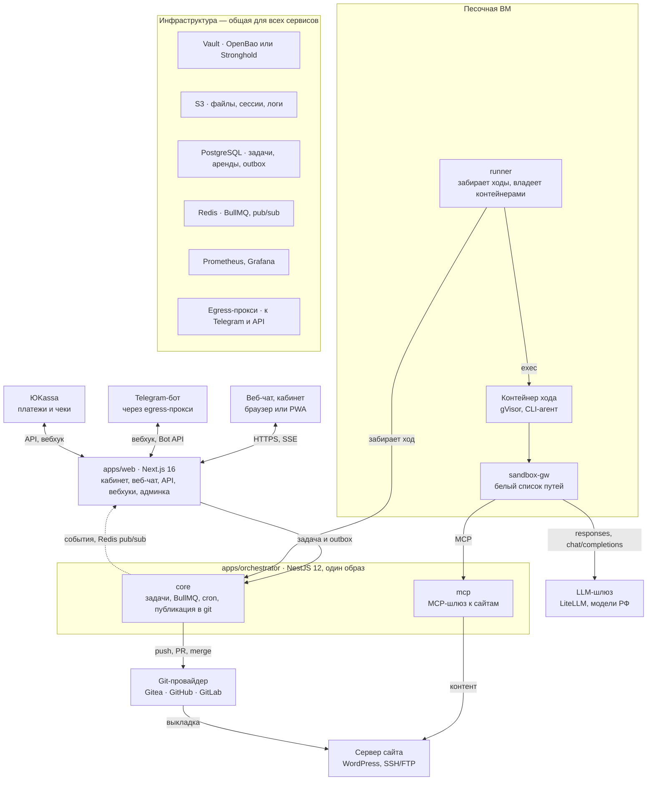
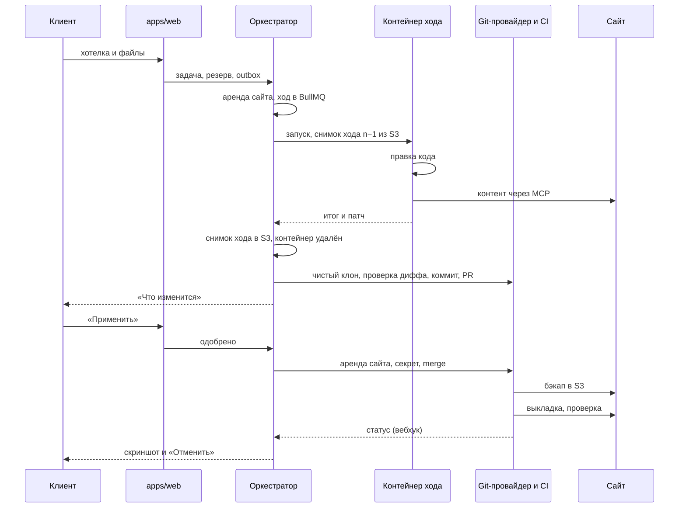

# Радити: AI-поддержка сайтов для малого бизнеса — спецификация v0.3

Версия v0.3 · 26.09.2026

> Снимок v0.2 из Claude Docs, обновлённый до v0.3 по решениям владельца от 26.09.2026 (итог bootstrap); исследования — в [docs/research/2026-09-bootstrap/](research/2026-09-bootstrap/). Если решение меняется — обновите и этот файл, и документ.

## 1. Коротко

Радити (raditi.ru) ведёт сайты малого бизнеса в России: владелец пишет пожелание в чат, агент меняет сайт. Код меняется через git-провайдера — нашу Gitea с обязательным пайплайном выкладки, позже и GitHub или GitLab клиента, — контент прямо на сайте. Окружение одно — прод, поэтому каждую выкладку страхуют бэкап, проверка и автоматический откат.

Первый стек — WordPress, следующий — 1С-Битрикс; Laravel, Node.js и Python подключаются адаптерами без переделки ядра.

**Ключевые решения**

| Область | Решение |
| --- | --- |
| Клиент | Малый бизнес без своего разработчика (раздел 2) |
| Каналы | Веб-чат (PWA) — основной, Telegram-бот — второй, MAX — позже |
| Структура кода | Монорепозиторий по образцу anynote, порты и адаптеры: pnpm 12, Turborepo 2.11, Next.js 16, NestJS 12, Prisma 7 (раздел 6) |
| Агент | Любой CLI-агент через драйвер: Codex CLI, Kimi Code CLI, Qwen Code, OpenCode (раздел 8) |
| Модели | Российские провайдеры: Yandex AI Studio, Cloud.ru, GigaChat (раздел 9) |
| Изоляция | Одноразовый контейнер под gVisor на каждый ход агента (раздел 8) |
| Код сайтов | Gitea 1.27 и gitea/runner, обязательный workflow организации; GitHub и GitLab клиента — через `GitProvider` (раздел 10) |
| Окружения | Только прод: подтверждение, бэкап, проверка, откат |
| Файлы, сессии, логи | S3 в российском облаке (раздел 14) |
| Секреты | OpenBao или Deckhouse Stronghold (раздел 15) |
| Данные и очереди | PostgreSQL и Prisma 7 — истина о задаче; Redis и BullMQ — очередь, таймеры, cron, раздача событий (раздел 7) |
| Оплата | ЮKassa: карта, СБП, SberPay, автоплатёж, чеки 54-ФЗ; подписка с квотой или оплата за действие из кошелька (раздел 17) |
| Код платформы | GitHub: CI и релизы в GitHub Actions (раздел 6) |
| Наблюдаемость | Prometheus и Grafana (раздел 19) |

**Что изменилось в v0.3**

1. `apps/agents` и `apps/engines` объединены в `apps/orchestrator`: один образ, роли `core`, `mcp` и `runner` (разделы 5, 6).
2. Пакеты устроены как порты и адаптеры: порты — в `packages/domain`, новые пакеты `agent-drivers`, `sandbox-providers`, `git-providers` (разделы 6, 8).
3. Контейнер песочницы живёт один ход, а не всю задачу; снимки сессии — по ходам; патч публикуется из чистого клона (разделы 7, 8).
4. Один ход, выкладка или откат на сайт — аренда сайта в PostgreSQL; Redis остаётся для BullMQ, постановка в очередь — через `outbox_events` (раздел 7).
5. Код сайта может жить в нашей Gitea или в GitHub и GitLab клиента; список запрещённых путей расширен (раздел 10).
6. Деньги — Decimal, а не целые копейки; новый тариф «Оплата за действие» с кошельком; счёт — по журналу LiteLLM (разделы 9, 16, 17).
7. Второй стек после WordPress — 1С-Битрикс (разделы 3, 13).
8. Исправлены флаги драйверов и описана изоляция: dockerd от root, uid 10001 в контейнере, граница — gVisor (разделы 8, 18).
9. Капча — Yandex SmartCaptcha; мониторинг — Prometheus и Grafana; CI и релизы платформы — GitHub Actions (разделы 6, 18, 19).

**Что изменилось в v0.2**

1. GitLab заменён на Gitea с act\_runner (раздел 10).
2. Файлы клиентов, сессии агентов и логи хранятся в S3 (раздел 14).
3. Секреты хранятся в Vault-совместимом хранилище (раздел 15).
4. Структура репозитория взята из anynote (раздел 6).
5. Агент не привязан к Codex: драйверы для нескольких CLI и модели, доступные в России (разделы 8–9).
6. Рынок — только Россия, оплата через ЮKassa (раздел 17).
7. Добавлен портрет пользователя (раздел 2).
8. Staging убран: только прод со страховкой (разделы 7 и 10).

**Что поправлено в исходной идее**

- Подписка ChatGPT за $200 не подходит: ChatGPT официально недоступен в России, а условия OpenAI запрещают отдавать свой аккаунт другим. Codex CLI остаётся — как открытый рантайм на российских моделях.
- Kimi берём как модель Kimi-K2.6 в Cloud.ru: подписку Kimi Code российской картой напрямую не оплатить.
- Telegram в России с февраля 2026 года замедлен, поэтому основной канал — веб-чат.
- Без staging прод защищают подтверждение перед выкладкой, бэкап, проверка и откат.

## 2. Для кого

Клиент — владелец малого бизнеса, у которого есть купленный сайт, но нет своего разработчика и знаний, чтобы менять его самому. Он пишет пожелания обычными словами, как подрядчику, и ждёт результат, а не технические детали.

| Черта | Как выглядит | Что это значит для продукта |
| --- | --- | --- |
| Бизнес | Кафе, салон, клиника, магазин, услуги; сайт — витрина и источник заявок | Типовые задачи: цены, акции, фото, баннеры, формы, новые страницы |
| Сайт | Куплен у студии или фрилансера; обычно WordPress или Bitrix, часто на виртуальном хостинге | Доступ часто только FTP и панель хостинга; онбординг помогает их найти |
| Знания | Не знает, что такое Git, SSH, плагин или кэш | Никаких терминов в чате; агент сам решает, код это или контент |
| Время | Пишет урывками с телефона, часто голосом | Голос и фото в чате, короткие ответы, кнопки вместо вопросов |
| Страх | Боится «сломать сайт» и потерять заявки | Скриншот после правки, кнопка «Отменить», понятный статус |
| Деньги | Платит картой или со счёта организации, ждёт чек | ЮKassa, чеки 54-ФЗ; счета юрлицам — после MVP |

**Как агент говорит с клиентом**

- Обращается на «вы», без жаргона и английских терминов.
- Перед правкой кода показывает «Что изменится» — 1–3 пункта простыми словами — и кнопки «Применить», «Изменить», «Отмена».
- Если просьба неясна, задаёт один уточняющий вопрос с вариантами-кнопками.
- После выкладки присылает скриншот и держит кнопку «Отменить» 7 дней.
- Если задача ему не по силам, передаёт её специалисту и честно называет срок.

## 3. Границы MVP

MVP — WordPress-сайты малого бизнеса в России, одно окружение (прод) и два канала: веб-чат и Telegram. Всё, что за этими рамками, заложено в интерфейсы, но включается позже.

| Область | В MVP | Позже |
| --- | --- | --- |
| Стеки | WordPress | 1С-Битрикс — следующим; Laravel, статика, Node.js, Python |
| Каналы | Веб-чат (PWA), Telegram-бот | MAX, e-mail |
| Окружения | Только прод | Staging по запросу клиента |
| Доступ к серверу | SSH, FTP/FTPS | Панели хостинга через API |
| Git-провайдер сайта | Наша Gitea | GitHub и GitLab клиента через `GitProvider` (раздел 10) |
| Выкладка | Gitea Actions: rsync по SSH, git-ftp | Docker Compose; для GitHub и GitLab клиента — открытый вопрос (раздел 20) |
| Контент | WP-CLI, REST API, Playwright | Конструкторы сайтов через браузер |
| Агенты | Codex CLI, Kimi Code CLI | Qwen Code, OpenCode, GigaCode, SourceCraft |
| Модели | Yandex AI Studio, Cloud.ru | GigaChat, свои модели на GPU |
| Оплата | ЮKassa: карта, СБП, SberPay, автоплатёж, чеки; подписка с квотой и оплата за действие из кошелька | Счета и закрывающие документы для юрлиц |
| Секреты и файлы | OpenBao на одном узле, S3 в российском облаке | Stronghold или кластер высокой доступности |

## 4. Пользовательские сценарии

Клиент работает в веб-чате или в Telegram; кабинет с тарифом, оплатой и историей — только на сайте платформы. Сценарии MVP:

1. **Подключение сайта.** Мастер в кабинете просит адрес сайта и доступы: SSH, FTP, вход в админку. Он подсказывает, где их взять у популярных хостингов, и сам их проверяет (раздел 12).
2. **Правка кода.** «Добавьте на главную блок с отзывами». Агент готовит правку, клиент видит «Что изменится» и жмёт «Применить», «Изменить» или «Отмена». После выкладки приходит скриншот.
3. **Правка контента.** «Поменяйте цену на стрижку на 1500». Агент делает снимок страницы, меняет текст и сразу применяет; «Отменить» возвращает снимок.
4. **Голос и файлы.** Голосовое распознаётся (Yandex SpeechKit или SaluteSpeech), фото и документы уходят в S3 и попадают агенту во входящие.
5. **Уточнение.** Если просьба неясна, агент задаёт один вопрос с вариантами-кнопками; задача ждёт ответа.
6. **Сессии.** Каждая задача — отдельный диалог в веб-чате и отдельная тема в Telegram. Клиент видит список сессий и может вернуться к любой.
7. **Отмена.** «Верните как было» или кнопка «Отменить» в течение 7 дней: код откатывается revert-коммитом, контент — из снимка.
8. **Тариф и оплата.** Остаток правок или баланс кошелька виден в чате; купить или сменить тариф и пополнить кошелёк можно только в кабинете. Бот ничего не продаёт.
9. **Специалист.** Если агент не справился за две попытки или задача вне тарифа, её получает оператор, а клиент — понятный срок.

## 5. Архитектура

Платформа устроена как anynote: Next.js-приложение для людей, NestJS-оркестратор для задач, агентов и фоновых работ, Gitea для кода сайтов. Агент работает только в одноразовом контейнере на песочной ВМ и выходит наружу только через `sandbox-gw` — к LLM-шлюзу и MCP-шлюзу.



Главный путь: сообщение → apps/web (задача и `outbox_events` одной транзакцией) → relay в `core` → BullMQ → ход в контейнере песочницы → патч → публикация в git-провайдер → «Применить» → выкладка на сервер сайта. Правки контента идут из песочницы через `sandbox-gw` в MCP-шлюз (роль `mcp`) прямо на сайт.

| Компонент | Что делает | Технологии |
| --- | --- | --- |
| apps/web | Кабинет, веб-чат (SSE), API, вебхуки Telegram, ЮKassa и git-провайдеров, админка оператора; пишет задачу и `outbox_events` одной транзакцией | Next.js 16.3, tRPC 11, better-auth 1.7, MUI 9 |
| apps/orchestrator · core | Жизненный цикл задач, квоты и кошелёк, relay outbox → BullMQ, воркеры и cron, выбор драйвера и модели, управление песочницами, публикация в git | NestJS 12, BullMQ 6 |
| apps/orchestrator · mcp | MCP-шлюз к сайтам: WP-CLI, REST, браузер; отдельный процесс и порт, своя AppRole в Vault и своя роль в PostgreSQL без доступа к биллингу | NestJS 12, @rekog/mcp-nest 2, Playwright |
| apps/orchestrator · runner | Pull-раннер на песочной ВМ: сам забирает ходы, владеет контейнерами, без входящих портов, аренда хода с эпохой (roadmap P2). В PoC вместо него `core` управляет Docker через локальный сокет | NestJS 12, dockerode |
| Песочница | Одноразовый контейнер на ход: CLI-агент, рабочая копия сайта, файлы клиента | Docker 29 + gVisor (`runsc`, systrap) |
| sandbox-gw | Единственный выход песочницы: белый список путей к LiteLLM и MCP-шлюзу | Обратный прокси: Caddy, Envoy или Nginx |
| LLM-шлюз | Единая точка к моделям: виртуальный ключ на ход с бюджетом и TTL, журнал расходов для биллинга, мост Responses API для Codex | LiteLLM ≥ 1.83.7, один экземпляр |
| Git-провайдер | Репозитории сайтов, проверки и выкладка: Gitea — наша, GitHub и GitLab — клиента | Gitea 1.27, gitea/runner 4 |
| Vault | Доступы к сайтам, ключи моделей, токены выкладки, SSH-сертификаты, ключи шифрования | OpenBao или Stronghold |
| S3 | Файлы клиентов, снимки ходов, логи, бэкапы, скриншоты | Объектное хранилище в российском облаке |
| PostgreSQL | Данные платформы; истина о задаче (`tasks.status`), аренды сайтов, outbox, история событий | PostgreSQL 17, Prisma 7.10 |
| Redis | Очереди и таймеры BullMQ, job schedulers для cron, pub/sub событий задачи для реплик web | Redis 8.10: `appendonly`, `maxmemory-policy noeviction` |
| Мониторинг | Метрики сервисов и инфраструктуры, алерты | Prometheus, Grafana |
| Egress-прокси | Выход к Telegram и внешним API с отдельного адреса | Как WARP-прокси для Telegram в anynote |

## 6. Монорепозиторий

Платформа повторяет структуру [anynote](https://github.com/anynoteinc/anynote): pnpm и Turborepo, `apps/*` и `packages/*`, а слои пакетов проверяет dependency-cruiser (`pnpm check-architecture`). Отличий два: оркестратор пишем на TypeScript (NestJS), а не на Python — агент теперь внешний CLI, и граф LangGraph не нужен; пакеты устроены по схеме «порты и адаптеры».

**Версии** (на 26.09.2026)

| Что | Версия | Оговорка |
| --- | --- | --- |
| Node.js | 26.10 | В прод — после перехода 26 в LTS 28.10.2026 |
| pnpm, Turborepo | 12.6, 2.11 | — |
| TypeScript | `tsc` 7.0 для проверки типов; пакет `typescript` 6.0 через псевдоним | typescript-eslint, dependency-cruiser и Nest CLI с TS 7 не работают |
| Next.js, React, MUI | 16.3, 19.3, 9.4 | MUI 9, а не v6 |
| NestJS | 12.1 | Только ESM |
| Prisma | 7.10, строго | Генератор `prisma-client`; тег `latest` у CLI указывает на 8.0 RC |
| better-auth, tRPC, zod | 1.7, 11.19, 4.6 | tRPC — через `@trpc/tanstack-react-query` |
| Vitest, ESLint, Playwright | 5, 10, 1.63 | Для Nest — unplugin-swc |
| BullMQ, @nestjs/bullmq, Redis | 6.3, 12, 8.10 | — |

| Путь | Назначение | Из anynote |
| --- | --- | --- |
| apps/web | Next.js 16: лендинг `(about)`, вход `(auth)`, кабинет и веб-чат `(protected)`, юридические документы в MDX, вебхуки, SSE-поток задачи | Да: route groups, SSE, вебхук ЮKassa, юридические документы |
| apps/orchestrator | NestJS 12, один код и один образ, три роли запуска: `core` — жизненный цикл задач, воркеры BullMQ, cron, управление песочницами, публикация в git; `mcp` — MCP-шлюз к сайтам; `runner` — pull-раннер на песочной ВМ. В проде роли — отдельные процессы; локально `core` и `mcp` можно запустить в одном процессе на разных портах (`ORCHESTRATOR_ROLES`) | Роль та же, что у бывших agents и engines; стек TypeScript вместо Python |
| apps/e2e | Playwright-тесты платформы | Да |
| packages/domain | Ядро: ошибки `DomainError` и порты — `AgentDriver` с общими событиями и zod-схемой итога хода, `SandboxProvider`, `GitProvider`, `SiteAdapter`, `SecretStore`, `ObjectStorage`, `JobQueue`. Бизнес-логики пока нет, со временем вся она будет здесь | Да, роль шире |
| packages/db | Prisma 7 + PrismaPg: схема, миграции, сиды | Да |
| packages/storage | S3 за портом `ObjectStorage`: добавить presigned URL, multipart, несколько бакетов | Расширить |
| packages/vault | Клиент Vault API за портом `SecretStore`: KV, Transit, SSH, AppRole, wrapping | Новый |
| packages/git-providers | `GitProvider`: адаптеры gitea, github, gitlab — репозитории, ветки, PR, секреты и переменные CI, вебхуки | Новый, вместо packages/gitea |
| packages/sandbox-providers | `SandboxProvider`: адаптер docker | Новый |
| packages/agent-drivers | `AgentDriver`: codex, kimi, qwen, opencode — запуск, разбор событий, состояние сессии | Новый, вместо packages/agent-runtime |
| packages/site-adapters | `SiteAdapter`: wordpress, дальше bitrix | Новый |
| packages/yookassa | Платежи, автоплатёж, возвраты, вебхуки; добавить чеки | Расширить |
| packages/mail, telegram | Письма через SendSay, Bot API через прокси | Да |
| packages/auth | better-auth, вход через Telegram, капча SmartCaptcha | Расширить |
| packages/notifications | Уведомления | Да |
| packages/trpc, packages/ui | tRPC с `createCaller` для RSC; MUI 9 | Да |
| packages/observability | Серверные помощники приложений: health-проверки, метрики, сравнение bearer-токена, текст ошибки и лог с ограничением частоты. Зависит только от domain и `@prometheus-io/client`, импортируют его только приложения | Новый |
| agent-kit/ | Образы песочниц: базовый образ на стек с закреплёнными версиями CLI агентов | Новый |
| ci/ | Обязательные workflow и actions выкладки сайтов; синхронизируются в `platform/ci` в Gitea | Новый |
| .github/ | CI и релизы платформы в GitHub Actions | Да |
| ansible/ | Плейбуки подготовки серверов сайтов | Новый |
| infra/ | `infra/dev` — локальная инфраструктура (`docker-compose.yml` с профилями `site`, `llm`, `ci`, `monitoring`, `monitoring-host`); `infra/sandbox` — песочная ВМ (watchdog, шлюз, раннер); `infra/app` — app-ВМ: Compose с Traefik и Let's Encrypt, web, core, PostgreSQL, Redis, runbook выкладки; `infra/{gitea,ci,vault}` — M10 | Новый |
| docs/ | architecture.md, спецификации, исследования, юридические тексты | Да |

**Слои — порты и адаптеры.** Зависимости идут только вниз; адаптер реализует порт из `packages/domain` и зависит только от него, а какой адаптер подставить, решает приложение. `mail`, `telegram` и `yookassa` пока — клиенты внешних сервисов без своих портов: порты `Mailer`, `Messenger` и `PaymentGateway` появятся в domain вместе с логикой, которой они нужны (M3, M5). `observability` стоит сбоку от слоёв: это только серверный код приложений (health, метрики, bearer-токен, лог ошибок с ограничением частоты), он зависит только от domain и `@prometheus-io/client`, и ни один пакет его не импортирует. Чистые помощники без ввода-вывода, которые нужны и доверенному коду, живут в domain: `withTimeout` и разбор переменных окружения (`parseEnv`, `envVar`, `envProblems`, тип `Env`).

| Слой | Пакеты |
| --- | --- |
| Приложения | apps/web, apps/orchestrator, apps/e2e |
| UI и транспорт | ui, trpc |
| Сервисы | auth (better-auth), notifications |
| Адаптеры | db, storage, vault, git-providers, sandbox-providers, agent-drivers, site-adapters, yookassa, mail, telegram |
| Ядро | domain: порты, ошибки домена и чистые помощники (`withTimeout`; `parseEnv`, `envVar`, `envProblems`, `Env`) |
| Сбоку, только для приложений | observability: health, метрики, bearer-токен, лог ошибок |

Новые переменные окружения попадают и в `.env.example`, и в `globalEnv` в `turbo.json`. Код платформы живёт на GitHub: CI (typecheck, lint, test, check-architecture, build) и релизы через semantic-release с `@semantic-release/github` идут в GitHub Actions; выкладка платформы на ВМ через GitHub Actions — позже (M10). Gitea — только для репозиториев сайтов клиентов и реестра образов.

## 7. Жизненный цикл задачи

Одна задача — одна логическая сессия агента и одна ветка задачи; контейнер песочницы живёт один ход. Пока задача ждёт клиента, контейнера нет, а сессия лежит в S3. Правка кода попадает в прод только после «Применить», правка контента — сразу, но со снимком для отката.



Прод один, поэтому клиент видит «Что изменится» до merge, а пайплайн делает бэкап, выкладку, проверку и при сбое — откат. Секрет выкладки одноразовый: оркестратор кладёт его в репозиторий перед merge и удаляет после (раздел 15).

**Очередь и сериализация**

- Истина о задаче — `tasks.status` в PostgreSQL. Переход статуса — условный `UPDATE … WHERE status IN (…)` в одной транзакции с записью в `credit_ledger`, поэтому списание и возврат случаются ровно один раз.
- Постановка в очередь атомарна с записью в базу: web пишет задачу и `outbox_events` одной транзакцией, relay в `core` переносит их в BullMQ. После публикации relay очищает payload строки, а опубликованные и неудачные строки удаляет через 7 дней: в payload бывают одноразовые ссылки. Задания уведомлений удаляются из Redis сразу после выполнения.
- Ходы, выкладки, таймеры и cron — задачи BullMQ через `@nestjs/bullmq`; cron — job schedulers BullMQ. Redis работает с `appendonly` и `maxmemory-policy noeviction`.
- Долгие ожидания (`awaiting_user`, `awaiting_approval`) — это статус плюс отложенная задача-таймер BullMQ, а не висящий job. Таймер ничего не делает, если статус уже сменился.
- Ответ клиента и «Изменить» ставят следующий ход той же задачи в очередь (`queued`).
- На сайте одновременно идёт не больше одной операции — хода, выкладки или отката. Это аренда сайта (site lease) в PostgreSQL; группы BullMQ есть только в платной Pro, поэтому их не берём. Если исход выкладки неизвестен, аренда не снимается до решения оператора.
- Живой поток задачи: события пишутся в `task_events` (история) и раздаются репликам web через Redis pub/sub; браузер получает SSE и после обрыва досылает пропущенное по `Last-Event-ID`.
- Запасной путь без Redis — бэкенд BullMQ 6 на PostgreSQL (`createPostgresBackend`, с июля 2026).

| Статус | Что происходит | Контейнер хода | Что видит клиент |
| --- | --- | --- | --- |
| queued | Задача в очереди, резерв сделан: единица квоты или сумма в кошельке | Нет | «Приняли, начинаем» |
| preparing | Аренда сайта, запуск контейнера, восстановление снимка хода n−1 или клон ветки | Создаётся | «Готовим» |
| running | Агент работает, события пишутся в `task_events` и S3 | Есть | Прогресс шагами |
| awaiting\_user | Агент задал вопрос, идёт таймер ожидания | Нет | Вопрос с кнопками |
| awaiting\_approval | Правка кода опубликована в ветку, проверки прошли, идёт таймер ожидания | Нет | «Что изменится» и кнопки |
| deploying | Merge в main, пайплайн делает бэкап и выкладку; сайт под арендой | Нет | «Выкладываем» |
| verifying | Проверки после выкладки | Нет | «Проверяем» |
| done | Готово, резерв списан | Нет | Скриншот и «Отменить» |
| failed | Ошибка до выкладки, на сайте ничего не изменилось; резерв возвращён. «Попробовать ещё» — та же задача с новым резервом (`failed` → `queued`) | Нет | Объяснение и «Попробовать ещё» |
| rolled\_back | Проверка не прошла, прод вернули из бэкапа | Нет | «Вернули как было» |
| cancelled | Клиент отменил до выкладки; резерв возвращён | Удаляется | «Отменено» |

## 8. Агентный рантайм

Платформа не привязана к одному агенту: любой CLI-агент подключается драйвером (`AgentDriver`), а песочница — провайдером (`SandboxProvider`). Оба порта объявлены в `packages/domain`, адаптеры лежат в `packages/agent-drivers` и `packages/sandbox-providers`. В MVP два драйвера — Codex CLI и Kimi Code CLI; Qwen Code и OpenCode — запасные.

### Драйвер

```ts
interface AgentDriver {
  id: 'codex' | 'kimi' | 'qwen' | 'opencode' | 'gigacode' | 'sourcecraft'
  image: string                                        // образ песочницы с CLI, по дайджесту
  capabilities: {
    resume: boolean                                    // продолжение сессии
    jsonEvents: boolean                                // поток событий JSONL
    outputSchema: boolean                              // итог по JSON-схеме
    mcp: boolean
    images: boolean                                    // картинки на вход
  }
  prepare(ctx: RunContext): Promise<PreparedRun>       // конфиг, AGENTS.md, MCP; env; секреты хода
  command(run: PreparedRun, turn: TurnInput): string[] // argv хода: новая сессия или продолжение
  parseEvent(line: string): AgentEvent[]               // строка stdout → ноль или несколько общих событий
  sessionState(run: PreparedRun): {                    // что упаковать в home.tar.zst
    root: string; include: string[]; exclude: string[]
  }
  locateNativeSession?(fs: SandboxFs, run: PreparedRun): Promise<string | null> // id сессии CLI, у Kimi — из session_index.jsonl
  extractResult(events: AgentEvent[]): AgentResult
}
```

Оркестратор и чат видят только общие события: `started`, `message`, `command`, `file_change`, `tool_call`, `question`, `usage`, `completed`, `failed`. События `usage` печатает процесс под управлением агента, поэтому они идут только в интерфейс; деньги считаются по журналу LiteLLM (раздел 9). `failed.reason` — сырой текст CLI или провайдера, часто на английском: он нужен только для логов и оператора. Клиент его не видит: чат показывает русский текст по типу события.

В P1 реализованы stateless-парсеры JSONL, проверка итога через `turnResultSchema` и списки файлов сессии для четырёх CLI. Форматы сверены с закреплёнными upstream-релизами; [источники и ограничения](../packages/agent-drivers/src/fixtures/README.md). Строка JSONL ограничена 256 КиБ, глубина JSON — 32; неизвестные и повреждённые строки пропускаются. Обрезанный текст помечается и не принимается как итоговый JSON. `capabilities` описывает возможности CLI; `prepare`, `command`, запуск с моделью и resume в контейнере проверяются в P4/P5. Kimi не печатает terminal event и usage: успешный выход процесса проверяет супервизор. `output` общего события usage включает reasoning.

| Драйвер | Запуск без интерфейса | Сессии | Модели | Настройка для песочницы |
| --- | --- | --- | --- | --- |
| Codex CLI | `codex exec --json --output-schema <файл>` | `codex exec resume <thread_id>`; rollout-файлы в `CODEX_HOME/sessions`; `--ephemeral` не использовать | Провайдер с Responses API, `wire_api="responses"`; Cloud.ru и GigaChat — через мост LiteLLM `/responses` → chat | Встроенную песочницу и подтверждения выключает `--dangerously-bypass-approvals-and-sandbox`; `check_for_update_on_startup=false`, аналитика выключена |
| Kimi Code CLI (`@moonshot-ai/kimi-code` 2.1) | `kimi -p <задача> --output-format stream-json`; `-p` нельзя сочетать с `--yolo`, `--auto` и `--plan` | `--session <id>`; каталог `KIMI_CODE_HOME/sessions/<workDirKey>/…`, ключ зависит от пути рабочего каталога | Kimi-K2.6 и другие через `KIMI_MODEL_*`; в `stream-json` нет usage | `KIMI_DISABLE_TELEMETRY=1`, `KIMI_CODE_NO_AUTO_UPDATE=1`; `rg` и `fd` — в образе |
| Qwen Code 0.24 | `qwen -p <задача> --output-format stream-json` | `--resume <id>`; чаты в `~/.qwen/projects/<cwd>` | OpenAI-совместимые через `modelProviders` | `--approval-mode yolo`; лимиты `--max-wall-time`, `--max-session-turns` |
| OpenCode 1.18 | `opencode run --format json` | `--session <id>`, `opencode export` и `import` | Любые провайдеры из конфига | Права через `OPENCODE_PERMISSION` |

Флаги взяты из документации [Codex](https://learn.chatgpt.com/docs/non-interactive-mode), [Kimi Code](https://moonshotai.github.io/kimi-code/en/reference/kimi-command.html) ([переменные окружения](https://github.com/MoonshotAI/kimi-code/blob/main/docs/en/configuration/env-vars.md)), [Qwen Code](https://qwenlm.github.io/qwen-code-docs/en/users/features/headless/) и [OpenCode](https://opencode.ai/docs/cli/); работу каждого драйвера подтверждаем в PoC. Порядок флагов у `codex exec resume` в документации и в SDK расходится: по документации флаги идут после `resume`, в SDK — до; проверяем в PoC.

### Песочница

Порт `SandboxProvider` прячет, как запускается контейнер: адаптер `docker` работает через dockerode и локальный сокет Docker. Где идёт работа с контейнером хода, прячет второй порт — `TurnExecutor` (ниже). В PoC и тестах `core` вызывает провайдер в своём процессе, в пилоте тот же адаптер работает внутри роли `runner` на песочной ВМ: раннер сам забирает ходы, владеет контейнерами и файлом вывода, входящих портов у него нет, а аренда хода с эпохой отсекает устаревшего владельца. Удалённая граница — `TurnExecutor`, а не провайдер: удалённый провайдер означал бы RPC на каждый exec и каждую операцию с файлами, а stdin и stdout шли бы через core. Поэтому `SandboxProvider.kind` — только `docker`. Docker API по TCP наружу не выставляем: ключ к нему — это root на ВМ.

```ts
interface SandboxProvider {
  kind: 'docker'                                       // локальный сокет Docker: в core (PoC) или в роли runner (пилот)
  create(spec: SandboxSpec, signal?: AbortSignal): Promise<Sandbox>
  get(id: SandboxId): Promise<Sandbox | null>          // подхватить для работы: свой, неизменный, шлюз цел
  getForRemoval(id: SandboxId): Promise<RemovableSandbox | null> // только удалить: и тот, что get не отдаёт
  list(filter?: Partial<SandboxLabels>): Promise<SandboxInfo[]> // свои контейнеры ходов по меткам — и для работы, и для удаления
}

interface SandboxSpec {
  image: string                                        // только по дайджесту из своего реестра
  labels: SandboxLabels                                // workspaceId, siteId, taskId, sessionId, turn, leaseEpoch
  runtime: 'runsc' | 'runc'                            // из SANDBOX_RUNTIME; на macOS — runc
  resources: { cpu: number; memoryMiB: number; pids: number } // 2 / 4096 / 512
  user: { uid: number; gid: number }                   // только 10001:10001
  env: Record<string, string>                          // без секретов: видно в docker inspect
  secrets: SecretFile[]                                // tmpfs вне /workspace и /agent-home, только на ход
  network: { mode: 'none' } | { mode: 'gateway'; routes: Array<'llm' | 'mcp'> } // зеркала пакетов — позже
  hardTimeoutMs: number                                // не больше 20 минут
}                                                      // корневая ФС всегда только для чтения — переключателя нет

interface Sandbox {
  id: SandboxId
  exec(spec: ExecSpec): Promise<ExecHandle>            // всё через exec: агент, git diff, tar
  attach(execId: ExecId, cursor?: { stdout: number; stderr: number }): Promise<ExecHandle> // байтовые оффсеты потоков
  quiesce(): Promise<void>                             // остановить процессы агента перед снимком
  fs: SandboxFs                                        // чтение и запись; байты — через stdin и stdout exec
  destroy(reason: 'completed' | 'failed' | 'cancelled' | 'timeout' | 'gc'): Promise<void>
}
```

Принять контейнер после рестарта для работы и для удаления — разные операции. `get` отдаёт только контейнер, в котором можно продолжать ход: свой по меткам, с прежними настройками изоляции и целым шлюзом. `getForRemoval` находит и тот, что для работы уже не годится (например, упал его шлюз), и умеет только удалить его вместе с ресурсами шлюза; `null` значит, что контейнера нет, а чужой контейнер — `CONFLICT`. `list` сообщает все свои контейнеры ходов, поэтому recovery и сборщик мусора видят и такие. Пропавший exec при `attach` — `NOT_FOUND`: recovery отказывается от хода (`exec_lost`), а не повторяет попытку.

Правило 5 из CLAUDE.md проверяется кодом, а не только ревью: каждая спецификация проходит `sandboxSpecSchema` (`assertSandboxSpec` в `packages/domain`) до запуска — образ по дайджесту, uid 10001, потолки ресурсов и времени, сеть только `sandbox-gw`, нет похожих на секреты переменных окружения. Вывод агента недоверенный: у общих событий и итога хода есть лимиты длины (`agentOutputLimits`). Пути, которые дифф трогать не может, проверяет `isForbiddenPath` там же, в ядре.

Супервизор хода в `core` держит аренду, журнал, драйвер и публикацию, а контейнером хода владеет исполнитель — порт `TurnExecutor` в `packages/domain`. `LocalTurnExecutor` вызывает `SandboxProvider` в процессе `core` (PoC, тесты), удалённый исполнитель передаёт те же шаги раннеру по протоколу из раздела «Раннер на песочной ВМ»; код супервизора для обоих один.

```ts
interface TurnExecutor {
  prepare(input, signal): Promise<TurnExecution>        // контейнер, git bundle, restore хода n−1, файлы и секреты драйвера
  adopt(input, signal): Promise<TurnExecution | null>   // после рестарта: принять контейнер для работы или только для удаления
  list(filter): Promise<SandboxInfo[]>                  // контейнеры ходов по меткам — что recovery должен принять или удалить
  takeover(assignment): TurnTakeover | null             // можно ли забрать назначение сейчас: сессия раннера и держит ли она ключи хода
}

interface TurnExecution {
  launch(timeoutMs): Promise<TurnAgentExec>             // запуск агента — только после проверки fence
  attach(from): Promise<TurnAgentExec | null>           // переподключение с execId, курсора и числа событий из журнала
  quiesce(): Promise<void>
  capture({ home, baseSha }): Promise<CapturedTurn>     // patch и untracked — недоверенные данные; home остаётся у исполнителя
  seal({ base, dataKey, put }): Promise<SealedTurnPart> // шифрует home.tar.zst и кладёт его presigned PUT
  destroy(reason): Promise<void>
}
```

Сразу после создания контейнера `prepare` передаёт супервизору его `TurnExecution` (`input.created`): с этого момента удаление контейнера — забота супервизора, даже если импорт bundle, restore или запись файлов потом не удались, а контейнер, о котором исполнитель сообщил уже после отказа от хода, удаляется сразу. Вывод агента исполнитель отдаёт партиями `{from, to, events}`: курсор сдвигают только целые строки stdout, а следующая партия читается после того, как журнал записал предыдущую. Секретов платформы у исполнителя нет: объекты S3 он получает presigned-запросами, ключ данных и git bundle — через функции `core`. Файлы и секреты драйвера приходят к нему уже проверенными (`preparedRunSchema`, `preparedRunExposesSecret`), и он проверяет их снова (`preparedFilesSchema`).

### Изоляция

- Один контейнер на ход: PID 1 — `tini` и `sleep`, всё остальное — через exec. Агент запускается обёрткой в своей группе процессов и пишет события в файл с оффсетами, поэтому после переподключения вывод дочитывается с места обрыва. Отмена — сигнал группе процессов, запасной путь — остановка контейнера.
- `docker cp` и archive API не используем: изменения в оверлее корневой ФС gVisor хосту не видны, а сам `docker cp` исторически уязвим.
- Docker 29 + [gVisor](https://gvisor.dev/docs/) `runsc` в режиме systrap: вложенная виртуализация не нужна. В Yandex Cloud её нет, поэтому Kata и Firecracker там невозможны.
- dockerd работает от root, в контейнере — uid 10001; границу изоляции держит gVisor. Режим `runsc --rootless` не берём: в нём нет netstack и снимков.
- Корневая файловая система только для чтения, `--cap-drop=ALL`, `no-new-privileges`, `HOME` и служебные файлы хода — в tmpfs.
- В локальном P2 до данных задачи доверенный bootstrap один раз запускается как uid 0 без дополнительных capabilities: сохраняет PID/starttime служебного процесса в root-owned control tmpfs. Агент и обычные exec остаются uid 10001; контрольную запись они изменить не могут. Quiesce использует эту запись, а не подделываемый argv процесса.
- Лимиты: 2 vCPU, 4 ГБ памяти, 512 процессов, 20 минут на весь ход вместе с сохранением снимка и публикацией: самому агенту остаётся на 3 минуты меньше (п. 3 «Супервизор хода и публикация»). Таймаут тишины в выводе — щедрый: Codex в `--json` пишет событие только по завершении элемента.
- Папки: `/workspace/repo` — рабочая копия сайта, `/workspace/inbox` — файлы клиента, `/workspace/out` — артефакты, `/agent-home` — сессия агента. Пути `/workspace/repo` и `/agent-home` фиксированы: от них зависят сессии Kimi и Qwen.
- Долгоживущих секретов внутри нет: только виртуальный ключ LiteLLM на этот ход (бюджет и TTL) и токен MCP, ограниченный сайтом и задачей. Учётных данных git, S3 и Vault в песочнице нет. Подписки агентов в песочницу не попадают: если они появятся (§9), ключ подставляет `sandbox-gw`, а не контейнер.
- Встроенные песочницы и подтверждения агентов выключены (флаги — в таблице драйверов): изоляцию даёт контейнер.
- Образ — один базовый на стек, например `sbx-wordpress`: PHP CLI, Composer, Node, git, `rg`, `fd`, `jq`, `tini` и CLI агентов с закреплёнными версиями. Хранится по дайджесту в реестре Gitea не меньше срока хранения сессий. Автообновления и телеметрия CLI выключены.

### Сеть

- У песочницы — своя internal-сеть без DNS и выхода в интернет.
- Единственный выход — `sandbox-gw` с белым списком путей: LiteLLM `/v1/responses` и `/v1/chat/completions`, MCP-шлюз. Заголовок Host нормализуется.
- Git-провайдер, S3, Vault и сервер сайта из песочницы недоступны. Зеркала пакетов (npm, Composer) — позже: темам WordPress сборка зависимостей обычно не нужна.
- Presigned-ссылок S3 внутри песочницы нет: разрешённый S3-эндпоинт — это канал утечки. Файлы клиента в песочницу кладёт и артефакты забирает хост.

Сеть попытки (P2). На каждую попытку — своя internal-сеть без адреса хоста: мост `rdx<12 hex>` (имя выводится из id попытки), `gateway_mode_ipv4/ipv6=isolated`, IPv6 выключен. Провайдер проверяет не опции, а результат: в `IPAM.Config` нет `Gateway`, иначе попытка удаляется и ход не запускается. Трафик внутри моста не фильтруется, поэтому к сети подключены ровно двое — шлюз (`.2`) и сторона песочницы (`.3`); третий участник делает песочницу непризнанной. HTTP-шлюз на Node разрешает точные методы и пути, не следует redirect и не поддерживает CONNECT/upgrade; исходящие адреса задаёт только хост. Агент — uid 10001 без capabilities.

- `runc` (локально на macOS): агент разделяет сетевое пространство доверенного контейнера-фильтра с `NET_ADMIN` и отдельным PID-пространством; фильтр пропускает только TCP к шлюзу на порт 8080.
- `runsc` (прод): [netstack gVisor](https://gvisor.dev/docs/architecture_guide/networking/) отправляет кадры в обход netfilter своего пространства имён, поэтому фильтр в пространстве имён не используется. Песочница подключается к сети попытки напрямую, а доверенный помощник `host-firewall.mjs` (runc, сеть хоста, только `NET_ADMIN`, без сокета Docker) до запуска кода ставит на хосте `INPUT -i <мост> -j DROP` для IPv4 и IPv6 и проверяет его. При каждом повторном принятии песочницы (`get`, recovery) провайдер заново ставит правило тем же помощником (установка идемпотентна) и проверяет его: правило, пропавшее после `firewalld --reload` или `iptables-restore`, возвращается. Если помощник не отработал, вызов завершается ошибкой инфраструктуры, а не ответом «песочницы нет», чтобы контейнер не потерялся для уборки. Правило снимается после удаления моста: при каждой установке и освобождении помощник убирает правила, чьего моста уже нет; гонка двух таких уборок и неудачная уборка чужих правил ход не ломают — правило без моста ничего не пропускает. `runsc` регистрируется в демоне путём к бинарю `runsc`, без `runtimeType` и `options` (shim `containerd-shim-runsc-v1` берёт флаги из toml-файла, которого `docker info` не показывает), а в `runtimeArgs` нельзя включать `net-raw`, `allow-flag-override` и `network`, кроме `sandbox`. Провайдер проверяет это перед созданием; неверная настройка демона — сбой инфраструктуры (502), а не ошибка ввода.
- Помощник файловых операций внутри песочницы принимает каталог, только если имя само является этим каталогом (тот же inode, не симлинк): gVisor, в отличие от Linux, открывает симлинк на каталог даже с `O_DIRECTORY | O_NOFOLLOW`.

Проверено 27.09.2026 в Linux-ВМ (Colima, Ubuntu 24.04, Docker 29.5.2, gVisor release-20260921.0, systrap, aarch64) отдельной атакой из песочницы: доступен только `sandbox-gw:8080`; адрес моста, хост ВМ, `docker0`, metadata, интернет, DNS `127.0.0.11`, соседние попытки, IPv6, broadcast, raw-сокеты и обходы HTTP-шлюза закрыты. Каждый из двух рубежей — мост без адреса хоста и правило INPUT — закрывает хост сам по себе; правила переживают перезапуск dockerd. Перед продом — повторить на x86_64 (Yandex Cloud, systrap), зафиксировать backend iptables (сейчас nft) и настроить пулы адресов Docker под сеть на попытку (`default-address-pools` мелкими подсетями).

### Сессии и снимки по ходам

- Задача — логическая сессия (`sessionId`), ход — один контейнер. Рабочая копия — ветка задачи во внутреннем зеркале Gitea: первый ход клонирует её, следующие продолжают с коммита прошлого хода. Для сайтов в GitHub и GitLab клиента промежуточные ходы в их репозитории не видны.
- Снимок хода лежит в `raditi-sessions`: `sessions/<sessionId>/turns/<NNNN>/{home.tar.zst, untracked.tar.zst, patch.diff, manifest.json}`.
  - `home.tar.zst` — только `driver.sessionState()`, без учётных данных, логов и бинарников CLI;
  - `untracked.tar.zst` — неотслеживаемые файлы сырого снимка; в завершённом снимке P2 новые файлы уже входят в коммит, поэтому сохраняется корректный пустой архив;
  - `patch.diff` — патч хода, чтобы публикацию можно было повторить, когда контейнера уже нет;
  - `manifest.json` пишется последним: `schemaVersion: 1`, workspace/session/turn, время, образ по дайджесту, версия драйвера, id сессии CLI (если доступен), git provider/branch/baseSha/headSha, список home-файлов и три части с параметрами шифрования.
  - id сессии CLI (`nativeSessionId`) попадает в буквальные пути снимка, поэтому проверяется целиком и не обрезается: `^[A-Za-z0-9][A-Za-z0-9_-]{0,199}$`, без `.` и `:`. Решение от 27.09.2026: драйверы P1 таких id не выдавали, а снимки с ними есть только в dev, поэтому `schemaVersion` остаётся 1; миграция старых снимков не нужна.
- Архивы собирает GNU `tar --zstd --format=ustar` внутри песочницы после остановки процессов агента, через exec и NUL-списки буквальных путей. Хост проверяет байты обоих архивов до сохранения или восстановления; `.git`, абсолютные пути, traversal, ссылки, специальные файлы, дубликаты, расширения PAX/GNU и некорректные заголовки запрещены. Файлы на хост не извлекаются.
- CLI может сам записать учётные данные хода в `/agent-home` или в рабочую копию. Поэтому при capture хост ищет точные значения `turnCredentials` — ключ LiteLLM, токен MCP, значение каждого файла секретов — в именах и содержимом файлов обоих архивов (в том числе на стыке частей распаковки) и в тексте `patch.diff`. Найденное значение — отказ `SNAPSHOT_NOT_WRITTEN` до кандидата, gitleaks, сохранения и push: ничего не записано, аренда освобождается, в журнале причина `snapshot_credential`; само значение не попадает ни в ошибку, ни в журнал, ни в лог. Двоичные изменения отслеживаемых файлов лежат в `patch.diff` сжатыми, и поиск в тексте патча их не видит. Поэтому кандидат публикации (шаг 5 в «Супервизор хода и публикация») повторяет тот же поиск в содержимом каждого изменённого файла целиком, двоичные тоже, до gitleaks; находка — тот же отказ `SNAPSHOT_NOT_WRITTEN` с причиной `snapshot_credential`, аренда освобождается. Повтор публикации из завершённого снимка учётных данных хода уже не знает и этот поиск пропускает: снимок сохраняется только после него.
- P1 буферизует сжатые части в ограниченной памяти: до 16 МиБ на архив, 8 МиБ на patch; распаковка — потоком до 128 МиБ на архив, один файл до 32 МиБ, до 10 000 записей. Глубина пути — до 32, длина — до 1024 байт, дополнительно действуют ограничения представления USTAR (100 байт имени и 155 байт префикса). Превышение — ошибка 413 без частичного принятия: `SNAPSHOT_TOO_LARGE` для home и манифеста (состояние сессии агента), `PUBLICATION_TOO_LARGE` для untracked и патча (изменения агента); сохранение при этом ничего не пишет. Манифест — до 64 КиБ.
- Один 256-битный ключ данных на снимок выдаёт Vault Transit `ws-<workspaceId>`. Хост шифрует каждую часть AES-256-GCM с отдельным случайным IV (12 байт) и tag (16 байт); SHA-256 и размер в манифесте относятся к шифротексту. AAD связывает часть со всеми метаданными снимка, включая git SHA и home. Открытый ключ живёт только в памяти и обнуляется после операции; в S3 — wrapped key (один на все части, манифест с разными отклоняется), IV, tag и шифротекст; при чтении ключ разворачивается одним запросом к Vault после проверки SHA-256 всех частей, в песочницу ключ не попадает.
- Сначала хост без побочных эффектов проверяет метаданные и архивы, получает ключ данных, шифрует все части и собирает манифест. Сбой на этих шагах, в том числе отказ проверки, ничего не записывает (`SNAPSHOT_NOT_WRITTEN`): аренда освобождается как после обычной ошибки хода, ход можно повторить. Метаданные, известные до хода (образ, версия драйвера, ветка, SHA, время публикации), супервизор проверяет той же схемой (`snapshotPlanSchema`) ещё до аренды, чтобы 20-минутный ход не закончился снимком, который нельзя сохранить. Если супервизор перестал ждать сохранение (таймаут, отмена, потеря аренды), оно получает сигнал отмены: до резервирования ничего не пишет, после — не пишет следующие части и манифест. Затем супервизор ждёт ответа прерванного сохранения — до `TURN_PUBLICATION_GRACE_MS` (90 секунд), но не дольше срока аренды: `SNAPSHOT_NOT_WRITTEN` (или 413) — аренда освобождается, в журнале остаётся причина прерывания (`timeout`, `cancelled`, `lease_lost`) без префикса снимка; записанный снимок, другая ошибка или отсутствие ответа — аренда удерживается для разбора. Только затем хост атомарно занимает `reservation.json` через S3 `If-None-Match: *`. Ключи завершённого хода неизменяемы. При сбое или неоднозначном ответе S3 начиная с запроса резервирования резервирование и частичные объекты остаются: удалять их автоматически опасно из-за запоздалой записи. Снимок существует только после `manifest.json`; разбор незавершённых попыток под арендой сайта — P2.
- Restore сверяет ожидаемые workspace/session/turn, образ, версию драйвера и home, затем хеши, GCM и оба архива, и только после этого пишет в новый контейнер до запуска агента. P2 заранее клонирует `headSha` в `/workspace/repo`, удаляет процессы старого хода и выдаёт секреты нового хода после restore. `patch.diff` возвращается как данные для доверенной публикации; при restore автоматически не применяется. Существующие файлы не перезаписываются, симлинки в назначении запрещены.
- Продолжать сессию можно только тем же образом. При смене образа или драйвера сессия не переносится: новый агент получает краткое содержание прошлых ходов.
- «Изменить» — возврат к ходу n−1: ветка сбрасывается на его коммит, `home` берётся из его снимка. Перед этим откатываются правки контента хода n (раздел 11).
- Лог — поток событий частями: `tasks/<taskId>/events/<n>.jsonl.zst` каждые 10 секунд или 256 КБ, плюс сырые stdout и stderr.
- Артефакты (скриншоты, отчёты) агент кладёт в `/workspace/out`, хост выгружает их в `raditi-artifacts` с лимитами по типу и размеру.

Бакеты, сроки хранения и шифрование — в разделе 14.

### Супервизор хода и публикация

1. **Размещение.** Аренда сайта и слот на песочной ВМ; имя контейнера детерминированное (`raditi-turn-<taskId>-<turnNo>`), поэтому второй такой же ход не запустится.
2. **Подготовка.** Рабочую копию готовит хост: клон ветки задачи с укреплённым git (без хуков и сабмодулей, короткий токен только на чтение, не остаётся в `.git/config`) и восстановление снимка хода n−1. В песочницу копия передаётся git bundle (объекты и один ref, без конфигурации и credentials) через stdin exec — git-провайдер из песочницы недоступен. Конфиг драйвера и платформенный AGENTS.md — через `fs` в agent home (`/agent-home`), а не в рабочую копию: иначе capture опубликовал бы их в репозиторий клиента. Итог `prepare` проверяет `preparedRunSchema` из `packages/domain`: файлы — только нормализованные пути под `/agent-home`, секреты — только в tmpfs `/run/raditi/secrets` и вместе не больше его размера (`SANDBOX_SECRETS_TMPFS_BYTES`, 2 МиБ, с учётом целых страниц tmpfs; та же константа задаёт размер tmpfs в провайдере): не больше 32 файлов и 65 536 символов в каждом; ключ LiteLLM и токен MCP — не длиннее. Те же пределы у учётных данных в командах раннера (`runnerLimits`), поэтому оба исполнителя принимают и отклоняют одно и то же. Учётные данные хода — ключ LiteLLM, токен MCP и значение любого файла из `secrets` — попадают в песочницу только файлами секретов: файл драйвера, переменная окружения или аргумент команды драйвера (`command()`) с ними отклоняются до записи (`preparedRunExposesSecret`, `DRIVER_PREPARE_INVALID`), потому что `/agent-home` упаковывается в `home.tar.zst` в S3, а env и argv видны в `docker inspect` и в списке процессов. Env контейнера (`SandboxSpec.env`) с ключом LiteLLM или токеном MCP отклоняется ещё до аренды. Файлы клиента — через `fs` в `/workspace/inbox`, секреты хода — в tmpfs.
   - Роль `runner` не имеет своих доступов к Vault и S3: на каждый ход `core` выдаёт ей presigned-ссылки на части снимков этого хода и ключ данных Vault Transit (открытый ключ живёт только в памяти runner на время операции). Ссылки для логов (P12) и артефактов (M7) добавятся в протокол на этих этапах; подробности — в разделе «Раннер на песочной ВМ».
3. **Ход.** Команда драйвера через exec; события → `task_events`, части лога в S3, Redis pub/sub → SSE. 20 минут — лимит всего хода, включая шаги 4–5: quiesce, capture, кандидат с gitleaks, сохранение снимка и push. Поэтому exec агента получает остаток лимита минус резерв `TURN_FINALIZE_RESERVE_MS` (3 минуты, `packages/domain`); если к запуску агента осталось меньше резерва, агент не запускается и ход завершается как `timeout`. Контейнер живёт до конца всего лимита, чтобы capture успел после остановки агента. Сбой вывода агента — `TURN_OUTPUT_REJECTED` (502), слишком большой вывод — `TURN_OUTPUT_TOO_LARGE` (413), недопустимый итог `prepare` или `command` — `DRIVER_PREPARE_INVALID` (502), сбой служебной команды в песочнице — `SANDBOX_COMMAND_FAILED` (502); ошибкой ввода клиента (400) они не считаются. Так же, `TURN_OUTPUT_REJECTED`, отвечают недопустимые данные в работе агента: ссылка, FIFO или другой особый файл, бит setuid или setgid в рабочей копии или в `/agent-home` (отказ формата архива при capture), путь с `-` в начале или с компонентом `.git`, испорченный двоичный патч, неверные заголовки и статистика патча. У отказов политики публикации свои коды: изменение путей CI, `.gitmodules` или `protectedPaths`, ссылка, сабмодуль или смена прав — `PUBLICATION_FORBIDDEN` (502), находка gitleaks — `PUBLICATION_SECRET` (502). Ссылка, сабмодуль или недопустимый путь в самом репозитории сайта — не вина агента: `REPOSITORY_UNSUPPORTED` (422), уже при подготовке рабочей копии.
4. **Дифф.** После `quiesce` хост забирает `git diff --binary --no-renames <trustedBaseSha>` и неотслеживаемые файлы как недоверенные данные. Сравнение всегда с исходным SHA хода, поэтому собственные коммиты агента не скрывают изменения.
5. **Кандидат и публикация** — только на доверенной стороне, в роли `core`:
   - чистый клон без checkout;
   - предпроверка `git apply --numstat --summary`: отказ на симлинки, сабмодули и смену прав;
   - `git apply --cached`, `transfer.fsckObjects=true`, свежая версия git. Патч, который git отвергает (испорченный или не накладывается), и новый файл, который git молча не внёс в индекс (при `core.protectNTFS` — имена вроде `git~1` и `.git.`), — `TURN_OUTPUT_REJECTED`: после `update-index` хост сверяет каждый новый файл с индексом кандидата;
   - `DiffPolicy`: запрещённые пути (раздел 10), лимиты на размер и число файлов, поиск секретов gitleaks. `SiteAdapter.protectedPaths()` — обязательное поле источника публикации: если защищённых путей нет, передаётся пустой список, пропуск поля отклоняется. Полный патч кандидата ограничен тем же лимитом, что и `patch.diff` снимка (8 МиБ); превышение — `PUBLICATION_TOO_LARGE` (413, «слишком большой объём»), а не ошибка инфраструктуры. Так же — 413 — отвечают все лимиты размера и числа: число файлов, размер файла и дерева, двоичный патч, архивы и части снимка. Изменения агента — `PUBLICATION_TOO_LARGE`, состояние его сессии — `SNAPSHOT_TOO_LARGE`, сам репозиторий сайта (bundle, базовое дерево) — `REPOSITORY_TOO_LARGE`; русские тексты для клиента — в `packages/trpc/src/errors.ts`. Число файлов ограничено двумя разными лимитами (`publicationLimits` в `packages/domain`): изменения агента за ход — до 10 000 файлов (`files`: изменённые патчем и новые вместе), базовое дерево сайта — до 100 000 (`repositoryFiles`; индекс кандидата — до их суммы). Списки файлов git (`ls-tree`, `ls-files`) читаются с пределом по байтам, выведенным из этих лимитов и длины пути (1024 байта), поэтому большой сайт получает 413, а не сбой команды. Лимит репозитория — оценка, его проверяем на настоящих сайтах WordPress в P5. Число процессов кандидата не зависит от числа файлов: новые файлы пишутся в объекты одним `hash-object --stdin-paths`, изменённое содержимое читается несколькими `cat-file --batch` (до 32 МиБ за чтение) и проверяется одним запуском `gitleaks dir` на кандидат по закрытому каталогу с копиями, которые хост нумерует сам: пути агента, в том числе его `.gitleaksignore`, на проверку не влияют. Gitleaks пропускает файл, чьи байты в начале (в том числе на смещениях 128, 257 и 32769) похожи на архив, PDF или программу, поэтому каждую копию хост предваряет заголовком картинки GIF и переводом строки: картинки gitleaks проверяет, а их сигнатуры сверяет раньше прочих. Заголовок получают и двоичные копии: иначе один неверный байт UTF-8 прятал бы текст за сигнатурой. Находка — только код выхода 99 (`--exit-code=99`): кодом 1 gitleaks отвечает и на собственные ошибки (неполная проверка, испорченная конфигурация), это `GIT_OPERATION_FAILED`. Замер 27.09.2026 (Apple M1 Max, git 2.55, gitleaks 8.30.1): кандидат на 10 000 изменённых или новых файлов — 9–11 секунд, push — около 1,5 секунды, три двоичных файла по 32 МиБ — 3 секунды; прежняя проверка по файлу (около 0,4 секунды на файл) занимала 400–470 секунд уже на 1 000 файлов. Поэтому лимит в 10 000 файлов с запасом укладывается в резерв `TURN_FINALIZE_RESERVE_MS` вместе с capture и сохранением снимка;
   - детерминированный коммит от бота с трейлером `Raditi-Task:`: task/turn/время берутся из доверенного запроса; полный патч кандидата включает новые файлы;
   - завершённый снимок с `baseSha`, `headSha` кандидата и `git.publication.taskId/committedAt` сохраняется в S3 до push; `untracked` в нём пуст, `home` сохраняется; затем контейнер удаляется;
   - непосредственно перед push — проверка аренды; обновление ветки — с проверкой исходного SHA и короткими credentials через `GitProvider`.

   Неоднозначный ответ S3 или push удерживает аренду для разбора. Повтор публикации из завершённого снимка явно забирает удержанную эпоху, получает новую эпоху, заново строит кандидат и сравнивает точный `headSha`; уже опубликованный кандидат считается успехом. Метаданные публикации включены в AAD снимка. Незавершённый `reservation.json` автоматически не освобождается.

   С `.git` агента учётные данные не встречаются: его хуки и настройки не исполняются.
6. **Итог.** `extractResult` → zod-схема итога хода; `client_message` проверяется и уходит клиенту.
7. **Сборщик мусора** удаляет конкретные ID контейнеров, чья эпоха больше не владеет арендой, и повторно сверяет аренду перед удалением. Ошибка чтения PostgreSQL не считается истечением аренды. Независимый `infra/sandbox/watchdog.mjs` контролирует абсолютный TTL контейнеров и служебных ресурсов шлюза через локальный сокет Docker, даже если core завершился. Сервис запускается отдельно до приёма ходов; Docker и watchdog должны быть доступны, часы хоста — синхронизированы. Аренда живёт минимум на 90 секунд дольше лимита операции (60 секунд на уже начатый push и 30 секунд запаса); у хода лимит — 20 минут вместе с публикацией (п. 3). Ход её не продлевает: лимит отсчитывается от запроса аренды, а супервизор раз в 30 секунд сверяет fence. Ход прерывается только при явной потере аренды; ошибка чтения PostgreSQL даёт предупреждение в лог (не чаще раза в минуту) и повтор на следующей сверке, а локальный таймер всё равно остановит ход к истечению аренды. Так же мягко аренда сверяется перед каждой записью вывода агента в журнал: сама вставка в `task_events` проверяет fence в том же SQL-запросе. Если вставка не нашла свою аренду — ход завершается как `lease_lost` (`LEASE_LOST`), если база недоступна — как `run_failed`, а не как потеря аренды. Проверка перед записью в S3 и push строгая: ошибка чтения там считается потерей аренды. При отказе в аренде супервизор смотрит её состояние (`inspect`): сайт занят другой операцией — `SITE_BUSY` («попробуйте, когда она закончится»), сайт удержан для оператора после неоднозначной записи — `SITE_HELD` (повтор не поможет, клиенту обещаем написать); если посмотреть не удалось — `SITE_BUSY`. Сбой или отказ самого удержания (`holdForRecovery`) не заменяет исходную ошибку хода, но пишется в лог как ошибка: только эпоха и фаза, без идентификаторов, текста ошибки и секретов. Если последнюю запись журнала хода сделать не удалось, сайт удерживается для оператора, только если уже началось сохранение снимка или push (или не удалось удалить контейнер); иначе супервизор освобождает аренду, а если не удалось и это — она истекает по сроку. `renew` остаётся в порте для долгих выкладок и откатов (P12, до 45 минут).

Состояние реализации P2 описано в [отчёте проверки](plan/03-p2-verification.md). Готовы локальный супервизор, SQL-аренда, журнал хода, pull-runner с выдачей scoped presigned-ссылок и восстановление незавершённого хода после падения `core` или раннера: гейты 2 и 3 P2 закрыты проверкой в ВМ с gVisor. Подключение супервизора и восстановления к очереди задач относится к P12, реальные CLI и их resume — к P4/P5, проверка на целевой облачной ВМ — к M10.

### Раннер на песочной ВМ

Роль `runner` — процесс без HTTP-сервера на отдельной Linux-ВМ. Docker он вызывает через локальный сокет, ходы забирает у `core` сам. Своих доступов к PostgreSQL, Redis, Vault, S3 и Git у него нет ни в окружении, ни в памяти. В проде раннер запускается только со своими переменными — `APP_ENV`, `NODE_ENV`, `ORCHESTRATOR_ROLES`, `RUNNER_*`, `SANDBOX_*` — и системными (`PATH`, `HOME`, `HOSTNAME`, `TZ`, язык, то, что задаёт образ Node). С любой другой непустой переменной — `DATABASE_URL`, `GITEA_TOKEN`, ключом модели, секретом web — он не стартует и называет её, но не значение. Раннер проводит ход целиком — restore и снимок по presigned-ссылкам, публикация остаётся в `core` — и переживает `kill -9` как `core`, так и самого себя во время вывода агента. В P2 — один раннер, один ход на раннер (`RUNNER_MAX_TURNS=1`) и одна реплика `core`; несколько раннеров и реплик — этап 2.

**Транспорт.** Раннер держит long-poll `POST /runner/v1/poll`: `core` отвечает сразу, когда есть команды, а иначе через 25 секунд. Отчёты раннер шлёт на `POST /runner/v1/reports`. Оба адреса — на отдельном порту `core` `RUNNER_API_PORT` (8083) в частной сети, не на :8081. Внутри контура — HTTP (решение владельца от 27.09.2026): порт публикуется только на частном адресе app-ВМ (`APP_PRIVATE_IP`) и открыт группой безопасности только подсети песочных ВМ; через Traefik он не проходит. В проде `RUNNER_CORE_URL` — `http://` только на частный IP-адрес (RFC 1918 или IPv6 ULA; имя не принимается — его адрес не проверяется), иначе `https://` (тогда можно свой CA, `RUNNER_CORE_CA_FILE`). Хеш токена ВМ в `RUNNER_TOKENS` привязан к частному адресу этой ВМ (`id:sha256@ip`): `core` принимает токен только с этого адреса, поэтому на app-ВМ `userland-proxy: false`. Presigned-ссылки раннер принимает только с точным путём объекта хода под `RUNNER_S3_ORIGIN`: это origin S3, а при path-style адресации — origin и бакет сессий, потому что хост делят чужие бакеты. Токен ВМ, ключ данных хода, git bundle и патч идут по частной сети открытым текстом — принятый риск (раздел 18). Отклонены: Redis/BullMQ или PostgreSQL на ВМ — это секреты платформы и доступ ко всем задачам; входящий порт или Docker по TCP — запрещено выше; WebSocket и gRPC — лишняя зависимость. Как ВМ доказывает, кто она, — в разделе 15.

**Сообщения.** Схемы zod, все `.strict()`, лежат в `packages/domain/src/runner/protocol.ts`. Опрос сообщает `runnerSession` (новый uuid на каждый запуск процесса), число свободных мест, контейнеры ходов по меткам и активные назначения с их фазой. Каждая команда несёт `commandId`, `assignmentId`, fence и срок годности `ttlMs`: просроченные команды и устаревшие эпохи раннер отбрасывает.

| Команда | Что делает раннер | Отчёт |
| --- | --- | --- |
| `prepare` | Создаёт контейнер по `SandboxSpec` без секретов и сообщает о нём, дожидаясь ответа `core`: с этого момента удаление контейнера — забота супервизора. Затем скачивает у `core` git bundle (SHA-256, до 64 МиБ, с базовым SHA и веткой задачи) и импортирует его через stdin exec; восстанавливает ход n−1 по presigned GET трёх частей (SHA-256, GCM, проверка архивов); пишет файлы и секреты драйвера | `created{containerId}`, затем `prepared{containerId}` |
| `launch` | Запускает агента — `core` перед этим строго сверил аренду; разбирает вывод `parseEvent` и фильтрует учётные данные хода | `running{execId}`; `output{from,to,events}` — до 1 МиБ, только целые строки; `exited{exit}` |
| `adopt`, `resume` | После рестарта принимает контейнер — для работы или только для удаления — и переподключается к exec с курсора журнала. Контейнера нет — ответ `destroyed`, чужой контейнер — `failed{CONFLICT}` | `adopted`, `running` |
| `quiesce`, `capture` | Останавливает агента; снимает patch и untracked и загружает их в `core` (`PUT …/candidate/{patch,untracked}`, до 8 и 16 МиБ, недоверенные данные); home остаётся у раннера | `quiesced`, `captured` |
| `seal` | Шифрует `home.tar.zst` ключом данных хода с AAD снимка, куда входят headSha кандидата и `createdAt`, и кладёт его presigned PUT | `sealed{sha256,sizeBytes,iv,tag}` |
| `abort` | Убивает exec агента; контейнер остаётся для capture или удаления | Отдельного ответа нет: вывод завершается отчётом `exited` |
| `destroy` | Удаляет контейнер | `destroyed` |

Сбой команды — `failed{code}` с кодом из закрытого списка. Ошибку с текстом строит `core`, а текст раннера не попадает ни в журнал, ни к клиенту. Прочие отказы API — `{error}` с кодом и без подробностей (`runnerApiErrors`): `COMMAND_CLOSED` (410) — `core` больше не ждёт эту команду или этот exec, раннер бросает эту работу и ждёт следующую команду; `UNAVAILABLE` (503) — повторить с backoff до срока хода; а также 400, 401, 404, 413 и 500.

**Назначение хода.** Супервизор открывает `turn_assignments` сразу после аренды — для обоих исполнителей: запись фенсится арендой в том же SQL-запросе, а у хода бывает только одно незавершённое назначение. Удалённый исполнитель ждёт, пока его заберёт раннер со свободным местом: опрос забирает назначения через `FOR UPDATE SKIP LOCKED` и сразу получает `prepare`. Не забранное за 30 секунд назначение закрывается как `failed` — после этого его не заберёт ни один раннер, — а ход завершается `RUNNER_UNAVAILABLE`. Завершённый ход закрывает назначение (`completed` или `failed`) после подтверждённого удаления контейнера; удержанный для оператора ход остаётся назначенным — его подхватывает восстановление. Где идут ходы, задаёт `TURN_EXECUTOR`: `local` — Docker на машине `core`, только не в проде; `runner` — песочные ВМ через API раннеров (`RUNNER_API_PORT`, `RUNNER_TOKENS`, раздел 15).

**Ключ данных и ссылки.** `GET …/keys/{restore|seal}` отдаёт 32 байта как `application/octet-stream` с `Cache-Control: no-store` и только текущему `runnerSession`, на текущей эпохе и для открытой команды. Раннер обнуляет буфер сразу после использования. Presigned-ссылки выдаются только на `sessions/<sid>/turns/<NNNN>/…` этого хода: GET трёх частей хода n−1 для restore и один PUT `home.tar.zst` хода n для снимка. Срок ссылки — не больше min(5 минут, остаток аренды), адрес S3 — такой, каким его видит ВМ (`S3_RUNNER_ENDPOINT`, раздел 14). Ссылка — доступ по предъявлению, поэтому в проде адрес, под который `core` её подписывает (`S3_RUNNER_ENDPOINT`, иначе `S3_ENDPOINT`), — только `https://`, иначе `core` не стартует; раннер принимает ссылки только на `https://`-origin `RUNNER_S3_ORIGIN`. Ключи и query-строки presigned-ссылок в логи не пишутся.

**Fence и идемпотентность.** Каждый запрос несёт `assignmentId`, эпоху и `runnerSession`; `core` проверяет цепочку токен → `runnerId` → назначение этого раннера и этой сессии → эпоха. Перед presign, выдачей ключа и `launch` аренда сверяется строго (`leases.assert`), а для вывода — внутри INSERT журнала, как в локальном супервизоре. На устаревшую эпоху `core` отвечает `409 FENCE_SUPERSEDED{fence}`, если назначение и контейнер по-прежнему за этим раннером (после recovery), — раннер переходит на новый fence. Иначе ответ — `409 LEASE_LOST`: аренды этого хода больше нет, раннер убивает exec и удаляет контейнер. Сессии, которая раннеру больше не принадлежит, — снятой (опрашивает более новая сессия этого раннера) или брошенной `core` по молчанию, а также сессии, которой не принадлежит назначение, хотя оно за этим раннером, — `core` отвечает `409 SESSION_RETIRED`: раннер останавливается, не трогая ни одного контейнера (их может держать новая сессия или recovery), и сервис перезапускается новой сессией. Вывод принимается, только если `from` совпадает с курсором журнала, и подтверждается после записи в журнал; лимит событий хода и учётные данные хода `core` проверяет в партии ещё раз, что бы ни отфильтровал раннер, — и после своего рестарта тоже: ключи для проверки recovery берёт у `TurnCredentialSource.recover`. Партию, чей `to` не дальше курсора, `core` подтверждает без записи — это повтор. На разрыв `core` отвечает `409 CURSOR_MISMATCH{expected}`, и раннер переподключается с `expected`. Остальные отчёты идемпотентны по `commandId`; назначение забирается через `FOR UPDATE SKIP LOCKED`.

**Время и сбои.** Опрос служит heartbeat: раннер, молчащий 90 секунд, считается потерянным. Если за 30 секунд ни один раннер не забрал `prepare`, ход завершается `RUNNER_UNAVAILABLE` (503, `run_failed`). Тем же кодом кончается ход, чей раннер посреди хода замолчал, перезапустился или не ответил на команду вовремя, поэтому текст клиенту — «не получается связаться с агентом». Опрос, чьё соединение закрылось, пока шёл захват, команд не забирает: `prepare` ждёт следующего опроса и выданным не считается (доказательство (1) ниже). Отчёты раннер повторяет с backoff до срока хода плюс `TURN_PUBLICATION_GRACE_MS` — пока живёт аренда: иначе отчёт `destroyed` о контейнере, удалённом по сроку, не ушёл бы ни разу. `deadline_at` — абсолютное время PostgreSQL, раннер получает остаток в миллисекундах. Таймауты протокола — константы домена (`runnerTimings`), а не переменные окружения.

**Срок контейнера и аренда.** Аренда хода живёт не меньше срока хода плюс `TURN_PUBLICATION_GRACE_MS` (90 секунд). Срок контейнера — метка `deadline`, по которой watchdog удаляет его по часам ВМ, — не позже срока хода: `core` пересчитывает остаток в `prepare` в момент, когда опрос забирает команду, раннер отсчитывает его от отправки этого опроса, провайдер — от начала `create` и не создаёт контейнер, если срок уже вышел. Поэтому к моменту, когда аренда истекает сама, контейнера уже нет: запас покрывает такт watchdog, повторы удаления и дрейф часов. На песочных ВМ и на app-ВМ (часы PostgreSQL) NTP подстраивает часы плавно (`makestep` только при загрузке), расхождение больше секунды — тревога. Иначе агент мог бы менять сайт через MCP, пока аренду держит другой ход.

Раньше срока аренду освобождают только с доказательством, что контейнера хода нет и не будет: (1) `prepare` не ушёл из `core` — назначение закрыто `abandon`, пока его не забрал раннер, команда снята из очереди раньше, чем её забрал опрос, или локально провайдер не начинал создание; (2) удаление подтверждено — успешный `destroy` или ответ «контейнера нет» на принятие по точному ID известного контейнера; (3) раннер ответил на `prepare` `failed{absent}` — создание не начиналось, демон Docker отказал в нём и контейнера с именем хода нет, или провайдер удалил созданный контейнер. Не доказательство: отсутствие контейнера в инвентаре раннера (инвентарь отстаёт от создания, которое ещё идёт), `destroyed` для контейнера, которого `core` не знал, и ответ Docker 409. Если владелец отказался от хода без доказательства (отмена, таймаут, сбой до `created`), в журнале — `vacating{reason}`: аренда не освобождается и не удерживается для оператора, а истекает сама; назначение остаётся открытым, новый ход на сайте получает `SITE_BUSY`. Поздний `created` (контейнер сразу удаляется) или `failed{absent}` завершают ожидание раньше: `failed`, освобождение аренды, назначение `failed` (решение от 27.09.2026). Назначение закрывается только после освобождения аренды: пока сайт удержан на эпохе хода, его закрывает восстановление.

**Серверный барьер (P3/P6).** Срок виртуального ключа LiteLLM и токена MCP — не позже `deadline_at` по часам сервера; MCP-шлюз на каждом изменяющем вызове сверяет `(taskId, epoch)` хода с арендой (`assert`), как API раннеров; учётные данные хода отзываются при `vacating` и до любого освобождения аренды.

**Устройство раннера.** Роль `runner` — Nest application context без HTTP-сервера: `SandboxRunner` опрашивает `core` и выполняет команды параллельно через `LocalTurnExecutor` над Docker ВМ — тот же код, что у `core` в PoC. Отчёты повторяются с backoff до срока хода плюс `TURN_PUBLICATION_GRACE_MS`. Presigned-ссылку раннер принимает, только если её путь называет объект своего хода: для restore — части хода n−1 своей сессии, для seal — `home.tar.zst` хода n, — и только если это точный путь объекта под `RUNNER_S3_ORIGIN` (origin, при path-style — с бакетом сессий); иначе команда отклоняется до первого байта и до выдачи ключа. Ход, переживший срок и grace, раннер удаляет сам и сообщает `destroyed` без команды. Освободившееся место раннер сообщает сразу — иначе следующий ход ждал бы до 25 секунд: новый опрос уходит, не прерывая прежний. `core` отвечает прежнему сразу — пусто или тем, что уже забрал для него из очереди, — и раннер выполняет и это: прерванный запрос потерял бы ответ, который `core` уже считает доставленным. `core`, который останавливается, отвечает раннерам `UNAVAILABLE` (повторить), а не `SESSION_RETIRED`: сессии он снимает только в своей памяти. Свои ходы он при этом не бросает: ожидания ответов раннеров и вывода агента кончаются кодом `CORE_STOPPING`, а не `RUNNER_UNAVAILABLE`, и попытка хода до начала снимка не удаляет контейнер, не удерживает сайт и ничего не пишет в журнал. Журнал остаётся на последнем шаге, аренда — на своей эпохе, и recovery следующего `core` возобновляет агента, как после `kill -9`. Ход, у которого снимок уже начат, удерживается для публикации, как при любом сбое. При старте и раз в 5 минут — сверка `POST /runner/v1/reconcile`: удаляются только контейнеры из отчёта этой сессии, не занятые её ходами и с прежними метками. Контейнеры ходов раннер помечает своим id из токена ВМ (`io.raditi.runner`, вне проверяемой идентичности песочницы) и в инвентарь и сверку берёт только свои, поэтому два раннера на одном демоне Docker (например, две проверки на одной ВМ) не удаляют контейнеры друг друга. В проде на песочной ВМ один раннер. Ответ `SESSION_RETIRED` — на опрос или на отчёт — значит, что сессию сменила более новая или `core` снял её по молчанию: раннер забывает ходы, не трогая контейнеры (их может держать новая сессия), и завершает процесс — сервис перезапускается новой сессией, а контейнеры принимает recovery. Токен ВМ читается из файла при старте; в проде файл должен быть доступен только владельцу. Docker `core` ведёт только при `TURN_EXECUTOR=local`, поэтому `SANDBOX_*` нужны `core` только тогда; до этапа 2 `RUNNER_MAX_TURNS` — только 1. Число свободных мест `core` берёт из опроса раннера (не больше 64) и своего лимита на раннер не держит: это допустимо, пока `RUNNER_MAX_TURNS=1` и раннер один. Для нескольких ходов на раннер (этап 2) `core` должен ограничивать места сам — из числа незавершённых назначений раннера в базе. Сервис `runner` описан в `infra/sandbox/docker-compose.yml` (профиль `runner`, рядом с watchdog): без портов, root только ради сокета Docker, все capabilities сброшены, токен (и CA, если адрес `core` — `https://`) — из `/etc/raditi` только для чтения; `RUNNER_S3_ORIGIN` — origin presigned-ссылок. Слои проверяет dependency-cruiser: `src/runner/**` и `LocalTurnExecutor` даже транзитивно не достают до `@repo/db`, `@repo/vault`, `@repo/storage`, Redis и API раннеров `core`.

| Шаг | Где |
| --- | --- |
| Аренда, журнал, `driver.prepare`, argv, `extractResult`, `sessionState` | `core` |
| Клон и git bundle без учётных данных | `core`; импорт через stdin exec — раннер |
| Создание контейнера, restore (GET, SHA-256, GCM, проверка архивов), запись файлов, exec, `parseEvent` и фильтр учётных данных, quiesce, capture | раннер |
| Кандидат, `DiffPolicy`, gitleaks по недоверенному патчу | `core` |
| Ключ данных Transit | выдаёт `core` |
| Шифрование `home.tar.zst` и PUT | раннер |
| Шифрование patch и untracked, резервирование, проверка home (GET → хеш → GCM → архив), манифест | `core` |
| Push через `GitProvider` (п. 5 выше) | только `core` |

AAD снимка включает headSha и `createdAt`, поэтому home шифруется только после кандидата. Перед командой `seal` `core` шифрует patch и untracked и занимает резервирование. Отказ capture на раннере — превышение лимита или недопустимый архив — ничего не пишет (413 или `SNAPSHOT_NOT_WRITTEN`), и аренда освобождается. Любая ошибка после резервирования — `snapshot_ambiguous`, как в локальном супервизоре.

### Восстановление незавершённого хода

`TurnExecRecovery` в `core` запускается при старте и каждые 30 секунд. Он берёт незавершённые `turn_assignments` и читает журнал по диапазону эпох назначения `first_epoch…lease_epoch` в порядке `task_events.id`. Затем удерживает эпоху E (`holdForRecovery`) и забирает её вместе с назначением (`takeOver`) на `deadline_at − now + TURN_PUBLICATION_GRACE_MS`: срок хода не продлевается. Остаток охраняет новый `LeaseGuard`. Восстановление публикации забирает эпоху на `max(RECOVERY_TIMEOUT_MS, deadline_at − now) + TURN_PUBLICATION_GRACE_MS`: работа по-прежнему ограничена шестью минутами, но контейнер, который ещё предстоит удалить, может жить до срока хода, и аренда не истекает раньше него.

| Последняя фаза | Что делаем |
| --- | --- |
| `leased` (последняя запись — `leased`, `vacating` или `recovery`) | Только удаление, попытки не считаются, драйвер не нужен. Назначение не забрано раннером — `abandon` и освобождение аренды. Контейнер известен по ID из журнала или виден по меткам, а раннер на связи — забрать ход, удалить по ID и после подтверждения освободить аренду. Иначе ждать, не удерживая аренду. После `deadline_at + grace` — `failed`, удержание снимается, назначение `failed` (если был `vacating`) или `lost` |
| `created`, `restored` | Агент мог успеть стартовать: удалить контейнер, `run_failed`; аренда освобождается только после подтверждённого удаления |
| `running`, `output` | Раннер получает `resume`, локально — `get` и `attach`. Курсор и события берутся из журнала, `readTurnOutput` продолжает с ними; в журнале — `resumed{recoveredFromEpoch}` |
| `quiesced` | Принять контейнер, повторить quiesce и capture — оба идемпотентны |
| `checkpointing` (манифест есть), `checkpointed` | Публикация только после подтверждённого удаления контейнера: `TurnPublicationRecovery` принимает для удаления контейнер из журнала по ID, затем найденные по меткам; попытка засчитывается после удаления. Раннер не на связи (нет сессии или она молчит дольше 40 секунд) — сайт удерживается (`holdForRecovery` на эпохе E), в журнал один раз `recovery{awaiting_runner}`, попытка не считается; ждём раннер или `deadline_at + TURN_PUBLICATION_GRACE_MS` — после этого контейнер удалил watchdog, пишем `destroyed{reason: timeout}` и публикуем (решение от 27.09.2026). Манифеста нет или идентичность контейнера неоднозначна — удержание для оператора; сбой чтения снимка (S3, Vault, таймаут) — не доказательство: аренда удерживается, следующий проход пробует снова |
| `destroyed`, `publishing` | Удаление подтверждено журналом — сразу `TurnPublicationRecovery`. Его первая запись под новой эпохой — снова `destroyed`, поэтому проход, сорвавшийся до `publishing`, не прячет подтверждённое удаление, и следующий тоже публикует сразу |
| `failed` | Удаление доказано или срок с grace прошёл: снять удержание аренды, если оно есть, и закрыть назначение |

Исходный `RunContext` берётся из `turn_assignments.plan`: там хранится запрос хода без учётных данных — `turnPlanSchema` отклоняет ключ LLM и токен MCP — и драйвер хода. `sessionState` и `extractResult` от них не зависят: им нужна только сессия драйвера. Её дают событие `started` в журнале или запись `restored`, куда супервизор пишет сессию, которую ход продолжает.

Учётные данные хода нужны тому, кто фильтрует вывод, а работающий CLI держит свои ключи, поэтому при attach их не сменить. Вывод и кандидата `core` проверяет ими и сам, поэтому после рестарта `core` recovery всегда берёт их у порта `TurnCredentialSource.recover` (`issue`, `recover`, `revoke`; реализация — P3, P6 и P8, в P2 — только тестовая). Раннеру, пережившему `core`, они не отправляются — он держит их сам; раннеру после рестарта (и локальному исполнителю) — отправляются. Ответ `null` означает отказ от хода.

От хода отказываемся — kill, удаление контейнера, `failed{reason}`, `revoke`, — когда exec или контейнер пропали или чужие (`exec_lost`), срок хода прошёл (`timeout`), учётные данные не восстановить или раннер не вернулся до срока хода плюс grace. Больше двух попыток восстановления или расхождение журнала — удержание для оператора. Аренда освобождается по правилу из «Время и сбои» выше. Итог `lost` или `failed` передаётся P12: снять `credit_holds`, `TaskTurn.status=lost`. Зомби-`core` отсекает эпоха, зомби-раннер — `runnerSession`. Сборщик мусора (`TurnReconciler.stale`) считает свежим контейнер, принятый назначением на текущей эпохе; у раннера нет базы, поэтому его сверка идёт через `POST /runner/v1/reconcile`. Контейнер хода, найденный по меткам, но не принятый провайдером (например, упал шлюз), recovery не пропускает: принятие для работы и для удаления различаются, и сайт удерживается, пока такой контейнер не удалён.

Как это устроено (`turns/turn-exec-recovery.ts`):

- Ход, который ведёт супервизор этого же процесса, recovery не трогает: супервизор отмечает свою эпоху в `LiveTurns` ещё до того, как откроет назначение, и снимает отметку, только когда запись `vacating` уже в журнале — иначе проход этого процесса закрыл бы ход как `lost`, а не `failed`. Запись, которую отклонила база, супервизор повторяет с паузой, пока жива аренда; отказ по аренде (у сайта новый владелец) окончателен. В P2 реплика `core` одна; для нескольких реплик нужен владелец назначения в базе (этап 2). Назначения восстанавливаются независимо друг от друга: возобновлённый агент может работать до конца хода, и проход раз в 30 секунд его не ждёт.
- Забрать ход: удержать эпоху E, затем одним запросом забрать её под E+1 на остаток хода плюс grace и перевести назначение на E+1 (`takeOver`: аренда и назначение переходят вместе или не переходят вовсе; с новой сессией раннера, если он перезапустился; счётчик попыток растёт, кроме хода, который только удаляется, и восстановления публикации — там попытка засчитывается после удаления контейнеров). Если `takeOver` не ответил, назначение читается заново: перешло на E+1 (ответ потерян после коммита) — удерживается E+1; закрыто владельцем — эпоха E освобождается; иначе аренда остаётся удержанной на E, и следующий проход пробует снова. Эпоху recovery освобождает одним запросом (`SiteLeaseStore.free`, удержана она или истекла), без промежуточного удержания. Назначение закрывается только после освобождения своей эпохи или когда она не удержана, поэтому удержание на эпохе закрытого назначения, у задачи которого на сайте нет незакрытых назначений, оставил проход, который прервался между закрытием и освобождением или проиграл гонку владельцу. К такому ходу проходы не возвращаются, и каждый проход начинает с того, что снимает такие удержания одним запросом (`freeOrphanedHolds`). Эпоху, на которую не указывает назначение, recovery не удерживает. Все записи нового владельца несут `recoveredFromEpoch`. `TurnPublicationRecovery` тоже забирает ход через `takeOver`, прежде чем принимать контейнеры, и закрывает назначение как `completed`.
- Дальше ход идёт тем же кодом, что у супервизора (`TurnAttempt`): вывод, quiesce, capture, кандидат, снимок, удаление, публикация. Ключи хода recovery берёт у `TurnCredentialSource.recover` и проверяет ими вывод и кандидата в `core`. Исполнителю, который их ещё держит (`TurnTakeover.holdsCredentials`: раннер, переживший `core`), они повторно не отправляются (`TurnAdoptInput.holdsCredentials`). Нет ключей — отказ от хода (`exec_lost`).
- Отказ от хода — итог `lost` (`failed`, если первым от хода отказался его владелец — `vacating`): удалить контейнер из журнала и все найденные по меткам контейнеры этого назначения, записать `failed{reason, outcome}`, освободить аренду, `revoke`. Не удалось удалить — `recovery{destroy_failed}`, аренда удерживается.
- Сбой до возврата агента, который не значит потерю (исполнитель или хранилище не ответили), не трогает контейнер: аренда новой эпохи удерживается, следующий проход пробует снова — пока попыток не больше двух.
- Раннер не на связи — ждём до `deadline_at + grace`: к этому времени контейнер удалил watchdog. Затем отзываем учётные данные хода, пишем `failed{timeout}`, снимаем удержание аренды, если оно было (`destroy_failed`, отложенная попытка), и закрываем назначение как `lost` — и тогда, когда аренду уже занял другой владелец. Публикацию из снимка при раннере вне связи не начинаем (таблица выше).
- Ход с последним шагом `completed`, у которого потерялось только освобождение аренды или обновление назначения, закрывается как `completed`, аренда освобождается. Ход, чей журнал кончается `failed`, закрывается с итогом из этой записи (`outcome`: `lost`, если от хода отказалось восстановление, иначе `failed`; у записей без него — `failed`), удержание аренды снимается. Так итог не меняется с `lost` на `failed`, если обновление назначения не прошло.
- Для оператора оставляем ход с расхождением журнала (другой контейнер или exec, курсор назад, контейнер назначения не совпадает с журналом), без закоммиченного манифеста этого хода (его нет — `NOT_FOUND`: манифест пишется последним — или он другого хода; сбой чтения S3 или Vault доказательством не считается), с недоступным драйвером или после двух попыток. Процесс больше его не трогает; в лог — только эпоха, фаза и число попыток.

### Инструкции агенту

1. Платформенный `AGENTS.md`: роль, язык ответа клиенту, запрет трогать файлы CI, защищённые пути CMS и секреты, формат итога.
2. `AGENTS.md` сайта: стек, тема, где что лежит, особые правила; пишется при онбординге.
3. Навыки по типовым задачам: цены, баннеры, формы, новые страницы.

Драйверам, которые не читают `AGENTS.md`, тот же текст уходит системным промптом.

### Инструменты MCP

| Инструмент | Что делает |
| --- | --- |
| `site_info` | Стек, версии, плагины, ключевые страницы |
| `wp_cli` | Команды WP-CLI из белого списка |
| `wp_rest` | Запросы к REST API WordPress |
| `snapshot`, `restore` | Снимок объекта перед правкой и возврат |
| `media_upload` | Загрузка файла из входящих в медиатеку |
| `browser_*` | Playwright: открыть, кликнуть, заполнить, скриншот |
| `request_approval` | Показать клиенту «Что изменится» и ждать решения |

MCP-шлюз — отдельный процесс (роль `mcp`) со своим портом, своей AppRole в Vault и своей ролью в PostgreSQL без доступа к биллингу. Каждый вызов, который меняет сайт, пишется в журнал MCP-вызовов хода с ключом идемпотентности (раздел 11). Браузер работает в MCP-шлюзе, а не в песочнице, открывает только домен сайта клиента и входит в админку с доступами из Vault ([Playwright MCP](https://github.com/microsoft/playwright-mcp)). Для WordPress подходит и [MCP Adapter](https://github.com/WordPress/mcp-adapter), если плагин можно поставить.

Что инструментам нельзя, задаёт адаптер сайта: у WordPress это `wordpressMcpPolicy` — запрещённые группы команд WP-CLI (пользователи, плагины, темы, WooCommerce, ядро, база, произвольный код), маршруты REST (пользователи, плагины, темы, настройки, заказы и платёжные шлюзы, пакетные запросы), защищённые опции и страницы админки, которые браузер не открывает. Шлюз применяет эту политику до вызова и считает изменённые объекты за ход: больше 20 — только через `request_approval` (правило 4).

### Итог хода

```json
{
  "summary": "Добавил блок отзывов на главную",
  "change_type": "code",
  "client_message": "На главной появится блок «Отзывы» с тремя карточками.",
  "files_changed": ["wp-content/themes/shop/front-page.php"],
  "questions": [],
  "needs_approval": true,
  "risk": "low"
}
```

Итог проверяется zod-схемой; при ошибке агент получает одну попытку исправить. `change_type` — `code`, `content`, `mixed` или `none`; `client_message` уходит клиенту как есть, поэтому пишется простыми словами, а размер его ограничен и перед SSE он экранируется.

## 9. Агенты и модели в России

ChatGPT, Claude и Gemini в России официально недоступны: [OpenAI](https://help.openai.com/en/articles/7947663-chatgpt-supported-countries), [Anthropic](https://www.anthropic.com/supported-countries) и [Google](https://ai.google.dev/gemini-api/docs/available-regions) не включают страну в список поддерживаемых. Поэтому агенты — открытые или российские CLI, а модели — у провайдеров с серверами в России.

### CLI-агенты

| Агент | Доступ из России | Модели | Роль |
| --- | --- | --- | --- |
| [Codex CLI](https://learn.chatgpt.com/docs/non-interactive-mode) | Открытый код; сторонний провайдер — только через Responses API: `wire_api="chat"` удалён в феврале 2026 ([обсуждение](https://github.com/openai/codex/discussions/7782)) | Yandex AI Studio напрямую; Cloud.ru и GigaChat — через мост LiteLLM `/responses` → chat, для GigaChat есть и [gpt2giga](https://github.com/ai-forever/gpt2giga/blob/main/integrations/codex/README.md) | Основной драйвер |
| [Kimi Code CLI](https://moonshotai.github.io/kimi-code/en/reference/kimi-command.html) | CLI работает; [подписку](https://www.kimi.com/code/docs/en/kimi-code/membership.html) из России оплатить можно только через посредников ([vc.ru](https://vc.ru/services/3056116-kak-kupit-kimi-api-i-podpisku-kimi-code-iz-rossii)) | Kimi-K2.6 в Cloud.ru через `KIMI_MODEL_*`; работу со сторонним провайдером проверяем в PoC | Второй драйвер |
| [Qwen Code](https://qwenlm.github.io/qwen-code-docs/en/users/configuration/model-providers/) | Apache-2.0; бесплатный вход Qwen OAuth закрыт с 15 апреля 2026 | Любые OpenAI-совместимые | Запасной |
| [OpenCode](https://opencode.ai/docs/cli/) | Открытый код, есть режим сервера | Любые провайдеры из конфига | Запасной |
| [GigaCode CLI](https://neuraldeep.ru/gigacode-cli) | Сбер; облако и on-prem, для компаний — по договору | GigaChat | После PoC |
| [SourceCraft CLI](https://vc.ru/ai/2880355-yandex-b2b-tech-sourcecraft-cli-ii-agent) | Яндекс, с апреля 2026 | YandexGPT, Qwen3, DeepSeek и другие | После PoC |

Claude Code и Gemini CLI не берём: их модели в России недоступны.

### Провайдеры моделей

| Провайдер | API | Модели для кода | Оплата |
| --- | --- | --- | --- |
| [Yandex AI Studio](https://aistudio.yandex.ru/docs/en/ai-studio/concepts/generation/models.html) | OpenAI-совместимый, включая Responses ([API](https://aistudio.yandex.ru/docs/en/ai-studio/api/)) | Qwen3 235B, gpt-oss-120b, DeepSeek V4 Flash, YandexGPT Pro 5.1 | Рубли |
| [Cloud.ru Evolution Foundation Models](https://cloud.ru/docs/foundation-models/ug/topics/overview__available__models) | OpenAI-совместимый, вызов функций, 20 запросов в секунду на ключ | Kimi-K2.6, GLM-5.1, DeepSeek-V4-Pro, Qwen3-Coder-Next, MiniMax-M3 | Рубли |
| GigaChat API | Свой API; для Codex — мост LiteLLM или прокси gpt2giga | GigaChat-3-Ultra, GigaChat-2-Max | Рубли |

У Cloud.ru есть и [«внешние» модели](https://cloud.ru/products/evolution-foundation-models) сторонних поставщиков — для данных клиентов берём только модели на серверах Cloud.ru.

### Роутер

Роутер — это [LiteLLM](https://docs.litellm.ai/docs/response_api) перед всеми провайдерами и правила в оркестраторе. LiteLLM выдаёт виртуальный ключ на ход (`max_budget`, TTL, отзыв после хода), держит лимиты и мост `/responses` для провайдеров, где есть только Chat Completions.

- **Учёт.** Деньги считаются только по журналу LiteLLM на ключ хода: каждый вызов приходит к нам callback'ом и записывается в `token_usage` идемпотентно по id вызова (раздел 17). Связь «ключ → задача и ход» храним у себя. События `usage` от CLI — только для интерфейса.
- **Ключ на ход, а не на задачу.** Внутри песочницы нет долгоживущих секретов, а ожидание в `awaiting_user` может длиться сколько угодно.
- **Один экземпляр.** Redis для LiteLLM понадобится только при масштабировании: лимиты нескольких экземпляров синхронизируются через него.
- **Безопасность.** LiteLLM не ниже 1.83.7 ([CVE-2026-42271](https://www.oligo.security/blog/oligo-detects-and-blocks-rce-in-litellm-cve-2026-42271)), закреплён по digest, в отдельном сегменте сети без доступа к базе платформы и Vault. Для ключей и журнала у него своя база `litellm` и своя роль PostgreSQL.
- **На app-ВМ (P3).** Свой экземпляр PostgreSQL в internal-сети; связь с `core` — отдельная internal-сеть; выход — только к провайдерам моделей (правила DOCKER-USER для моста LiteLLM); образ без root, файловая система только для чтения. На частном адресе app-ВМ LiteLLM доступен только через точку входа с тем же белым списком путей, что у `sandbox-gw`: песочная ВМ не достаёт до `/key/*`, `/spend/*` и документации API.

| Класс | Когда | Кандидаты (гипотеза) |
| --- | --- | --- |
| Лёгкий (`light`) | Разбор просьбы, тексты, простые правки контента | Qwen3.6 35B, DeepSeek V4 Flash; YandexGPT Pro 5.1 — когда будет цена |
| Стандарт (`standard`) | Обычные правки кода и контента | Qwen3-Coder-Next, Kimi-K2.6 |
| Тяжёлый (`heavy`) | Новые страницы, сложная вёрстка, повтор после неудачи | GLM-5.1, DeepSeek-V4-Pro, Qwen3 235B |
| Служебный (`service`) | Классификация задачи, сообщения клиенту, краткое содержание ходов — не для правок | gpt-oss-120b |

До пилота прогоняем 30 типовых задач на каждой паре «агент + модель» и оставляем лучшие по качеству и цене.

**Алгоритм выбора**

1. Лёгкая модель определяет тип и сложность задачи.
2. Тип сайта и тариф сужают список пар «драйвер + модель».
3. Отбрасываются пары с исчерпанным лимитом провайдера или ошибками за последние 15 минут.
4. Из оставшихся берётся лучшая по итогам eval для этого класса.
5. Сессия задачи остаётся на выбранной паре до конца.
6. При сбое — следующая пара того же класса и краткое содержание прошлых ходов.
7. Вторая неудача — задача уходит оператору.

**Подписки.** Тип провайдера «подписка» в модели данных остаётся, но включается только там, где договор разрешает работу на клиентов, — например, корпоративный GigaCode. Подписки ChatGPT, Claude и Kimi для этого не используем: первые две недоступны в России, Kimi не оплатить напрямую.

## 10. Git-провайдеры и Gitea: код и выкладка

Код сайта живёт у git-провайдера: в MVP — в нашей Gitea 1.27, в организации `sites`; позже — и в GitHub или GitLab клиента. Ядро работает с ними только через порт `GitProvider` (`packages/git-providers`). В Gitea выкладку делает gitea/runner по обязательному workflow организации, который агент изменить не может. Gitea — только для репозиториев сайтов клиентов; код платформы живёт на GitHub (раздел 6).

```ts
interface GitProvider {
  kind: 'gitea' | 'github' | 'gitlab'
  getRepository(ref: RepoRef): Promise<RepositoryInfo | null>
  issueCredentials(ref: RepoRef, access: 'read' | 'write', ttlSeconds: number): Promise<GitCredentials> // клон и push делает git на доверенной стороне
  openPullRequest(ref: RepoRef, input: PullRequestInput): Promise<PullRequest>
  getPullRequest(ref: RepoRef, number: number): Promise<PullRequest | null>
  mergePullRequest(ref: RepoRef, number: number, expectedHeadSha: string): Promise<{ mergeSha: string }> // только если голова PR не менялась
  closePullRequest(ref: RepoRef, number: number): Promise<void>
  setActionsSecret(ref: RepoRef, name: string, value: string): Promise<void>  // одноразовый секрет выкладки
  deleteActionsSecret(ref: RepoRef, name: string): Promise<void>
  setActionsVariable(ref: RepoRef, name: string, value: string): Promise<void> // параметры выкладки (SiteAdapter.deployVars)
  listWorkflowRuns(ref: RepoRef, filter: { headSha?: string; branch?: string }): Promise<WorkflowRun[]> // запасной путь, если вебхук не пришёл
  parseWebhook(headers: Headers, rawBody: string, secret: string): GitWebhookEvent | null // сначала подпись (timing-safe), потом zod-схема события
}
```

- [Gitea 1.27](https://blog.gitea.com/release-of-1.27.0/) умеет обязательные workflow уровня организации ([scoped workflows](https://docs.gitea.com/usage/actions/scoped-workflows/)): они лежат в отдельном репозитории `platform/ci` и выполняются в контексте репозитория сайта; обязательный workflow нельзя отключить.
- В репозиториях сайтов нет файлов CI. `DiffPolicy` отклоняет дифф, который трогает запрещённые пути: `.gitea/`, `.github/`, `.gitlab-ci.yml`, `.gitlab/`, `.forgejo/`, `.woodpecker*`, `.drone.yml`, `Jenkinsfile`, `bitbucket-pipelines.yml`, `.circleci/`, `.gitmodules`, а также `SiteAdapter.protectedPaths()` — у WordPress `wp-config.php`, `wp-admin/`, `wp-includes/`, у Битрикса `/bitrix/`.
- Раннеры двух видов ([gitea/runner](https://gitea.com/gitea/runner/releases), бывший act\_runner): `check` — проверки в Docker, `deploy` — выкладка с постоянного IP, который клиент при необходимости добавляет в белый список хостинга.
- Выкладки одного сайта идут строго по очереди: в Gitea есть `concurrency` с [Gitea 1.26](https://blog.gitea.com/release-of-1.26.0/), а поверх — аренда сайта в PostgreSQL, одна на ход, выкладку и откат для любого провайдера (раздел 7).
- `GITEA_TOKEN` работает в ограниченном режиме, доступ к чужим репозиториям по умолчанию закрыт ([права токена](https://docs.gitea.com/usage/actions/token-permissions/)).
- О ходе выкладки платформа узнаёт из вебхуков `workflow_run` и `workflow_job` с подписью `X-Gitea-Signature` ([вебхуки](https://docs.gitea.com/usage/webhooks)); если вебхук не пришёл, оркестратор опрашивает API запусков.
- Docker-образы песочниц, а после MVP и сайтов, хранятся во встроенном [реестре Gitea](https://docs.gitea.com/usage/packages/container/).
- **Сайты в GitHub или GitLab клиента.** Ветки и PR — через `GitProvider`, промежуточные ходы — во внутреннем зеркале Gitea. Выкладку там делает пайплайн клиента; как сохранить бэкап, проверку и автооткат — открытый вопрос (раздел 20).

### Git-флоу

1. Супервизор создаёт ветку `agent/<taskId>` от `main`; хост клонирует её коротким токеном только на чтение и передаёт в песочницу архивом через exec.
2. После хода патч публикуется на доверенной стороне: чистый клон, предпроверка, `git apply --cached`, `DiffPolicy` и gitleaks, коммит от бота, push через `GitProvider` (раздел 8).
3. Оркестратор открывает PR; workflow `check` прогоняет проверки.
4. Клиент нажимает «Применить» — оркестратор берёт аренду сайта, кладёт одноразовый секрет выкладки и делает merge.
5. Push в `main` запускает `deploy`; итог приходит вебхуком, секрет удаляется, аренда снимается.

### Пайплайн

| Шаг | Что делает | При ошибке |
| --- | --- | --- |
| check | Линтер PHP, сборка ассетов, запрет на запрещённые пути и секреты в диффе | PR не мержится, агент получает лог |
| drift | Сравнивает файлы на сервере с последней выкладкой | По политике сайта: `sync` или остановка |
| backup | Архив изменяемых файлов и дамп БД в S3 (`raditi-backups`) | Остановка |
| deploy | rsync по SSH, git-ftp или Docker — по `vars.DEPLOY_METHOD` | Откат |
| verify | HTTP-коды ключевых страниц, ошибки PHP в логе, скриншоты | Откат |
| rollback | Возврат файлов из бэкапа, revert-коммит в `main` | Оператору |

```yaml
# platform/ci/.gitea/scoped_workflows/deploy.yml
name: deploy
on:
  push:
    branches: [main]
concurrency:
  group: deploy-${{ gitea.repository }}
  cancel-in-progress: false
jobs:
  deploy:
    runs-on: deploy
    steps:
      - uses: actions/checkout@v4
      - uses: platform/actions/vault-login@v1     # разворачивает одноразовый токен
      - uses: platform/actions/drift-check@v1
      - uses: platform/actions/backup@v1
      - uses: platform/actions/deploy@v1          # rsync, git-ftp или docker по vars.DEPLOY_METHOD
      - uses: platform/actions/verify@v1
      - if: failure()
        uses: platform/actions/rollback@v1
```

Actions берутся из своей Gitea (`DEFAULT_ACTIONS_URL = self`), а `actions/checkout` зеркалируется туда же. Параметры выкладки — хост, путь, метод — хранятся в переменных Actions репозитория; их задаёт оркестратор при онбординге.

**Дрейф.** Владелец или плагин могут менять файлы на сервере в обход Gitea. Политика задаётся на сайт: `sync` — расхождения перед выкладкой коммитятся в `main` отдельным коммитом; `freeze` — в WordPress включается `DISALLOW_FILE_MODS`, и обновления идут только через платформу.

**Откат.** «Отменить» в течение 7 дней делает revert-коммит и обычную выкладку. Базу данных восстанавливаем из дампа только после подтверждения клиента: новые заказы и заявки при этом пропадут.

## 11. Изменения контента

Контент — тексты, цены, фото, записи, меню — меняется прямо на проде без Git: перед правкой делается снимок в S3, после — скриншот и кнопка «Отменить».

| Способ | Когда | Пример |
| --- | --- | --- |
| WP-CLI через MCP | Есть SSH | `wp post update`, `wp option update`, `wp media import` |
| REST API WordPress | Нет SSH, есть пароль приложения | Страницы, записи, медиа, меню |
| MCP Adapter | Плагин можно поставить | Возможности WordPress (Abilities API) как инструменты MCP |
| Playwright | Конструкторы страниц и настройки без API | Elementor, настройки плагинов, формы |

**Правила**

- Перед правкой — снимок объекта (запись, опция, файл медиа) в `raditi-artifacts`; «Отменить» восстанавливает его 7 дней.
- Каждый вызов MCP, который меняет сайт, пишется в журнал MCP-вызовов хода с ключом идемпотентности: повтор вызова не применяет правку дважды.
- «Изменить» и повтор хода сначала откатывают правки контента этого хода по снимкам из журнала.
- Контент одного сайта одновременно меняет только один ход — аренда сайта (раздел 7).
- Сразу применяются только обратимые правки: текст, цена, фото, запись. Удаление страниц, смена темы, плагины и настройки оплаты — только через «Применить».
- Массовые правки (больше 20 объектов) — через «Применить» со списком.
- Агент не трогает пользователей, заказы и настройки платежей.
- Входы в админку и пароли приложений лежат в Vault; браузер получает их на время сессии.

Бот в Telegram может скачать файл не больше 20 МБ ([Bot API](https://core.telegram.org/bots/api#getfile)). Большие файлы клиент загружает в веб-чате — напрямую в S3 по presigned-ссылке.

## 12. Подключение сайта

Онбординг превращает «сайт где-то на хостинге» в репозиторий Gitea, доступы в Vault и описание сайта для агента. Мастер ведёт клиента, сложные случаи доделывает оператор.

| Доступ | Где взять | Что даёт |
| --- | --- | --- |
| SSH | Панель хостинга; на VPS — ключ или SSH-сертификат из Vault | Выкладка через rsync, WP-CLI, дамп БД |
| FTP/FTPS | Панель хостинга | Выкладка через git-ftp; контент через REST |
| Вход в админку WordPress | Владелец или прежний подрядчик | Пароль приложения для REST, браузер |
| Доступ к БД | Панель хостинга | Бэкап и откат, если нет SSH |

1. **Доступы.** Клиент вводит их в форме; они сразу уходят в Vault, в базе остаётся только ссылка. Форма работает только на запись — прочитать доступ обратно из кабинета нельзя.
2. **Разведка.** Воркер проверяет доступы и определяет стек, версии, плагины, размер сайта.
3. **Подготовка сервера.** На VPS Ansible ставит SSH CA, WP-CLI и rsync; на виртуальном хостинге ничего не ставится, только проверка.
4. **Импорт.** Код сайта без `uploads` и кэша становится репозиторием в организации `sites`; `.gitignore` задаёт адаптер.
5. **Выкладка.** Оркестратор задаёт переменные Actions и политику Vault `site-<id>-deploy`.
6. **AGENTS.md.** Агент описывает сайт — тема, шаблоны, ключевые страницы, — оператор проверяет.
7. **Эталон.** Скриншоты ключевых страниц и полный бэкап уходят в S3.
8. **Готово.** Первые задачи проходят проверку оператора (`operator_review`).

Ansible запускается через ansible-runner; доступы он получает из Vault на время запуска и нигде не сохраняет.

## 13. Адаптеры стеков

Всё, что зависит от CMS или фреймворка, спрятано за адаптером (`packages/site-adapters`); ядро платформы о WordPress и Битриксе не знает.

```ts
interface SiteAdapter {
  id: 'wordpress' | 'bitrix' | 'laravel' | 'static' | 'node' | 'python'
  detect(probe: ServerProbe): Promise<SiteFacts | null>  // стек, версии, пути
  importRules(site: SiteFacts): ImportRules               // .gitignore, что не импортировать
  deployVars(site: SiteFacts): DeployVars                 // переменные Actions: метод, пути, команды
  backup(site: SiteFacts): BackupPlan                     // файлы и БД
  verify(site: SiteFacts): VerifyPlan                     // страницы, логи, скриншоты
  mcpTools(site: SiteFacts): McpToolSet                   // инструменты контента
  protectedPaths(site: SiteFacts): string[]               // дифф агента сюда не пускаем: ядро CMS, конфиг с секретами
  snapshotExcludes(site: SiteFacts): string[]             // что не класть в снимок хода: зависимости, кэши
  agentGuide(site: SiteFacts): string                     // заготовка AGENTS.md
}
```

| Стек | Выкладка | Контент | Защищённые пути | Этап |
| --- | --- | --- | --- | --- |
| WordPress | rsync или git-ftp | WP-CLI, REST, MCP Adapter, браузер | `wp-config.php`, `wp-admin/`, `wp-includes/` | MVP |
| 1С-Битрикс | rsync или git-ftp; только `/local/`, ядро `/bitrix/` не трогаем | REST модулей, браузер | `/bitrix/` | 3, первым из других стеков |
| Статика | rsync или FTP | Правки в коде | — | 2 |
| Laravel | rsync, `composer install`, миграции | Админка через браузер | — | 3 |
| Node.js, Python | Docker Compose, образ из реестра Gitea | Через API проекта | — | 3 |

Адаптер не пишет свой CI: он отдаёт только переменные для общего workflow `deploy`, поэтому пайплайн один на все стеки и агент не может его изменить.

## 14. S3: файлы, сессии и логи

Всё, что не помещается в PostgreSQL, лежит в S3 российского облака — Yandex Object Storage, Selectel, Cloud.ru или VK Cloud; платформа работает с ним через `@repo/storage` из anynote.

| Бакет | Что лежит | Ключи | Срок | Доступ |
| --- | --- | --- | --- | --- |
| raditi-inbox | Файлы клиента из чата | `inbox/<wsId>/<taskId>/<fileId>` | 90 дней | web пишет; в песочницу файлы кладёт хост хода |
| raditi-sessions | Снимки ходов, с версиями | `sessions/<sessionId>/turns/<NNNN>/{home.tar.zst, untracked.tar.zst, patch.diff, manifest.json}` | 30 дней после закрытия задачи | Только оркестратор: core; runner — по presigned-ссылкам хода от core |
| raditi-logs | События и stdout агентов | `tasks/<taskId>/events/<n>.jsonl.zst` | 180 дней | Оркестратор пишет (runner — по presigned-ссылкам хода, с P12), админка читает |
| raditi-artifacts | Скриншоты, снимки контента, диффы | `tasks/<taskId>/…`, `snapshots/<siteId>/…` | 1 год | web, core и mcp; runner — по presigned-ссылкам хода, с M7 |
| raditi-backups | Бэкапы сайтов перед выкладкой | `sites/<siteId>/<deployId>/…` | 14 последних или 30 дней | Только раннер `deploy` |
| raditi-platform | Бэкапы самой платформы | `pg/`, `gitea/`, `vault/` | 30 дней | Только администраторы |

- Сессии, логи и бэкапы шифруются на стороне платформы ключами данных из Vault Transit (ключ на рабочее пространство), поверх шифрования хранилища. Снимки ходов шифрует хост: ключ в песочницу не попадает.
- У каждого сервиса свой ключ доступа только к своим бакетам. Песочница не получает ни ключей S3, ни presigned-ссылок: файлы в неё и из неё переносит хост хода.
- Сроки хранения задаются правилами жизненного цикла бакета; удаление аккаунта стирает его префиксы.
- `@repo/storage` расширяем: presigned URL, multipart для больших файлов, несколько бакетов.
- В P1 добавлен атомарный `putIfAbsent` для резервирования хода; совместимость S3 проверяется интеграционным тестом с конкурирующими записями.
- В P2 добавлен `ObjectStorage.presign` — только для `raditi-sessions`: раннеру нужны GET частей хода n−1 и PUT `home.tar.zst` хода n (раздел 8, «Раннер на песочной ВМ»). Ссылка живёт от 1 секунды до 5 минут, вызывающий ограничивает её ещё и остатком аренды. PUT только создаёт объект: в подпись входят `If-None-Match: *` и точный `Content-Length`, поэтому ссылка не перезапишет объект и не примет другой размер. Подпись привязана к адресу S3, каким его видит ВМ раннера (`S3_RUNNER_ENDPOINT`, по умолчанию `S3_ENDPOINT`). Интеграционный тест на локальном SeaweedFS проверяет повторный PUT (412), PUT без условия или другого размера (403) и просроченные ссылки (403). Presigned URL для браузера — M2.
- Данные граждан РФ хранятся только в России — требование 152-ФЗ с 1 июля 2025 года (раздел 18).
- Для разработки — SeaweedFS в `infra/dev` вместо MinIO из compose anynote: MinIO Community больше не развивается как открытый проект ([It's FOSS](https://itsfoss.com/news/minio-moves-away-from-open-source/)).

## 15. Vault: секреты

Секреты хранятся в Vault-совместимом хранилище: [OpenBao](https://openbao.org/community/release-notes/2-6-0/) — открытый форк Vault под лицензией MPL 2.0 — или российский [Deckhouse Stronghold](https://deckhouse.ru/blog/ne-prosto-fork-sravnenie-deckhouse-stronghold-s-hashicorp-vault-ce/). HashiCorp Vault не берём: HashiCorp прекратила работу с российскими организациями ([BearPass](https://bearpass.ru/blog/hashicorp-vault-alternativy-rossiya-2026-devops-sekrety)).

| Механизм | Путь | Что хранит |
| --- | --- | --- |
| KV v2 | `kv/sites/<siteId>/{ssh,ftp,wp,browser}` | Доступы к сайтам |
| KV v2 | `kv/llm/<provider>`, `kv/subscriptions/<accountId>` | Ключи провайдеров моделей и подписок |
| Transit | `transit/keys/ws-<wsId>` | Ключи шифрования сессий, логов и бэкапов |
| SSH CA | `ssh/sign/deploy` | Короткие SSH-сертификаты для VPS клиентов |
| AppRole | `auth/approle/role/<service>` | Вход сервисов платформы: web, core, mcp — у каждого своя роль |
| Response wrapping | `sys/wrapping/*` | Одноразовые обёртки для токенов выкладки |
| Audit | Файл и syslog | Журнал всех обращений |
| KV v2 | `kv/platform/app/<service>` | Настройки с секретами сервисов app-ВМ (`DATABASE_URL`, `REDIS_URL`, ключи S3, `METRICS_TOKEN`, ключи внешних API) и пароли ролей PostgreSQL и пользователей Redis: vault-agent ВМ (M10) рендерит их в `/run/raditi/<service>/` на tmpfs хоста до старта Docker; каталог монтируется только в свой контейнер, приложение читает его `node --env-file`. SecretID сервисов здесь не хранится: vault-agent выпускает его сам (`auth/approle/role/<service>/secret-id` с `cidr_list` и `token_bound_cidrs` = `APP_PRIVATE_IP/32`). Docker маскирует выход мостов `rd-web` и `rd-core` под адрес ВМ, поэтому Vault видит частный адрес app-ВМ, а не подсеть моста. web и `core` различаются ролями и политиками AppRole и своими каталогами секретов (uid, монтирование только в свой контейнер), а не адресом |

Исключение: ключи TLS-сертификата и ACME-аккаунта Traefik лежат в `acme.json` на томе `acme` app-ВМ (0600, только Traefik), не в Vault и не в бэкапах; при утрате сертификат перевыпускается после правки CAA: запись привязывает выпуск к ACME-аккаунту из `acme.json` (runbook — `infra/app/README.md`). Токен реестра образов на ВМ — только на чтение, его рендерит vault-agent в tmpfs (`DOCKER_CONFIG`).

Для P1 в `packages/vault` работают выдача и расшифровка ключа данных Transit и вход по AppRole с ограниченным TTL кэша токена. Runtime не создаёт mount, ключи рабочих пространств, роли и политики; их provisioning, KV v2, SSH CA и response wrapping остаются P7. Локальная проверка P1 при необходимости включает Transit mount и создаёт/удаляет собственный тестовый ключ; mount остаётся включённым.

**Политики**

- web — только запись в `kv/sites/*`, чтение запрещено.
- mcp — только чтение `kv/sites/*` для MCP-шлюза, браузера и проверок при онбординге; отдельная AppRole, отдельный процесс, доступа к биллингу нет.
- core — выдача токенов выкладки, Transit, чтение `kv/llm/*`; доступы к сайтам не читает.
- runner — доступа к Vault нет: на песочной ВМ нет секретов платформы; ключ данных и presigned-ссылки хода выдаёт core (раздел 8).
- `site-<id>-deploy` — чтение доступов одного сайта и подпись SSH-сертификата; токен живёт 15 минут.
- Раннер `check` и песочницы агентов доступа к Vault не имеют.

**Токен песочной ВМ.** Раннер входит в `core` токеном `rnr_<runnerId>.<256 бит>`. Токен лежит в файле `RUNNER_TOKEN_FILE` (владелец root, права 0400, монтируется только для чтения), а не в env: окружение контейнера видно в `docker inspect`. `core` хранит только SHA-256 токенов в `RUNNER_TOKENS=id:hash@ip,…` — до двух хешей на id, для ротации — и сравнивает их за постоянное время. Токен — машинная идентичность, а не секрет платформы: он открывает только ходы, назначенные этой ВМ (решение по умолчанию, раздел 20). Ротация: `scripts/runner-token.mjs issue <id> <файл> --ip <частный IP ВМ>` выпускает токен на самой ВМ и печатает запись `id:sha256@ip` → запись добавляется в `RUNNER_TOKENS` `core` → файл занимает место старого → раннер перезапускается → старая запись удаляется (runbook — `infra/app/README.md`, «Токены раннеров»). Транспорт — HTTP в частной сети (раздел 19); хеш токена привязан к частному адресу ВМ (`RUNNER_TOKENS=id:sha256@ip`). Шифрование, если потребуется, — WireGuard между ВМ без правок кода.

**Секрет выкладки без OIDC.** В Gitea Actions пока нет OIDC-токенов для внешних систем ([issue #33681](https://github.com/go-gitea/gitea/issues/33681)), поэтому выкладка получает доступ так:

1. Перед merge оркестратор создаёт токен с политикой `site-<id>-deploy` на 15 минут.
2. Оборачивает его ([response wrapping](https://openbao.org/docs/concepts/response-wrapping/)): обёртка одноразовая и живёт 10 минут.
3. Кладёт обёртку в секрет Actions репозитория через `GitProvider` и делает merge.
4. Шаг `vault-login` разворачивает токен; второй раз ту же обёртку не развернуть.
5. После выкладки оркестратор отзывает токен и удаляет секрет.

Хранилище распечатывается ключами Шамира по схеме 3 из 5. На старте — один узел со снапшотами Raft в `raditi-platform`, кластер — позже.

## 16. Модель данных

Схема лежит в `packages/db` (Prisma 7), как в anynote; центр модели — задача (`tasks`), вокруг неё ходы, события, выкладки и списания. Значения перечислений — строчные, как в коде (`quota`, `edit`, `grant`). CHECK-ограничения, которых Prisma не описывает, — в SQL миграций: баланс и резерв не меньше нуля, резерв не больше баланса, правки и остатки квот только целые, цены и токены не отрицательные. Применённые миграции не меняем: новые ограничения добавляем следующей миграцией с сохранением существующих данных.

| Таблица | Ключевые поля | Зачем |
| --- | --- | --- |
| users, user\_consents | better-auth; согласия — неизменяемые записи с видом и редакцией документа | Вход, 152-ФЗ, оферта |
| workspaces, members | Владелец, роли | Клиент — компания, а не один человек |
| channel\_identities | `channel` (web, telegram, max), внешний id | Кто пишет и из какого канала |
| sites | Стек, домен, `drift_policy`, `operator_review` | Сайт клиента |
| site\_leases | Сайт, операция (ход, выкладка, откат), владелец, эпоха, срок | Строго одна операция на сайт |
| git\_repositories | Сайт, провайдер (gitea, github, gitlab), адрес, ветка по умолчанию, ссылка на доступ | Где живёт код сайта |
| environments | Только `prod`; хост, метод выкладки | Задел под staging |
| credential\_refs | Путь в Vault (уникальный), тип, `key_version`; доступы к сайту — с сайтом, ключи провайдеров и подписок — без рабочего пространства | Ссылки на секреты, не сами секреты |
| chat\_sessions | Канал, тема Telegram, `agent_driver`, указатель на последний ход | Сессия агента |
| tasks | Статус, тип правки, класс модели, PR, `deployment_id`, `pricing_rule_id`, себестоимость и цена, `billable` | Задача |
| task\_turns | Номер хода, статус, образ, id сессии CLI, снимок в S3, хэш ключа LiteLLM, коммит | Ходы задачи |
| turn\_assignments | Ход, исполнитель (`local` или `runner`; у раннера — `runner_id`, `runner_session`), эпохи аренды `first_epoch…lease_epoch`, `deadline_at` (время PostgreSQL), контейнер, число попыток восстановления, итог (`completed`, `failed`, `lost`), `plan` — запрос хода без учётных данных и с драйвером хода (`turnPlanSchema`); фаза, exec и сессия драйвера — в журнале хода (`task_events`); частичный уникальный индекс — одно незавершённое назначение на ход | Кто исполняет ход; восстановление незавершённого хода (раздел 8) |
| task\_events | Порядковый id, ход, тип, данные, видно ли клиенту; крупное — ссылкой на S3 | История событий для чата и SSE |
| mcp\_calls | Ход, инструмент, ключ идемпотентности, снимок объекта, результат | Журнал правок сайта: повтор без дублей, откат при «Изменить» |
| attachments | S3-ключ, тип, размер, источник | Файлы клиента |
| snapshots | Объект, S3-ключ, срок | Откат контента |
| deployments | Коммит, запуск workflow, статус, бэкап | Выкладки и откаты |
| agent\_drivers | id, образ, возможности, включён | Реестр драйверов |
| llm\_providers, llm\_models | Провайдер; модель — имя в LiteLLM, класс | Роутер |
| llm\_model\_prices | Цены за 1 млн токенов с НДС: вход, кэш, запись в кэш, выход; ставка НДС; `effective_from` | История цен, себестоимость |
| token\_usage | Id вызова LiteLLM (уникальный), задача и ход, токены по категориям, `price_id`, себестоимость | Расход токенов, идемпотентно |
| subscription\_accounts | Тип, ссылка на Vault, лимиты | Подписки там, где их разрешает договор |
| plans | `kind` (quota, payg, pack), цена, квоты, число сайтов | Тарифы |
| pricing\_rules | Тариф, класс моделей, наценка, фикса, минимум, резерв, `effective_from` | Цена действия на «Оплате за действие» |
| subscriptions | Тариф, период, `paymentMethodId` | Подписки, как в anynote |
| billing\_accounts | Рабочее пространство, `unit` (edit, rub), баланс, резерв | Квота в правках и рублёвый кошелёк |
| credit\_holds | Счёт и копия его `unit`, задача, попытка (`attempt`: «Попробовать ещё» — новый резерв), сумма, статус, срок | Резервы под задачи; единица совпадает со счётом, правки только целые |
| credit\_ledger | Счёт и копия его `unit`, вид (grant, topup, charge, refund, expire, adjust), сумма со знаком, остаток после, ключ идемпотентности | Единый журнал правок и рублей |
| orders | Платёж ЮKassa, вид (подписка, пакет, пополнение), сумма, `receipt_status` | Оплаты и чеки |
| outbox\_events | Тип, payload, статус | Постановка в очередь атомарно с записью в базу |
| audit\_log | Кто, что, когда | Аудит действий людей и агента |

**Деньги — Decimal** с явной точностью, не float и не целые копейки:

| Что | Тип |
| --- | --- |
| Суммы клиента: цены тарифов, заказы, правила цены | `Decimal(12,2)` |
| Баланс, резерв, записи журнала | `Decimal(14,2)` |
| Цена провайдера в рублях за 1 млн токенов с НДС | `Decimal(14,6)` |
| Ставка НДС | `Decimal(5,4)` |
| Себестоимость вызова, хода, задачи | `Decimal(18,10)` |
| Наценка | `Decimal(8,4)` |

Округление — HALF\_UP до копеек один раз на действие, от суммы в полной точности. В DTO и API деньги передаются строками. Точность задаём всегда: Prisma `Decimal` без `@db` даёт `decimal(65,30)`. Квоты и кошелёк считаются по `credit_ledger` и `credit_holds` (раздел 17). Роль MCP-шлюза в PostgreSQL не видит биллинг и пользователей.

## 17. Тарифы и оплата

Клиент выбирает подписку с месячной квотой правок или «Оплату за действие» из предоплаченного кошелька; деньги принимает ЮKassa, чек по 54-ФЗ уходит автоматически. Цены — в рублях с НДС ([docs/business.md](business.md) §6).

| Тариф | Цена | Квота | Сайтов |
| --- | --- | --- | --- |
| Старт | 4 900 ₽ в месяц | 30 правок в месяц, до 5 в день | 1 |
| Бизнес | 12 900 ₽ в месяц | 80 правок в месяц, до 10 в день | 3 |
| Агентство | 39 900 ₽ в месяц | 250 правок в месяц, до 30 в день | 15 |
| Пакет «10 правок» | 1 990 ₽ разово | Плюс 10 правок к квоте | — |

Квота месячная, дневной лимит только сглаживает пики.

**Оплата за действие**

- Действие — это задача. Уточнение и «Изменить» — та же задача.
- Цена = clamp(фикса + Σ себестоимость токенов × наценка, минимум, резерв) по правилу цены (`pricing_rules`) для класса моделей; правило закрепляется на задаче при постановке в очередь.
- Гипотеза для сидов: наценка ×2,0, фикса 30 ₽, минимум 50 ₽, резерв 300, 600 и 1 500 ₽ для лёгкого, стандартного и тяжёлого класса.
- Клиенту показываем только рубли — оценку до старта и итог.
- Кошелёк — предоплаченный рублёвый баланс: пополнение через ЮKassa, по желанию автопополнение с сохранённой карты. Автоплатёж на каждое действие не делаем.

**Правила списания**

- Задача резервирует при постановке в очередь: на тарифе с квотой — единицу квоты (счёт `edit`), на «Оплате за действие» — сумму резерва для класса моделей (счёт `rub`). Если квоты или баланса не хватает, задача не ставится.
- Резерв списывается при `done`; `failed` и `cancelled` возвращают его. Как быть с `rolled_back` — открытый вопрос (раздел 20).
- На «Оплате за действие» каждый ход получает ключ LiteLLM с бюджетом из остатка резерва. Если бюджет кончился, задача переходит в `awaiting_user`: агент спрашивает, добрать ли резерв; согласие увеличивает резерв и ставит следующий ход. При `done` списывается цена, но не больше резерва: перерасход последнего вызова платформа берёт на себя. Себестоимость неоплаченных задач остаётся в `token_usage`.
- Квота тарифа начисляется раз в период, остаток в конце периода сгорает; пакет из 10 правок начисляется по оплаченному заказу. Дневной лимит считается по резервам и списаниям за сутки.
- Уточняющий вопрос и «Изменить» новой задачей не считаются.
- «Отменить» бесплатно.
- Потерянные попытки хода по вине платформы клиенту не выставляются.
- Все операции идут через `credit_ledger` с ключом идемпотентности, резервы — через `credit_holds`.
- Остаток квоты или баланс кошелька виден в чате; докупить пакет или пополнить кошелёк можно в кабинете.

**Оплата через ЮKassa**

- Берём `packages/yookassa` из anynote: `createPayment`, `chargeWithSavedMethod`, возвраты и вебхук `/api/webhooks/yookassa` с проверкой IP.
- Первый платёж — с `save_payment_method`, дальше продление по cron (job scheduler BullMQ в роли `core`).
- В боевом магазине автоплатежи включает менеджер ЮKassa по запросу; клиент явно соглашается на списания и получает уведомления ([автоплатежи](https://yookassa.ru/developers/payment-acceptance/scenario-extensions/recurring-payments/basics)).
- Чеки — через «Чеки от ЮKassa» или онлайн-кассу (АТОЛ, Orange Data): в платёж добавляется `receipt` с e-mail или телефоном, позициями, `vat_code`, `payment_subject` и `payment_mode` ([чеки](https://yookassa.ru/developers/payment-acceptance/receipts/basics)).
- Пополнение кошелька — аванс. «Чеки от ЮKassa» признак «аванс» не поддерживают ([параметры](https://yookassa.ru/developers/payment-acceptance/receipts/54fz/yoomoney/parameters-values)), поэтому схему чеков выбирает бухгалтер (раздел 20).
- В Telegram-боте ничего не продаём: цифровые товары внутри Telegram оплачиваются только в Stars ([Telegram](https://core.telegram.org/bots/payments-stars)). Оплата — только в кабинете на сайте.
- Счета юрлицам — после MVP.

**Себестоимость задачи**

```latex
\text{cost} = \sum_{i} \frac{(t_{in,i} - t_{cached,i} - t_{cwrite,i})\,p_{in} + t_{cached,i}\,p_{cached} + t_{cwrite,i}\,p_{cwrite} + t_{out,i}\,p_{out}}{10^{6}} + c_{\text{sandbox}}
```

Сумма идёт по вызовам LLM задачи: токены берём из журнала LiteLLM (`token_usage`), а не из событий `usage` CLI. t\_in — весь вход вызова, включая кэш и запись в кэш; reasoning входит в выход и отдельно не прибавляется. Цены p — рубли за 1 млн токенов с НДС из `llm_model_prices`, действующие на момент вызова; если отдельной цены кэша или записи в кэш у модели нет, берётся цена входа. c\_sandbox — минуты песочницы и хранение в S3. Себестоимость хранится в `Decimal(18,10)`, округляется только цена для клиента. Гейт 2 требует, чтобы средняя себестоимость была ниже цены задачи в тарифе.

## 18. Безопасность

Агент не может навредить больше, чем позволяет песочница: у него нет долгоживущих секретов, доступа к серверу сайта и права менять пайплайн.

| Угроза | Защита |
| --- | --- |
| Промпт-инъекция из контента сайта или файла | Песочница без секретов, сеть только через `sandbox-gw`, правки кода только через «Применить» |
| Агент меняет пайплайн, чтобы выкатить что угодно | Обязательный workflow из `platform/ci`; дифф в файлах CI (`.gitea/`, `.github/`, `.gitlab-ci.yml` и других) и в защищённых путях CMS отклоняется |
| Вредный патч: симлинки, сабмодули, запись за пределы рабочего дерева | Публикация из чистого клона: предпроверка `git apply --numstat --summary`, `git apply --cached`, `fsckObjects`, gitleaks; хуки и настройки `.git` агента не исполняются |
| Кража секрета выкладки | Одноразовая обёртка на 10 минут, токен на 15 минут, отзыв после выкладки |
| Утечка доступов клиента | Vault, форма только на запись, политики, аудит |
| Побег из контейнера | gVisor (`runsc`, systrap); dockerd от root, но в контейнере uid 10001, `cap-drop ALL`, `no-new-privileges`, read-only rootfs, лимиты, контейнер на один ход |
| Атака из песочницы на LLM- или MCP-шлюз | `sandbox-gw` с белым списком путей и нормализацией Host; LiteLLM не ниже 1.83.7 (CVE-2026-42271) в отдельном сегменте без доступа к базе и Vault; MCP-шлюз — отдельный процесс со своей AppRole и ролью PostgreSQL без биллинга; браузер открывает только домен сайта |
| Утечка через разрешённые адреса | Нет интернета и DNS, нет S3 и presigned-ссылок в песочнице; Docker API по TCP наружу не выставлен |
| Поломка прода без staging | «Что изменится» до merge, бэкап, проверка, автооткат, «Отменить» 7 дней, оператор на первых задачах |
| Удаление данных на сайте | Опасные операции только через «Применить»; заказы и пользователи агенту недоступны |
| Повтор хода дублирует правки на сайте | Журнал MCP-вызовов с ключами идемпотентности, откат контента хода перед повтором, аренда сайта |
| Чужой пишет в чат от имени клиента | Telegram привязывается через вход в кабинет, роли в рабочем пространстве |
| Боты на регистрации и входе | Yandex SmartCaptcha, лимит частоты запросов (ниже) |
| Перерасход токенов | Ключ LiteLLM на ход с бюджетом и TTL, таймауты, квоты и резервы тарифа |
| Подделка расхода токенов агентом | Счёт только по журналу LiteLLM; `usage` из CLI — только для интерфейса |
| Утечка данных за рубеж | Модели и хранилища только в России (ниже) |
| Перехват в частной сети (раннер ↔ `core`, с P3/P6 — `sandbox-gw` ↔ LiteLLM и MCP) | Трафик открытым текстом — принятый риск (решение от 27.09.2026). Частная подсеть и группы безопасности; порты только на частном адресе app-ВМ. Перехваченный токен ВМ даёт все ожидающие ходы любых клиентов, поэтому хеш токена привязан к адресу ВМ и работает только с него; presigned-ссылки раннер принимает только на своём origin S3, срок ссылок — не больше 5 минут; ключ данных — на один снимок. При необходимости — WireGuard между ВМ |
| Подделка адреса клиента (`X-Forwarded-For`) | Traefik отбрасывает клиентские `X-Forwarded-*` и ставит один адрес соединения; до web доходит только Traefik (отдельные сети, web не делит сеть с `core`); `userland-proxy: false`, без AAAA, пока мосты без IPv6; перед Traefik нет L7-балансировщика |
| Выход из контейнера сервиса app-ВМ | У каждого сервиса свой uid и свой каталог секретов; PostgreSQL — роли без SUPERUSER и DDL у приложений; Redis — ACL по сервисам; мосты выхода без доступа к сервису метаданных облака и к частной сети, кроме Vault и Gitea |

**Капча.** Yandex SmartCaptcha — данные остаются в России. В better-auth 1.7 её нет среди встроенных провайдеров, поэтому пишем свой плагин на `hooks.before`: он срабатывает и на HTTP, и на вызовах `auth.api.*`. Плагин защищает регистрацию, вход, сброс пароля и отправку письма подтверждения; токен приходит в заголовке `x-captcha-response`. Пропускаем без проверки только при сетевой ошибке, 5xx и 429; на 4xx и ответ `failed` — отказ и запись в лог. Ключи — `SMARTCAPTCHA_SERVER_KEY` и `SMARTCAPTCHA_CLIENT_KEY`: пустые в dev выключают капчу, в проде обязательны. Google — ни вход, ни reCAPTCHA — не используем. Sentry — позже и только на своём сервере в России (M9).

**152-ФЗ.** С 1 июля 2025 года запись и хранение персональных данных граждан РФ в иностранных базах запрещены ([Лидингс](https://www.lidings.com/ru/media/legalupdates/localization_pd_update/)). Поэтому база, S3, логи и модели — только у российских провайдеров, а внешние модели Cloud.ru для данных клиентов выключены. Нужны уведомление Роскомнадзора об обработке ПДн, согласия (в anynote уже есть `user_consents`) и поручение обработки провайдерам, включая Яндекс для SmartCaptcha.

**Юридические документы и согласия.** Пользовательское соглашение, оферту, политику конфиденциальности, согласие на обработку ПДн, согласие на рассылки и сведения об операторе переносим из anynote в MDX и адаптируем под Радити. Налоговые разделы — под ООО с НДС 22% и чеки 54-ФЗ; реквизиты оператора пока заглушки: [НАЗВАНИЕ], [ИНН], [ОГРН], [АДРЕС], [ПОЧТА]. Согласие на обработку ПДн — отдельная обязательная галочка, отдельно от принятия соглашения и оферты (152-ФЗ с 1 сентября 2025 года); сервер сам проверяет обе, новая редакция документа требует согласия заново, реестр документов один. Рабочие процедуры tRPC строятся на `consentedProcedure`: без принятых текущих редакций они отвечают `CONSENT_REQUIRED`, и кабинет ведёт клиента принять документы.

**Тексты ошибок.** Клиент видит только русские тексты на «вы» по коду ошибки; сообщения исключений и детали валидации уходят только в журнал и в режиме разработки.

Telegram — иностранный сервис: переписка в нём проходит через его серверы, а наша копия хранится в России. Это не юридическая консультация: схему обработки данных и юридические тексты стоит проверить с юристом.

## 19. Инфраструктура

Для MVP хватает пяти виртуальных машин в российском облаке и управляемого S3; всё поднимается Compose (`infra/app`, `infra/sandbox`) и Ansible (M10).

| Машина | Что работает | Ориентир |
| --- | --- | --- |
| app | Traefik — единственный публичный вход (80/443, Let's Encrypt); apps/web; apps/orchestrator в роли `core` (роль `mcp` — с P6); PostgreSQL, Redis; LiteLLM со своим PostgreSQL в отдельном сегменте сети (с P3); Prometheus и Grafana (M9) | 8 vCPU, 16 ГБ |
| sandbox | Роль `runner` без входящих портов, Docker 29 + gVisor (systrap), контейнеры ходов, `sandbox-gw`, watchdog; секретов платформы нет. Исходящие соединения — HTTP к API раннеров `core` (:8083) на частном адресе app-ВМ, с P3/P6 — из `sandbox-gw` к LiteLLM (:4000) и MCP (:8082) там же; HTTPS к S3 по presigned-ссылкам и к реестру образов; NTP; PostgreSQL, Redis, Vault и Git с ВМ недоступны. Браузеры MCP-шлюза сюда не ставим: они входят в админки сайтов и работают в изолированных контейнерах рядом с ролью `mcp` | 16 vCPU, 64 ГБ, масштабируется |
| gitea | Gitea и её PostgreSQL, реестр образов; свой Traefik с Let's Encrypt (M10) | 4 vCPU, 8 ГБ |
| ci | gitea/runner: `check` и `deploy` с постоянным IP | 4 vCPU, 8 ГБ |
| vault | OpenBao или Stronghold | 2 vCPU, 4 ГБ |

S3 — управляемый сервис того же облака. Выход к Telegram — через egress-прокси, как WARP-прокси в anynote ([спецификация](https://github.com/anynoteinc/anynote/blob/main/docs/superpowers/specs/2026-08-01-telegram-warp-proxy-design.md)).

- Docker Hub отвечает 403 на российские IP, поэтому образы — из своего реестра (реестр Gitea), для apt-репозиториев Docker и gVisor — зеркала. gVisor ставим из apt или полным архивом релиза.
- Код платформы — на GitHub: CI и релизы в GitHub Actions; выкладка платформы на ВМ через GitHub Actions — позже (M10).
- Образы инфраструктуры закреплены версиями; LiteLLM и все образы app-ВМ (`infra/app`) — ещё и по digest, зеркала сохраняют upstream-digest. В dev порты публикуются только на `127.0.0.1`.
- API раннеров (`RUNNER_API_PORT`, 8083) — отдельный порт `core`, открытый только песочным ВМ в частной сети; публичный вход и :8081 им не нужны. Часы песочной ВМ синхронизируются по NTP: по ним watchdog удаляет контейнеры с истёкшим сроком.

**Публичный вход.** Единственная публичная точка app-ВМ — Traefik 3.7 на 80 и 443 (`infra/app/docker-compose.yml`): 80 — только редирект на HTTPS и проверка HTTP-01, 443 — `raditi.ru` → `web:3000` и `www` (редирект на apex). Сертификаты apex и `www` выпускаются отдельно и продлеваются самим Traefik (ACME HTTP-01, ключ EC256, `acme.json` на томе, который переживает выкладки); порт 80 открыт всему миру — Let's Encrypt проверяет домен из нескольких стран. Маршруты — file provider, сокета Docker у Traefik нет, панели нет; `ping` и метрики — на внутреннем порту 9000, он не публикуется. TLS не ниже 1.2, `sniStrict`. Заголовки безопасности ставит web. Журнал запросов — без заголовков и query-строк, путь сброса пароля не пишется. Логи контейнеров идут в journald хоста и переживают пересоздание контейнера при выкладке: до M9 журнал запросов — единственный след инцидента (152-ФЗ). В нём адреса клиентов, поэтому срок хранения ограничен: 90 дней и не больше 10 ГБ (`infra/app/README.md`, «Хост»). `/api/metrics` через край закрыт. Срок сертификата до M9 проверяет ежедневный workflow `edge-cert.yml`.

**Внутри контура — HTTP** (решение владельца от 27.09.2026). Между ВМ — HTTP на частные IP-адреса, закрытые группами безопасности: API раннеров `core` :8083 опубликован только на `APP_PRIVATE_IP` для подсети песочных ВМ; :8081, PostgreSQL и Redis не публикуются. Исключения — Vault и Gitea: код требует для них HTTPS (`VAULT_ADDR`, git-транспорт); Vault — с внутренним CA, Gitea — со своим Traefik и Let's Encrypt. Опубликованные порты Docker обходят межсетевой экран хоста, поэтому граница — группы безопасности облака; на ВМ `userland-proxy: false` (иначе `core` и web видят адрес шлюза Docker вместо адреса клиента).

**Сервисы app-ВМ.** У каждого свой uid, свои сети и свой каталог секретов: web видит только Traefik, PostgreSQL и Redis; `core` — PostgreSQL, Redis и выход наружу; web и `core` друг друга не видят. Выход из мостов в сервис метаданных облака и частную сеть закрыт правилами DOCKER-USER, кроме Vault и Gitea (M10).

**Секреты на ВМ.** В Compose и `.env` сервера — только несекретное. Каждый сервис читает свои файлы из `/run/raditi/<service>/` (tmpfs хоста), смонтированные только в него; нет каталога — контейнер не стартует. Их рендерит vault-agent из `kv/platform/app/<service>` до старта Docker (раздел 15, M10).

**Выкладка.** Каталог `infra/app` на ВМ приводится к той же ревизии, из которой собраны образы (`APP_REVISION` в `.env`) → `preflight.sh` (в том числе все образы — по digest) → миграция отдельным шагом (`docker compose run --rm migrate`: только расширение схемы, сужение — следующим релизом) → `up -d --wait --no-deps web core` (без `--no-deps`, если релиз менял Traefik или сервисы данных) → сиды, если менялись. Пересоздание web даёт несколько секунд 502 — принято. Откат — прежняя ревизия каталога и прежние digest образов, схема не откатывается. Runbook — `infra/app/README.md`.

**Наблюдаемость**

- Prometheus и Grafana. В dev — профиль `monitoring` в `infra/dev/docker-compose.yml`: Prometheus 3.15, Grafana 13.2 без телеметрии наружу, postgres-exporter, redis\_exporter, blackbox-exporter; cAdvisor — профиль `monitoring-host`, только Linux.
- Метрики отдают SeaweedFS, OpenBao, Gitea, gitea/runner, LiteLLM (отдельный порт метрик), `apps/web` — `/api/metrics`, `apps/orchestrator` — `/metrics`; оба приложения — по `METRICS_TOKEN`. Библиотека — `@prometheus-io/client`: prom-client объявлен устаревшим.
- В метки не кладём `task_id` и `user_id`. Prometheus — не источник для биллинга: деньги — только из `token_usage`.
- Логи сервисов, трассировка задачи от сообщения до выкладки.
- Расход токенов и денег по провайдерам и клиентам — из `token_usage` (журнал LiteLLM).
- Алерты: задача в очереди дольше 10 минут, ошибки выкладки, откаты, исчерпание лимитов провайдера.
- Ежедневные бэкапы PostgreSQL и Gitea и снапшоты Vault — в `raditi-platform`.

## 20. Риски и открытые вопросы

Главные риски v0.3 — качество российских моделей на задачах агента, работа Codex через мост Responses на Cloud.ru и GigaChat и доступность Telegram; всё это проверяется в PoC до пилота.

Telegram в России с февраля 2026 года официально замедлен, файлы и голосовые работают с перебоями ([Битрикс24](https://www.bitrix24.ru/journal/blokirovka-telegram/)). Поэтому основной канал — веб-чат, Telegram — второй, а бот в [MAX](https://dev.max.ru/docs/chatbots/bots-coding/prepare) — следующий шаг: MAX требует российское юрлицо, ИП или самозанятого и модерацию бота.

| Риск | Вероятность | Что делаем |
| --- | --- | --- |
| Российские модели хуже справляются с кодом | Высокая | Eval на 30 задачах, тяжёлый класс для повторов, оператор |
| Codex CLI сломает совместимость со сторонними провайдерами | Средняя | Несколько драйверов, версии CLI закреплены в образах |
| Мост LiteLLM `/responses` → chat теряет поля для Codex на Cloud.ru и GigaChat | Средняя | Отдельный пункт PoC; на этих провайдерах — Kimi Code, Qwen Code или OpenCode |
| Kimi Code CLI не заработает с Kimi-K2.6 из Cloud.ru | Средняя | Kimi-K2.6 через Codex, Qwen Code или OpenCode |
| CLI ломается под gVisor: io_uring, встроенные песочницы, автообновления | Средняя | PoC на каждом драйвере; встроенные песочницы, автообновления и телеметрия выключены; `rg` и `fd` в образе |
| Формат сессии меняется с версией CLI, и продолжение ломается | Высокая со временем | Дайджест образа в манифесте, продолжение только тем же образом, иначе краткое содержание |
| Повтор хода дублирует правки контента | Средняя | Журнал MCP-вызовов с идемпотентностью, откат контента хода, аренда сайта |
| Уязвимость LiteLLM или MCP-шлюза | Средняя | LiteLLM ≥ 1.83.7 по digest, отдельный сегмент, белый список путей, отдельный процесс `mcp` |
| Сбой Redis | Низкая | `appendonly`, `noeviction`; истина о задаче — в PostgreSQL; запасной путь — бэкенд BullMQ на PostgreSQL |
| Docker Hub и другие реестры недоступны из России | Факт | Свой реестр и зеркала |
| Нет вложенной виртуализации (Yandex Cloud) | Факт | gVisor в режиме systrap; microVM — только на выделенных серверах |
| Замедление или блокировка Telegram | Высокая | Веб-чат основной, MAX, уведомления по e-mail и push |
| Поломка прода без staging | Средняя | Бэкап, проверка, откат, оператор на первых задачах |
| Дрейф файлов на сервере | Высокая | drift-check, политики `sync` и `freeze` |
| Хостинг блокирует IP раннера или не даёт SSH | Средняя | Постоянный IP, git-ftp, инструкции для популярных хостингов |
| Себестоимость выше цены | Средняя | Роутер по классам, учёт по журналу LiteLLM, лимиты, наценка на «Оплате за действие» |
| Требования 152-ФЗ и 54-ФЗ | Средняя | Всё в России, согласия, чеки ЮKassa, юрист |
| Поставщик Vault или S3 уйдёт с рынка | Низкая | OpenBao и S3 API переносимы |

**Открытые вопросы**

- [ ] Основной канал на старте: только веб-чат или сразу веб-чат и Telegram?
- [ ] Провайдер моделей по умолчанию: Yandex AI Studio или Cloud.ru?
- [ ] OpenBao или Deckhouse Stronghold: нужен ли российский вендор с поддержкой?
- [ ] Какие правки контента применять сразу, без «Применить»?
- [ ] Можно ли присылать из Telegram-бота ссылку на оплату в кабинете?
- [ ] Нужны ли счета юрлицам с первого дня?
- [ ] Какой срок ответа оператора обещать в тарифах?
- [ ] Подключение сайта в MVP: мастер с доступами SSH и FTP (раздел 12) или плагин «Радити» в один клик ([docs/business.md](business.md) §2)? Как при плагине выкладывать код?
- [ ] Выкладка для сайтов в GitHub или GitLab клиента: там работает пайплайн клиента — как сохранить бэкап, проверку и автооткат?
- [ ] Платит ли клиент за `rolled_back`?
- [ ] Отмена задачи после правок контента: откатывать снимки или не делать такую отмену бесплатной?
- [ ] Сколько задача ждёт ответа клиента и «Применить» до автоотмены? Гипотеза — 72 часа и 7 дней.
- [ ] Сгорает ли остаток кошелька и как возвращаем неиспользованный аванс?
- [ ] Чеки 54-ФЗ для аванса: касса с признаком `advance` или «Чеки от ЮKassa» с `full_prepayment` и чеки зачёта — на каждое действие или за период?
- [ ] Налоговый режим: ОСНО с НДС 22% или УСН?
- [ ] Минимальное пополнение кошелька и порог автопополнения.
- [ ] Можно ли после исчерпания квоты платить из кошелька? Нужен ли на тарифах с квотой лимит себестоимости одной правки?
- [ ] Сайты в GitHub или GitLab клиента: это зарубежные сервисы, и коммиты с контентом сайта уходят туда по выбору клиента — проверить с юристом (152-ФЗ).
- [ ] Выкладка платформы через GitHub Actions (M10): доступы к прод-ВМ окажутся в GitHub Secrets — зарубежном сервисе. Вариант: self-hosted раннер в России и вход в OpenBao по OIDC с коротким токеном.
- [ ] Согласия при удалении аккаунта: сейчас записи `user_consents` удаляются вместе с пользователем, а доказывать согласие должен оператор (ч. 3 ст. 9 152-ФЗ) — сколько и в каком виде хранить после удаления, решить с юристом.
- [ ] semantic-release пушит коммит с CHANGELOG прямо в `main`: при защищённой ветке нужно исключение для GitHub Actions или отказ от CHANGELOG в репозитории.

**Решения по умолчанию для гейтов 2–3 P2 — ждут подтверждения владельца**

Реализуем так, пока владелец продукта не решит иначе.

- [ ] Ход, чей процесс умер, нельзя продолжить с тем же ключом LiteLLM и токеном MCP: они живут только в памяти. До P3 такой ход завершается без списания (резерв снимает P12). В P3 их можно хранить в Vault KV `kv/turns/<turnId>` с TTL.
- [ ] Токен песочной ВМ — машинная идентичность, а не секрет платформы (разделы 15 и 19): он открывает только ходы, назначенные этой ВМ. Транспорт — HTTP в частной сети, хеш токена привязан к адресу ВМ (решение владельца от 27.09.2026, раздел 19).
- [ ] Потерянный раннер или ВМ — ход `lost` без списания и кнопка «Попробовать ещё» (P12); автоповтор — после P6.
- [ ] Гейт 2 закрывается на локальной Linux-ВМ (Colima, профиль `gvisor`); облачная ВМ — M10.

## 21. План работ

План — четыре этапа с гейтами: сначала PoC доказывает, что агенты на российских моделях доводят задачу до прода, потом пилот на платящих клиентах.

| Этап | Что делаем | Гейт на выходе |
| --- | --- | --- |
| 0 · PoC | Песочница gVisor, контейнер на ход через локальный сокет Docker; агенты на моделях РФ; Gitea, S3, Vault | Гейт 1: 10 задач сквозь без ручных правок |
| 1 · MVP-пилот | Веб-чат и Telegram; ЮKassa, онбординг; роль `runner` на песочной ВМ; только прод, откат | Гейт 2: пилот платит, себестоимость в ₽ |
| 2 · Масштаб | Ещё драйверы агентов; параллельный запуск; MAX, конструкторы | Гейт 3: стабильность и маржа в плюсе |
| 3 · Другие стеки | 1С-Битрикс первым, затем Laravel; Node.js, Python; Docker-проекты | — |

Гейт — условие перехода: пока оно не выполнено, следующий этап не начинается.

**Критерии гейтов**

1. **Гейт 1, после PoC.** 10 типовых задач на тестовых WordPress-сайтах прошли от сообщения до прода без ручных правок, откат сработал.
2. **Гейт 2, после пилота.** Пилотные клиенты платят через ЮKassa, себестоимость задачи посчитана в рублях и ниже цены.
3. **Гейт 3, перед масштабом.** Месяц без инцидентов на проде по вине платформы и маржа в плюсе.

**Что проверить в PoC**

- [ ] Codex CLI на Yandex AI Studio через Responses API
- [ ] Codex CLI на Cloud.ru и GigaChat через мост LiteLLM `/responses` → chat: какие поля теряются
- [ ] Codex CLI на GigaChat через gpt2giga
- [ ] Codex: порядок флагов у `codex exec resume` — документация и SDK расходятся; что ещё в `CODEX_HOME` нужно для продолжения
- [ ] Kimi Code CLI на Kimi-K2.6 из Cloud.ru: `-p --session <id> --output-format stream-json`, id сессии из `session_index.jsonl`; если не выйдет — Qwen Code или OpenCode
- [ ] Агенты под gVisor (systrap) без встроенной песочницы на ВМ Yandex Cloud; io\_uring под gVisor
- [ ] Время старта контейнера под `runsc`, восстановление снимка из S3, клон, `git diff`
- [ ] Продолжение сессии в новом контейнере из `home.tar.zst` по фиксированным путям
- [ ] Internal-сеть без DNS и выхода наружу, `sandbox-gw` с белым списком путей; пулы адресов Docker для сети на песочницу
- [ ] Публикация патча: запрещённые пути, симлинки, сабмодули, gitleaks; push в Gitea, GitHub и GitLab
- [ ] Обязательный scoped workflow в Gitea 1.27 и запрет на файлы CI
- [ ] Секрет выкладки через обёрнутый токен Vault
- [ ] Учёт токенов: отдают ли Yandex AI Studio и Cloud.ru кэш и reasoning в usage; сверка `token_usage` с детализацией счёта
- [ ] Eval: 30 задач на трёх парах «агент + модель»
- [ ] Telegram через egress-прокси: сообщения, файлы, голос
- [ ] GigaCode CLI и SourceCraft CLI в режиме без интерфейса
- [ ] Вложенная виртуализация в Cloud.ru Evolution, Selectel и Timeweb — запрос в поддержку

## Источники

- Исследования bootstrap (версии, очередь, песочница, биллинг, капча, мониторинг): [docs/research/2026-09-bootstrap/](research/2026-09-bootstrap/)
- anynote: [репозиторий](https://github.com/anynoteinc/anynote), [спецификация WARP-прокси для Telegram](https://github.com/anynoteinc/anynote/blob/main/docs/superpowers/specs/2026-08-01-telegram-warp-proxy-design.md)
- Gitea: [релиз 1.27](https://blog.gitea.com/release-of-1.27.0/), [релиз 1.26](https://blog.gitea.com/release-of-1.26.0/), [scoped workflows](https://docs.gitea.com/usage/actions/scoped-workflows/), [права токена Actions](https://docs.gitea.com/usage/actions/token-permissions/), [вебхуки](https://docs.gitea.com/usage/webhooks), [act\_runner](https://docs.gitea.com/usage/actions/act-runner), [gitea/runner: релизы](https://gitea.com/gitea/runner/releases), [реестр контейнеров](https://docs.gitea.com/usage/packages/container/), [issue #33681: OIDC в Actions](https://github.com/go-gitea/gitea/issues/33681)
- Секреты: [OpenBao 2.6](https://openbao.org/community/release-notes/2-6-0/), [OpenBao: response wrapping](https://openbao.org/docs/concepts/response-wrapping/), [OpenBao: телеметрия](https://openbao.org/docs/configuration/telemetry/), [Deckhouse Stronghold и Vault CE](https://deckhouse.ru/blog/ne-prosto-fork-sravnenie-deckhouse-stronghold-s-hashicorp-vault-ce/), [BearPass: альтернативы Vault в России](https://bearpass.ru/blog/hashicorp-vault-alternativy-rossiya-2026-devops-sekrety)
- S3: [It's FOSS: MinIO уходит от open source](https://itsfoss.com/news/minio-moves-away-from-open-source/)
- Доступность и условия: [ChatGPT: поддерживаемые страны](https://help.openai.com/en/articles/7947663-chatgpt-supported-countries), [Anthropic: поддерживаемые страны](https://www.anthropic.com/supported-countries), [Gemini API: регионы](https://ai.google.dev/gemini-api/docs/available-regions), [OpenAI Terms of Use](https://openai.com/policies/row-terms-of-use/)
- Агенты: [Codex: non-interactive mode](https://learn.chatgpt.com/docs/non-interactive-mode), [Codex: переход на Responses API](https://github.com/openai/codex/discussions/7782), [Kimi Code CLI: команда kimi](https://moonshotai.github.io/kimi-code/en/reference/kimi-command.html), [Kimi Code: переменные окружения](https://github.com/MoonshotAI/kimi-code/blob/main/docs/en/configuration/env-vars.md), [Kimi Code: расположение данных](https://github.com/MoonshotAI/kimi-code/blob/main/docs/en/configuration/data-locations.md), [Kimi Code: подписка](https://www.kimi.com/code/docs/en/kimi-code/membership.html), [vc.ru: Kimi из России](https://vc.ru/services/3056116-kak-kupit-kimi-api-i-podpisku-kimi-code-iz-rossii), [Qwen Code: headless](https://qwenlm.github.io/qwen-code-docs/en/users/features/headless/), [Qwen Code: провайдеры моделей](https://qwenlm.github.io/qwen-code-docs/en/users/configuration/model-providers/), [OpenCode CLI](https://opencode.ai/docs/cli/), [GigaCode CLI](https://neuraldeep.ru/gigacode-cli), [vc.ru: SourceCraft CLI](https://vc.ru/ai/2880355-yandex-b2b-tech-sourcecraft-cli-ii-agent), [gpt2giga для Codex](https://github.com/ai-forever/gpt2giga/blob/main/integrations/codex/README.md)
- Модели: [Yandex AI Studio: модели](https://aistudio.yandex.ru/docs/en/ai-studio/concepts/generation/models.html), [Yandex AI Studio: API](https://aistudio.yandex.ru/docs/en/ai-studio/api/), [Yandex AI Studio: цены](https://aistudio.yandex.ru/docs/ru/ai-studio/pricing.html), [Yandex Cloud: модели в IDE](https://yandex.cloud/en/docs/tutorials/ml-ai/ai-model-ide-integration), [Cloud.ru: доступные модели](https://cloud.ru/docs/foundation-models/ug/topics/overview__available__models), [Cloud.ru Evolution Foundation Models](https://cloud.ru/products/evolution-foundation-models), [Cloud.ru: тариф Foundation Models](https://cloud.ru/documents/tariffs/evolution/foundation-models)
- LiteLLM: [Responses API](https://docs.litellm.ai/docs/response_api), [виртуальные ключи](https://docs.litellm.ai/docs/proxy/virtual_keys), [свои цены](https://docs.litellm.ai/docs/proxy/custom_pricing), [прод и Redis](https://docs.litellm.ai/docs/proxy/prod), [Prometheus](https://docs.litellm.ai/docs/proxy/prometheus), [issue #24664: мост /responses](https://github.com/BerriAI/litellm/issues/24664), [Oligo: CVE-2026-42271](https://www.oligo.security/blog/oligo-detects-and-blocks-rce-in-litellm-cve-2026-42271)
- Песочница: [gVisor](https://gvisor.dev/docs/), [gVisor: платформы](https://gvisor.dev/docs/architecture_guide/platforms/), [gVisor: rootless](https://gvisor.dev/docs/user_guide/rootless/), [gVisor: файловая система](https://gvisor.dev/docs/user_guide/filesystem/), [gVisor: установка](https://gvisor.dev/docs/user_guide/install/), [Docker Engine: релизы](https://docs.docker.com/engine/release-notes/), [Docker: защита сокета](https://docs.docker.com/engine/security/protect-access/), [Yandex Cloud: вложенная виртуализация](https://github.com/yandex-cloud/docs/blob/master/ru/_qa/compute/vm.md), [Хабр: Docker Hub в России](https://habr.com/ru/articles/818565/), [gitleaks](https://github.com/gitleaks/gitleaks/releases/latest), [CVE-2023-23946](https://nvd.nist.gov/vuln/detail/CVE-2023-23946), [CVE-2023-25652](https://nvd.nist.gov/vuln/detail/CVE-2023-25652)
- Инструменты сайта: [Playwright MCP](https://github.com/microsoft/playwright-mcp), [WordPress MCP Adapter](https://github.com/WordPress/mcp-adapter)
- Очереди: [BullMQ Pro: группы](https://docs.bullmq.io/bullmq-pro/groups/concurrency)
- Капча: [Yandex SmartCaptcha: проверка токена](https://yandex.cloud/ru/docs/smartcaptcha/concepts/validation), [SmartCaptcha для React](https://yandex.cloud/ru/docs/smartcaptcha/concepts/react), [better-auth: плагин капчи](https://www.better-auth.com/docs/plugins/captcha), [better-auth PR #9136: SmartCaptcha](https://github.com/better-auth/better-auth/pull/9136)
- Мониторинг: [Prometheus: цикл релизов](https://prometheus.io/docs/introduction/release-cycle/), [Grafana в Docker](https://grafana.com/docs/grafana/latest/setup-grafana/installation/docker/), [Grafana: provisioning](https://grafana.com/docs/grafana/latest/administration/provisioning/)
- Деньги: [Prisma: Decimal](https://www.prisma.io/docs/orm/v7/prisma-client/special-fields-and-types), [PostgreSQL: математические функции](https://www.postgresql.org/docs/17/functions-math.html)
- Версии: [TypeScript 7.0](https://devblogs.microsoft.com/typescript/announcing-typescript-7-0/), [Next.js 16.3](https://nextjs.org/blog/next-16-3), [NestJS: миграция на 12](https://docs.nestjs.com/migration-guide), [pnpm 12](https://pnpm.io/blog/releases/12.0), [Prisma 7](https://www.prisma.io/docs/orm/more/upgrade-guides/upgrading-versions/upgrading-to-prisma-7)
- Оплата и право: [ЮKassa: автоплатежи](https://yookassa.ru/developers/payment-acceptance/scenario-extensions/recurring-payments/basics), [ЮKassa: чеки](https://yookassa.ru/developers/payment-acceptance/receipts/basics), [ЮKassa: параметры чеков 54-ФЗ](https://yookassa.ru/developers/payment-acceptance/receipts/54fz/yoomoney/parameters-values), [Лидингс: локализация ПДн](https://www.lidings.com/ru/media/legalupdates/localization_pd_update/)
- Каналы: [Битрикс24: Telegram в России](https://www.bitrix24.ru/journal/blokirovka-telegram/), [MAX: подготовка бота](https://dev.max.ru/docs/chatbots/bots-coding/prepare), [Telegram Bot API](https://core.telegram.org/bots/api), [Telegram: платежи в Stars](https://core.telegram.org/bots/payments-stars)
